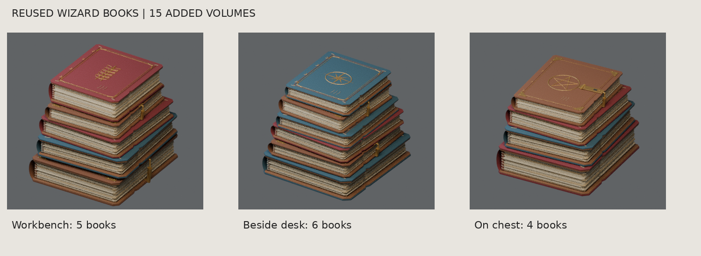
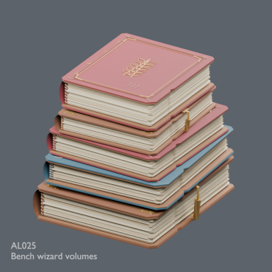
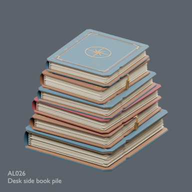
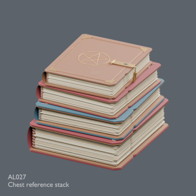

# 錬金術師の作業場

27配布レコード、24設計。末尾3点は既存の魔法使いの本を積み直したグループで、新規書籍の設計ではありません。

各単体ZIPはBLEND・GLB・README・ライセンスを含みます。モデルと必要な同梱材質のみCC0 1.0。記事・作例画像・完成配置シーンは対象外です。
BLENDは単体データのため、一部はFile > Appendでオブジェクト/コレクションを読み込んでください。GLBは微細バンプ等の表現がBlenderと異なることがあります。実機性能は未検証です。

| ID | 元ID | 素材 | 配布 |
|---|---|---|---|
| AL001 | L01 | Stone laboratory bench | [ZIP](https://github.com/k3peta/tales-on-a-table/releases/download/v2026.10.21-alchemist/AL001_CC0.zip) |
| AL002 | L02 | Refractory furnace | [ZIP](https://github.com/k3peta/tales-on-a-table/releases/download/v2026.10.21-alchemist/AL002_CC0.zip) |
| AL003 | L03 | Copper alembic | [ZIP](https://github.com/k3peta/tales-on-a-table/releases/download/v2026.10.21-alchemist/AL003_CC0.zip) |
| AL004 | L04 | Cooling vat | [ZIP](https://github.com/k3peta/tales-on-a-table/releases/download/v2026.10.21-alchemist/AL004_CC0.zip) |
| AL005 | L05 | Reading desk | [ZIP](https://github.com/k3peta/tales-on-a-table/releases/download/v2026.10.21-alchemist/AL005_CC0.zip) |
| AL006 | L06 | Open folio | [ZIP](https://github.com/k3peta/tales-on-a-table/releases/download/v2026.10.21-alchemist/AL006_CC0.zip) |
| AL007 | L07 | Assayers balance | [ZIP](https://github.com/k3peta/tales-on-a-table/releases/download/v2026.10.21-alchemist/AL007_CC0.zip) |
| AL008 | L08 | Green reagent bottle | [ZIP](https://github.com/k3peta/tales-on-a-table/releases/download/v2026.10.21-alchemist/AL008_CC0.zip) |
| AL009 | L09 | Small reagent bottle | [ZIP](https://github.com/k3peta/tales-on-a-table/releases/download/v2026.10.21-alchemist/AL009_CC0.zip) |
| AL010 | L10 | Glass retort | [ZIP](https://github.com/k3peta/tales-on-a-table/releases/download/v2026.10.21-alchemist/AL010_CC0.zip) |
| AL011 | L11 | Mortar pestle | [ZIP](https://github.com/k3peta/tales-on-a-table/releases/download/v2026.10.21-alchemist/AL011_CC0.zip) |
| AL012 | L12 | Mineral sample tray | [ZIP](https://github.com/k3peta/tales-on-a-table/releases/download/v2026.10.21-alchemist/AL012_CC0.zip) |
| AL013 | L13 | Copper funnel | [ZIP](https://github.com/k3peta/tales-on-a-table/releases/download/v2026.10.21-alchemist/AL013_CC0.zip) |
| AL014 | L14 | Bellows | [ZIP](https://github.com/k3peta/tales-on-a-table/releases/download/v2026.10.21-alchemist/AL014_CC0.zip) |
| AL015 | L15 | Long tongs | [ZIP](https://github.com/k3peta/tales-on-a-table/releases/download/v2026.10.21-alchemist/AL015_CC0.zip) |
| AL016 | L16 | Storage chest | [ZIP](https://github.com/k3peta/tales-on-a-table/releases/download/v2026.10.21-alchemist/AL016_CC0.zip) |
| AL017 | L17 | Bound volumes | [ZIP](https://github.com/k3peta/tales-on-a-table/releases/download/v2026.10.21-alchemist/AL017_CC0.zip) |
| AL018 | L18 | Ink and quill | [ZIP](https://github.com/k3peta/tales-on-a-table/releases/download/v2026.10.21-alchemist/AL018_CC0.zip) |
| AL019 | L19 | Stool | [ZIP](https://github.com/k3peta/tales-on-a-table/releases/download/v2026.10.21-alchemist/AL019_CC0.zip) |
| AL020 | L20 | Crucibles | [ZIP](https://github.com/k3peta/tales-on-a-table/releases/download/v2026.10.21-alchemist/AL020_CC0.zip) |
| AL021 | L21 | Copper ladle | [ZIP](https://github.com/k3peta/tales-on-a-table/releases/download/v2026.10.21-alchemist/AL021_CC0.zip) |
| AL022 | L22 | Wall instrument chart | [ZIP](https://github.com/k3peta/tales-on-a-table/releases/download/v2026.10.21-alchemist/AL022_CC0.zip) |
| AL023 | L23 | Bucket | [ZIP](https://github.com/k3peta/tales-on-a-table/releases/download/v2026.10.21-alchemist/AL023_CC0.zip) |
| AL024 | L24 | Hourglass | [ZIP](https://github.com/k3peta/tales-on-a-table/releases/download/v2026.10.21-alchemist/AL024_CC0.zip) |
| AL025 | L25 | Bench wizard volumes | [ZIP](https://github.com/k3peta/tales-on-a-table/releases/download/v2026.10.21-alchemist/AL025_CC0.zip) |
| AL026 | L26 | Desk side book pile | [ZIP](https://github.com/k3peta/tales-on-a-table/releases/download/v2026.10.21-alchemist/AL026_CC0.zip) |
| AL027 | L27 | Chest reference stack | [ZIP](https://github.com/k3peta/tales-on-a-table/releases/download/v2026.10.21-alchemist/AL027_CC0.zip) |

## 作例・カタログ画像

画像は単体のすべてを示す保証ではありません。完成シーンは配布対象外です。画像にモデル用CC0を適用しません。

[Release](https://github.com/k3peta/tales-on-a-table/releases/tag/v2026.10.21-alchemist) · [SHA256](../releases/alchemist/SHA256SUMS.txt) · [License](../LICENSE.md)

## Individual images / 個別画像 / 单件图片

Actual distributed models; chosen camera view does not establish intended front or placement pivot. Images are outside model CC0. Original links and archives retained.

### AL001 — Stone laboratory bench

Stone laboratory bench

[Full image](../previews/apiary-alchemy24/renders/AL001.png) · [ZIP · BLEND/GLB](https://github.com/k3peta/tales-on-a-table/releases/download/v2026.10.21-alchemist/AL001_CC0.zip)

### AL002 — Refractory furnace

Refractory furnace

[Full image](../previews/apiary-alchemy24/renders/AL002.png) · [ZIP · BLEND/GLB](https://github.com/k3peta/tales-on-a-table/releases/download/v2026.10.21-alchemist/AL002_CC0.zip)

### AL003 — Copper alembic

Copper alembic

[Full image](../previews/apiary-alchemy24/renders/AL003.png) · [ZIP · BLEND/GLB](https://github.com/k3peta/tales-on-a-table/releases/download/v2026.10.21-alchemist/AL003_CC0.zip)

### AL004 — Cooling vat

Cooling vat

[Full image](../previews/apiary-alchemy24/renders/AL004.png) · [ZIP · BLEND/GLB](https://github.com/k3peta/tales-on-a-table/releases/download/v2026.10.21-alchemist/AL004_CC0.zip)

### AL005 — Reading desk

Reading desk

[Full image](../previews/apiary-alchemy24/renders/AL005.png) · [ZIP · BLEND/GLB](https://github.com/k3peta/tales-on-a-table/releases/download/v2026.10.21-alchemist/AL005_CC0.zip)

### AL006 — Open folio

Open folio

[Full image](../previews/apiary-alchemy24/renders/AL006.png) · [ZIP · BLEND/GLB](https://github.com/k3peta/tales-on-a-table/releases/download/v2026.10.21-alchemist/AL006_CC0.zip)

### AL007 — Assayers balance

Assayers balance

[Full image](../previews/apiary-alchemy24/renders/AL007.png) · [ZIP · BLEND/GLB](https://github.com/k3peta/tales-on-a-table/releases/download/v2026.10.21-alchemist/AL007_CC0.zip)

### AL008 — Green reagent bottle

Green reagent bottle

[Full image](../previews/apiary-alchemy24/renders/AL008.png) · [ZIP · BLEND/GLB](https://github.com/k3peta/tales-on-a-table/releases/download/v2026.10.21-alchemist/AL008_CC0.zip)

### AL009 — Small reagent bottle

Small reagent bottle

[Full image](../previews/apiary-alchemy24/renders/AL009.png) · [ZIP · BLEND/GLB](https://github.com/k3peta/tales-on-a-table/releases/download/v2026.10.21-alchemist/AL009_CC0.zip)

### AL010 — Glass retort

Glass retort

[Full image](../previews/apiary-alchemy24/renders/AL010.png) · [ZIP · BLEND/GLB](https://github.com/k3peta/tales-on-a-table/releases/download/v2026.10.21-alchemist/AL010_CC0.zip)

### AL011 — Mortar pestle

Mortar pestle

[Full image](../previews/apiary-alchemy24/renders/AL011.png) · [ZIP · BLEND/GLB](https://github.com/k3peta/tales-on-a-table/releases/download/v2026.10.21-alchemist/AL011_CC0.zip)

### AL012 — Mineral sample tray

Mineral sample tray

[Full image](../previews/apiary-alchemy24/renders/AL012.png) · [ZIP · BLEND/GLB](https://github.com/k3peta/tales-on-a-table/releases/download/v2026.10.21-alchemist/AL012_CC0.zip)

### AL013 — Copper funnel

Copper funnel

[Full image](../previews/apiary-alchemy24/renders/AL013.png) · [ZIP · BLEND/GLB](https://github.com/k3peta/tales-on-a-table/releases/download/v2026.10.21-alchemist/AL013_CC0.zip)

### AL014 — Bellows

Bellows

[Full image](../previews/apiary-alchemy24/renders/AL014.png) · [ZIP · BLEND/GLB](https://github.com/k3peta/tales-on-a-table/releases/download/v2026.10.21-alchemist/AL014_CC0.zip)

### AL015 — Long tongs

Long tongs

[Full image](../previews/apiary-alchemy24/renders/AL015.png) · [ZIP · BLEND/GLB](https://github.com/k3peta/tales-on-a-table/releases/download/v2026.10.21-alchemist/AL015_CC0.zip)

## Individual images / 個別画像 / 单件图片

Actual distributed models; chosen camera view does not establish intended front or placement pivot. Images are outside model CC0. Original links and archives retained.

### AL016 — Storage chest

Storage chest

[Full image](../previews/alchemy-forest14/renders/AL016.png) · [ZIP · BLEND/GLB](https://github.com/k3peta/tales-on-a-table/releases/download/v2026.10.21-alchemist/AL016_CC0.zip)

### AL017 — Bound volumes

Bound volumes

[Full image](../previews/alchemy-forest14/renders/AL017.png) · [ZIP · BLEND/GLB](https://github.com/k3peta/tales-on-a-table/releases/download/v2026.10.21-alchemist/AL017_CC0.zip)

### AL018 — Ink and quill

Ink and quill

[Full image](../previews/alchemy-forest14/renders/AL018.png) · [ZIP · BLEND/GLB](https://github.com/k3peta/tales-on-a-table/releases/download/v2026.10.21-alchemist/AL018_CC0.zip)

### AL019 — Stool

Stool

[Full image](../previews/alchemy-forest14/renders/AL019.png) · [ZIP · BLEND/GLB](https://github.com/k3peta/tales-on-a-table/releases/download/v2026.10.21-alchemist/AL019_CC0.zip)

### AL020 — Crucibles

Crucibles

[Full image](../previews/alchemy-forest14/renders/AL020.png) · [ZIP · BLEND/GLB](https://github.com/k3peta/tales-on-a-table/releases/download/v2026.10.21-alchemist/AL020_CC0.zip)

### AL021 — Copper ladle

Copper ladle

[Full image](../previews/alchemy-forest14/renders/AL021.png) · [ZIP · BLEND/GLB](https://github.com/k3peta/tales-on-a-table/releases/download/v2026.10.21-alchemist/AL021_CC0.zip)

### AL022 — Wall instrument chart

Wall instrument chart

[Full image](../previews/alchemy-forest14/renders/AL022.png) · [ZIP · BLEND/GLB](https://github.com/k3peta/tales-on-a-table/releases/download/v2026.10.21-alchemist/AL022_CC0.zip)

### AL023 — Bucket

Bucket

[Full image](../previews/alchemy-forest14/renders/AL023.png) · [ZIP · BLEND/GLB](https://github.com/k3peta/tales-on-a-table/releases/download/v2026.10.21-alchemist/AL023_CC0.zip)

### AL024 — Hourglass

Hourglass

[Full image](../previews/alchemy-forest14/renders/AL024.png) · [ZIP · BLEND/GLB](https://github.com/k3peta/tales-on-a-table/releases/download/v2026.10.21-alchemist/AL024_CC0.zip)

### AL025 — Bench wizard volumes

Bench wizard volumes

[Full image](../previews/alchemy-forest14/renders/AL025.png) · [ZIP · BLEND/GLB](https://github.com/k3peta/tales-on-a-table/releases/download/v2026.10.21-alchemist/AL025_CC0.zip)

### AL026 — Desk side book pile

Desk side book pile

[Full image](../previews/alchemy-forest14/renders/AL026.png) · [ZIP · BLEND/GLB](https://github.com/k3peta/tales-on-a-table/releases/download/v2026.10.21-alchemist/AL026_CC0.zip)

### AL027 — Chest reference stack

Chest reference stack

[Full image](../previews/alchemy-forest14/renders/AL027.png) · [ZIP · BLEND/GLB](https://github.com/k3peta/tales-on-a-table/releases/download/v2026.10.21-alchemist/AL027_CC0.zip)
