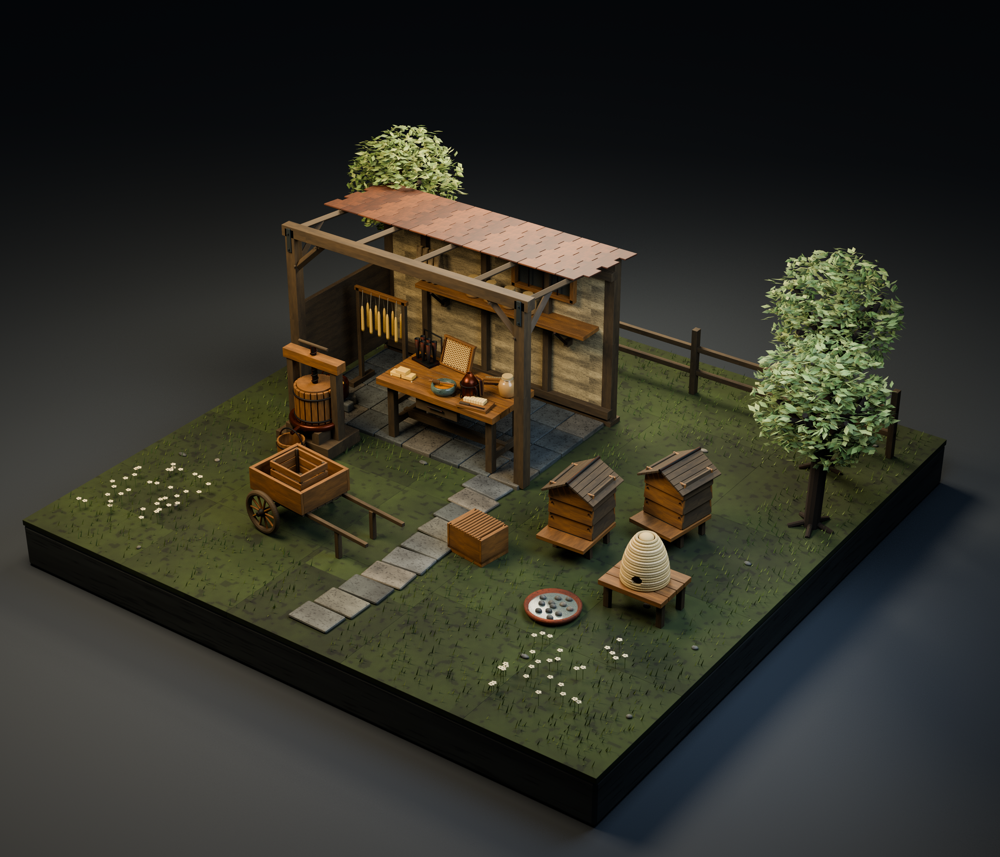

# 森林养蜂小屋

[日本語](apiary.md) · [English](apiary.en.md) · [简体中文](apiary.zh-CN.md)

20个分发条目，20种设计。BLEND和GLB是同一模型的不同格式。

每个单品ZIP包含BLEND、GLB、README和许可条款。CC0 1.0仅适用于模型及必要的附带材质，不涵盖文章、示例图片、完整布置场景和制作代码。部分BLEND为数据资源，请使用File > Append导入对象或集合。GLB中的细微表面效果可能不同。游戏运行性能未经测试。

图片为组合示例，不分发完整场景。

| ID | Asset | ZIP (BLEND + GLB) |
|---|---|---|
| AP001 | Weather lift beehive | [ZIP](https://github.com/k3peta/tales-on-a-table/releases/download/v2026.10.21-apiary/AP001_CC0.zip) |
| AP002 | Open hive body | [ZIP](https://github.com/k3peta/tales-on-a-table/releases/download/v2026.10.21-apiary/AP002_CC0.zip) |
| AP003 | Honeycomb frame | [ZIP](https://github.com/k3peta/tales-on-a-table/releases/download/v2026.10.21-apiary/AP003_CC0.zip) |
| AP004 | Coiled straw skep | [ZIP](https://github.com/k3peta/tales-on-a-table/releases/download/v2026.10.21-apiary/AP004_CC0.zip) |
| AP005 | Copper bee smoker | [ZIP](https://github.com/k3peta/tales-on-a-table/releases/download/v2026.10.21-apiary/AP005_CC0.zip) |
| AP006 | Honey workbench | [ZIP](https://github.com/k3peta/tales-on-a-table/releases/download/v2026.10.21-apiary/AP006_CC0.zip) |
| AP007 | Manual honey press | [ZIP](https://github.com/k3peta/tales-on-a-table/releases/download/v2026.10.21-apiary/AP007_CC0.zip) |
| AP008 | Staved honey pail | [ZIP](https://github.com/k3peta/tales-on-a-table/releases/download/v2026.10.21-apiary/AP008_CC0.zip) |
| AP009 | Honey storage jar | [ZIP](https://github.com/k3peta/tales-on-a-table/releases/download/v2026.10.21-apiary/AP009_CC0.zip) |
| AP010 | Honey dipper bowl | [ZIP](https://github.com/k3peta/tales-on-a-table/releases/download/v2026.10.21-apiary/AP010_CC0.zip) |
| AP011 | Beeswax blocks | [ZIP](https://github.com/k3peta/tales-on-a-table/releases/download/v2026.10.21-apiary/AP011_CC0.zip) |
| AP012 | Candle drying rack | [ZIP](https://github.com/k3peta/tales-on-a-table/releases/download/v2026.10.21-apiary/AP012_CC0.zip) |
| AP013 | Six tube candle mould | [ZIP](https://github.com/k3peta/tales-on-a-table/releases/download/v2026.10.21-apiary/AP013_CC0.zip) |
| AP014 | Wax melting cauldron | [ZIP](https://github.com/k3peta/tales-on-a-table/releases/download/v2026.10.21-apiary/AP014_CC0.zip) |
| AP015 | Hive tool and brush | [ZIP](https://github.com/k3peta/tales-on-a-table/releases/download/v2026.10.21-apiary/AP015_CC0.zip) |
| AP016 | Apiary handcart | [ZIP](https://github.com/k3peta/tales-on-a-table/releases/download/v2026.10.21-apiary/AP016_CC0.zip) |
| AP017 | Frame transport crate | [ZIP](https://github.com/k3peta/tales-on-a-table/releases/download/v2026.10.21-apiary/AP017_CC0.zip) |
| AP018 | Uncapping board | [ZIP](https://github.com/k3peta/tales-on-a-table/releases/download/v2026.10.21-apiary/AP018_CC0.zip) |
| AP019 | Bee water tray | [ZIP](https://github.com/k3peta/tales-on-a-table/releases/download/v2026.10.21-apiary/AP019_CC0.zip) |
| AP020 | Low hive stand | [ZIP](https://github.com/k3peta/tales-on-a-table/releases/download/v2026.10.21-apiary/AP020_CC0.zip) |

[Release](https://github.com/k3peta/tales-on-a-table/releases/tag/v2026.10.21-apiary) · [SHA256](../releases/apiary/SHA256SUMS.txt) · [License](../LICENSE.md)

## Individual images / 個別画像 / 单件图片

Actual distributed models; chosen camera view does not establish intended front or placement pivot. Images are outside model CC0. Original links and archives retained.

### AP001 — Weather lift beehive

Weather lift beehive

[Full image](../previews/mill-terrain-apiary24/renders/AP001.png) · [ZIP · BLEND/GLB](https://github.com/k3peta/tales-on-a-table/releases/download/v2026.10.21-apiary/AP001_CC0.zip)

### AP002 — Open hive body

Open hive body

[Full image](../previews/mill-terrain-apiary24/renders/AP002.png) · [ZIP · BLEND/GLB](https://github.com/k3peta/tales-on-a-table/releases/download/v2026.10.21-apiary/AP002_CC0.zip)

### AP003 — Honeycomb frame

Honeycomb frame

[Full image](../previews/mill-terrain-apiary24/renders/AP003.png) · [ZIP · BLEND/GLB](https://github.com/k3peta/tales-on-a-table/releases/download/v2026.10.21-apiary/AP003_CC0.zip)

### AP004 — Coiled straw skep

Coiled straw skep

[Full image](../previews/mill-terrain-apiary24/renders/AP004.png) · [ZIP · BLEND/GLB](https://github.com/k3peta/tales-on-a-table/releases/download/v2026.10.21-apiary/AP004_CC0.zip)

### AP005 — Copper bee smoker

Copper bee smoker

[Full image](../previews/mill-terrain-apiary24/renders/AP005.png) · [ZIP · BLEND/GLB](https://github.com/k3peta/tales-on-a-table/releases/download/v2026.10.21-apiary/AP005_CC0.zip)

### AP006 — Honey workbench

Honey workbench

[Full image](../previews/mill-terrain-apiary24/renders/AP006.png) · [ZIP · BLEND/GLB](https://github.com/k3peta/tales-on-a-table/releases/download/v2026.10.21-apiary/AP006_CC0.zip)

### AP007 — Manual honey press

Manual honey press

[Full image](../previews/mill-terrain-apiary24/renders/AP007.png) · [ZIP · BLEND/GLB](https://github.com/k3peta/tales-on-a-table/releases/download/v2026.10.21-apiary/AP007_CC0.zip)

### AP008 — Staved honey pail

Staved honey pail

[Full image](../previews/mill-terrain-apiary24/renders/AP008.png) · [ZIP · BLEND/GLB](https://github.com/k3peta/tales-on-a-table/releases/download/v2026.10.21-apiary/AP008_CC0.zip)

### AP009 — Honey storage jar

Honey storage jar

[Full image](../previews/mill-terrain-apiary24/renders/AP009.png) · [ZIP · BLEND/GLB](https://github.com/k3peta/tales-on-a-table/releases/download/v2026.10.21-apiary/AP009_CC0.zip)

### AP010 — Honey dipper bowl

Honey dipper bowl

[Full image](../previews/mill-terrain-apiary24/renders/AP010.png) · [ZIP · BLEND/GLB](https://github.com/k3peta/tales-on-a-table/releases/download/v2026.10.21-apiary/AP010_CC0.zip)

### AP011 — Beeswax blocks

Beeswax blocks

[Full image](../previews/mill-terrain-apiary24/renders/AP011.png) · [ZIP · BLEND/GLB](https://github.com/k3peta/tales-on-a-table/releases/download/v2026.10.21-apiary/AP011_CC0.zip)

## Individual images / 個別画像 / 单件图片

Actual distributed models; chosen camera view does not establish intended front or placement pivot. Images are outside model CC0. Original links and archives retained.

### AP012 — Candle drying rack

Candle drying rack

[Full image](../previews/apiary-alchemy24/renders/AP012.png) · [ZIP · BLEND/GLB](https://github.com/k3peta/tales-on-a-table/releases/download/v2026.10.21-apiary/AP012_CC0.zip)

### AP013 — Six tube candle mould

Six tube candle mould

[Full image](../previews/apiary-alchemy24/renders/AP013.png) · [ZIP · BLEND/GLB](https://github.com/k3peta/tales-on-a-table/releases/download/v2026.10.21-apiary/AP013_CC0.zip)

### AP014 — Wax melting cauldron

Wax melting cauldron

[Full image](../previews/apiary-alchemy24/renders/AP014.png) · [ZIP · BLEND/GLB](https://github.com/k3peta/tales-on-a-table/releases/download/v2026.10.21-apiary/AP014_CC0.zip)

### AP015 — Hive tool and brush

Hive tool and brush

[Full image](../previews/apiary-alchemy24/renders/AP015.png) · [ZIP · BLEND/GLB](https://github.com/k3peta/tales-on-a-table/releases/download/v2026.10.21-apiary/AP015_CC0.zip)

### AP016 — Apiary handcart

Apiary handcart

[Full image](../previews/apiary-alchemy24/renders/AP016.png) · [ZIP · BLEND/GLB](https://github.com/k3peta/tales-on-a-table/releases/download/v2026.10.21-apiary/AP016_CC0.zip)

### AP017 — Frame transport crate

Frame transport crate

[Full image](../previews/apiary-alchemy24/renders/AP017.png) · [ZIP · BLEND/GLB](https://github.com/k3peta/tales-on-a-table/releases/download/v2026.10.21-apiary/AP017_CC0.zip)

### AP018 — Uncapping board

Uncapping board

[Full image](../previews/apiary-alchemy24/renders/AP018.png) · [ZIP · BLEND/GLB](https://github.com/k3peta/tales-on-a-table/releases/download/v2026.10.21-apiary/AP018_CC0.zip)

### AP019 — Bee water tray

Bee water tray

[Full image](../previews/apiary-alchemy24/renders/AP019.png) · [ZIP · BLEND/GLB](https://github.com/k3peta/tales-on-a-table/releases/download/v2026.10.21-apiary/AP019_CC0.zip)

### AP020 — Low hive stand

Low hive stand

[Full image](../previews/apiary-alchemy24/renders/AP020.png) · [ZIP · BLEND/GLB](https://github.com/k3peta/tales-on-a-table/releases/download/v2026.10.21-apiary/AP020_CC0.zip)
