# Walls, floors & architecture 1

[← Asset shelf](../README.en.md)

[日本語](architecture_01.md) · [English](architecture_01.en.md) · [简体中文](architecture_01.zh-CN.md)

## FT_041 — Wooden door and frame

Wooden door and frame from the tavern collection. Unit: one model record. Includes BLEND and GLB. The close-up is rendered from the distributed BLEND.

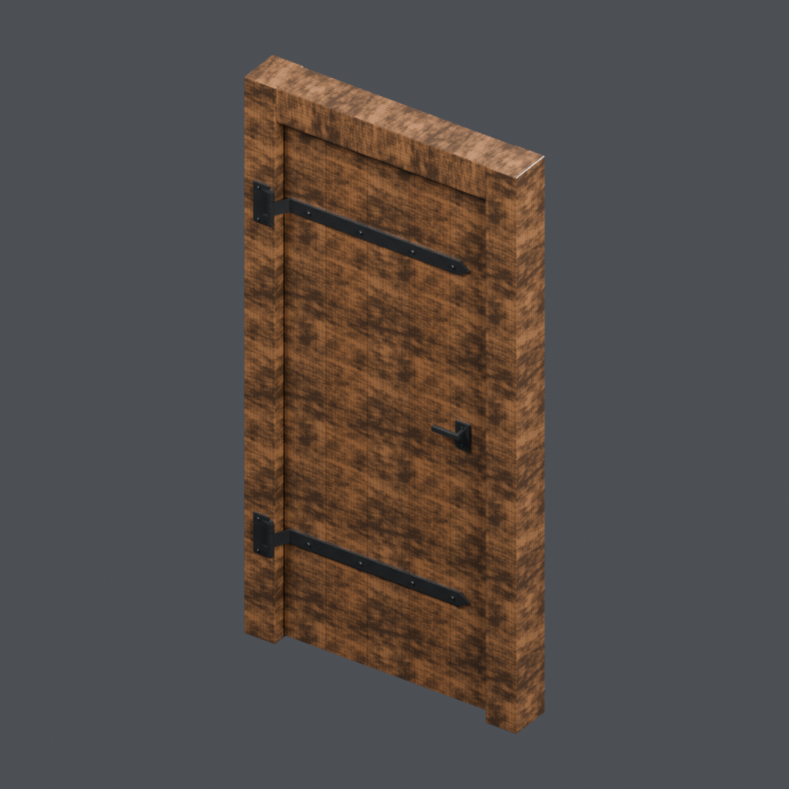

[ZIP · BLEND + GLB · 0.98 MB](https://github.com/k3peta/tales-on-a-table/releases/download/v2026.10.18/FT_041_CC0.zip) · CC0-1.0

`catalog-20261018` · SHA-256: `8d738149479f2f28db093ace553feb7d1d2b0edaccf176080cbcf77045e310f0`

## FT_042 — Leaded-glass window

Leaded-glass window from the tavern collection. Unit: one model record. Includes BLEND and GLB. The close-up is rendered from the distributed BLEND.

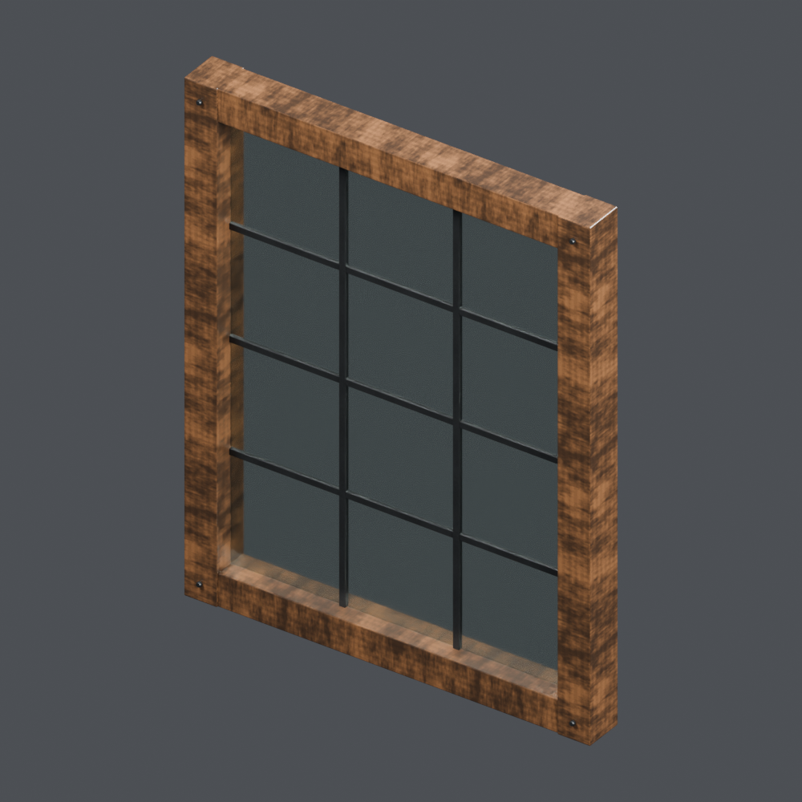

[ZIP · BLEND + GLB · 0.45 MB](https://github.com/k3peta/tales-on-a-table/releases/download/v2026.10.18/FT_042_CC0.zip) · CC0-1.0

`catalog-20261018` · SHA-256: `662bb063ad45ef401f0fa9fd6dbcd72db03d20a17f86a4ae53350abdceff6bab`

## FT_043 — Wooden post and crossbeam

Wooden post and crossbeam from the tavern collection. Unit: one model record. Includes BLEND and GLB. The close-up is rendered from the distributed BLEND.

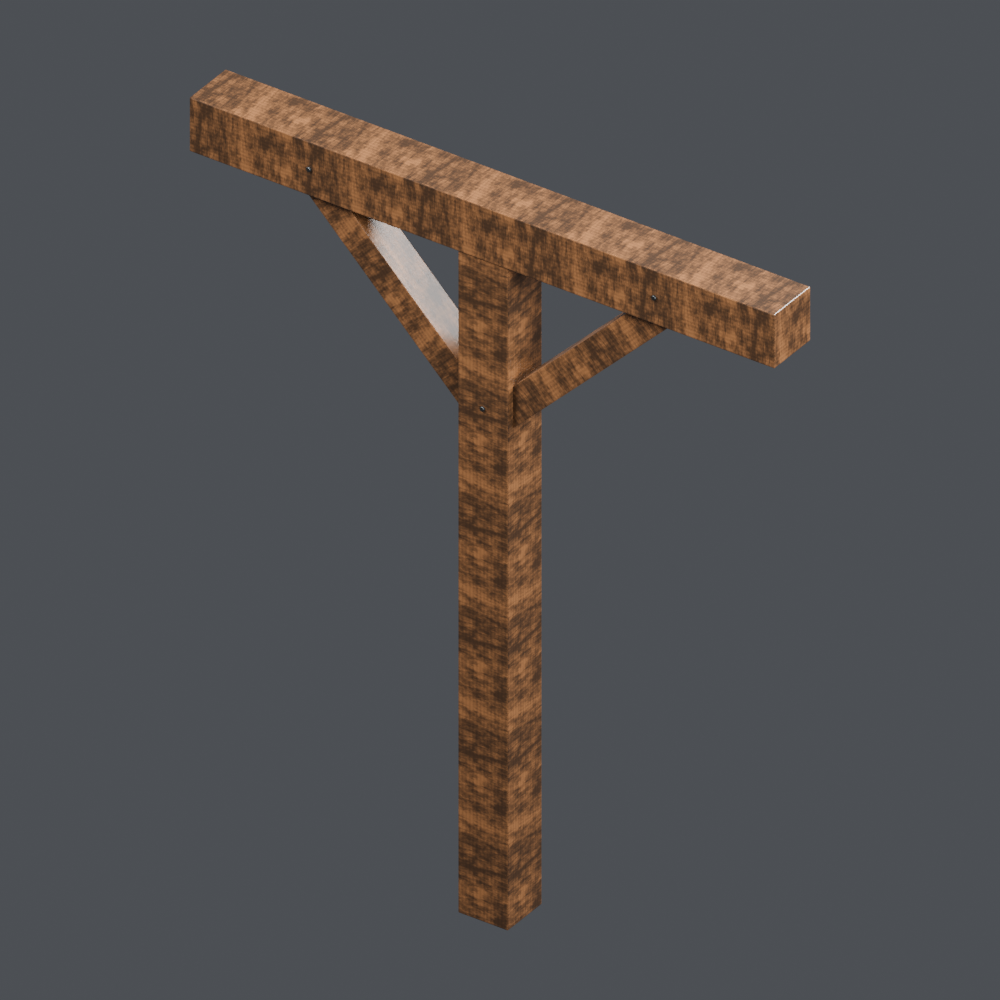

[ZIP · BLEND + GLB · 0.40 MB](https://github.com/k3peta/tales-on-a-table/releases/download/v2026.10.18/FT_043_CC0.zip) · CC0-1.0

`catalog-20261018` · SHA-256: `220521c9f55cba9c500f0c3f43881c63eede2f2d4c33004a8a2b26d8f521ed91`

## FT_044 — Plaster wall with two openings

Plaster wall with two openings from the tavern collection. Unit: one model record. Includes BLEND and GLB. The close-up is rendered from the distributed BLEND.

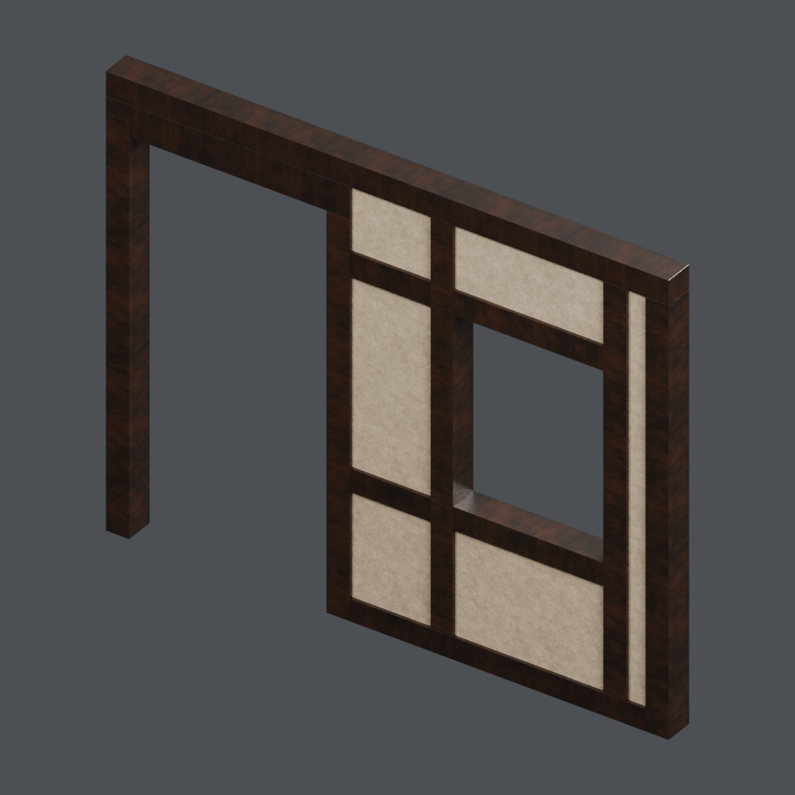

[ZIP · BLEND + GLB · 2.48 MB](https://github.com/k3peta/tales-on-a-table/releases/download/v2026.10.18/FT_044_CC0.zip) · CC0-1.0

`catalog-20261018` · SHA-256: `60a8bf956f64498523747b9d396253f73706613c5bfc879f97f9aada738be38c`

## FT_045 — Wooden floor module

Wooden floor module from the tavern collection. Unit: one model record. Includes BLEND and GLB. The close-up is rendered from the distributed BLEND.

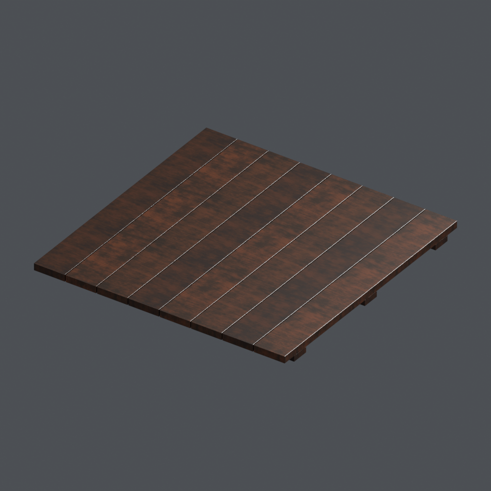

[ZIP · BLEND + GLB · 0.67 MB](https://github.com/k3peta/tales-on-a-table/releases/download/v2026.10.18/FT_045_CC0.zip) · CC0-1.0

`catalog-20261018` · SHA-256: `48dd1cf144f11cb44cdbc1955b98bdf8592d3f7a72044545ad04d6c5e950b97b`

## FT_046 — Stone floor module

Stone floor module from the tavern collection. Unit: one model record. Includes BLEND and GLB. The close-up is rendered from the distributed BLEND.

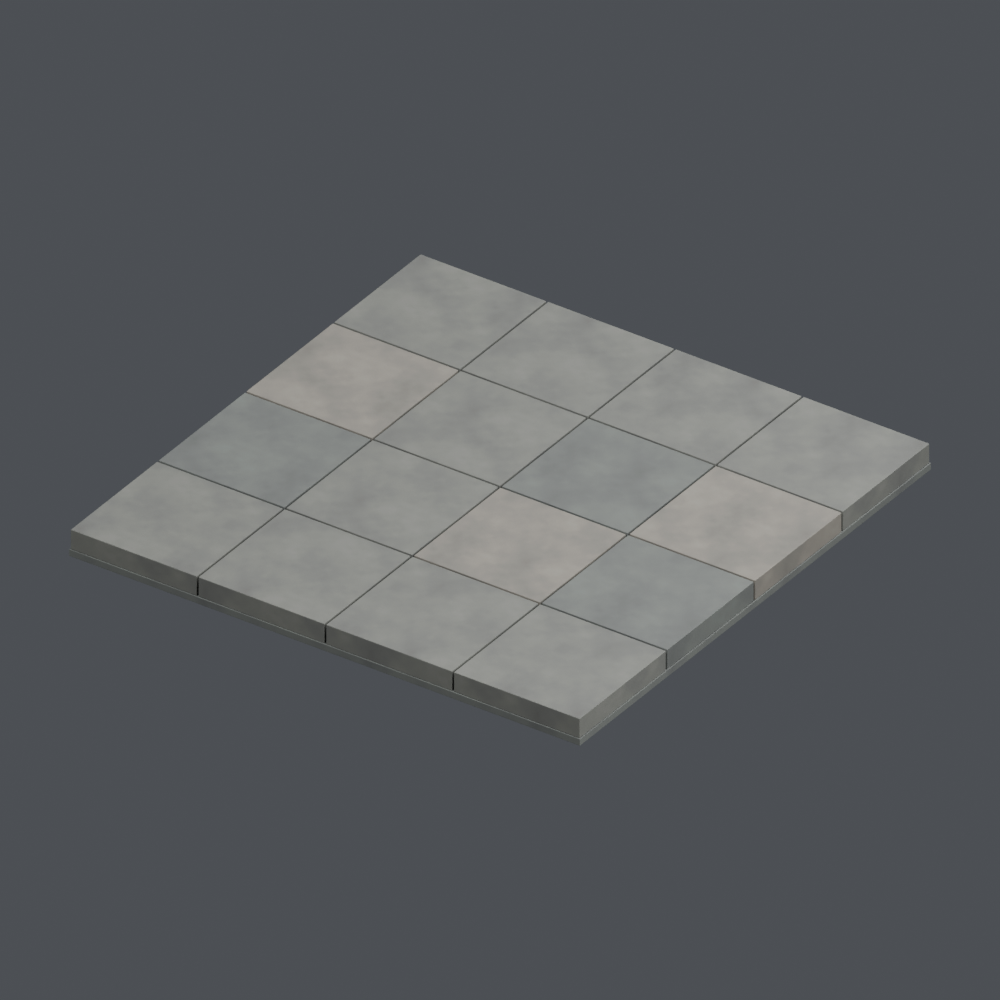

[ZIP · BLEND + GLB · 0.61 MB](https://github.com/k3peta/tales-on-a-table/releases/download/v2026.10.18/FT_046_CC0.zip) · CC0-1.0

`catalog-20261018` · SHA-256: `c273fdb71fd5141a9d9da00f54b516f8c35207d77a884beb38d0e82a972679ba`

## FT_047 — Seven-step wooden staircase

Seven-step wooden staircase from the tavern collection. Unit: one model record. Includes BLEND and GLB. The close-up is rendered from the distributed BLEND.

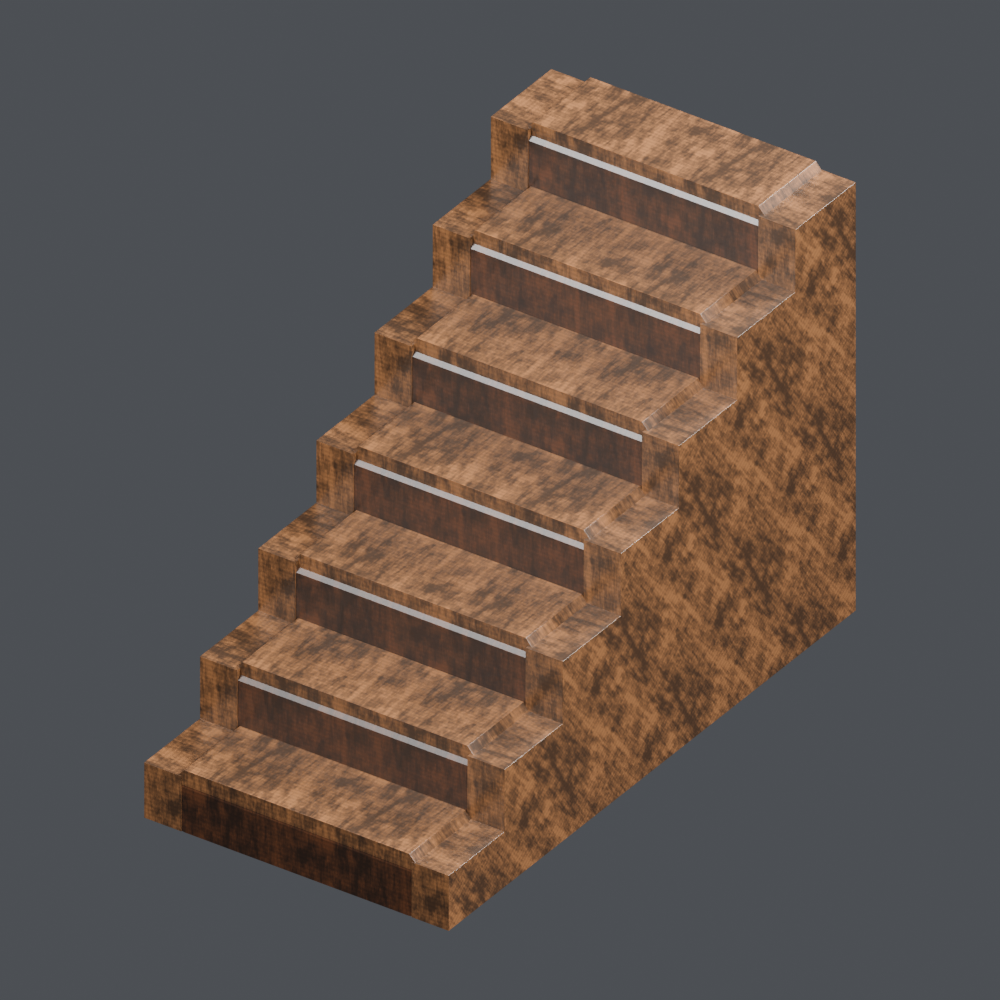

[ZIP · BLEND + GLB · 0.63 MB](https://github.com/k3peta/tales-on-a-table/releases/download/v2026.10.18/FT_047_CC0.zip) · CC0-1.0

`catalog-20261018` · SHA-256: `3874d355354eddf7328b3640f8011cb4b98be6538a7ca8b2ed241d76c110c86c`

## FT_048 — Fixed wooden railing

Fixed wooden railing from the tavern collection. Unit: one model record. Includes BLEND and GLB. The close-up is rendered from the distributed BLEND.

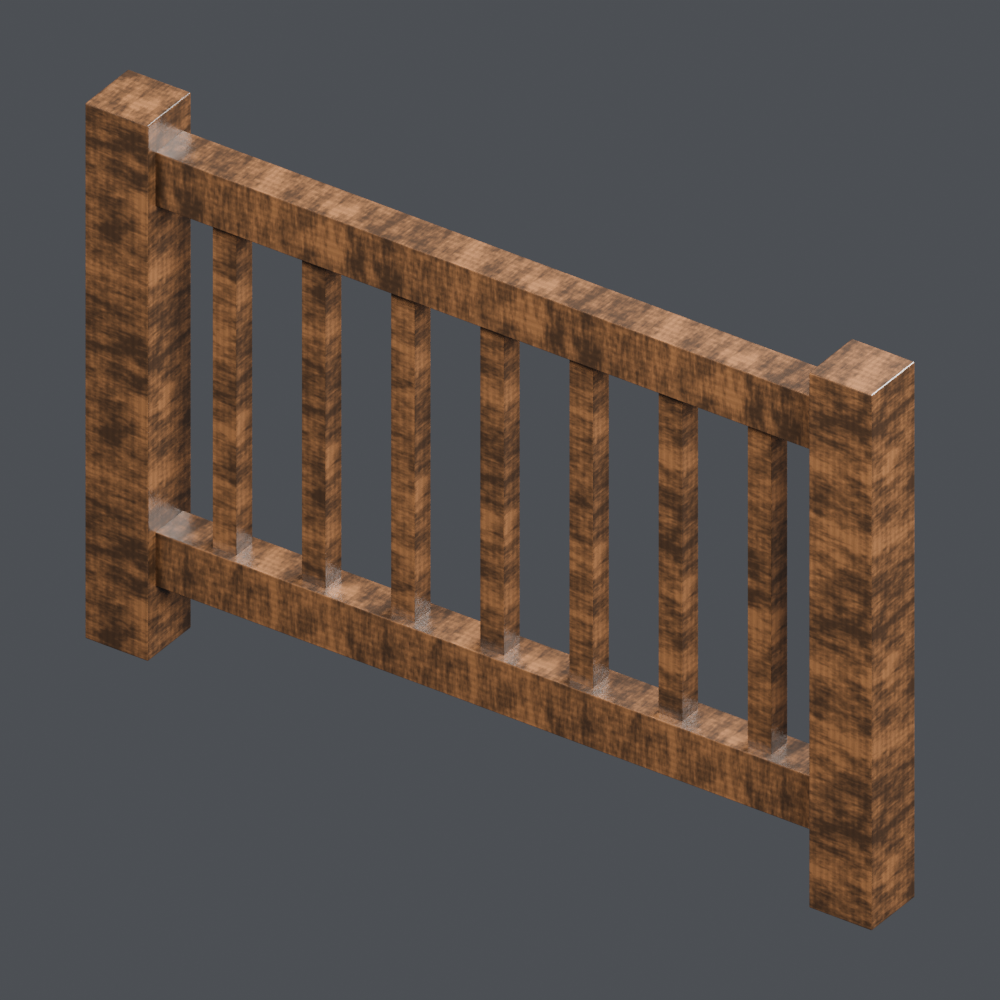

[ZIP · BLEND + GLB · 0.35 MB](https://github.com/k3peta/tales-on-a-table/releases/download/v2026.10.18/FT_048_CC0.zip) · CC0-1.0

`catalog-20261018` · SHA-256: `7064d0d7fe57aefbec7cb15f67ba407fcbb2d0e5a435151f39bc3289f3037d3a`

## FH_006 — Straight 2 m seawall section

Straight 2 m seawall section from the harbor collection. Unit: one model record. Includes BLEND and GLB. The close-up is rendered from the distributed BLEND.

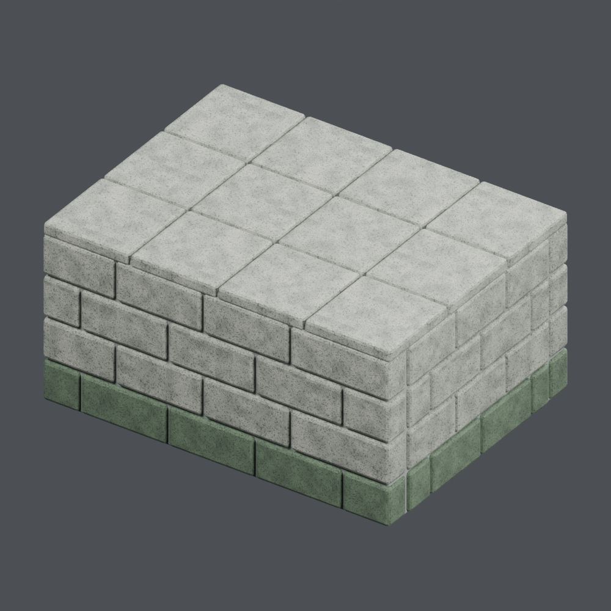

[ZIP · BLEND + GLB · 8.19 MB](https://github.com/k3peta/tales-on-a-table/releases/download/v2026.10.18/FH_006_CC0.zip) · CC0-1.0

`catalog-20261018` · SHA-256: `6a1f501fbd0707dd2b5649729d66851e67c1bd7d9e10ad11177d564c1db3139f`

## FH_007 — Right-angle seawall corner

Right-angle seawall corner from the harbor collection. Unit: one model record. Includes BLEND and GLB. The close-up is rendered from the distributed BLEND.

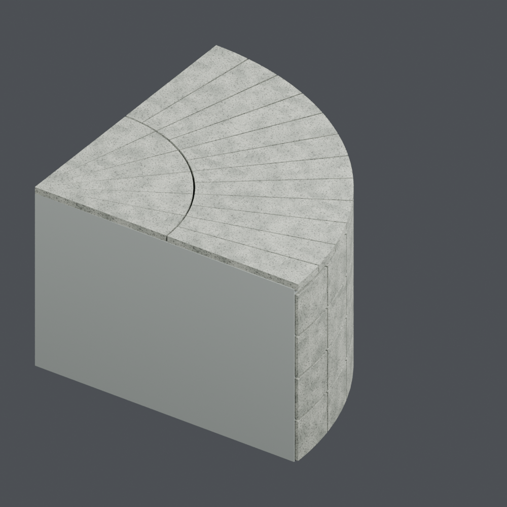

[ZIP · BLEND + GLB · 4.81 MB](https://github.com/k3peta/tales-on-a-table/releases/download/v2026.10.18/FH_007_CC0.zip) · CC0-1.0

`catalog-20261018` · SHA-256: `79d5a1c16b5a8b14771e9aa78f0e9ff9fbacdb8b19098b7790441ed41656c6e0`

## FH_008 — Rounded seawall end

Rounded seawall end from the harbor collection. Unit: one model record. Includes BLEND and GLB. The close-up is rendered from the distributed BLEND.

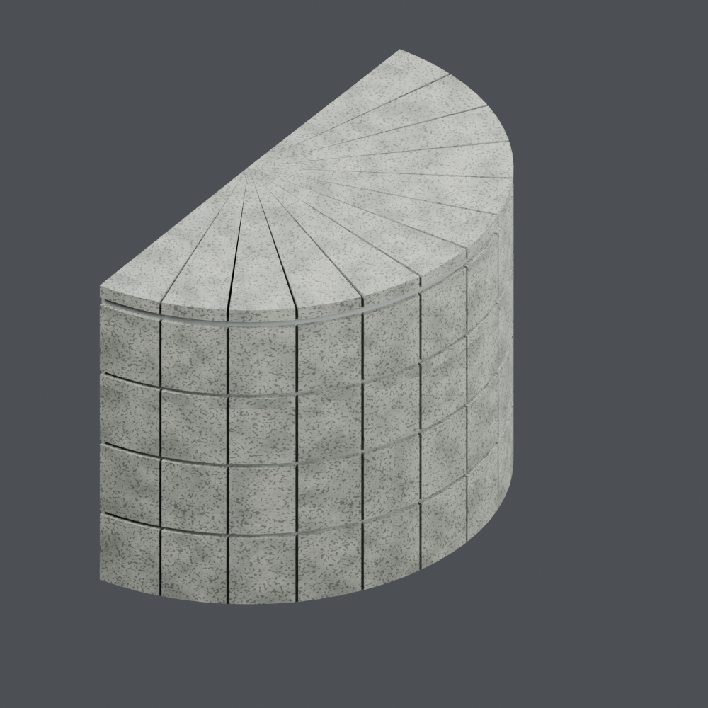

[ZIP · BLEND + GLB · 4.81 MB](https://github.com/k3peta/tales-on-a-table/releases/download/v2026.10.18/FH_008_CC0.zip) · CC0-1.0

`catalog-20261018` · SHA-256: `1192a8d0a7624b3eda89e78bc4cf1e26a49093e7c32953aeb3724d8c9431dd12`

## FH_009 — 2 m paved quay section

2 m paved quay section from the harbor collection. Unit: one model record. Includes BLEND and GLB. The close-up is rendered from the distributed BLEND.

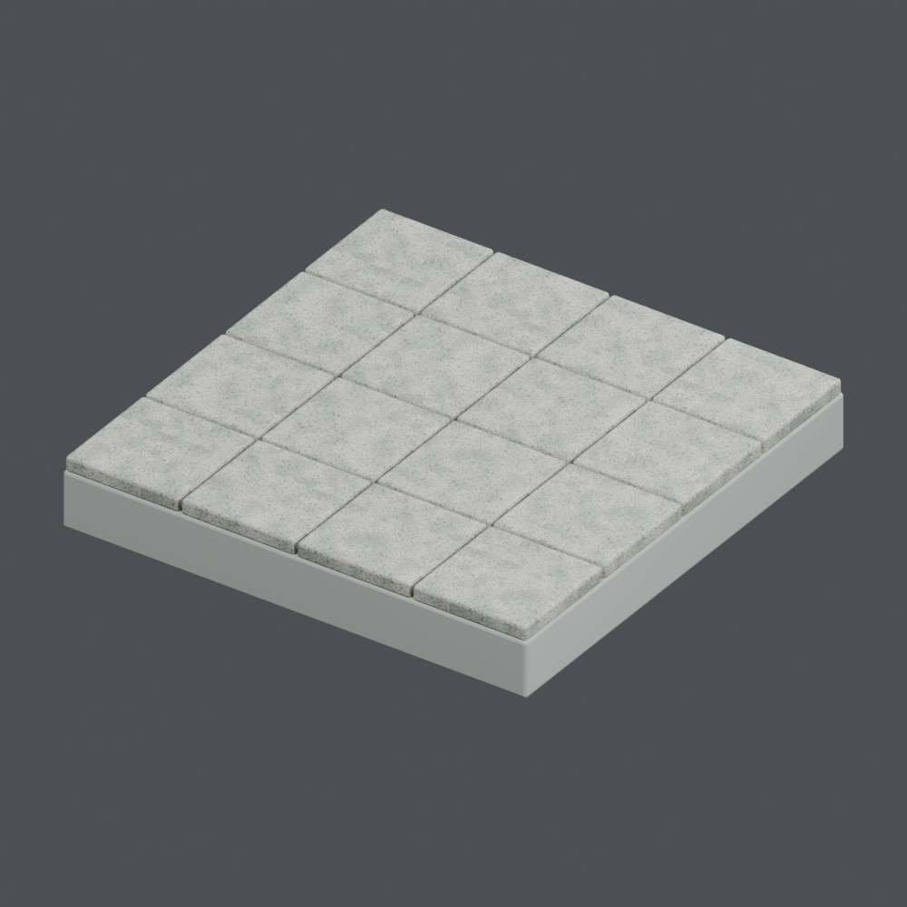

[ZIP · BLEND + GLB · 4.79 MB](https://github.com/k3peta/tales-on-a-table/releases/download/v2026.10.18/FH_009_CC0.zip) · CC0-1.0

`catalog-20261018` · SHA-256: `07f225e78a4f9ff53aa7bce6a012e34c2c2f620d236b6df333641d72c71a6d0e`

## FH_010 — Tide-wet landing steps

Tide-wet landing steps from the harbor collection. Unit: one model record. Includes BLEND and GLB. The close-up is rendered from the distributed BLEND.

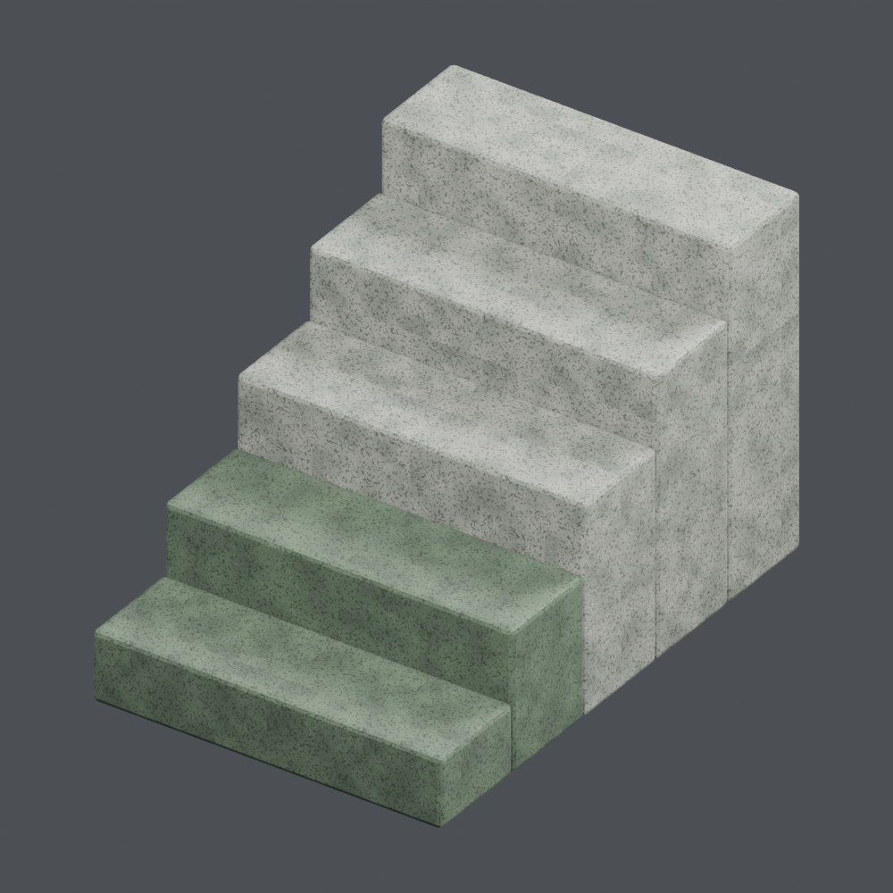

[ZIP · BLEND + GLB · 8.08 MB](https://github.com/k3peta/tales-on-a-table/releases/download/v2026.10.18/FH_010_CC0.zip) · CC0-1.0

`catalog-20261018` · SHA-256: `dd8ed8a0ff0231188d3801ffb7aaeec0c0a9951cf7ce4bb72e2d759159649cb9`

## FH_011 — Low seaward parapet

Low seaward parapet from the harbor collection. Unit: one model record. Includes BLEND and GLB. The close-up is rendered from the distributed BLEND.

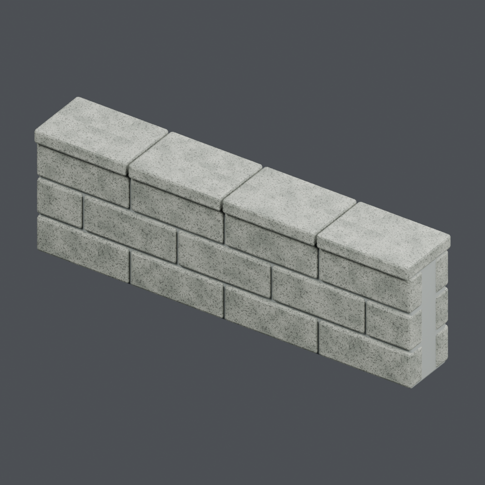

[ZIP · BLEND + GLB · 4.82 MB](https://github.com/k3peta/tales-on-a-table/releases/download/v2026.10.18/FH_011_CC0.zip) · CC0-1.0

`catalog-20261018` · SHA-256: `36ca9eb65b7ff1fd8a8c63f491603298c23b9e6914876c0fa0c68c877c37d305`

## FH_013 — Stone-mounted mooring ring

Stone-mounted mooring ring from the harbor collection. Unit: one model record. Includes BLEND and GLB. The close-up is rendered from the distributed BLEND.

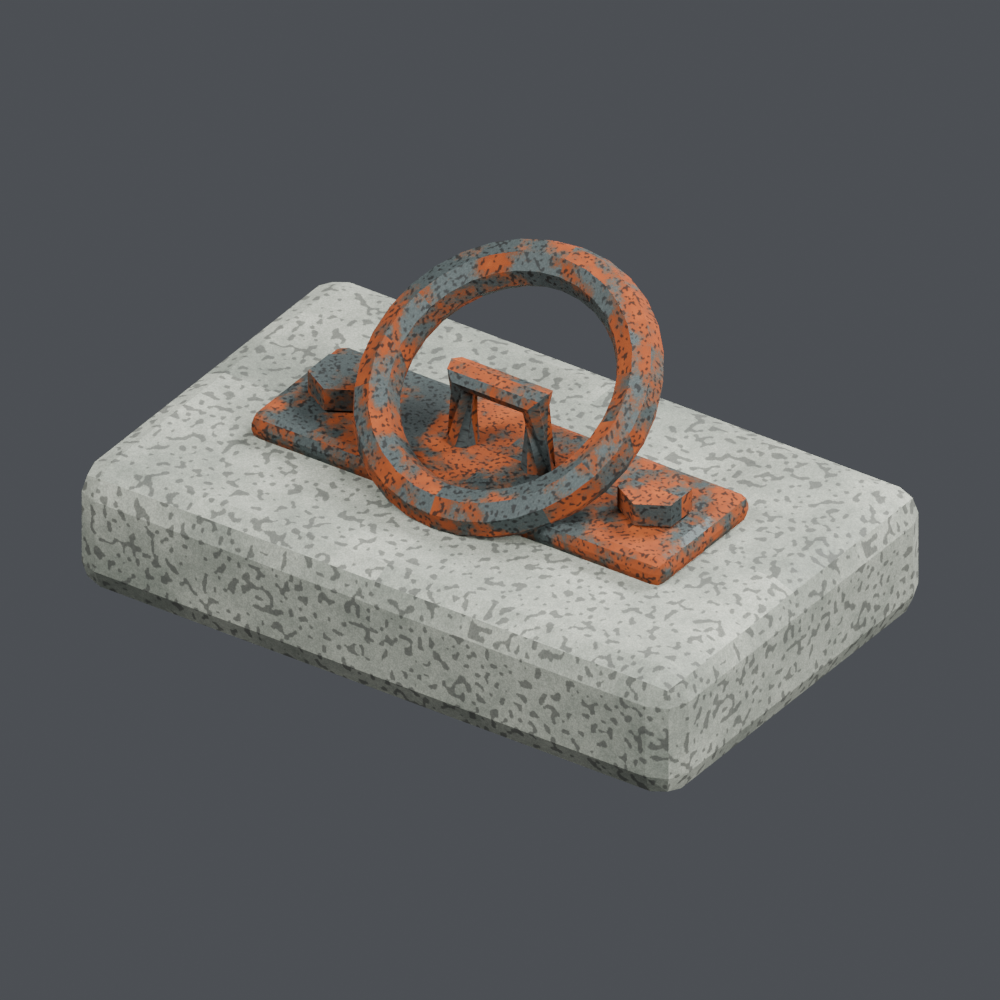

[ZIP · BLEND + GLB · 10.01 MB](https://github.com/k3peta/tales-on-a-table/releases/download/v2026.10.18/FH_013_CC0.zip) · CC0-1.0

`catalog-20261018` · SHA-256: `09006871610540cd45db7133692787a10b5721bdbecf967d60e2957ae03e7219`

## FH_014 — Wooden quay ladder

Wooden quay ladder from the harbor collection. Unit: one model record. Includes BLEND and GLB. The close-up is rendered from the distributed BLEND.

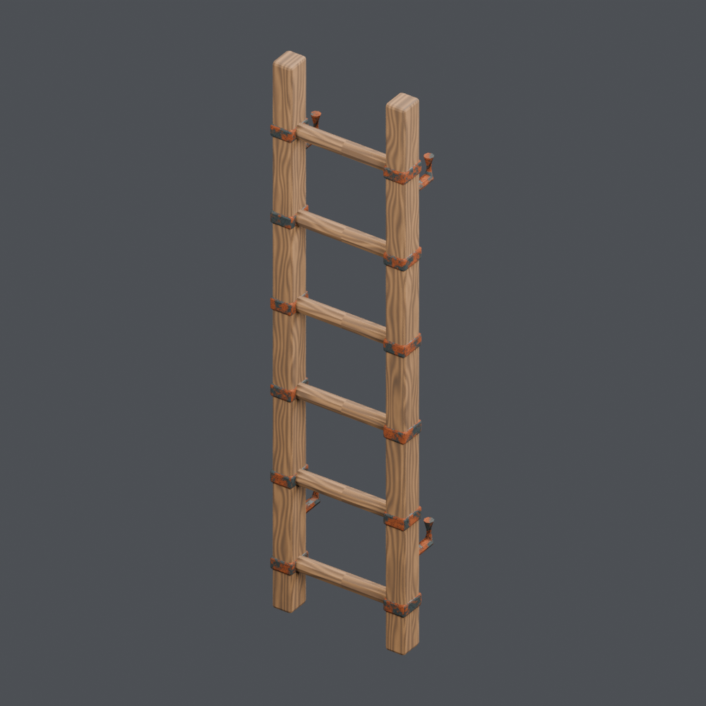

[ZIP · BLEND + GLB · 10.45 MB](https://github.com/k3peta/tales-on-a-table/releases/download/v2026.10.18/FH_014_CC0.zip) · CC0-1.0

`catalog-20261018` · SHA-256: `dddc0263e796f52b95332257a7201f761732cf8879cb14220434ab2388bf06cc`
