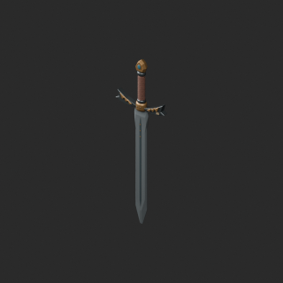
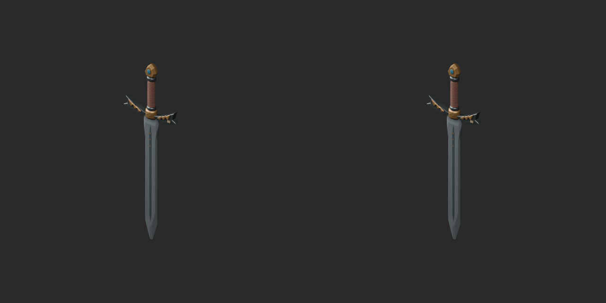
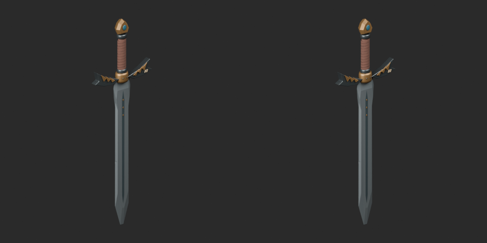
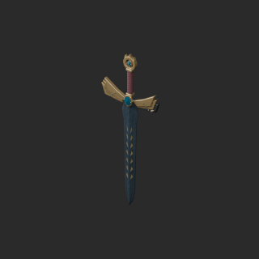
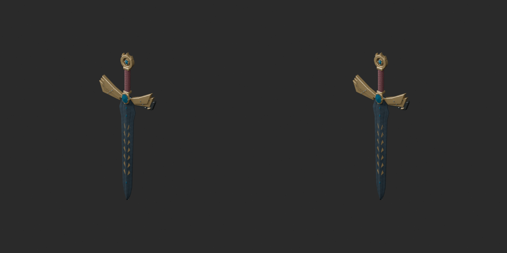
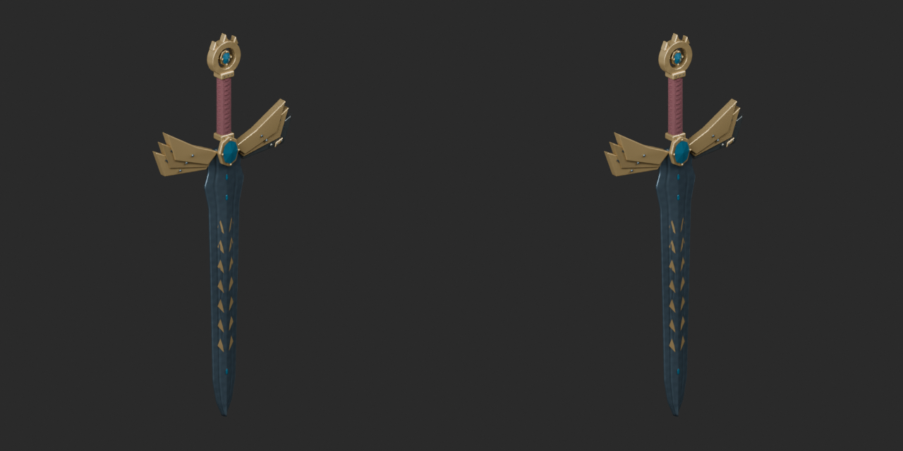

# ARM001/003 vertex-color correction v2 / 頂点色訂正版 / 顶点色修正版

Two revisions; base1008 and variants145 unchanged. Public retrieval pending: prior repairs remain withdrawn.

Originals contain zero-area defects. Quality37 repairs dropped vertex colors; regression now rejects both old BLEND and GLB (four files). V2 preserves oriented triangle corner colors and positions on surviving surfaces, removing only42/96 zero-area faces. ARM00341808 triangles remains over budget.

旧版は削除せず履歴保持。旧修復は両形式で頂点色欠落を確認。訂正版のみ公開再取得後に解除します。仅v2通过公开下载校验后解除暂停；旧版仍不推荐。

Impact scan:121 published-hash-matched revision records:2 missing COLOR_0,119 had no source vertex colors. This scan concerns GLB attribute presence by named objects, not full color-value/BLEND validation of119 or all1008 records. Targeted v2 checks cover both formats. Assessed376/remain632/budget87 unchanged. No gameplay/collision/load/oldBlender approval.

Models/embedded materials CC0 only; images separate catalogue-use artwork. [License](../LICENSE.md).

## ARM_001__repair_color_v2

竜翼鍔の旅剣 · 竜翼鍔の旅剣

[ZIP BLEND/GLB](https://raw.githubusercontent.com/k3peta/tales-on-a-table/main/distributions/quality-arm001-003-color-correction-v2/ARM_001__repair_color_v2_CC0.zip)

Original and v2 under matching camera/light; prior failure comparison independently inspected in format sheets.

## ARM_003__repair_color_v2

海門守護の伝説剣 · 海門守護の伝説剣

[ZIP BLEND/GLB](https://raw.githubusercontent.com/k3peta/tales-on-a-table/main/distributions/quality-arm001-003-color-correction-v2/ARM_003__repair_color_v2_CC0.zip)

Original and v2 under matching camera/light; prior failure comparison independently inspected in format sheets.
