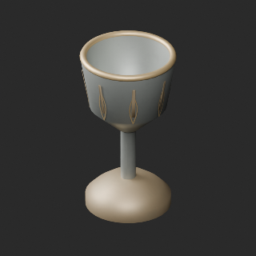
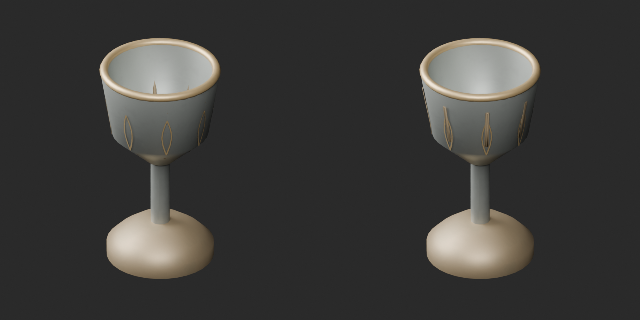

# AT042 cup ornament revision / 杯の装飾面修復 / 杯饰修订

**Final ZIP guard passed; matching the public-download artifact is pending. One revision, zero new models/variants/images-covered IDs.**

Long ornament faces crossed the curved cup wall even though their original vertices lay outside the cavity. Exterior brass ornament was subdivided and seated along the outer wall. Producer sampled surface intrusion1044→0; triangles7076→8356, bounds error0, boundary edges0→0. This is a geometry revision with interpolated ornament UV, not a same-geometry color variant. Sampling is not an exhaustive proof of every intersection.

長い装飾面が杯内へ貫通する問題を修復。頂点だけの検査では発見できない面の貫通でした。面分割と外壁沿い配置で検査標本の貫通1044→0、原寸法保持。旧版・試行を保全し新規件数は加算しません。AT050軽量化候補は陰影悪化で棄却、公開せず未修復維持。

长装饰面穿入杯内，细分后沿外壁贴合。抽样侵入1044→0，不是全交叉穷尽证明。原版保留；AT050减面候选未采用、不发布。

Guard binds final ZIP/member hashes, input/script hashes, unique run ID, start/end time and Blender version/build. Synthetic stale-hash test is not geometry evidence; this package has actual BLEND/GLB numerical results. Original geometry files preserved. No function, strength, collision or Blender4.3.2 compatibility guarantee. Models/embedded materials CC0; preview images and code excluded.

## AT_042__repair

[Revised ZIP](https://raw.githubusercontent.com/k3peta/tales-on-a-table/main/distributions/quality-at042-section-v1/AT_042__repair_CC0.zip)

