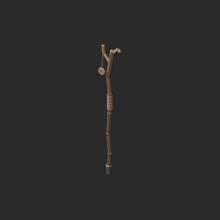
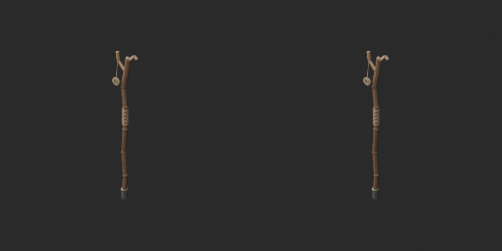
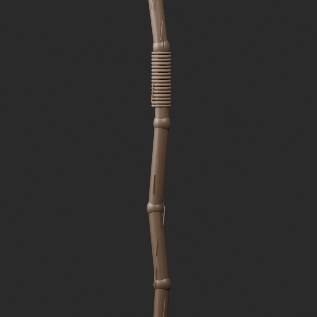
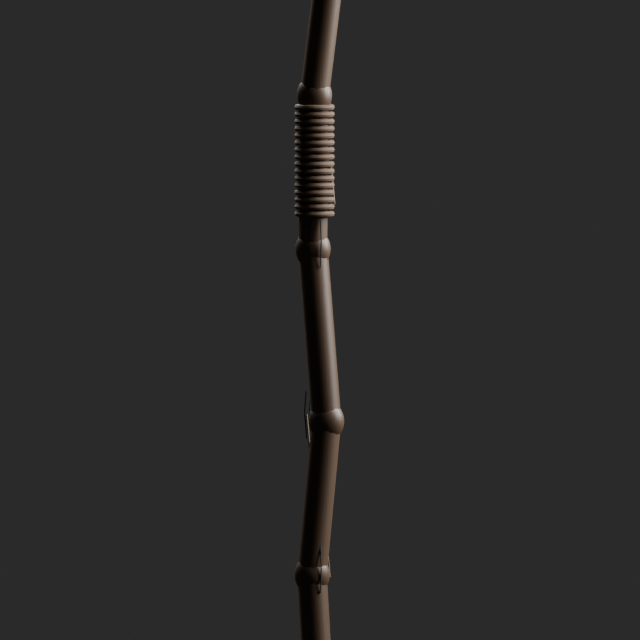
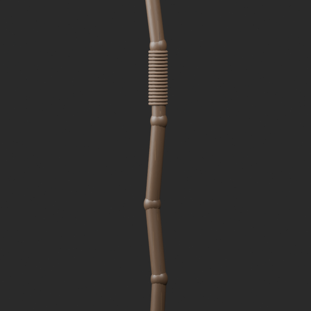

# AT067 scratch revision / 傷装飾の修復 / 划痕装饰修订

**Final ZIP guard passed; exact public-download ZIP and internal model hashes independently matched. One revision, no base/variant/full-audit increment.**

42 detached body-scratch components, up to22.225mm from the wooden surface, were replaced with open decorative surface ribbons whose tested vertices lie within0.2mm of the wood. Scratch geometry and UV changed: original geometry/UV invariance is NOT claimed. Non-scratch parts retained by construction. Intentional open decorative boundaries are not holes in the staff body. Initial nearest-vertex projection produced degenerate faces and was rejected before export.

木面から最大22.225mm離れた傷42部品を、検査頂点が表面から0.2mm以内にある装飾面に置換。傷の形状・UVは変更しており同形variantではありません。初回の退化面を生じた試作は不採用。元の傷以外の部品と旧版は保持。接写前後を確認。21,548→21,140三角形ですが予算超過は解消せず、未修復予算・再設計44件を維持します。

42个悬浮划痕改为表面装饰带，划痕几何和UV已改变，不是同形变体。三角形21548→21140仍超预算。原版和失败试验保留；未修复预算问题44项不变。

Guard binds final ZIP/member/input/verifier hashes, run ID, time and Blender version. Producer final-ZIP numerical tests are checked against exact public artifacts; publication does not claim a separate Blender rerun. Cumulative assessment246 remains unchanged,762 unassessed. Function, collision and Blender4.3.2 compatibility unverified. Model/material CC0 only; images and code excluded.

## AT_067__repair

[Revised ZIP](https://raw.githubusercontent.com/k3peta/tales-on-a-table/main/distributions/quality-at067-scratch-repair-v1/AT_067__repair_CC0.zip)

### original_before_front

### original_before_rear

### repaired_before_front

### repaired_before_rear

[Bound ZIP/model hashes, run ID and numerical results](../distributions/quality-at067-scratch-repair-v1/validation.json). Producer geometry tests were not independently rerun here; the public artifact identity was independently verified.
