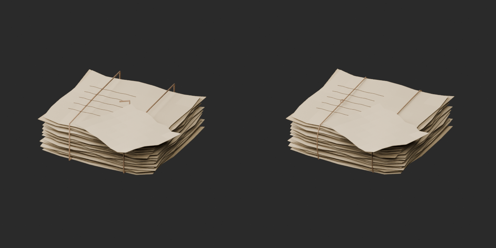
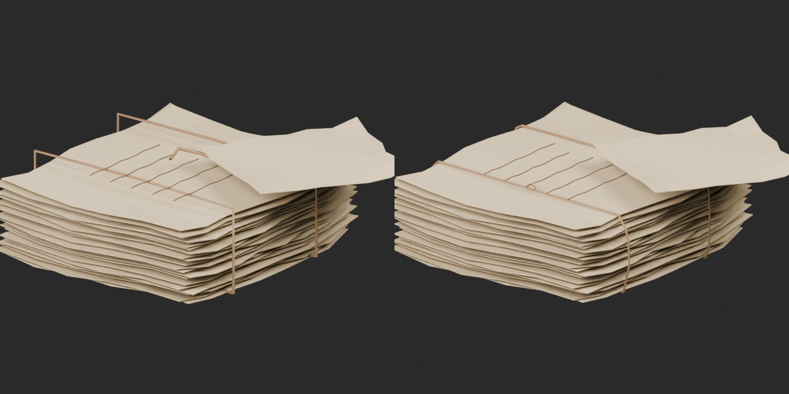
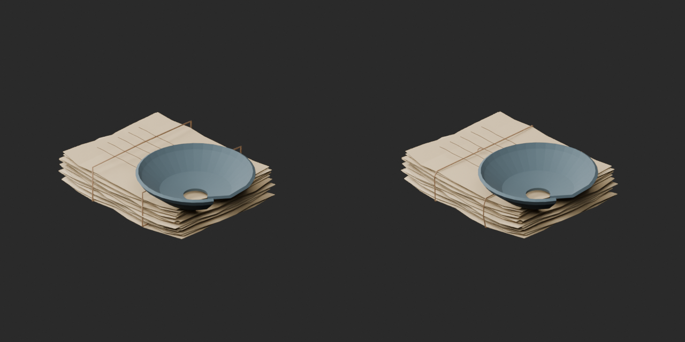
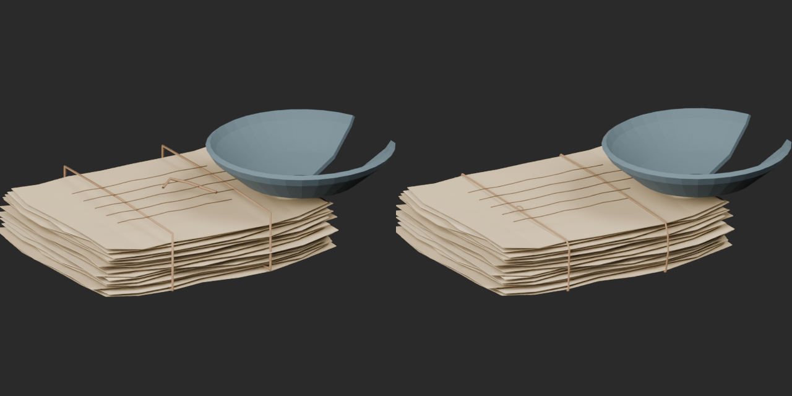
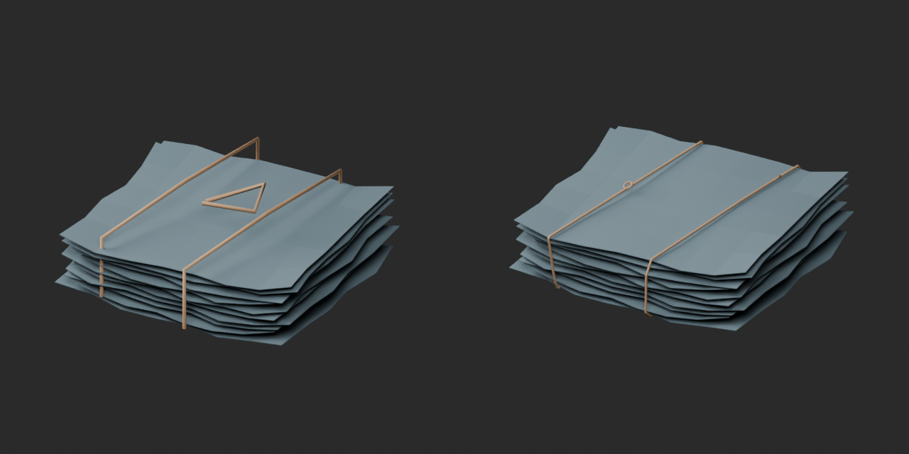
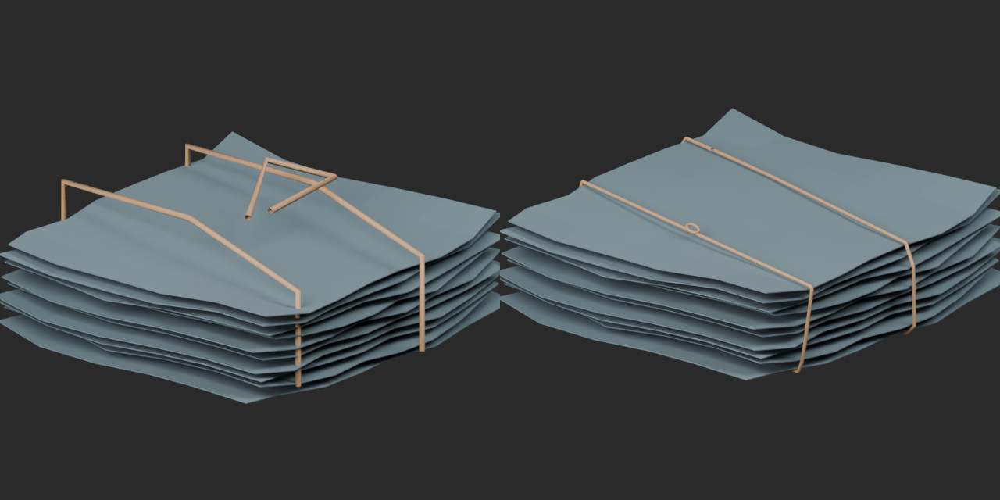
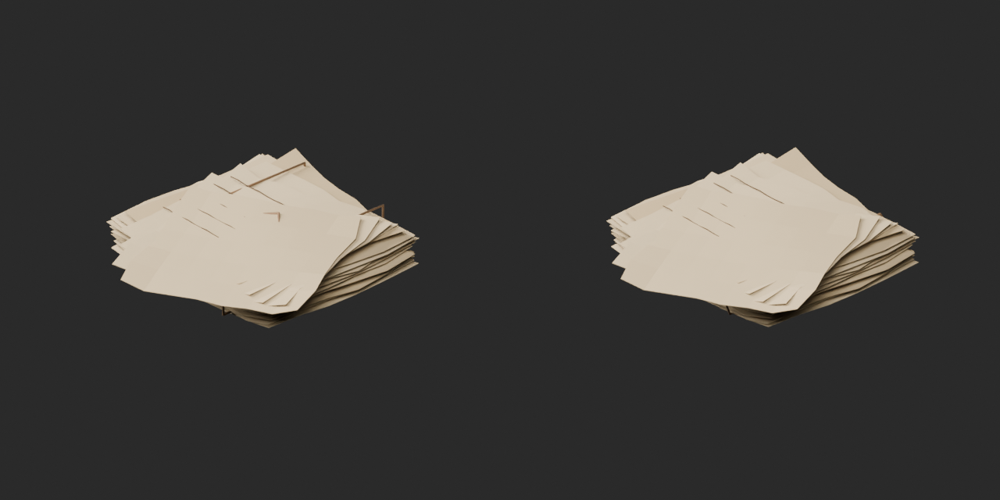
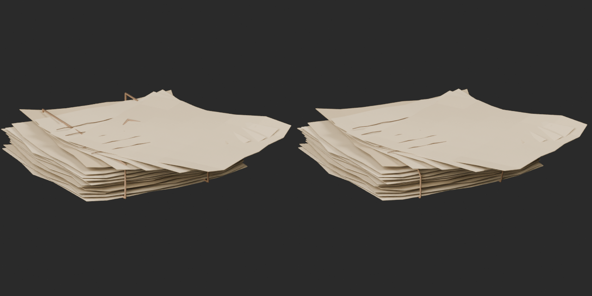
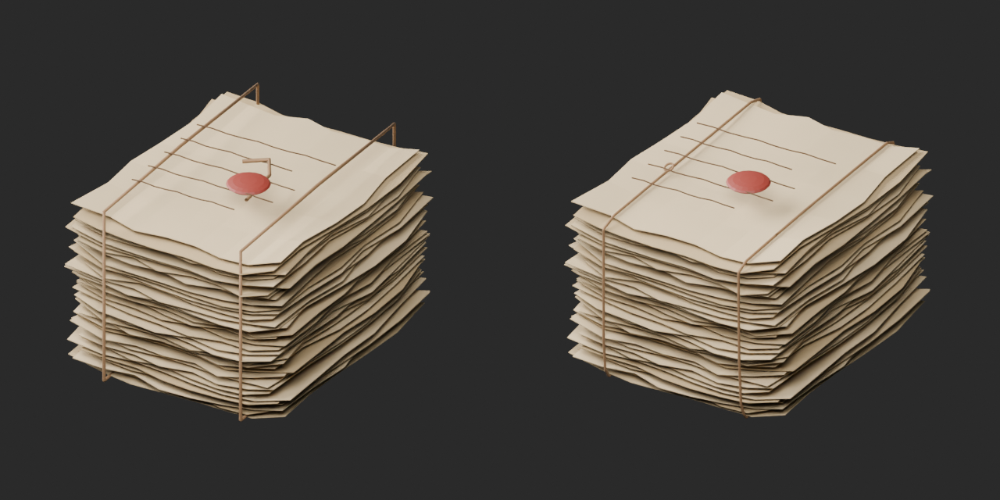
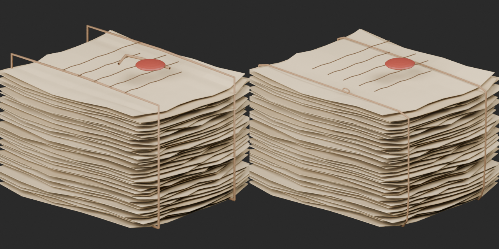

# Binding revisions / 結束紐の改訂 / 捆绳修订

Five geometry/UV revisions, no new base or material variants. Base1008,variant127,assessed266 remain unchanged. Original downloads and versions retained.

Two bindings per asset rebuilt around convex cross-sections of existing paper/cloth, considering a3.2mm strip. Tube radius1.6mm,section offset2.4mm. Detached loose tails replaced by a small attached loop. Binding topology and UV changed. Nonbinding geometry retained except recorded whole-model vertical translation to ground the new bottom cord at Z0. Original generator evidence did not establish exact intended knot mechanics.

紐の形状・UVを変更した5改訂で、新作や同形色variantには加算しません。紙・布の凸断面に沿って紐を組み直し、遊離端を小ループに置換。底の紐をZ0へ接地するモデル全体の上下移動があります。凹部や隙間をまたぐ箇所は意図的に残り、全点接触や物理的な張力を保証しません。

5个几何及UV修订，不新增基本模型或颜色变体。绳子沿凸截面重建，小环替代悬浮尾部；整体垂直移动以接地。跨越局部凹陷是有意保留，不保证全点接触或物理张力。

Producer surface diagnostic maximum nearest-surface vertex distances24–38mm→12–18mm; zero tested negative-signed-nearest vertices beyond0.05mm. This is not solid collision, knot mechanics or tension validation. Guard triangle/UV correspondence compares against the repaired reference, NOT the original. Same-setting overview and opposite close comparisons reviewed. Final-ZIP guard and exact public ZIP/member identity verified. Publication did not rerun Blender.

Still unresolved:AT085 paper/box contact,AT088 dark scroll bases/partial rings,AT090 separate-packet assembly,AT092 budget. Budget/redesign46 unchanged. No game/walking/collision/Blender4.3.2 guarantee. Models and embedded materials only CC0; images separate; private code/reports excluded. [License](../LICENSE.md).

## AT_082__repair — Folded deed and broken seal

折った証書と割れた封印

[Revised ZIP](https://raw.githubusercontent.com/k3peta/tales-on-a-table/main/distributions/quality-at-binding-repair-v1/AT_082__repair_CC0.zip) · [Original historical ZIP](https://github.com/k3peta/tales-on-a-table/releases/download/v2026.10.18/AT_082_CC0.zip)

Left original;right repair,same settings.

Left original;right repair,same settings.

## AT_083__repair — Old pottery shards and papers

古い陶片と書類

[Revised ZIP](https://raw.githubusercontent.com/k3peta/tales-on-a-table/main/distributions/quality-at-binding-repair-v1/AT_083__repair_CC0.zip) · [Original historical ZIP](https://github.com/k3peta/tales-on-a-table/releases/download/v2026.10.18/AT_083_CC0.zip)

Left original;right repair,same settings.

Left original;right repair,same settings.

## AT_086__repair — Old cloth bundle tied with string

紐で結んだ古い布包み

[Revised ZIP](https://raw.githubusercontent.com/k3peta/tales-on-a-table/main/distributions/quality-at-binding-repair-v1/AT_086__repair_CC0.zip) · [Original historical ZIP](https://github.com/k3peta/tales-on-a-table/releases/download/v2026.10.18/AT_086_CC0.zip)

Left original;right repair,same settings.

Left original;right repair,same settings.

## AT_087__repair — Unsorted survey maps

未整理の測量地図

[Revised ZIP](https://raw.githubusercontent.com/k3peta/tales-on-a-table/main/distributions/quality-at-binding-repair-v1/AT_087__repair_CC0.zip) · [Original historical ZIP](https://github.com/k3peta/tales-on-a-table/releases/download/v2026.10.18/AT_087_CC0.zip)

Left original;right repair,same settings.

Left original;right repair,same settings.

## AT_089__repair — Unopened parcel for a scholar

未開封の学者宛て包み

[Revised ZIP](https://raw.githubusercontent.com/k3peta/tales-on-a-table/main/distributions/quality-at-binding-repair-v1/AT_089__repair_CC0.zip) · [Original historical ZIP](https://github.com/k3peta/tales-on-a-table/releases/download/v2026.10.18/AT_089_CC0.zip)

Left original;right repair,same settings.

Left original;right repair,same settings.

[ZIP/model/run/numerical evidence](../distributions/quality-at-binding-repair-v1/validation.json).
