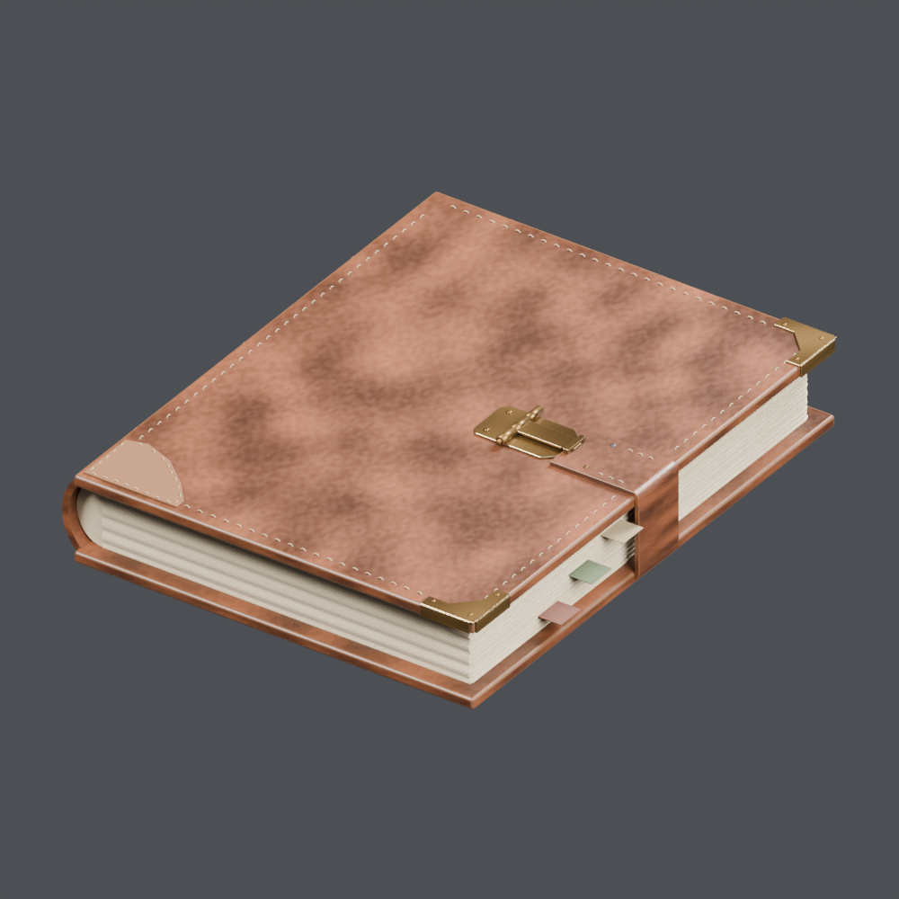

# 书、纸与书写工具 1

[← 素材架首页](../README.zh-CN.md)

[日本語](books-paper_01.md) · [English](books-paper_01.en.md) · [简体中文](books-paper_01.zh-CN.md)

## FT_051 — 修补过的账簿

酒馆素材「修补过的账簿」。计数单位：一个模型记录。包含BLEND和GLB。近景图由所提供的BLEND实际渲染。

[ZIP · BLEND + GLB · 5.01 MB](https://github.com/k3peta/tales-on-a-table/releases/download/v2026.10.18/FT_051_CC0.zip) · CC0-1.0

`catalog-20261018` · SHA-256: `45e7f9494f14feb56e07461a9c9cca4d4e8e66931bd19900025d8102a6a85a4a`

## OL_STORY_003 — 封好的信与账簿

灯具店素材「封好的信与账簿」。计数单位：一个包含多个物体的组合。包含BLEND和GLB。近景图由所提供的BLEND实际渲染。

[ZIP · BLEND + GLB · 0.17 MB](https://github.com/k3peta/tales-on-a-table/releases/download/v2026.10.18/OL_STORY_003_CC0.zip) · CC0-1.0

`catalog-20261018` · SHA-256: `274ca4976074e5a19387343d0341654ad96effb61586421181b566084b72dce3`

## AT_022 — 锁链封住的魔法书

古董店素材「锁链封住的魔法书」。计数单位：一个模型记录。包含BLEND和GLB。近景图由所提供的BLEND实际渲染。

[ZIP · BLEND + GLB · 1.39 MB](https://github.com/k3peta/tales-on-a-table/releases/download/v2026.10.18/AT_022_CC0.zip) · CC0-1.0

`catalog-20261018` · SHA-256: `33c67650c6a0b46a07e9e75c2b7d70d1aa05ef176030e2c1433dada06ce627aa`

## AT_030 — 伪装书脊的账簿

古董店素材「伪装书脊的账簿」。计数单位：一个模型记录。包含BLEND和GLB。近景图由所提供的BLEND实际渲染。

[ZIP · BLEND + GLB · 1.38 MB](https://github.com/k3peta/tales-on-a-table/releases/download/v2026.10.18/AT_030_CC0.zip) · CC0-1.0

`catalog-20261018` · SHA-256: `8e734978bcb2657b037fcff528a522ce21974ce5219335618df4786b19d252b7`

## AT_036 — 封好的地图筒

古董店素材「封好的地图筒」。计数单位：一个模型记录。包含BLEND和GLB。近景图由所提供的BLEND实际渲染。

[ZIP · BLEND + GLB · 0.97 MB](https://github.com/k3peta/tales-on-a-table/releases/download/v2026.10.18/AT_036_CC0.zip) · CC0-1.0

`catalog-20261018` · SHA-256: `101f82a8fdb13cf55bb8508f7e34a655d747902c2280b5788ffa634b43a30f9d`

## AT_037 — 摊开的群岛地图

古董店素材「摊开的群岛地图」。计数单位：一个模型记录。包含BLEND和GLB。近景图由所提供的BLEND实际渲染。

[ZIP · BLEND + GLB · 1.03 MB](https://github.com/k3peta/tales-on-a-table/releases/download/v2026.10.18/AT_037_CC0.zip) · CC0-1.0

`catalog-20261018` · SHA-256: `4631a753f1a7e52a7aa2f036b99de4e125547b8a9d0e9b5256ee3c6bd61023ea`

## AT_038 — 线装旅行日记

古董店素材「线装旅行日记」。计数单位：一个模型记录。包含BLEND和GLB。近景图由所提供的BLEND实际渲染。

[ZIP · BLEND + GLB · 1.19 MB](https://github.com/k3peta/tales-on-a-table/releases/download/v2026.10.18/AT_038_CC0.zip) · CC0-1.0

`catalog-20261018` · SHA-256: `19b0200df94631dc2a5f39f0fb4035e9d99bd43a62b6d2c2746cee1c187486e0`

## AT_056 — 羽毛笔与墨水瓶

古董店素材「羽毛笔与墨水瓶」。计数单位：一个模型记录。包含BLEND和GLB。近景图由所提供的BLEND实际渲染。

[ZIP · BLEND + GLB · 1.19 MB](https://github.com/k3peta/tales-on-a-table/releases/download/v2026.10.18/AT_056_CC0.zip) · CC0-1.0

`catalog-20261018` · SHA-256: `826e2ec2940da9314583e569c6c330ac93d5439f88bd64c311c5ca954d47d5b2`

## AT_065 — 尚未写完的鉴定账簿

古董店素材「尚未写完的鉴定账簿」。计数单位：一个模型记录。包含BLEND和GLB。近景图由所提供的BLEND实际渲染。

[ZIP · BLEND + GLB · 0.90 MB](https://github.com/k3peta/tales-on-a-table/releases/download/v2026.10.18/AT_065_CC0.zip) · CC0-1.0

`catalog-20261018` · SHA-256: `44ba01a0917a27db8efeef5f115be9d83cf7c68121ec824627780c83f6a41e4c`

## AT_079 — 埋有绿石的文件堆

古董店素材「埋有绿石的文件堆」。计数单位：一个包含多个物体的组合。包含BLEND和GLB。近景图由所提供的BLEND实际渲染。

[ZIP · BLEND + GLB · 0.53 MB](https://github.com/k3peta/tales-on-a-table/releases/download/v2026.10.18/AT_079_CC0.zip) · CC0-1.0

`catalog-20261018` · SHA-256: `b1adc93ea17bc06e8e243f84a0508b06d73dfb62af63a3358b1627c949c814d0`

## AT_081 — 卷轴与散页书信

古董店素材「卷轴与散页书信」。计数单位：一个包含多个物体的组合。包含BLEND和GLB。近景图由所提供的BLEND实际渲染。

[ZIP · BLEND + GLB · 0.38 MB](https://github.com/k3peta/tales-on-a-table/releases/download/v2026.10.18/AT_081_CC0.zip) · CC0-1.0

`catalog-20261018` · SHA-256: `a86aa2d87bc22516566f5ade0cf96aeb2426061b0e5167903402274ed64eace8`

## AT_082 — 折起的文书与破封印

古董店素材「折起的文书与破封印」。计数单位：一个包含多个物体的组合。包含BLEND和GLB。近景图由所提供的BLEND实际渲染。

[ZIP · BLEND + GLB · 0.27 MB](https://github.com/k3peta/tales-on-a-table/releases/download/v2026.10.18/AT_082_CC0.zip) · CC0-1.0

`catalog-20261018` · SHA-256: `e1e13203e959e99bb5f5279a876bfd33906642cc8f94b70fc6029fe7cbf7edab`

## AT_083 — 旧陶片与文件

古董店素材「旧陶片与文件」。计数单位：一个包含多个物体的组合。包含BLEND和GLB。近景图由所提供的BLEND实际渲染。

[ZIP · BLEND + GLB · 0.25 MB](https://github.com/k3peta/tales-on-a-table/releases/download/v2026.10.18/AT_083_CC0.zip) · CC0-1.0

`catalog-20261018` · SHA-256: `d5575fe57061f88fbd6bd5cc8876334926431f6651f2c63958dc1968a744f2e4`

## AT_084 — 斜靠的文件束

古董店素材「斜靠的文件束」。计数单位：一个包含多个物体的组合。包含BLEND和GLB。近景图由所提供的BLEND实际渲染。

[ZIP · BLEND + GLB · 0.17 MB](https://github.com/k3peta/tales-on-a-table/releases/download/v2026.10.18/AT_084_CC0.zip) · CC0-1.0

`catalog-20261018` · SHA-256: `d4f836a3aac98d82056ce1ccc957720a9a3ccfaccf425fd9c901efd7d771b35f`

## AT_087 — 未整理的测绘地图

古董店素材「未整理的测绘地图」。计数单位：一个包含多个物体的组合。包含BLEND和GLB。近景图由所提供的BLEND实际渲染。

[ZIP · BLEND + GLB · 0.23 MB](https://github.com/k3peta/tales-on-a-table/releases/download/v2026.10.18/AT_087_CC0.zip) · CC0-1.0

`catalog-20261018` · SHA-256: `80a01a16e06057bccb3f7f0c50b55edfc9ee62b2cf5484fd3e77e8b978e0f27e`

## AT_088 — 多卷羊皮纸

古董店素材「多卷羊皮纸」。计数单位：一个包含多个物体的组合。包含BLEND和GLB。近景图由所提供的BLEND实际渲染。

[ZIP · BLEND + GLB · 0.19 MB](https://github.com/k3peta/tales-on-a-table/releases/download/v2026.10.18/AT_088_CC0.zip) · CC0-1.0

`catalog-20261018` · SHA-256: `451dfa46095b9fad8c7b208fdc9384733d889e3e6c5724c7096cbe92e4e233f4`

## AT_089 — 寄给学者的未拆包裹

古董店素材「寄给学者的未拆包裹」。计数单位：一个包含多个物体的组合。包含BLEND和GLB。近景图由所提供的BLEND实际渲染。

[ZIP · BLEND + GLB · 0.38 MB](https://github.com/k3peta/tales-on-a-table/releases/download/v2026.10.18/AT_089_CC0.zip) · CC0-1.0

`catalog-20261018` · SHA-256: `832acbe8974f56fe649396569da434968fb72e44fad0f141031347b66f4a8aac`

## AT_090 — 散页书信包

古董店素材「散页书信包」。计数单位：一个包含多个物体的组合。包含BLEND和GLB。近景图由所提供的BLEND实际渲染。

[ZIP · BLEND + GLB · 0.23 MB](https://github.com/k3peta/tales-on-a-table/releases/download/v2026.10.18/AT_090_CC0.zip) · CC0-1.0

`catalog-20261018` · SHA-256: `9e1b1f1a6aad65c52a3db8248f07f0a29dcd4c21452f31cf1e2361c88ebba14c`
