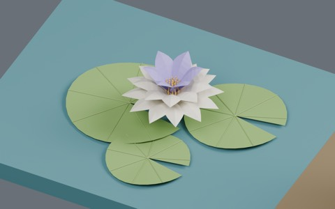
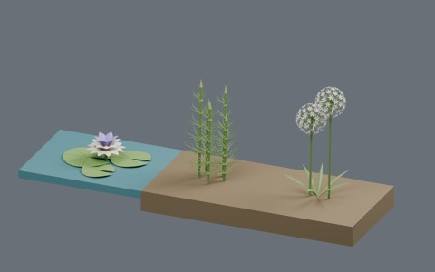
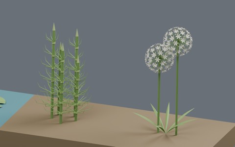

# Botanical diversity: three waterside and field plant models

882 existing records + 3 = 885 distribution records. Water lily, horsetail and flowering allium. BLEND and GLB are two formats of each record. Global historical design independence is unverified; no claim of three globally unique designs.

### BD201_WaterLily

[ZIP](https://raw.githubusercontent.com/k3peta/tales-on-a-table/main/distributions/botanical-diversity-v2/BD201_WaterLily_CC0.zip)

158198

### BD202_Horsetail

[ZIP](https://raw.githubusercontent.com/k3peta/tales-on-a-table/main/distributions/botanical-diversity-v2/BD202_Horsetail_CC0.zip)

295660

### BD203_FloweringAllium

[ZIP](https://raw.githubusercontent.com/k3peta/tales-on-a-table/main/distributions/botanical-diversity-v2/BD203_FloweringAllium_CC0.zip)

221678

[Checksums](../distributions/botanical-diversity-v2/SHA256SUMS.txt). Model geometry and embedded display materials only: CC0-1.0. No generation code, private records, images or assembled scenes are distributed. The separate 12-record farm reuse review remains on hold and is not included.

## Uses and limits

Metres, Z up, root origin zero. Water lily origin Z=0 is the water surface, not the pond bed. Horsetail and allium origins are soil level. Blender 5.2.2 round-trip checked in production. Stylized thin leaves; static models with no wind animation or rig. Wind behavior, collision, walking, Blender 4.3.2 compatibility and global historical uniqueness are unverified. Append the named collection from each BLEND.

No growth or floating-water physics validation. Place water lily at the water elevation; underwater roots and water surfaces are not included.

- BD201_WaterLily: Notched floating pads and layered flower. Origin Z=0 is WATER SURFACE, not pond bed. Place at the water elevation; no underwater roots included.
- BD202_Horsetail: Jointed stems with seven-way whorled branches. Damp forest edge or waterside bank. Origin is soil level.
- BD203_FloweringAllium: Spherical umbels of small six-petal florets above basal narrow leaves. Field border or vegetable plot in flower. Origin is soil level.

## 実作画像 / Actual renders

完成バッチの配置・接写。画像は閲覧用でモデルCC0の対象外です。[既存の画像利用条件](../LICENSE.md)を維持します。

### BD201_WaterLily

WaterLily

[ZIP](https://raw.githubusercontent.com/k3peta/tales-on-a-table/main/distributions/botanical-diversity-v2/BD201_WaterLily_CC0.zip)

### BD202_Horsetail

Horsetail

[ZIP](https://raw.githubusercontent.com/k3peta/tales-on-a-table/main/distributions/botanical-diversity-v2/BD202_Horsetail_CC0.zip)

### BD203_FloweringAllium

FloweringAllium

[ZIP](https://raw.githubusercontent.com/k3peta/tales-on-a-table/main/distributions/botanical-diversity-v2/BD203_FloweringAllium_CC0.zip)

