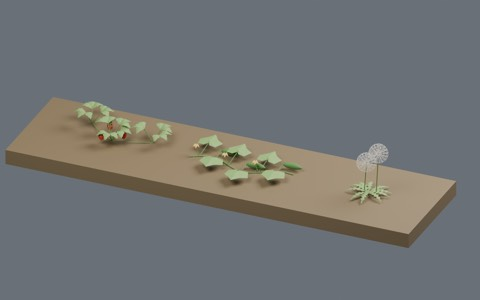
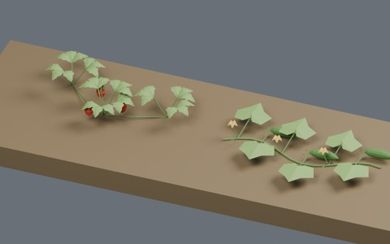
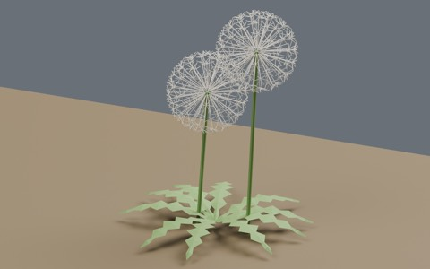
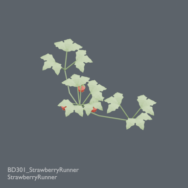
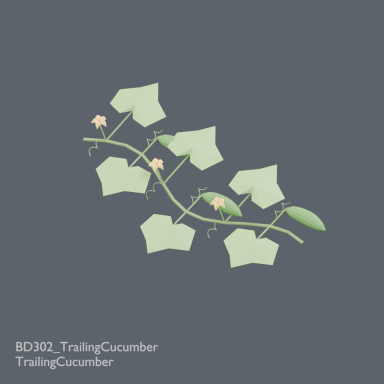
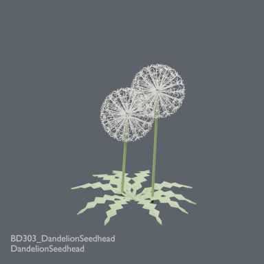

# Botanical diversity: three field-edge plant models

885 existing records + 3 = 888 distribution records. Strawberry runners, trailing cucumber and dandelion seed heads. BLEND and GLB are two formats of each record. Global historical design independence is unverified; no claim of three globally unique designs.

### BD301_StrawberryRunner

[ZIP](https://raw.githubusercontent.com/k3peta/tales-on-a-table/main/distributions/botanical-diversity-v3/BD301_StrawberryRunner_CC0.zip)

164215

### BD302_TrailingCucumber

[ZIP](https://raw.githubusercontent.com/k3peta/tales-on-a-table/main/distributions/botanical-diversity-v3/BD302_TrailingCucumber_CC0.zip)

169500

### BD303_DandelionSeedhead

[ZIP](https://raw.githubusercontent.com/k3peta/tales-on-a-table/main/distributions/botanical-diversity-v3/BD303_DandelionSeedhead_CC0.zip)

592909

[Checksums](../distributions/botanical-diversity-v3/SHA256SUMS.txt). Model geometry and embedded display materials only: CC0-1.0. No generation code, private records, images or assembled scenes are distributed.

## Uses and limits

Metres, Z up, root origin zero. Ground-level placement; small stem cross-sections may extend below the datum. Blender 5.2.2 round-trip checked in production. Stylized thin leaves; static models with no wind animation or rig. Wind behavior, collision, walking, Blender 4.3.2 compatibility and global historical uniqueness are unverified. Append the named collection from each BLEND.

Runners, vines and seeds are static geometry. No growth, seed dispersal or automatic terrain conformance. Unretrieved history, nested archives and unnamed shapes remain outside the completed comparison.

- BD301_StrawberryRunner: Trifoliate serrated leaves, berries and two daughter crowns connected by runners. Ground cover for field edges.
- BD302_TrailingCucumber: Ground-trailing vine with broad angular leaves, tendrils, elongated fruit and small flowers. Vegetable bed.
- BD303_DandelionSeedhead: Deeply toothed basal rosette and spherical parachute seed heads. Field margins and neglected walls; static seeds.

## 実作画像 / Actual renders

完成バッチの配置・接写。画像は閲覧用でモデルCC0の対象外です。[既存の画像利用条件](../LICENSE.md)を維持します。

### BD301_StrawberryRunner

StrawberryRunner

[ZIP](https://raw.githubusercontent.com/k3peta/tales-on-a-table/main/distributions/botanical-diversity-v3/BD301_StrawberryRunner_CC0.zip)

### BD302_TrailingCucumber

TrailingCucumber

[ZIP](https://raw.githubusercontent.com/k3peta/tales-on-a-table/main/distributions/botanical-diversity-v3/BD302_TrailingCucumber_CC0.zip)

### BD303_DandelionSeedhead

DandelionSeedhead

[ZIP](https://raw.githubusercontent.com/k3peta/tales-on-a-table/main/distributions/botanical-diversity-v3/BD303_DandelionSeedhead_CC0.zip)

## Individual images / 個別画像 / 单件图片

Actual distributed models; chosen camera view does not establish intended front or placement pivot. Images are outside model CC0. Original links and archives retained.

### BD301_StrawberryRunner — StrawberryRunner

StrawberryRunner

[Full image](../previews/ud1102-rg24/renders/BD301_StrawberryRunner.png) · [ZIP · BLEND/GLB](https://raw.githubusercontent.com/k3peta/tales-on-a-table/main/distributions/botanical-diversity-v3/BD301_StrawberryRunner_CC0.zip)

### BD302_TrailingCucumber — TrailingCucumber

TrailingCucumber

[Full image](../previews/ud1102-rg24/renders/BD302_TrailingCucumber.png) · [ZIP · BLEND/GLB](https://raw.githubusercontent.com/k3peta/tales-on-a-table/main/distributions/botanical-diversity-v3/BD302_TrailingCucumber_CC0.zip)

### BD303_DandelionSeedhead — DandelionSeedhead

DandelionSeedhead

[Full image](../previews/ud1102-rg24/renders/BD303_DandelionSeedhead.png) · [ZIP · BLEND/GLB](https://raw.githubusercontent.com/k3peta/tales-on-a-table/main/distributions/botanical-diversity-v3/BD303_DandelionSeedhead_CC0.zip)
