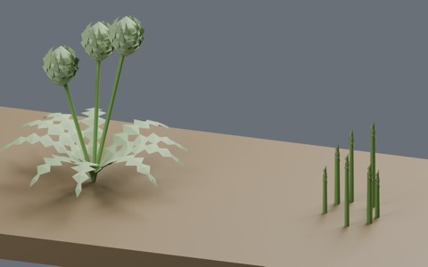
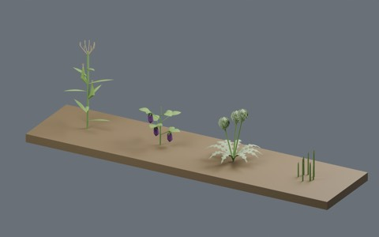
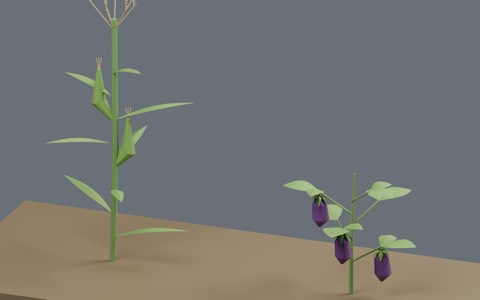
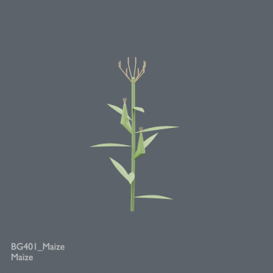
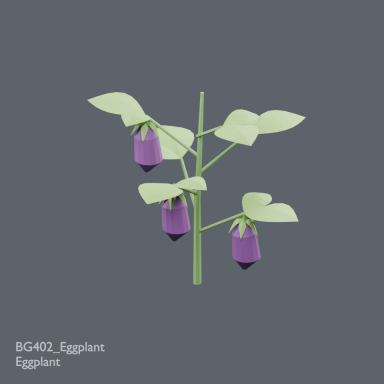
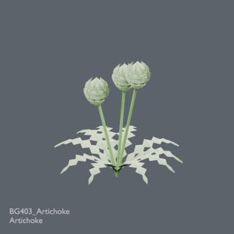
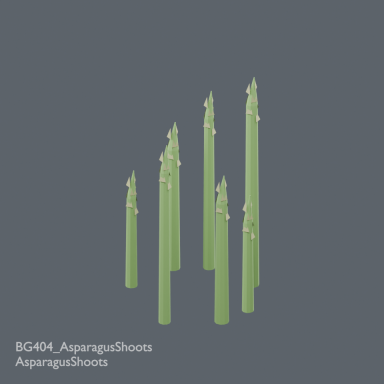

# Botanical diversity: four field growth models

905 existing records + 4 = 909 distribution records. Maize, eggplant, artichoke and asparagus shoots. BLEND and GLB are two formats of each record. Global historical design independence is unverified; no claim of four globally unique designs.

### BG401_Maize

[ZIP](https://raw.githubusercontent.com/k3peta/tales-on-a-table/main/distributions/botanical-field-growth-v1/BG401_Maize_CC0.zip)

107389

### BG402_Eggplant

[ZIP](https://raw.githubusercontent.com/k3peta/tales-on-a-table/main/distributions/botanical-field-growth-v1/BG402_Eggplant_CC0.zip)

116162

### BG403_Artichoke

[ZIP](https://raw.githubusercontent.com/k3peta/tales-on-a-table/main/distributions/botanical-field-growth-v1/BG403_Artichoke_CC0.zip)

121561

### BG404_AsparagusShoots

[ZIP](https://raw.githubusercontent.com/k3peta/tales-on-a-table/main/distributions/botanical-field-growth-v1/BG404_AsparagusShoots_CC0.zip)

84891

[Checksums](../distributions/botanical-field-growth-v1/SHA256SUMS.txt). Model geometry and embedded display materials only: CC0-1.0. No generation code, private records, images or assembled scenes are distributed.

## Uses and limits

Metres, Z up, root origin zero. Production aligned the lowest model point to ground level. Blender 5.2.2 round-trip checked in production. Stylized thin leaves; static models with no wind animation or rig. Wind behavior, collision, walking, Blender 4.3.2 compatibility and global historical uniqueness are unverified. Append the named collection from each BLEND.

Asparagus is shown in its spring shoot stage, not as mature foliage. Wind, flowering and growth animations are not included. These stylized models are not botanical identification references. Unretrieved history, nested archives and unnamed geometry remain outside the completed comparison.

- BG401_Maize: Tall stalk with long blade leaves, lateral husked ears and terminal branched tassel.
- BG402_Eggplant: Branching vegetable shrub with broad leaves and hanging elongated purple fruit under green calyx.
- BG403_Artichoke: Deeply cut basal leaves and three stalked heads built from overlapping pointed bracts.
- BG404_AsparagusShoots: Seven emerging tapering spears with small overlapping tip scales; spring shoot stage, not mature fern foliage.

## 実作画像 / Actual renders

完成バッチの配置・接写。画像は閲覧用でモデルCC0の対象外です。[既存の画像利用条件](../LICENSE.md)を維持します。

### BG401_Maize

Maize

[ZIP](https://raw.githubusercontent.com/k3peta/tales-on-a-table/main/distributions/botanical-field-growth-v1/BG401_Maize_CC0.zip)

### BG402_Eggplant

Eggplant

[ZIP](https://raw.githubusercontent.com/k3peta/tales-on-a-table/main/distributions/botanical-field-growth-v1/BG402_Eggplant_CC0.zip)

### BG403_Artichoke

Artichoke

[ZIP](https://raw.githubusercontent.com/k3peta/tales-on-a-table/main/distributions/botanical-field-growth-v1/BG403_Artichoke_CC0.zip)

### BG404_AsparagusShoots

AsparagusShoots

[ZIP](https://raw.githubusercontent.com/k3peta/tales-on-a-table/main/distributions/botanical-field-growth-v1/BG404_AsparagusShoots_CC0.zip)

## Individual images / 個別画像 / 单件图片

Actual distributed models; chosen camera view does not establish intended front or placement pivot. Images are outside model CC0. Original links and archives retained.

### BG401_Maize — Maize

Maize

[Full image](../previews/bg-fcs24/renders/BG401_Maize.png) · [ZIP · BLEND/GLB](https://raw.githubusercontent.com/k3peta/tales-on-a-table/main/distributions/botanical-field-growth-v1/BG401_Maize_CC0.zip)

### BG402_Eggplant — Eggplant

Eggplant

[Full image](../previews/bg-fcs24/renders/BG402_Eggplant.png) · [ZIP · BLEND/GLB](https://raw.githubusercontent.com/k3peta/tales-on-a-table/main/distributions/botanical-field-growth-v1/BG402_Eggplant_CC0.zip)

### BG403_Artichoke — Artichoke

Artichoke

[Full image](../previews/bg-fcs24/renders/BG403_Artichoke.png) · [ZIP · BLEND/GLB](https://raw.githubusercontent.com/k3peta/tales-on-a-table/main/distributions/botanical-field-growth-v1/BG403_Artichoke_CC0.zip)

### BG404_AsparagusShoots — AsparagusShoots

AsparagusShoots

[Full image](../previews/bg-fcs24/renders/BG404_AsparagusShoots.png) · [ZIP · BLEND/GLB](https://raw.githubusercontent.com/k3peta/tales-on-a-table/main/distributions/botanical-field-growth-v1/BG404_AsparagusShoots_CC0.zip)
