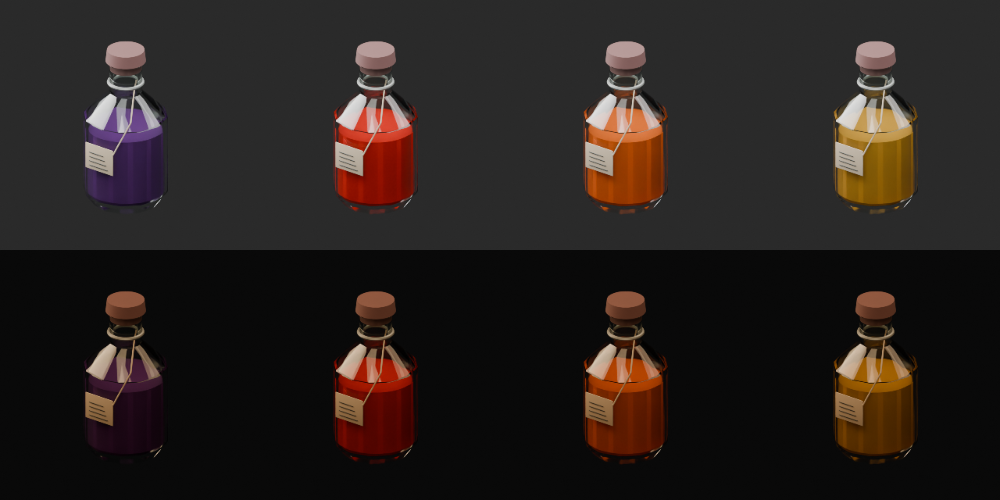
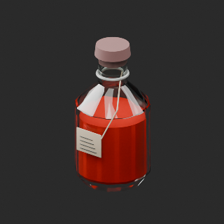
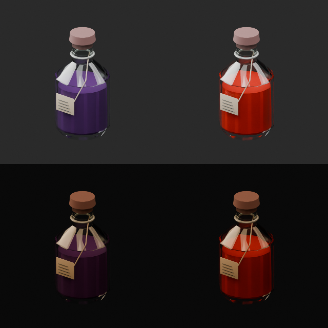
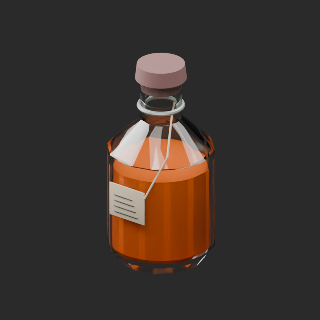
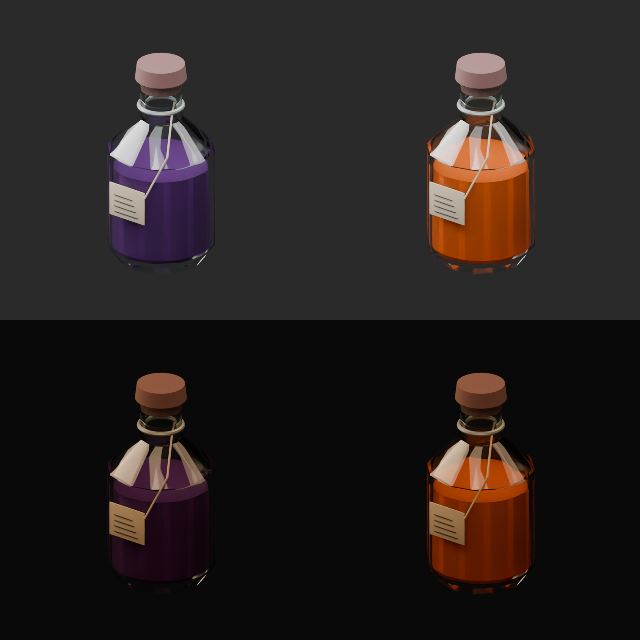
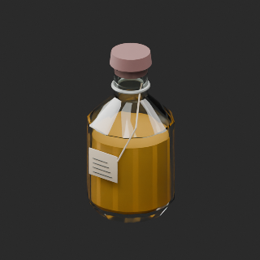
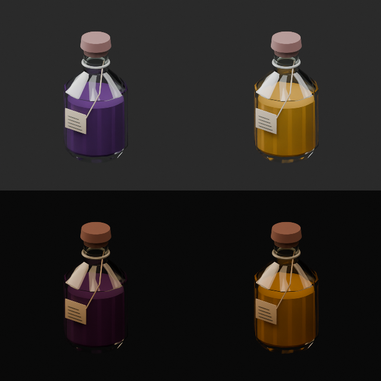

# 瓶の液体色 / Bottle liquid colors

**Existing1008 records unchanged; material variants68=54+11+3. Two revisions are not added as new records.**

AT025の既存液体材質領域のみ赤・オレンジ・琥珀へ変更。瓶外面・栓・ラベル・形状UV保持、発光0、液体mesh追加なし。緑ガラスAT072の3候補は棄却。FT020は空瓶で対象外。通常/暖色暗所スタジオ比較であり特定酒場の実scene検証ではありません。多重透明/他engine色管理/旧Blender/液体物理は未検証。

Only existing AT025 liquid material region changed; exterior materials/geometry/UV retained, zero emission. AT072 rejected; no new liquid mesh. Top neutral, bottom warm-dim studio lighting; original, red, orange, amber left to right. Other engines/physics/old Blender unverified.

[拡大原図 / Full lighting sheet](https://raw.githubusercontent.com/k3peta/tales-on-a-table/main/previews/bottle-liquid-colors-v1/AT_025_colour_lighting_sheet.png)

モデル/埋込材質のみCC0。画像は閲覧用でモデルCC0対象外、[既存画像権利](../LICENSE.md)維持。代码图片私有査定不属模型CC0。

## AT_025__liquid_red — 瓶詰めエーテル

material_variant · [ZIP · BLEND/GLB](https://raw.githubusercontent.com/k3peta/tales-on-a-table/main/distributions/bottle-liquid-colors-v1/AT_025__liquid_red_CC0.zip)

[拡大 / Full image](https://raw.githubusercontent.com/k3peta/tales-on-a-table/main/previews/bottle-liquid-colors-v1/AT_025__liquid_red_thumb.png)

[拡大 / Full image](https://raw.githubusercontent.com/k3peta/tales-on-a-table/main/previews/bottle-liquid-colors-v1/AT_025__liquid_red_comparison.png)

top neutral / bottom warm dim; left original / right variant

## AT_025__liquid_orange — 瓶詰めエーテル

material_variant · [ZIP · BLEND/GLB](https://raw.githubusercontent.com/k3peta/tales-on-a-table/main/distributions/bottle-liquid-colors-v1/AT_025__liquid_orange_CC0.zip)

[拡大 / Full image](https://raw.githubusercontent.com/k3peta/tales-on-a-table/main/previews/bottle-liquid-colors-v1/AT_025__liquid_orange_thumb.png)

[拡大 / Full image](https://raw.githubusercontent.com/k3peta/tales-on-a-table/main/previews/bottle-liquid-colors-v1/AT_025__liquid_orange_comparison.png)

top neutral / bottom warm dim; left original / right variant

## AT_025__liquid_amber — 瓶詰めエーテル

material_variant · [ZIP · BLEND/GLB](https://raw.githubusercontent.com/k3peta/tales-on-a-table/main/distributions/bottle-liquid-colors-v1/AT_025__liquid_amber_CC0.zip)

[拡大 / Full image](https://raw.githubusercontent.com/k3peta/tales-on-a-table/main/previews/bottle-liquid-colors-v1/AT_025__liquid_amber_thumb.png)

[拡大 / Full image](https://raw.githubusercontent.com/k3peta/tales-on-a-table/main/previews/bottle-liquid-colors-v1/AT_025__liquid_amber_comparison.png)

top neutral / bottom warm dim; left original / right variant
