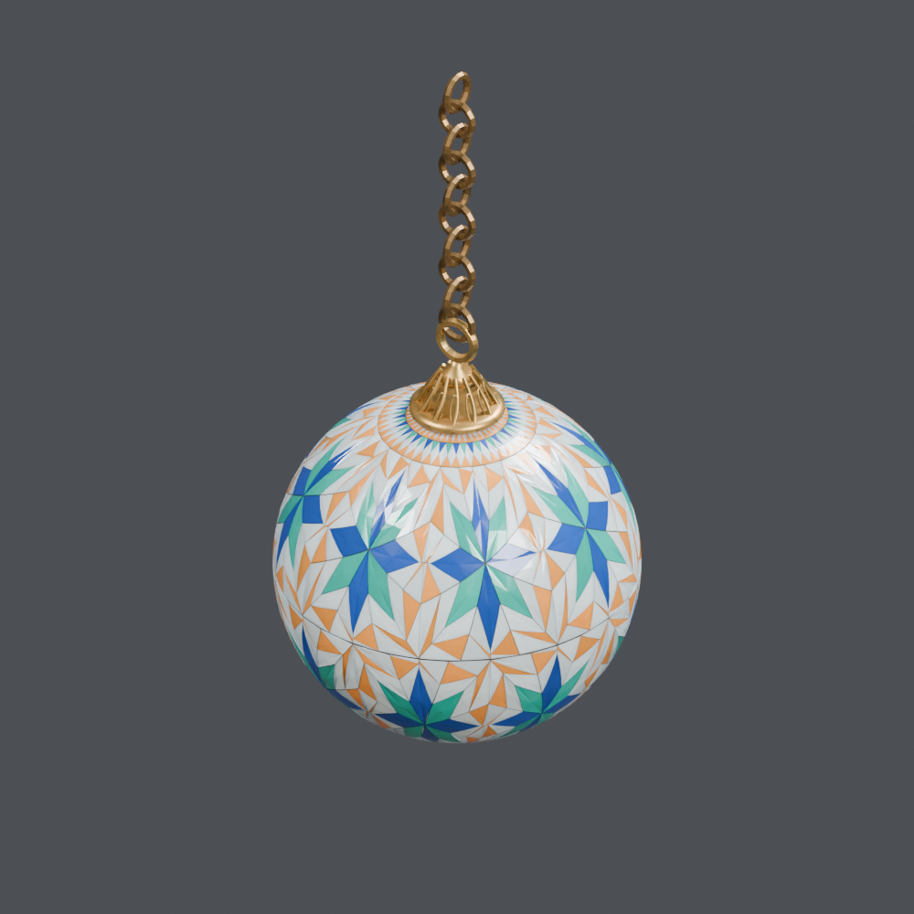
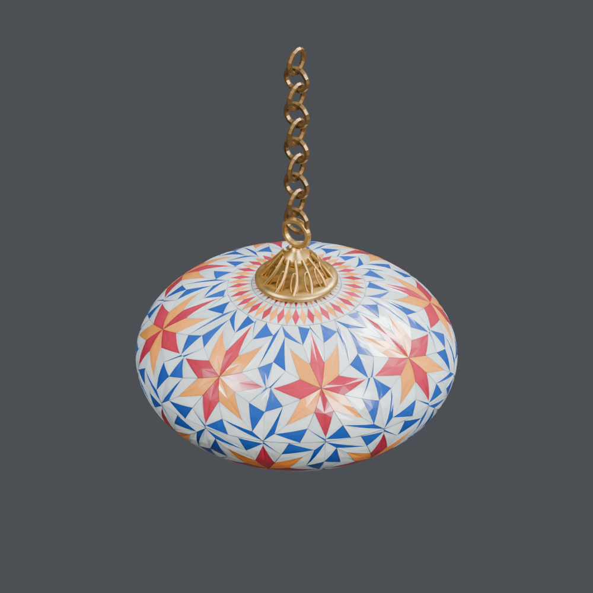

# 灯り・燭台 2

[← 素材棚トップ](../README.md)

[日本語](candles-light_02.md) · [English](candles-light_02.en.md) · [简体中文](candles-light_02.zh-CN.md)

## OL_015 — 紅色のしずく形ランタン

ランプ店の素材「紅色のしずく形ランタン」。収録単位：1モデル。BLENDとGLBを同梱しています。近景は同じ配布BLENDの実レンダーです。

[ZIP · BLEND + GLB · 2.82 MB](https://github.com/k3peta/tales-on-a-table/releases/download/v2026.10.18/OL_015_CC0.zip) · CC0-1.0

`catalog-20261018` · SHA-256: `da9bc7eb9f967e8e5fad8dd177e742b515244e32068f1dca1a1c1f0f478c4e1b`

## OL_016 — 青い六角ランタン

ランプ店の素材「青い六角ランタン」。収録単位：1モデル。BLENDとGLBを同梱しています。近景は同じ配布BLENDの実レンダーです。

[ZIP · BLEND + GLB · 2.76 MB](https://github.com/k3peta/tales-on-a-table/releases/download/v2026.10.18/OL_016_CC0.zip) · CC0-1.0

`catalog-20261018` · SHA-256: `6387e59a1a1809f37ee7503e364a438d3b55ecde3383e7f3183d2e5e67a0a0a5`

## OL_017 — 棚置きの琥珀色ランタン

ランプ店の素材「棚置きの琥珀色ランタン」。収録単位：1モデル。BLENDとGLBを同梱しています。近景は同じ配布BLENDの実レンダーです。

[ZIP · BLEND + GLB · 2.63 MB](https://github.com/k3peta/tales-on-a-table/releases/download/v2026.10.18/OL_017_CC0.zip) · CC0-1.0

`catalog-20261018` · SHA-256: `13d96f554f1ac45eca0903c6375dc937c2c1dcf16676d21a0755d7819b199879`

## OL_018 — 棚置きの紅色ランタン

ランプ店の素材「棚置きの紅色ランタン」。収録単位：1モデル。BLENDとGLBを同梱しています。近景は同じ配布BLENDの実レンダーです。

[ZIP · BLEND + GLB · 2.55 MB](https://github.com/k3peta/tales-on-a-table/releases/download/v2026.10.18/OL_018_CC0.zip) · CC0-1.0

`catalog-20261018` · SHA-256: `bc0edc77af35311b09d0005451b4e13fcec267f6644033aec5588ecad991c424`

## OL_020 — 飾り棚用の銀色燭台

ランプ店の素材「飾り棚用の銀色燭台」。収録単位：1モデル。BLENDとGLBを同梱しています。近景は同じ配布BLENDの実レンダーです。

[ZIP · BLEND + GLB · 2.84 MB](https://github.com/k3peta/tales-on-a-table/releases/download/v2026.10.18/OL_020_CC0.zip) · CC0-1.0

`catalog-20261018` · SHA-256: `39e2bd4eb929592acde2632f0a6ac423252949b9cecb2c0a6bc65f72cc266dd1`

## OL_021 — 銀色の三枝燭台

ランプ店の素材「銀色の三枝燭台」。収録単位：1モデル。BLENDとGLBを同梱しています。近景は同じ配布BLENDの実レンダーです。

[ZIP · BLEND + GLB · 2.89 MB](https://github.com/k3peta/tales-on-a-table/releases/download/v2026.10.18/OL_021_CC0.zip) · CC0-1.0

`catalog-20261018` · SHA-256: `5ca005988b795c3b06907eb5199d4bc9b476185ecec2b90db37a8a8db5b0c8e7`

## OL_022 — 小さな金色ランタン

ランプ店の素材「小さな金色ランタン」。収録単位：1モデル。BLENDとGLBを同梱しています。近景は同じ配布BLENDの実レンダーです。

[ZIP · BLEND + GLB · 3.10 MB](https://github.com/k3peta/tales-on-a-table/releases/download/v2026.10.18/OL_022_CC0.zip) · CC0-1.0

`catalog-20261018` · SHA-256: `159ee6def5413eac895a37c4120f389646422f92f09427bdc4b21fa27e6d8c44`

## OL_025 — 紫のメロン形ランタン

ランプ店の素材「紫のメロン形ランタン」。収録単位：1モデル。BLENDとGLBを同梱しています。近景は同じ配布BLENDの実レンダーです。

[ZIP · BLEND + GLB · 3.15 MB](https://github.com/k3peta/tales-on-a-table/releases/download/v2026.10.18/OL_025_CC0.zip) · CC0-1.0

`catalog-20261018` · SHA-256: `ffb8180905849850451ed33d3613edc8c19aacfda969b9505870398ef4170bf3`

## OL_026 — 紫の玉ねぎ形ランプ

ランプ店の素材「紫の玉ねぎ形ランプ」。収録単位：1モデル。BLENDとGLBを同梱しています。近景は同じ配布BLENDの実レンダーです。

[ZIP · BLEND + GLB · 2.87 MB](https://github.com/k3peta/tales-on-a-table/releases/download/v2026.10.18/OL_026_CC0.zip) · CC0-1.0

`catalog-20261018` · SHA-256: `9cf9f6413fc1f30326d624266c88b53116f13810228969aa47573a71a353ef0c`

## OL_027 — 翠色の球形ランプ

ランプ店の素材「翠色の球形ランプ」。収録単位：1モデル。BLENDとGLBを同梱しています。近景は同じ配布BLENDの実レンダーです。

[ZIP · BLEND + GLB · 2.70 MB](https://github.com/k3peta/tales-on-a-table/releases/download/v2026.10.18/OL_027_CC0.zip) · CC0-1.0

`catalog-20261018` · SHA-256: `884b53bf957e63770f881e97b2ee70d265fa5bfa64d790ee4e83af69f154d1c6`

## OL_028 — 青い扁球形ランプ

ランプ店の素材「青い扁球形ランプ」。収録単位：1モデル。BLENDとGLBを同梱しています。近景は同じ配布BLENDの実レンダーです。

[ZIP · BLEND + GLB · 2.71 MB](https://github.com/k3peta/tales-on-a-table/releases/download/v2026.10.18/OL_028_CC0.zip) · CC0-1.0

`catalog-20261018` · SHA-256: `a2f8ebae6430a99fca07dcee2754a9241f3866dd4e95c9d3a661ef41ff7b97dd`

## OL_030 — 追加の琥珀色丸形ランタン

ランプ店の素材「追加の琥珀色丸形ランタン」。収録単位：1モデル。BLENDとGLBを同梱しています。近景は同じ配布BLENDの実レンダーです。

[ZIP · BLEND + GLB · 3.09 MB](https://github.com/k3peta/tales-on-a-table/releases/download/v2026.10.18/OL_030_CC0.zip) · CC0-1.0

`catalog-20261018` · SHA-256: `b3f4349b7b1249f2213ca71d38a36256188bb06ab9381f190fdf10b5e83c8641`

## OL_031 — 追加の青い六角ランタン

ランプ店の素材「追加の青い六角ランタン」。収録単位：1モデル。BLENDとGLBを同梱しています。近景は同じ配布BLENDの実レンダーです。

[ZIP · BLEND + GLB · 2.71 MB](https://github.com/k3peta/tales-on-a-table/releases/download/v2026.10.18/OL_031_CC0.zip) · CC0-1.0

`catalog-20261018` · SHA-256: `7bf51a05e8628fc234840eb9c9522c8b54630dd1ae818ff55ec7017949c24422`

## OL_032 — 追加の紅色しずく形ランタン

ランプ店の素材「追加の紅色しずく形ランタン」。収録単位：1モデル。BLENDとGLBを同梱しています。近景は同じ配布BLENDの実レンダーです。

[ZIP · BLEND + GLB · 2.78 MB](https://github.com/k3peta/tales-on-a-table/releases/download/v2026.10.18/OL_032_CC0.zip) · CC0-1.0

`catalog-20261018` · SHA-256: `c8866a7d7f61a140587aae923a2f0e5a148b43fa39246c44cabb2fba43ed796b`

## OL_039 — 球形モザイクの吊りランプ

ランプ店の素材「球形モザイクの吊りランプ」。収録単位：1モデル。BLENDとGLBを同梱しています。近景は同じ配布BLENDの実レンダーです。

[ZIP · BLEND + GLB · 8.16 MB](https://github.com/k3peta/tales-on-a-table/releases/download/v2026.10.18/OL_039_CC0.zip) · CC0-1.0

`catalog-20261018` · SHA-256: `fd3aa412d651dcdf4546c31790f456d3885f707efb490527479489a88ce0ce76`

## OL_040 — 扁球形モザイクの吊りランプ

ランプ店の素材「扁球形モザイクの吊りランプ」。収録単位：1モデル。BLENDとGLBを同梱しています。近景は同じ配布BLENDの実レンダーです。

[ZIP · BLEND + GLB · 8.92 MB](https://github.com/k3peta/tales-on-a-table/releases/download/v2026.10.18/OL_040_CC0.zip) · CC0-1.0

`catalog-20261018` · SHA-256: `2987e111c002e56ad59baf4c62e62d7411e6ff3e213509502a74082ce53039b7`
