# 灯り・燭台 3

[← 素材棚トップ](../README.md)

[日本語](candles-light_03.md) · [English](candles-light_03.en.md) · [简体中文](candles-light_03.zh-CN.md)

## OL_041 — 玉ねぎ形モザイクの吊りランプ

ランプ店の素材「玉ねぎ形モザイクの吊りランプ」。収録単位：1モデル。BLENDとGLBを同梱しています。近景は同じ配布BLENDの実レンダーです。

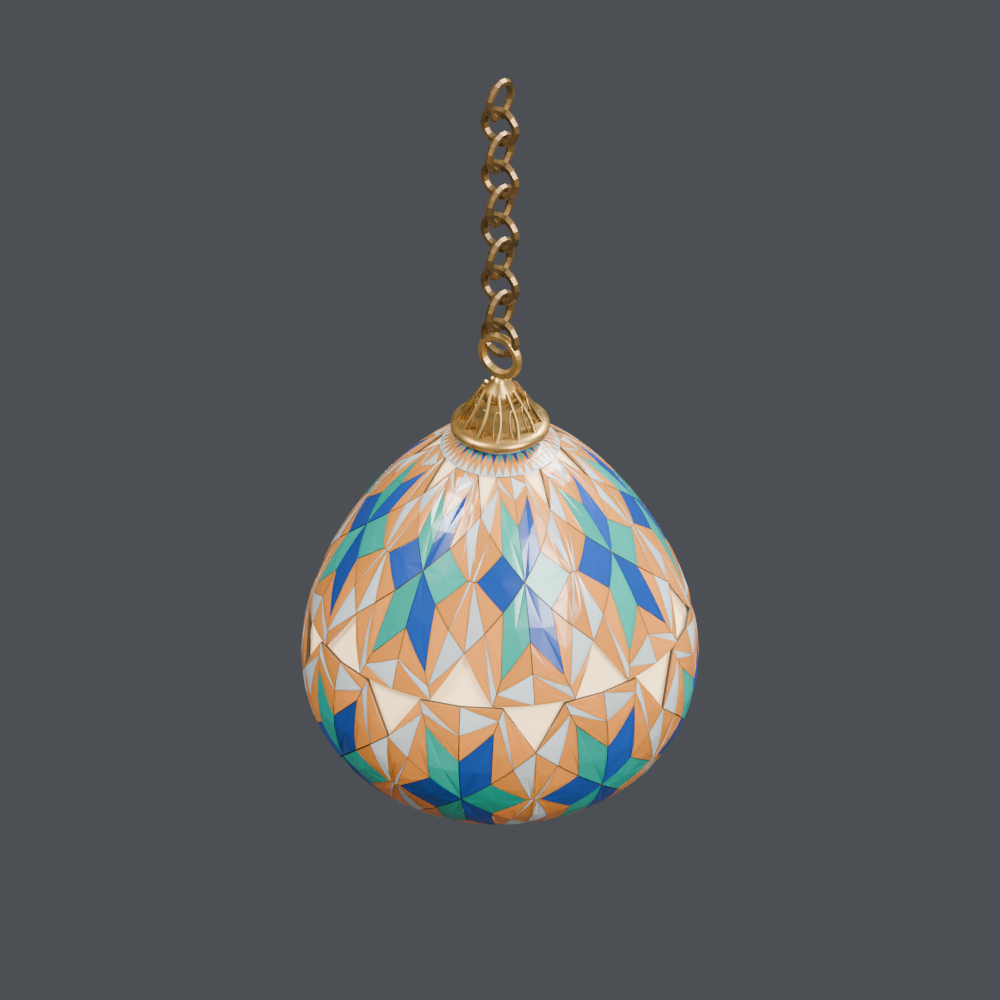

[ZIP · BLEND + GLB · 7.22 MB](https://github.com/k3peta/tales-on-a-table/releases/download/v2026.10.18/OL_041_CC0.zip) · CC0-1.0

`catalog-20261018` · SHA-256: `c20fd2c26c941d4f2b8e866b47d984db7180e56da52e4abefe5a242a628d3d9c`

## OL_042 — しずく形モザイクの吊りランプ

ランプ店の素材「しずく形モザイクの吊りランプ」。収録単位：1モデル。BLENDとGLBを同梱しています。近景は同じ配布BLENDの実レンダーです。

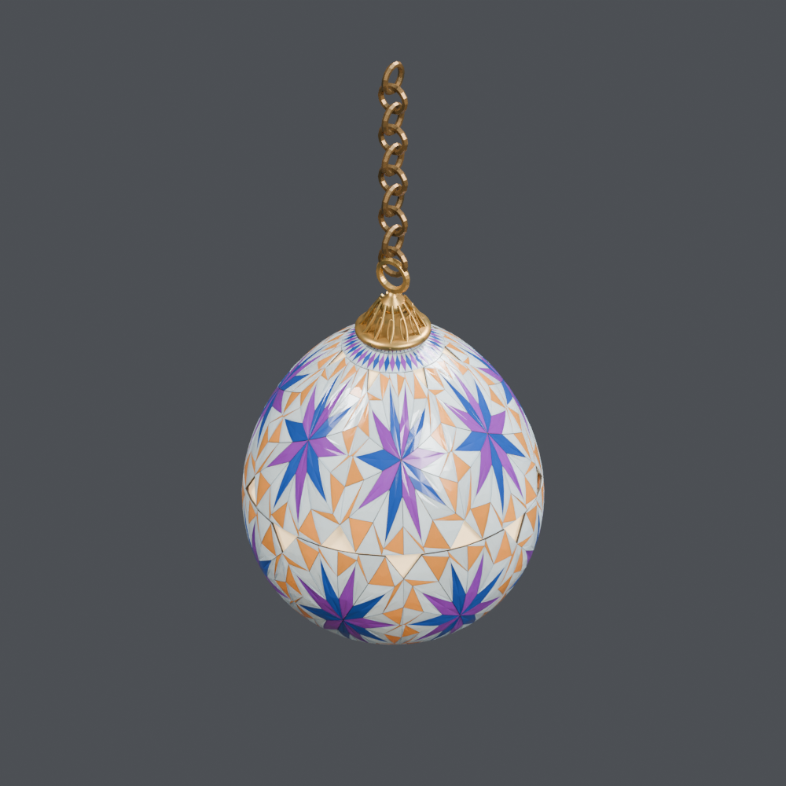

[ZIP · BLEND + GLB · 9.65 MB](https://github.com/k3peta/tales-on-a-table/releases/download/v2026.10.18/OL_042_CC0.zip) · CC0-1.0

`catalog-20261018` · SHA-256: `adda72d6b7ce28ee85b75665db3eeb11a678cd367e83f9c9371a3c139c59b1ff`

## OL_043 — 低い台座の卓上ランプ

ランプ店の素材「低い台座の卓上ランプ」。収録単位：1モデル。BLENDとGLBを同梱しています。近景は同じ配布BLENDの実レンダーです。

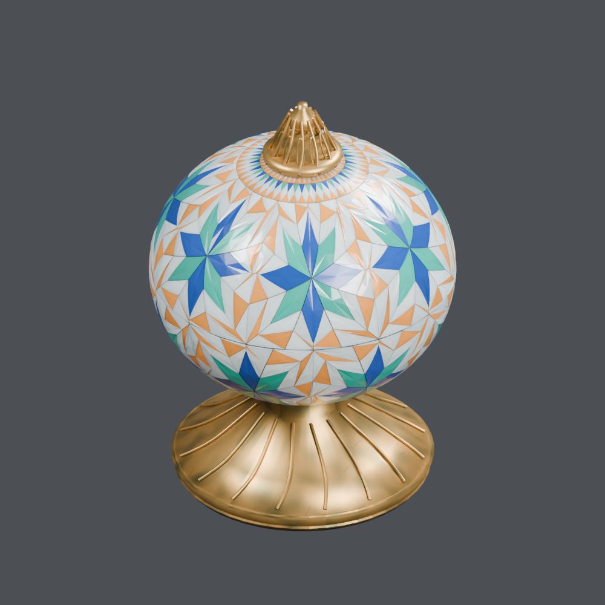

[ZIP · BLEND + GLB · 7.90 MB](https://github.com/k3peta/tales-on-a-table/releases/download/v2026.10.18/OL_043_CC0.zip) · CC0-1.0

`catalog-20261018` · SHA-256: `ca30a9b08bef1d7fcec23f2c37f8506e8690a496a7841bd1a92e650d98a2ee8a`

## OL_044 — 背の高い支柱の卓上ランプ

ランプ店の素材「背の高い支柱の卓上ランプ」。収録単位：1モデル。BLENDとGLBを同梱しています。近景は同じ配布BLENDの実レンダーです。

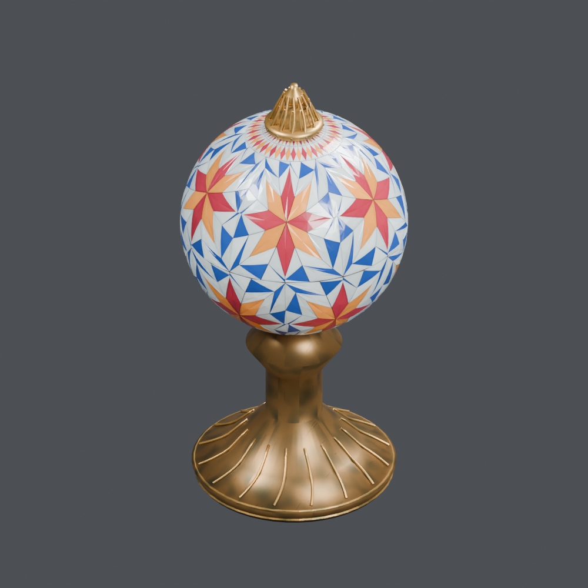

[ZIP · BLEND + GLB · 8.26 MB](https://github.com/k3peta/tales-on-a-table/releases/download/v2026.10.18/OL_044_CC0.zip) · CC0-1.0

`catalog-20261018` · SHA-256: `19ea24f9ef969242e5c3aeac8cff9a96c867d3a9c195af78849e47623c0b3565`

## OL_045 — 三脚の卓上ランプ

ランプ店の素材「三脚の卓上ランプ」。収録単位：1モデル。BLENDとGLBを同梱しています。近景は同じ配布BLENDの実レンダーです。

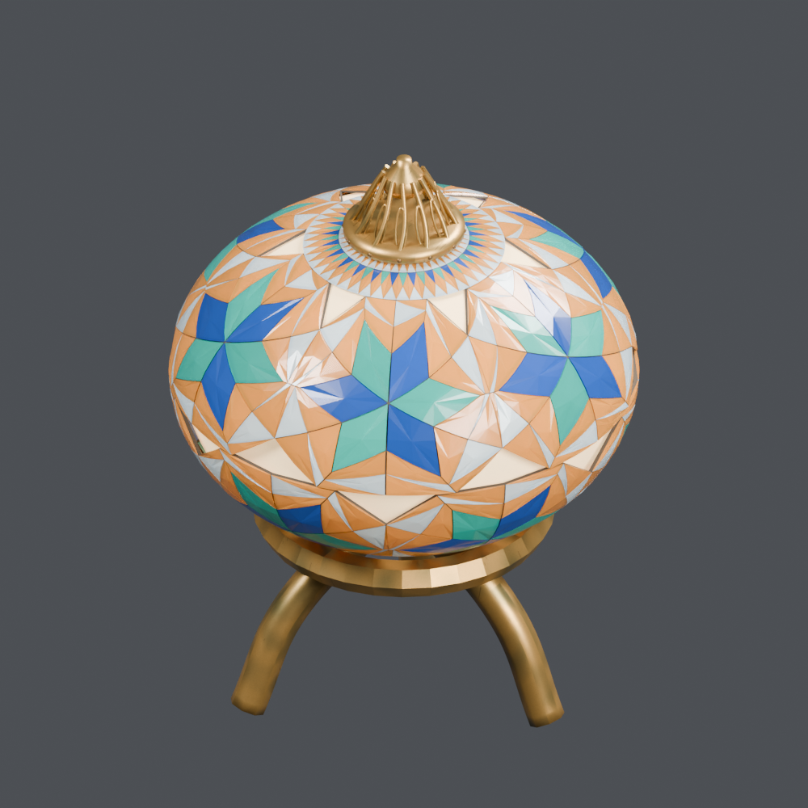

[ZIP · BLEND + GLB · 6.53 MB](https://github.com/k3peta/tales-on-a-table/releases/download/v2026.10.18/OL_045_CC0.zip) · CC0-1.0

`catalog-20261018` · SHA-256: `05760d5c246614030822c3596d1e0a98ff4a8a2e911957933ecc82d73c9ee333`

## OL_046 — 曲がり首の卓上ランプ

ランプ店の素材「曲がり首の卓上ランプ」。収録単位：1モデル。BLENDとGLBを同梱しています。近景は同じ配布BLENDの実レンダーです。

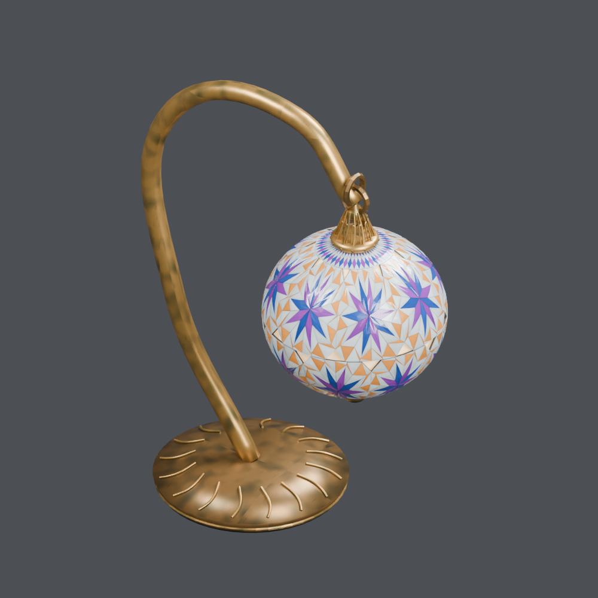

[ZIP · BLEND + GLB · 10.36 MB](https://github.com/k3peta/tales-on-a-table/releases/download/v2026.10.18/OL_046_CC0.zip) · CC0-1.0

`catalog-20261018` · SHA-256: `bc4f0f93ae052123bbb941b17e2a803c5e48be7a46aa5d36984ebd3a55c00f28`

## OL_047 — 二枝の卓上ランプ

ランプ店の素材「二枝の卓上ランプ」。収録単位：1モデル。BLENDとGLBを同梱しています。近景は同じ配布BLENDの実レンダーです。

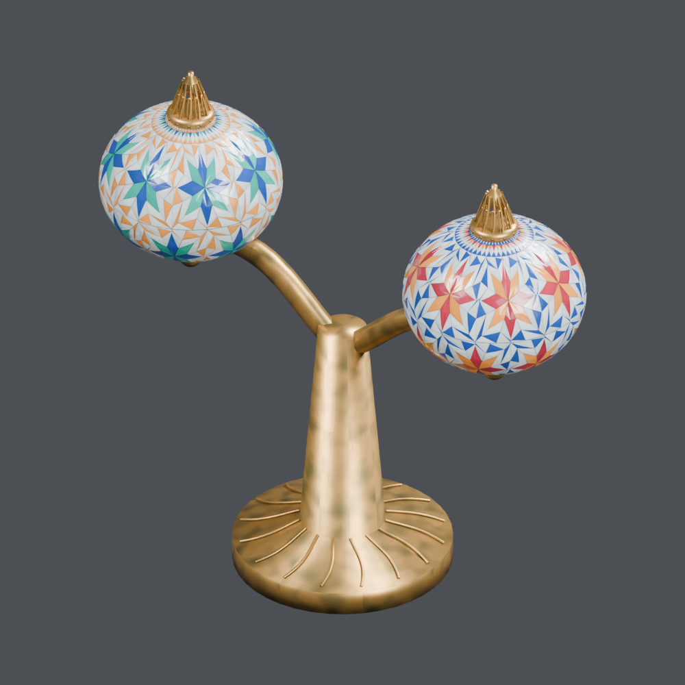

[ZIP · BLEND + GLB · 14.90 MB](https://github.com/k3peta/tales-on-a-table/releases/download/v2026.10.18/OL_047_CC0.zip) · CC0-1.0

`catalog-20261018` · SHA-256: `7253f6c41a156e20b75d9c3fc8a6de8efa7b8d2b6b5bcf07ca092896773d5c33`

## OL_048 — 三段の床置きランプ

ランプ店の素材「三段の床置きランプ」。収録単位：1モデル。BLENDとGLBを同梱しています。近景は同じ配布BLENDの実レンダーです。

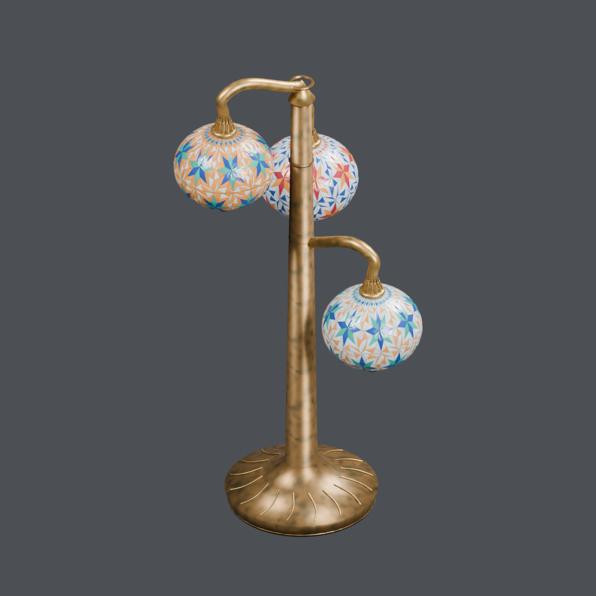

[ZIP · BLEND + GLB · 24.52 MB](https://github.com/k3peta/tales-on-a-table/releases/download/v2026.10.18/OL_048_CC0.zip) · CC0-1.0

`catalog-20261018` · SHA-256: `439609f124a7fadc4b3fa7bc7dd8c6daa9b2e6e637e5527559cb409292f8df11`

## OL_049 — 五灯のシャンデリア

ランプ店の素材「五灯のシャンデリア」。収録単位：1モデル。BLENDとGLBを同梱しています。近景は同じ配布BLENDの実レンダーです。

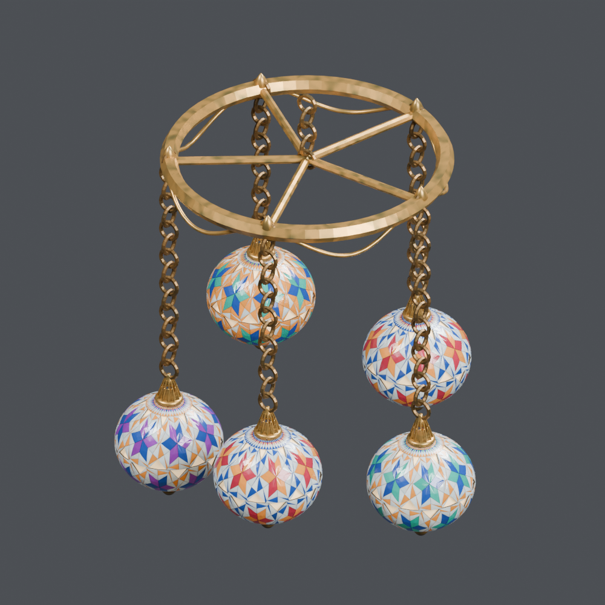

[ZIP · BLEND + GLB · 30.64 MB](https://github.com/k3peta/tales-on-a-table/releases/download/v2026.10.18/OL_049_CC0.zip) · CC0-1.0

`catalog-20261018` · SHA-256: `d04435c0afb325cdc9bfc619793f09cebef3760323ce34dc372bf89af914749a`

## OL_050 — 曲線装飾の壁付け灯

ランプ店の素材「曲線装飾の壁付け灯」。収録単位：1モデル。BLENDとGLBを同梱しています。近景は同じ配布BLENDの実レンダーです。

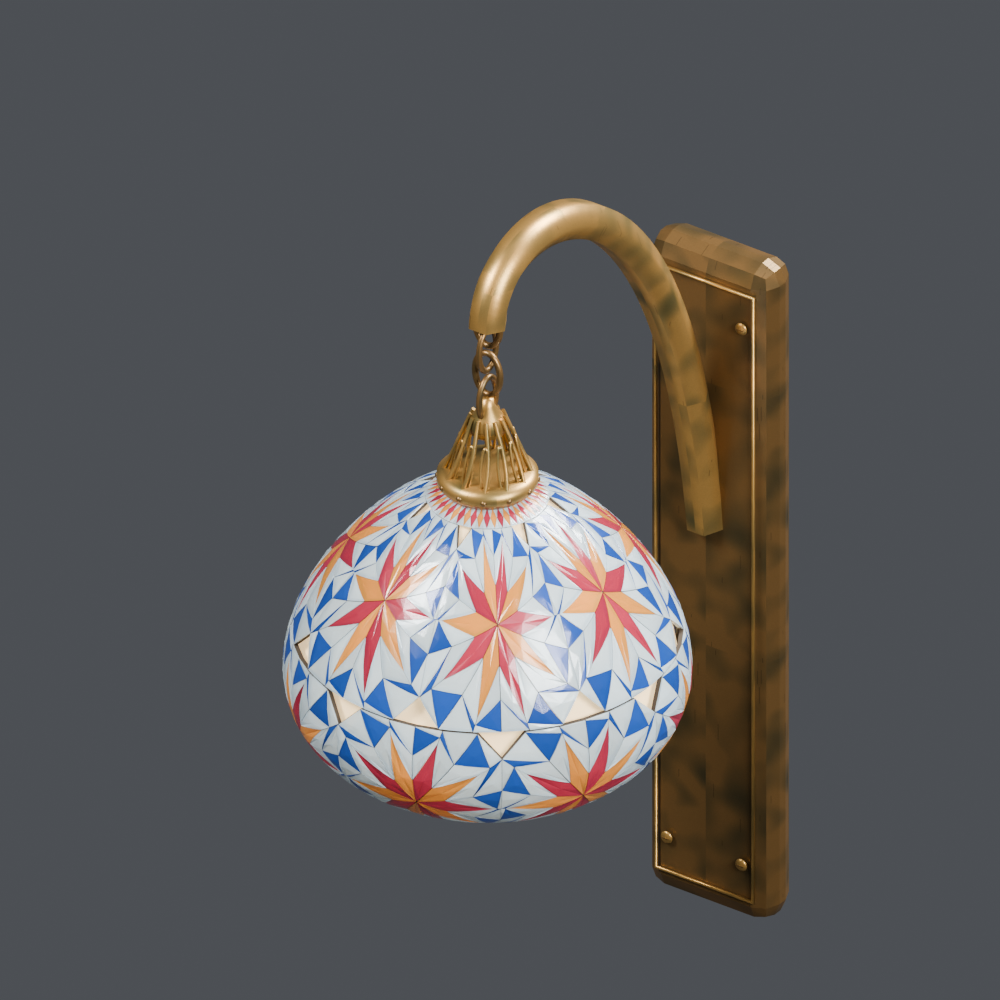

[ZIP · BLEND + GLB · 9.86 MB](https://github.com/k3peta/tales-on-a-table/releases/download/v2026.10.18/OL_050_CC0.zip) · CC0-1.0

`catalog-20261018` · SHA-256: `5afe716b037e91e94f94359c7353bb1276aa2e5210ea6c3e61ede4d01d5cc08c`

## OL_051 — 六角モザイクの棚置きランタン

ランプ店の素材「六角モザイクの棚置きランタン」。収録単位：1モデル。BLENDとGLBを同梱しています。近景は同じ配布BLENDの実レンダーです。

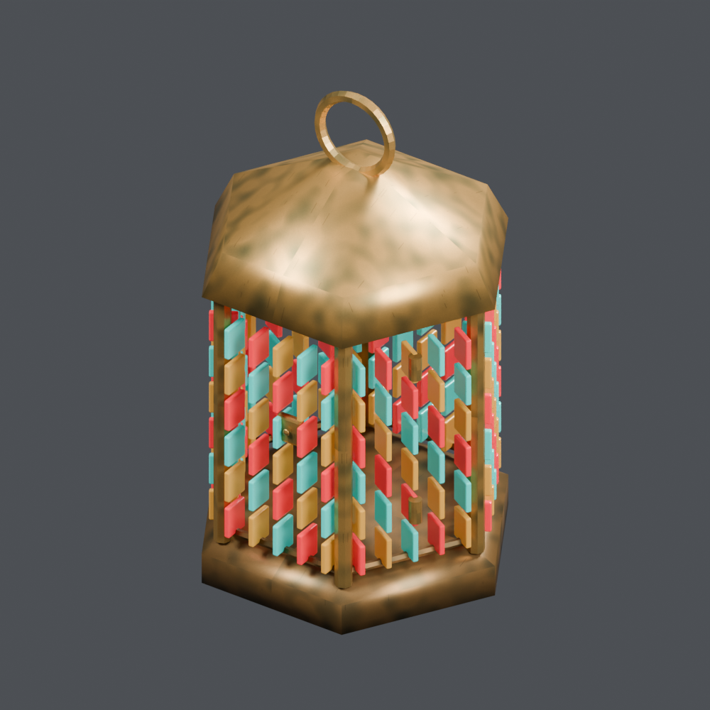

[ZIP · BLEND + GLB · 2.18 MB](https://github.com/k3peta/tales-on-a-table/releases/download/v2026.10.18/OL_051_CC0.zip) · CC0-1.0

`catalog-20261018` · SHA-256: `b870faa1f51d3094aae5807adbb57b6e4cb5b5da0052b53a34a323e82fbf2d4d`

## OL_052 — 透かし真鍮ランタン

ランプ店の素材「透かし真鍮ランタン」。収録単位：1モデル。BLENDとGLBを同梱しています。近景は同じ配布BLENDの実レンダーです。

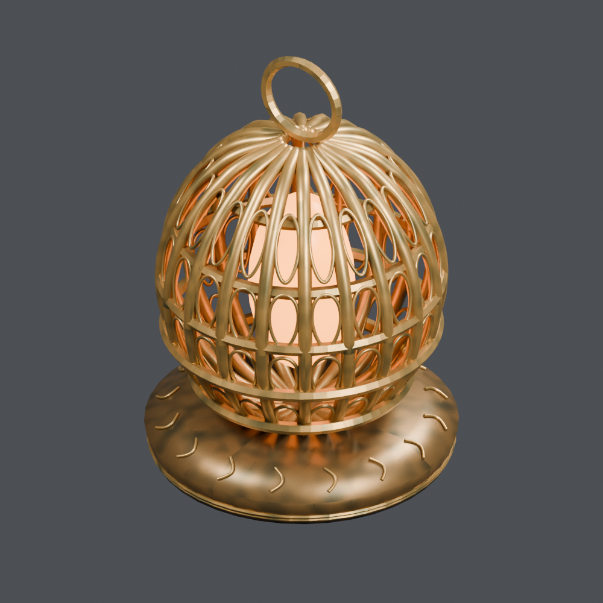

[ZIP · BLEND + GLB · 6.62 MB](https://github.com/k3peta/tales-on-a-table/releases/download/v2026.10.18/OL_052_CC0.zip) · CC0-1.0

`catalog-20261018` · SHA-256: `8af421b68faf88967380e629284786426ffdf2fa3cd5740f2e6d3b1ad6a61301`

## OL_STORY_002 — 贈答用ランプの化粧箱

ランプ店の素材「贈答用ランプの化粧箱」。収録単位：複数品を組み合わせた1グループ。BLENDとGLBを同梱しています。近景は同じ配布BLENDの実レンダーです。

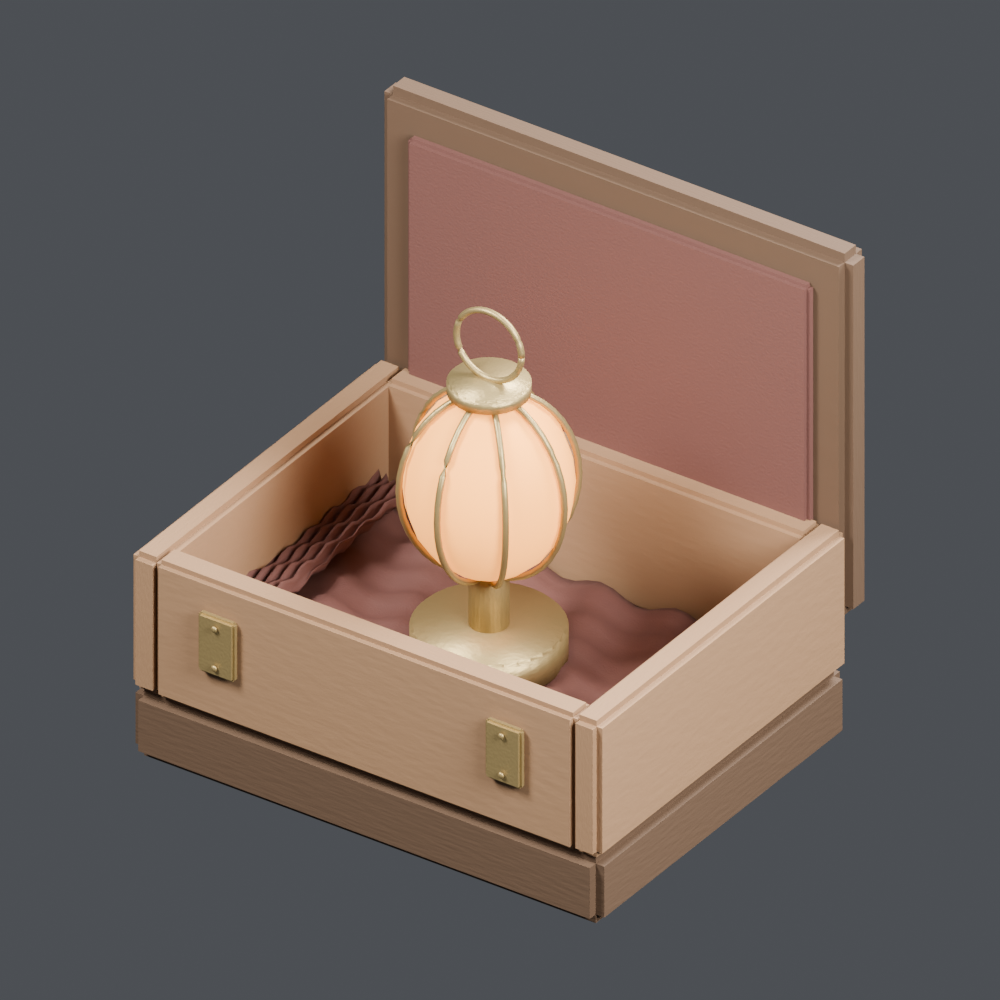

[ZIP · BLEND + GLB · 0.63 MB](https://github.com/k3peta/tales-on-a-table/releases/download/v2026.10.18/OL_STORY_002_CC0.zip) · CC0-1.0

`catalog-20261018` · SHA-256: `d040ddfedde05f4acb55a0e0f301a3a0e549d039ca7136eab053039178499c73`

## AT_026 — 幽光の檻ランタン

骨董屋の素材「幽光の檻ランタン」。収録単位：1モデル。BLENDとGLBを同梱しています。近景は同じ配布BLENDの実レンダーです。

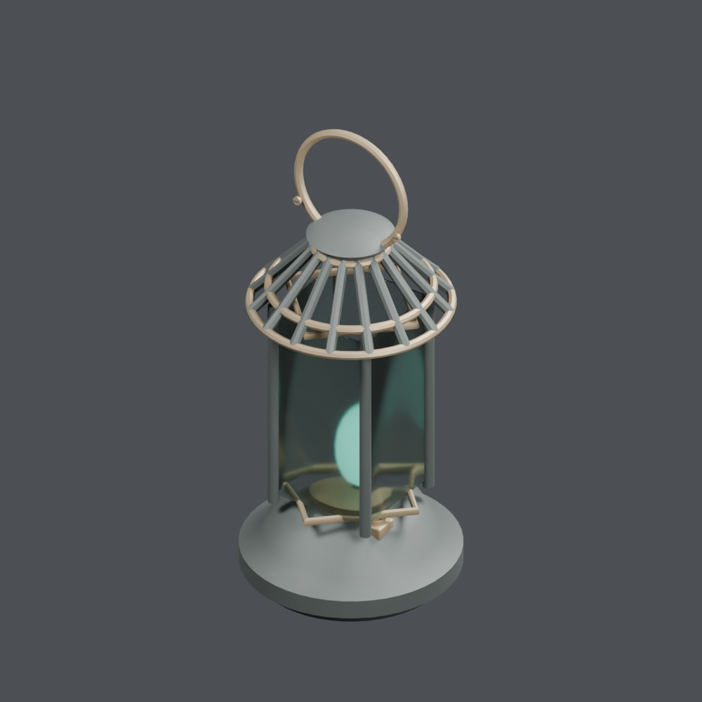

[ZIP · BLEND + GLB · 0.86 MB](https://github.com/k3peta/tales-on-a-table/releases/download/v2026.10.18/AT_026_CC0.zip) · CC0-1.0

`catalog-20261018` · SHA-256: `aa51c45c3ef1ca613ecad78d66d47739c82600011e87c56974bf3406d5ad9d3b`

## AT_048 — 蝋の垂れた真鍮燭台

骨董屋の素材「蝋の垂れた真鍮燭台」。収録単位：1モデル。BLENDとGLBを同梱しています。近景は同じ配布BLENDの実レンダーです。

[ZIP · BLEND + GLB · 0.87 MB](https://github.com/k3peta/tales-on-a-table/releases/download/v2026.10.18/AT_048_CC0.zip) · CC0-1.0

`catalog-20261018` · SHA-256: `396ba0b5b5f162d430ee8999bcf55cc7c54f2141790a52159adeea954929435a`

## AT_049 — 真鍮のカウンターランプ

骨董屋の素材「真鍮のカウンターランプ」。収録単位：1モデル。BLENDとGLBを同梱しています。近景は同じ配布BLENDの実レンダーです。

[ZIP · BLEND + GLB · 0.86 MB](https://github.com/k3peta/tales-on-a-table/releases/download/v2026.10.18/AT_049_CC0.zip) · CC0-1.0

`catalog-20261018` · SHA-256: `14ad4a6465538677c3cc55b62cba679e036c9610df358c31bdcc26f7733155ef`
