# 船长室与船用物品 — 26个分发套件

[日本語](captain-cabin.md) · [English](captain-cabin.en.md) · [简体中文](captain-cabin.zh-CN.md)

首次发布14个此前模型与12个追加设计。CP006采用修正后的箱体接缝。既有复用物品不重复登记，两只旅行包按同一设计计算。每个ZIP包含BLEND、GLB、实渲染图、三语README和CC0条件，不含完整场景。

## CP_001 — 八握柄船舵轮

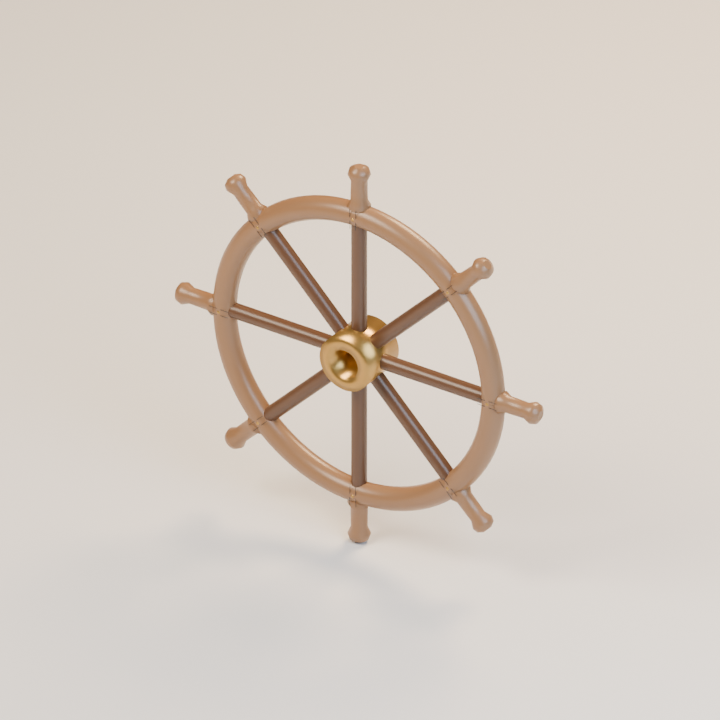

分段木轮圈、车削握柄、八根辐条、轴孔与背板。

1.082 × 0.137 × 1.082 m · captain-v2 · CC0-1.0

[下载 BLEND + GLB](https://github.com/k3peta/tales-on-a-table/releases/download/v2026.10.19-captain-cabin/CP_001_CC0.zip)

## CP_002 — 甲板舵轮架

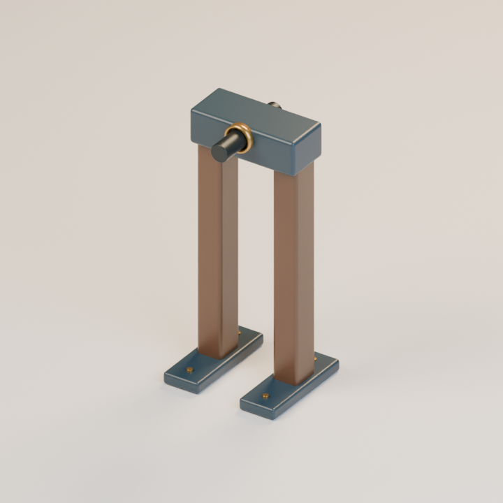

带双脚甲板固定架、转轴和轴承，可与舵轮分开使用。

0.500 × 0.450 × 1.137 m · captain-v2 · CC0-1.0

[下载 BLEND + GLB](https://github.com/k3peta/tales-on-a-table/releases/download/v2026.10.19-captain-cabin/CP_002_CC0.zip)

## CP_003 — 三节伸缩手持望远镜

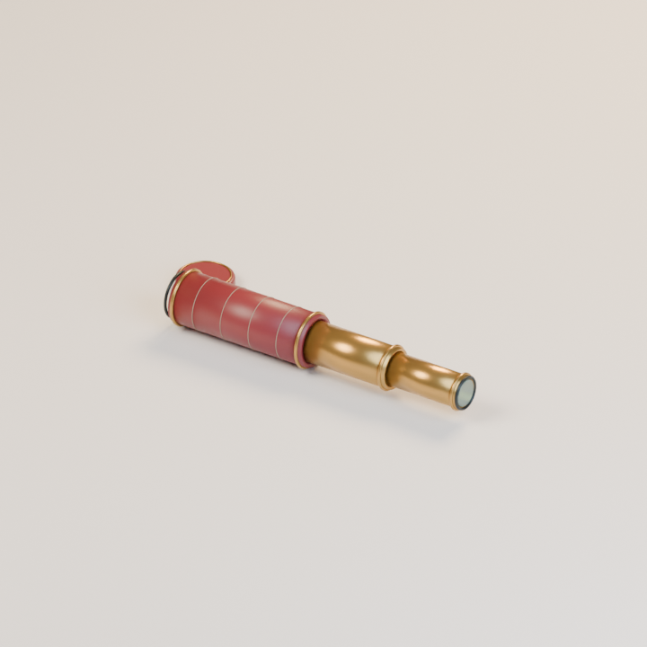

展开的三节黄铜望远镜，带皮革握把和玻璃镜片。

0.468 × 0.157 × 0.073 m · captain-v2 · CC0-1.0

[下载 BLEND + GLB](https://github.com/k3peta/tales-on-a-table/releases/download/v2026.10.19-captain-cabin/CP_003_CC0.zip)

## CP_004 — 中空皮革望远镜筒

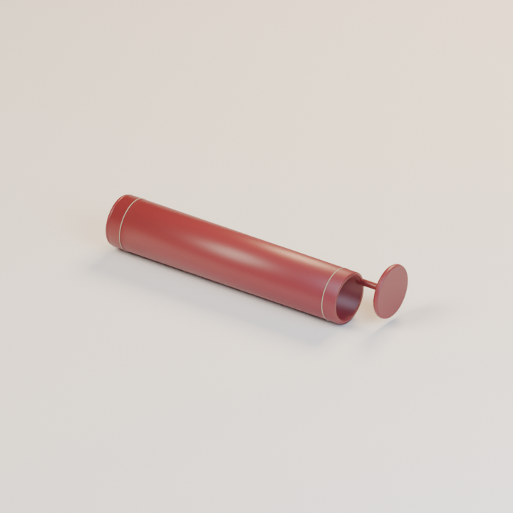

中空筒形皮革收纳盒，带底盖、打开的铰接盖、缝线和固定带。

0.532 × 0.142 × 0.107 m · captain-v2 · CC0-1.0

[下载 BLEND + GLB](https://github.com/k3peta/tales-on-a-table/releases/download/v2026.10.19-captain-cabin/CP_004_CC0.zip)

## CP_005 — 手持六分仪

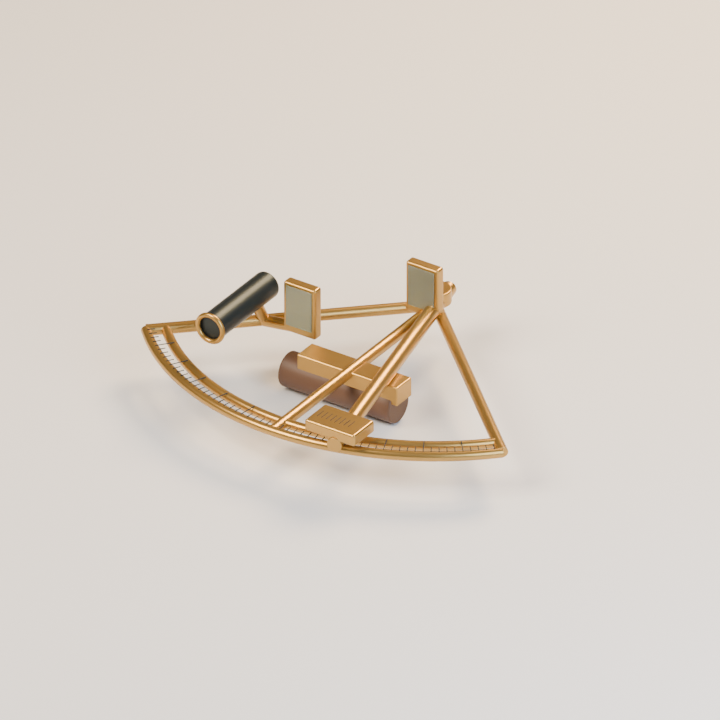

带握柄、刻度框、瞄准筒、反光镜和固定支架。

0.327 × 0.243 × 0.078 m · captain-v2 · CC0-1.0

[下载 BLEND + GLB](https://github.com/k3peta/tales-on-a-table/releases/download/v2026.10.19-captain-cabin/CP_005_CC0.zip)

## CP_006 — 带轮廓支撑的六分仪盒

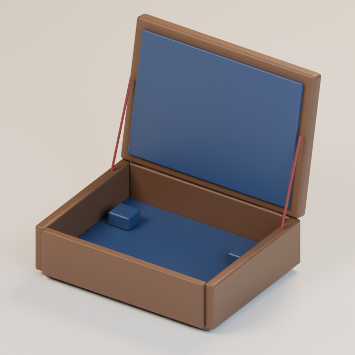

打开的内衬木盒，带轮廓支撑、铰链和撑带；外部接缝已修正。

0.375 × 0.350 × 0.366 m · captain-v3-r1 · CC0-1.0

[下载 BLEND + GLB](https://github.com/k3peta/tales-on-a-table/releases/download/v2026.10.19-captain-cabin/CP_006_CC0.zip)

## CP_010 — 双轮滑车

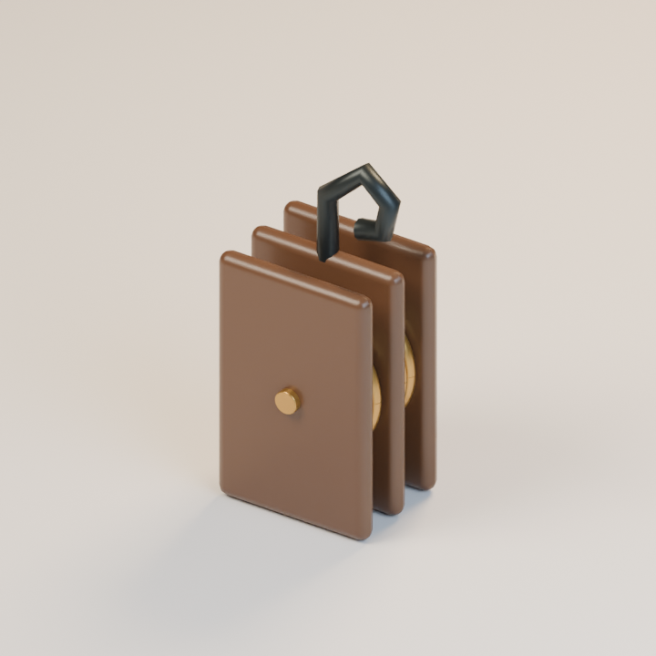

木壳内装有两个带槽滑轮，并配有金属吊环。

0.140 × 0.120 × 0.309 m · captain-v2 · CC0-1.0

[下载 BLEND + GLB](https://github.com/k3peta/tales-on-a-table/releases/download/v2026.10.19-captain-cabin/CP_010_CC0.zip)

## CP_012 — 带挡边的海图桌

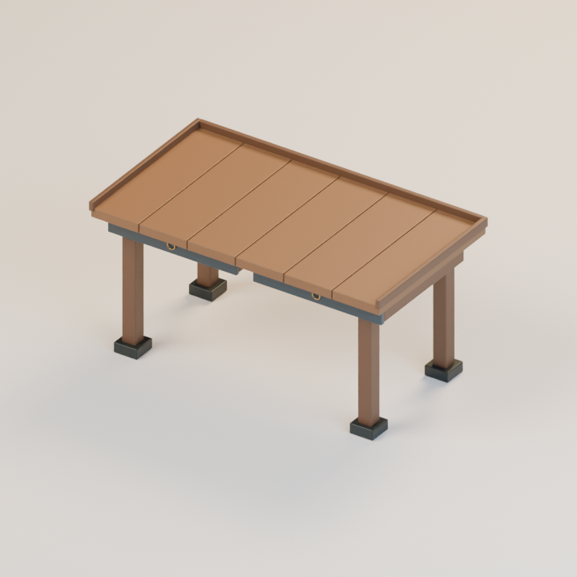

木制海图桌，带防落挡边、结实桌腿和抽屉。

1.604 × 0.902 × 0.817 m · captain-v2 · CC0-1.0

[下载 BLEND + GLB](https://github.com/k3peta/tales-on-a-table/releases/download/v2026.10.19-captain-cabin/CP_012_CC0.zip)

## CP_013 — 标绘航线的海图

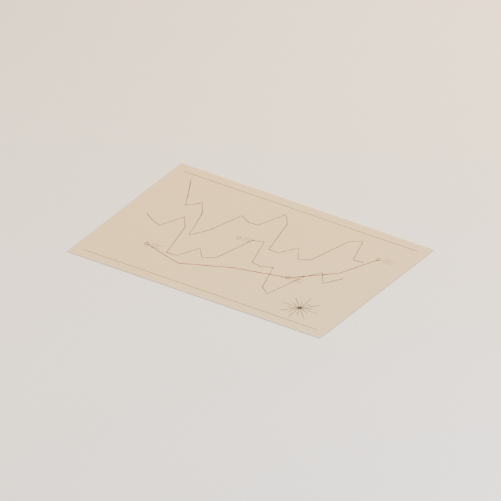

独立海图，绘有虚构海岸线与红色航线。

0.650 × 0.440 × 0.002 m · captain-v2 · CC0-1.0

[下载 BLEND + GLB](https://github.com/k3peta/tales-on-a-table/releases/download/v2026.10.19-captain-cabin/CP_013_CC0.zip)

## CP_014 — 黄铜海图分规

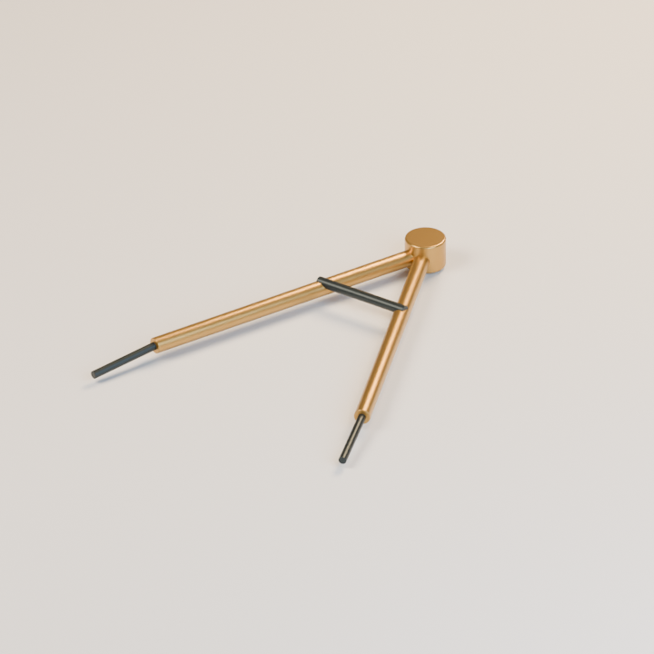

带双尖脚与黄铜铰接部的航海桌用分规。

0.148 × 0.191 × 0.015 m · captain-v2 · CC0-1.0

[下载 BLEND + GLB](https://github.com/k3peta/tales-on-a-table/releases/download/v2026.10.19-captain-cabin/CP_014_CC0.zip)

## CP_015 — 连杆平行尺

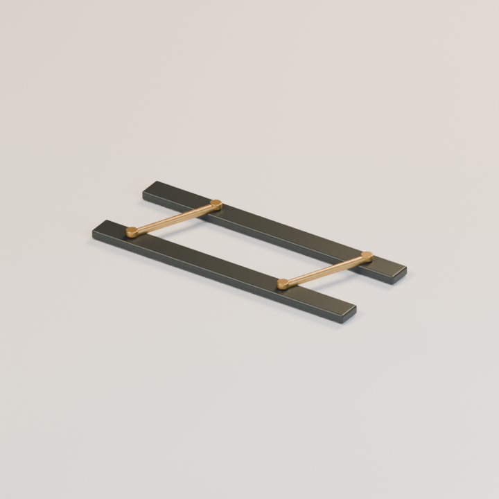

两根深色直尺由黄铜连杆与转轴连接。

0.300 × 0.117 × 0.017 m · captain-v2 · CC0-1.0

[下载 BLEND + GLB](https://github.com/k3peta/tales-on-a-table/releases/download/v2026.10.19-captain-cabin/CP_015_CC0.zip)

## CP_016 — 打开的航海日志

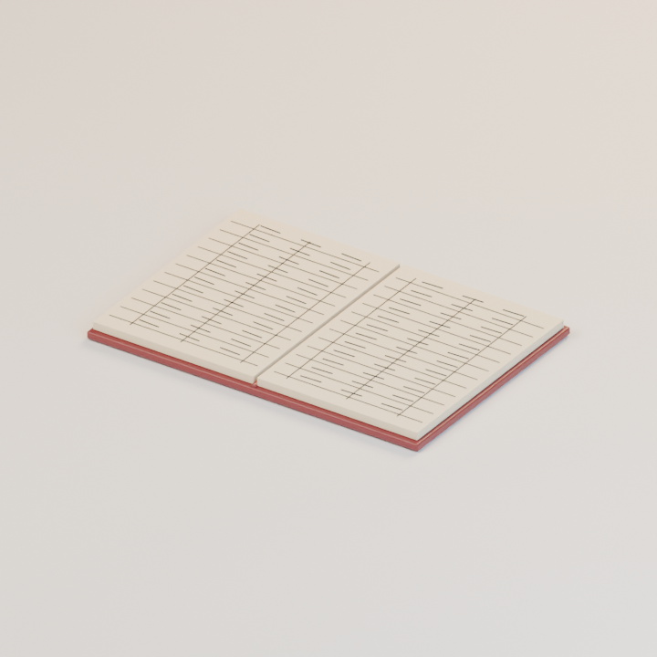

打开的装订日志，带分层书页与部分填写的格线页面。

0.360 × 0.250 × 0.018 m · captain-v2 · CC0-1.0

[下载 BLEND + GLB](https://github.com/k3peta/tales-on-a-table/releases/download/v2026.10.19-captain-cabin/CP_016_CC0.zip)

## CP_017 — 带提手的海图镇纸

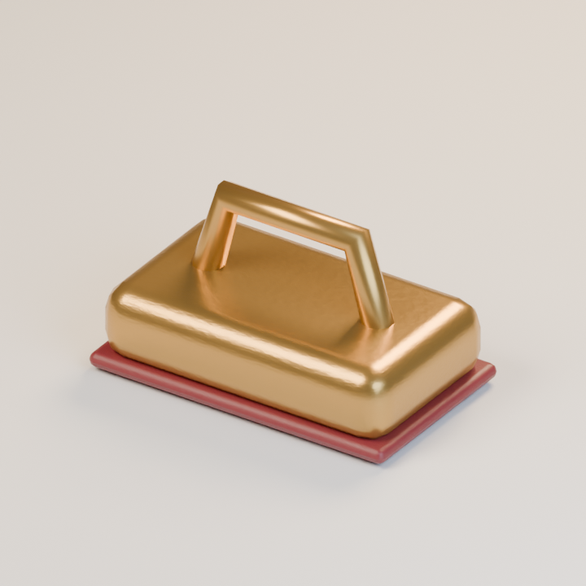

小巧的长方形金属镇纸，带凸起提手。

0.083 × 0.050 × 0.045 m · captain-v2 · CC0-1.0

[下载 BLEND + GLB](https://github.com/k3peta/tales-on-a-table/releases/download/v2026.10.19-captain-cabin/CP_017_CC0.zip)

## CP_019 — 带储物空间的船舱卧铺

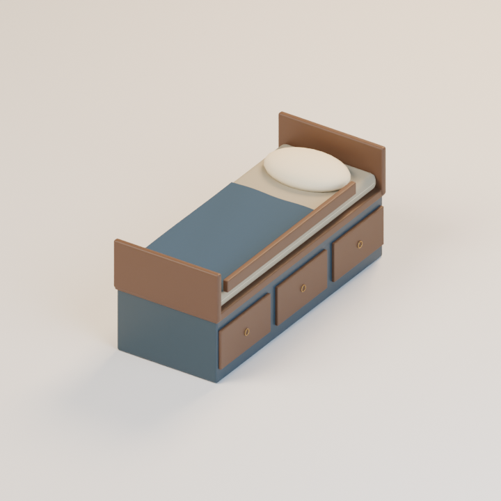

木框卧铺，配有储物柜面、枕头与垂落的深蓝毯子。

0.831 × 1.965 × 0.830 m · captain-v2 · CC0-1.0

[下载 BLEND + GLB](https://github.com/k3peta/tales-on-a-table/releases/download/v2026.10.19-captain-cabin/CP_019_CC0.zip)

## CP_020 — 带重物的藏宝图

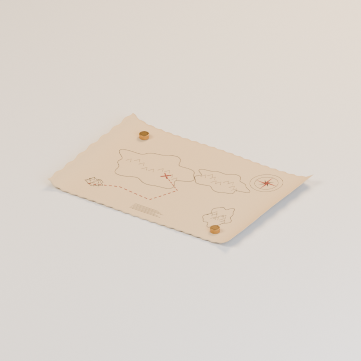

做旧羊皮纸边缘、卷角、虚构岛屿、虚线航路与黄铜重物。

0.685 × 0.486 × 0.033 m · captain-v3-r1 · CC0-1.0

[下载 BLEND + GLB](https://github.com/k3peta/tales-on-a-table/releases/download/v2026.10.19-captain-cabin/CP_020_CC0.zip)

## CP_021 — 带鞘的大型船长刀

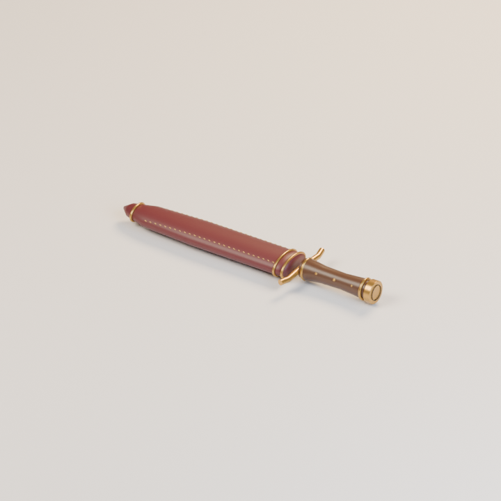

大刀完整收纳于带缝线的皮鞘中，配有护手与铆钉木柄。

0.566 × 0.143 × 0.048 m · captain-v3-r1 · CC0-1.0

[下载 BLEND + GLB](https://github.com/k3peta/tales-on-a-table/releases/download/v2026.10.19-captain-cabin/CP_021_CC0.zip)

## CP_022 — 带皮套的折叠放大镜

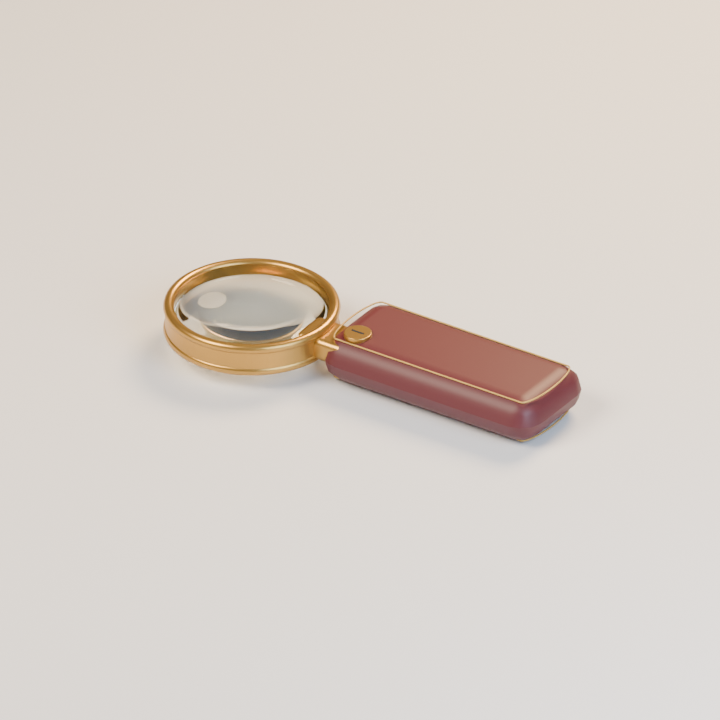

黄铜镜筒内装凸透镜，配双固定环、转轴与圆头皮套。

0.245 × 0.101 × 0.031 m · captain-v3-r1 · CC0-1.0

[下载 BLEND + GLB](https://github.com/k3peta/tales-on-a-table/releases/download/v2026.10.19-captain-cabin/CP_022_CC0.zip)

## CP_023 — 盛咖啡的陶制壶

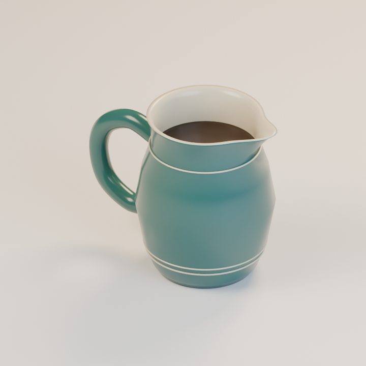

中空釉面陶壶，带壶嘴、连接把手、陶瓷内壁与咖啡液面。

0.308 × 0.196 × 0.247 m · captain-v3-r1 · CC0-1.0

[下载 BLEND + GLB](https://github.com/k3peta/tales-on-a-table/releases/download/v2026.10.19-captain-cabin/CP_023_CC0.zip)

## CP_024 — 悬挂的船长长外套

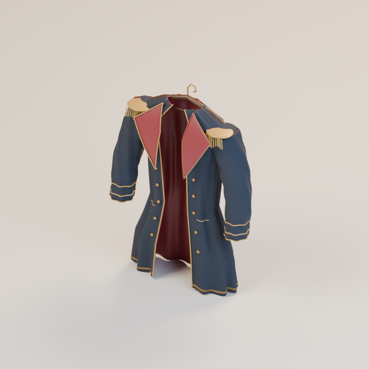

空置长外套，带红色内衬、中空袖口、金饰边、肩章与衣架。

0.858 × 0.291 × 1.170 m · captain-v3-r1 · CC0-1.0

[下载 BLEND + GLB](https://github.com/k3peta/tales-on-a-table/releases/download/v2026.10.19-captain-cabin/CP_024_CC0.zip)

## CP_025 — 金边提督帽

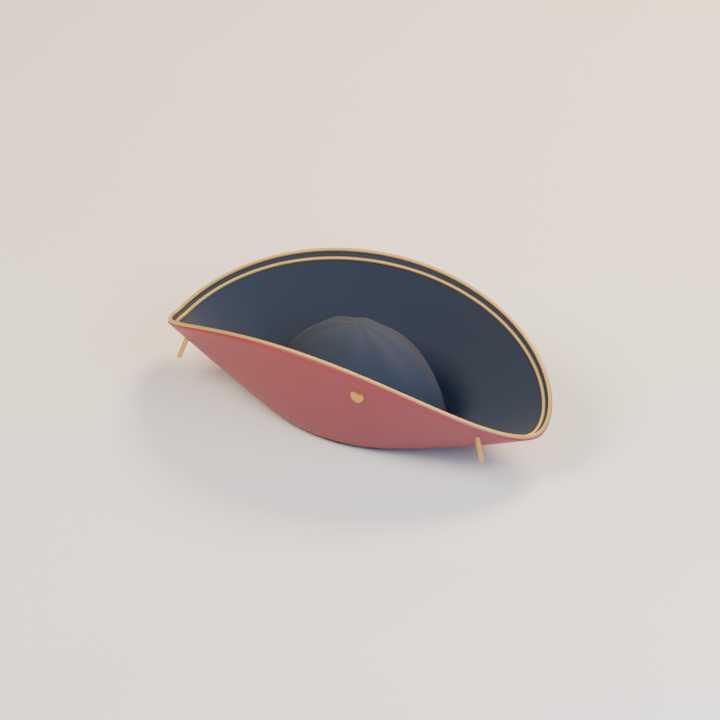

弯起的双角帽檐、中空帽体、双层金边、饰绳与帽章。

0.696 × 0.361 × 0.197 m · captain-v3-r1 · CC0-1.0

[下载 BLEND + GLB](https://github.com/k3peta/tales-on-a-table/releases/download/v2026.10.19-captain-cabin/CP_025_CC0.zip)

## CP_026 — 开门的大型鸟笼

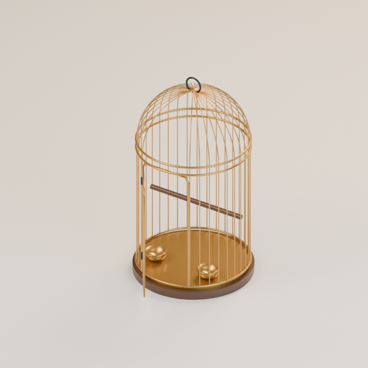

圆顶黄铜鸟笼，带弯曲栏杆、可分离底盘、打开的门与食碗。

0.700 × 0.895 × 1.278 m · captain-v3-r1 · CC0-1.0

[下载 BLEND + GLB](https://github.com/k3peta/tales-on-a-table/releases/download/v2026.10.19-captain-cabin/CP_026_CC0.zip)

## CP_027 — 独立落地鹦鹉栖架

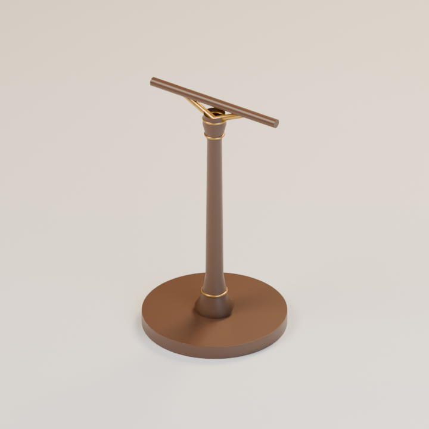

带加重圆底座、车削立柱与支撑木横杆；与鸟模型分离。

0.490 × 0.480 × 0.855 m · captain-v3-r1 · CC0-1.0

[下载 BLEND + GLB](https://github.com/k3peta/tales-on-a-table/releases/download/v2026.10.19-captain-cabin/CP_027_CC0.zip)

## CP_028 — 绯红金刚鹦鹉

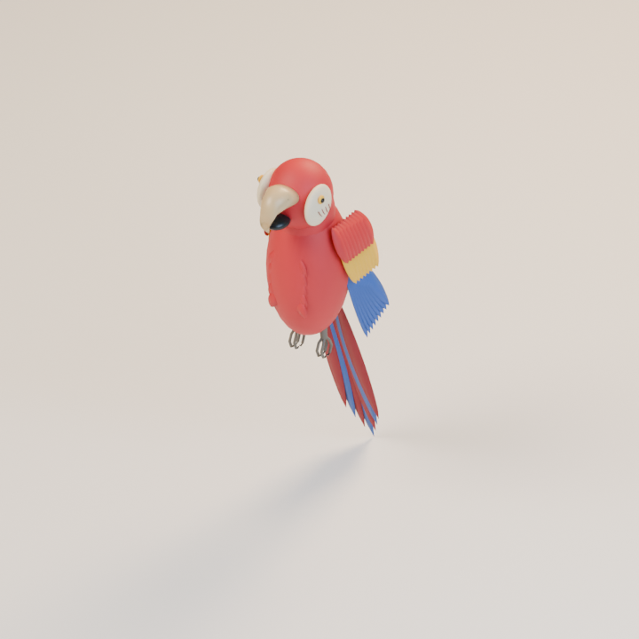

静态红色金刚鹦鹉，带分层黄蓝翼羽、长尾和抓握脚爪。

0.242 × 0.423 × 0.829 m · captain-v3-r1 · CC0-1.0

[下载 BLEND + GLB](https://github.com/k3peta/tales-on-a-table/releases/download/v2026.10.19-captain-cabin/CP_028_CC0.zip)

## CP_029 — 木脚落地地球仪

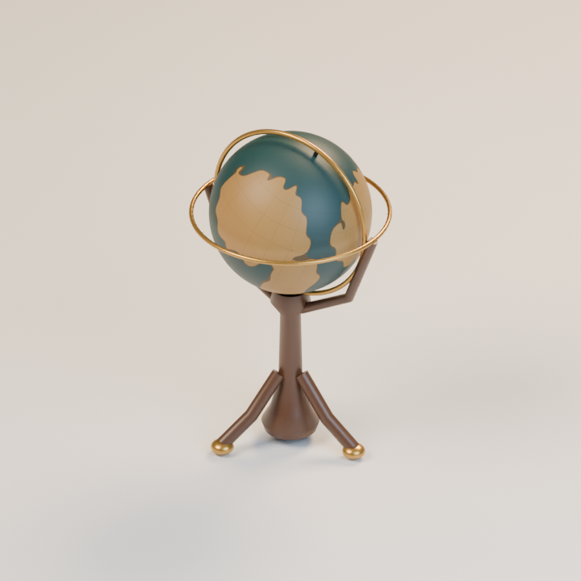

原创虚构大陆、经纬线、黄铜环与木制三脚架。

0.712 × 0.696 × 1.205 m · captain-v3-r1 · CC0-1.0

[下载 BLEND + GLB](https://github.com/k3peta/tales-on-a-table/releases/download/v2026.10.19-captain-cabin/CP_029_CC0.zip)

## CP_030 — 打开的船用私物箱

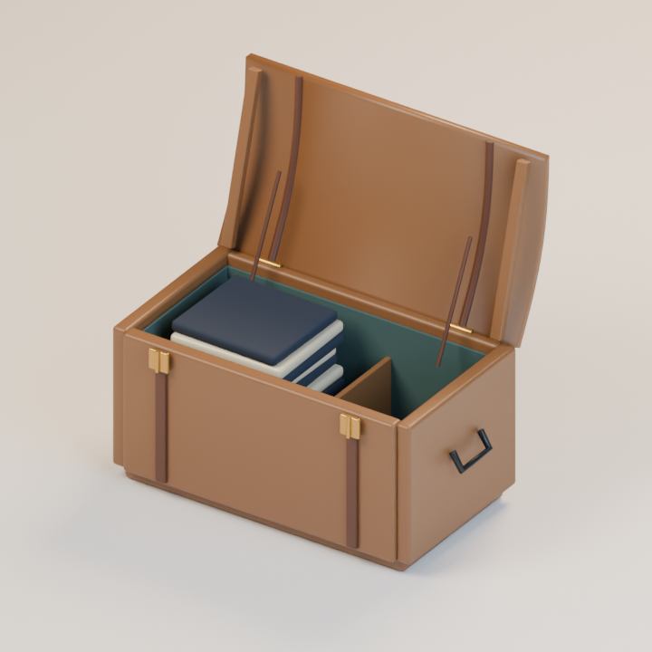

带内衬和隔板的木箱，配有打开的弧形盖、撑带、叠布、瓶子及修正后的接缝。

1.102 × 0.748 × 1.031 m · captain-v3-r1 · CC0-1.0

[下载 BLEND + GLB](https://github.com/k3peta/tales-on-a-table/releases/download/v2026.10.19-captain-cabin/CP_030_CC0.zip)

## CP_031 — 高身皮革旅行包

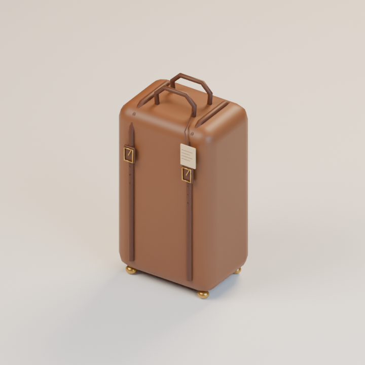

高约0.92米的挺括旅行包，带加固带、搭扣、提手、底脚和行李牌。

0.480 × 0.382 × 0.920 m · captain-v3-r1 · CC0-1.0

[下载 BLEND + GLB](https://github.com/k3peta/tales-on-a-table/releases/download/v2026.10.19-captain-cabin/CP_031_CC0.zip)

