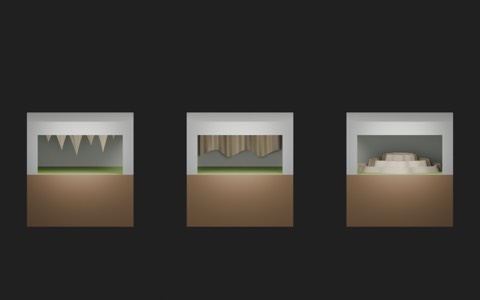
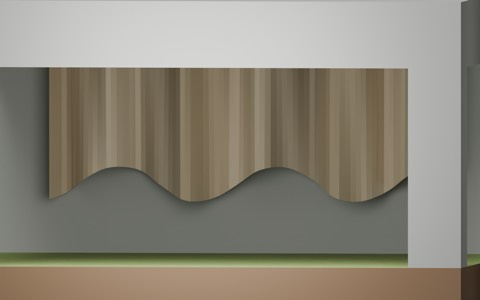
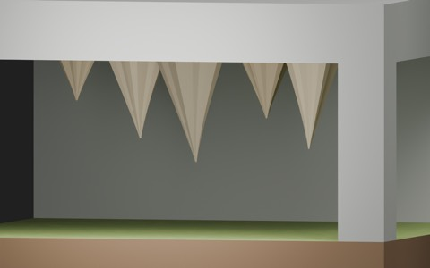
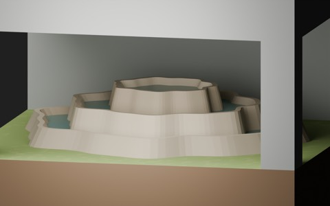
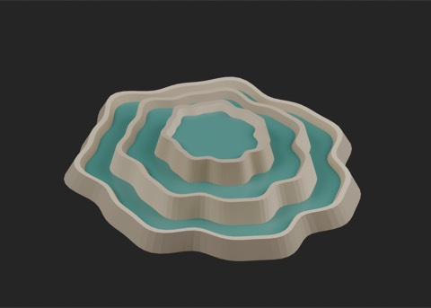

# Cave deposition: three decorative inserts

917 existing records + 3 = 920 distribution records. These are local morphology/use candidates; global historical independence is unconfirmed. BLEND and GLB are two formats per record.

|ID|Download|Bytes|
|---|---|---:|
|CD101_CeilingPendants|[ZIP](https://raw.githubusercontent.com/k3peta/tales-on-a-table/main/distributions/cave-deposition-v1/CD101_CeilingPendants_CC0.zip)|184974|
|CD102_FoldedCurtain|[ZIP](https://raw.githubusercontent.com/k3peta/tales-on-a-table/main/distributions/cave-deposition-v1/CD102_FoldedCurtain_CC0.zip)|243747|
|CD103_RimstonePools|[ZIP](https://raw.githubusercontent.com/k3peta/tales-on-a-table/main/distributions/cave-deposition-v1/CD103_RimstonePools_CC0.zip)|192791|

## Mounting and limitations

- CD101_CeilingPendants: Ceiling mineral pendants. Anchor origin on ceiling plane; place at Z0.75 for a cave ceiling0.75. Upper0.04m embeds into roof. Lowest local Z-0.465.
- CD102_FoldedCurtain: Folded cave curtain. Ceiling anchor origin; place at Y0.65 Z0.75 in a2m room with north inner wallY0.8. Upper0.04m embeds into roof.
- CD103_RimstonePools: Closed rimstone pools. Floor anchor originZ0. Local static water levels0.27,0.17,0.07m. Not compatible with standard river waterZ-0.01 without deliberate separate basin placement.

Metres, Z up. Decorative inserts within a 2 m grid, not filled terrain tiles or complete walkable caves. CD101/CD102 origin is the ceiling anchor, with the upper 0.04 m intentionally embedded into a roof. At a 0.75 m ceiling the remaining low space is approximately 0.20-0.44 m, not a human passage. Curtain thickness is defined along Y, not as constant thickness normal to its curved surface.

CD103 uses a floor anchor and three closed local water levels (0.27, 0.17, 0.07 m); it is not a direct connector to standard river water at -0.01 m. Water is a thin static opaque surface. These are simplified viewing decorations, not geological growth or fluid simulations. Production checked Blender 5.2.2 reloading and sampled mounting cross-sections. Full collision/contact volumes, actual walking, gameplay, fluid behavior, Blender 4.3.2 compatibility and global historical uniqueness remain unverified. Append named Collections from BLEND.

Model geometry and embedded display materials only: CC0-1.0. No code, private evidence, images or assembled scenes included. [Checksums](../distributions/cave-deposition-v1/SHA256SUMS.txt).

## 実作画像 / Actual renders

完成バッチの配置・接写。画像は閲覧用でモデルCC0の対象外です。[既存の画像利用条件](../LICENSE.md)を維持します。

|ID|名称 / Name|Download|
|---|---|---|
|CD101_CeilingPendants|CeilingPendants|[ZIP](https://raw.githubusercontent.com/k3peta/tales-on-a-table/main/distributions/cave-deposition-v1/CD101_CeilingPendants_CC0.zip)|
|CD102_FoldedCurtain|FoldedCurtain|[ZIP](https://raw.githubusercontent.com/k3peta/tales-on-a-table/main/distributions/cave-deposition-v1/CD102_FoldedCurtain_CC0.zip)|
|CD103_RimstonePools|RimstonePools|[ZIP](https://raw.githubusercontent.com/k3peta/tales-on-a-table/main/distributions/cave-deposition-v1/CD103_RimstonePools_CC0.zip)|

