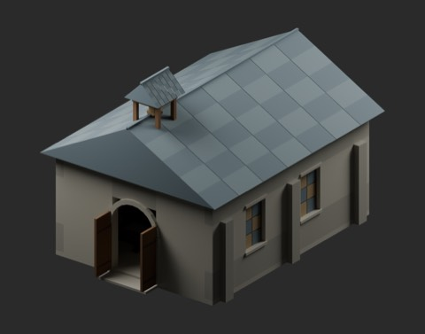
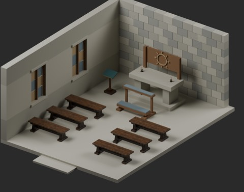
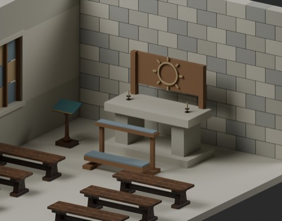
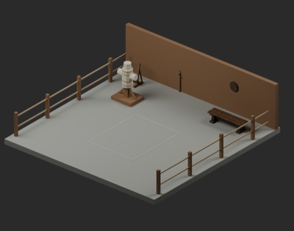
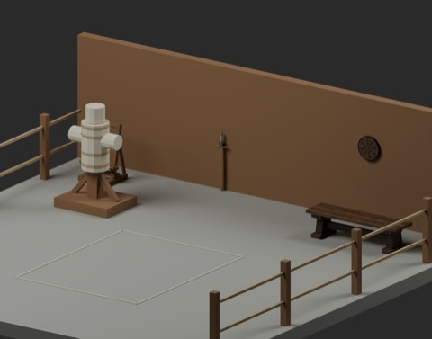

# 小教会と訓練場 / Chapel and training court / 小教堂与训练场

**995 distribution records = 989 + 4 model candidates + 2 assemblies.** Existing six types are reused without increment; global shape independence is unconfirmed.

|ID|日本語|English|中文|ZIP|
|---|---|---|---|---|
|CPT101_ChapelShell|小教会|Chapel shell|小教堂|[ZIP](https://raw.githubusercontent.com/k3peta/tales-on-a-table/main/distributions/chapel-training-v1/CPT101_ChapelShell_CC0.zip)|
|CPT102_SunAltar|日輪祭壇|Sun altar|日轮祭坛|[ZIP](https://raw.githubusercontent.com/k3peta/tales-on-a-table/main/distributions/chapel-training-v1/CPT102_SunAltar_CC0.zip)|
|CPT103_PrayerKneeler|祈祷膝台|Prayer kneeler|祈祷跪凳|[ZIP](https://raw.githubusercontent.com/k3peta/tales-on-a-table/main/distributions/chapel-training-v1/CPT103_PrayerKneeler_CC0.zip)|
|CPT201_PaddedPell|詰め物標柱|Padded pell|填充练习柱|[ZIP](https://raw.githubusercontent.com/k3peta/tales-on-a-table/main/distributions/chapel-training-v1/CPT201_PaddedPell_CC0.zip)|
|CPTV01_Chapel|教会配置|Chapel assembly|教堂布置|[ZIP](https://raw.githubusercontent.com/k3peta/tales-on-a-table/main/distributions/chapel-training-v1/CPTV01_Chapel_CC0.zip)|
|CPTV02_TrainingCourt|訓練場配置|Training court assembly|训练场布置|[ZIP](https://raw.githubusercontent.com/k3peta/tales-on-a-table/main/distributions/chapel-training-v1/CPTV02_TrainingCourt_CC0.zip)|

## 日本語

単品4（建築1・家具道具3）と配置2を区別。再利用6種類を加算しません。教会は6×8m、床0.16m、入口幅1.68m、中央通路1.5m。屋根・鐘楼・壁は取り外し可能。内装画像は非表示による切断表示で配布形状は保持。色窓は不透明、扉・鐘は静止。訓練場8×8m、中央2.4×3mの空き領域は実用上の安全な間合いを保証しません。実歩行・衝突・荷重建築安全・動作・旧Blender互換・全履歴独立性は未検証。モデル材質のみCC0、コード画像記事私的記録は対象外。

## English

Metres, Z up, ground origins. Chapel6x8m, floor0.16m, doorway1.68m, aisle1.5m. Roof/bell tower/walls remain separate; cutaway images hide them, while the distributed geometry remains complete. Windows are opaque colored panels, door/bell fixed. Court8x8m has a2.4x3m clear marked area, not certified safe training distance. No real training mechanism or operating instructions are supplied. Walking/collision, structural/load safety, dynamic doors/bell, historical precision and Blender4.3.2 compatibility remain unverified. Reused FT_005/FT_028/FT_034/WS_014/ARM_019/ARM_051 retain model/material CC0; new models are original procedural work. Code, images, articles and private records are excluded.

## 中文

新增4个单件候选与2个布置记录，既有6种模型不重复计数，历史独立形状数未确认。教堂6×8米、地板0.16米、入口1.68米、中央通道1.5米；屋顶、钟楼和墙体可分别隐藏。内部图片为剖视显示，配布文件保留完整形状。彩窗不透明，门和钟静止。训练场8×8米，中央2.4×3米空区不代表安全训练距离。实际行走、碰撞、结构承重安全、动态机构及旧Blender兼容性均未验证。仅模型几何与内嵌材质适用CC0；代码、图片、文章和私有记录不包含在授权内。

[Checksums](../distributions/chapel-training-v1/SHA256SUMS.txt).

実作レンダー / Actual model renders. Images are supplied for browsing, excluded from model CC0; existing [image rights](../LICENSE.md) remain unchanged. Images do not add model records.

## 配置全景・接写 / Scene overview and detail

### 教会配置（CPT101小教会・CPT102祭壇・CPT103膝台）

[CPT101_ChapelShell ZIP](https://raw.githubusercontent.com/k3peta/tales-on-a-table/main/distributions/chapel-training-v1/CPT101_ChapelShell_CC0.zip) · [CPT102_SunAltar ZIP](https://raw.githubusercontent.com/k3peta/tales-on-a-table/main/distributions/chapel-training-v1/CPT102_SunAltar_CC0.zip) · [CPT103_PrayerKneeler ZIP](https://raw.githubusercontent.com/k3peta/tales-on-a-table/main/distributions/chapel-training-v1/CPT103_PrayerKneeler_CC0.zip) · [CPTV01_Chapel ZIP](https://raw.githubusercontent.com/k3peta/tales-on-a-table/main/distributions/chapel-training-v1/CPTV01_Chapel_CC0.zip) ·

### 訓練場配置（CPT201詰め物標柱）

[CPT201_PaddedPell ZIP](https://raw.githubusercontent.com/k3peta/tales-on-a-table/main/distributions/chapel-training-v1/CPT201_PaddedPell_CC0.zip) · [CPTV02_TrainingCourt ZIP](https://raw.githubusercontent.com/k3peta/tales-on-a-table/main/distributions/chapel-training-v1/CPTV02_TrainingCourt_CC0.zip) ·

