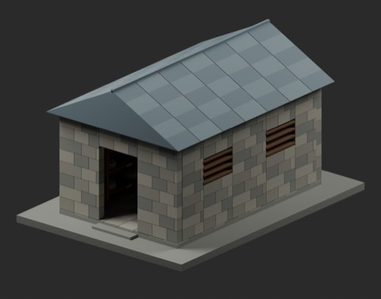
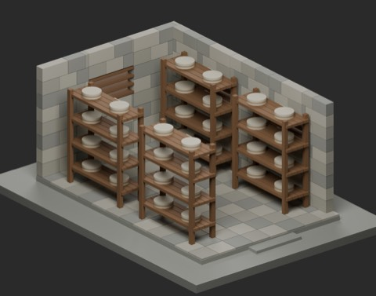
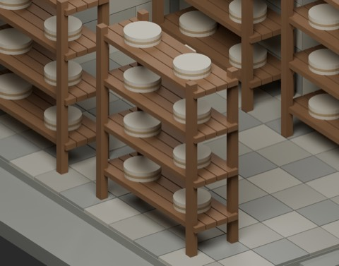
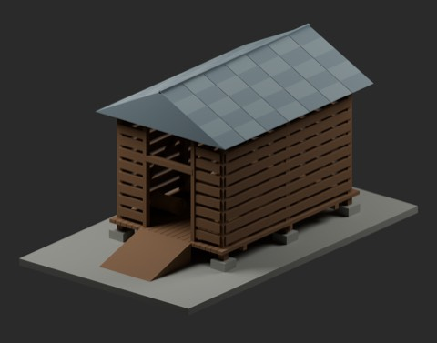
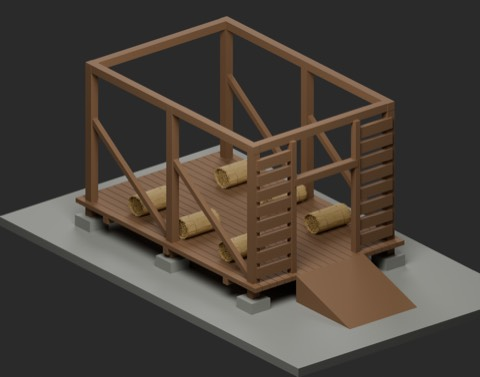
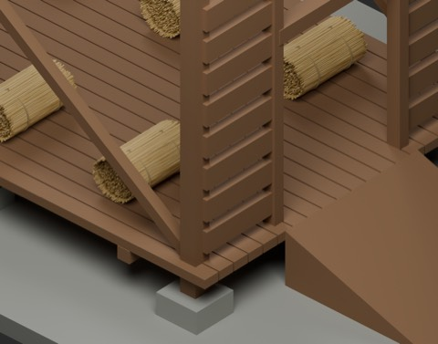

# チーズ熟成小屋・乾草納屋 / Cheese and dry-hay buildings

**955 distribution records = 950 + 3 component candidates + 2 assembly examples.** Two structural buildings and one use-specific composite rack. Existing hay reuse adds zero new types; assemblies, cheese wheels, vents and fixtures are not separate new shapes. Global historical independence remains unconfirmed.

### CHB101_CheeseHouse

structural_building

[ZIP](https://raw.githubusercontent.com/k3peta/tales-on-a-table/main/distributions/cheese-hay-buildings-v1/CHB101_CheeseHouse_CC0.zip)

### CHB102_RipeningRack

composite_ripening_shelf

[ZIP](https://raw.githubusercontent.com/k3peta/tales-on-a-table/main/distributions/cheese-hay-buildings-v1/CHB102_RipeningRack_CC0.zip)

### CHB103_VentilatedHayBarn

structural_building

[ZIP](https://raw.githubusercontent.com/k3peta/tales-on-a-table/main/distributions/cheese-hay-buildings-v1/CHB103_VentilatedHayBarn_CC0.zip)

### CHBV01_CheeseRipeningHut

assembly_not_new_shape

[ZIP](https://raw.githubusercontent.com/k3peta/tales-on-a-table/main/distributions/cheese-hay-buildings-v1/CHBV01_CheeseRipeningHut_CC0.zip)

### CHBV02_DryHayStore

assembly_not_new_shape

[ZIP](https://raw.githubusercontent.com/k3peta/tales-on-a-table/main/distributions/cheese-hay-buildings-v1/CHBV02_DryHayStore_CC0.zip)

## Dimensions and use

Metres, Z up, origins at XY0/Z0. CHB101 is a4x6m stone cheese house with floorZ0.15,1.3m doorway, side/rear louvers and removable roof/walls. Ridge about4.05m. CHB102 combines a2m-wide slatted rack and eight supported0.45m cheese wheels; shelves atZ0.4/1/1.6/2.2. It is a use-specific composite related to existing shelves, not a proven globally distinct shelf type. CHB103 is a4x6m ventilated dry-hay barn with floorZ0.6 and a1.8m-wide ramp rising0.6m over1.8m horizontal run; ridge about4.93m. Roofs/steps/ramp extend beyond the floor footprint. The upper facade opening is for display: no second floor, lift or loft access is supplied. This is dry-hay storage, not a sealed fermented-feed silo.

CHBV01 combines the cheese house and four racks; CHBV02 combines the barn and six unchanged existing BN_005 hay models. Complete assemblies retain Removable_* roof/wall objects; hide these to inspect interiors as in cutaway render examples. Existing FT025 cheese wedge, general shelves, HCV102 feeder and HCV503 ventilation wall are comparable uses, not claimed absent.

Original procedural geometry for the three components; existing BN_005 published ZIP hash/CC0 checked. Model geometry and embedded materials only are CC0-1.0. Code, images, article text and private records are excluded. Hygiene/food safety, ripening temperature/humidity/airflow, load/structural/fire safety, walking/collision and Blender4.3.2 compatibility are unverified. Cheese is fixed display geometry, not a ripening simulation. Sampled dimensions and connections do not certify a real facility. [Checksums](../distributions/cheese-hay-buildings-v1/SHA256SUMS.txt).

## 実作画像 / Actual renders

完成バッチの配置・接写。画像は閲覧用でモデルCC0の対象外です。[既存の画像利用条件](../LICENSE.md)を維持します。

### BN_005

結束した干し草

[ZIP](https://github.com/k3peta/tales-on-a-table/releases/download/v2026.10.19-farmhouse-barn/BN_005_CC0.zip)

### HCV102

HCV102

[ZIP](https://raw.githubusercontent.com/k3peta/tales-on-a-table/main/distributions/husbandry-cellar-v1/HCV102-CC0.zip)

### CHB101_CheeseHouse

CheeseHouse

[ZIP](https://raw.githubusercontent.com/k3peta/tales-on-a-table/main/distributions/cheese-hay-buildings-v1/CHB101_CheeseHouse_CC0.zip)

### CHB102_RipeningRack

RipeningRack

[ZIP](https://raw.githubusercontent.com/k3peta/tales-on-a-table/main/distributions/cheese-hay-buildings-v1/CHB102_RipeningRack_CC0.zip)

### CHB103_VentilatedHayBarn

VentilatedHayBarn

[ZIP](https://raw.githubusercontent.com/k3peta/tales-on-a-table/main/distributions/cheese-hay-buildings-v1/CHB103_VentilatedHayBarn_CC0.zip)

### CHBV01_CheeseRipeningHut

CheeseRipeningHut

[ZIP](https://raw.githubusercontent.com/k3peta/tales-on-a-table/main/distributions/cheese-hay-buildings-v1/CHBV01_CheeseRipeningHut_CC0.zip)

### CHBV02_DryHayStore

DryHayStore

[ZIP](https://raw.githubusercontent.com/k3peta/tales-on-a-table/main/distributions/cheese-hay-buildings-v1/CHBV02_DryHayStore_CC0.zip)

### HCV503

HCV503

[ZIP](https://raw.githubusercontent.com/k3peta/tales-on-a-table/main/distributions/husbandry-cellar-v2/HCV503-CC0.zip)

## Individual images / 個別画像 / 单件图片

Actual distributed models; chosen camera view does not establish intended front or placement pivot. Images are outside model CC0. Original links and archives retained.

### CHB101_CheeseHouse — CheeseHouse

CheeseHouse

[Full image](../previews/hcv-chb24/renders/CHB101_CheeseHouse.png) · [ZIP · BLEND/GLB](https://raw.githubusercontent.com/k3peta/tales-on-a-table/main/distributions/cheese-hay-buildings-v1/CHB101_CheeseHouse_CC0.zip)

### CHB102_RipeningRack — RipeningRack

RipeningRack

[Full image](../previews/hcv-chb24/renders/CHB102_RipeningRack.png) · [ZIP · BLEND/GLB](https://raw.githubusercontent.com/k3peta/tales-on-a-table/main/distributions/cheese-hay-buildings-v1/CHB102_RipeningRack_CC0.zip)

### CHB103_VentilatedHayBarn — VentilatedHayBarn

VentilatedHayBarn

[Full image](../previews/hcv-chb24/renders/CHB103_VentilatedHayBarn.png) · [ZIP · BLEND/GLB](https://raw.githubusercontent.com/k3peta/tales-on-a-table/main/distributions/cheese-hay-buildings-v1/CHB103_VentilatedHayBarn_CC0.zip)

### HCV102 — HCV102

HCV102

[Full image](../previews/hcv-chb24/renders/HCV102.png) · [ZIP · BLEND/GLB](https://raw.githubusercontent.com/k3peta/tales-on-a-table/main/distributions/husbandry-cellar-v1/HCV102-CC0.zip)

## Individual images / 個別画像 / 单件图片

Actual distributed models; chosen camera view does not establish intended front or placement pivot. Images are outside model CC0. Original links and archives retained.

### CHBV01_CheeseRipeningHut — CheeseRipeningHut

CheeseRipeningHut

[Full image](../previews/chbv-mrt24/renders/CHBV01_CheeseRipeningHut.png) · [ZIP · BLEND/GLB](https://raw.githubusercontent.com/k3peta/tales-on-a-table/main/distributions/cheese-hay-buildings-v1/CHBV01_CheeseRipeningHut_CC0.zip)

### CHBV02_DryHayStore — DryHayStore

DryHayStore

[Full image](../previews/chbv-mrt24/renders/CHBV02_DryHayStore.png) · [ZIP · BLEND/GLB](https://raw.githubusercontent.com/k3peta/tales-on-a-table/main/distributions/cheese-hay-buildings-v1/CHBV02_DryHayStore_CC0.zip)

### HCV503 — HCV503

HCV503

[Full image](../previews/chbv-mrt24/renders/HCV503.png) · [ZIP · BLEND/GLB](https://raw.githubusercontent.com/k3peta/tales-on-a-table/main/distributions/husbandry-cellar-v2/HCV503-CC0.zip)
