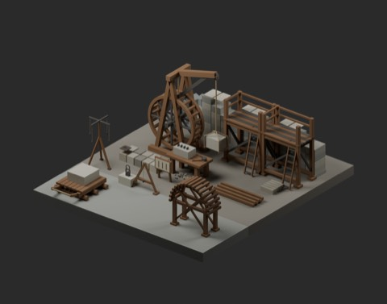
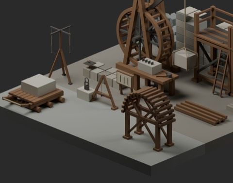
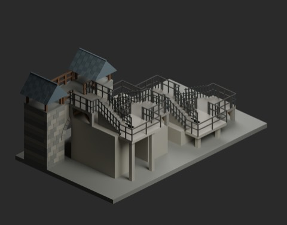
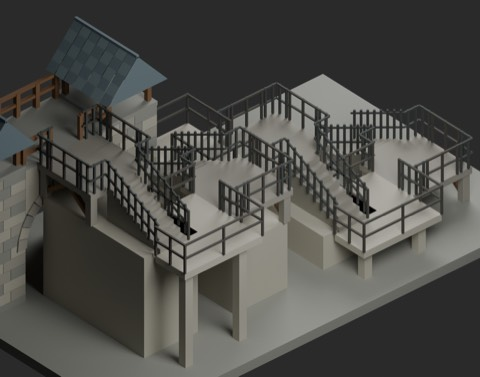
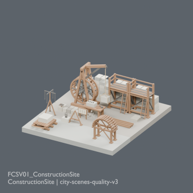
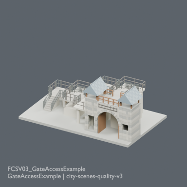

# 城塞シーン品質改訂 v3

**989 distribution records unchanged.** Two revisions of existing FCSV01/FCSV03, zero new records or independent shapes. All original ZIPs and primary record fields remain intact.

- [FCSV01_ConstructionSite v3](https://raw.githubusercontent.com/k3peta/tales-on-a-table/main/distributions/city-scenes-quality-v3/FCSV01_ConstructionSite_v3_CC0.zip)
- [FCSV03_GateAccessExample v3](https://raw.githubusercontent.com/k3peta/tales-on-a-table/main/distributions/city-scenes-quality-v3/FCSV03_GateAccessExample_v3_CC0.zip)

Construction scene adds existing MRT101/102/103/104/105 and MRH202 at scale1 around the work zones. Gate access rearranges four existing ER101 stairs with alternating direction and lateral movement; stair geometry is unchanged. Added landings/supports/railings are scene fixtures, not standalone asset increments.

The old8x20m base was160m²; new14x8.5m base is119m², approximately26% less area. Stair depth changes from16m to about6.2m by using more width; gate landing remainsZ4. Sampled stairs/landings/door/headroom and turning-path lines were checked, not complete body collision. Actual walking, collision, structural/load/egress safety and Blender4.3.2 compatibility remain unverified.

Original model geometry and embedded-material CC0 scope is preserved. Code, rendered images, articles and private records are excluded. [Checksums](../distributions/city-scenes-quality-v3/SHA256SUMS.txt).

## Batch artwork / 制作バッチ画像（版対応は下記監査参照）

完成バッチの配置・接写。画像は閲覧用でモデルCC0の対象外です。[既存の画像利用条件](../LICENSE.md)を維持します。

### FCSV01_ConstructionSite

ConstructionSite

[ZIP](https://raw.githubusercontent.com/k3peta/tales-on-a-table/main/distributions/fortified-city-sites-v1/FCSV01_ConstructionSite_CC0.zip)

### FCSV03_GateAccessExample

GateAccessExample

[ZIP](https://raw.githubusercontent.com/k3peta/tales-on-a-table/main/distributions/fortified-city-access-v2/FCSV03_GateAccessExample_CC0.zip)

## Primary archive images / 初回配布版画像 / 原始归档图片

Actual distributed models; chosen camera view does not establish intended front or placement pivot. Images are outside model CC0. Original links and archives retained.

### FCSV01_ConstructionSite — ConstructionSite

ConstructionSite

[Full image](../previews/bg-fcs24/renders/FCSV01_ConstructionSite.png) · [ZIP · BLEND/GLB](https://raw.githubusercontent.com/k3peta/tales-on-a-table/main/distributions/fortified-city-sites-v1/FCSV01_ConstructionSite_CC0.zip)

## Primary archive images / 初回配布版画像 / 原始归档图片

Actual distributed models; chosen camera view does not establish intended front or placement pivot. Images are outside model CC0. Original links and archives retained.

### FCSV03_GateAccessExample — GateAccessExample

GateAccessExample

[Full image](../previews/hcv-chb24/renders/FCSV03_GateAccessExample.png) · [ZIP · BLEND/GLB](https://raw.githubusercontent.com/k3peta/tales-on-a-table/main/distributions/fortified-city-access-v2/FCSV03_GateAccessExample_CC0.zip)

Version note: individual primary-archive thumbnails show their linked original ZIPs, not necessarily the revisions listed above. Earlier batch artwork retains its original association; exact revised-ZIP/render binding needs review for the six records listed in [Version audit](international/VERSION-AUDIT.md).

## Latest revision images / 現行改訂版画像

Exact revised ZIP GLB renders; public retrieval verification pending. Older archive previews remain labelled above. Images are viewing artwork, not model CC0.

### FCSV01_ConstructionSite

[Matching revision ZIP](https://raw.githubusercontent.com/k3peta/tales-on-a-table/main/distributions/city-scenes-quality-v3/FCSV01_ConstructionSite_v3_CC0.zip) · [Full-size image](../previews/current-scenes6/renders/FCSV01_ConstructionSite.png). scene model geometry and embedded materials only; code/images/private records excluded.

### FCSV03_GateAccessExample

[Matching revision ZIP](https://raw.githubusercontent.com/k3peta/tales-on-a-table/main/distributions/city-scenes-quality-v3/FCSV03_GateAccessExample_v3_CC0.zip) · [Full-size image](../previews/current-scenes6/renders/FCSV03_GateAccessExample.png). scene model geometry and embedded materials only; code/images/private records excluded.
