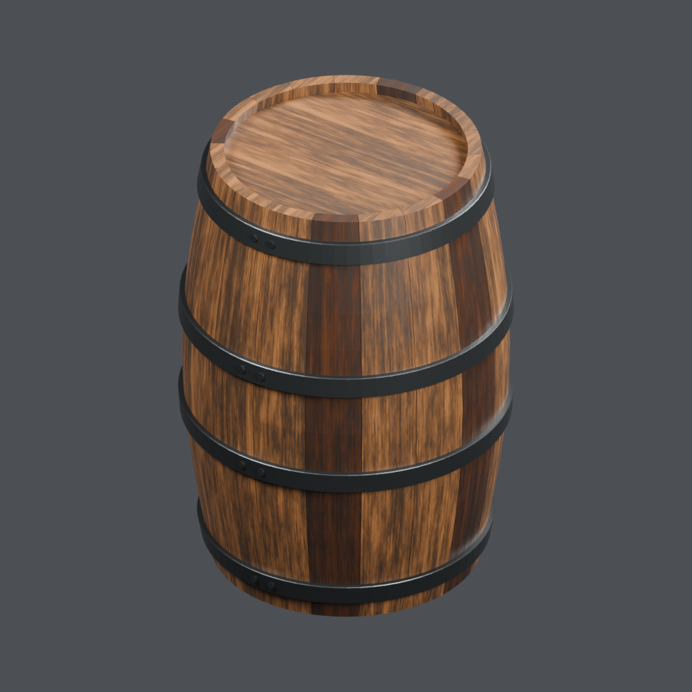
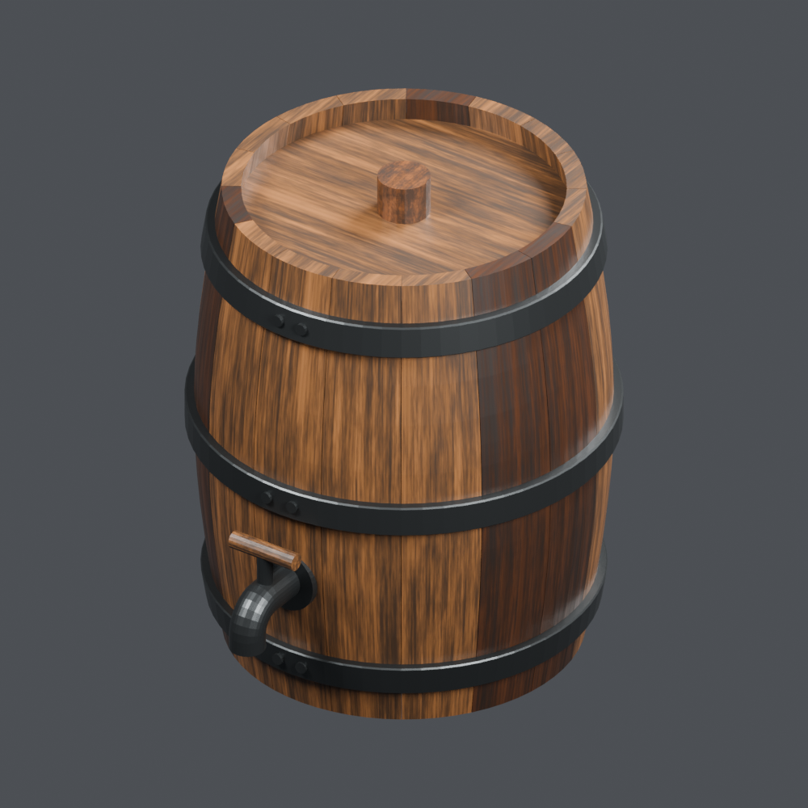
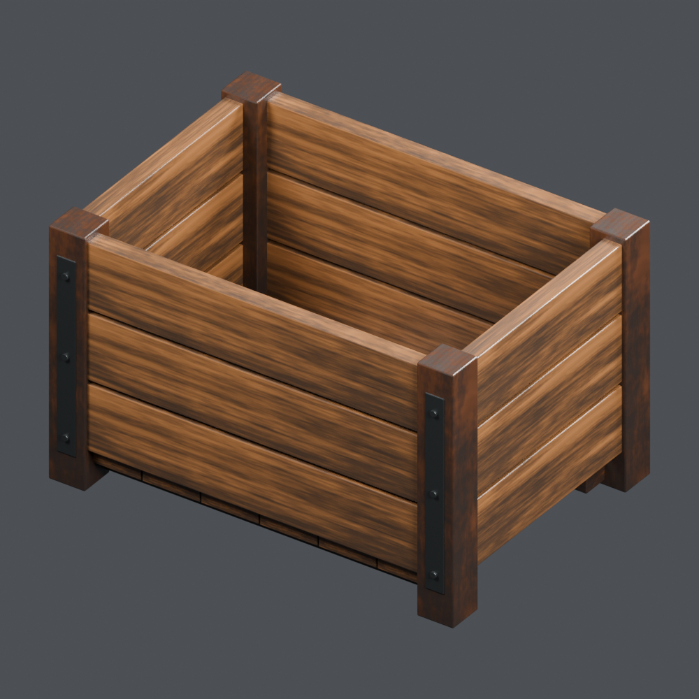
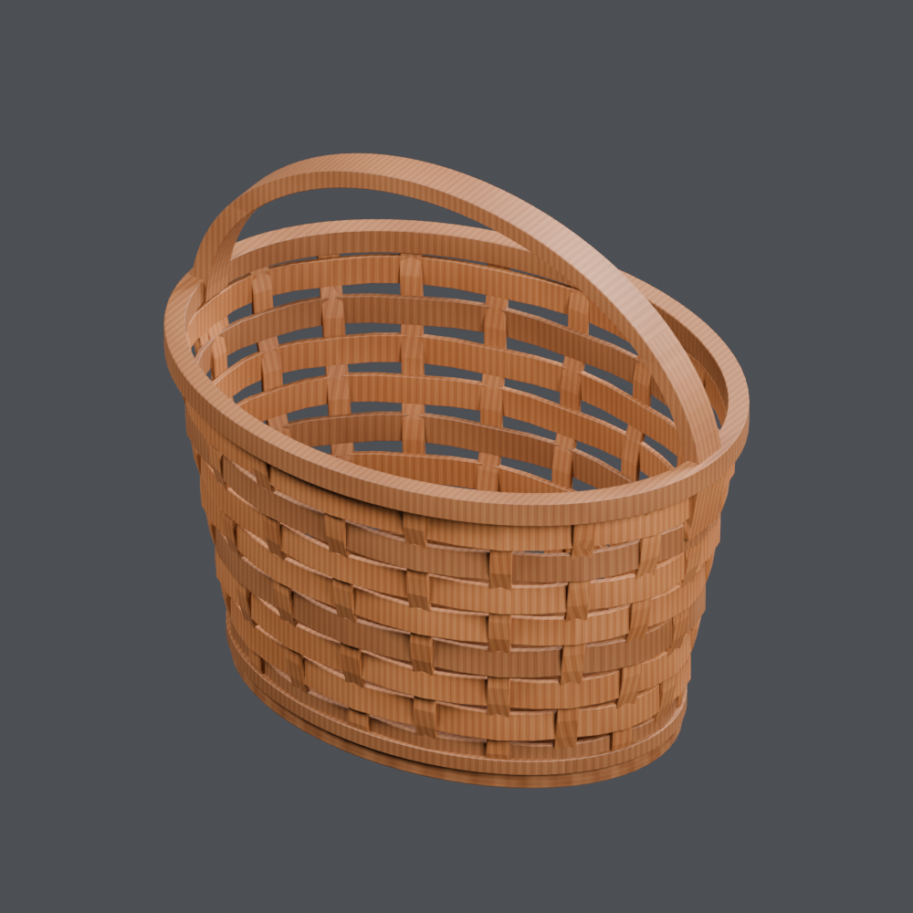
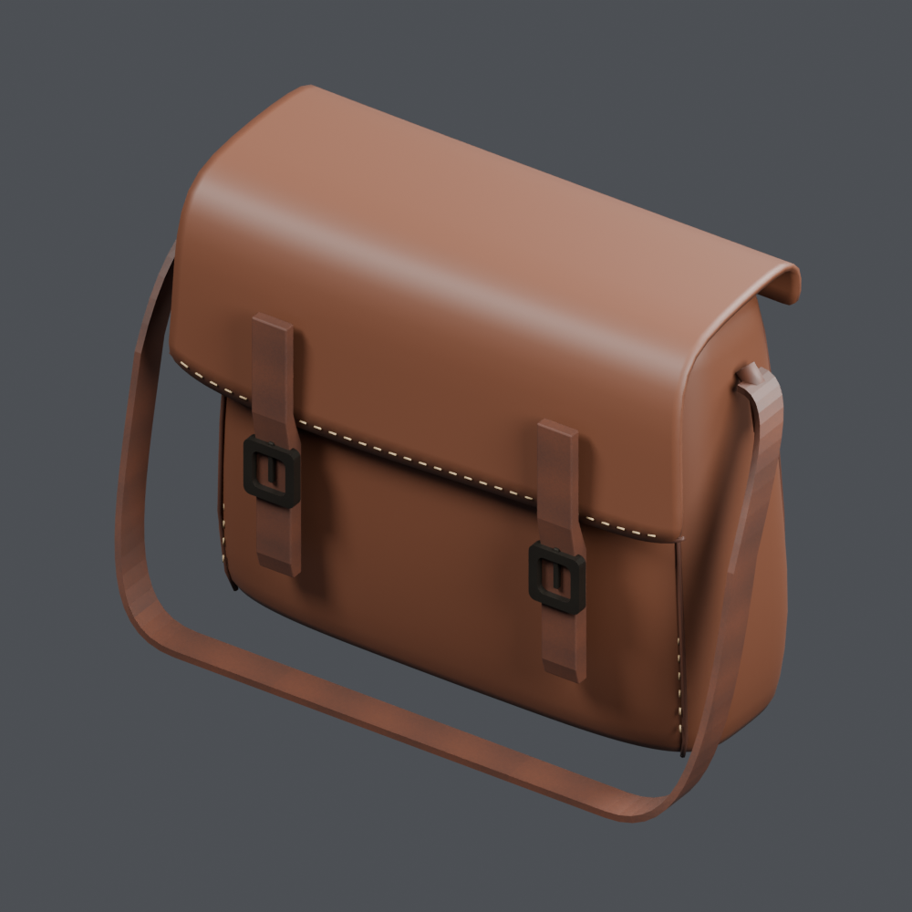
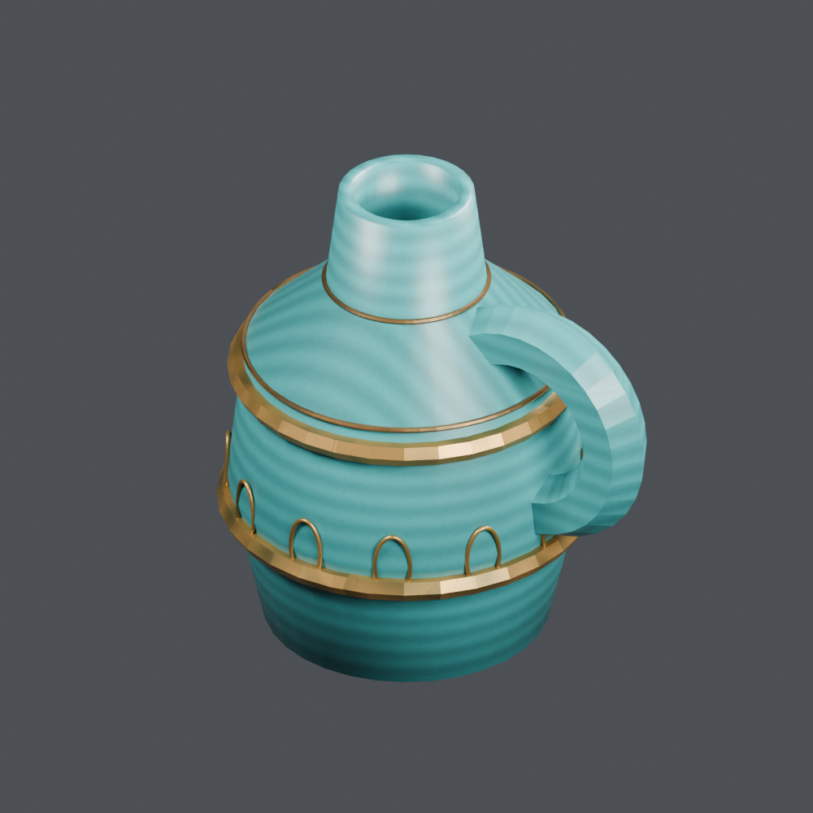
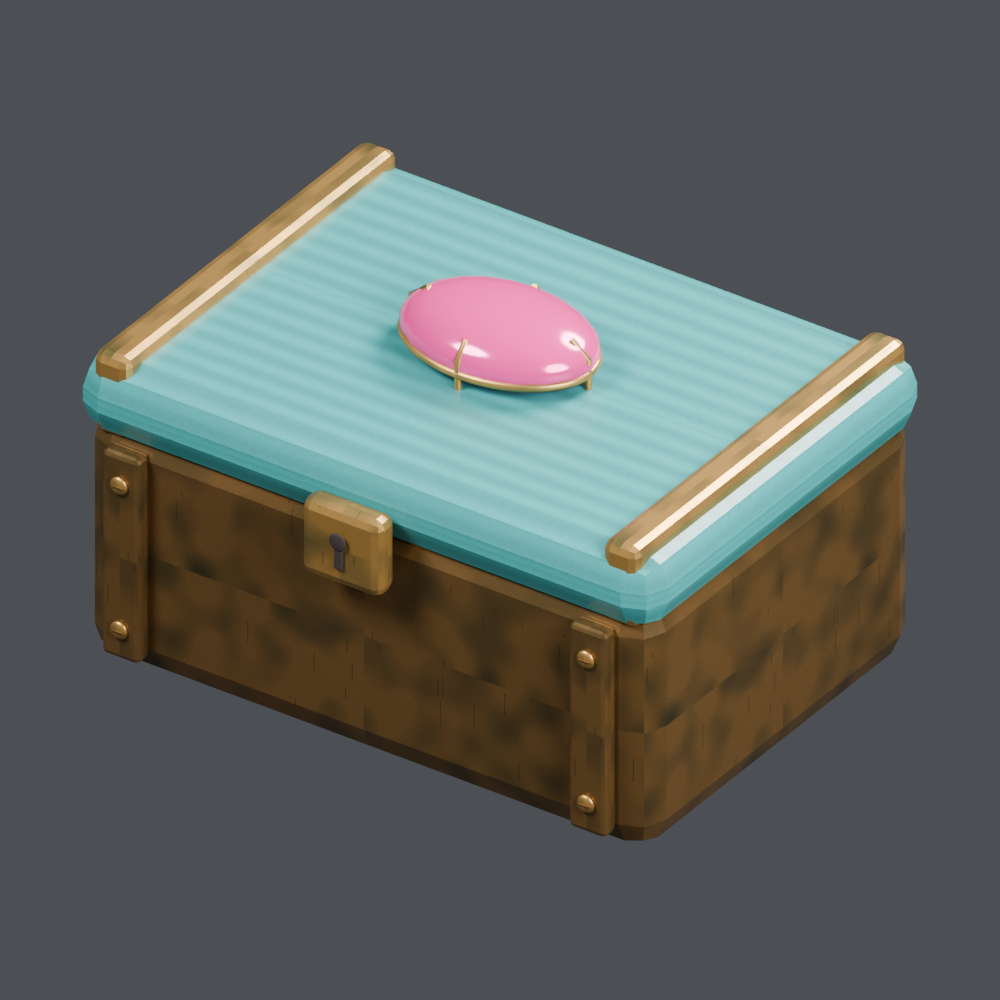

# Boxes, baskets & bags 1

[← Asset shelf](../README.en.md)

[日本語](containers_01.md) · [English](containers_01.en.md) · [简体中文](containers_01.zh-CN.md)

## FT_011 — Wooden barrel

Wooden barrel from the tavern collection. Unit: one model record. Includes BLEND and GLB. The close-up is rendered from the distributed BLEND.

[ZIP · BLEND + GLB · 2.31 MB](https://github.com/k3peta/tales-on-a-table/releases/download/v2026.10.18/FT_011_CC0.zip) · CC0-1.0

`catalog-20261018` · SHA-256: `94441bc1ec730846047375812ce4a6c74afaf5693cbe3cba0de4dcc2b620a779`

## FT_013 — Small barrel with tap

Small barrel with tap from the tavern collection. Unit: one model record. Includes BLEND and GLB. The close-up is rendered from the distributed BLEND.

[ZIP · BLEND + GLB · 3.01 MB](https://github.com/k3peta/tales-on-a-table/releases/download/v2026.10.18/FT_013_CC0.zip) · CC0-1.0

`catalog-20261018` · SHA-256: `3a557003882812499debd4dc2993870694cb542f19c64fe5bfa0ca9d09e4778e`

## FT_014 — Open wooden crate

Open wooden crate from the tavern collection. Unit: one model record. Includes BLEND and GLB. The close-up is rendered from the distributed BLEND.

[ZIP · BLEND + GLB · 2.04 MB](https://github.com/k3peta/tales-on-a-table/releases/download/v2026.10.18/FT_014_CC0.zip) · CC0-1.0

`catalog-20261018` · SHA-256: `638526583905ab70eef8a187cc4bb338d16f9fd0e3baa01e702ec3c9c870c00d`

## FT_015 — Woven basket with handle

Woven basket with handle from the tavern collection. Unit: one model record. Includes BLEND and GLB. The close-up is rendered from the distributed BLEND.

[ZIP · BLEND + GLB · 0.98 MB](https://github.com/k3peta/tales-on-a-table/releases/download/v2026.10.18/FT_015_CC0.zip) · CC0-1.0

`catalog-20261018` · SHA-256: `52c8d4c9d50e6c42a40e01f0a0e72bb94d48ba998b7af289de5370d883ea0aba`

## FT_040 — Closed leather travel bag

Closed leather travel bag from the tavern collection. Unit: one model record. Includes BLEND and GLB. The close-up is rendered from the distributed BLEND.

[ZIP · BLEND + GLB · 1.02 MB](https://github.com/k3peta/tales-on-a-table/releases/download/v2026.10.18/FT_040_CC0.zip) · CC0-1.0

`quality-patch-20261017` · SHA-256: `bb635241a992e983c6f6e7cbadafec47974a2f461ff7a27d56c9b4f267e37620`

## FH_025 — Woven fish trap

Woven fish trap from the harbor collection. Unit: one model record. Includes BLEND and GLB. The close-up is rendered from the distributed BLEND.

[ZIP · BLEND + GLB · 0.84 MB](https://github.com/k3peta/tales-on-a-table/releases/download/v2026.10.18/FH_025_CC0.zip) · CC0-1.0

`catalog-20261018` · SHA-256: `a5418c081ce7136fefe5cd9ab50e823e3d34d84d4f3cb63c3a93e695df07b22e`

## FH_026 — Fish basket

Fish basket from the harbor collection. Unit: one model record. Includes BLEND and GLB. The close-up is rendered from the distributed BLEND.

[ZIP · BLEND + GLB · 0.76 MB](https://github.com/k3peta/tales-on-a-table/releases/download/v2026.10.18/FH_026_CC0.zip) · CC0-1.0

`catalog-20261018` · SHA-256: `dc882880f605b9441edd1a2695713818e5297ce22cb5570e58425bf15365041e`

## FH_027 — Wooden fish crate

Wooden fish crate from the harbor collection. Unit: one model record. Includes BLEND and GLB. The close-up is rendered from the distributed BLEND.

[ZIP · BLEND + GLB · 8.27 MB](https://github.com/k3peta/tales-on-a-table/releases/download/v2026.10.18/FH_027_CC0.zip) · CC0-1.0

`catalog-20261018` · SHA-256: `e277bd313c42f74ab5f3ebcc7fe905bb8de6560a715c7415537c267702483a54`

## FH_035 — Lunch box tied with cloth

Lunch box tied with cloth from the harbor collection. Unit: one model record. Includes BLEND and GLB. The close-up is rendered from the distributed BLEND.

[ZIP · BLEND + GLB · 5.42 MB](https://github.com/k3peta/tales-on-a-table/releases/download/v2026.10.18/FH_035_CC0.zip) · CC0-1.0

`catalog-20261018` · SHA-256: `7278070efc97af55a10696c3348a1896a1f57e03f66a64e292ea4df3bfe58c8f`

## FH_045 — Restitched canvas bag

Restitched canvas bag from the harbor collection. Unit: one model record. Includes BLEND and GLB. The close-up is rendered from the distributed BLEND.

[ZIP · BLEND + GLB · 0.26 MB](https://github.com/k3peta/tales-on-a-table/releases/download/v2026.10.18/FH_045_CC0.zip) · CC0-1.0

`catalog-20261018` · SHA-256: `f12c00c4756d04a8386834ae166cc5d4613c822196dc48ad2a42cd37fb8ada40`

## FH_054 — Bait box

Bait box from the harbor collection. Unit: one model record. Includes BLEND and GLB. The close-up is rendered from the distributed BLEND.

[ZIP · BLEND + GLB · 3.12 MB](https://github.com/k3peta/tales-on-a-table/releases/download/v2026.10.18/FH_054_CC0.zip) · CC0-1.0

`catalog-20261018` · SHA-256: `5dea5b759233fdbd0b14706f30613259f1ea8d1f03cf4754335402c644b76805`

## FH_056 — Shoulder-carried fish basket

Shoulder-carried fish basket from the harbor collection. Unit: one model record. Includes BLEND and GLB. The close-up is rendered from the distributed BLEND.

[ZIP · BLEND + GLB · 1.05 MB](https://github.com/k3peta/tales-on-a-table/releases/download/v2026.10.18/FH_056_CC0.zip) · CC0-1.0

`catalog-20261018` · SHA-256: `2cfc0a218765f684dc3ae853bf3ac61d27ffe8f136c228004a1d1ac3c3ab979a`

## OL_003 — Blue decorative vase

Blue decorative vase from the lamp shop collection. Unit: one model record. Includes BLEND and GLB. The close-up is rendered from the distributed BLEND.

[ZIP · BLEND + GLB · 2.14 MB](https://github.com/k3peta/tales-on-a-table/releases/download/v2026.10.18/OL_003_CC0.zip) · CC0-1.0

`catalog-20261018` · SHA-256: `82c168059f63d6dde796c9e29a248997f544168a5b852c941ce660a41da33a28`

## OL_024 — Teal decorative vase

Teal decorative vase from the lamp shop collection. Unit: one model record. Includes BLEND and GLB. The close-up is rendered from the distributed BLEND.

[ZIP · BLEND + GLB · 2.13 MB](https://github.com/k3peta/tales-on-a-table/releases/download/v2026.10.18/OL_024_CC0.zip) · CC0-1.0

`catalog-20261018` · SHA-256: `8a776e18a0e02d2f61b952a7a70a95a13418eb61f2bf3433eb887333f2d983a8`

## OL_033 — Gold-decorated jewelry box

Gold-decorated jewelry box from the lamp shop collection. Unit: one model record. Includes BLEND and GLB. The close-up is rendered from the distributed BLEND.

[ZIP · BLEND + GLB · 2.32 MB](https://github.com/k3peta/tales-on-a-table/releases/download/v2026.10.18/OL_033_CC0.zip) · CC0-1.0

`catalog-20261018` · SHA-256: `5bab279200b23d2b831a391107f3f936de514927312e7e9e0a93cfcf1809ad0a`
