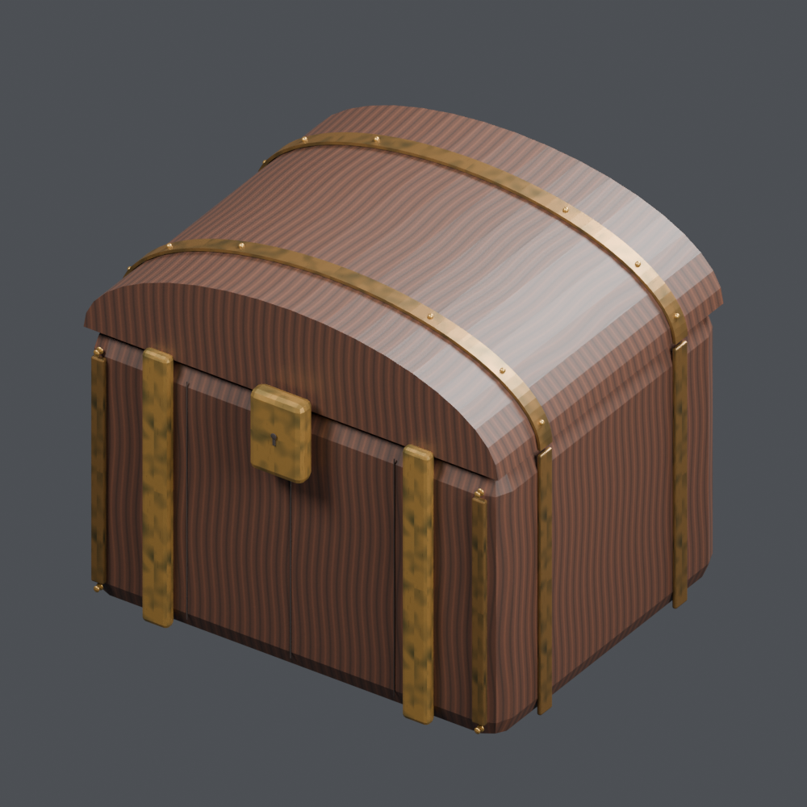
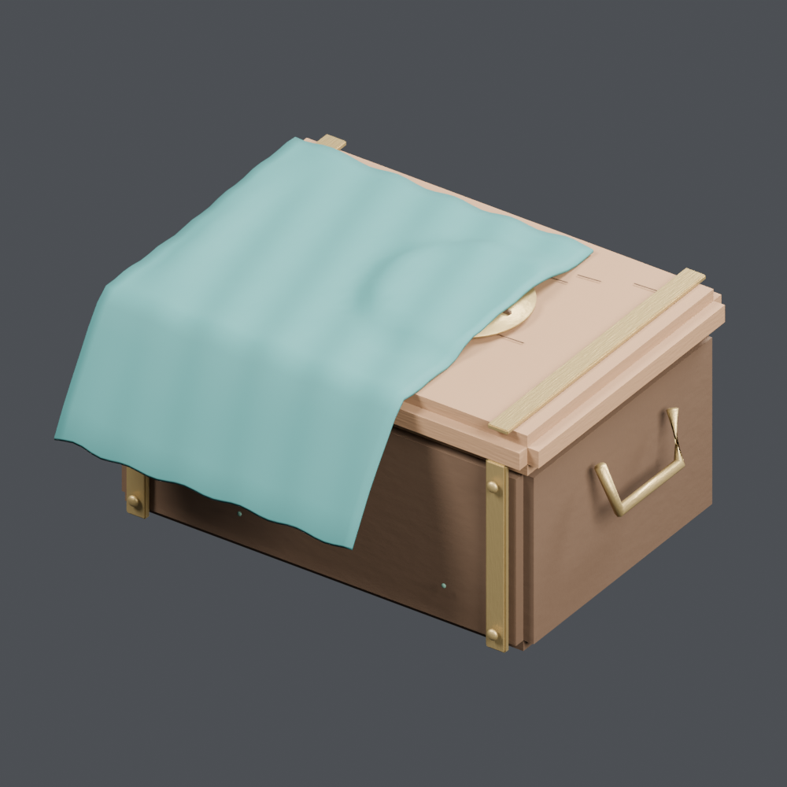
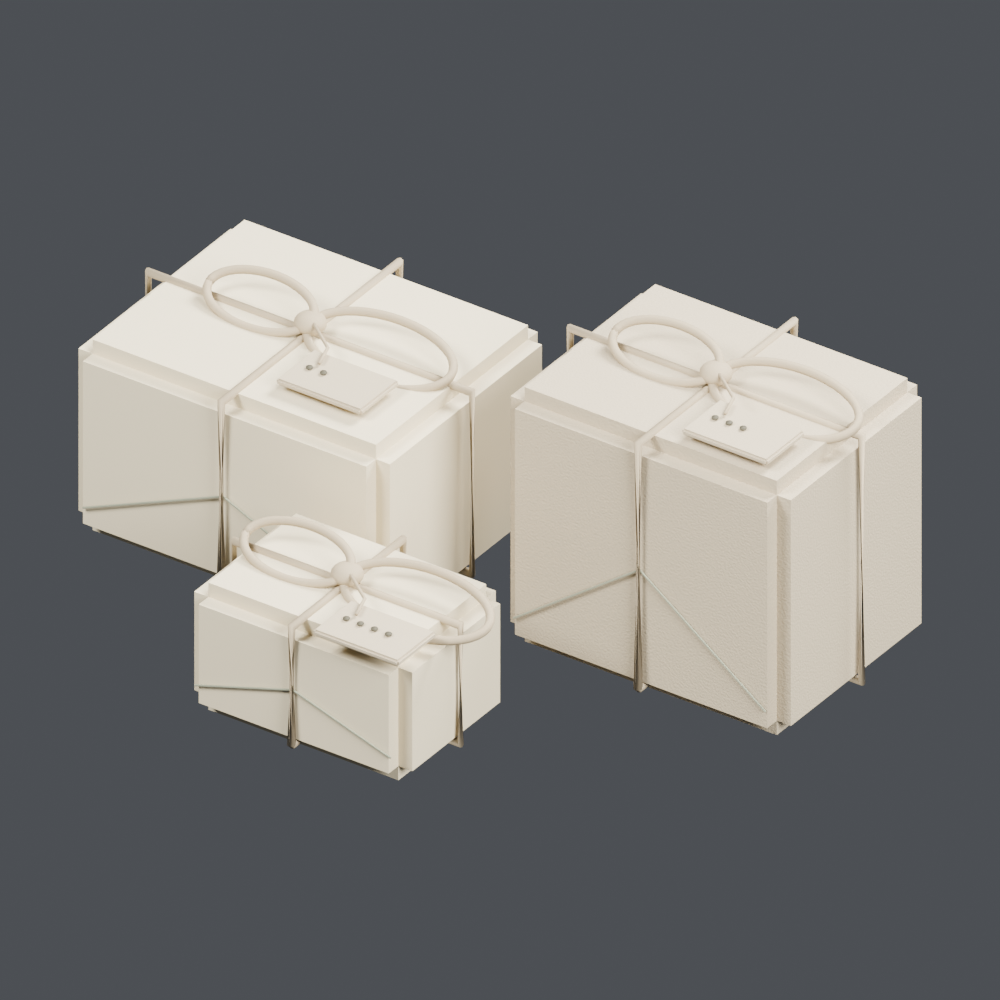

# Boxes, baskets & bags 2

[← Asset shelf](../README.en.md)

[日本語](containers_02.md) · [English](containers_02.en.md) · [简体中文](containers_02.zh-CN.md)

## OL_034 — Merchant chest with gold bands

Merchant chest with gold bands from the lamp shop collection. Unit: one model record. Includes BLEND and GLB. The close-up is rendered from the distributed BLEND.

[ZIP · BLEND + GLB · 2.22 MB](https://github.com/k3peta/tales-on-a-table/releases/download/v2026.10.18/OL_034_CC0.zip) · CC0-1.0

`catalog-20261018` · SHA-256: `36a3fa7d1cb5701a0dec77686421c8fa94bac3e2924066338021b9b5ff9fdf36`

## OL_STORY_001 — Cloth-draped handbox

Cloth-draped handbox from the lamp shop collection. Unit: one group containing several objects. Includes BLEND and GLB. The close-up is rendered from the distributed BLEND.

[ZIP · BLEND + GLB · 0.38 MB](https://github.com/k3peta/tales-on-a-table/releases/download/v2026.10.18/OL_STORY_001_CC0.zip) · CC0-1.0

`catalog-20261018` · SHA-256: `44f3b9158c245334f2b5efe6ae967e5b345f3cd87ff499246ae644c737279301`

## OL_STORY_005 — Travel souvenir bundle

Travel souvenir bundle from the lamp shop collection. Unit: one group containing several objects. Includes BLEND and GLB. The close-up is rendered from the distributed BLEND.

[ZIP · BLEND + GLB · 0.26 MB](https://github.com/k3peta/tales-on-a-table/releases/download/v2026.10.18/OL_STORY_005_CC0.zip) · CC0-1.0

`catalog-20261018` · SHA-256: `393f9e0e10f7d7f4ca773c07c0d397665ed81ffc11832267abd38e9ad52ea176`

## AT_021 — Sealed cursed reliquary

Sealed cursed reliquary from the antique shop collection. Unit: one model record. Includes BLEND and GLB. The close-up is rendered from the distributed BLEND.

[ZIP · BLEND + GLB · 1.27 MB](https://github.com/k3peta/tales-on-a-table/releases/download/v2026.10.18/AT_021_CC0.zip) · CC0-1.0

`catalog-20261018` · SHA-256: `5660a9352857bf664452f58f8868a22807c48ad0147fe2827b56491a2a715f33`

## AT_028 — Chained smuggler's chest

Chained smuggler's chest from the antique shop collection. Unit: one model record. Includes BLEND and GLB. The close-up is rendered from the distributed BLEND.

[ZIP · BLEND + GLB · 1.16 MB](https://github.com/k3peta/tales-on-a-table/releases/download/v2026.10.18/AT_028_CC0.zip) · CC0-1.0

`catalog-20261018` · SHA-256: `af56116d5c14cfc229d2f27727801a304b082783008aba01b3d06a6cdd67c273`

## AT_033 — Patched travel bag

Patched travel bag from the antique shop collection. Unit: one model record. Includes BLEND and GLB. The close-up is rendered from the distributed BLEND.

[ZIP · BLEND + GLB · 1.14 MB](https://github.com/k3peta/tales-on-a-table/releases/download/v2026.10.18/AT_033_CC0.zip) · CC0-1.0

`catalog-20261018` · SHA-256: `fe9025a51eb2c2e2594a551eeb693a645696fa1896ffd1440b77073257f6de3c`

## AT_040 — Leather pouch of old coins

Leather pouch of old coins from the antique shop collection. Unit: one model record. Includes BLEND and GLB. The close-up is rendered from the distributed BLEND.

[ZIP · BLEND + GLB · 0.97 MB](https://github.com/k3peta/tales-on-a-table/releases/download/v2026.10.18/AT_040_CC0.zip) · CC0-1.0

`catalog-20261018` · SHA-256: `a4fb72529565c93fe9c68f46e02c696546ab4881d32ae35250ad6fed865f6fdf`

## AT_051 — Mother-of-pearl jewelry box

Mother-of-pearl jewelry box from the antique shop collection. Unit: one model record. Includes BLEND and GLB. The close-up is rendered from the distributed BLEND.

[ZIP · BLEND + GLB · 1.41 MB](https://github.com/k3peta/tales-on-a-table/releases/download/v2026.10.18/AT_051_CC0.zip) · CC0-1.0

`catalog-20261018` · SHA-256: `b7a55e25991b0360643bf3a8468f1150d50fae62a385e8536a2ecf8c8d61de83`

## AT_068 — Raven-marked incoming crate

Raven-marked incoming crate from the antique shop collection. Unit: one model record. Includes BLEND and GLB. The close-up is rendered from the distributed BLEND.

[ZIP · BLEND + GLB · 0.93 MB](https://github.com/k3peta/tales-on-a-table/releases/download/v2026.10.18/AT_068_CC0.zip) · CC0-1.0

`catalog-20261018` · SHA-256: `64c317a1b1308324d997d83f0cc174abb4db5fa46df5a87ffef01bdb7d159cc8`

## AT_071 — Repaired drawstring leather pouch

Repaired drawstring leather pouch from the antique shop collection. Unit: one model record. Includes BLEND and GLB. The close-up is rendered from the distributed BLEND.

[ZIP · BLEND + GLB · 0.95 MB](https://github.com/k3peta/tales-on-a-table/releases/download/v2026.10.18/AT_071_CC0.zip) · CC0-1.0

`catalog-20261018` · SHA-256: `2a5cf3441e398e08122453ab6d48fb18bc95139648f084cceed8de9b36b68561`

## AT_073 — Field medicine box with bandages and packets

Field medicine box with bandages and packets from the antique shop collection. Unit: one model record. Includes BLEND and GLB. The close-up is rendered from the distributed BLEND.

[ZIP · BLEND + GLB · 1.94 MB](https://github.com/k3peta/tales-on-a-table/releases/download/v2026.10.18/AT_073_CC0.zip) · CC0-1.0

`catalog-20261018` · SHA-256: `7493ba2a0b712d5c39fb370c0cd1af1d118ec84876a0806f55f24e31c6d78cfb`

## AT_074 — Woven basket of forgotten bottles

Woven basket of forgotten bottles from the antique shop collection. Unit: one group containing several objects. Includes BLEND and GLB. The close-up is rendered from the distributed BLEND.

[ZIP · BLEND + GLB · 2.77 MB](https://github.com/k3peta/tales-on-a-table/releases/download/v2026.10.18/AT_074_CC0.zip) · CC0-1.0

`catalog-20261018` · SHA-256: `43d4c62b22ead992fd39a09dc88a671e2ed52e64aea44eaaf22b6c63cdcfb0c8`

## AT_085 — Box with a broken seal

Box with a broken seal from the antique shop collection. Unit: one group containing several objects. Includes BLEND and GLB. The close-up is rendered from the distributed BLEND.

[ZIP · BLEND + GLB · 0.13 MB](https://github.com/k3peta/tales-on-a-table/releases/download/v2026.10.18/AT_085_CC0.zip) · CC0-1.0

`catalog-20261018` · SHA-256: `e6bcba16f8024d115f2ec9239db17a3bb6f032ab3b8b9bc67135e384f2f934ce`

## AT_086 — Old cloth bundle tied with string

Old cloth bundle tied with string from the antique shop collection. Unit: one group containing several objects. Includes BLEND and GLB. The close-up is rendered from the distributed BLEND.

[ZIP · BLEND + GLB · 0.17 MB](https://github.com/k3peta/tales-on-a-table/releases/download/v2026.10.18/AT_086_CC0.zip) · CC0-1.0

`catalog-20261018` · SHA-256: `5de5c3d7d88d629247522c1c1b2a6a21f68359bee3be247396fef24ce9291725`
