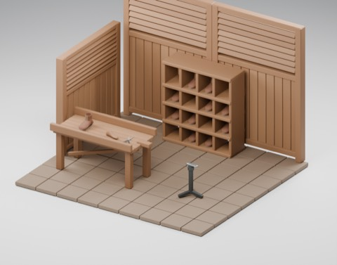
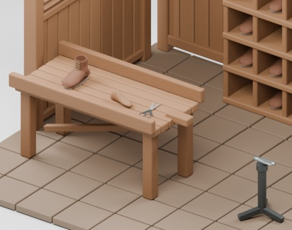
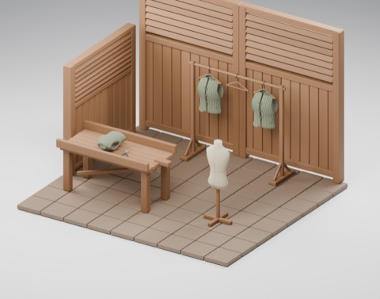
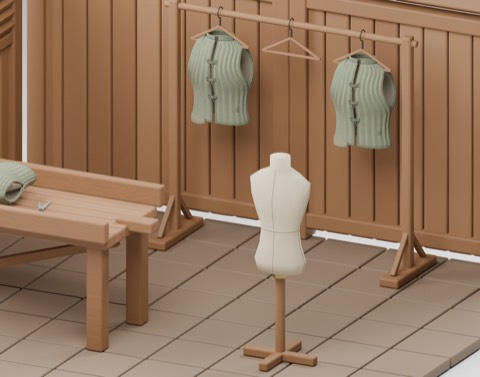
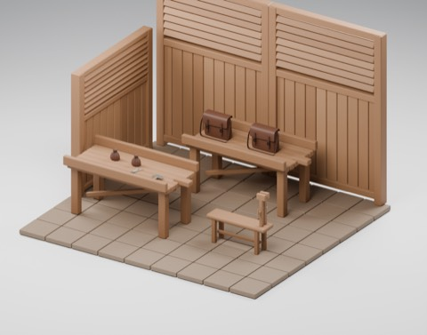
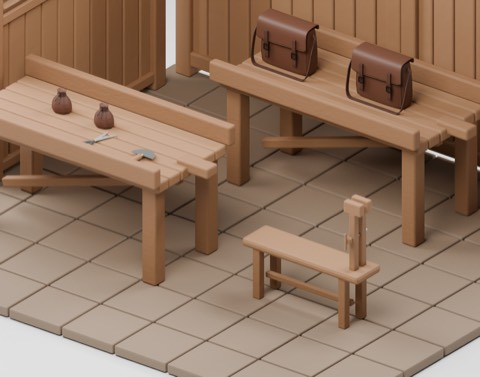

# 靴屋・服屋・革工房 / Craft shops / 手工作坊

**1007 distribution records = 998 + 6 model candidates + 3 arrangements.** This is not a count of 1007 independent shapes. Eight existing types and one scene-only shelf derivative are not counted again.

### CSH101

model

CC0-1.0

[ZIP](https://raw.githubusercontent.com/k3peta/tales-on-a-table/main/distributions/craft-shops-v1/CSH101-CC0.zip)

### CSH102

model

CC0-1.0

[ZIP](https://raw.githubusercontent.com/k3peta/tales-on-a-table/main/distributions/craft-shops-v1/CSH102-CC0.zip)

### CSH201

model

CC0-1.0

[ZIP](https://raw.githubusercontent.com/k3peta/tales-on-a-table/main/distributions/craft-shops-v1/CSH201-CC0.zip)

### CSH202

model

CC0-1.0

[ZIP](https://raw.githubusercontent.com/k3peta/tales-on-a-table/main/distributions/craft-shops-v1/CSH202-CC0.zip)

### CSH301

model

CC0-1.0

[ZIP](https://raw.githubusercontent.com/k3peta/tales-on-a-table/main/distributions/craft-shops-v1/CSH301-CC0.zip)

### CSH302

model

CC0-1.0

[ZIP](https://raw.githubusercontent.com/k3peta/tales-on-a-table/main/distributions/craft-shops-v1/CSH302-CC0.zip)

### CSH_SCENE_COBBLER

group

LicenseRef-Scene-Viewing-Rearranging

[ZIP](https://raw.githubusercontent.com/k3peta/tales-on-a-table/main/distributions/craft-shops-v1/cobbler-scene-v1.zip)

### CSH_SCENE_TAILOR

group

LicenseRef-Scene-Viewing-Rearranging

[ZIP](https://raw.githubusercontent.com/k3peta/tales-on-a-table/main/distributions/craft-shops-v1/tailor-scene-v1.zip)

### CSH_SCENE_LEATHERWORKER

group

LicenseRef-Scene-Viewing-Rearranging

[ZIP](https://raw.githubusercontent.com/k3peta/tales-on-a-table/main/distributions/craft-shops-v1/leatherworker-scene-v1.zip)

## 日本語

CSH101靴木型、CSH102底打ち金床、CSH201採寸用トルソー、CSH202衣服レール、CSH301革縫いクランプ、CSH302半月裁断刃。単一道具1＋複合道具/什器5。靴屋・服屋・革工房の配置3件は単品と分離。モデル/同梱材質のみCC0。配置はCC0ではなく閲覧・再配置用で、配置全体の追加再配布許諾なし。各SCENE-RIGHTS.txtを参照。HCV402の斜め瓶受けを場面コピーだけ除去、原本保持。工具安全/荷重/機構/他衣服適合/実歩行/衝突/アプリ性能/旧Blender互換/全履歴独立性は未検証。静的モデルで細かな手続き凹凸はGLBと異なる場合あり。コード画像私的資料は非公開。

## English

Six models: wooden shoe last, sole-working stake, measuring torso, garment rail, stitching clamp, half-moon knife. One single tool and five composite tools/fixtures. Three separately counted shop arrangements. Underlying geometry/materials CC0; arrangements are NOT CC0, provided for viewing and rearranging without additional redistribution permission. See each SCENE-RIGHTS.txt. Bottle cradles removed only in scene-copy shoe shelf; original HCV402 unchanged. Eight reused types not counted. Tool/load safety, mechanisms, garment fit, walking/collision, app performance, older Blender compatibility and global shape independence unverified. Static only; procedural bump details can differ in GLB. Code/images/private records excluded.

## 中文

6个模型候选（单一道具1、复合工具家具5）和3个店铺布置分开计数，既有8种及场景鞋架派生不重复计数。模型与内嵌材质CC0；布置不属CC0，仅供查看和重新排列，没有额外的整体再分发许可。原瓶架不变，仅修改场景副本。工具安全、承重、动态机构、服装通用适配、行走碰撞、应用性能、旧Blender兼容和历史独立形状均未验证。静态模型，GLB细节可能不同，不含代码图片私有记录。

[Checksums](../distributions/craft-shops-v1/SHA256SUMS.txt).

実作レンダー / Actual model renders. Images are supplied for browsing, excluded from model CC0; existing [image rights](../LICENSE.md) remain unchanged. Images do not add model records.

## 配置全景・接写 / Scene overview and detail

### 靴屋（CSH101靴木型・CSH102金床）

[CSH101 ZIP](https://raw.githubusercontent.com/k3peta/tales-on-a-table/main/distributions/craft-shops-v1/CSH101-CC0.zip) · [CSH102 ZIP](https://raw.githubusercontent.com/k3peta/tales-on-a-table/main/distributions/craft-shops-v1/CSH102-CC0.zip) · [CSH_SCENE_COBBLER ZIP](https://raw.githubusercontent.com/k3peta/tales-on-a-table/main/distributions/craft-shops-v1/cobbler-scene-v1.zip) ·

### 服屋（CSH201トルソー・CSH202衣服レール）

[CSH201 ZIP](https://raw.githubusercontent.com/k3peta/tales-on-a-table/main/distributions/craft-shops-v1/CSH201-CC0.zip) · [CSH202 ZIP](https://raw.githubusercontent.com/k3peta/tales-on-a-table/main/distributions/craft-shops-v1/CSH202-CC0.zip) · [CSH_SCENE_TAILOR ZIP](https://raw.githubusercontent.com/k3peta/tales-on-a-table/main/distributions/craft-shops-v1/tailor-scene-v1.zip) ·

### 革工房（CSH301クランプ・CSH302裁断刃）

[CSH301 ZIP](https://raw.githubusercontent.com/k3peta/tales-on-a-table/main/distributions/craft-shops-v1/CSH301-CC0.zip) · [CSH302 ZIP](https://raw.githubusercontent.com/k3peta/tales-on-a-table/main/distributions/craft-shops-v1/CSH302-CC0.zip) · [CSH_SCENE_LEATHERWORKER ZIP](https://raw.githubusercontent.com/k3peta/tales-on-a-table/main/distributions/craft-shops-v1/leatherworker-scene-v1.zip) ·

