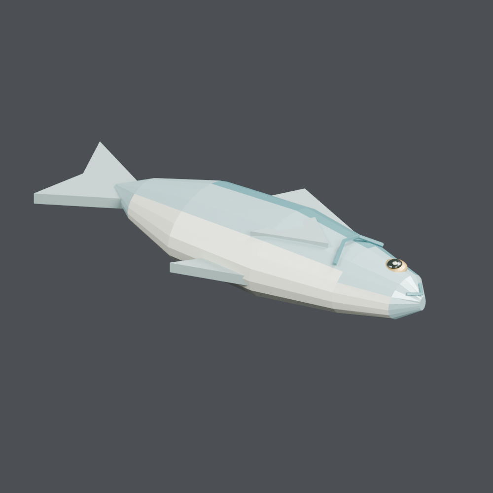

# Creatures 1

[← Asset shelf](../README.en.md)

[日本語](creatures_01.md) · [English](creatures_01.en.md) · [简体中文](creatures_01.zh-CN.md)

## FH_003 — Fallen silver-blue fish

Fallen silver-blue fish from the harbor collection. Unit: one model record. Includes BLEND and GLB. The close-up is rendered from the distributed BLEND.

[ZIP · BLEND + GLB · 0.17 MB](https://github.com/k3peta/tales-on-a-table/releases/download/v2026.10.18/FH_003_CC0.zip) · CC0-1.0

`catalog-20261018` · SHA-256: `58c1cc8ae1e9d3b80b4cd49228e224e251813d8e3172ef5ae52871354937e77c`

## FH_031 — Crouching cat watching a fish

Crouching cat watching a fish from the harbor collection. Unit: one model record. Includes BLEND and GLB. The close-up is rendered from the distributed BLEND.

[ZIP · BLEND + GLB · 0.89 MB](https://github.com/k3peta/tales-on-a-table/releases/download/v2026.10.18/FH_031_CC0.zip) · CC0-1.0

`catalog-20261018` · SHA-256: `db41baff45642ce1a1d5e6e327282cd4ffe81b37a8cc657de7718c2d437fefc3`

## FH_032 — Seagull

Seagull from the harbor collection. Unit: one model record. Includes BLEND and GLB. The close-up is rendered from the distributed BLEND.

[ZIP · BLEND + GLB · 0.56 MB](https://github.com/k3peta/tales-on-a-table/releases/download/v2026.10.18/FH_032_CC0.zip) · CC0-1.0

`catalog-20261018` · SHA-256: `b0e79eeaec0fc7971c405fa25c0fbd6757cb7fc4c3ff3b7d48fc6a1ae67d5c0c`
