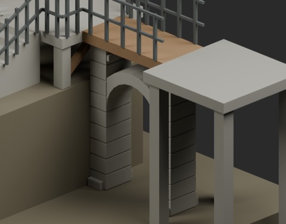
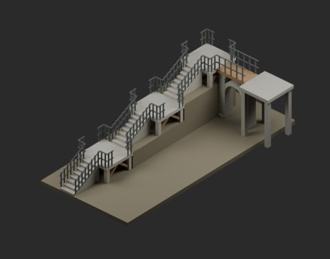
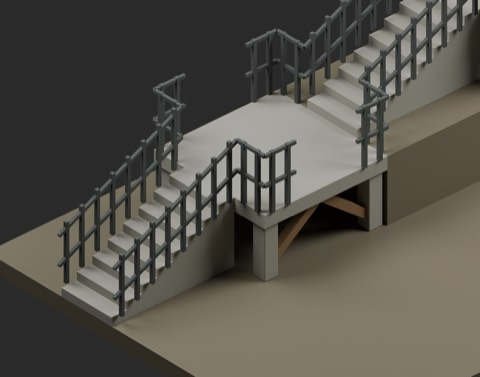
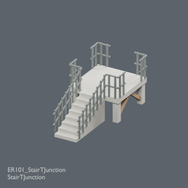
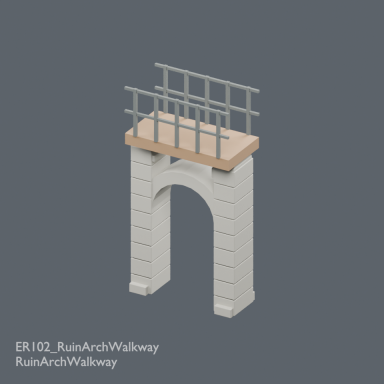

# Elevated ruin connectors: two static modules

898 previous records + 2 = 900 distribution records. This is not a certified global independent-shape count. BLEND and GLB are two formats of each record.

### ER101_StairTJunction

[ZIP](https://raw.githubusercontent.com/k3peta/tales-on-a-table/main/distributions/elevated-ruin-connectors-v1/ER101_StairTJunction_CC0.zip)

110862

### ER102_RuinArchWalkway

[ZIP](https://raw.githubusercontent.com/k3peta/tales-on-a-table/main/distributions/elevated-ruin-connectors-v1/ER102_RuinArchWalkway_CC0.zip)

116512

## Placement and limitations

- ER101_StairTJunction: 2x4m stair-top T junction. Low S interface (0,-2,0), first riser .125m; 8 treads .25m run/.125m rise. Top floor1m; W(-1,1,1), E(1,1,1), N(0,2,1). Stair tread width .9m. Landing underside .8m; not a human underpass.
- ER102_RuinArchWalkway: 2m EW upper walkway at Z3m over NS arch. Deck width1m, conservative guard clearance .955m. Lower opening width1.2m; spring1.6m, centre crown2.2m. E/W upper ports (+/-1,0,3). Upper and lower routes are separate. Broken stone crest remains below deck.

Metres, Z up, origin zero. Append the named Collection from BLEND. ER101 nominal footprint is 2 x 4 m; guards extend slightly beyond it (actual bounds in ZIP README). Its first step rises 0.125 m from the low reference, and the 0.8 m landing underside is not a human underpass. ER102 has separate upper and lower routes, not a filled terrain tile.

Static miniature modules. Open ports require adjoining pieces or closures; the examples are not complete fall-protection systems. Sampled rays, dimensions and Blender 5.2.2 reloading were checked by production. Actual walking, full-body collision, navigation meshes, structural safety, full opening interference, Blender 4.3.2 compatibility and global historical independence remain unverified. Meshes are not sealed manifold unions. Supports and end floors used in examples are not included.

Model geometry and embedded display materials only are CC0-1.0. No source code, private evidence, images or assembled scenes are distributed. [Checksums](../distributions/elevated-ruin-connectors-v1/SHA256SUMS.txt).

## 実作画像 / Actual renders

完成バッチの配置・接写。画像は閲覧用でモデルCC0の対象外です。[既存の画像利用条件](../LICENSE.md)を維持します。

### ER101_StairTJunction

StairTJunction

[ZIP](https://raw.githubusercontent.com/k3peta/tales-on-a-table/main/distributions/elevated-ruin-connectors-v1/ER101_StairTJunction_CC0.zip)

### ER102_RuinArchWalkway

RuinArchWalkway

[ZIP](https://raw.githubusercontent.com/k3peta/tales-on-a-table/main/distributions/elevated-ruin-connectors-v1/ER102_RuinArchWalkway_CC0.zip)

## Individual images / 個別画像 / 单件图片

Actual distributed models; chosen camera view does not establish intended front or placement pivot. Images are outside model CC0. Original links and archives retained.

### ER101_StairTJunction — StairTJunction

StairTJunction

[Full image](../previews/ud1102-rg24/renders/ER101_StairTJunction.png) · [ZIP · BLEND/GLB](https://raw.githubusercontent.com/k3peta/tales-on-a-table/main/distributions/elevated-ruin-connectors-v1/ER101_StairTJunction_CC0.zip)

### ER102_RuinArchWalkway — RuinArchWalkway

RuinArchWalkway

[Full image](../previews/ud1102-rg24/renders/ER102_RuinArchWalkway.png) · [ZIP · BLEND/GLB](https://raw.githubusercontent.com/k3peta/tales-on-a-table/main/distributions/elevated-ruin-connectors-v1/ER102_RuinArchWalkway_CC0.zip)
