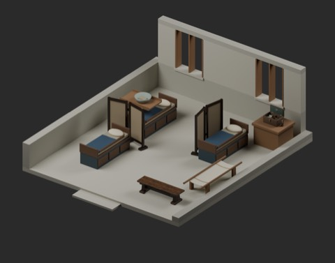
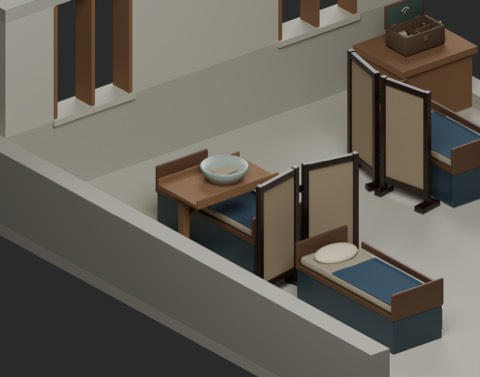
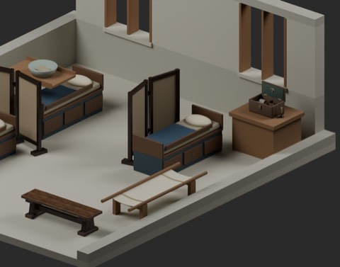

# 架空治療院 / Fantasy infirmary / 架空治疗院

998 distribution records = 995 + 2 model candidates + 1 assembly. Six reused types are not added. Global shape independence is unconfirmed.

### INF101_CanvasStretcher

帆布担架

Canvas stretcher

帆布担架

[ZIP](https://raw.githubusercontent.com/k3peta/tales-on-a-table/main/distributions/fantasy-infirmary-v1/INF101_CanvasStretcher_CC0.zip)

### INF102_BedsideCantileverTray

片持ち寝台トレイ

Bedside cantilever tray

床边悬臂托盘

[ZIP](https://raw.githubusercontent.com/k3peta/tales-on-a-table/main/distributions/fantasy-infirmary-v1/INF102_BedsideCantileverTray_CC0.zip)

### INFV01_FantasyInfirmary

治療院配置

Fantasy infirmary assembly

治疗院布置

[ZIP](https://raw.githubusercontent.com/k3peta/tales-on-a-table/main/distributions/fantasy-infirmary-v1/INFV01_FantasyInfirmary_CC0.zip)

## 日本語

単品2候補と配置1件。既存6種は非加算。7×8m、床高0.16m、屋根なし低壁の鑑賞用配置。中央通路0.9m・頭上1.8mは標本検査のみで、搬送経路全体の保証ではありません。担架長2.5m、トレイ天板1.05m。FW018鉢は配置コピーの誤ったNormal接続のみ解除、元入力・形状・色画像を保持し新規加算なし。医療手順/効能/衛生/構造安全/実歩行/衝突/動作/Blender4.3.2互換は未検証。モデル材質のみCC0、コード画像記事私的記録は対象外。

## English

Two static model candidates and one assembly; six existing types reused. Floor 7x8m at Z0.16m, roofless cutaway with low walls. Aisle0.9m and headroom1.8m sampled, not a full transport route or collision test. Stretcher2.5m, tray top1.05m. FW018 basin normal-map connection corrected only in the scene copy; original input, geometry and color image retained. No medical procedures, efficacy, hygiene, structural/load safety, walking, collision, mechanisms or Blender4.3.2 compatibility verified. Geometry and embedded materials CC0 only; code/images/articles/private records excluded.

## 中文

2个单件候选加1个布置，既有6种不重复计数。7×8米无屋顶低墙场景，地板高0.16米；通道0.9米和净高1.8米仅采样检查，未验证完整搬运路径。担架长2.5米，托盘高1.05米。FW018盆仅在场景副本中修正法线贴图连接，原输入保留，不计新增。医疗功效、卫生、结构安全、行走、碰撞、动态机构、旧Blender兼容性未验证。仅模型材质CC0，代码图片文章和私有记录除外。

[Checksums](../distributions/fantasy-infirmary-v1/SHA256SUMS.txt).

実作レンダー / Actual model renders. Images are supplied for browsing, excluded from model CC0; existing [image rights](../LICENSE.md) remain unchanged. Images do not add model records.

## 配置全景・接写 / Scene overview and detail

### 治療院配置（INF101担架・INF102寝台トレイ）

[INF101_CanvasStretcher ZIP](https://raw.githubusercontent.com/k3peta/tales-on-a-table/main/distributions/fantasy-infirmary-v1/INF101_CanvasStretcher_CC0.zip) · [INF102_BedsideCantileverTray ZIP](https://raw.githubusercontent.com/k3peta/tales-on-a-table/main/distributions/fantasy-infirmary-v1/INF102_BedsideCantileverTray_CC0.zip) · [INFV01_FantasyInfirmary ZIP](https://raw.githubusercontent.com/k3peta/tales-on-a-table/main/distributions/fantasy-infirmary-v1/INFV01_FantasyInfirmary_CC0.zip) ·

