# ファンタジー農家の納屋 — 8単品

[日本語](farmhouse-barn.md) · [English](farmhouse-barn.en.md) · [简体中文](farmhouse-barn.zh-CN.md)

収穫を運び、選り分け、道具を戻す納屋の8単品を初公開します。再利用の樽・木箱・ランタンは重複計上せず、完成配置は含みません。

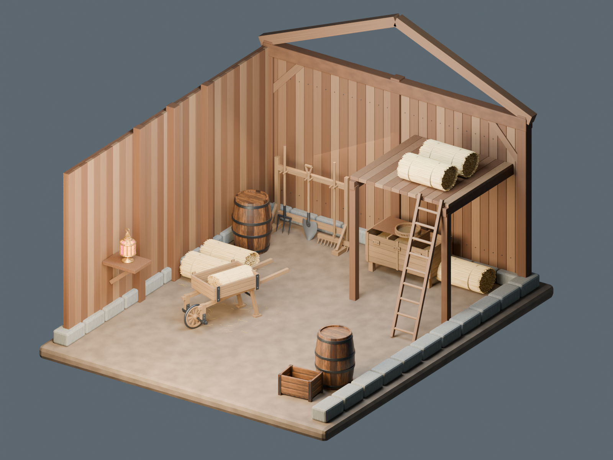

自作モデルと表示材質はCC0-1.0です。記事・作例画像・コード・完成配置シーンはCC0の範囲に含みません。単品BLENDとGLB、確認画像を収録。完成配置は配布しません。メートル単位、底面中央原点、静的装飾素材。リグや衝突形状は含まず、各ゲームエンジンでの性能保証はありません。

## BN_001 — 干し草フォーク

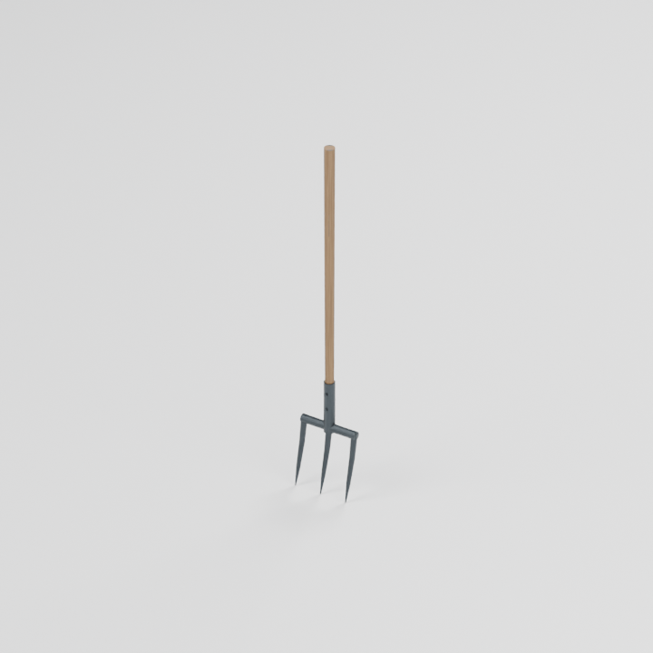

三本の曲がった鉄歯と木柄。干し草置場や厩舎の道具に。

0.268 × 0.091 × 1.581 m

[ZIP · BLEND + GLB](https://github.com/k3peta/tales-on-a-table/releases/download/v2026.10.19-farmhouse-barn/BN_001_CC0.zip)

## BN_002 — 木製レーキ

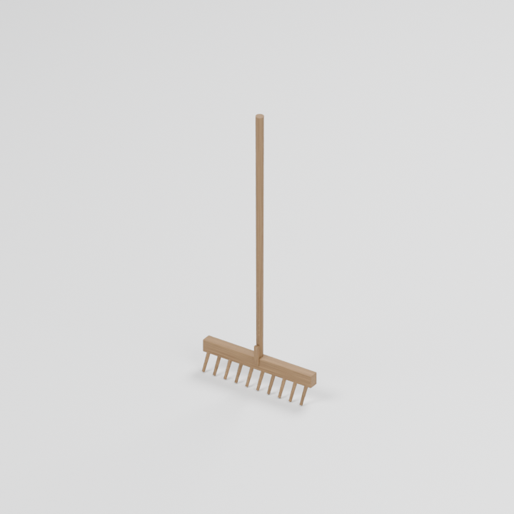

横木に並ぶ木の歯。庭や畑、納屋の壁際へ置けます。

0.650 × 0.104 × 1.554 m

[ZIP · BLEND + GLB](https://github.com/k3peta/tales-on-a-table/releases/download/v2026.10.19-farmhouse-barn/BN_002_CC0.zip)

## BN_003 — 穀物用の鋤

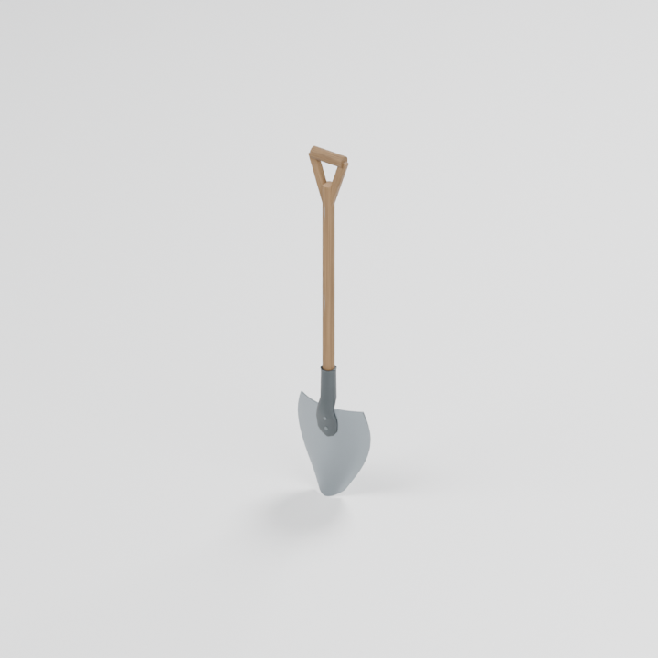

曲面の刃と、舌状の接合部を持つソケット。二本のリベットで留めています。

0.300 × 0.076 × 1.382 m

[ZIP · BLEND + GLB](https://github.com/k3peta/tales-on-a-table/releases/download/v2026.10.19-farmhouse-barn/BN_003_CC0.zip)

## BN_004 — 木製手押し車

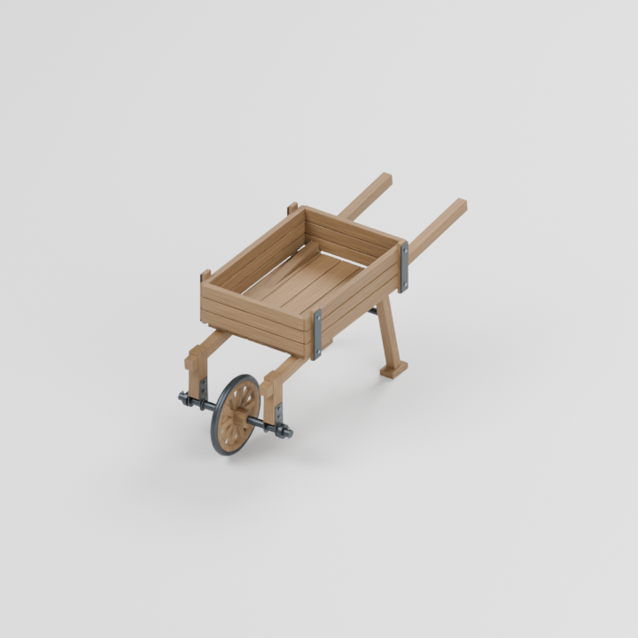

板張りの荷台、一本の車輪、穴あき受け板と固定ボルトを備えた運搬道具。

0.716 × 1.973 × 0.850 m

[ZIP · BLEND + GLB](https://github.com/k3peta/tales-on-a-table/releases/download/v2026.10.19-farmhouse-barn/BN_004_CC0.zip)

## BN_005 — 結束した干し草

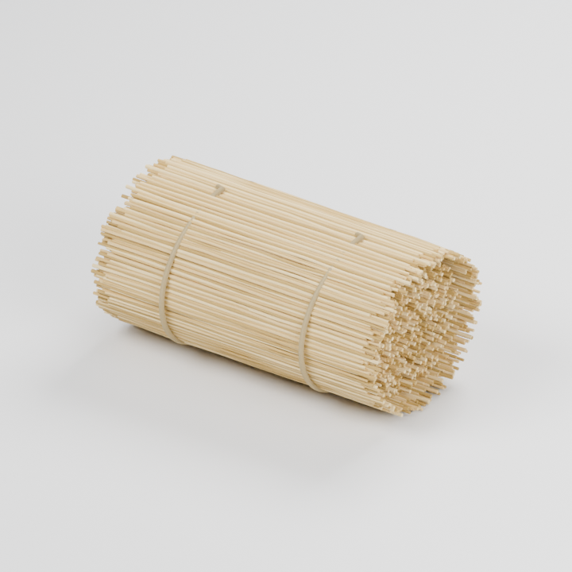

端が不揃いな藁を二本の紐で束ねた干し草。積み重ねや荷台の荷物に。

0.910 × 0.535 × 0.448 m

[ZIP · BLEND + GLB](https://github.com/k3peta/tales-on-a-table/releases/download/v2026.10.19-farmhouse-barn/BN_005_CC0.zip)

## BN_006 — 三区画の穀物箱

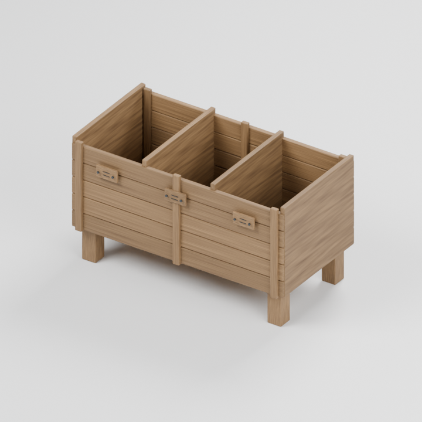

三つの収納区画と木札を備えた空の木箱。中身を自由に組み合わせられます。

1.308 × 0.695 × 0.735 m

[ZIP · BLEND + GLB](https://github.com/k3peta/tales-on-a-table/releases/download/v2026.10.19-farmhouse-barn/BN_006_CC0.zip)

## BN_007 — 農具掛け

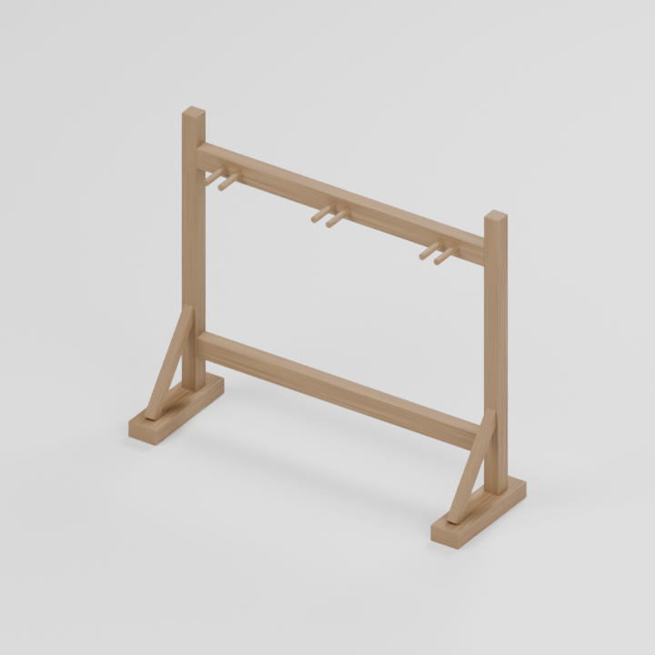

横桟と対になった掛け棒を持つ自立式の農具掛け。道具は別素材です。

1.530 × 0.480 × 1.305 m

[ZIP · BLEND + GLB](https://github.com/k3peta/tales-on-a-table/releases/download/v2026.10.19-farmhouse-barn/BN_007_CC0.zip)

## BN_008 — 穀物の篩

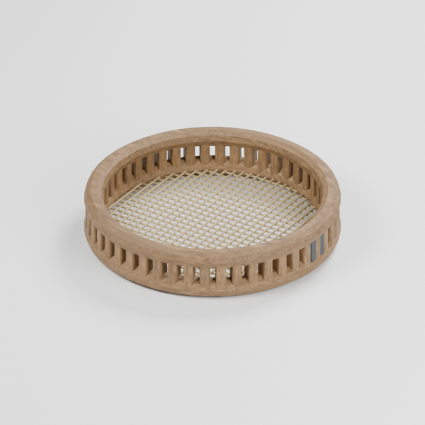

厚みのある木の縁と網を持つ丸い篩。穀物箱や作業台に添えられます。

0.444 × 0.444 × 0.089 m

[ZIP · BLEND + GLB](https://github.com/k3peta/tales-on-a-table/releases/download/v2026.10.19-farmhouse-barn/BN_008_CC0.zip)

## Details

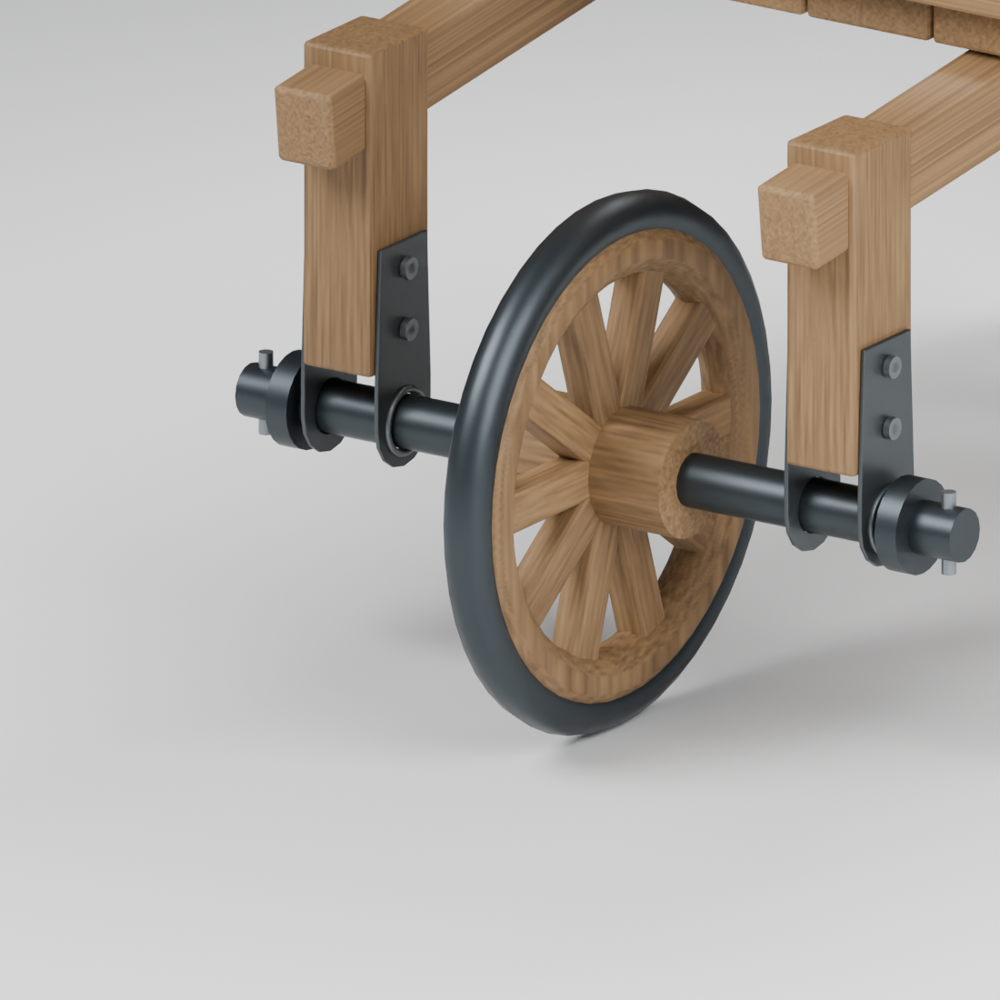

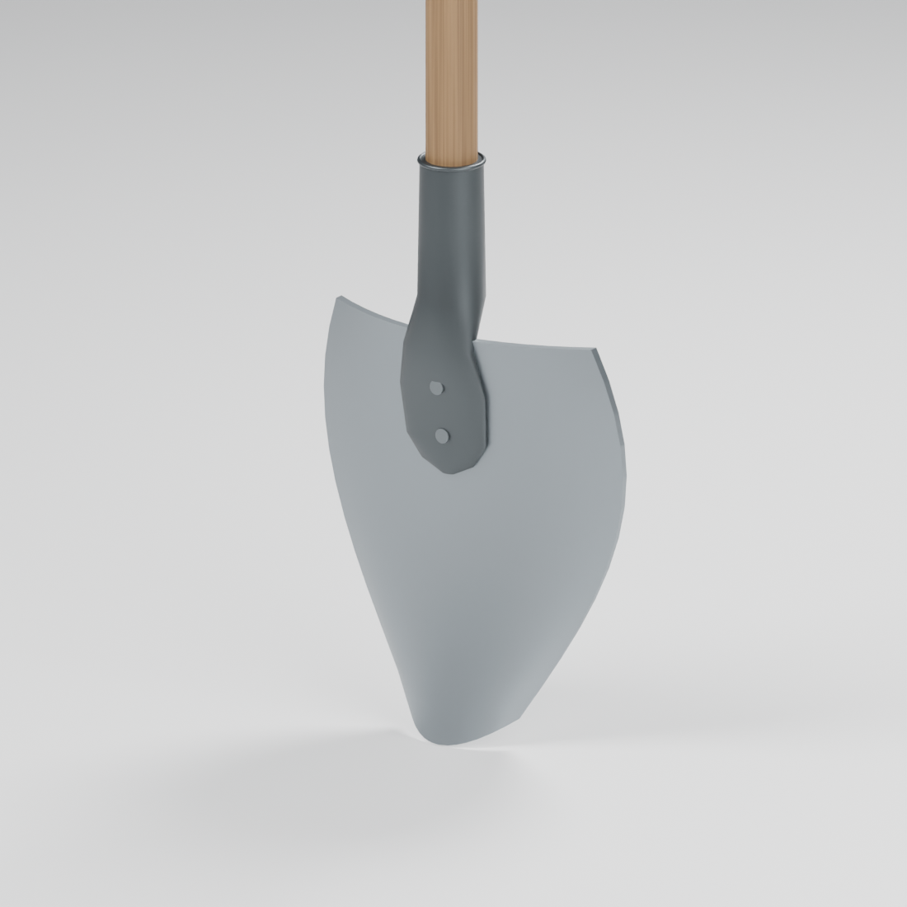

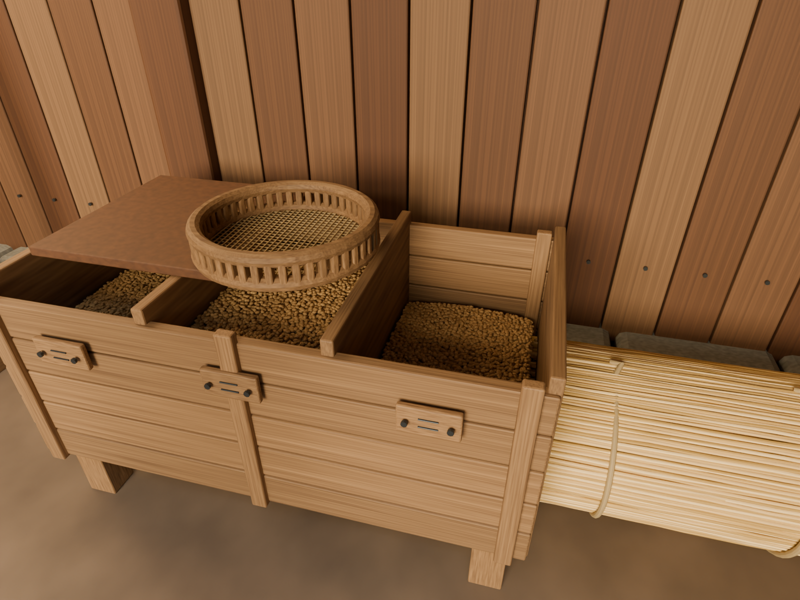

