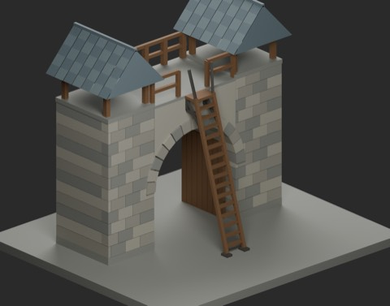
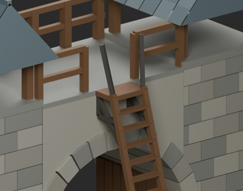
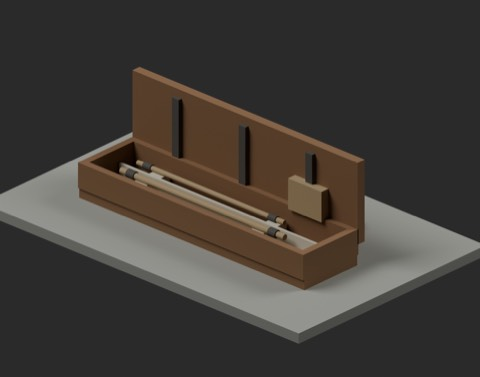
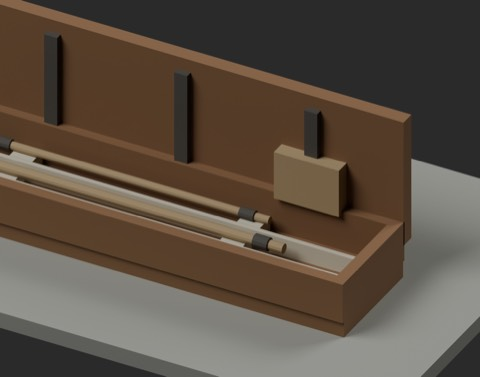

# 工事・釣り・旅の接続小物 / Field and travel tools

**949 distribution records = 945 + 2 component candidates + 2 assembly examples.** One structural connection and one composite transport accessory; global independent shape count is unconfirmed. The reused gate and existing fishing/travel gear are not added again.

### FTR101_StepoffLadder4m

structural_connection

[ZIP](https://raw.githubusercontent.com/k3peta/tales-on-a-table/main/distributions/field-travel-tools-v1/FTR101_StepoffLadder4m_CC0.zip)

### FTR102_SegmentedRodCase

composite_transport_accessory

[ZIP](https://raw.githubusercontent.com/k3peta/tales-on-a-table/main/distributions/field-travel-tools-v1/FTR102_SegmentedRodCase_CC0.zip)

### FTRV01_GateLadderFit

assembly_not_new_shape

[ZIP](https://raw.githubusercontent.com/k3peta/tales-on-a-table/main/distributions/field-travel-tools-v1/FTRV01_GateLadderFit_CC0.zip)

### FTRV02_TravelRodKit

assembly_not_new_shape

[ZIP](https://raw.githubusercontent.com/k3peta/tales-on-a-table/main/distributions/field-travel-tools-v1/FTRV02_TravelRodKit_CC0.zip)

## Uses and limitations

FTR101 combines a4m-high step-off deck, extended handholds and stand-off supports. Metres, Z up, ground origin. Fifteen rungs at0.25m intervals plus the step-off deck; handholds reach4.8m. Place at (0,2.55,0), rotate180 degrees around Z for the access-v2 gate rear deck. It is not intended to replace the existing2m scaffold ladder. WS034 and FH014 are existing comparable ladders; their exact original dimensions were not recovered, so this is a bounded connection use, not proof of a globally new ladder design.

FTR102 is a fixed-open1.35m by0.34m segmented-rod transport case with three stored sections, supports, retainers, fittings, bag and shoulder strap. Lid height is0.50m. It is one composite accessory, not three fishing rods, and has no fishing or folding mechanism.

FTRV01 demonstrates the reused gate connection; FTRV02 demonstrates the rod kit. Neither assembly is an additional independent shape. Existing rods, nets, stands, bait boxes, tackle winders/floats, creels, water bottles, backpacks, rolled blankets and stools are excluded from new counts. This is not a wholly new travel-equipment set.

The two components were generated from original mesh code without external geometry/images or held material. CC0-1.0 covers model geometry and embedded materials; the reused gate retains its CC0 scope. Code, images, articles and private records are excluded. Actual climbing, collision, whole-body clearance, load capacity, construction/ladder safety standards and Blender4.3.2 compatibility remain unverified. Sampled geometric fit is not safety certification or game movement. [Checksums](../distributions/field-travel-tools-v1/SHA256SUMS.txt).

## 実作画像 / Actual renders

完成バッチの配置・接写。画像は閲覧用でモデルCC0の対象外です。[既存の画像利用条件](../LICENSE.md)を維持します。

### FTR101_StepoffLadder4m

StepoffLadder4m

[ZIP](https://raw.githubusercontent.com/k3peta/tales-on-a-table/main/distributions/field-travel-tools-v1/FTR101_StepoffLadder4m_CC0.zip)

### FTR102_SegmentedRodCase

SegmentedRodCase

[ZIP](https://raw.githubusercontent.com/k3peta/tales-on-a-table/main/distributions/field-travel-tools-v1/FTR102_SegmentedRodCase_CC0.zip)

### FTRV01_GateLadderFit

GateLadderFit

[ZIP](https://raw.githubusercontent.com/k3peta/tales-on-a-table/main/distributions/field-travel-tools-v1/FTRV01_GateLadderFit_CC0.zip)

### FTRV02_TravelRodKit

TravelRodKit

[ZIP](https://raw.githubusercontent.com/k3peta/tales-on-a-table/main/distributions/field-travel-tools-v1/FTRV02_TravelRodKit_CC0.zip)

## Individual images / 個別画像 / 单件图片

Actual distributed models; chosen camera view does not establish intended front or placement pivot. Images are outside model CC0. Original links and archives retained.

### FTR101_StepoffLadder4m — StepoffLadder4m

StepoffLadder4m

[Full image](../previews/hcv-chb24/renders/FTR101_StepoffLadder4m.png) · [ZIP · BLEND/GLB](https://raw.githubusercontent.com/k3peta/tales-on-a-table/main/distributions/field-travel-tools-v1/FTR101_StepoffLadder4m_CC0.zip)

### FTR102_SegmentedRodCase — SegmentedRodCase

SegmentedRodCase

[Full image](../previews/hcv-chb24/renders/FTR102_SegmentedRodCase.png) · [ZIP · BLEND/GLB](https://raw.githubusercontent.com/k3peta/tales-on-a-table/main/distributions/field-travel-tools-v1/FTR102_SegmentedRodCase_CC0.zip)

### FTRV01_GateLadderFit — GateLadderFit

GateLadderFit

[Full image](../previews/hcv-chb24/renders/FTRV01_GateLadderFit.png) · [ZIP · BLEND/GLB](https://raw.githubusercontent.com/k3peta/tales-on-a-table/main/distributions/field-travel-tools-v1/FTRV01_GateLadderFit_CC0.zip)

### FTRV02_TravelRodKit — TravelRodKit

TravelRodKit

[Full image](../previews/hcv-chb24/renders/FTRV02_TravelRodKit.png) · [ZIP · BLEND/GLB](https://raw.githubusercontent.com/k3peta/tales-on-a-table/main/distributions/field-travel-tools-v1/FTRV02_TravelRodKit_CC0.zip)
