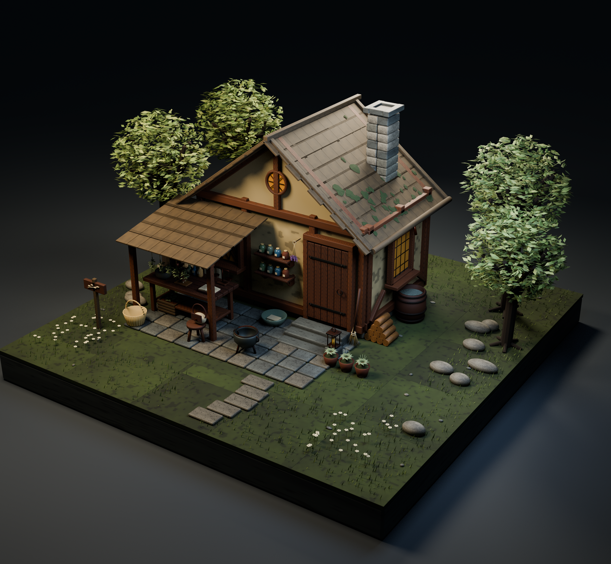

# 森の魔女の薬草小屋

22配布レコード、22設計。

各単体ZIPはBLEND・GLB・README・ライセンスを含みます。モデルと必要な同梱材質のみCC0 1.0。記事・作例画像・完成配置シーンは対象外です。
BLENDは単体データのため、一部はFile > Appendでオブジェクト/コレクションを読み込んでください。GLBは微細バンプ等の表現がBlenderと異なることがあります。実機性能は未検証です。

| ID | 元ID | 素材 | 配布 |
|---|---|---|---|
| FW001 | W01 | Herbalists workbench | [ZIP](https://github.com/k3peta/tales-on-a-table/releases/download/v2026.10.21-forest-witch/FW001_CC0.zip) |
| FW002 | W02 | Stone mortar and pestle | [ZIP](https://github.com/k3peta/tales-on-a-table/releases/download/v2026.10.21-forest-witch/FW002_CC0.zip) |
| FW003 | W03 | Corked apothecary bottles | [ZIP](https://github.com/k3peta/tales-on-a-table/releases/download/v2026.10.21-forest-witch/FW003_CC0.zip) |
| FW004 | W04 | Open herbal and bookstand | [ZIP](https://github.com/k3peta/tales-on-a-table/releases/download/v2026.10.21-forest-witch/FW004_CC0.zip) |
| FW005 | W05 | Hanging herb drying rail | [ZIP](https://github.com/k3peta/tales-on-a-table/releases/download/v2026.10.21-forest-witch/FW005_CC0.zip) |
| FW006 | W06 | Wicker gathering basket | [ZIP](https://github.com/k3peta/tales-on-a-table/releases/download/v2026.10.21-forest-witch/FW006_CC0.zip) |
| FW007 | W07 | Birch twig broom | [ZIP](https://github.com/k3peta/tales-on-a-table/releases/download/v2026.10.21-forest-witch/FW007_CC0.zip) |
| FW008 | W08 | Iron cauldron and tripod | [ZIP](https://github.com/k3peta/tales-on-a-table/releases/download/v2026.10.21-forest-witch/FW008_CC0.zip) |
| FW009 | W09 | Split firewood stack | [ZIP](https://github.com/k3peta/tales-on-a-table/releases/download/v2026.10.21-forest-witch/FW009_CC0.zip) |
| FW010 | W10 | Copper kettle | [ZIP](https://github.com/k3peta/tales-on-a-table/releases/download/v2026.10.21-forest-witch/FW010_CC0.zip) |
| FW011 | W11 | Lantern on stone plinth | [ZIP](https://github.com/k3peta/tales-on-a-table/releases/download/v2026.10.21-forest-witch/FW011_CC0.zip) |
| FW012 | W12 | Rainwater barrel | [ZIP](https://github.com/k3peta/tales-on-a-table/releases/download/v2026.10.21-forest-witch/FW012_CC0.zip) |
| FW013 | W13 | Three earthen herb pots | [ZIP](https://github.com/k3peta/tales-on-a-table/releases/download/v2026.10.21-forest-witch/FW013_CC0.zip) |
| FW014 | W14 | Low three legged stool | [ZIP](https://github.com/k3peta/tales-on-a-table/releases/download/v2026.10.21-forest-witch/FW014_CC0.zip) |
| FW015 | W15 | Canvas gathering satchel | [ZIP](https://github.com/k3peta/tales-on-a-table/releases/download/v2026.10.21-forest-witch/FW015_CC0.zip) |
| FW016 | W16 | Mushroom sorting tray | [ZIP](https://github.com/k3peta/tales-on-a-table/releases/download/v2026.10.21-forest-witch/FW016_CC0.zip) |
| FW017 | W17 | Herb bundle storage crate | [ZIP](https://github.com/k3peta/tales-on-a-table/releases/download/v2026.10.21-forest-witch/FW017_CC0.zip) |
| FW018 | W18 | Folded linen and wash basin | [ZIP](https://github.com/k3peta/tales-on-a-table/releases/download/v2026.10.21-forest-witch/FW018_CC0.zip) |
| FW019 | W19 | Balanced apothecary scales | [ZIP](https://github.com/k3peta/tales-on-a-table/releases/download/v2026.10.21-forest-witch/FW019_CC0.zip) |
| FW020 | W20 | Weathered waymarker | [ZIP](https://github.com/k3peta/tales-on-a-table/releases/download/v2026.10.21-forest-witch/FW020_CC0.zip) |
| FW021 | W21 | Wall apothecary shelf | [ZIP](https://github.com/k3peta/tales-on-a-table/releases/download/v2026.10.21-forest-witch/FW021_CC0.zip) |
| FW022 | W22 | Lavender drying bundle | [ZIP](https://github.com/k3peta/tales-on-a-table/releases/download/v2026.10.21-forest-witch/FW022_CC0.zip) |

## 作例・カタログ画像

画像は単体のすべてを示す保証ではありません。完成シーンは配布対象外です。画像にモデル用CC0を適用しません。

[Release](https://github.com/k3peta/tales-on-a-table/releases/tag/v2026.10.21-forest-witch) · [SHA256](../releases/forest_witch/SHA256SUMS.txt) · [License](../LICENSE.md)

## Individual images / 個別画像 / 单件图片

Actual distributed models; chosen camera view does not establish intended front or placement pivot. Images are outside model CC0. Original links and archives retained.

### FW003 — Corked apothecary bottles

Corked apothecary bottles

[Full image](../previews/alchemy-forest14/renders/FW003.png) · [ZIP · BLEND/GLB](https://github.com/k3peta/tales-on-a-table/releases/download/v2026.10.21-forest-witch/FW003_CC0.zip)

### FW006 — Wicker gathering basket

Wicker gathering basket

[Full image](../previews/alchemy-forest14/renders/FW006.png) · [ZIP · BLEND/GLB](https://github.com/k3peta/tales-on-a-table/releases/download/v2026.10.21-forest-witch/FW006_CC0.zip)

## Material revisions / 材質改訂

## FW001 — Herbalists workbench

Herbalists workbench

[Repaired ZIP](https://raw.githubusercontent.com/k3peta/tales-on-a-table/main/distributions/quality-fw-normal-repair-v1/FW001__repair_CC0.zip) · [Original ZIP · historical](https://github.com/k3peta/tales-on-a-table/releases/download/v2026.10.21-forest-witch/FW001_CC0.zip) · [Full image](../previews/quality-fw-normal-repair-v1/renders/FW001.png)

## FW002 — Stone mortar and pestle

Stone mortar and pestle

[Repaired ZIP](https://raw.githubusercontent.com/k3peta/tales-on-a-table/main/distributions/quality-fw-normal-repair-v1/FW002__repair_CC0.zip) · [Original ZIP · historical](https://github.com/k3peta/tales-on-a-table/releases/download/v2026.10.21-forest-witch/FW002_CC0.zip) · [Full image](../previews/quality-fw-normal-repair-v1/renders/FW002.png)

## FW004 — Open herbal and bookstand

Open herbal and bookstand

[Repaired ZIP](https://raw.githubusercontent.com/k3peta/tales-on-a-table/main/distributions/quality-fw-normal-repair-v1/FW004__repair_CC0.zip) · [Original ZIP · historical](https://github.com/k3peta/tales-on-a-table/releases/download/v2026.10.21-forest-witch/FW004_CC0.zip) · [Full image](../previews/quality-fw-normal-repair-v1/renders/FW004.png)

## FW005 — Hanging herb drying rail

Hanging herb drying rail

[Repaired ZIP](https://raw.githubusercontent.com/k3peta/tales-on-a-table/main/distributions/quality-fw-normal-repair-v1/FW005__repair_CC0.zip) · [Original ZIP · historical](https://github.com/k3peta/tales-on-a-table/releases/download/v2026.10.21-forest-witch/FW005_CC0.zip) · [Full image](../previews/quality-fw-normal-repair-v1/renders/FW005.png)

## FW007 — Birch twig broom

Birch twig broom

[Repaired ZIP](https://raw.githubusercontent.com/k3peta/tales-on-a-table/main/distributions/quality-fw-normal-repair-v1/FW007__repair_CC0.zip) · [Original ZIP · historical](https://github.com/k3peta/tales-on-a-table/releases/download/v2026.10.21-forest-witch/FW007_CC0.zip) · [Full image](../previews/quality-fw-normal-repair-v1/renders/FW007.png)

## FW008 — Iron cauldron and tripod

Iron cauldron and tripod

[Repaired ZIP](https://raw.githubusercontent.com/k3peta/tales-on-a-table/main/distributions/quality-fw-normal-repair-v1/FW008__repair_CC0.zip) · [Original ZIP · historical](https://github.com/k3peta/tales-on-a-table/releases/download/v2026.10.21-forest-witch/FW008_CC0.zip) · [Full image](../previews/quality-fw-normal-repair-v1/renders/FW008.png)

## FW009 — Split firewood stack

Split firewood stack

[Repaired ZIP](https://raw.githubusercontent.com/k3peta/tales-on-a-table/main/distributions/quality-fw-normal-repair-v1/FW009__repair_CC0.zip) · [Original ZIP · historical](https://github.com/k3peta/tales-on-a-table/releases/download/v2026.10.21-forest-witch/FW009_CC0.zip) · [Full image](../previews/quality-fw-normal-repair-v1/renders/FW009.png)

## FW010 — Copper kettle

Copper kettle

[Repaired ZIP](https://raw.githubusercontent.com/k3peta/tales-on-a-table/main/distributions/quality-fw-normal-repair-v1/FW010__repair_CC0.zip) · [Original ZIP · historical](https://github.com/k3peta/tales-on-a-table/releases/download/v2026.10.21-forest-witch/FW010_CC0.zip) · [Full image](../previews/quality-fw-normal-repair-v1/renders/FW010.png)

## FW011 — Lantern on stone plinth

Lantern on stone plinth

[Repaired ZIP](https://raw.githubusercontent.com/k3peta/tales-on-a-table/main/distributions/quality-fw-normal-repair-v1/FW011__repair_CC0.zip) · [Original ZIP · historical](https://github.com/k3peta/tales-on-a-table/releases/download/v2026.10.21-forest-witch/FW011_CC0.zip) · [Full image](../previews/quality-fw-normal-repair-v1/renders/FW011.png)

## FW012 — Rainwater barrel

Rainwater barrel

[Repaired ZIP](https://raw.githubusercontent.com/k3peta/tales-on-a-table/main/distributions/quality-fw-normal-repair-v1/FW012__repair_CC0.zip) · [Original ZIP · historical](https://github.com/k3peta/tales-on-a-table/releases/download/v2026.10.21-forest-witch/FW012_CC0.zip) · [Full image](../previews/quality-fw-normal-repair-v1/renders/FW012.png)

