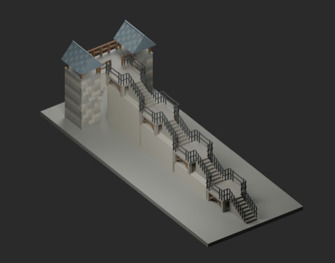
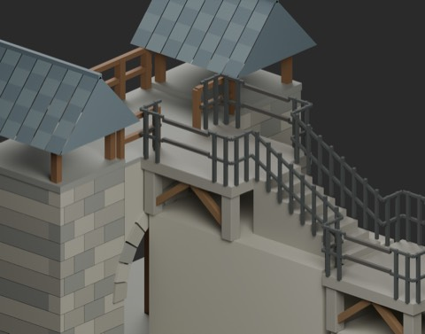
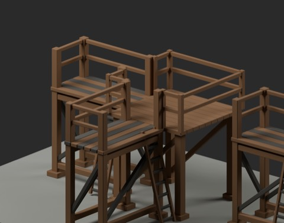
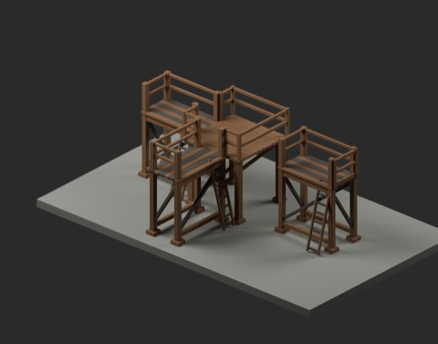

# 城塞アクセス・足場接続 v2 / Fortified city access

**945 distribution records = 941 + 2 component candidates + 2 assembly examples.** One gatehouse revision adds zero records and zero new designs. Four instances of existing ER101 stairs are reuse, not new stairs. Assemblies are not independent new shapes; global shape independence remains unconfirmed. The original gatehouse ZIP and initial vignettes remain available unchanged.

### FCS105_RoadGatehouse_access_v2

revision_not_new

[ZIP](https://raw.githubusercontent.com/k3peta/tales-on-a-table/main/distributions/fortified-city-access-v2/FCS105_RoadGatehouse_access_v2_CC0.zip)

### FCS201_ScaffoldCorner

local_connection_candidate

[ZIP](https://raw.githubusercontent.com/k3peta/tales-on-a-table/main/distributions/fortified-city-access-v2/FCS201_ScaffoldCorner_CC0.zip)

### FCS202_DeckEndGuard

structural_accessory

[ZIP](https://raw.githubusercontent.com/k3peta/tales-on-a-table/main/distributions/fortified-city-access-v2/FCS202_DeckEndGuard_CC0.zip)

### FCSV03_GateAccessExample

assembly_not_new_shape

[ZIP](https://raw.githubusercontent.com/k3peta/tales-on-a-table/main/distributions/fortified-city-access-v2/FCSV03_GateAccessExample_CC0.zip)

### FCSV04_ScaffoldCornerExample

assembly_not_new_shape

[ZIP](https://raw.githubusercontent.com/k3peta/tales-on-a-table/main/distributions/fortified-city-access-v2/FCSV04_ScaffoldCornerExample_CC0.zip)

## Connections and limitations

FCS201 is a 2m square corner landing at deck Z2, with central 1m openings on west and south sides. Railings project45mm outside its connection footprint. FCS202 is a0.98m wide,0.86m high end guard with mounting-plane origin Z0; place at (1,0,2) on the existing bay. It is a structural accessory, not another complete scaffold.

The FCS105 access_v2 revision opens the central1m of the rear rail to reach the deck at Z4. Four existing1m-rise ER101 stairs span16m depth; the highest endpoint (0,1,4) reaches the gate floor. Unused branches are closed with scene railings and supports are placed below elevated stairs. A compact switchback solution is not implemented. Metres, Z up; fixed models, not functional mechanisms.

FCSV03 is a gate rear-access example; FCSV04 demonstrates corner and end connections. They do not replace the initial two full-scene vignettes. CC0-1.0 covers model geometry and embedded materials, including the existing ER101/FCS101 components where reused. Code, renders, private inputs and articles are excluded. Game collision, actual walking, whole-body clearance, full contact volumes, construction/load safety and Blender4.3.2 compatibility are unverified. Sampled connection/headroom tests do not certify safety. [Checksums](../distributions/fortified-city-access-v2/SHA256SUMS.txt).

## 実作画像 / Actual renders

完成バッチの配置・接写。画像は閲覧用でモデルCC0の対象外です。[既存の画像利用条件](../LICENSE.md)を維持します。

### FCS201_ScaffoldCorner

ScaffoldCorner

[ZIP](https://raw.githubusercontent.com/k3peta/tales-on-a-table/main/distributions/fortified-city-access-v2/FCS201_ScaffoldCorner_CC0.zip)

### FCS202_DeckEndGuard

DeckEndGuard

[ZIP](https://raw.githubusercontent.com/k3peta/tales-on-a-table/main/distributions/fortified-city-access-v2/FCS202_DeckEndGuard_CC0.zip)

### FCSV03_GateAccessExample

GateAccessExample

[ZIP](https://raw.githubusercontent.com/k3peta/tales-on-a-table/main/distributions/fortified-city-access-v2/FCSV03_GateAccessExample_CC0.zip)

### FCSV04_ScaffoldCornerExample

ScaffoldCornerExample

[ZIP](https://raw.githubusercontent.com/k3peta/tales-on-a-table/main/distributions/fortified-city-access-v2/FCSV04_ScaffoldCornerExample_CC0.zip)

