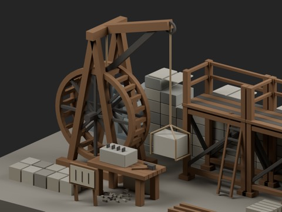
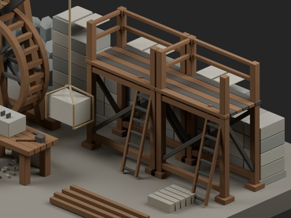
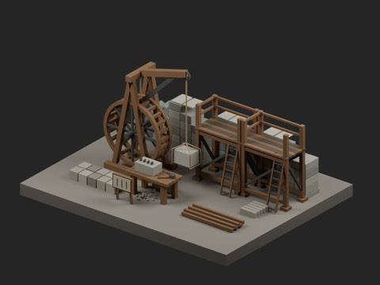
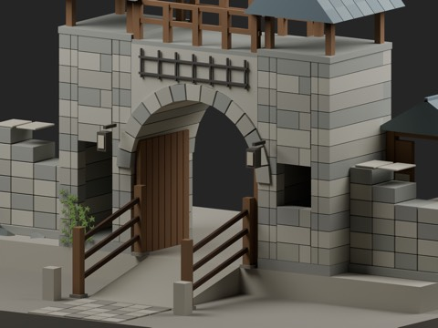
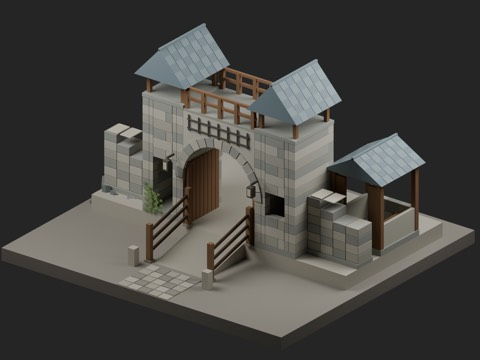
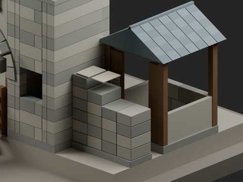

# 城塞工事・街道門 / Fortified city sites

921 + 6 standalone model records + 2 assembled vignette records = **929 distribution records**. The six standalone candidates comprise four local-use candidates and two structural variants. Three existing types reused in the vignettes are not added again. Vignettes and scene fixtures are not additional independent shapes; global shape independence remains unconfirmed.

|ID|Classification|Download|Bytes|
|---|---|---|---:|
|FCS101_TimberScaffold|local_use_candidate|[ZIP](https://raw.githubusercontent.com/k3peta/tales-on-a-table/main/distributions/fortified-city-sites-v1/FCS101_TimberScaffold_CC0.zip)|106336|
|FCS102_TreadwheelHoist|local_use_candidate|[ZIP](https://raw.githubusercontent.com/k3peta/tales-on-a-table/main/distributions/fortified-city-sites-v1/FCS102_TreadwheelHoist_CC0.zip)|219378|
|FCS103_UnfinishedMasonry|structural_variant|[ZIP](https://raw.githubusercontent.com/k3peta/tales-on-a-table/main/distributions/fortified-city-sites-v1/FCS103_UnfinishedMasonry_CC0.zip)|88992|
|FCS104_MasonsDressingBank|structural_variant|[ZIP](https://raw.githubusercontent.com/k3peta/tales-on-a-table/main/distributions/fortified-city-sites-v1/FCS104_MasonsDressingBank_CC0.zip)|86468|
|FCS105_RoadGatehouse|local_use_candidate|[ZIP](https://raw.githubusercontent.com/k3peta/tales-on-a-table/main/distributions/fortified-city-sites-v1/FCS105_RoadGatehouse_CC0.zip)|390688|
|FCS106_WatchKiosk|local_use_candidate|[ZIP](https://raw.githubusercontent.com/k3peta/tales-on-a-table/main/distributions/fortified-city-sites-v1/FCS106_WatchKiosk_CC0.zip)|101310|
|FCSV01_ConstructionSite|vignette_reused_components|[ZIP](https://raw.githubusercontent.com/k3peta/tales-on-a-table/main/distributions/fortified-city-sites-v1/FCSV01_ConstructionSite_CC0.zip)|559301|
|FCSV02_RoadEntrance|vignette_reused_components|[ZIP](https://raw.githubusercontent.com/k3peta/tales-on-a-table/main/distributions/fortified-city-sites-v1/FCSV02_RoadEntrance_CC0.zip)|903641|

## Use and limitations

- FCS101_TimberScaffold: 2m bay deckZ2 with integral ladder and guard rails; published ladder alone not a scaffold
- FCS102_TreadwheelHoist: Grounded frame, treadwheel, boom and hanging stone sling; loose pulley not complete hoist
- FCS103_UnfinishedMasonry: 2m masonry bay with stepped unlaid top and tooth end; old wall remains existing reference
- FCS104_MasonsDressingBank: Stone dressing bank with ashlar block and wedges; generic workbench not newly counted independent
- FCS105_RoadGatehouse: 6m frontage, clear central cart arch,4m upper deck, twin roofed tower rooms; old2m gate arch different scale/program
- FCS106_WatchKiosk: 2m guard booth with open door/window, bench and pitched roof; not barn/wine facility
- FCSV01_ConstructionSite: Repositionable assembly of current FCS parts and verified CC0 NR102/BD104/RS201 where used, plus original scene fixtures. Not an additional independent shape.
- FCSV02_RoadEntrance: Repositionable assembly of current FCS parts and verified CC0 NR102/BD104/RS201 where used, plus original scene fixtures. Not an additional independent shape.

Metres, Z up; standalone origins at ground Z0. Scaffold deck Z2, 2m bay spacing; gatehouse frontage6m and upper deckZ4. The upper gatehouse deck has no access stair in this batch. Doors, raised grille, treadwheel and suspended stone are fixed display geometry: no opening, rotation or lifting mechanism. These stylized models are not construction-safety, load-capacity or historical-reconstruction evidence.

The road vignette rises 0.5m over a 2m run; objects remain repositionable. Append the named Collection from the BLEND library. Only cleaned model/assembly BLEND and GLB files are supplied, not rendering work scenes. Sampled geometry/reload checks do not establish game collision, actual walking, complete contact volumes, mechanism operation, LOD or Blender4.3.2 compatibility; all remain unverified.

CC0-1.0 applies to model geometry and embedded materials, including verified CC0 reused components NR102/BD104/RS201 where present. Rendering scene sources, generation code, renders, article text and private records are excluded; this is not a blanket license for those works. Public placement and provenance metadata accompany the assemblies. [Checksums](../distributions/fortified-city-sites-v1/SHA256SUMS.txt).

## 実作画像 / Actual renders

完成バッチの配置・接写。画像は閲覧用でモデルCC0の対象外です。[既存の画像利用条件](../LICENSE.md)を維持します。

|ID|名称 / Name|Download|
|---|---|---|
|RS201|Pasture slope bay|[ZIP](https://raw.githubusercontent.com/k3peta/tales-on-a-table/main/distributions/rustic-slope-connections-v2/zips/RS201_CC0.zip)|
|FCS101_TimberScaffold|TimberScaffold|[ZIP](https://raw.githubusercontent.com/k3peta/tales-on-a-table/main/distributions/fortified-city-sites-v1/FCS101_TimberScaffold_CC0.zip)|
|FCS102_TreadwheelHoist|TreadwheelHoist|[ZIP](https://raw.githubusercontent.com/k3peta/tales-on-a-table/main/distributions/fortified-city-sites-v1/FCS102_TreadwheelHoist_CC0.zip)|
|FCS103_UnfinishedMasonry|UnfinishedMasonry|[ZIP](https://raw.githubusercontent.com/k3peta/tales-on-a-table/main/distributions/fortified-city-sites-v1/FCS103_UnfinishedMasonry_CC0.zip)|
|FCS104_MasonsDressingBank|MasonsDressingBank|[ZIP](https://raw.githubusercontent.com/k3peta/tales-on-a-table/main/distributions/fortified-city-sites-v1/FCS104_MasonsDressingBank_CC0.zip)|
|FCS105_RoadGatehouse|RoadGatehouse|[ZIP](https://raw.githubusercontent.com/k3peta/tales-on-a-table/main/distributions/fortified-city-sites-v1/FCS105_RoadGatehouse_CC0.zip)|
|FCS106_WatchKiosk|WatchKiosk|[ZIP](https://raw.githubusercontent.com/k3peta/tales-on-a-table/main/distributions/fortified-city-sites-v1/FCS106_WatchKiosk_CC0.zip)|
|FCSV01_ConstructionSite|ConstructionSite|[ZIP](https://raw.githubusercontent.com/k3peta/tales-on-a-table/main/distributions/fortified-city-sites-v1/FCSV01_ConstructionSite_CC0.zip)|
|FCSV02_RoadEntrance|RoadEntrance|[ZIP](https://raw.githubusercontent.com/k3peta/tales-on-a-table/main/distributions/fortified-city-sites-v1/FCSV02_RoadEntrance_CC0.zip)|

