# Furniture & displays 1

[← Asset shelf](../README.en.md)

[日本語](furniture_01.md) · [English](furniture_01.en.md) · [简体中文](furniture_01.zh-CN.md)

## FT_001 — Wood and black-iron tavern counter

Wood and black-iron tavern counter from the tavern collection. Unit: one model record. Includes BLEND and GLB. The close-up is rendered from the distributed BLEND.

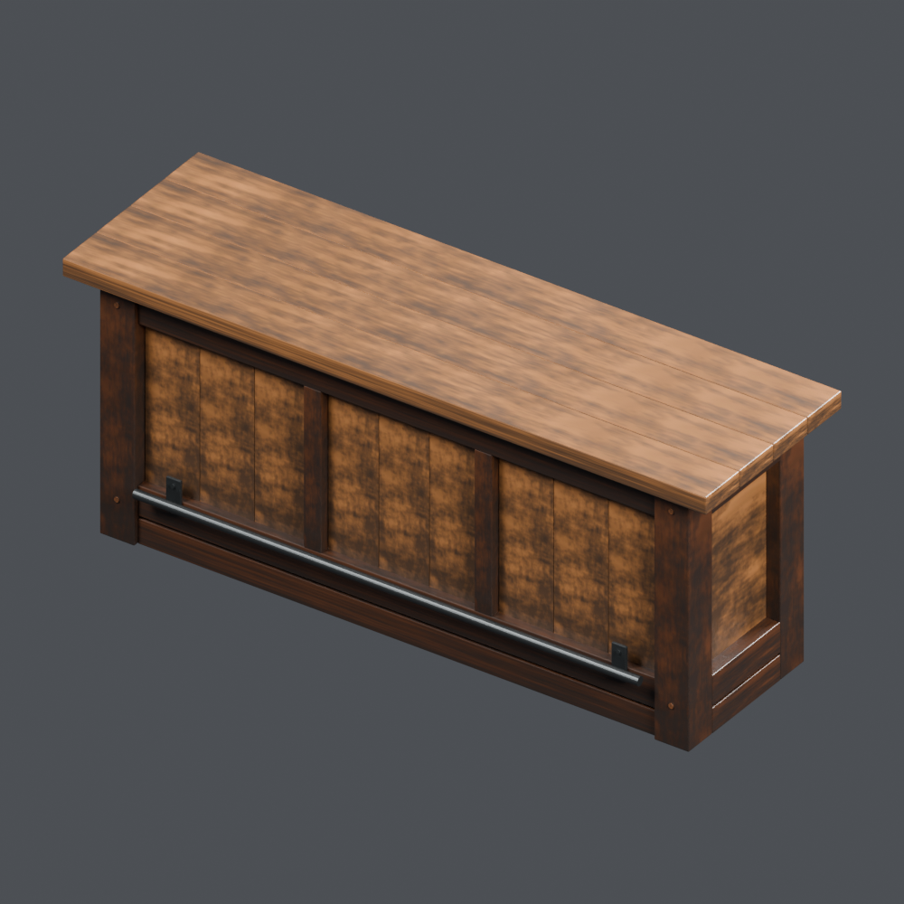

[ZIP · BLEND + GLB · 2.77 MB](https://github.com/k3peta/tales-on-a-table/releases/download/v2026.10.18/FT_001_CC0.zip) · CC0-1.0

`catalog-20261018` · SHA-256: `feea207fc601ff84a1252a787b01ed39d0fbe6f61cb00aac363a78930da8dc15`

## FT_002 — Trestle table

Trestle table from the tavern collection. Unit: one model record. Includes BLEND and GLB. The close-up is rendered from the distributed BLEND.

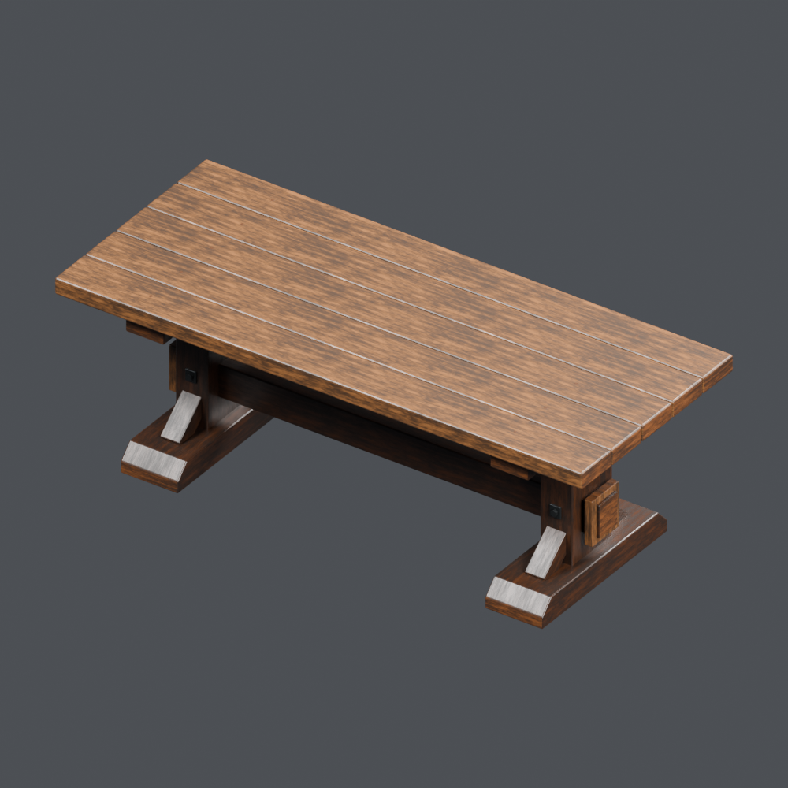

[ZIP · BLEND + GLB · 2.75 MB](https://github.com/k3peta/tales-on-a-table/releases/download/v2026.10.18/FT_002_CC0.zip) · CC0-1.0

`catalog-20261018` · SHA-256: `1984690722138c00d2f51aa3ac8dccbae022530d2bbd537dbc44b0bb4a2e5bf9`

## FT_003 — Wooden tavern chair

Wooden tavern chair from the tavern collection. Unit: one model record. Includes BLEND and GLB. The close-up is rendered from the distributed BLEND.

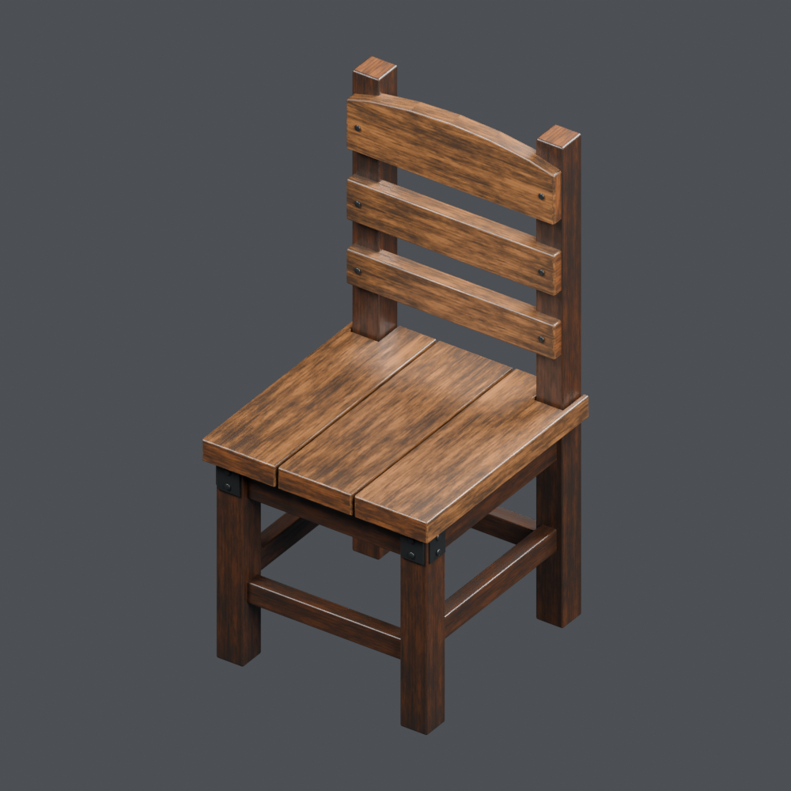

[ZIP · BLEND + GLB · 2.82 MB](https://github.com/k3peta/tales-on-a-table/releases/download/v2026.10.18/FT_003_CC0.zip) · CC0-1.0

`catalog-20261018` · SHA-256: `728d3c30105989435ffbc9613e4d0b1140c545e15853c0111b36d958a442dc92`

## FT_004 — Tall wood and black-iron bar stool

Tall wood and black-iron bar stool from the tavern collection. Unit: one model record. Includes BLEND and GLB. The close-up is rendered from the distributed BLEND.

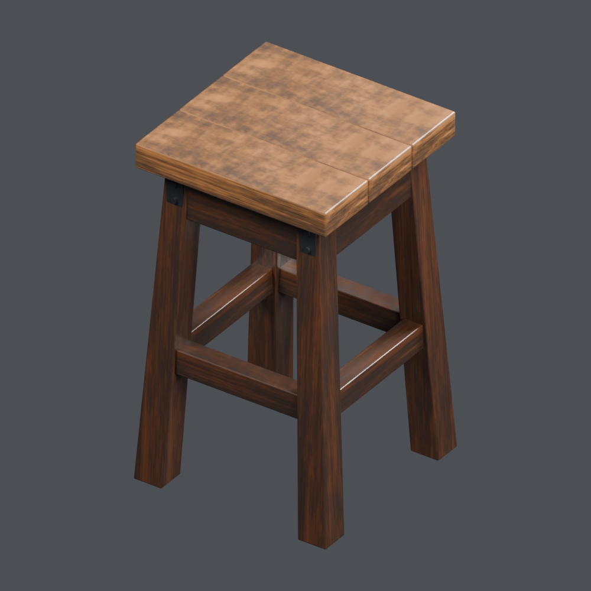

[ZIP · BLEND + GLB · 2.01 MB](https://github.com/k3peta/tales-on-a-table/releases/download/v2026.10.18/FT_004_CC0.zip) · CC0-1.0

`catalog-20261018` · SHA-256: `875d1afe922fdaf7d9cce53df6fb7d6e36e6d130ab78d22c4b60ade33cfd374c`

## FT_005 — Long wooden bench

Long wooden bench from the tavern collection. Unit: one model record. Includes BLEND and GLB. The close-up is rendered from the distributed BLEND.

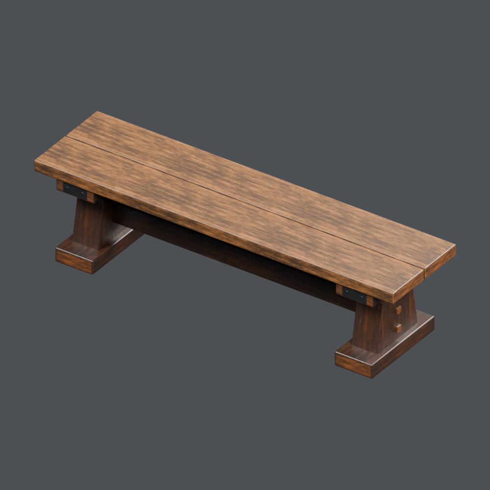

[ZIP · BLEND + GLB · 2.74 MB](https://github.com/k3peta/tales-on-a-table/releases/download/v2026.10.18/FT_005_CC0.zip) · CC0-1.0

`catalog-20261018` · SHA-256: `393ba7245dbd0e770f609005c855f10b533b4bfab9fbeb199e84343e208e81d9`

## FT_006 — Round pedestal table

Round pedestal table from the tavern collection. Unit: one model record. Includes BLEND and GLB. The close-up is rendered from the distributed BLEND.

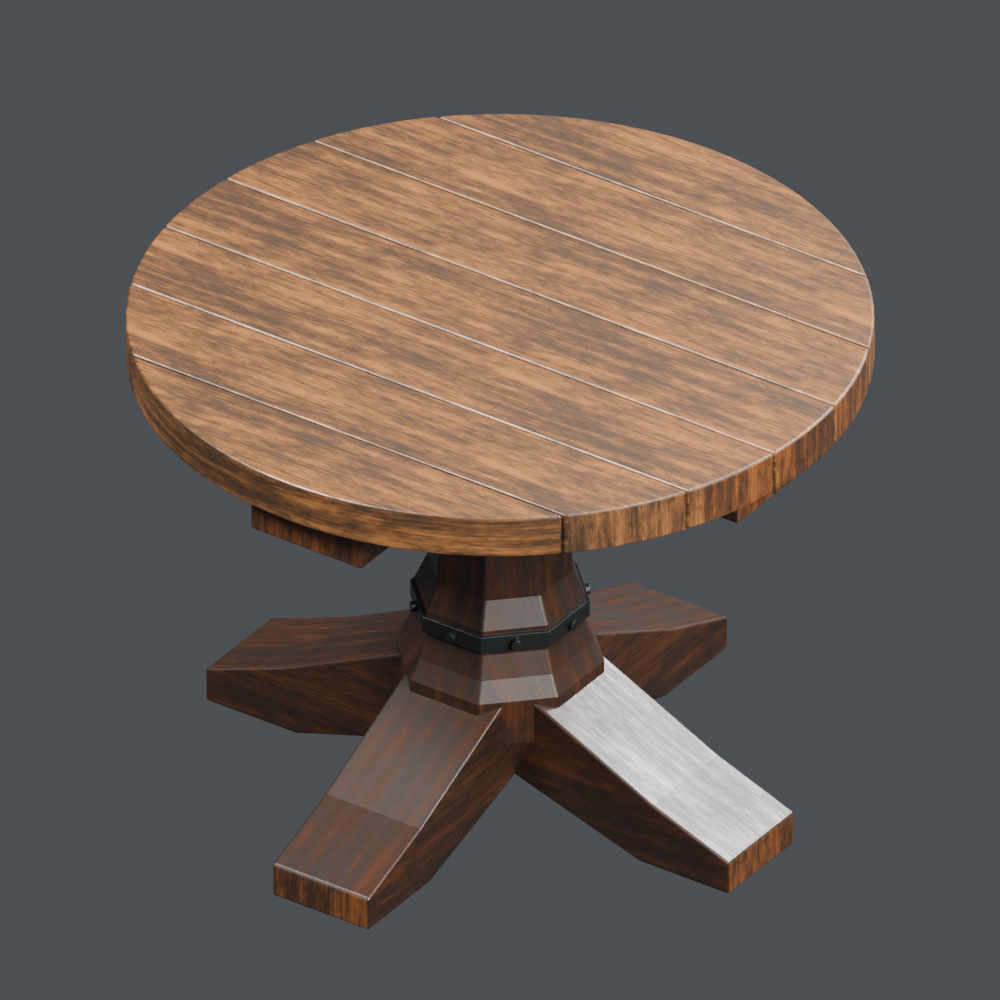

[ZIP · BLEND + GLB · 2.85 MB](https://github.com/k3peta/tales-on-a-table/releases/download/v2026.10.18/FT_006_CC0.zip) · CC0-1.0

`catalog-20261018` · SHA-256: `3872afd5d185e83928c53956580fe175eb0394cc47c6c8a14665d25f595a6e37`

## FT_007 — L-shaped wooden corner bench

L-shaped wooden corner bench from the tavern collection. Unit: one model record. Includes BLEND and GLB. The close-up is rendered from the distributed BLEND.

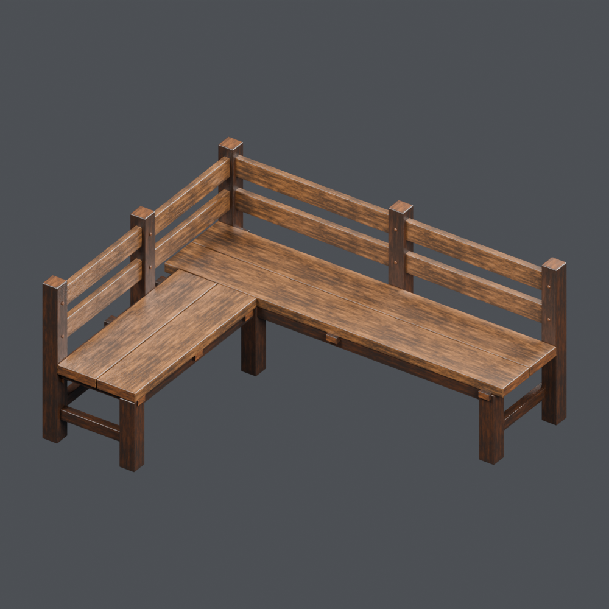

[ZIP · BLEND + GLB · 2.75 MB](https://github.com/k3peta/tales-on-a-table/releases/download/v2026.10.18/FT_007_CC0.zip) · CC0-1.0

`catalog-20261018` · SHA-256: `ed844d4cf04e14b79e66d6f9c50b728e27b7b4eaaf5646ff4daae162d7a032e6`

## FT_008 — Freestanding tavern shelving

Freestanding tavern shelving from the tavern collection. Unit: one model record. Includes BLEND and GLB. The close-up is rendered from the distributed BLEND.

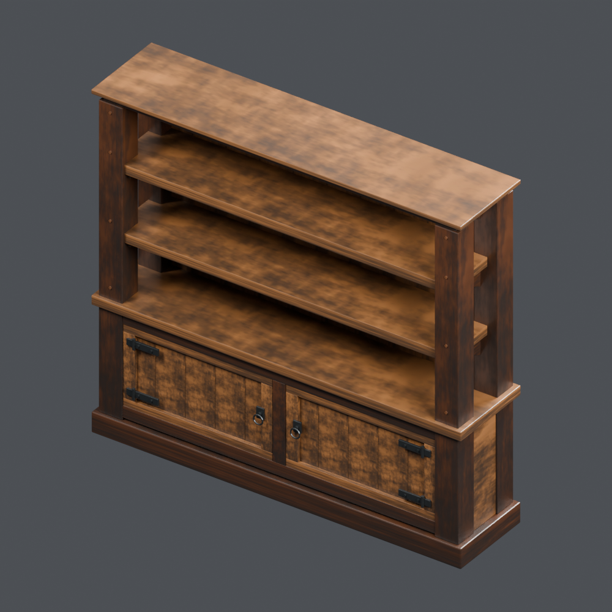

[ZIP · BLEND + GLB · 2.84 MB](https://github.com/k3peta/tales-on-a-table/releases/download/v2026.10.18/FT_008_CC0.zip) · CC0-1.0

`catalog-20261018` · SHA-256: `8d62ce1bfdc5e06684c820322f2263c9510e654db36a27bef13bc70fa37ca50b`

## FT_009 — Wall shelf

Wall shelf from the tavern collection. Unit: one model record. Includes BLEND and GLB. The close-up is rendered from the distributed BLEND.

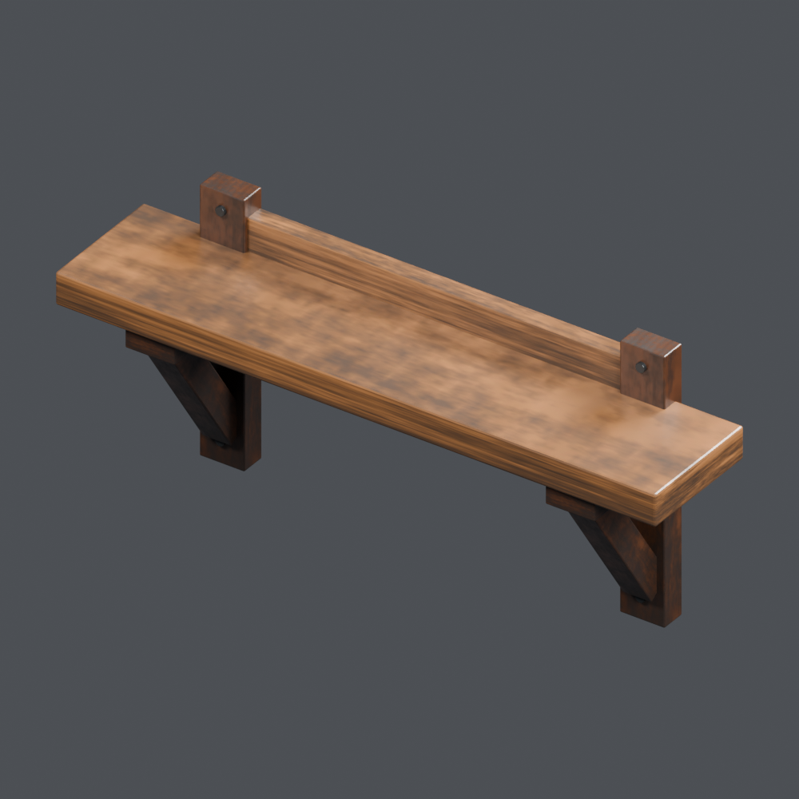

[ZIP · BLEND + GLB · 2.71 MB](https://github.com/k3peta/tales-on-a-table/releases/download/v2026.10.18/FT_009_CC0.zip) · CC0-1.0

`catalog-20261018` · SHA-256: `511a61f08d97158d0fd2b4ca1e0d61e817ec6061df86da64ba765f8444cdb992`

## FT_010 — Double-door wooden cupboard

Double-door wooden cupboard from the tavern collection. Unit: one model record. Includes BLEND and GLB. The close-up is rendered from the distributed BLEND.

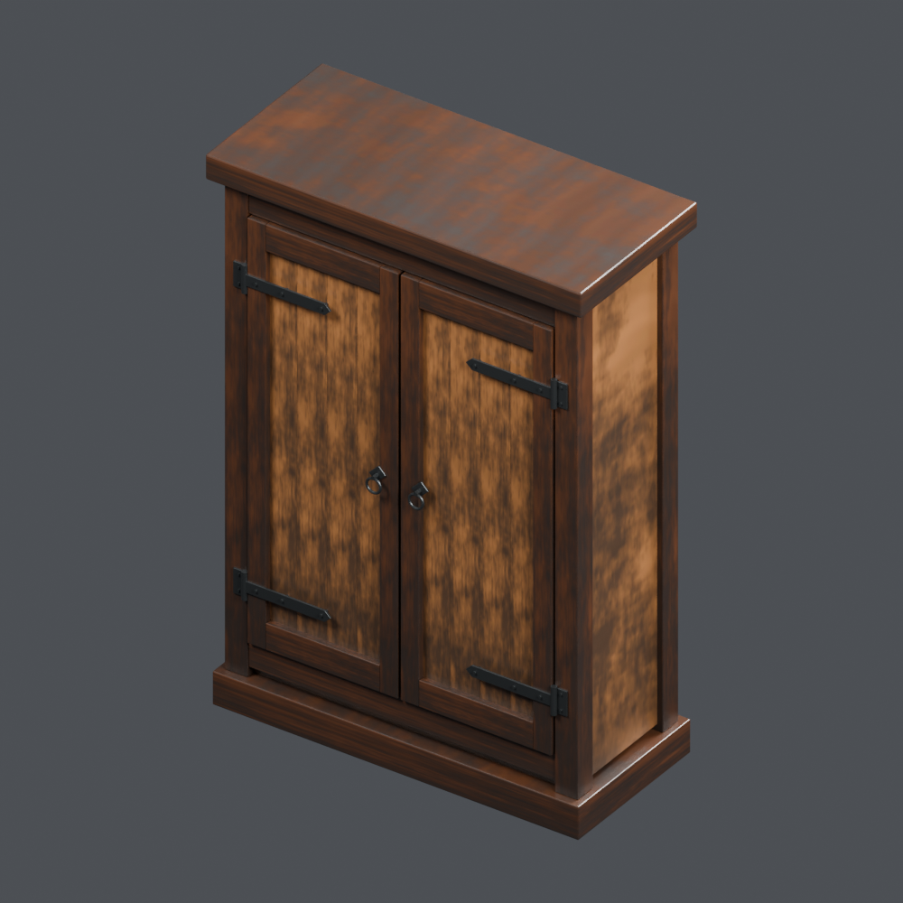

[ZIP · BLEND + GLB · 2.16 MB](https://github.com/k3peta/tales-on-a-table/releases/download/v2026.10.18/FT_010_CC0.zip) · CC0-1.0

`catalog-20261018` · SHA-256: `98e3194650b7f4be249f31162c44719f0b0cfe9d1b787cccb7839e7564f75560`

## FT_012 — Horizontal barrel stand

Horizontal barrel stand from the tavern collection. Unit: one model record. Includes BLEND and GLB. The close-up is rendered from the distributed BLEND.

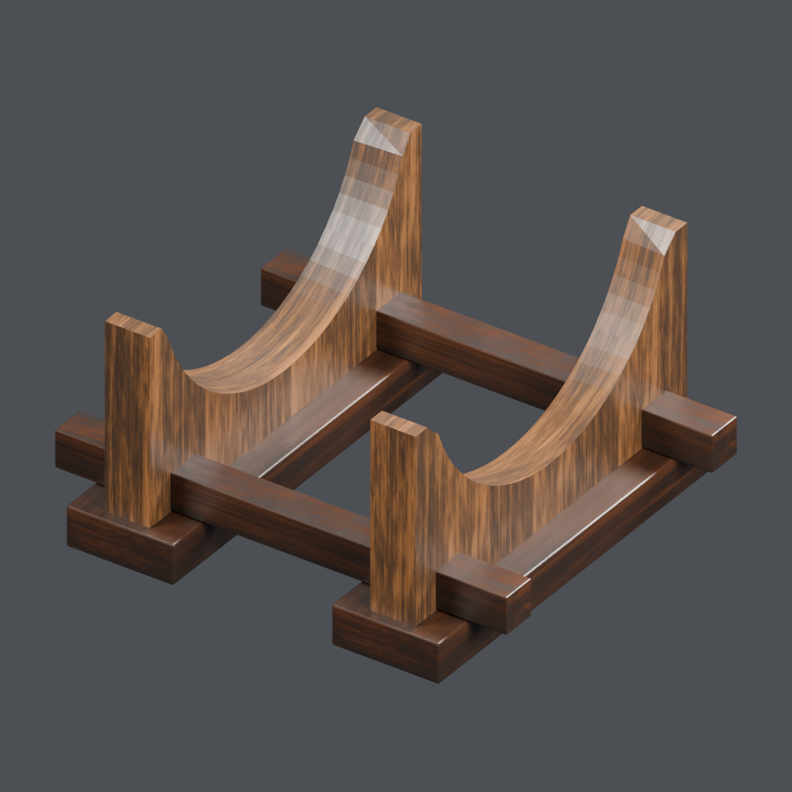

[ZIP · BLEND + GLB · 2.68 MB](https://github.com/k3peta/tales-on-a-table/releases/download/v2026.10.18/FT_012_CC0.zip) · CC0-1.0

`catalog-20261018` · SHA-256: `416bf79640ae42cfcbb2eef243c18a4470358300877675c6edc1cc41addff2f3`

## FT_050 — Two-panel wood and linen screen

Two-panel wood and linen screen from the tavern collection. Unit: one model record. Includes BLEND and GLB. The close-up is rendered from the distributed BLEND.

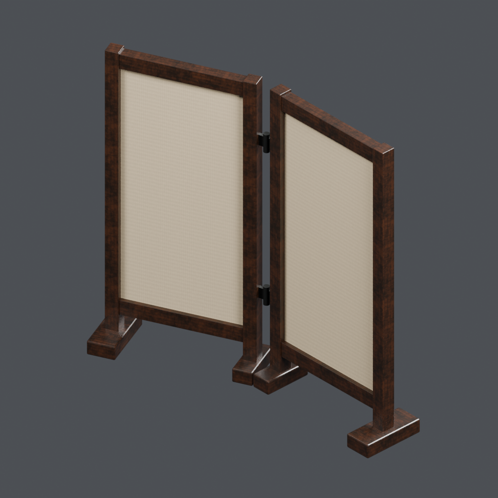

[ZIP · BLEND + GLB · 0.66 MB](https://github.com/k3peta/tales-on-a-table/releases/download/v2026.10.18/FT_050_CC0.zip) · CC0-1.0

`catalog-20261018` · SHA-256: `e1b791e8d010a492160ad4eb5fdf6c5cabe3fda3e9b79b580124d3d28f28c643`
