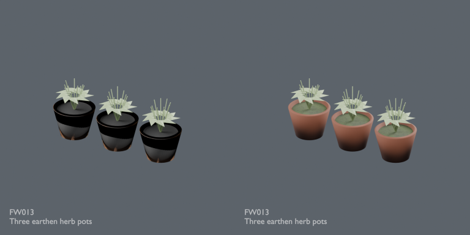
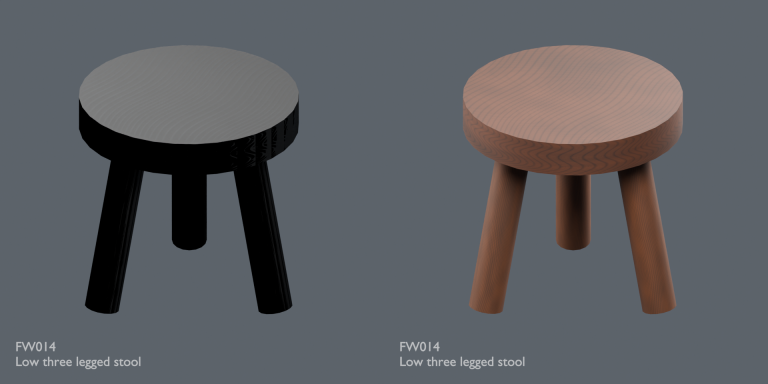
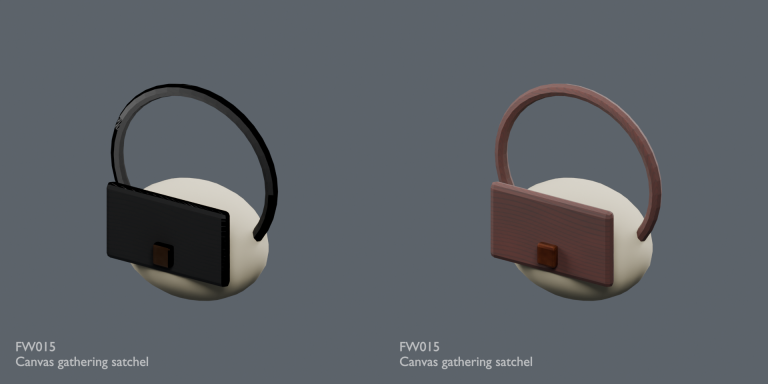
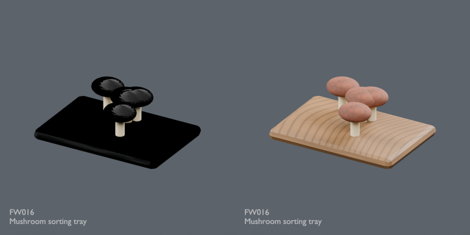
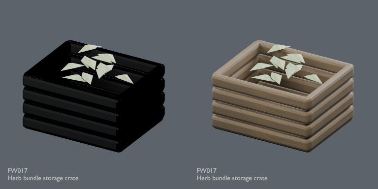
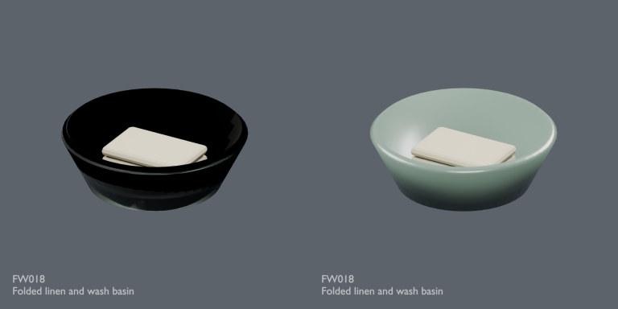
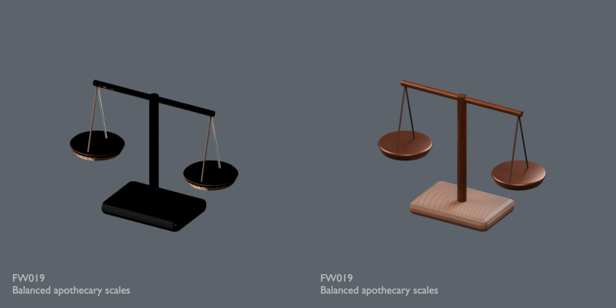
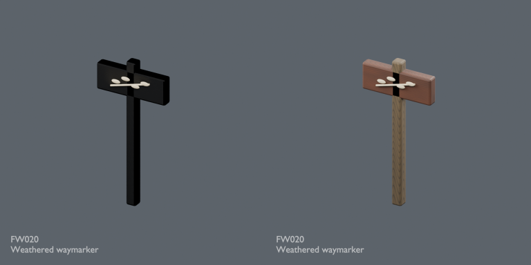
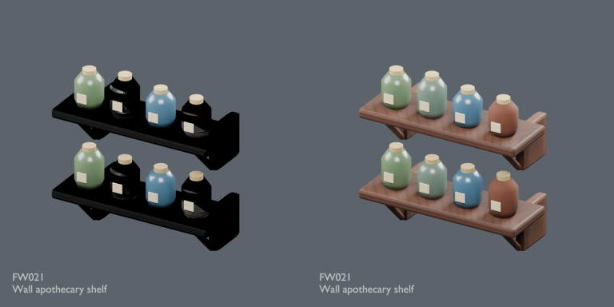

# FW material connection repairs / FW材質接続修復 / FW材质连接修复

Nine revisions, no new bases or color variants. Color images were incorrectly used as normal textures. The invalid links were removed and basecolor sRGB interpretation restored; albedo image bytes, geometry and UV retained. No invented normal detail, no lighting workaround. Original coarse textures remain. Same-camera/light before-after comparisons show original left, repair right.

9件の材質接続改訂。色画像の法線への誤接続を除去し、色解釈を修正。形状・UV・色画像データを保持、粗い木目は残ります。旧原本は履歴として保持し、新規件数には加算しません。

9个材质修订，不新增基本模型或变体。移除错误法线连接，恢复sRGB。几何、UV和原颜色图像保持，粗纹理未重绘。左原版、右修复版。

Final ZIP producer guard passed; public-download identity verification pending. Guard binds ZIP/member/input/verifier hashes, run, times and Blender5.2.2; both formats tested for absent normal links and correct sRGB image interpretation. Publication has not rerun Blender. No full-audit increment or game/collision/Blender4.3.2 guarantee. Models/materials CC0; images separately licensed for catalogue viewing, not modelCC0. [License](../LICENSE.md).

## FW013 — Three earthen herb pots

Three earthen herb pots

[Repaired ZIP](https://raw.githubusercontent.com/k3peta/tales-on-a-table/main/distributions/quality-fw013-021-normal-repair-v1/FW013__repair_CC0.zip) · [Original ZIP · historical](https://github.com/k3peta/tales-on-a-table/releases/download/v2026.10.21-forest-witch/FW013_CC0.zip) · [Full image](../previews/quality-fw013-021-normal-repair-v1/renders/FW013.png)

## FW014 — Low three legged stool

Low three legged stool

[Repaired ZIP](https://raw.githubusercontent.com/k3peta/tales-on-a-table/main/distributions/quality-fw013-021-normal-repair-v1/FW014__repair_CC0.zip) · [Original ZIP · historical](https://github.com/k3peta/tales-on-a-table/releases/download/v2026.10.21-forest-witch/FW014_CC0.zip) · [Full image](../previews/quality-fw013-021-normal-repair-v1/renders/FW014.png)

## FW015 — Canvas gathering satchel

Canvas gathering satchel

[Repaired ZIP](https://raw.githubusercontent.com/k3peta/tales-on-a-table/main/distributions/quality-fw013-021-normal-repair-v1/FW015__repair_CC0.zip) · [Original ZIP · historical](https://github.com/k3peta/tales-on-a-table/releases/download/v2026.10.21-forest-witch/FW015_CC0.zip) · [Full image](../previews/quality-fw013-021-normal-repair-v1/renders/FW015.png)

## FW016 — Mushroom sorting tray

Mushroom sorting tray

[Repaired ZIP](https://raw.githubusercontent.com/k3peta/tales-on-a-table/main/distributions/quality-fw013-021-normal-repair-v1/FW016__repair_CC0.zip) · [Original ZIP · historical](https://github.com/k3peta/tales-on-a-table/releases/download/v2026.10.21-forest-witch/FW016_CC0.zip) · [Full image](../previews/quality-fw013-021-normal-repair-v1/renders/FW016.png)

## FW017 — Herb bundle storage crate

Herb bundle storage crate

[Repaired ZIP](https://raw.githubusercontent.com/k3peta/tales-on-a-table/main/distributions/quality-fw013-021-normal-repair-v1/FW017__repair_CC0.zip) · [Original ZIP · historical](https://github.com/k3peta/tales-on-a-table/releases/download/v2026.10.21-forest-witch/FW017_CC0.zip) · [Full image](../previews/quality-fw013-021-normal-repair-v1/renders/FW017.png)

## FW018 — Folded linen and wash basin

Folded linen and wash basin

[Repaired ZIP](https://raw.githubusercontent.com/k3peta/tales-on-a-table/main/distributions/quality-fw013-021-normal-repair-v1/FW018__repair_CC0.zip) · [Original ZIP · historical](https://github.com/k3peta/tales-on-a-table/releases/download/v2026.10.21-forest-witch/FW018_CC0.zip) · [Full image](../previews/quality-fw013-021-normal-repair-v1/renders/FW018.png)

## FW019 — Balanced apothecary scales

Balanced apothecary scales

[Repaired ZIP](https://raw.githubusercontent.com/k3peta/tales-on-a-table/main/distributions/quality-fw013-021-normal-repair-v1/FW019__repair_CC0.zip) · [Original ZIP · historical](https://github.com/k3peta/tales-on-a-table/releases/download/v2026.10.21-forest-witch/FW019_CC0.zip) · [Full image](../previews/quality-fw013-021-normal-repair-v1/renders/FW019.png)

## FW020 — Weathered waymarker

Weathered waymarker

[Repaired ZIP](https://raw.githubusercontent.com/k3peta/tales-on-a-table/main/distributions/quality-fw013-021-normal-repair-v1/FW020__repair_CC0.zip) · [Original ZIP · historical](https://github.com/k3peta/tales-on-a-table/releases/download/v2026.10.21-forest-witch/FW020_CC0.zip) · [Full image](../previews/quality-fw013-021-normal-repair-v1/renders/FW020.png)

## FW021 — Wall apothecary shelf

Wall apothecary shelf

[Repaired ZIP](https://raw.githubusercontent.com/k3peta/tales-on-a-table/main/distributions/quality-fw013-021-normal-repair-v1/FW021__repair_CC0.zip) · [Original ZIP · historical](https://github.com/k3peta/tales-on-a-table/releases/download/v2026.10.21-forest-witch/FW021_CC0.zip) · [Full image](../previews/quality-fw013-021-normal-repair-v1/renders/FW021.png)

## Reference-audit scope / 参照監査の範囲

Producer inspected all22 original FW records:19 had color-image-as-normal references; prior10 plus current9 repairs address those identified references. FW003/006/022 did not have this defect. Original ZIP hashes match the public ledger. This is not a claim that all FW shape/texture/functional issues are fixed. Original coarse textures remain.
