# FW material connection repairs / FW材質接続修復 / FW材质连接修复

Ten revisions, no new bases or color variants. Color images were incorrectly used as normal textures. The invalid links were removed and basecolor sRGB interpretation restored; albedo image bytes, geometry and UV retained. No invented normal detail, no lighting workaround. Original coarse textures remain. Same-camera/light before-after comparisons show original left, repair right.

10件の材質接続改訂。色画像の法線への誤接続を除去し、色解釈を修正。形状・UV・色画像データを保持、粗い木目は残ります。旧原本は履歴として保持し、新規件数には加算しません。

10个材质修订，不新增基本模型或变体。移除错误法线连接，恢复sRGB。几何、UV和原颜色图像保持，粗纹理未重绘。左原版、右修复版。

Final ZIP producer guard passed; public-download identity verification pending. Guard binds ZIP/member/input/verifier hashes, run, times and Blender5.2.2; both formats tested for absent normal links and correct sRGB image interpretation. Publication has not rerun Blender. No full-audit increment or game/collision/Blender4.3.2 guarantee. Models/materials CC0; images separately licensed for catalogue viewing, not modelCC0. [License](../LICENSE.md).

## FW001 — Herbalists workbench

Herbalists workbench

[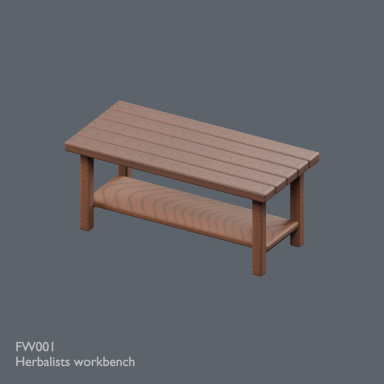](../previews/quality-fw-normal-repair-v1/renders/FW001.png)

[Repaired ZIP](https://raw.githubusercontent.com/k3peta/tales-on-a-table/main/distributions/quality-fw-normal-repair-v1/FW001__repair_CC0.zip) · [Original ZIP · historical](https://github.com/k3peta/tales-on-a-table/releases/download/v2026.10.21-forest-witch/FW001_CC0.zip) · [Full image](../previews/quality-fw-normal-repair-v1/renders/FW001.png)

[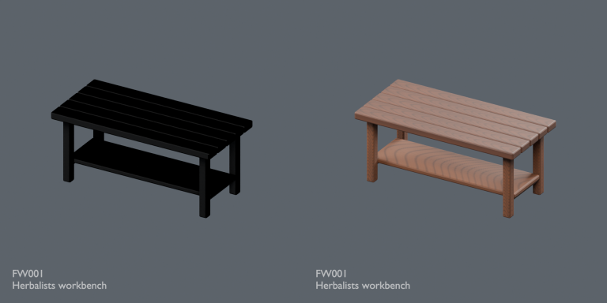](../previews/quality-fw-normal-repair-v1/comparisons/FW001.png)

## FW002 — Stone mortar and pestle

Stone mortar and pestle

[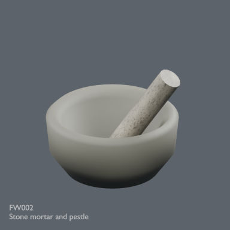](../previews/quality-fw-normal-repair-v1/renders/FW002.png)

[Repaired ZIP](https://raw.githubusercontent.com/k3peta/tales-on-a-table/main/distributions/quality-fw-normal-repair-v1/FW002__repair_CC0.zip) · [Original ZIP · historical](https://github.com/k3peta/tales-on-a-table/releases/download/v2026.10.21-forest-witch/FW002_CC0.zip) · [Full image](../previews/quality-fw-normal-repair-v1/renders/FW002.png)

[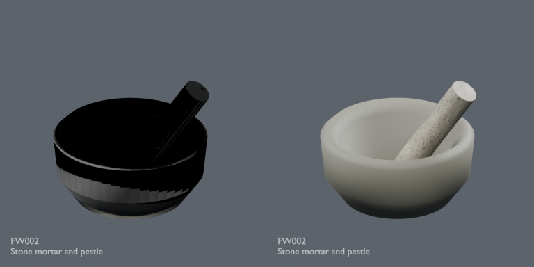](../previews/quality-fw-normal-repair-v1/comparisons/FW002.png)

## FW004 — Open herbal and bookstand

Open herbal and bookstand

[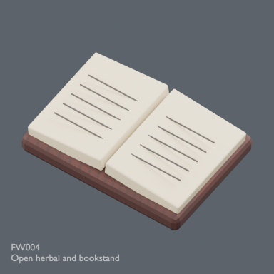](../previews/quality-fw-normal-repair-v1/renders/FW004.png)

[Repaired ZIP](https://raw.githubusercontent.com/k3peta/tales-on-a-table/main/distributions/quality-fw-normal-repair-v1/FW004__repair_CC0.zip) · [Original ZIP · historical](https://github.com/k3peta/tales-on-a-table/releases/download/v2026.10.21-forest-witch/FW004_CC0.zip) · [Full image](../previews/quality-fw-normal-repair-v1/renders/FW004.png)

[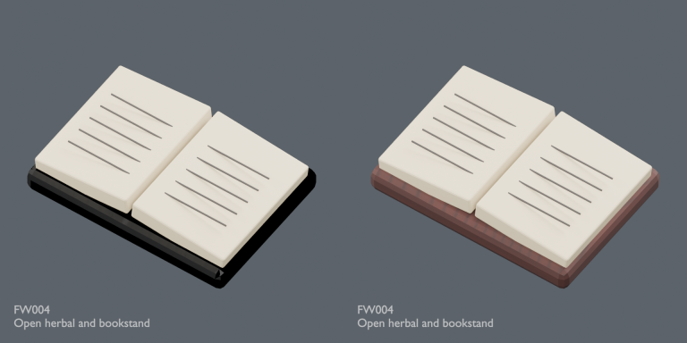](../previews/quality-fw-normal-repair-v1/comparisons/FW004.png)

## FW005 — Hanging herb drying rail

Hanging herb drying rail

[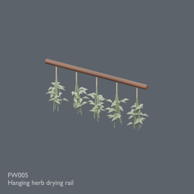](../previews/quality-fw-normal-repair-v1/renders/FW005.png)

[Repaired ZIP](https://raw.githubusercontent.com/k3peta/tales-on-a-table/main/distributions/quality-fw-normal-repair-v1/FW005__repair_CC0.zip) · [Original ZIP · historical](https://github.com/k3peta/tales-on-a-table/releases/download/v2026.10.21-forest-witch/FW005_CC0.zip) · [Full image](../previews/quality-fw-normal-repair-v1/renders/FW005.png)

[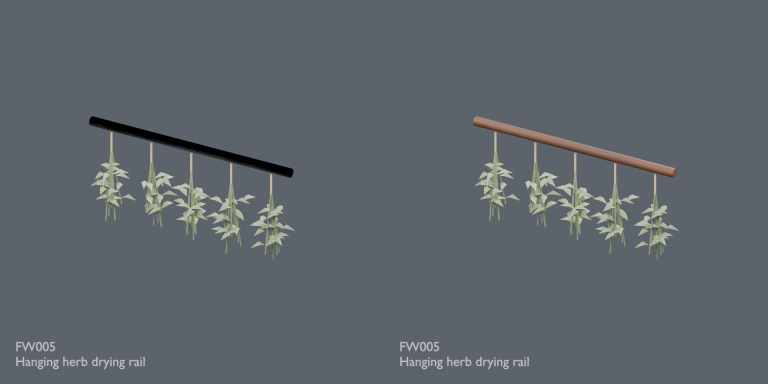](../previews/quality-fw-normal-repair-v1/comparisons/FW005.png)

## FW007 — Birch twig broom

Birch twig broom

[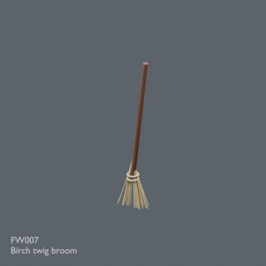](../previews/quality-fw-normal-repair-v1/renders/FW007.png)

[Repaired ZIP](https://raw.githubusercontent.com/k3peta/tales-on-a-table/main/distributions/quality-fw-normal-repair-v1/FW007__repair_CC0.zip) · [Original ZIP · historical](https://github.com/k3peta/tales-on-a-table/releases/download/v2026.10.21-forest-witch/FW007_CC0.zip) · [Full image](../previews/quality-fw-normal-repair-v1/renders/FW007.png)

[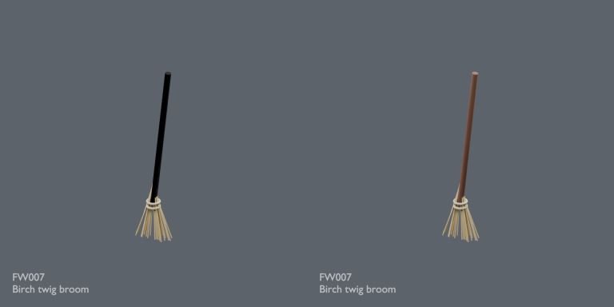](../previews/quality-fw-normal-repair-v1/comparisons/FW007.png)

## FW008 — Iron cauldron and tripod

Iron cauldron and tripod

[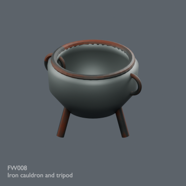](../previews/quality-fw-normal-repair-v1/renders/FW008.png)

[Repaired ZIP](https://raw.githubusercontent.com/k3peta/tales-on-a-table/main/distributions/quality-fw-normal-repair-v1/FW008__repair_CC0.zip) · [Original ZIP · historical](https://github.com/k3peta/tales-on-a-table/releases/download/v2026.10.21-forest-witch/FW008_CC0.zip) · [Full image](../previews/quality-fw-normal-repair-v1/renders/FW008.png)

[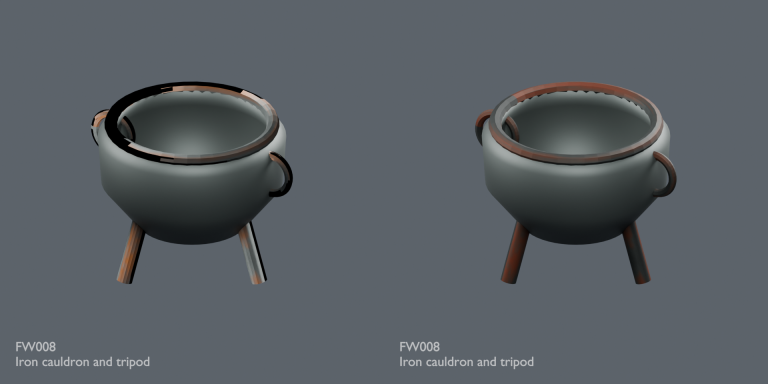](../previews/quality-fw-normal-repair-v1/comparisons/FW008.png)

## FW009 — Split firewood stack

Split firewood stack

[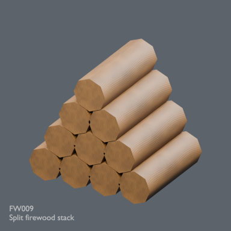](../previews/quality-fw-normal-repair-v1/renders/FW009.png)

[Repaired ZIP](https://raw.githubusercontent.com/k3peta/tales-on-a-table/main/distributions/quality-fw-normal-repair-v1/FW009__repair_CC0.zip) · [Original ZIP · historical](https://github.com/k3peta/tales-on-a-table/releases/download/v2026.10.21-forest-witch/FW009_CC0.zip) · [Full image](../previews/quality-fw-normal-repair-v1/renders/FW009.png)

[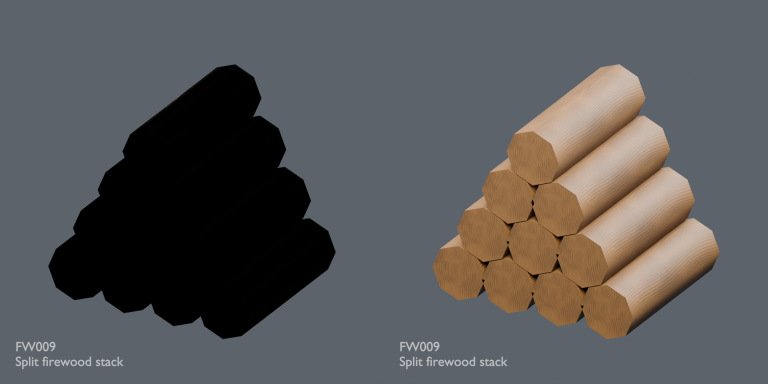](../previews/quality-fw-normal-repair-v1/comparisons/FW009.png)

## FW010 — Copper kettle

Copper kettle

[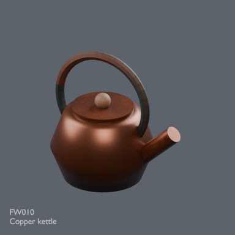](../previews/quality-fw-normal-repair-v1/renders/FW010.png)

[Repaired ZIP](https://raw.githubusercontent.com/k3peta/tales-on-a-table/main/distributions/quality-fw-normal-repair-v1/FW010__repair_CC0.zip) · [Original ZIP · historical](https://github.com/k3peta/tales-on-a-table/releases/download/v2026.10.21-forest-witch/FW010_CC0.zip) · [Full image](../previews/quality-fw-normal-repair-v1/renders/FW010.png)

[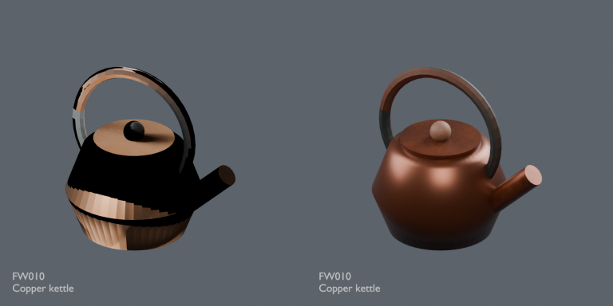](../previews/quality-fw-normal-repair-v1/comparisons/FW010.png)

## FW011 — Lantern on stone plinth

Lantern on stone plinth

[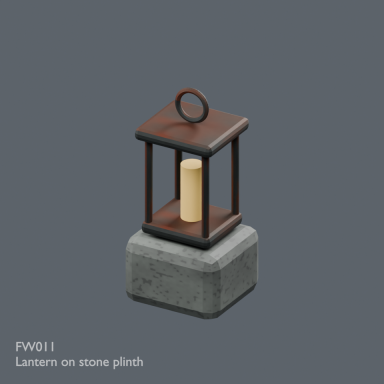](../previews/quality-fw-normal-repair-v1/renders/FW011.png)

[Repaired ZIP](https://raw.githubusercontent.com/k3peta/tales-on-a-table/main/distributions/quality-fw-normal-repair-v1/FW011__repair_CC0.zip) · [Original ZIP · historical](https://github.com/k3peta/tales-on-a-table/releases/download/v2026.10.21-forest-witch/FW011_CC0.zip) · [Full image](../previews/quality-fw-normal-repair-v1/renders/FW011.png)

[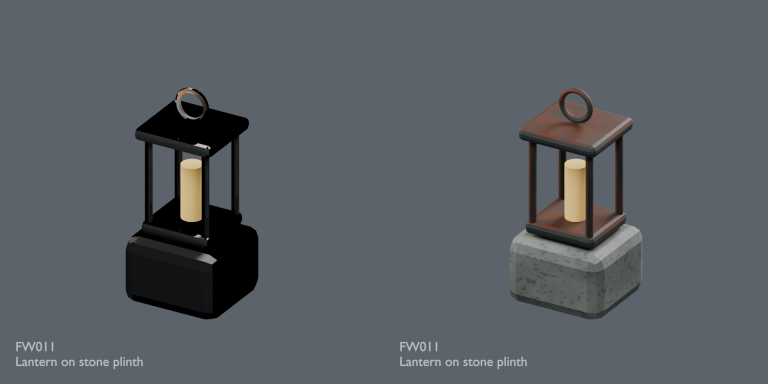](../previews/quality-fw-normal-repair-v1/comparisons/FW011.png)

## FW012 — Rainwater barrel

Rainwater barrel

[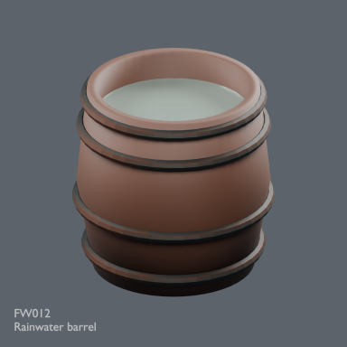](../previews/quality-fw-normal-repair-v1/renders/FW012.png)

[Repaired ZIP](https://raw.githubusercontent.com/k3peta/tales-on-a-table/main/distributions/quality-fw-normal-repair-v1/FW012__repair_CC0.zip) · [Original ZIP · historical](https://github.com/k3peta/tales-on-a-table/releases/download/v2026.10.21-forest-witch/FW012_CC0.zip) · [Full image](../previews/quality-fw-normal-repair-v1/renders/FW012.png)

[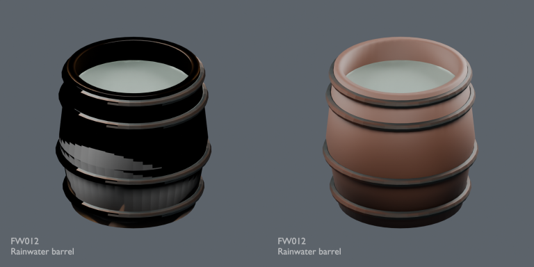](../previews/quality-fw-normal-repair-v1/comparisons/FW012.png)
