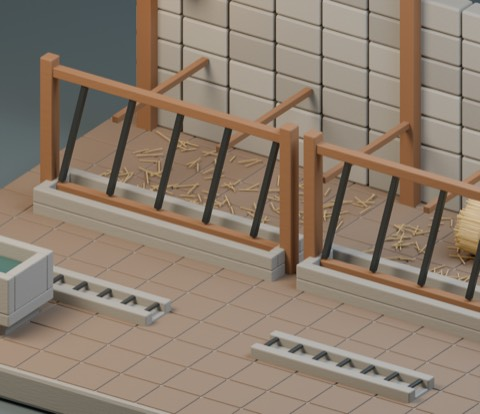
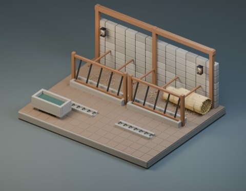
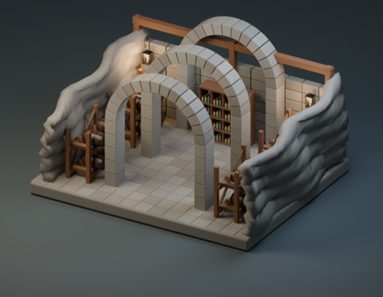
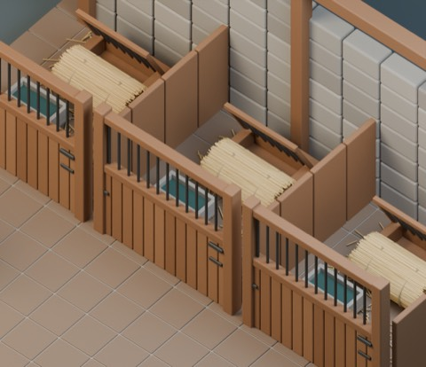
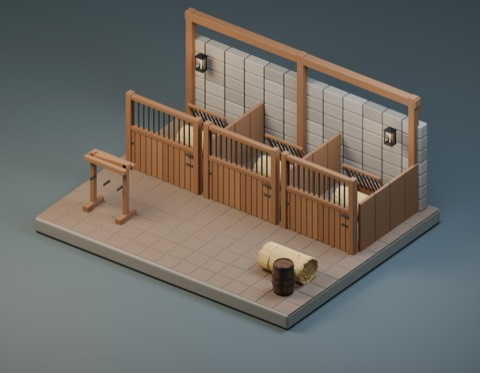
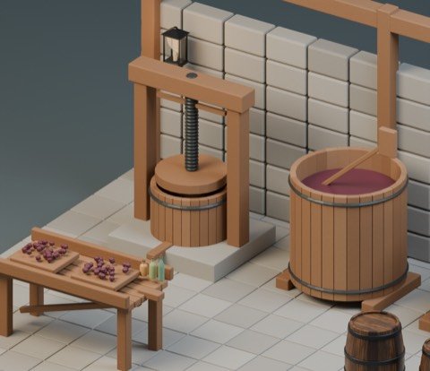
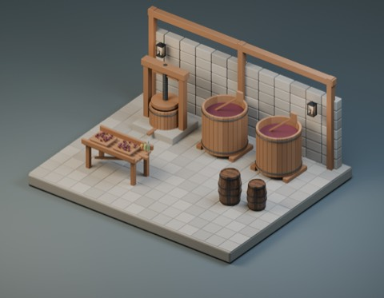

# 畜舎・ワイン施設 / Husbandry and cellar components

**941 distribution records = 929 + 12 standalone candidates.** Four reused models and four private arrangements are not added. Only the 12 component ZIPs below are distributed; scenes and renders are not included. Global shape independence remains unconfirmed.

### HCV101

HCV101: Horse box front with upper grille

[Download](https://raw.githubusercontent.com/k3peta/tales-on-a-table/main/distributions/husbandry-cellar-v1/HCV101-CC0.zip)

### HCV102

HCV102: Angled horse hay manger

[Download](https://raw.githubusercontent.com/k3peta/tales-on-a-table/main/distributions/husbandry-cellar-v1/HCV102-CC0.zip)

### HCV103

HCV103: Saddle and bridle stand

[Download](https://raw.githubusercontent.com/k3peta/tales-on-a-table/main/distributions/husbandry-cellar-v1/HCV103-CC0.zip)

### HCV201

HCV201: Cattle communal feed barrier and bunk

[Download](https://raw.githubusercontent.com/k3peta/tales-on-a-table/main/distributions/husbandry-cellar-v1/HCV201-CC0.zip)

### HCV202

HCV202: Raised livestock stone water trough

[Download](https://raw.githubusercontent.com/k3peta/tales-on-a-table/main/distributions/husbandry-cellar-v1/HCV202-CC0.zip)

### HCV203

HCV203: Barn grated drainage channel

[Download](https://raw.githubusercontent.com/k3peta/tales-on-a-table/main/distributions/husbandry-cellar-v1/HCV203-CC0.zip)

### HCV301

HCV301: Basket screw wine press

[Download](https://raw.githubusercontent.com/k3peta/tales-on-a-table/main/distributions/husbandry-cellar-v1/HCV301-CC0.zip)

### HCV302

HCV302: Open fermentation vat with paddle

[Download](https://raw.githubusercontent.com/k3peta/tales-on-a-table/main/distributions/husbandry-cellar-v1/HCV302-CC0.zip)

### HCV303

HCV303: Raised-edge sorting and draining table

[Download](https://raw.githubusercontent.com/k3peta/tales-on-a-table/main/distributions/husbandry-cellar-v1/HCV303-CC0.zip)

### HCV401

HCV401: Two-tier four-barrel cradle rack

[Download](https://raw.githubusercontent.com/k3peta/tales-on-a-table/main/distributions/husbandry-cellar-v1/HCV401-CC0.zip)

### HCV402

HCV402: Bottle storage cubby wall

[Download](https://raw.githubusercontent.com/k3peta/tales-on-a-table/main/distributions/husbandry-cellar-v1/HCV402-CC0.zip)

### HCV403

HCV403: Segmented cellar arch rib

[Download](https://raw.githubusercontent.com/k3peta/tales-on-a-table/main/distributions/husbandry-cellar-v1/HCV403-CC0.zip)

## Similar existing uses

HCV301 basket screw press has near comparables AP007 honey press and WS_017 bookbinding press. HCV401 two-tier barrel frame differs in intended arrangement from FT_012 single barrel stand. HCV403 dressed stone rib is compared with TG028 terrain arch; HCV203 grated barn drain with UD1101 terrain drain. Trough/vat uses also resemble WM006 and AL004. These are use comparisons, not exhaustive geometry-independence findings. FT_011 barrel, FT_020 bottle, FT_030 lantern and BN_005 hay are existing CC0 models used only in private example scenes; they are not newly distributed here.

## Use and limits

Metres, Z up, bottom-centred origin. Append the named Object from each BLEND library; GLB imports normally. Embedded geometry/materials only. Fine procedural bump is Blender-only; GLB retains base colors, roughness and geometry.

These static decorative components are not functional husbandry or winery equipment. Animals, saddles/tack themselves, moving doors or machinery, fluid/animal simulation and closed roofed building exteriors are not made. Private scenes are roofless cutaways and are not downloadable in this batch. Actual walking, collision, mechanism operation, structural safety, app integration/UI/GPU/FPS, older Blender compatibility and full non-intersection volumes remain unverified. Production reload checks used Blender 5.2.2 LTS.

CC0-1.0 covers newly generated model geometry and included display materials only. Code, app sources, arrangements, rendered images, articles and private records are excluded. [ZIP checksums](../distributions/husbandry-cellar-v1/SHA256SUMS.txt).

## 実作画像 / Actual renders

完成バッチの配置・接写。画像は閲覧用でモデルCC0の対象外です。[既存の画像利用条件](../LICENSE.md)を維持します。

### FT_011

木樽

[ZIP](https://github.com/k3peta/tales-on-a-table/releases/download/v2026.10.18/FT_011_CC0.zip)

### FT_012

横置き樽用の台

[ZIP](https://github.com/k3peta/tales-on-a-table/releases/download/v2026.10.18/FT_012_CC0.zip)

### FT_020

3本の空のガラス瓶

[ZIP](https://github.com/k3peta/tales-on-a-table/releases/download/v2026.10.18/FT_020_CC0.zip)

### FT_030

壁付けガラスランタン

[ZIP](https://github.com/k3peta/tales-on-a-table/releases/download/v2026.10.18/FT_030_CC0.zip)

### WS_017

修復用の木製製本プレス

[ZIP](https://github.com/k3peta/tales-on-a-table/releases/download/v2026.10.19-wizard-study/WS_017_CC0.zip)

### BN_005

結束した干し草

[ZIP](https://github.com/k3peta/tales-on-a-table/releases/download/v2026.10.19-farmhouse-barn/BN_005_CC0.zip)

### WM006

Flour collection trough

[ZIP](https://github.com/k3peta/tales-on-a-table/releases/download/v2026.10.21-watermill/WM006_CC0.zip)

### AP007

Manual honey press

[ZIP](https://github.com/k3peta/tales-on-a-table/releases/download/v2026.10.21-apiary/AP007_CC0.zip)

### AL004

Cooling vat

[ZIP](https://github.com/k3peta/tales-on-a-table/releases/download/v2026.10.21-alchemist/AL004_CC0.zip)

### TG028

arch

[ZIP](https://raw.githubusercontent.com/k3peta/tales-on-a-table/main/distributions/terrain-connectivity-91/zips/TG028_CC0.zip)

### UD1101

縁下排水口

[ZIP](https://raw.githubusercontent.com/k3peta/tales-on-a-table/main/distributions/terrain-connectivity-11/zips/UD1101_CC0.zip)

### HCV101

HCV101

[ZIP](https://raw.githubusercontent.com/k3peta/tales-on-a-table/main/distributions/husbandry-cellar-v1/HCV101-CC0.zip)

### HCV102

HCV102

[ZIP](https://raw.githubusercontent.com/k3peta/tales-on-a-table/main/distributions/husbandry-cellar-v1/HCV102-CC0.zip)

### HCV103

HCV103

[ZIP](https://raw.githubusercontent.com/k3peta/tales-on-a-table/main/distributions/husbandry-cellar-v1/HCV103-CC0.zip)

### HCV201

HCV201

[ZIP](https://raw.githubusercontent.com/k3peta/tales-on-a-table/main/distributions/husbandry-cellar-v1/HCV201-CC0.zip)

### HCV202

HCV202

[ZIP](https://raw.githubusercontent.com/k3peta/tales-on-a-table/main/distributions/husbandry-cellar-v1/HCV202-CC0.zip)

### HCV203

HCV203

[ZIP](https://raw.githubusercontent.com/k3peta/tales-on-a-table/main/distributions/husbandry-cellar-v1/HCV203-CC0.zip)

### HCV301

HCV301

[ZIP](https://raw.githubusercontent.com/k3peta/tales-on-a-table/main/distributions/husbandry-cellar-v1/HCV301-CC0.zip)

### HCV302

HCV302

[ZIP](https://raw.githubusercontent.com/k3peta/tales-on-a-table/main/distributions/husbandry-cellar-v1/HCV302-CC0.zip)

### HCV303

HCV303

[ZIP](https://raw.githubusercontent.com/k3peta/tales-on-a-table/main/distributions/husbandry-cellar-v1/HCV303-CC0.zip)

### HCV401

HCV401

[ZIP](https://raw.githubusercontent.com/k3peta/tales-on-a-table/main/distributions/husbandry-cellar-v1/HCV401-CC0.zip)

### HCV402

HCV402

[ZIP](https://raw.githubusercontent.com/k3peta/tales-on-a-table/main/distributions/husbandry-cellar-v1/HCV402-CC0.zip)

### HCV403

HCV403

[ZIP](https://raw.githubusercontent.com/k3peta/tales-on-a-table/main/distributions/husbandry-cellar-v1/HCV403-CC0.zip)

