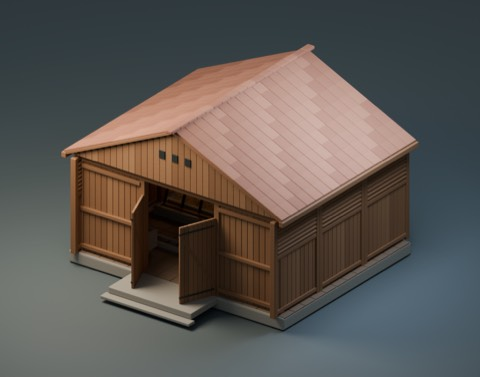
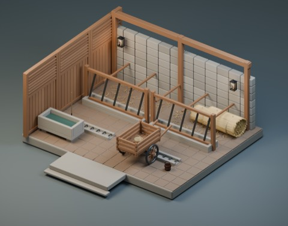
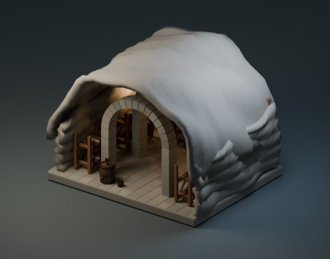
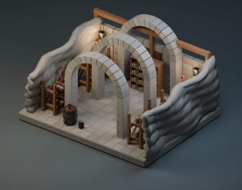
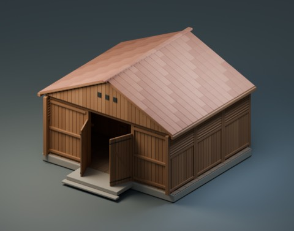
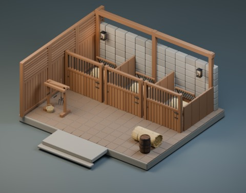
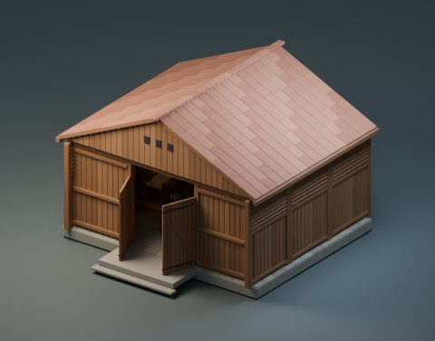
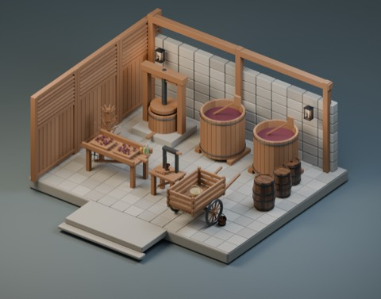

# husbandry-cellar-v2

965 distribution records = 955 + 6 components + 4 scene first-distributions. The four scenes revise previously PRIVATE arrangements, not previously public records. No reused model is added again. Scene revisions are not new standalone shapes.

**Rights differ:** six component ZIPs: model/material CC0. Four scene ZIPs: underlying models/materials CC0, but assembled arrangements are NOT CC0, supplied for viewing and rearranging with no additional redistribution license. Read SCENE-RIGHTS.txt; repository model-license statements do not override it.

|ID|Kind|License|Download|
|---|---|---|---|
|HCV501|model|CC0-1.0|[ZIP](https://raw.githubusercontent.com/k3peta/tales-on-a-table/main/distributions/husbandry-cellar-v2/HCV501-CC0.zip)|
|HCV502|model|CC0-1.0|[ZIP](https://raw.githubusercontent.com/k3peta/tales-on-a-table/main/distributions/husbandry-cellar-v2/HCV502-CC0.zip)|
|HCV503|model|CC0-1.0|[ZIP](https://raw.githubusercontent.com/k3peta/tales-on-a-table/main/distributions/husbandry-cellar-v2/HCV503-CC0.zip)|
|HCV504|model|CC0-1.0|[ZIP](https://raw.githubusercontent.com/k3peta/tales-on-a-table/main/distributions/husbandry-cellar-v2/HCV504-CC0.zip)|
|HCV505|model|CC0-1.0|[ZIP](https://raw.githubusercontent.com/k3peta/tales-on-a-table/main/distributions/husbandry-cellar-v2/HCV505-CC0.zip)|
|HCV506|model|CC0-1.0|[ZIP](https://raw.githubusercontent.com/k3peta/tales-on-a-table/main/distributions/husbandry-cellar-v2/HCV506-CC0.zip)|
|HCV_SCENE_HORSE|group|LicenseRef-Scene-Viewing-Rearranging|[ZIP](https://raw.githubusercontent.com/k3peta/tales-on-a-table/main/distributions/husbandry-cellar-v2/horse-scene-v2.zip)|
|HCV_SCENE_CATTLE|group|LicenseRef-Scene-Viewing-Rearranging|[ZIP](https://raw.githubusercontent.com/k3peta/tales-on-a-table/main/distributions/husbandry-cellar-v2/cattle-scene-v2.zip)|
|HCV_SCENE_WINERY|group|LicenseRef-Scene-Viewing-Rearranging|[ZIP](https://raw.githubusercontent.com/k3peta/tales-on-a-table/main/distributions/husbandry-cellar-v2/winery-scene-v2.zip)|
|HCV_SCENE_CELLAR|group|LicenseRef-Scene-Viewing-Rearranging|[ZIP](https://raw.githubusercontent.com/k3peta/tales-on-a-table/main/distributions/husbandry-cellar-v2/cellar-scene-v2.zip)|

HCV501 detachable roof; HCV502 front wall with fixed-open doors; HCV503 louver wall; HCV504 bottle drying stand; HCV505 lever corking bench; HCV506 two-wheel handcart. Wall repetition spacing is2.14m, not2m; not an automatic terrain connection. Scene BLEND opens directly; hide01_ROOF,02_ENTRANCE,03_NEAR_WALL collections for cutaway views. GLB omits presentation cameras/lights/backdrop. FW006 zero-area faces were cleaned only in three public scenes; original source remains unchanged. No animal models in these scene revisions.

Metres, ground-centered component origins, Blender Z up / standard glTF axes. Global historical shape independence is unverified. Static display only: no animated doors/wheels/walking, rigid-body coupling, load simulation or fluid mechanisms. Safety, full motion/intersection volumes, real use, app UI/GPU/FPS and older Blender compatibility are unverified. Code, rendered images and private records are excluded.

[Checksums](../distributions/husbandry-cellar-v2/SHA256SUMS.txt).

## 実作画像 / Actual renders

完成バッチの配置・接写。画像は閲覧用でモデルCC0の対象外です。[既存の画像利用条件](../LICENSE.md)を維持します。

|ID|名称 / Name|Download|
|---|---|---|
|FW006|Wicker gathering basket|[ZIP](https://github.com/k3peta/tales-on-a-table/releases/download/v2026.10.21-forest-witch/FW006_CC0.zip)|
|HCV501|HCV501|[ZIP](https://raw.githubusercontent.com/k3peta/tales-on-a-table/main/distributions/husbandry-cellar-v2/HCV501-CC0.zip)|
|HCV502|HCV502|[ZIP](https://raw.githubusercontent.com/k3peta/tales-on-a-table/main/distributions/husbandry-cellar-v2/HCV502-CC0.zip)|
|HCV503|HCV503|[ZIP](https://raw.githubusercontent.com/k3peta/tales-on-a-table/main/distributions/husbandry-cellar-v2/HCV503-CC0.zip)|
|HCV504|HCV504|[ZIP](https://raw.githubusercontent.com/k3peta/tales-on-a-table/main/distributions/husbandry-cellar-v2/HCV504-CC0.zip)|
|HCV505|HCV505|[ZIP](https://raw.githubusercontent.com/k3peta/tales-on-a-table/main/distributions/husbandry-cellar-v2/HCV505-CC0.zip)|
|HCV506|HCV506|[ZIP](https://raw.githubusercontent.com/k3peta/tales-on-a-table/main/distributions/husbandry-cellar-v2/HCV506-CC0.zip)|
|HCV_SCENE_HORSE|HCV_SCENE_HORSE|[ZIP](https://raw.githubusercontent.com/k3peta/tales-on-a-table/main/distributions/husbandry-cellar-v2/horse-scene-v2.zip)|
|HCV_SCENE_CATTLE|HCV_SCENE_CATTLE|[ZIP](https://raw.githubusercontent.com/k3peta/tales-on-a-table/main/distributions/husbandry-cellar-v2/cattle-scene-v2.zip)|
|HCV_SCENE_WINERY|HCV_SCENE_WINERY|[ZIP](https://raw.githubusercontent.com/k3peta/tales-on-a-table/main/distributions/husbandry-cellar-v2/winery-scene-v2.zip)|
|HCV_SCENE_CELLAR|HCV_SCENE_CELLAR|[ZIP](https://raw.githubusercontent.com/k3peta/tales-on-a-table/main/distributions/husbandry-cellar-v2/cellar-scene-v2.zip)|

