# 旅人の宿屋

24配布レコード、24設計。

各単体ZIPはBLEND・GLB・README・ライセンスを含みます。モデルと必要な同梱材質のみCC0 1.0。記事・作例画像・完成配置シーンは対象外です。
BLENDは単体データのため、一部はFile > Appendでオブジェクト/コレクションを読み込んでください。GLBは微細バンプ等の表現がBlenderと異なることがあります。実機性能は未検証です。

| ID | 元ID | 素材 | 配布 |
|---|---|---|---|
| IN001 | I01 | Stone hearth | [ZIP](https://github.com/k3peta/tales-on-a-table/releases/download/v2026.10.21-inn/IN001_CC0.zip) |
| IN002 | I02 | Reception counter | [ZIP](https://github.com/k3peta/tales-on-a-table/releases/download/v2026.10.21-inn/IN002_CC0.zip) |
| IN003 | I03 | Stair flight | [ZIP](https://github.com/k3peta/tales-on-a-table/releases/download/v2026.10.21-inn/IN003_CC0.zip) |
| IN004 | I04 | Trestle table | [ZIP](https://github.com/k3peta/tales-on-a-table/releases/download/v2026.10.21-inn/IN004_CC0.zip) |
| IN005 | I05 | Dining bench | [ZIP](https://github.com/k3peta/tales-on-a-table/releases/download/v2026.10.21-inn/IN005_CC0.zip) |
| IN006 | I06 | Highback chair | [ZIP](https://github.com/k3peta/tales-on-a-table/releases/download/v2026.10.21-inn/IN006_CC0.zip) |
| IN007 | I07 | Woven runner | [ZIP](https://github.com/k3peta/tales-on-a-table/releases/download/v2026.10.21-inn/IN007_CC0.zip) |
| IN008 | I08 | Guest ledger | [ZIP](https://github.com/k3peta/tales-on-a-table/releases/download/v2026.10.21-inn/IN008_CC0.zip) |
| IN009 | I09 | Counter bell | [ZIP](https://github.com/k3peta/tales-on-a-table/releases/download/v2026.10.21-inn/IN009_CC0.zip) |
| IN010 | I10 | Room key rack | [ZIP](https://github.com/k3peta/tales-on-a-table/releases/download/v2026.10.21-inn/IN010_CC0.zip) |
| IN011 | I11 | Travel chest | [ZIP](https://github.com/k3peta/tales-on-a-table/releases/download/v2026.10.21-inn/IN011_CC0.zip) |
| IN012 | I12 | Travel satchel | [ZIP](https://github.com/k3peta/tales-on-a-table/releases/download/v2026.10.21-inn/IN012_CC0.zip) |
| IN013 | I13 | Rolled blanket | [ZIP](https://github.com/k3peta/tales-on-a-table/releases/download/v2026.10.21-inn/IN013_CC0.zip) |
| IN014 | I14 | Log basket | [ZIP](https://github.com/k3peta/tales-on-a-table/releases/download/v2026.10.21-inn/IN014_CC0.zip) |
| IN015 | I15 | Fire tools | [ZIP](https://github.com/k3peta/tales-on-a-table/releases/download/v2026.10.21-inn/IN015_CC0.zip) |
| IN016 | I16 | Pewter tankard | [ZIP](https://github.com/k3peta/tales-on-a-table/releases/download/v2026.10.21-inn/IN016_CC0.zip) |
| IN017 | I17 | Ceramic pitcher | [ZIP](https://github.com/k3peta/tales-on-a-table/releases/download/v2026.10.21-inn/IN017_CC0.zip) |
| IN018 | I18 | Bread board | [ZIP](https://github.com/k3peta/tales-on-a-table/releases/download/v2026.10.21-inn/IN018_CC0.zip) |
| IN019 | I19 | Soup bowl | [ZIP](https://github.com/k3peta/tales-on-a-table/releases/download/v2026.10.21-inn/IN019_CC0.zip) |
| IN020 | I20 | Table linen | [ZIP](https://github.com/k3peta/tales-on-a-table/releases/download/v2026.10.21-inn/IN020_CC0.zip) |
| IN021 | I21 | Mantel lantern | [ZIP](https://github.com/k3peta/tales-on-a-table/releases/download/v2026.10.21-inn/IN021_CC0.zip) |
| IN022 | I22 | Ale barrel | [ZIP](https://github.com/k3peta/tales-on-a-table/releases/download/v2026.10.21-inn/IN022_CC0.zip) |
| IN023 | I23 | Travel boots | [ZIP](https://github.com/k3peta/tales-on-a-table/releases/download/v2026.10.21-inn/IN023_CC0.zip) |
| IN024 | I24 | Hanging cloak | [ZIP](https://github.com/k3peta/tales-on-a-table/releases/download/v2026.10.21-inn/IN024_CC0.zip) |

## 作例・カタログ画像

画像は単体のすべてを示す保証ではありません。完成シーンは配布対象外です。画像にモデル用CC0を適用しません。

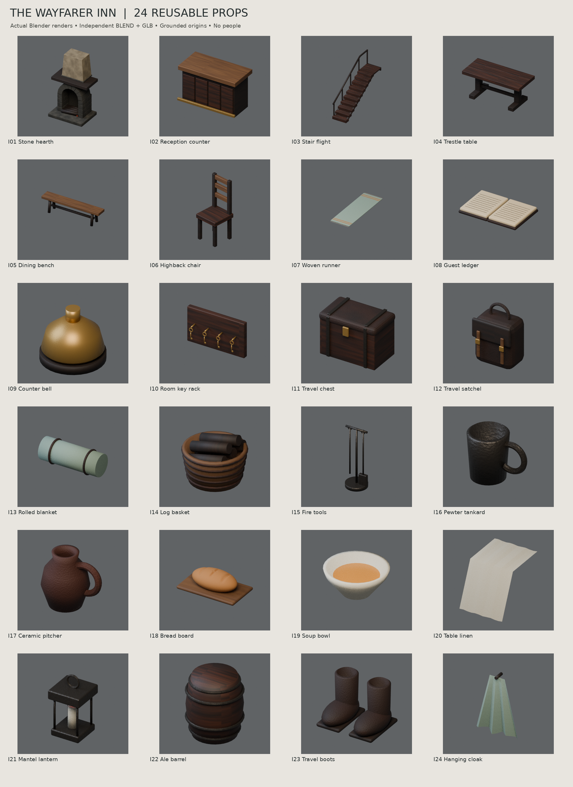

[Release](https://github.com/k3peta/tales-on-a-table/releases/tag/v2026.10.21-inn) · [SHA256](../releases/inn/SHA256SUMS.txt) · [License](../LICENSE.md)

## Individual images / 個別画像 / 单件图片

Actual distributed models; chosen camera view does not establish intended front or placement pivot. Images are outside model CC0. Original links and archives retained.

### IN001 — Stone hearth

Stone hearth

[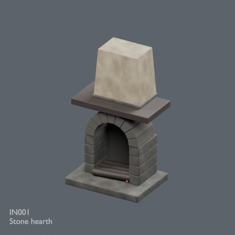](../previews/forest-inn15/renders/IN001.png)

[Full image](../previews/forest-inn15/renders/IN001.png) · [ZIP · BLEND/GLB](https://github.com/k3peta/tales-on-a-table/releases/download/v2026.10.21-inn/IN001_CC0.zip)

### IN002 — Reception counter

Reception counter

[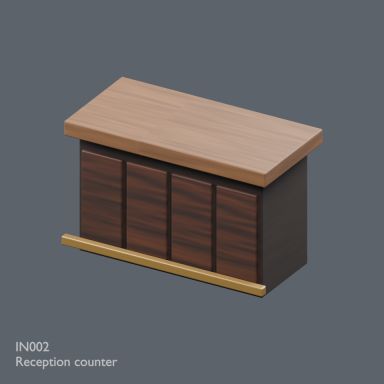](../previews/forest-inn15/renders/IN002.png)

[Full image](../previews/forest-inn15/renders/IN002.png) · [ZIP · BLEND/GLB](https://github.com/k3peta/tales-on-a-table/releases/download/v2026.10.21-inn/IN002_CC0.zip)

### IN003 — Stair flight

Stair flight

[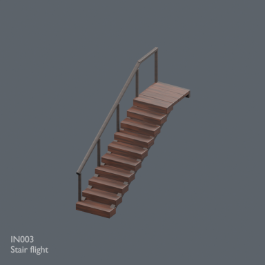](../previews/forest-inn15/renders/IN003.png)

[Full image](../previews/forest-inn15/renders/IN003.png) · [ZIP · BLEND/GLB](https://github.com/k3peta/tales-on-a-table/releases/download/v2026.10.21-inn/IN003_CC0.zip)

### IN004 — Trestle table

Trestle table

[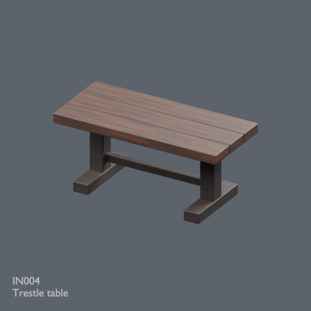](../previews/forest-inn15/renders/IN004.png)

[Full image](../previews/forest-inn15/renders/IN004.png) · [ZIP · BLEND/GLB](https://github.com/k3peta/tales-on-a-table/releases/download/v2026.10.21-inn/IN004_CC0.zip)

### IN005 — Dining bench

Dining bench

[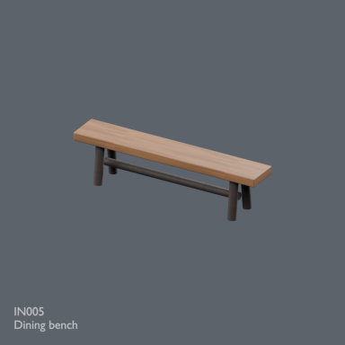](../previews/forest-inn15/renders/IN005.png)

[Full image](../previews/forest-inn15/renders/IN005.png) · [ZIP · BLEND/GLB](https://github.com/k3peta/tales-on-a-table/releases/download/v2026.10.21-inn/IN005_CC0.zip)

### IN006 — Highback chair

Highback chair

[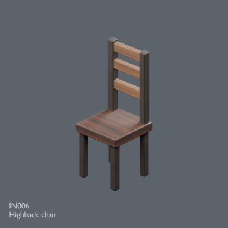](../previews/forest-inn15/renders/IN006.png)

[Full image](../previews/forest-inn15/renders/IN006.png) · [ZIP · BLEND/GLB](https://github.com/k3peta/tales-on-a-table/releases/download/v2026.10.21-inn/IN006_CC0.zip)

### IN007 — Woven runner

Woven runner

[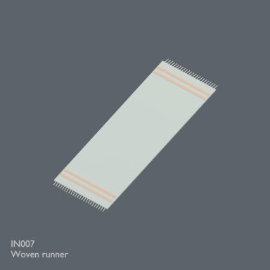](../previews/forest-inn15/renders/IN007.png)

[Full image](../previews/forest-inn15/renders/IN007.png) · [ZIP · BLEND/GLB](https://github.com/k3peta/tales-on-a-table/releases/download/v2026.10.21-inn/IN007_CC0.zip)

### IN008 — Guest ledger

Guest ledger

[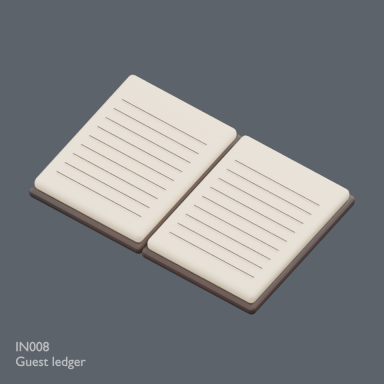](../previews/forest-inn15/renders/IN008.png)

[Full image](../previews/forest-inn15/renders/IN008.png) · [ZIP · BLEND/GLB](https://github.com/k3peta/tales-on-a-table/releases/download/v2026.10.21-inn/IN008_CC0.zip)

### IN009 — Counter bell

Counter bell

[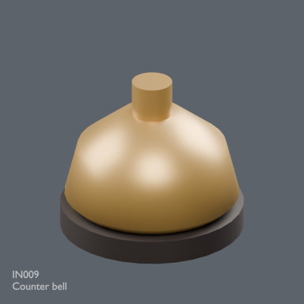](../previews/forest-inn15/renders/IN009.png)

[Full image](../previews/forest-inn15/renders/IN009.png) · [ZIP · BLEND/GLB](https://github.com/k3peta/tales-on-a-table/releases/download/v2026.10.21-inn/IN009_CC0.zip)

### IN010 — Room key rack

Room key rack

[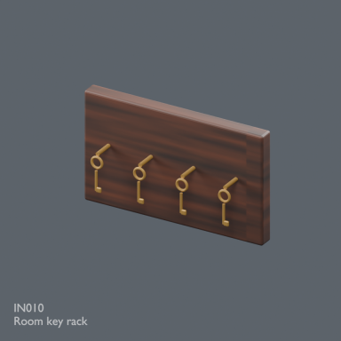](../previews/forest-inn15/renders/IN010.png)

[Full image](../previews/forest-inn15/renders/IN010.png) · [ZIP · BLEND/GLB](https://github.com/k3peta/tales-on-a-table/releases/download/v2026.10.21-inn/IN010_CC0.zip)

### IN011 — Travel chest

Travel chest

[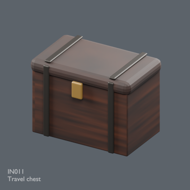](../previews/forest-inn15/renders/IN011.png)

[Full image](../previews/forest-inn15/renders/IN011.png) · [ZIP · BLEND/GLB](https://github.com/k3peta/tales-on-a-table/releases/download/v2026.10.21-inn/IN011_CC0.zip)

### IN012 — Travel satchel

Travel satchel

[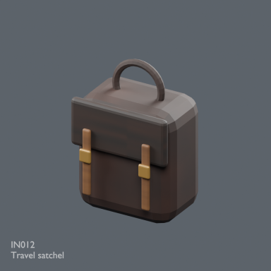](../previews/forest-inn15/renders/IN012.png)

[Full image](../previews/forest-inn15/renders/IN012.png) · [ZIP · BLEND/GLB](https://github.com/k3peta/tales-on-a-table/releases/download/v2026.10.21-inn/IN012_CC0.zip)

### IN013 — Rolled blanket

Rolled blanket

[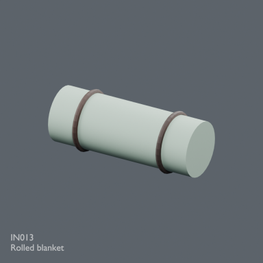](../previews/forest-inn15/renders/IN013.png)

[Full image](../previews/forest-inn15/renders/IN013.png) · [ZIP · BLEND/GLB](https://github.com/k3peta/tales-on-a-table/releases/download/v2026.10.21-inn/IN013_CC0.zip)

### IN014 — Log basket

Log basket

[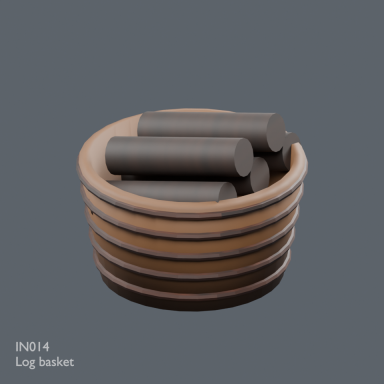](../previews/forest-inn15/renders/IN014.png)

[Full image](../previews/forest-inn15/renders/IN014.png) · [ZIP · BLEND/GLB](https://github.com/k3peta/tales-on-a-table/releases/download/v2026.10.21-inn/IN014_CC0.zip)
