# Base distribution records 25–48

[Browse index](README.md) · [Coverage and missing fields](COVERAGE.md)

Images are actual existing model renders for browsing, not covered by model CC0. A group record may show several reused models. Dimensions and triangle counts apply only to the original record when sourced; revisions can differ. Unknown means unverified, not zero. No blanket CC0 grant for scenes, images, code or articles.

## FT_025

**Cheese wedge with rind**

皮付きチーズの楔

Use / purpose: Cheese wedge with rind from the tavern collection. Unit: one model record. Includes BLEND and GLB. The close-up is rendered from the distributed BLEND.

Record type: model. Formats: BLEND/GLB.

Reported dimensions (metres; XYZ when derived from measured bounds, legacy axis order not reverified): [0.169365, 0.109628, 0.1]. Triangles: 1820.

Origin: Unknown / not independently confirmed. Orientation: Unknown / not independently confirmed.

Measured bounds relative to stored coordinates (metres): [[-0.08468269556760788, -0.054813869297504425, 0.0], [0.08468269556760788, 0.054813869297504425, 0.10000000149011612]]. Bounds do not establish the intended placement origin or facing direction.

[Download ZIP](https://github.com/k3peta/tales-on-a-table/releases/download/v2026.10.18/FT_025_CC0.zip) · [License scope](../../LICENSE.md)

**CC0-1.0** — See original ZIP license and repository license scope. Models and embedded materials only; previews excluded.

Source details: [Catalogue 1](../../catalog/tableware_01.en.md) · [Catalogue 2](../../catalog/tableware_01.md) · [Catalogue 3](../../catalog/tableware_01.zh-CN.md)

## FT_026

**Ceramic bowl of stew**

シチュー入り陶器鉢

Use / purpose: Ceramic bowl of stew from the tavern collection. Unit: one model record. Includes BLEND and GLB. The close-up is rendered from the distributed BLEND.

Record type: model. Formats: BLEND/GLB.

Reported dimensions (metres; XYZ when derived from measured bounds, legacy axis order not reverified): [0.23, 0.23, 0.085]. Triangles: 7584.

Origin: Unknown / not independently confirmed. Orientation: Unknown / not independently confirmed.

Measured bounds relative to stored coordinates (metres): [[-0.11500000208616257, -0.11500000208616257, 0.0], [0.11500000208616257, 0.11500000208616257, 0.08500000089406967]]. Bounds do not establish the intended placement origin or facing direction.

[Download ZIP](https://github.com/k3peta/tales-on-a-table/releases/download/v2026.10.18/FT_026_CC0.zip) · [License scope](../../LICENSE.md)

**CC0-1.0** — See original ZIP license and repository license scope. Models and embedded materials only; previews excluded.

Source details: [Catalogue 1](../../catalog/tableware_01.en.md) · [Catalogue 2](../../catalog/tableware_01.md) · [Catalogue 3](../../catalog/tableware_01.zh-CN.md)

## FT_027

**Roast and vegetable platter**

ローストと野菜の盛皿

Use / purpose: Roast and vegetable platter from the tavern collection. Unit: one model record. Includes BLEND and GLB. The close-up is rendered from the distributed BLEND.

Record type: model. Formats: BLEND/GLB.

Reported dimensions (metres; XYZ when derived from measured bounds, legacy axis order not reverified): [0.34, 0.23, 0.094]. Triangles: 7008.

Origin: Unknown / not independently confirmed. Orientation: Unknown / not independently confirmed.

Measured bounds relative to stored coordinates (metres): [[-0.17000000178813934, -0.11500000208616257, 0.0], [0.17000000178813934, 0.11500000208616257, 0.09399999678134918]]. Bounds do not establish the intended placement origin or facing direction.

[Download ZIP](https://github.com/k3peta/tales-on-a-table/releases/download/v2026.10.18/FT_027_CC0.zip) · [License scope](../../LICENSE.md)

**CC0-1.0** — See original ZIP license and repository license scope. Models and embedded materials only; previews excluded.

Source details: [Catalogue 1](../../catalog/tableware_01.en.md) · [Catalogue 2](../../catalog/tableware_01.md) · [Catalogue 3](../../catalog/tableware_01.zh-CN.md)

## FT_028

**Unlit candlestick**

未点火の燭台

Use / purpose: Unlit candlestick from the tavern collection. Unit: one model record. Includes BLEND and GLB. The close-up is rendered from the distributed BLEND.

Record type: model. Formats: BLEND/GLB.

Reported dimensions (metres; XYZ when derived from measured bounds, legacy axis order not reverified): [0.11, 0.11, 0.22]. Triangles: 5568.

Origin: Unknown / not independently confirmed. Orientation: Unknown / not independently confirmed.

Measured bounds relative to stored coordinates (metres): [[-0.054999999701976776, -0.054999999701976776, 0.0], [0.054999999701976776, 0.054999999701976776, 0.2199999988079071]]. Bounds do not establish the intended placement origin or facing direction.

[Download ZIP](https://github.com/k3peta/tales-on-a-table/releases/download/v2026.10.18/FT_028_CC0.zip) · [License scope](../../LICENSE.md)

**CC0-1.0** — See original ZIP license and repository license scope. Models and embedded materials only; previews excluded.

Source details: [Catalogue 1](../../catalog/candles-light_01.en.md) · [Catalogue 2](../../catalog/candles-light_01.md) · [Catalogue 3](../../catalog/candles-light_01.zh-CN.md)

## FT_029

**Unlit iron-ring chandelier**

未点火の鉄輪シャンデリア

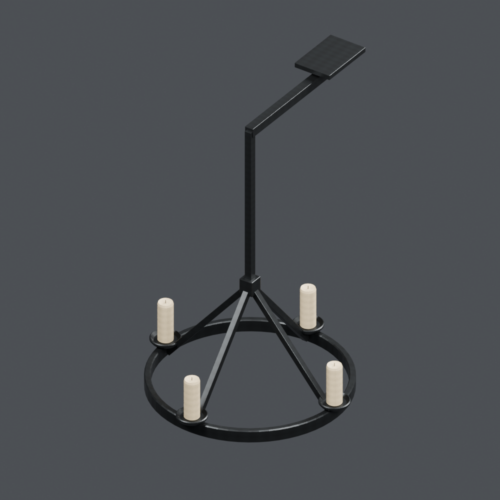

Use / purpose: Unlit iron-ring chandelier from the tavern collection. Unit: one model record. Includes BLEND and GLB. The close-up is rendered from the distributed BLEND.

Record type: model. Formats: BLEND/GLB.

Reported dimensions (metres; XYZ when derived from measured bounds, legacy axis order not reverified): [0.672, 0.826, 0.9]. Triangles: 7436.

Origin: Unknown / not independently confirmed. Orientation: Unknown / not independently confirmed.

Measured bounds relative to stored coordinates (metres): [[-0.335999995470047, -0.4129999876022339, 0.0], [0.335999995470047, 0.4129999876022339, 0.8999999761581421]]. Bounds do not establish the intended placement origin or facing direction.

[Download ZIP](https://github.com/k3peta/tales-on-a-table/releases/download/v2026.10.18/FT_029_CC0.zip) · [License scope](../../LICENSE.md)

**CC0-1.0** — See original ZIP license and repository license scope. Models and embedded materials only; previews excluded.

Source details: [Catalogue 1](../../catalog/candles-light_01.en.md) · [Catalogue 2](../../catalog/candles-light_01.md) · [Catalogue 3](../../catalog/candles-light_01.zh-CN.md)

## FT_030

**Wall-mounted glass lantern**

壁付けガラスランタン

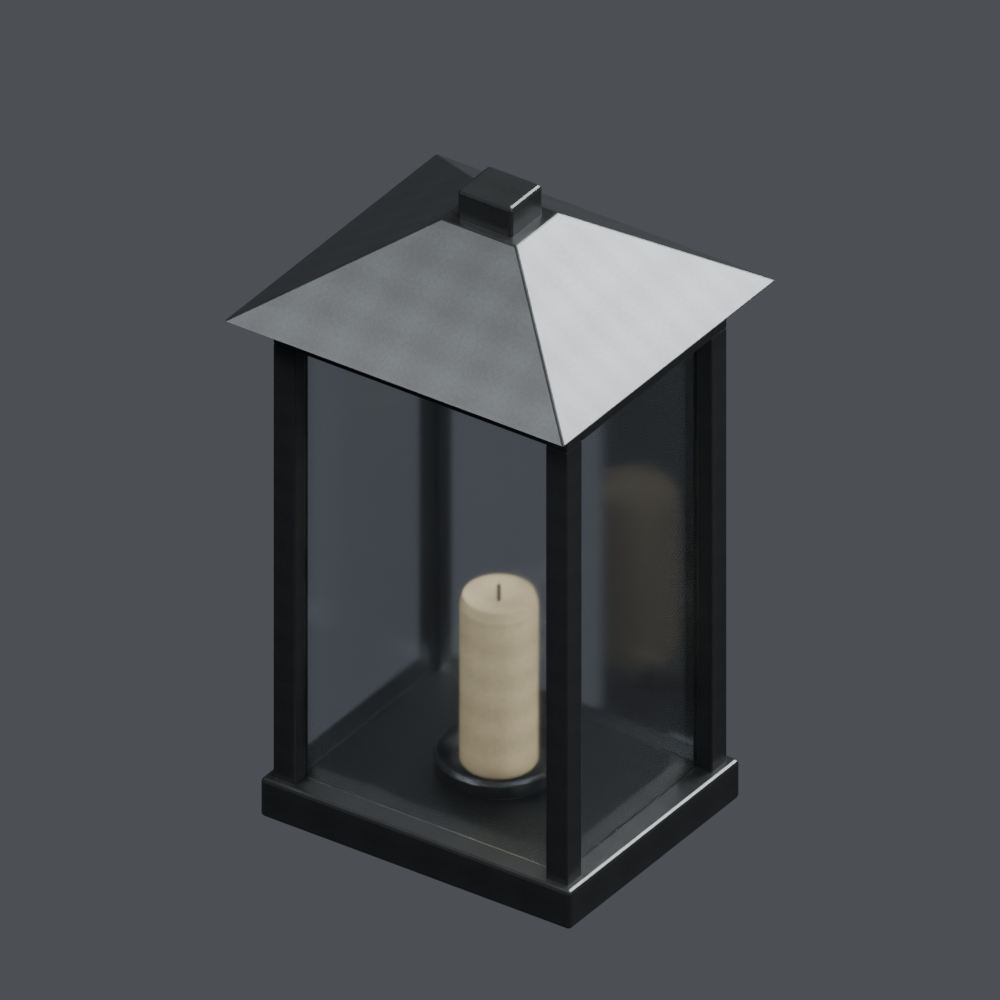

Use / purpose: Wall-mounted glass lantern from the tavern collection. Unit: one model record. Includes BLEND and GLB. The close-up is rendered from the distributed BLEND.

Record type: model. Formats: BLEND/GLB.

Reported dimensions (metres; XYZ when derived from measured bounds, legacy axis order not reverified): [0.218918, 0.250464, 0.42]. Triangles: 3376.

Origin: Unknown / not independently confirmed. Orientation: Unknown / not independently confirmed.

Measured bounds relative to stored coordinates (metres): [[-0.10945906490087509, -0.12523216009140015, 0.0], [0.10945906490087509, 0.12523216009140015, 0.41999998688697815]]. Bounds do not establish the intended placement origin or facing direction.

[Download ZIP](https://github.com/k3peta/tales-on-a-table/releases/download/v2026.10.18/FT_030_CC0.zip) · [License scope](../../LICENSE.md)

**CC0-1.0** — See original ZIP license and repository license scope. Models and embedded materials only; previews excluded.

Source details: [Catalogue 1](../../catalog/candles-light_01.en.md) · [Catalogue 2](../../catalog/candles-light_01.md) · [Catalogue 3](../../catalog/candles-light_01.zh-CN.md)

## FT_031

**Decorative stone fireplace**

装飾用の石造暖炉

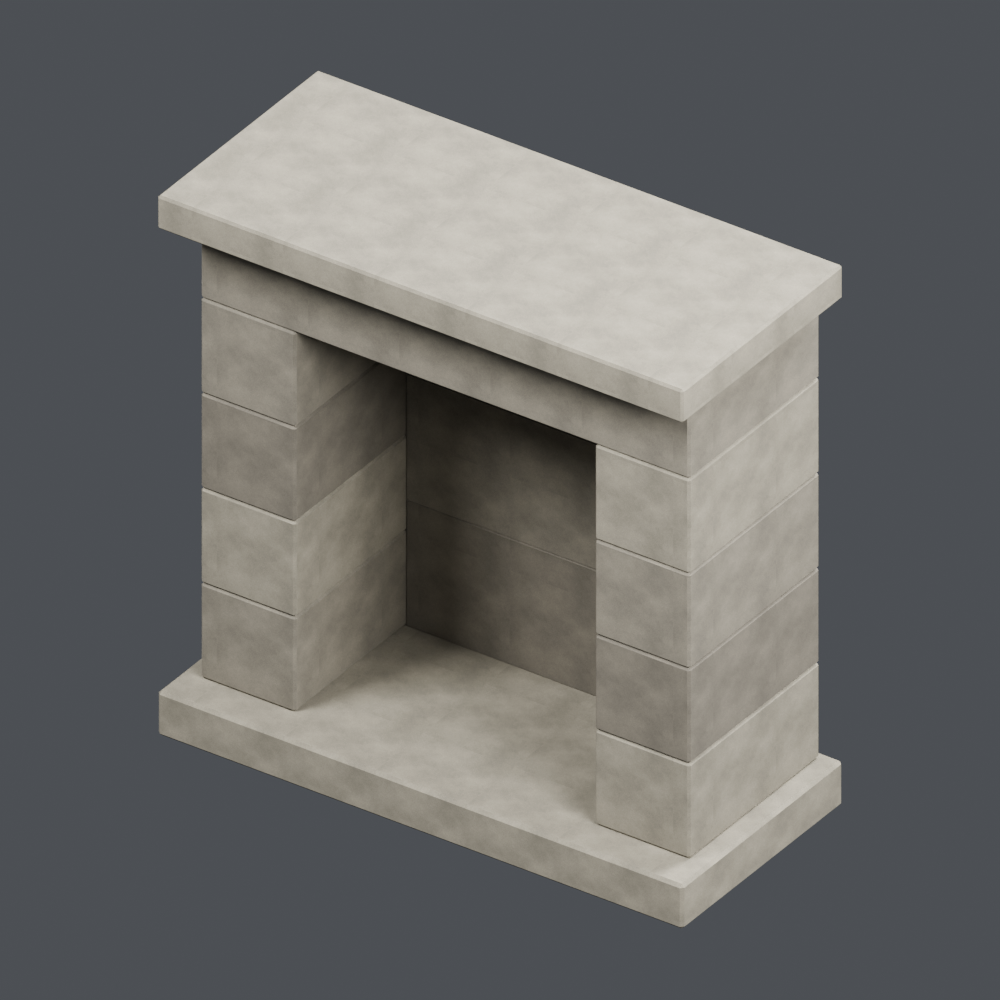

Use / purpose: Decorative stone fireplace from the tavern collection. Unit: one model record. Includes BLEND and GLB. The close-up is rendered from the distributed BLEND.

Record type: model. Formats: BLEND/GLB.

Reported dimensions (metres; XYZ when derived from measured bounds, legacy axis order not reverified): [1.44, 0.64, 1.45]. Triangles: 616.

Origin: Unknown / not independently confirmed. Orientation: Unknown / not independently confirmed.

Measured bounds relative to stored coordinates (metres): [[-0.7200000286102295, -0.3199999928474426, 0.0], [0.7200000286102295, 0.3199999928474426, 1.4499999284744263]]. Bounds do not establish the intended placement origin or facing direction.

[Download ZIP](https://github.com/k3peta/tales-on-a-table/releases/download/v2026.10.18/FT_031_CC0.zip) · [License scope](../../LICENSE.md)

**CC0-1.0** — See original ZIP license and repository license scope. Models and embedded materials only; previews excluded.

Source details: [Catalogue 1](../../catalog/candles-light_01.en.md) · [Catalogue 2](../../catalog/candles-light_01.md) · [Catalogue 3](../../catalog/candles-light_01.zh-CN.md)

## FT_032

**Iron firewood rack with split logs**

割り薪入りの鉄製薪台

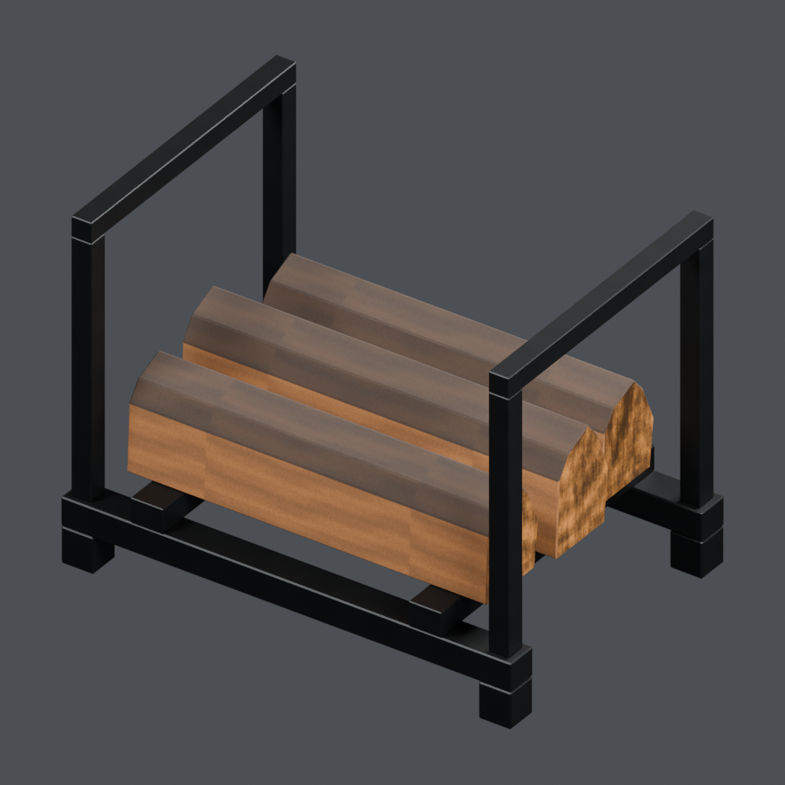

Use / purpose: Iron firewood rack with split logs from the tavern collection. Unit: one model record. Includes BLEND and GLB. The close-up is rendered from the distributed BLEND.

Record type: model. Formats: BLEND/GLB.

Reported dimensions (metres; XYZ when derived from measured bounds, legacy axis order not reverified): [0.55, 0.38, 0.415]. Triangles: 840.

Origin: Unknown / not independently confirmed. Orientation: Unknown / not independently confirmed.

Measured bounds relative to stored coordinates (metres): [[-0.2750000059604645, -0.1899999976158142, 0.0], [0.2750000059604645, 0.1899999976158142, 0.41499999165534973]]. Bounds do not establish the intended placement origin or facing direction.

[Download ZIP](https://github.com/k3peta/tales-on-a-table/releases/download/v2026.10.18/FT_032_CC0.zip) · [License scope](../../LICENSE.md)

**CC0-1.0** — See original ZIP license and repository license scope. Models and embedded materials only; previews excluded.

Source details: [Catalogue 1](../../catalog/candles-light_01.en.md) · [Catalogue 2](../../catalog/candles-light_01.md) · [Catalogue 3](../../catalog/candles-light_01.zh-CN.md)

## FT_033

**Fireplace tools and stand**

火かき道具と支持台

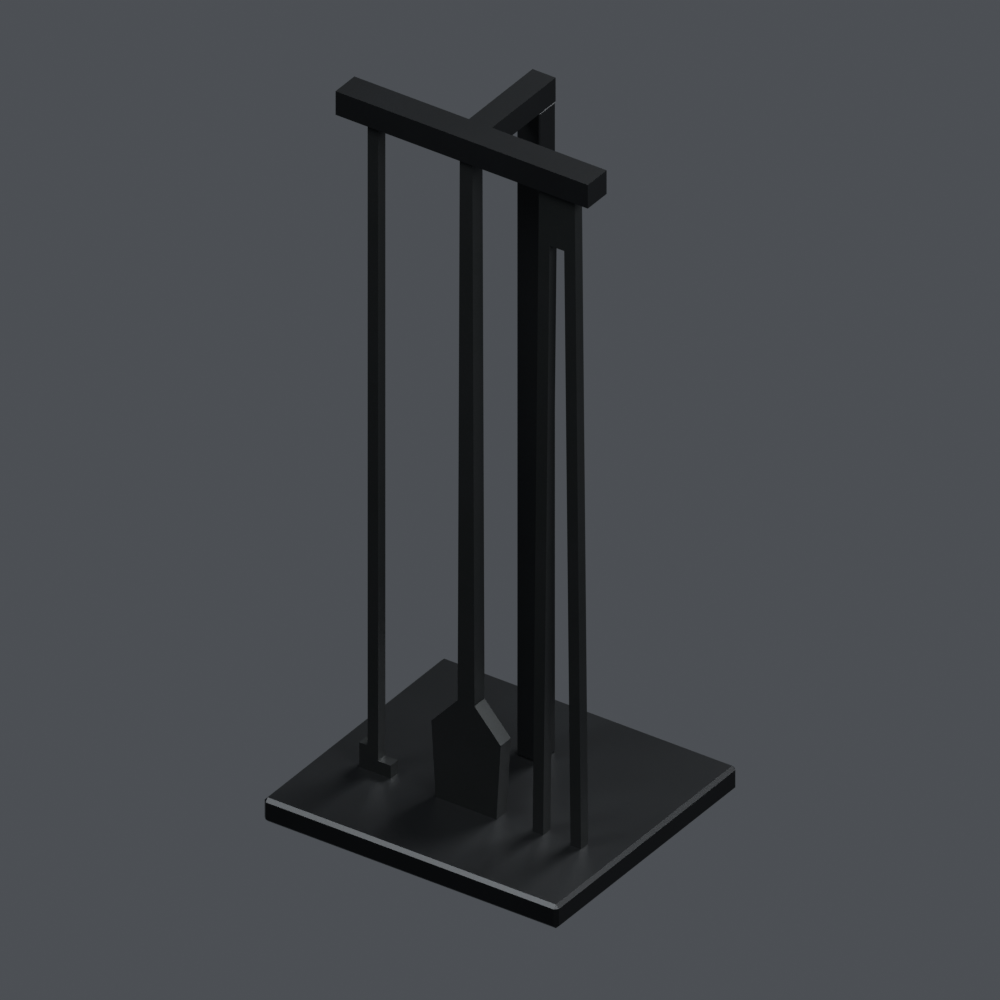

Use / purpose: Fireplace tools and stand from the tavern collection. Unit: one model record. Includes BLEND and GLB. The close-up is rendered from the distributed BLEND.

Record type: model. Formats: BLEND/GLB.

Reported dimensions (metres; XYZ when derived from measured bounds, legacy axis order not reverified): [0.28, 0.25, 0.65]. Triangles: 196.

Origin: Unknown / not independently confirmed. Orientation: Unknown / not independently confirmed.

Measured bounds relative to stored coordinates (metres): [[-0.14000000059604645, -0.125, 0.0], [0.14000000059604645, 0.125, 0.6499999761581421]]. Bounds do not establish the intended placement origin or facing direction.

[Download ZIP](https://github.com/k3peta/tales-on-a-table/releases/download/v2026.10.18/FT_033_CC0.zip) · [License scope](../../LICENSE.md)

**CC0-1.0** — See original ZIP license and repository license scope. Models and embedded materials only; previews excluded.

Source details: [Catalogue 1](../../catalog/candles-light_01.en.md) · [Catalogue 2](../../catalog/candles-light_01.md) · [Catalogue 3](../../catalog/candles-light_01.zh-CN.md)

## FT_034

**Wooden target**

木製の的

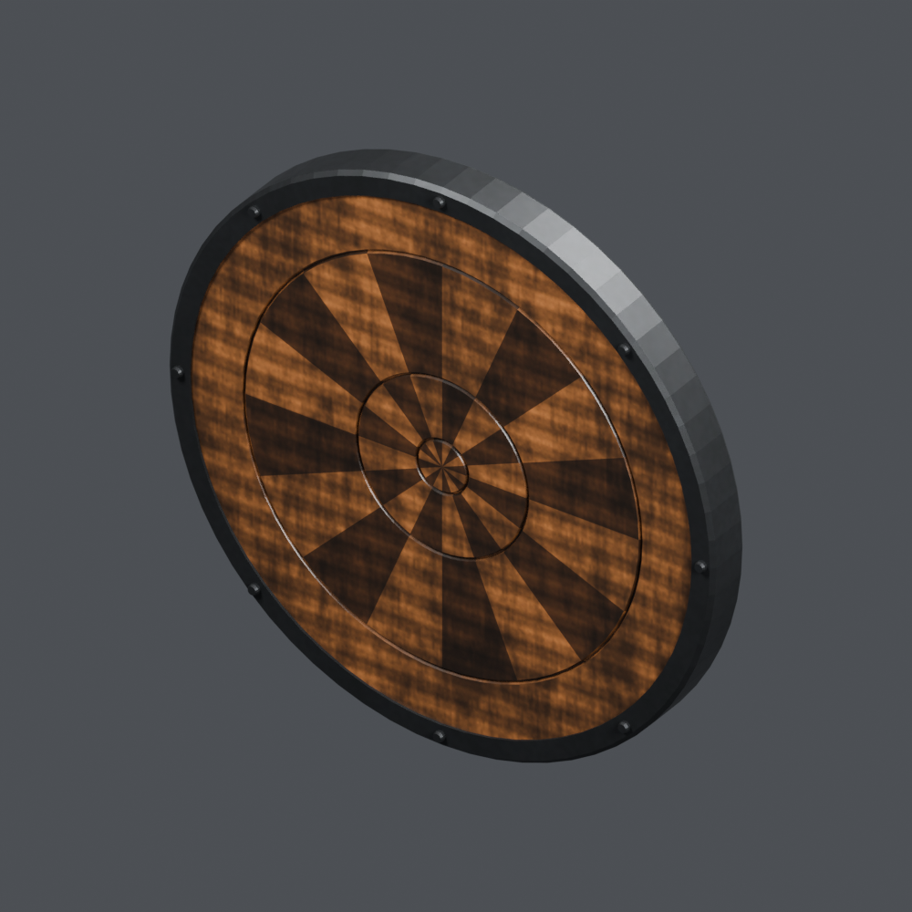

Use / purpose: Wooden target from the tavern collection. Unit: one model record. Includes BLEND and GLB. The close-up is rendered from the distributed BLEND.

Record type: model. Formats: BLEND/GLB.

Reported dimensions (metres; XYZ when derived from measured bounds, legacy axis order not reverified): [0.42, 0.046, 0.42]. Triangles: 4012.

Origin: Unknown / not independently confirmed. Orientation: Unknown / not independently confirmed.

Measured bounds relative to stored coordinates (metres): [[-0.20999999344348907, -0.023000000044703484, 0.0], [0.20999999344348907, 0.023000000044703484, 0.41999998688697815]]. Bounds do not establish the intended placement origin or facing direction.

[Download ZIP](https://github.com/k3peta/tales-on-a-table/releases/download/v2026.10.18/FT_034_CC0.zip) · [License scope](../../LICENSE.md)

**CC0-1.0** — See original ZIP license and repository license scope. Models and embedded materials only; previews excluded.

Source details: [Catalogue 1](../../catalog/chapel_training_v1.md) · [Catalogue 2](../../catalog/curios-tools_01.en.md) · [Catalogue 3](../../catalog/curios-tools_01.md)

## FT_035

**Blank notice board**

無地の掲示板

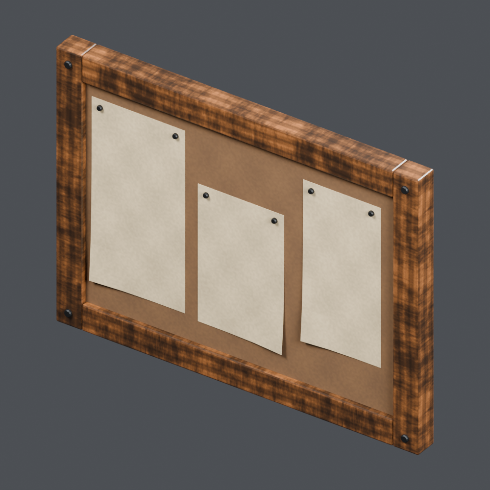

Use / purpose: Blank notice board from the tavern collection. Unit: one model record. Includes BLEND and GLB. The close-up is rendered from the distributed BLEND.

Record type: model. Formats: BLEND/GLB.

Reported dimensions (metres; XYZ when derived from measured bounds, legacy axis order not reverified): [0.7, 0.055, 0.52]. Triangles: 2100.

Origin: Unknown / not independently confirmed. Orientation: Unknown / not independently confirmed.

Measured bounds relative to stored coordinates (metres): [[-0.3499999940395355, -0.027499999850988388, 0.0], [0.3499999940395355, 0.027499999850988388, 0.5199999809265137]]. Bounds do not establish the intended placement origin or facing direction.

[Download ZIP](https://github.com/k3peta/tales-on-a-table/releases/download/v2026.10.18/FT_035_CC0.zip) · [License scope](../../LICENSE.md)

**CC0-1.0** — See original ZIP license and repository license scope. Models and embedded materials only; previews excluded.

Source details: [Catalogue 1](../../catalog/curios-tools_01.en.md) · [Catalogue 2](../../catalog/curios-tools_01.md) · [Catalogue 3](../../catalog/curios-tools_01.zh-CN.md)

## FT_036

**Blank A-frame menu board**

無地のA型メニュー看板

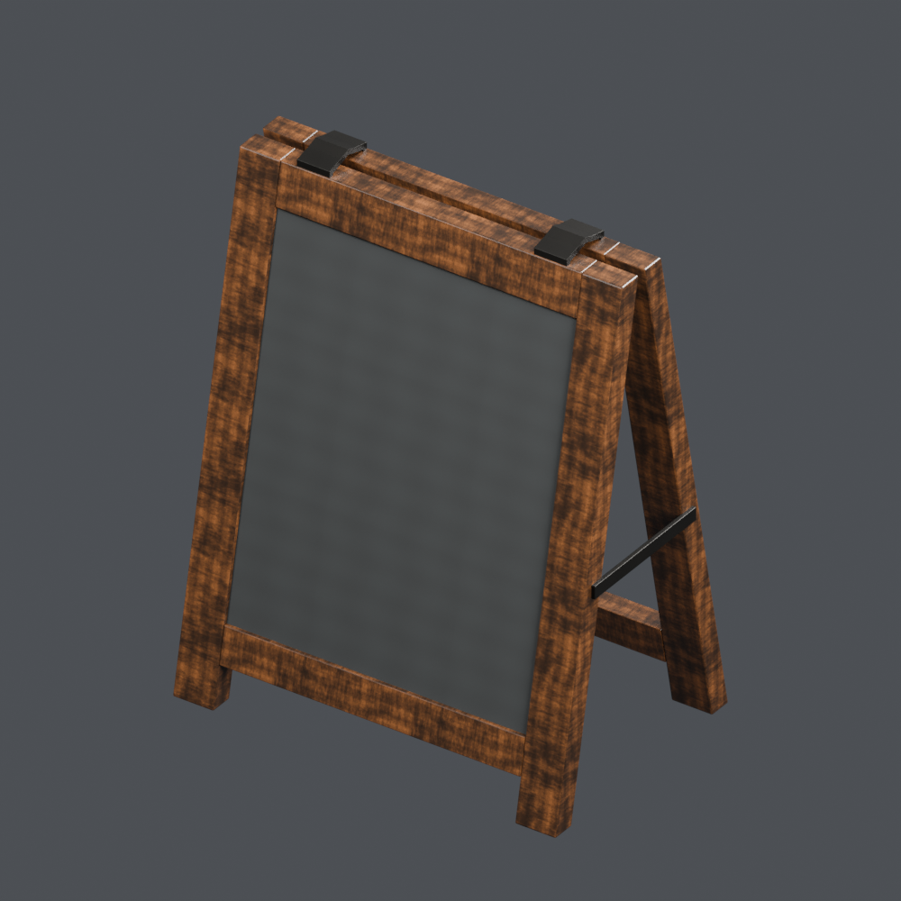

Use / purpose: Blank A-frame menu board from the tavern collection. Unit: one model record. Includes BLEND and GLB. The close-up is rendered from the distributed BLEND.

Record type: model. Formats: BLEND/GLB.

Reported dimensions (metres; XYZ when derived from measured bounds, legacy axis order not reverified): [0.428, 0.275372, 0.549926]. Triangles: 1836.

Origin: Unknown / not independently confirmed. Orientation: Unknown / not independently confirmed.

Measured bounds relative to stored coordinates (metres): [[-0.21400000154972076, -0.13768620789051056, 0.0], [0.21400000154972076, 0.13768620789051056, 0.5499259233474731]]. Bounds do not establish the intended placement origin or facing direction.

[Download ZIP](https://github.com/k3peta/tales-on-a-table/releases/download/v2026.10.18/FT_036_CC0.zip) · [License scope](../../LICENSE.md)

**CC0-1.0** — See original ZIP license and repository license scope. Models and embedded materials only; previews excluded.

Source details: [Catalogue 1](../../catalog/curios-tools_01.en.md) · [Catalogue 2](../../catalog/curios-tools_01.md) · [Catalogue 3](../../catalog/curios-tools_01.zh-CN.md)

## FT_037

**Blank hanging sign**

無地の吊り看板

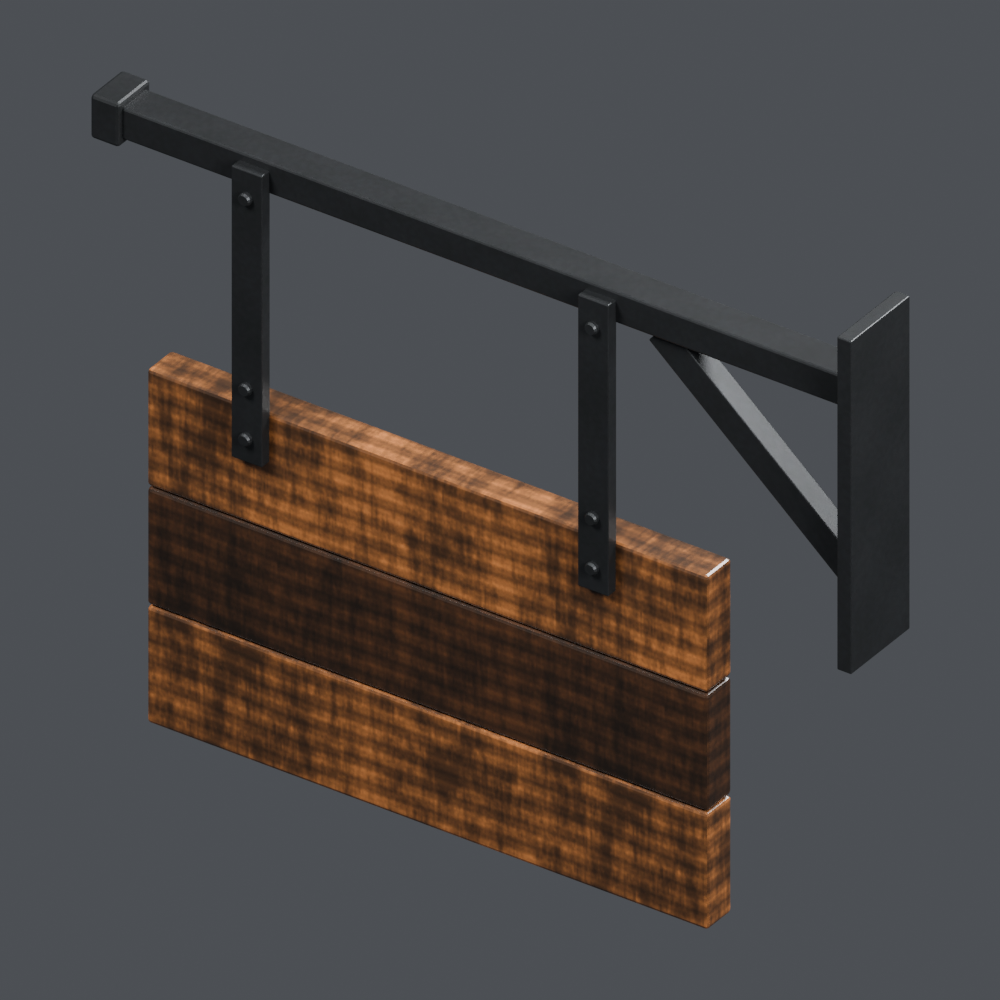

Use / purpose: Blank hanging sign from the tavern collection. Unit: one model record. Includes BLEND and GLB. The close-up is rendered from the distributed BLEND.

Record type: model. Formats: BLEND/GLB.

Reported dimensions (metres; XYZ when derived from measured bounds, legacy axis order not reverified): [0.76, 0.084, 0.637]. Triangles: 1980.

Origin: Unknown / not independently confirmed. Orientation: Unknown / not independently confirmed.

Measured bounds relative to stored coordinates (metres): [[-0.3799999952316284, -0.041999999433755875, 0.0], [0.3799999952316284, 0.041999999433755875, 0.6369999647140503]]. Bounds do not establish the intended placement origin or facing direction.

[Download ZIP](https://github.com/k3peta/tales-on-a-table/releases/download/v2026.10.18/FT_037_CC0.zip) · [License scope](../../LICENSE.md)

**CC0-1.0** — See original ZIP license and repository license scope. Models and embedded materials only; previews excluded.

Source details: [Catalogue 1](../../catalog/curios-tools_01.en.md) · [Catalogue 2](../../catalog/curios-tools_01.md) · [Catalogue 3](../../catalog/curios-tools_01.zh-CN.md)

## FT_038

**Closed leather pouch**

閉じた革の巾着

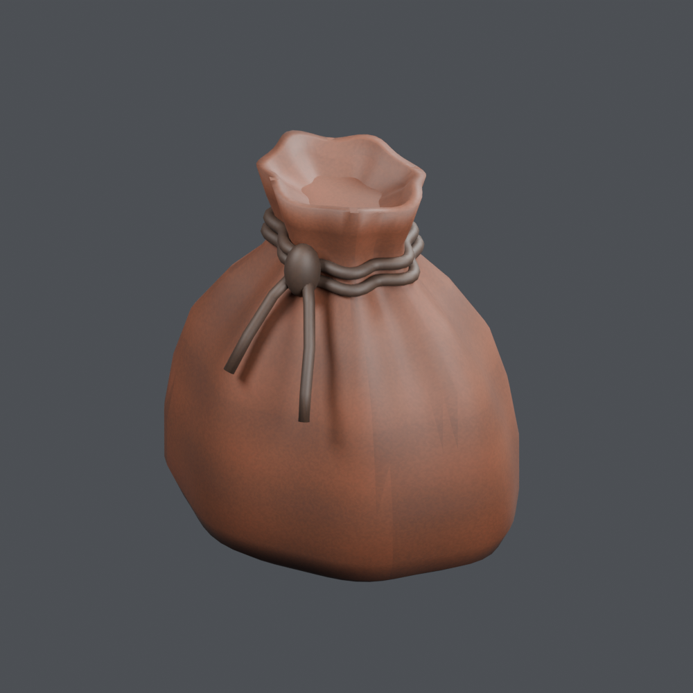

Use / purpose: Closed leather pouch from the tavern collection. Unit: one model record. Includes BLEND and GLB. The close-up is rendered from the distributed BLEND.

Record type: model. Formats: BLEND/GLB.

Reported dimensions (metres; XYZ when derived from measured bounds, legacy axis order not reverified): [0.146297, 0.117483, 0.1596]. Triangles: 5472.

Origin: Unknown / not independently confirmed. Orientation: Unknown / not independently confirmed.

Measured bounds relative to stored coordinates (metres): [[-0.07314848899841309, -0.05874170362949371, 0.0], [0.07314848899841309, 0.05874170362949371, 0.15960000455379486]]. Bounds do not establish the intended placement origin or facing direction.

[Download ZIP](https://github.com/k3peta/tales-on-a-table/releases/download/v2026.10.18/FT_038_CC0.zip) · [License scope](../../LICENSE.md)

**CC0-1.0** — See original ZIP license and repository license scope. Models and embedded materials only; previews excluded.

Source details: [Catalogue 1](../../catalog/curios-tools_01.en.md) · [Catalogue 2](../../catalog/curios-tools_01.md) · [Catalogue 3](../../catalog/curios-tools_01.zh-CN.md)

## FT_039

**Empty dice cup and two dice**

空のダイスカップと二つのサイコロ

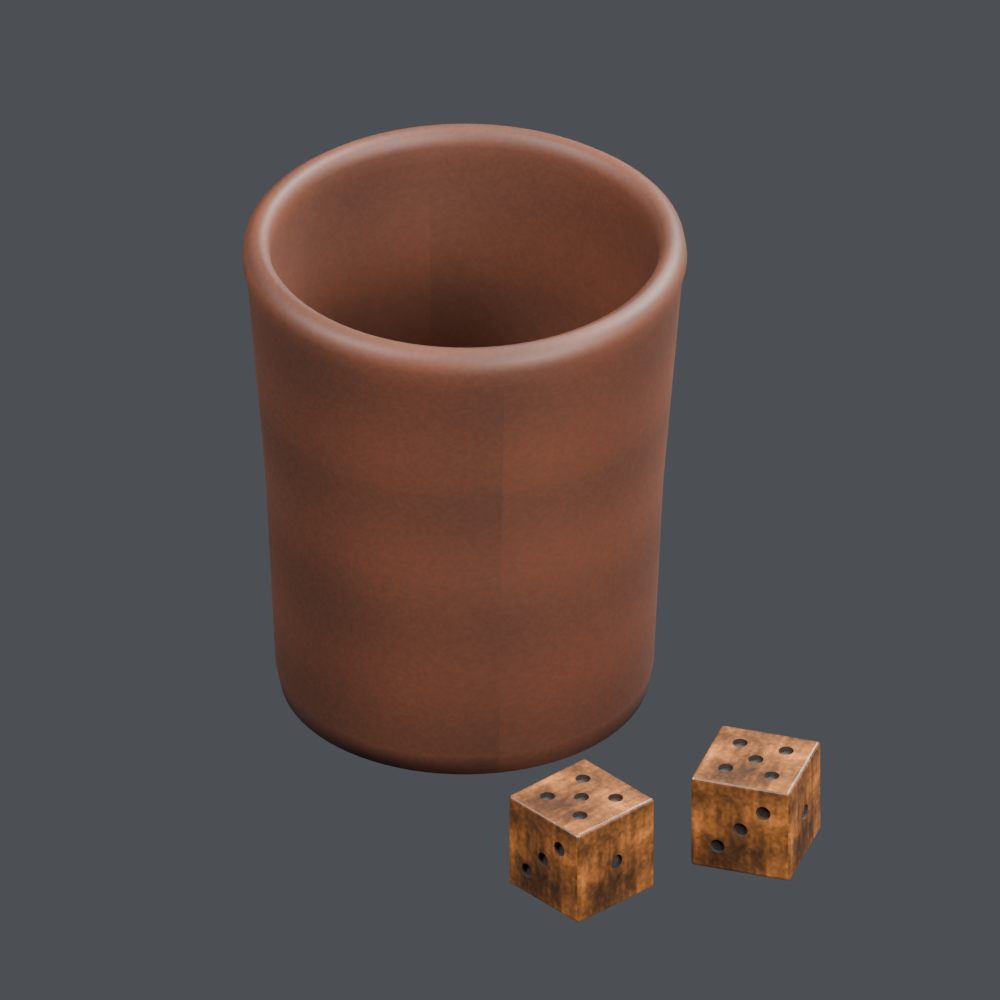

Use / purpose: Empty dice cup and two dice from the tavern collection. Unit: one model record. Includes BLEND and GLB. The close-up is rendered from the distributed BLEND.

Record type: model. Formats: BLEND/GLB.

Reported dimensions (metres; XYZ when derived from measured bounds, legacy axis order not reverified): [0.14753, 0.111024, 0.112]. Triangles: 5348.

Origin: Unknown / not independently confirmed. Orientation: Unknown / not independently confirmed.

Measured bounds relative to stored coordinates (metres): [[-0.07376492023468018, -0.05551191046833992, 0.0], [0.07376492023468018, 0.05551191046833992, 0.1120000034570694]]. Bounds do not establish the intended placement origin or facing direction.

[Download ZIP](https://github.com/k3peta/tales-on-a-table/releases/download/v2026.10.18/FT_039_CC0.zip) · [License scope](../../LICENSE.md)

**CC0-1.0** — See original ZIP license and repository license scope. Models and embedded materials only; previews excluded.

Source details: [Catalogue 1](../../catalog/tableware_02.en.md) · [Catalogue 2](../../catalog/tableware_02.md) · [Catalogue 3](../../catalog/tableware_02.zh-CN.md)

## FT_040

**Closed leather travel bag**

閉じた革の旅鞄

Use / purpose: Closed leather travel bag from the tavern collection. Unit: one model record. Includes BLEND and GLB. The close-up is rendered from the distributed BLEND.

Record type: model. Formats: BLEND/GLB.

Reported dimensions (metres; XYZ when derived from measured bounds, legacy axis order not reverified): [0.378, 0.1655, 0.274]. Triangles: 13812.

Origin: Unknown / not independently confirmed. Orientation: Unknown / not independently confirmed.

Measured bounds relative to stored coordinates (metres): [[-0.1889999806880951, -0.08275000005960464, 0.0], [0.1889999806880951, 0.08275000005960464, 0.27399998903274536]]. Bounds do not establish the intended placement origin or facing direction.

[Download ZIP](https://github.com/k3peta/tales-on-a-table/releases/download/v2026.10.18/FT_040_CC0.zip) · [License scope](../../LICENSE.md)

**CC0-1.0** — See original ZIP license and repository license scope. Models and embedded materials only; previews excluded.

Source details: [Catalogue 1](../../catalog/containers_01.en.md) · [Catalogue 2](../../catalog/containers_01.md) · [Catalogue 3](../../catalog/containers_01.zh-CN.md)

## FT_041

**Wooden door and frame**

木製の扉と枠

Use / purpose: Wooden door and frame from the tavern collection. Unit: one model record. Includes BLEND and GLB. The close-up is rendered from the distributed BLEND.

Record type: model. Formats: BLEND/GLB.

Reported dimensions (metres; XYZ when derived from measured bounds, legacy axis order not reverified): [1.05, 0.183, 2.1]. Triangles: 6708.

Origin: Unknown / not independently confirmed. Orientation: Unknown / not independently confirmed.

Measured bounds relative to stored coordinates (metres): [[-0.5249999761581421, -0.09149999916553497, 0.0], [0.5249999761581421, 0.09149999916553497, 2.1000001430511475]]. Bounds do not establish the intended placement origin or facing direction.

[Download ZIP](https://github.com/k3peta/tales-on-a-table/releases/download/v2026.10.18/FT_041_CC0.zip) · [License scope](../../LICENSE.md)

**CC0-1.0** — See original ZIP license and repository license scope. Models and embedded materials only; previews excluded.

Source details: [Catalogue 1](../../catalog/architecture_01.en.md) · [Catalogue 2](../../catalog/architecture_01.md) · [Catalogue 3](../../catalog/architecture_01.zh-CN.md)

## FT_042

**Leaded-glass window**

鉛桟のガラス窓

Use / purpose: Leaded-glass window from the tavern collection. Unit: one model record. Includes BLEND and GLB. The close-up is rendered from the distributed BLEND.

Record type: model. Formats: BLEND/GLB.

Reported dimensions (metres; XYZ when derived from measured bounds, legacy axis order not reverified): [0.8, 0.087, 1.0]. Triangles: 2908.

Origin: Unknown / not independently confirmed. Orientation: Unknown / not independently confirmed.

Measured bounds relative to stored coordinates (metres): [[-0.4000000059604645, -0.04349999874830246, 0.0], [0.4000000059604645, 0.04349999874830246, 1.0]]. Bounds do not establish the intended placement origin or facing direction.

[Download ZIP](https://github.com/k3peta/tales-on-a-table/releases/download/v2026.10.18/FT_042_CC0.zip) · [License scope](../../LICENSE.md)

**CC0-1.0** — See original ZIP license and repository license scope. Models and embedded materials only; previews excluded.

Source details: [Catalogue 1](../../catalog/architecture_01.en.md) · [Catalogue 2](../../catalog/architecture_01.md) · [Catalogue 3](../../catalog/architecture_01.zh-CN.md)

## FT_043

**Wooden post and crossbeam**

木製の柱と横梁

Use / purpose: Wooden post and crossbeam from the tavern collection. Unit: one model record. Includes BLEND and GLB. The close-up is rendered from the distributed BLEND.

Record type: model. Formats: BLEND/GLB.

Reported dimensions (metres; XYZ when derived from measured bounds, legacy axis order not reverified): [2.0, 0.187, 2.4]. Triangles: 912.

Origin: Unknown / not independently confirmed. Orientation: Unknown / not independently confirmed.

Measured bounds relative to stored coordinates (metres): [[-1.0, -0.09350000321865082, 0.0], [1.0, 0.09350000321865082, 2.3999998569488525]]. Bounds do not establish the intended placement origin or facing direction.

[Download ZIP](https://github.com/k3peta/tales-on-a-table/releases/download/v2026.10.18/FT_043_CC0.zip) · [License scope](../../LICENSE.md)

**CC0-1.0** — See original ZIP license and repository license scope. Models and embedded materials only; previews excluded.

Source details: [Catalogue 1](../../catalog/architecture_01.en.md) · [Catalogue 2](../../catalog/architecture_01.md) · [Catalogue 3](../../catalog/architecture_01.zh-CN.md)

## FT_044

**Plaster wall with two openings**

二つの実開口を持つ漆喰の壁

Use / purpose: Plaster wall with two openings from the tavern collection. Unit: one model record. Includes BLEND and GLB. The close-up is rendered from the distributed BLEND.

Record type: model. Formats: BLEND/GLB.

Reported dimensions (metres; XYZ when derived from measured bounds, legacy axis order not reverified): [3.0, 0.16, 2.4]. Triangles: 1944.

Origin: Unknown / not independently confirmed. Orientation: Unknown / not independently confirmed.

Measured bounds relative to stored coordinates (metres): [[-1.5, -0.07999999821186066, 0.0], [1.5, 0.07999999821186066, 2.4000000953674316]]. Bounds do not establish the intended placement origin or facing direction.

[Download ZIP](https://github.com/k3peta/tales-on-a-table/releases/download/v2026.10.18/FT_044_CC0.zip) · [License scope](../../LICENSE.md)

**CC0-1.0** — See original ZIP license and repository license scope. Models and embedded materials only; previews excluded.

Source details: [Catalogue 1](../../catalog/architecture_01.en.md) · [Catalogue 2](../../catalog/architecture_01.md) · [Catalogue 3](../../catalog/architecture_01.zh-CN.md)

## FT_045

**Wooden floor module**

板張りの床モジュール

Use / purpose: Wooden floor module from the tavern collection. Unit: one model record. Includes BLEND and GLB. The close-up is rendered from the distributed BLEND.

Record type: model. Formats: BLEND/GLB.

Reported dimensions (metres; XYZ when derived from measured bounds, legacy axis order not reverified): [2.0, 2.0, 0.1]. Triangles: 1188.

Origin: Unknown / not independently confirmed. Orientation: Unknown / not independently confirmed.

Measured bounds relative to stored coordinates (metres): [[-1.0, -1.0, 0.0], [1.0, 1.0, 0.09999999403953552]]. Bounds do not establish the intended placement origin or facing direction.

[Download ZIP](https://github.com/k3peta/tales-on-a-table/releases/download/v2026.10.18/FT_045_CC0.zip) · [License scope](../../LICENSE.md)

**CC0-1.0** — See original ZIP license and repository license scope. Models and embedded materials only; previews excluded.

Source details: [Catalogue 1](../../catalog/architecture_01.en.md) · [Catalogue 2](../../catalog/architecture_01.md) · [Catalogue 3](../../catalog/architecture_01.zh-CN.md)

## FT_046

**Stone floor module**

石敷きの床モジュール

Use / purpose: Stone floor module from the tavern collection. Unit: one model record. Includes BLEND and GLB. The close-up is rendered from the distributed BLEND.

Record type: model. Formats: BLEND/GLB.

Reported dimensions (metres; XYZ when derived from measured bounds, legacy axis order not reverified): [2.0, 2.0, 0.1]. Triangles: 1836.

Origin: Unknown / not independently confirmed. Orientation: Unknown / not independently confirmed.

Measured bounds relative to stored coordinates (metres): [[-1.0, -1.0, 0.0], [1.0, 1.0, 0.10000000149011612]]. Bounds do not establish the intended placement origin or facing direction.

[Download ZIP](https://github.com/k3peta/tales-on-a-table/releases/download/v2026.10.18/FT_046_CC0.zip) · [License scope](../../LICENSE.md)

**CC0-1.0** — See original ZIP license and repository license scope. Models and embedded materials only; previews excluded.

Source details: [Catalogue 1](../../catalog/architecture_01.en.md) · [Catalogue 2](../../catalog/architecture_01.md) · [Catalogue 3](../../catalog/architecture_01.zh-CN.md)

## FT_047

**Seven-step wooden staircase**

七段の木製階段

Use / purpose: Seven-step wooden staircase from the tavern collection. Unit: one model record. Includes BLEND and GLB. The close-up is rendered from the distributed BLEND.

Record type: model. Formats: BLEND/GLB.

Reported dimensions (metres; XYZ when derived from measured bounds, legacy axis order not reverified): [0.9, 1.75, 1.26]. Triangles: 3024.

Origin: Unknown / not independently confirmed. Orientation: Unknown / not independently confirmed.

Measured bounds relative to stored coordinates (metres): [[-0.44999998807907104, -0.875, 0.0], [0.44999998807907104, 0.875, 1.2599999904632568]]. Bounds do not establish the intended placement origin or facing direction.

[Download ZIP](https://github.com/k3peta/tales-on-a-table/releases/download/v2026.10.18/FT_047_CC0.zip) · [License scope](../../LICENSE.md)

**CC0-1.0** — See original ZIP license and repository license scope. Models and embedded materials only; previews excluded.

Source details: [Catalogue 1](../../catalog/architecture_01.en.md) · [Catalogue 2](../../catalog/architecture_01.md) · [Catalogue 3](../../catalog/architecture_01.zh-CN.md)

## FT_048

**Fixed wooden railing**

固定式の木製手すり

Use / purpose: Fixed wooden railing from the tavern collection. Unit: one model record. Includes BLEND and GLB. The close-up is rendered from the distributed BLEND.

Record type: model. Formats: BLEND/GLB.

Reported dimensions (metres; XYZ when derived from measured bounds, legacy axis order not reverified): [1.5, 0.12, 1.0]. Triangles: 1188.

Origin: Unknown / not independently confirmed. Orientation: Unknown / not independently confirmed.

Measured bounds relative to stored coordinates (metres): [[-0.75, -0.05999999865889549, 0.0], [0.75, 0.05999999865889549, 1.0]]. Bounds do not establish the intended placement origin or facing direction.

[Download ZIP](https://github.com/k3peta/tales-on-a-table/releases/download/v2026.10.18/FT_048_CC0.zip) · [License scope](../../LICENSE.md)

**CC0-1.0** — See original ZIP license and repository license scope. Models and embedded materials only; previews excluded.

Source details: [Catalogue 1](../../catalog/architecture_01.en.md) · [Catalogue 2](../../catalog/architecture_01.md) · [Catalogue 3](../../catalog/architecture_01.zh-CN.md)
