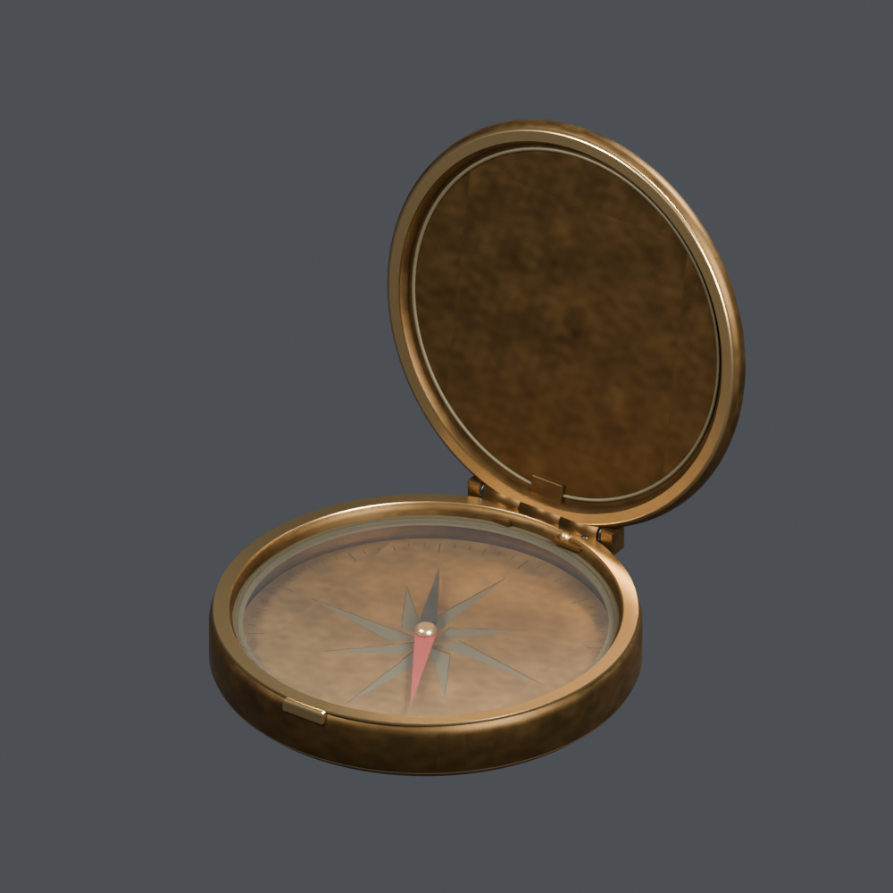

# Base distribution records 49–72

[Browse index](README.md) · [Coverage and missing fields](COVERAGE.md)

Images are actual existing model renders for browsing, not covered by model CC0. A group record may show several reused models. Dimensions and triangle counts apply only to the original record when sourced; revisions can differ. Unknown means unverified, not zero. No blanket CC0 grant for scenes, images, code or articles.

## FT_049

**Thin woven-pattern rug**

織り模様の薄いラグ

Use / purpose: Thin woven-pattern rug from the tavern collection. Unit: one model record. Includes BLEND and GLB. The close-up is rendered from the distributed BLEND.

Record type: model. Formats: BLEND/GLB.

Reported dimensions (metres; XYZ when derived from measured bounds, legacy axis order not reverified): [1.6, 1.0, 0.008]. Triangles: 380.

Origin: Unknown / not independently confirmed. Orientation: Unknown / not independently confirmed.

Measured bounds relative to stored coordinates (metres): [[-0.800000011920929, -0.5, 0.0], [0.800000011920929, 0.5, 0.00800000037997961]]. Bounds do not establish the intended placement origin or facing direction.

[Download ZIP](https://github.com/k3peta/tales-on-a-table/releases/download/v2026.10.18/FT_049_CC0.zip) · [License scope](../../LICENSE.md)

**CC0-1.0** — See original ZIP license and repository license scope. Models and embedded materials only; previews excluded.

Source details: [Catalogue 1](../../catalog/textiles_01.en.md) · [Catalogue 2](../../catalog/textiles_01.md) · [Catalogue 3](../../catalog/textiles_01.zh-CN.md)

## FT_050

**Two-panel wood and linen screen**

木枠とリネンの二連衝立

Use / purpose: Two-panel wood and linen screen from the tavern collection. Unit: one model record. Includes BLEND and GLB. The close-up is rendered from the distributed BLEND.

Record type: model. Formats: BLEND/GLB.

Reported dimensions (metres; XYZ when derived from measured bounds, legacy axis order not reverified): [1.738176, 0.462061, 1.625]. Triangles: 1840.

Origin: Unknown / not independently confirmed. Orientation: Unknown / not independently confirmed.

Measured bounds relative to stored coordinates (metres): [[-0.8690881729125977, -0.23103031516075134, 0.0], [0.8690881729125977, 0.23103031516075134, 1.625]]. Bounds do not establish the intended placement origin or facing direction.

[Download ZIP](https://github.com/k3peta/tales-on-a-table/releases/download/v2026.10.18/FT_050_CC0.zip) · [License scope](../../LICENSE.md)

**CC0-1.0** — See original ZIP license and repository license scope. Models and embedded materials only; previews excluded.

Source details: [Catalogue 1](../../catalog/furniture_01.en.md) · [Catalogue 2](../../catalog/furniture_01.md) · [Catalogue 3](../../catalog/furniture_01.zh-CN.md)

## FT_051

**Mended ledger**

補修された帳簿

Use / purpose: Mended ledger from the tavern collection. Unit: one model record. Includes BLEND and GLB. The close-up is rendered from the distributed BLEND.

Record type: model. Formats: BLEND/GLB.

Reported dimensions (metres; XYZ when derived from measured bounds, legacy axis order not reverified): [0.235927, 0.292, 0.05245]. Triangles: 29648.

Origin: Unknown / not independently confirmed. Orientation: Unknown / not independently confirmed.

Measured bounds relative to stored coordinates (metres): [[-0.12092669308185577, -0.1459999978542328, 0.0], [0.11499999463558197, 0.1459999978542328, 0.05245000123977661]]. Bounds do not establish the intended placement origin or facing direction.

[Download ZIP](https://github.com/k3peta/tales-on-a-table/releases/download/v2026.10.18/FT_051_CC0.zip) · [License scope](../../LICENSE.md)

**CC0-1.0** — See original ZIP license and repository license scope. Models and embedded materials only; previews excluded.

Source details: [Catalogue 1](../../catalog/books-paper_01.en.md) · [Catalogue 2](../../catalog/books-paper_01.md) · [Catalogue 3](../../catalog/books-paper_01.zh-CN.md)

## FT_052

**Repaired wooden cup**

修理された木の杯

Use / purpose: Repaired wooden cup from the tavern collection. Unit: one model record. Includes BLEND and GLB. The close-up is rendered from the distributed BLEND.

Record type: model. Formats: BLEND/GLB.

Reported dimensions (metres; XYZ when derived from measured bounds, legacy axis order not reverified): [0.119621, 0.119621, 0.2103]. Triangles: 39956.

Origin: Unknown / not independently confirmed. Orientation: Unknown / not independently confirmed.

Measured bounds relative to stored coordinates (metres): [[-0.05981060117483139, -0.05981060117483139, 0.0], [0.05981060117483139, 0.05981060117483139, 0.2102999985218048]]. Bounds do not establish the intended placement origin or facing direction.

[Download ZIP](https://github.com/k3peta/tales-on-a-table/releases/download/v2026.10.18/FT_052_CC0.zip) · [License scope](../../LICENSE.md)

**CC0-1.0** — See original ZIP license and repository license scope. Models and embedded materials only; previews excluded.

Source details: [Catalogue 1](../../catalog/tableware_02.en.md) · [Catalogue 2](../../catalog/tableware_02.md) · [Catalogue 3](../../catalog/tableware_02.zh-CN.md)

**Version scope:** The image above depicts the primary recorded ZIP. [Latest revision ZIP](https://raw.githubusercontent.com/k3peta/tales-on-a-table/main/distributions/quality-ft051-056-v1/FT_052__repair_CC0.zip). [Revision-specific preview](../../previews/quality-ft051-056-v1/FT_052__repair_thumb.png). [Version audit](VERSION-AUDIT.md).

## FT_053

**Old keys and leather tags**

古い鍵と革札の束

Use / purpose: Old keys and leather tags from the tavern collection. Unit: one model record. Includes BLEND and GLB. The close-up is rendered from the distributed BLEND.

Record type: model. Formats: BLEND/GLB.

Reported dimensions (metres; XYZ when derived from measured bounds, legacy axis order not reverified): [0.228642, 0.243206, 0.018]. Triangles: 40546.

Origin: Unknown / not independently confirmed. Orientation: Unknown / not independently confirmed.

Measured bounds relative to stored coordinates (metres): [[-0.11432082951068878, -0.12160292267799377, 0.0], [0.11432082951068878, 0.12160292267799377, 0.017999999225139618]]. Bounds do not establish the intended placement origin or facing direction.

[Download ZIP](https://github.com/k3peta/tales-on-a-table/releases/download/v2026.10.18/FT_053_CC0.zip) · [License scope](../../LICENSE.md)

**CC0-1.0** — See original ZIP license and repository license scope. Models and embedded materials only; previews excluded.

Source details: [Catalogue 1](../../catalog/curios-tools_01.en.md) · [Catalogue 2](../../catalog/curios-tools_01.md) · [Catalogue 3](../../catalog/curios-tools_01.zh-CN.md)

**Version scope:** The image above depicts the primary recorded ZIP. [Latest revision ZIP](https://raw.githubusercontent.com/k3peta/tales-on-a-table/main/distributions/quality-ft051-056-v1/FT_053__repair_CC0.zip). [Revision-specific preview](../../previews/quality-ft051-056-v1/FT_053__repair_thumb.png). [Version audit](VERSION-AUDIT.md).

## FT_054

**Repair tool roll**

修繕道具の巻き物

Use / purpose: Repair tool roll from the tavern collection. Unit: one model record. Includes BLEND and GLB. The close-up is rendered from the distributed BLEND.

Record type: model. Formats: BLEND/GLB.

Reported dimensions (metres; XYZ when derived from measured bounds, legacy axis order not reverified): [0.434, 0.26, 0.04]. Triangles: 63984.

Origin: Unknown / not independently confirmed. Orientation: Unknown / not independently confirmed.

Measured bounds relative to stored coordinates (metres): [[-0.18000000715255737, -0.12999999523162842, 0.0], [0.2540000081062317, 0.12999999523162842, 0.03999999910593033]]. Bounds do not establish the intended placement origin or facing direction.

[Download ZIP](https://github.com/k3peta/tales-on-a-table/releases/download/v2026.10.18/FT_054_CC0.zip) · [License scope](../../LICENSE.md)

**CC0-1.0** — See original ZIP license and repository license scope. Models and embedded materials only; previews excluded.

Source details: [Catalogue 1](../../catalog/curios-tools_01.en.md) · [Catalogue 2](../../catalog/curios-tools_01.md) · [Catalogue 3](../../catalog/curios-tools_01.zh-CN.md)

## FT_055

**Small loaner shield**

貸出用の小盾

Use / purpose: Small loaner shield from the tavern collection. Unit: one model record. Includes BLEND and GLB. The close-up is rendered from the distributed BLEND.

Record type: model. Formats: BLEND/GLB.

Reported dimensions (metres; XYZ when derived from measured bounds, legacy axis order not reverified): [0.439961, 0.19, 0.479981]. Triangles: 53918.

Origin: Unknown / not independently confirmed. Orientation: Unknown / not independently confirmed.

Measured bounds relative to stored coordinates (metres): [[-0.21998055279254913, -0.0949999988079071, 0.0], [0.21998055279254913, 0.0949999988079071, 0.47998055815696716]]. Bounds do not establish the intended placement origin or facing direction.

[Download ZIP](https://github.com/k3peta/tales-on-a-table/releases/download/v2026.10.18/FT_055_CC0.zip) · [License scope](../../LICENSE.md)

**CC0-1.0** — See original ZIP license and repository license scope. Models and embedded materials only; previews excluded.

Source details: [Catalogue 1](../../catalog/weapons-equipment_01.en.md) · [Catalogue 2](../../catalog/weapons-equipment_01.md) · [Catalogue 3](../../catalog/weapons-equipment_01.zh-CN.md)

**Version scope:** The image above depicts the primary recorded ZIP. [Latest revision ZIP](https://raw.githubusercontent.com/k3peta/tales-on-a-table/main/distributions/quality-ft051-056-v1/FT_055__repair_CC0.zip). [Revision-specific preview](../../previews/quality-ft051-056-v1/FT_055__repair_thumb.png). [Version audit](VERSION-AUDIT.md).

## FT_056

**Old travel compass**

古い旅の方位磁針

Use / purpose: Old travel compass from the tavern collection. Unit: one model record. Includes BLEND and GLB. The close-up is rendered from the distributed BLEND.

Record type: model. Formats: BLEND/GLB.

Reported dimensions (metres; XYZ when derived from measured bounds, legacy axis order not reverified): [0.14, 0.165577, 0.15726]. Triangles: 18694.

Origin: Unknown / not independently confirmed. Orientation: Unknown / not independently confirmed.

Measured bounds relative to stored coordinates (metres): [[-0.07000000029802322, -0.07050000131130219, 0.0], [0.07000000029802322, 0.09507700800895691, 0.15726019442081451]]. Bounds do not establish the intended placement origin or facing direction.

[Download ZIP](https://github.com/k3peta/tales-on-a-table/releases/download/v2026.10.18/FT_056_CC0.zip) · [License scope](../../LICENSE.md)

**CC0-1.0** — See original ZIP license and repository license scope. Models and embedded materials only; previews excluded.

Source details: [Catalogue 1](../../catalog/curios-tools_01.en.md) · [Catalogue 2](../../catalog/curios-tools_01.md) · [Catalogue 3](../../catalog/curios-tools_01.zh-CN.md)

## FH_001

**Coiled three-strand rope**

巻かれた三つ撚りロープ

Use / purpose: Coiled three-strand rope from the harbor collection. Unit: one model record. Includes BLEND and GLB. The close-up is rendered from the distributed BLEND.

Record type: model. Formats: BLEND/GLB.

Reported dimensions (metres; XYZ when derived from measured bounds, legacy axis order not reverified): [0.903017, 0.633297, 0.052582]. Triangles: 28396.

Origin: Unknown / not independently confirmed. Orientation: Unknown / not independently confirmed.

Measured bounds relative to stored coordinates (metres): [[-0.3170757293701172, -0.3309354782104492, 0.0], [0.5859416127204895, 0.30236199498176575, 0.052582476288080215]]. Bounds do not establish the intended placement origin or facing direction.

[Download ZIP](https://github.com/k3peta/tales-on-a-table/releases/download/v2026.10.18/FH_001_CC0.zip) · [License scope](../../LICENSE.md)

**CC0-1.0** — See original ZIP license and repository license scope. Models and embedded materials only; previews excluded.

Source details: [Catalogue 1](../../catalog/marine_01.en.md) · [Catalogue 2](../../catalog/marine_01.md) · [Catalogue 3](../../catalog/marine_01.zh-CN.md)

## FH_002

**Rusty small-boat anchor**

錆びた小舟用の錨

Use / purpose: Rusty small-boat anchor from the harbor collection. Unit: one model record. Includes BLEND and GLB. The close-up is rendered from the distributed BLEND.

Record type: model. Formats: BLEND/GLB.

Reported dimensions (metres; XYZ when derived from measured bounds, legacy axis order not reverified): [0.86, 1.119754, 0.10898]. Triangles: 7996.

Origin: Unknown / not independently confirmed. Orientation: Unknown / not independently confirmed.

Measured bounds relative to stored coordinates (metres): [[-0.4300000071525574, -0.40851855278015137, 0.0], [0.4300000071525574, 0.7112359404563904, 0.10897950828075409]]. Bounds do not establish the intended placement origin or facing direction.

[Download ZIP](https://github.com/k3peta/tales-on-a-table/releases/download/v2026.10.18/FH_002_CC0.zip) · [License scope](../../LICENSE.md)

**CC0-1.0** — See original ZIP license and repository license scope. Models and embedded materials only; previews excluded.

Source details: [Catalogue 1](../../catalog/marine_01.en.md) · [Catalogue 2](../../catalog/marine_01.md) · [Catalogue 3](../../catalog/marine_01.zh-CN.md)

## FH_003

**Fallen silver-blue fish**

落ちた銀青色の魚

Use / purpose: Fallen silver-blue fish from the harbor collection. Unit: one model record. Includes BLEND and GLB. The close-up is rendered from the distributed BLEND.

Record type: model. Formats: BLEND/GLB.

Reported dimensions (metres; XYZ when derived from measured bounds, legacy axis order not reverified): [0.506, 0.22, 0.09616]. Triangles: 1976.

Origin: Unknown / not independently confirmed. Orientation: Unknown / not independently confirmed.

Measured bounds relative to stored coordinates (metres): [[-0.3100000023841858, -0.10000000149011612, 0.0], [0.19600000977516174, 0.11999999731779099, 0.09616035223007202]]. Bounds do not establish the intended placement origin or facing direction.

[Download ZIP](https://github.com/k3peta/tales-on-a-table/releases/download/v2026.10.18/FH_003_CC0.zip) · [License scope](../../LICENSE.md)

**CC0-1.0** — See original ZIP license and repository license scope. Models and embedded materials only; previews excluded.

Source details: [Catalogue 1](../../catalog/creatures_01.en.md) · [Catalogue 2](../../catalog/creatures_01.md) · [Catalogue 3](../../catalog/creatures_01.zh-CN.md)

## FH_004

**Wooden buoy with peeling paint**

塗装が剥げた木製ブイ

Use / purpose: Wooden buoy with peeling paint from the harbor collection. Unit: one model record. Includes BLEND and GLB. The close-up is rendered from the distributed BLEND.

Record type: model. Formats: BLEND/GLB.

Reported dimensions (metres; XYZ when derived from measured bounds, legacy axis order not reverified): [0.4072, 0.32, 0.554693]. Triangles: 2568.

Origin: Unknown / not independently confirmed. Orientation: Unknown / not independently confirmed.

Measured bounds relative to stored coordinates (metres): [[-0.1599999964237213, -0.1599999964237213, 0.0], [0.24719999730587006, 0.1599999964237213, 0.5546934008598328]]. Bounds do not establish the intended placement origin or facing direction.

[Download ZIP](https://github.com/k3peta/tales-on-a-table/releases/download/v2026.10.18/FH_004_CC0.zip) · [License scope](../../LICENSE.md)

**CC0-1.0** — See original ZIP license and repository license scope. Models and embedded materials only; previews excluded.

Source details: [Catalogue 1](../../catalog/marine_01.en.md) · [Catalogue 2](../../catalog/marine_01.md) · [Catalogue 3](../../catalog/marine_01.zh-CN.md)

## FH_005

**Netting needle with thread**

糸を巻いた網針

Use / purpose: Netting needle with thread from the harbor collection. Unit: one model record. Includes BLEND and GLB. The close-up is rendered from the distributed BLEND.

Record type: model. Formats: BLEND/GLB.

Reported dimensions (metres; XYZ when derived from measured bounds, legacy axis order not reverified): [0.431768, 0.1175, 0.0688]. Triangles: 12476.

Origin: Unknown / not independently confirmed. Orientation: Unknown / not independently confirmed.

Measured bounds relative to stored coordinates (metres): [[-0.20999999344348907, -0.08249999582767487, 0.0], [0.22176776826381683, 0.03500000014901161, 0.06880000233650208]]. Bounds do not establish the intended placement origin or facing direction.

[Download ZIP](https://github.com/k3peta/tales-on-a-table/releases/download/v2026.10.18/FH_005_CC0.zip) · [License scope](../../LICENSE.md)

**CC0-1.0** — See original ZIP license and repository license scope. Models and embedded materials only; previews excluded.

Source details: [Catalogue 1](../../catalog/marine_01.en.md) · [Catalogue 2](../../catalog/marine_01.md) · [Catalogue 3](../../catalog/marine_01.zh-CN.md)

## FH_006

**Straight 2 m seawall section**

堤防・直線2m

Use / purpose: Straight 2 m seawall section from the harbor collection. Unit: one model record. Includes BLEND and GLB. The close-up is rendered from the distributed BLEND.

Record type: model. Formats: BLEND/GLB.

Reported dimensions (metres; XYZ when derived from measured bounds, legacy axis order not reverified): [2.0, 1.5, 1.0]. Triangles: 8316.

Origin: Unknown / not independently confirmed. Orientation: Unknown / not independently confirmed.

Measured bounds relative to stored coordinates (metres): [[-1.0, -0.75, 0.0], [1.0, 0.75, 1.0]]. Bounds do not establish the intended placement origin or facing direction.

[Download ZIP](https://github.com/k3peta/tales-on-a-table/releases/download/v2026.10.18/FH_006_CC0.zip) · [License scope](../../LICENSE.md)

**CC0-1.0** — See original ZIP license and repository license scope. Models and embedded materials only; previews excluded.

Source details: [Catalogue 1](../../catalog/architecture_01.en.md) · [Catalogue 2](../../catalog/architecture_01.md) · [Catalogue 3](../../catalog/architecture_01.zh-CN.md)

## FH_007

**Right-angle seawall corner**

堤防・直角角部

Use / purpose: Right-angle seawall corner from the harbor collection. Unit: one model record. Includes BLEND and GLB. The close-up is rendered from the distributed BLEND.

Record type: model. Formats: BLEND/GLB.

Reported dimensions (metres; XYZ when derived from measured bounds, legacy axis order not reverified): [1.499993, 1.499993, 1.0]. Triangles: 1436.

Origin: Unknown / not independently confirmed. Orientation: Unknown / not independently confirmed.

Measured bounds relative to stored coordinates (metres): [[0.0, 0.0, 0.0], [1.4999932050704956, 1.4999932050704956, 1.0]]. Bounds do not establish the intended placement origin or facing direction.

[Download ZIP](https://github.com/k3peta/tales-on-a-table/releases/download/v2026.10.18/FH_007_CC0.zip) · [License scope](../../LICENSE.md)

**CC0-1.0** — See original ZIP license and repository license scope. Models and embedded materials only; previews excluded.

Source details: [Catalogue 1](../../catalog/architecture_01.en.md) · [Catalogue 2](../../catalog/architecture_01.md) · [Catalogue 3](../../catalog/architecture_01.zh-CN.md)

## FH_008

**Rounded seawall end**

堤防・丸みのある端部

Use / purpose: Rounded seawall end from the harbor collection. Unit: one model record. Includes BLEND and GLB. The close-up is rendered from the distributed BLEND.

Record type: model. Formats: BLEND/GLB.

Reported dimensions (metres; XYZ when derived from measured bounds, legacy axis order not reverified): [0.749987, 1.499973, 1.0]. Triangles: 1632.

Origin: Unknown / not independently confirmed. Orientation: Unknown / not independently confirmed.

Measured bounds relative to stored coordinates (metres): [[0.0, -0.7499865293502808, 0.0], [0.7499865293502808, 0.7499865293502808, 1.0]]. Bounds do not establish the intended placement origin or facing direction.

[Download ZIP](https://github.com/k3peta/tales-on-a-table/releases/download/v2026.10.18/FH_008_CC0.zip) · [License scope](../../LICENSE.md)

**CC0-1.0** — See original ZIP license and repository license scope. Models and embedded materials only; previews excluded.

Source details: [Catalogue 1](../../catalog/architecture_01.en.md) · [Catalogue 2](../../catalog/architecture_01.md) · [Catalogue 3](../../catalog/architecture_01.zh-CN.md)

## FH_009

**2 m paved quay section**

岸壁・敷石2m

Use / purpose: 2 m paved quay section from the harbor collection. Unit: one model record. Includes BLEND and GLB. The close-up is rendered from the distributed BLEND.

Record type: model. Formats: BLEND/GLB.

Reported dimensions (metres; XYZ when derived from measured bounds, legacy axis order not reverified): [2.0, 2.0, 0.3]. Triangles: 1836.

Origin: Unknown / not independently confirmed. Orientation: Unknown / not independently confirmed.

Measured bounds relative to stored coordinates (metres): [[-1.0, -1.0, 0.0], [1.0, 1.0, 0.30000001192092896]]. Bounds do not establish the intended placement origin or facing direction.

[Download ZIP](https://github.com/k3peta/tales-on-a-table/releases/download/v2026.10.18/FH_009_CC0.zip) · [License scope](../../LICENSE.md)

**CC0-1.0** — See original ZIP license and repository license scope. Models and embedded materials only; previews excluded.

Source details: [Catalogue 1](../../catalog/architecture_01.en.md) · [Catalogue 2](../../catalog/architecture_01.md) · [Catalogue 3](../../catalog/architecture_01.zh-CN.md)

## FH_010

**Tide-wet landing steps**

潮に濡れた船着き階段

Use / purpose: Tide-wet landing steps from the harbor collection. Unit: one model record. Includes BLEND and GLB. The close-up is rendered from the distributed BLEND.

Record type: model. Formats: BLEND/GLB.

Reported dimensions (metres; XYZ when derived from measured bounds, legacy axis order not reverified): [1.0, 1.5, 1.0]. Triangles: 540.

Origin: Unknown / not independently confirmed. Orientation: Unknown / not independently confirmed.

Measured bounds relative to stored coordinates (metres): [[-0.5, -0.75, 0.0], [0.5, 0.75, 1.0]]. Bounds do not establish the intended placement origin or facing direction.

[Download ZIP](https://github.com/k3peta/tales-on-a-table/releases/download/v2026.10.18/FH_010_CC0.zip) · [License scope](../../LICENSE.md)

**CC0-1.0** — See original ZIP license and repository license scope. Models and embedded materials only; previews excluded.

Source details: [Catalogue 1](../../catalog/architecture_01.en.md) · [Catalogue 2](../../catalog/architecture_01.md) · [Catalogue 3](../../catalog/architecture_01.zh-CN.md)

## FH_011

**Low seaward parapet**

海側の低い胸壁

Use / purpose: Low seaward parapet from the harbor collection. Unit: one model record. Includes BLEND and GLB. The close-up is rendered from the distributed BLEND.

Record type: model. Formats: BLEND/GLB.

Reported dimensions (metres; XYZ when derived from measured bounds, legacy axis order not reverified): [1.988, 0.34, 0.65]. Triangles: 3348.

Origin: Unknown / not independently confirmed. Orientation: Unknown / not independently confirmed.

Measured bounds relative to stored coordinates (metres): [[-0.9940000176429749, -0.17000000178813934, 0.0], [0.9940000176429749, 0.17000000178813934, 0.6500000357627869]]. Bounds do not establish the intended placement origin or facing direction.

[Download ZIP](https://github.com/k3peta/tales-on-a-table/releases/download/v2026.10.18/FH_011_CC0.zip) · [License scope](../../LICENSE.md)

**CC0-1.0** — See original ZIP license and repository license scope. Models and embedded materials only; previews excluded.

Source details: [Catalogue 1](../../catalog/architecture_01.en.md) · [Catalogue 2](../../catalog/architecture_01.md) · [Catalogue 3](../../catalog/architecture_01.zh-CN.md)

## FH_012

**Iron mooring bollard**

鉄の係船柱

Use / purpose: Iron mooring bollard from the harbor collection. Unit: one model record. Includes BLEND and GLB. The close-up is rendered from the distributed BLEND.

Record type: model. Formats: BLEND/GLB.

Reported dimensions (metres; XYZ when derived from measured bounds, legacy axis order not reverified): [0.36, 0.32, 0.4345]. Triangles: 508.

Origin: Unknown / not independently confirmed. Orientation: Unknown / not independently confirmed.

Measured bounds relative to stored coordinates (metres): [[-0.18000000715255737, -0.1599999964237213, 0.0], [0.18000000715255737, 0.1599999964237213, 0.4345000088214874]]. Bounds do not establish the intended placement origin or facing direction.

[Download ZIP](https://github.com/k3peta/tales-on-a-table/releases/download/v2026.10.18/FH_012_CC0.zip) · [License scope](../../LICENSE.md)

**CC0-1.0** — See original ZIP license and repository license scope. Models and embedded materials only; previews excluded.

Source details: [Catalogue 1](../../catalog/marine_01.en.md) · [Catalogue 2](../../catalog/marine_01.md) · [Catalogue 3](../../catalog/marine_01.zh-CN.md)

## FH_013

**Stone-mounted mooring ring**

石留めの係留環

Use / purpose: Stone-mounted mooring ring from the harbor collection. Unit: one model record. Includes BLEND and GLB. The close-up is rendered from the distributed BLEND.

Record type: model. Formats: BLEND/GLB.

Reported dimensions (metres; XYZ when derived from measured bounds, legacy axis order not reverified): [0.35, 0.22, 0.166247]. Triangles: 828.

Origin: Unknown / not independently confirmed. Orientation: Unknown / not independently confirmed.

Measured bounds relative to stored coordinates (metres): [[-0.17499999701976776, -0.10999999940395355, 0.0], [0.17499999701976776, 0.10999999940395355, 0.16624730825424194]]. Bounds do not establish the intended placement origin or facing direction.

[Download ZIP](https://github.com/k3peta/tales-on-a-table/releases/download/v2026.10.18/FH_013_CC0.zip) · [License scope](../../LICENSE.md)

**CC0-1.0** — See original ZIP license and repository license scope. Models and embedded materials only; previews excluded.

Source details: [Catalogue 1](../../catalog/architecture_01.en.md) · [Catalogue 2](../../catalog/architecture_01.md) · [Catalogue 3](../../catalog/architecture_01.zh-CN.md)

## FH_014

**Wooden quay ladder**

岸壁の木製梯子

Use / purpose: Wooden quay ladder from the harbor collection. Unit: one model record. Includes BLEND and GLB. The close-up is rendered from the distributed BLEND.

Record type: model. Formats: BLEND/GLB.

Reported dimensions (metres; XYZ when derived from measured bounds, legacy axis order not reverified): [0.453, 0.189, 1.8]. Triangles: 1904.

Origin: Unknown / not independently confirmed. Orientation: Unknown / not independently confirmed.

Measured bounds relative to stored coordinates (metres): [[-0.226500004529953, -0.04399999976158142, 0.0], [0.226500004529953, 0.14499999582767487, 1.7999999523162842]]. Bounds do not establish the intended placement origin or facing direction.

[Download ZIP](https://github.com/k3peta/tales-on-a-table/releases/download/v2026.10.18/FH_014_CC0.zip) · [License scope](../../LICENSE.md)

**CC0-1.0** — See original ZIP license and repository license scope. Models and embedded materials only; previews excluded.

Source details: [Catalogue 1](../../catalog/architecture_01.en.md) · [Catalogue 2](../../catalog/architecture_01.md) · [Catalogue 3](../../catalog/architecture_01.zh-CN.md)

## FH_015

**Harbor lantern with wind shield**

防風ガラスの港灯

Use / purpose: Harbor lantern with wind shield from the harbor collection. Unit: one model record. Includes BLEND and GLB. The close-up is rendered from the distributed BLEND.

Record type: model. Formats: BLEND/GLB.

Reported dimensions (metres; XYZ when derived from measured bounds, legacy axis order not reverified): [0.31, 0.31, 0.653]. Triangles: 2752.

Origin: Unknown / not independently confirmed. Orientation: Unknown / not independently confirmed.

Measured bounds relative to stored coordinates (metres): [[-0.1550000011920929, -0.1550000011920929, 0.0], [0.1550000011920929, 0.1550000011920929, 0.652999997138977]]. Bounds do not establish the intended placement origin or facing direction.

[Download ZIP](https://github.com/k3peta/tales-on-a-table/releases/download/v2026.10.18/FH_015_CC0.zip) · [License scope](../../LICENSE.md)

**CC0-1.0** — See original ZIP license and repository license scope. Models and embedded materials only; previews excluded.

Source details: [Catalogue 1](../../catalog/candles-light_01.en.md) · [Catalogue 2](../../catalog/candles-light_01.md) · [Catalogue 3](../../catalog/candles-light_01.zh-CN.md)

## FH_016

**Bentwood lantern post**

灯火用の曲木柱

Use / purpose: Bentwood lantern post from the harbor collection. Unit: one model record. Includes BLEND and GLB. The close-up is rendered from the distributed BLEND.

Record type: model. Formats: BLEND/GLB.

Reported dimensions (metres; XYZ when derived from measured bounds, legacy axis order not reverified): [0.731356, 0.3, 2.153695]. Triangles: 1388.

Origin: Unknown / not independently confirmed. Orientation: Unknown / not independently confirmed.

Measured bounds relative to stored coordinates (metres): [[-0.15000000596046448, -0.15000000596046448, 0.0], [0.5813560485839844, 0.15000000596046448, 2.1536946296691895]]. Bounds do not establish the intended placement origin or facing direction.

[Download ZIP](https://github.com/k3peta/tales-on-a-table/releases/download/v2026.10.18/FH_016_CC0.zip) · [License scope](../../LICENSE.md)

**CC0-1.0** — See original ZIP license and repository license scope. Models and embedded materials only; previews excluded.

Source details: [Catalogue 1](../../catalog/candles-light_01.en.md) · [Catalogue 2](../../catalog/candles-light_01.md) · [Catalogue 3](../../catalog/candles-light_01.zh-CN.md)
