# Base distribution records 73–96

[Browse index](README.md) · [Coverage and missing fields](COVERAGE.md)

Images are actual existing model renders for browsing, not covered by model CC0. A group record may show several reused models. Dimensions and triangle counts apply only to the original record when sourced; revisions can differ. Unknown means unverified, not zero. No blanket CC0 grant for scenes, images, code or articles.

## FH_017

**Small wooden fishing boat**

木造の小さな漁船

Use / purpose: Small wooden fishing boat from the harbor collection. Unit: one model record. Includes BLEND and GLB. The close-up is rendered from the distributed BLEND.

Record type: model. Formats: BLEND/GLB.

Reported dimensions (metres; XYZ when derived from measured bounds, legacy axis order not reverified): [3.576, 1.312853, 0.83163]. Triangles: 13128.

Origin: Unknown / not independently confirmed. Orientation: Unknown / not independently confirmed.

Measured bounds relative to stored coordinates (metres): [[-1.7879999876022339, -0.6564263105392456, 0.0], [1.7879999876022339, 0.6564263105392456, 0.8316295742988586]]. Bounds do not establish the intended placement origin or facing direction.

[Download ZIP](https://github.com/k3peta/tales-on-a-table/releases/download/v2026.10.18/FH_017_CC0.zip) · [License scope](../../LICENSE.md)

**CC0-1.0** — See original ZIP license and repository license scope. Models and embedded materials only; previews excluded.

Source details: [Catalogue 1](../../catalog/marine_01.en.md) · [Catalogue 2](../../catalog/marine_01.md) · [Catalogue 3](../../catalog/marine_01.zh-CN.md)

## FH_018

**Worn oar**

擦り減った櫂

Use / purpose: Worn oar from the harbor collection. Unit: one model record. Includes BLEND and GLB. The close-up is rendered from the distributed BLEND.

Record type: model. Formats: BLEND/GLB.

Reported dimensions (metres; XYZ when derived from measured bounds, legacy axis order not reverified): [1.8, 0.17, 0.06]. Triangles: 340.

Origin: Unknown / not independently confirmed. Orientation: Unknown / not independently confirmed.

Measured bounds relative to stored coordinates (metres): [[-0.8999999761581421, -0.08500000089406967, 0.0], [0.8999999761581421, 0.08500000089406967, 0.05999999865889549]]. Bounds do not establish the intended placement origin or facing direction.

[Download ZIP](https://github.com/k3peta/tales-on-a-table/releases/download/v2026.10.18/FH_018_CC0.zip) · [License scope](../../LICENSE.md)

**CC0-1.0** — See original ZIP license and repository license scope. Models and embedded materials only; previews excluded.

Source details: [Catalogue 1](../../catalog/marine_01.en.md) · [Catalogue 2](../../catalog/marine_01.md) · [Catalogue 3](../../catalog/marine_01.zh-CN.md)

## FH_019

**Boat hook**

船を引き寄せる鉤竿

Use / purpose: Boat hook from the harbor collection. Unit: one model record. Includes BLEND and GLB. The close-up is rendered from the distributed BLEND.

Record type: model. Formats: BLEND/GLB.

Reported dimensions (metres; XYZ when derived from measured bounds, legacy axis order not reverified): [1.65, 0.14, 0.07]. Triangles: 324.

Origin: Unknown / not independently confirmed. Orientation: Unknown / not independently confirmed.

Measured bounds relative to stored coordinates (metres): [[-0.824999988079071, -0.07000000029802322, 0.0], [0.824999988079071, 0.07000000029802322, 0.07000000029802322]]. Bounds do not establish the intended placement origin or facing direction.

[Download ZIP](https://github.com/k3peta/tales-on-a-table/releases/download/v2026.10.18/FH_019_CC0.zip) · [License scope](../../LICENSE.md)

**CC0-1.0** — See original ZIP license and repository license scope. Models and embedded materials only; previews excluded.

Source details: [Catalogue 1](../../catalog/marine_01.en.md) · [Catalogue 2](../../catalog/marine_01.md) · [Catalogue 3](../../catalog/marine_01.zh-CN.md)

## FH_020

**Wooden bailer**

木製のあか汲み

Use / purpose: Wooden bailer from the harbor collection. Unit: one model record. Includes BLEND and GLB. The close-up is rendered from the distributed BLEND.

Record type: model. Formats: BLEND/GLB.

Reported dimensions (metres; XYZ when derived from measured bounds, legacy axis order not reverified): [0.32, 0.17, 0.12]. Triangles: 320.

Origin: Unknown / not independently confirmed. Orientation: Unknown / not independently confirmed.

Measured bounds relative to stored coordinates (metres): [[-0.1599999964237213, -0.08500000089406967, 0.0], [0.1599999964237213, 0.08500000089406967, 0.11999999731779099]]. Bounds do not establish the intended placement origin or facing direction.

[Download ZIP](https://github.com/k3peta/tales-on-a-table/releases/download/v2026.10.18/FH_020_CC0.zip) · [License scope](../../LICENSE.md)

**CC0-1.0** — See original ZIP license and repository license scope. Models and embedded materials only; previews excluded.

Source details: [Catalogue 1](../../catalog/marine_01.en.md) · [Catalogue 2](../../catalog/marine_01.md) · [Catalogue 3](../../catalog/marine_01.zh-CN.md)

## FH_021

**Folded and tied small sail**

畳んで縛った小さな帆

Use / purpose: Folded and tied small sail from the harbor collection. Unit: one model record. Includes BLEND and GLB. The close-up is rendered from the distributed BLEND.

Record type: model. Formats: BLEND/GLB.

Reported dimensions (metres; XYZ when derived from measured bounds, legacy axis order not reverified): [1.3, 0.28, 0.25]. Triangles: 5028.

Origin: Unknown / not independently confirmed. Orientation: Unknown / not independently confirmed.

Measured bounds relative to stored coordinates (metres): [[-0.6499999761581421, -0.14000000059604645, 0.0], [0.6499999761581421, 0.14000000059604645, 0.2499999850988388]]. Bounds do not establish the intended placement origin or facing direction.

[Download ZIP](https://github.com/k3peta/tales-on-a-table/releases/download/v2026.10.18/FH_021_CC0.zip) · [License scope](../../LICENSE.md)

**CC0-1.0** — See original ZIP license and repository license scope. Models and embedded materials only; previews excluded.

Source details: [Catalogue 1](../../catalog/marine_01.en.md) · [Catalogue 2](../../catalog/marine_01.md) · [Catalogue 3](../../catalog/marine_01.zh-CN.md)

## FH_022

**Hanging fishing net**

干された網

Use / purpose: Hanging fishing net from the harbor collection. Unit: one model record. Includes BLEND and GLB. The close-up is rendered from the distributed BLEND.

Record type: model. Formats: BLEND/GLB.

Reported dimensions (metres; XYZ when derived from measured bounds, legacy axis order not reverified): [1.850288, 0.08574, 1.271795]. Triangles: 15356.

Origin: Unknown / not independently confirmed. Orientation: Unknown / not independently confirmed.

Measured bounds relative to stored coordinates (metres): [[-0.9251439571380615, -0.06277776509523392, -1.196700096130371], [0.9251439571380615, 0.0229622982442379, 0.07509524375200272]]. Bounds do not establish the intended placement origin or facing direction.

[Download ZIP](https://github.com/k3peta/tales-on-a-table/releases/download/v2026.10.18/FH_022_CC0.zip) · [License scope](../../LICENSE.md)

**CC0-1.0** — See original ZIP license and repository license scope. Models and embedded materials only; previews excluded.

Source details: [Catalogue 1](../../catalog/marine_01.en.md) · [Catalogue 2](../../catalog/marine_01.md) · [Catalogue 3](../../catalog/marine_01.zh-CN.md)

## FH_023

**Wooden net-drying frame**

網干し用の木枠

Use / purpose: Wooden net-drying frame from the harbor collection. Unit: one model record. Includes BLEND and GLB. The close-up is rendered from the distributed BLEND.

Record type: model. Formats: BLEND/GLB.

Reported dimensions (metres; XYZ when derived from measured bounds, legacy axis order not reverified): [2.2, 0.65, 1.8]. Triangles: 1700.

Origin: Unknown / not independently confirmed. Orientation: Unknown / not independently confirmed.

Measured bounds relative to stored coordinates (metres): [[-1.100000023841858, -0.32499998807907104, 0.0], [1.100000023841858, 0.32499998807907104, 1.7999999523162842]]. Bounds do not establish the intended placement origin or facing direction.

[Download ZIP](https://github.com/k3peta/tales-on-a-table/releases/download/v2026.10.18/FH_023_CC0.zip) · [License scope](../../LICENSE.md)

**CC0-1.0** — See original ZIP license and repository license scope. Models and embedded materials only; previews excluded.

Source details: [Catalogue 1](../../catalog/marine_01.en.md) · [Catalogue 2](../../catalog/marine_01.md) · [Catalogue 3](../../catalog/marine_01.zh-CN.md)

## FH_024

**Folded bundle of netting**

畳まれた網束

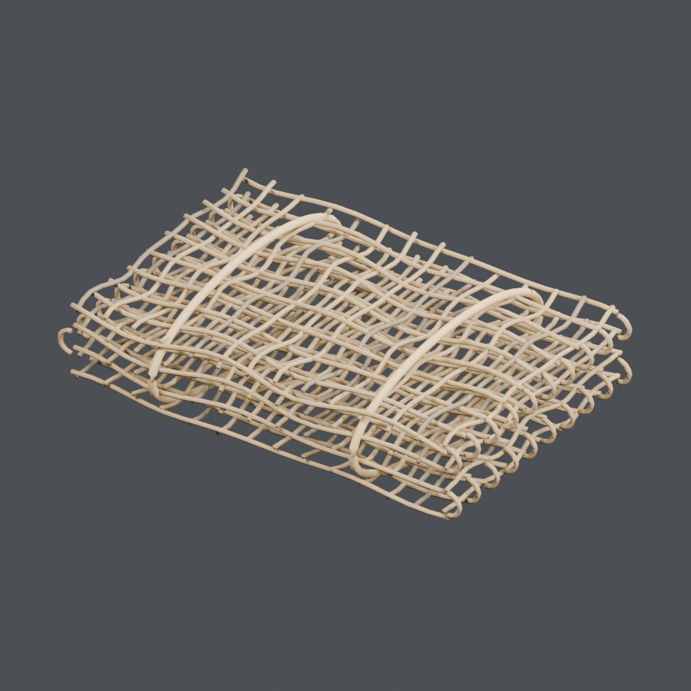

Use / purpose: Folded bundle of netting from the harbor collection. Unit: one model record. Includes BLEND and GLB. The close-up is rendered from the distributed BLEND.

Record type: model. Formats: BLEND/GLB.

Reported dimensions (metres; XYZ when derived from measured bounds, legacy axis order not reverified): [0.65, 0.45, 0.18]. Triangles: 23892.

Origin: Unknown / not independently confirmed. Orientation: Unknown / not independently confirmed.

Measured bounds relative to stored coordinates (metres): [[-0.32499998807907104, -0.22499999403953552, 0.0], [0.32499998807907104, 0.22499999403953552, 0.17999999225139618]]. Bounds do not establish the intended placement origin or facing direction.

[Download ZIP](https://github.com/k3peta/tales-on-a-table/releases/download/v2026.10.18/FH_024_CC0.zip) · [License scope](../../LICENSE.md)

**CC0-1.0** — See original ZIP license and repository license scope. Models and embedded materials only; previews excluded.

Source details: [Catalogue 1](../../catalog/marine_02.en.md) · [Catalogue 2](../../catalog/marine_02.md) · [Catalogue 3](../../catalog/marine_02.zh-CN.md)

## FH_025

**Woven fish trap**

編み籠の魚罠

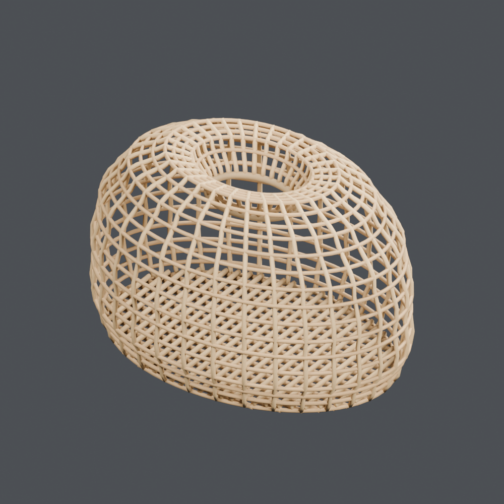

Use / purpose: Woven fish trap from the harbor collection. Unit: one model record. Includes BLEND and GLB. The close-up is rendered from the distributed BLEND.

Record type: model. Formats: BLEND/GLB.

Reported dimensions (metres; XYZ when derived from measured bounds, legacy axis order not reverified): [0.65, 0.45, 0.4]. Triangles: 25944.

Origin: Unknown / not independently confirmed. Orientation: Unknown / not independently confirmed.

Measured bounds relative to stored coordinates (metres): [[-0.32500001788139343, -0.22500000894069672, 0.0], [0.32500001788139343, 0.22500000894069672, 0.4000000059604645]]. Bounds do not establish the intended placement origin or facing direction.

[Download ZIP](https://github.com/k3peta/tales-on-a-table/releases/download/v2026.10.18/FH_025_CC0.zip) · [License scope](../../LICENSE.md)

**CC0-1.0** — See original ZIP license and repository license scope. Models and embedded materials only; previews excluded.

Source details: [Catalogue 1](../../catalog/containers_01.en.md) · [Catalogue 2](../../catalog/containers_01.md) · [Catalogue 3](../../catalog/containers_01.zh-CN.md)

## FH_026

**Fish basket**

魚籠

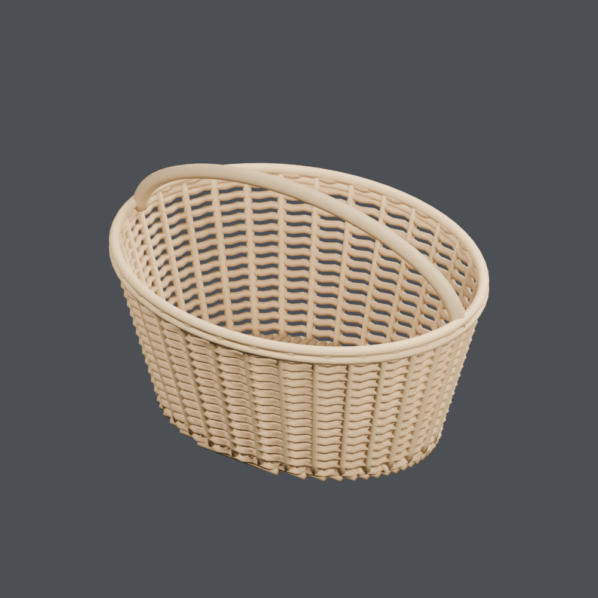

Use / purpose: Fish basket from the harbor collection. Unit: one model record. Includes BLEND and GLB. The close-up is rendered from the distributed BLEND.

Record type: model. Formats: BLEND/GLB.

Reported dimensions (metres; XYZ when derived from measured bounds, legacy axis order not reverified): [0.48, 0.38, 0.32]. Triangles: 24124.

Origin: Unknown / not independently confirmed. Orientation: Unknown / not independently confirmed.

Measured bounds relative to stored coordinates (metres): [[-0.23999999463558197, -0.1899999976158142, 0.0], [0.23999999463558197, 0.1899999976158142, 0.3199999928474426]]. Bounds do not establish the intended placement origin or facing direction.

[Download ZIP](https://github.com/k3peta/tales-on-a-table/releases/download/v2026.10.18/FH_026_CC0.zip) · [License scope](../../LICENSE.md)

**CC0-1.0** — See original ZIP license and repository license scope. Models and embedded materials only; previews excluded.

Source details: [Catalogue 1](../../catalog/containers_01.en.md) · [Catalogue 2](../../catalog/containers_01.md) · [Catalogue 3](../../catalog/containers_01.zh-CN.md)

## FH_027

**Wooden fish crate**

魚運びの木箱

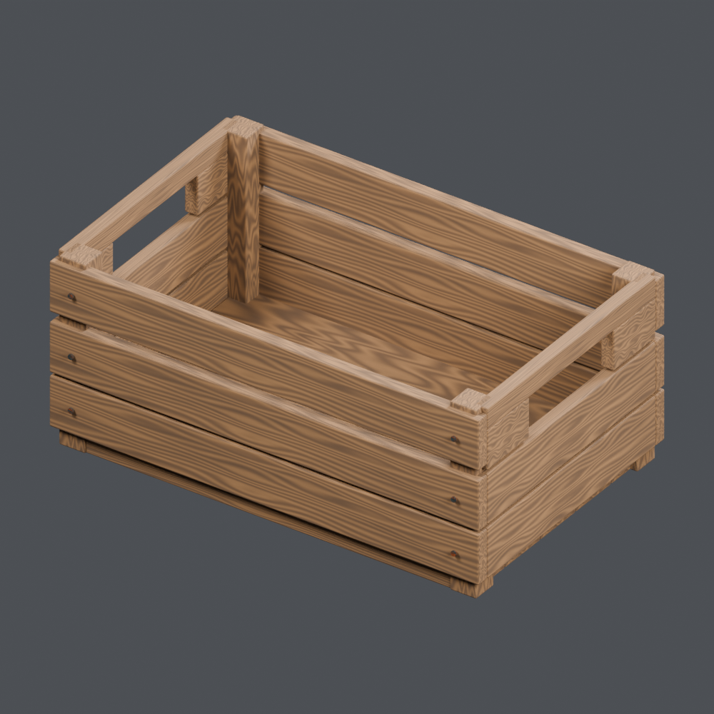

Use / purpose: Wooden fish crate from the harbor collection. Unit: one model record. Includes BLEND and GLB. The close-up is rendered from the distributed BLEND.

Record type: model. Formats: BLEND/GLB.

Reported dimensions (metres; XYZ when derived from measured bounds, legacy axis order not reverified): [0.65, 0.42, 0.28]. Triangles: 3036.

Origin: Unknown / not independently confirmed. Orientation: Unknown / not independently confirmed.

Measured bounds relative to stored coordinates (metres): [[-0.32499998807907104, -0.20999999344348907, 0.0], [0.32499998807907104, 0.20999999344348907, 0.2800000011920929]]. Bounds do not establish the intended placement origin or facing direction.

[Download ZIP](https://github.com/k3peta/tales-on-a-table/releases/download/v2026.10.18/FH_027_CC0.zip) · [License scope](../../LICENSE.md)

**CC0-1.0** — See original ZIP license and repository license scope. Models and embedded materials only; previews excluded.

Source details: [Catalogue 1](../../catalog/containers_01.en.md) · [Catalogue 2](../../catalog/containers_01.md) · [Catalogue 3](../../catalog/containers_01.zh-CN.md)

## FH_028

**Salting tub**

塩漬け桶

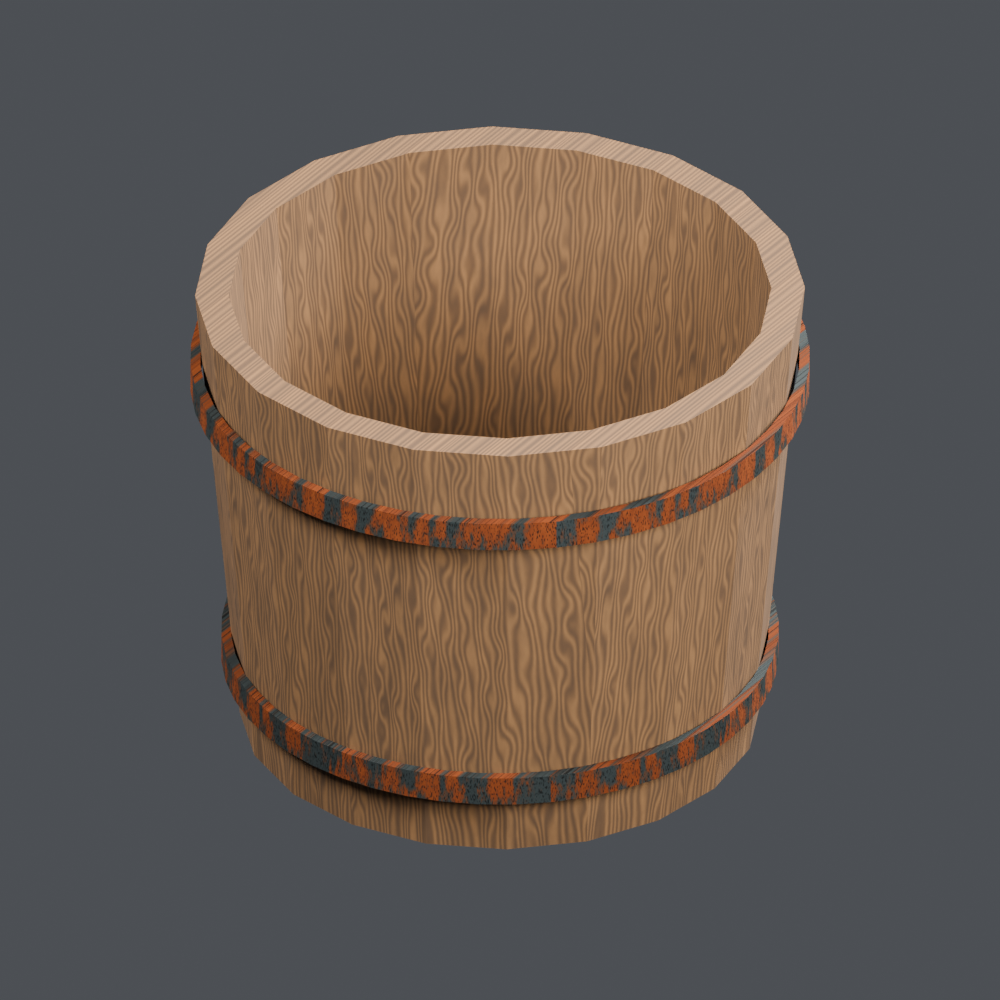

Use / purpose: Salting tub from the harbor collection. Unit: one model record. Includes BLEND and GLB. The close-up is rendered from the distributed BLEND.

Record type: model. Formats: BLEND/GLB.

Reported dimensions (metres; XYZ when derived from measured bounds, legacy axis order not reverified): [0.5, 0.5, 0.4]. Triangles: 1196.

Origin: Unknown / not independently confirmed. Orientation: Unknown / not independently confirmed.

Measured bounds relative to stored coordinates (metres): [[-0.25, -0.25, 0.0], [0.25, 0.25, 0.4000000059604645]]. Bounds do not establish the intended placement origin or facing direction.

[Download ZIP](https://github.com/k3peta/tales-on-a-table/releases/download/v2026.10.18/FH_028_CC0.zip) · [License scope](../../LICENSE.md)

**CC0-1.0** — See original ZIP license and repository license scope. Models and embedded materials only; previews excluded.

Source details: [Catalogue 1](../../catalog/curios-tools_01.en.md) · [Catalogue 2](../../catalog/curios-tools_01.md) · [Catalogue 3](../../catalog/curios-tools_01.zh-CN.md)

## FH_029

**Rope with small floats**

小さな浮子を並べた索

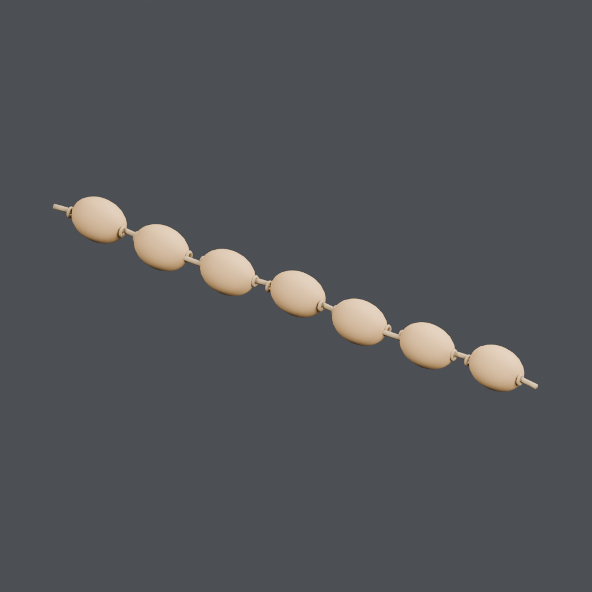

Use / purpose: Rope with small floats from the harbor collection. Unit: one model record. Includes BLEND and GLB. The close-up is rendered from the distributed BLEND.

Record type: model. Formats: BLEND/GLB.

Reported dimensions (metres; XYZ when derived from measured bounds, legacy axis order not reverified): [1.5, 0.12, 0.12]. Triangles: 9664.

Origin: Unknown / not independently confirmed. Orientation: Unknown / not independently confirmed.

Measured bounds relative to stored coordinates (metres): [[-0.7499999403953552, -0.05999999865889549, 0.0], [0.7499999403953552, 0.05999999865889549, 0.11999999731779099]]. Bounds do not establish the intended placement origin or facing direction.

[Download ZIP](https://github.com/k3peta/tales-on-a-table/releases/download/v2026.10.18/FH_029_CC0.zip) · [License scope](../../LICENSE.md)

**CC0-1.0** — See original ZIP license and repository license scope. Models and embedded materials only; previews excluded.

Source details: [Catalogue 1](../../catalog/marine_02.en.md) · [Catalogue 2](../../catalog/marine_02.md) · [Catalogue 3](../../catalog/marine_02.zh-CN.md)

## FH_030

**Bundle of net weights**

網の錘の束

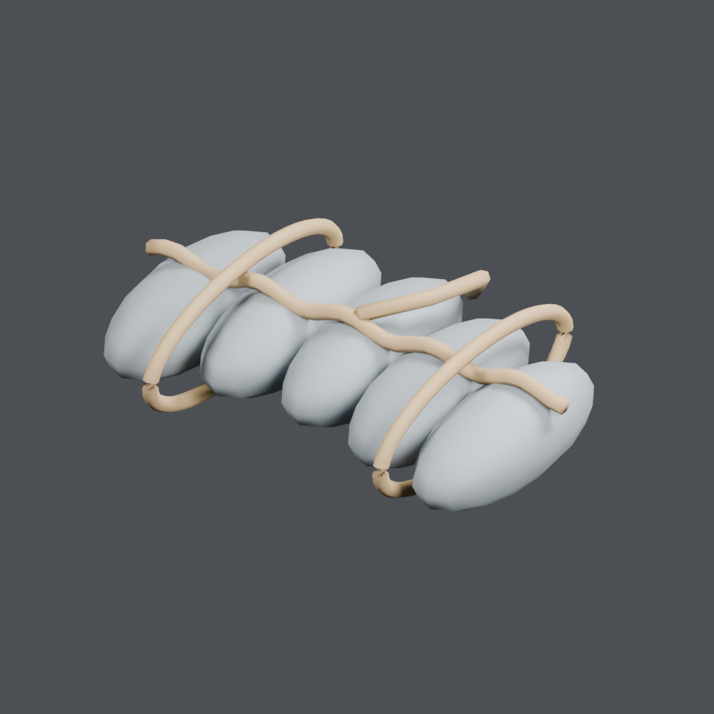

Use / purpose: Bundle of net weights from the harbor collection. Unit: one model record. Includes BLEND and GLB. The close-up is rendered from the distributed BLEND.

Record type: model. Formats: BLEND/GLB.

Reported dimensions (metres; XYZ when derived from measured bounds, legacy axis order not reverified): [0.22, 0.15, 0.06]. Triangles: 3368.

Origin: Unknown / not independently confirmed. Orientation: Unknown / not independently confirmed.

Measured bounds relative to stored coordinates (metres): [[-0.11000000685453415, -0.07499999552965164, 0.0], [0.11000000685453415, 0.07499999552965164, 0.06000000238418579]]. Bounds do not establish the intended placement origin or facing direction.

[Download ZIP](https://github.com/k3peta/tales-on-a-table/releases/download/v2026.10.18/FH_030_CC0.zip) · [License scope](../../LICENSE.md)

**CC0-1.0** — See original ZIP license and repository license scope. Models and embedded materials only; previews excluded.

Source details: [Catalogue 1](../../catalog/marine_02.en.md) · [Catalogue 2](../../catalog/marine_02.md) · [Catalogue 3](../../catalog/marine_02.zh-CN.md)

## FH_031

**Crouching cat watching a fish**

魚を狙って身を低くする猫

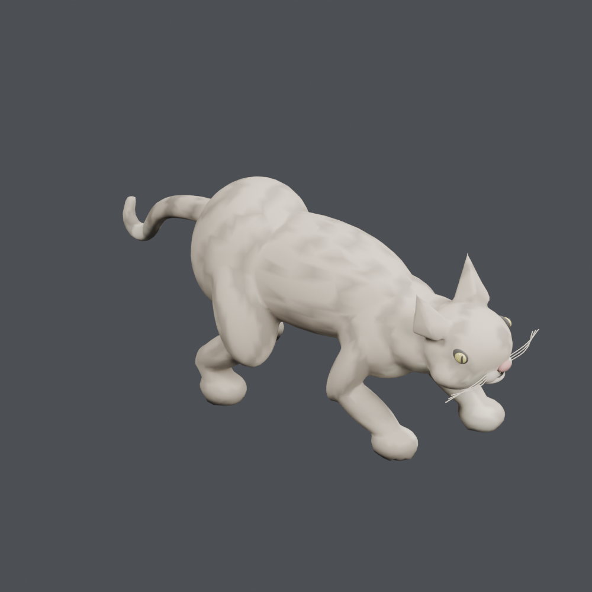

Use / purpose: Crouching cat watching a fish from the harbor collection. Unit: one model record. Includes BLEND and GLB. The close-up is rendered from the distributed BLEND.

Record type: model. Formats: BLEND/GLB.

Reported dimensions (metres; XYZ when derived from measured bounds, legacy axis order not reverified): [0.643411, 0.220137, 0.273964]. Triangles: 21480.

Origin: Unknown / not independently confirmed. Orientation: Unknown / not independently confirmed.

Measured bounds relative to stored coordinates (metres): [[-0.39111098647117615, -0.11545927077531815, 0.0], [0.2523000240325928, 0.10467788577079773, 0.2739635705947876]]. Bounds do not establish the intended placement origin or facing direction.

[Download ZIP](https://github.com/k3peta/tales-on-a-table/releases/download/v2026.10.18/FH_031_CC0.zip) · [License scope](../../LICENSE.md)

**CC0-1.0** — See original ZIP license and repository license scope. Models and embedded materials only; previews excluded.

Source details: [Catalogue 1](../../catalog/creatures_01.en.md) · [Catalogue 2](../../catalog/creatures_01.md) · [Catalogue 3](../../catalog/creatures_01.zh-CN.md)

## FH_032

**Seagull**

カモメ

Use / purpose: Seagull from the harbor collection. Unit: one model record. Includes BLEND and GLB. The close-up is rendered from the distributed BLEND.

Record type: model. Formats: BLEND/GLB.

Reported dimensions (metres; XYZ when derived from measured bounds, legacy axis order not reverified): [0.35, 0.18, 0.33]. Triangles: 12072.

Origin: Unknown / not independently confirmed. Orientation: Unknown / not independently confirmed.

Measured bounds relative to stored coordinates (metres): [[-0.17499999701976776, -0.09000000357627869, 0.0], [0.17499999701976776, 0.09000000357627869, 0.33000001311302185]]. Bounds do not establish the intended placement origin or facing direction.

[Download ZIP](https://github.com/k3peta/tales-on-a-table/releases/download/v2026.10.18/FH_032_CC0.zip) · [License scope](../../LICENSE.md)

**CC0-1.0** — See original ZIP license and repository license scope. Models and embedded materials only; previews excluded.

Source details: [Catalogue 1](../../catalog/creatures_01.en.md) · [Catalogue 2](../../catalog/creatures_01.md) · [Catalogue 3](../../catalog/creatures_01.zh-CN.md)

## FH_033

**Low net-mending stool**

網補修用の低い腰掛け

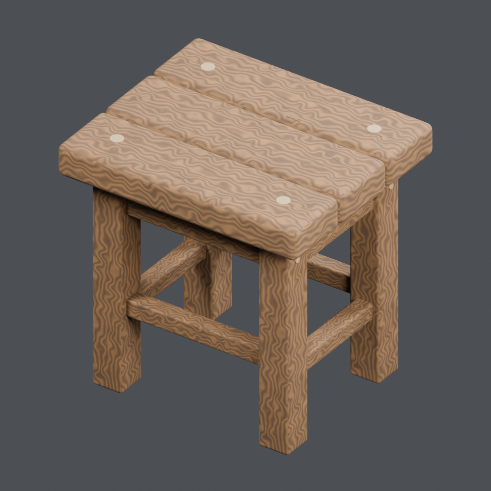

Use / purpose: Low net-mending stool from the harbor collection. Unit: one model record. Includes BLEND and GLB. The close-up is rendered from the distributed BLEND.

Record type: model. Formats: BLEND/GLB.

Reported dimensions (metres; XYZ when derived from measured bounds, legacy axis order not reverified): [0.35, 0.3, 0.35]. Triangles: 6916.

Origin: Unknown / not independently confirmed. Orientation: Unknown / not independently confirmed.

Measured bounds relative to stored coordinates (metres): [[-0.17499999701976776, -0.14999999105930328, 0.0], [0.17499999701976776, 0.14999999105930328, 0.3499999940395355]]. Bounds do not establish the intended placement origin or facing direction.

[Download ZIP](https://github.com/k3peta/tales-on-a-table/releases/download/v2026.10.18/FH_033_CC0.zip) · [License scope](../../LICENSE.md)

**CC0-1.0** — See original ZIP license and repository license scope. Models and embedded materials only; previews excluded.

Source details: [Catalogue 1](../../catalog/furniture_02.en.md) · [Catalogue 2](../../catalog/furniture_02.md) · [Catalogue 3](../../catalog/furniture_02.zh-CN.md)

## FH_034

**Wooden net-mending board**

網補修の木板

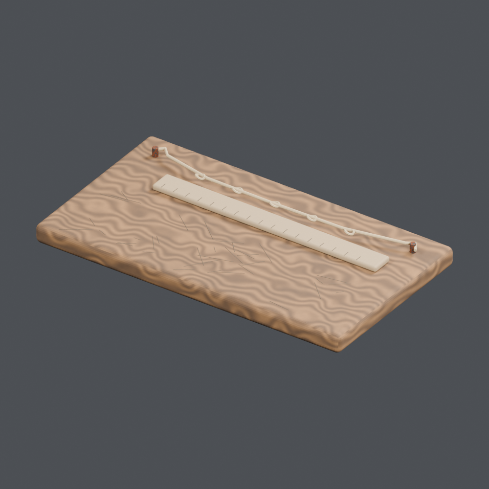

Use / purpose: Wooden net-mending board from the harbor collection. Unit: one model record. Includes BLEND and GLB. The close-up is rendered from the distributed BLEND.

Record type: model. Formats: BLEND/GLB.

Reported dimensions (metres; XYZ when derived from measured bounds, legacy axis order not reverified): [0.45, 0.25, 0.04]. Triangles: 4968.

Origin: Unknown / not independently confirmed. Orientation: Unknown / not independently confirmed.

Measured bounds relative to stored coordinates (metres): [[-0.22499999403953552, -0.125, 0.0], [0.22499999403953552, 0.125, 0.03999999910593033]]. Bounds do not establish the intended placement origin or facing direction.

[Download ZIP](https://github.com/k3peta/tales-on-a-table/releases/download/v2026.10.18/FH_034_CC0.zip) · [License scope](../../LICENSE.md)

**CC0-1.0** — See original ZIP license and repository license scope. Models and embedded materials only; previews excluded.

Source details: [Catalogue 1](../../catalog/marine_02.en.md) · [Catalogue 2](../../catalog/marine_02.md) · [Catalogue 3](../../catalog/marine_02.zh-CN.md)

## FH_035

**Lunch box tied with cloth**

布紐で留めた弁当箱

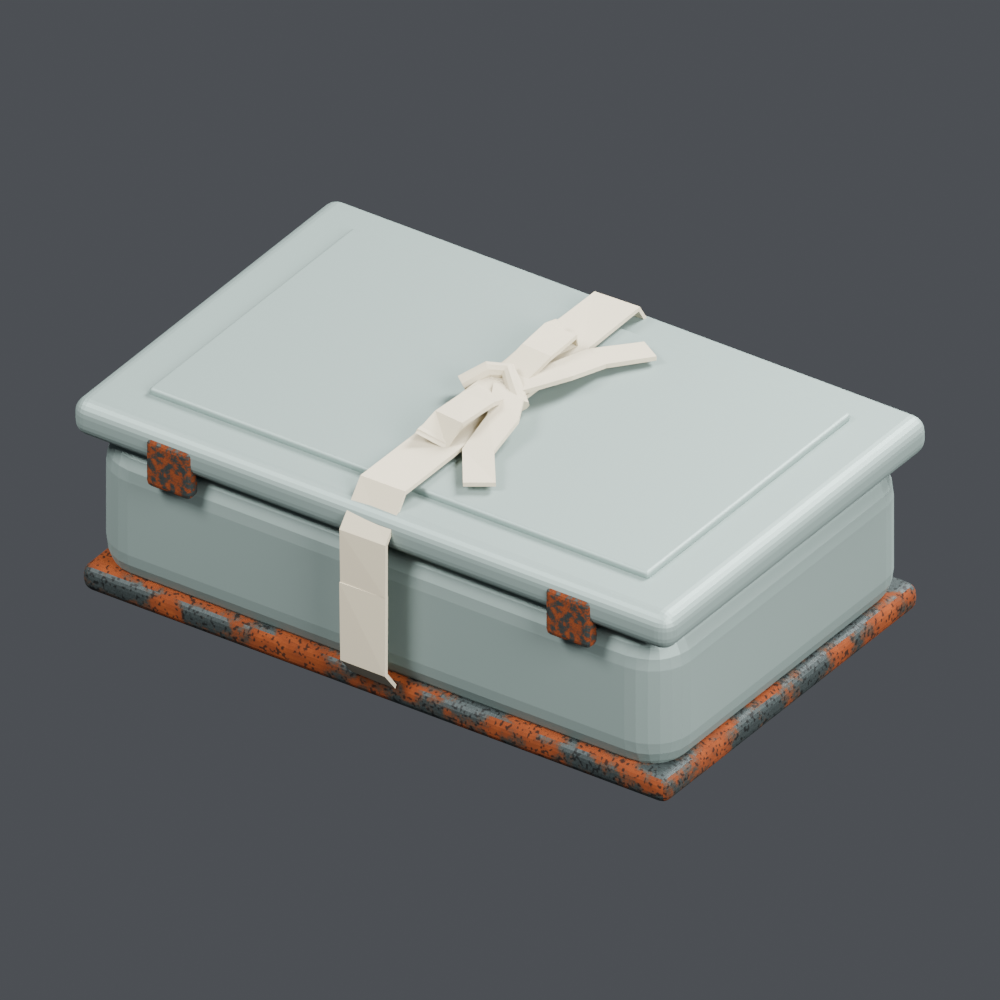

Use / purpose: Lunch box tied with cloth from the harbor collection. Unit: one model record. Includes BLEND and GLB. The close-up is rendered from the distributed BLEND.

Record type: model. Formats: BLEND/GLB.

Reported dimensions (metres; XYZ when derived from measured bounds, legacy axis order not reverified): [0.24, 0.16, 0.09]. Triangles: 2924.

Origin: Unknown / not independently confirmed. Orientation: Unknown / not independently confirmed.

Measured bounds relative to stored coordinates (metres): [[-0.11999999731779099, -0.07999999821186066, 0.0], [0.11999999731779099, 0.07999999821186066, 0.08999999612569809]]. Bounds do not establish the intended placement origin or facing direction.

[Download ZIP](https://github.com/k3peta/tales-on-a-table/releases/download/v2026.10.18/FH_035_CC0.zip) · [License scope](../../LICENSE.md)

**CC0-1.0** — See original ZIP license and repository license scope. Models and embedded materials only; previews excluded.

Source details: [Catalogue 1](../../catalog/containers_01.en.md) · [Catalogue 2](../../catalog/containers_01.md) · [Catalogue 3](../../catalog/containers_01.zh-CN.md)

## FH_036

**Leather-wrapped water flask**

革巻きの水筒

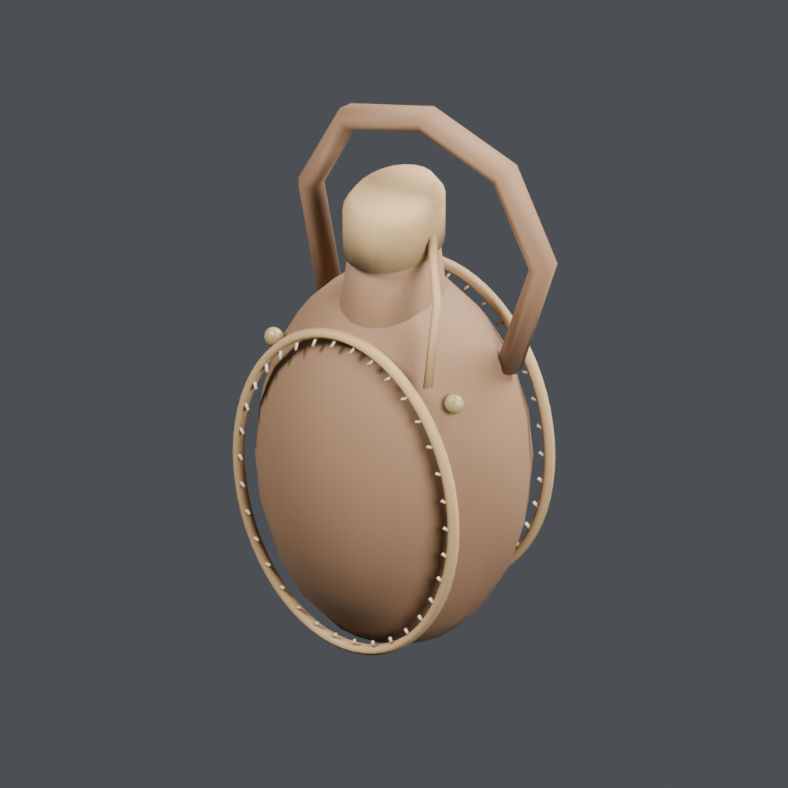

Use / purpose: Leather-wrapped water flask from the harbor collection. Unit: one model record. Includes BLEND and GLB. The close-up is rendered from the distributed BLEND.

Record type: model. Formats: BLEND/GLB.

Reported dimensions (metres; XYZ when derived from measured bounds, legacy axis order not reverified): [0.14, 0.12, 0.27]. Triangles: 4656.

Origin: Unknown / not independently confirmed. Orientation: Unknown / not independently confirmed.

Measured bounds relative to stored coordinates (metres): [[-0.07000000029802322, -0.05999999865889549, 0.0], [0.07000000029802322, 0.05999999865889549, 0.27000001072883606]]. Bounds do not establish the intended placement origin or facing direction.

[Download ZIP](https://github.com/k3peta/tales-on-a-table/releases/download/v2026.10.18/FH_036_CC0.zip) · [License scope](../../LICENSE.md)

**CC0-1.0** — See original ZIP license and repository license scope. Models and embedded materials only; previews excluded.

Source details: [Catalogue 1](../../catalog/personal_fishing_kit_v1.md) · [Catalogue 2](../../catalog/tableware_02.en.md) · [Catalogue 3](../../catalog/tableware_02.md)

## FH_037

**Rain cloak hanging on a nail**

釘に掛かった雨よけ外套

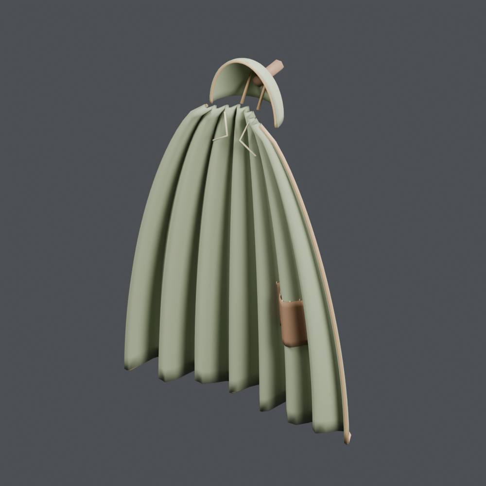

Use / purpose: Rain cloak hanging on a nail from the harbor collection. Unit: one model record. Includes BLEND and GLB. The close-up is rendered from the distributed BLEND.

Record type: model. Formats: BLEND/GLB.

Reported dimensions (metres; XYZ when derived from measured bounds, legacy axis order not reverified): [0.6, 0.2, 0.9]. Triangles: 8628.

Origin: Unknown / not independently confirmed. Orientation: Unknown / not independently confirmed.

Measured bounds relative to stored coordinates (metres): [[-0.30000001192092896, -0.10000000149011612, 0.0], [0.30000001192092896, 0.10000000149011612, 0.8999999761581421]]. Bounds do not establish the intended placement origin or facing direction.

[Download ZIP](https://github.com/k3peta/tales-on-a-table/releases/download/v2026.10.18/FH_037_CC0.zip) · [License scope](../../LICENSE.md)

**CC0-1.0** — See original ZIP license and repository license scope. Models and embedded materials only; previews excluded.

Source details: [Catalogue 1](../../catalog/textiles_01.en.md) · [Catalogue 2](../../catalog/textiles_01.md) · [Catalogue 3](../../catalog/textiles_01.zh-CN.md)

## FH_038

**Pair of boots left to dry**

乾かしている長靴一組

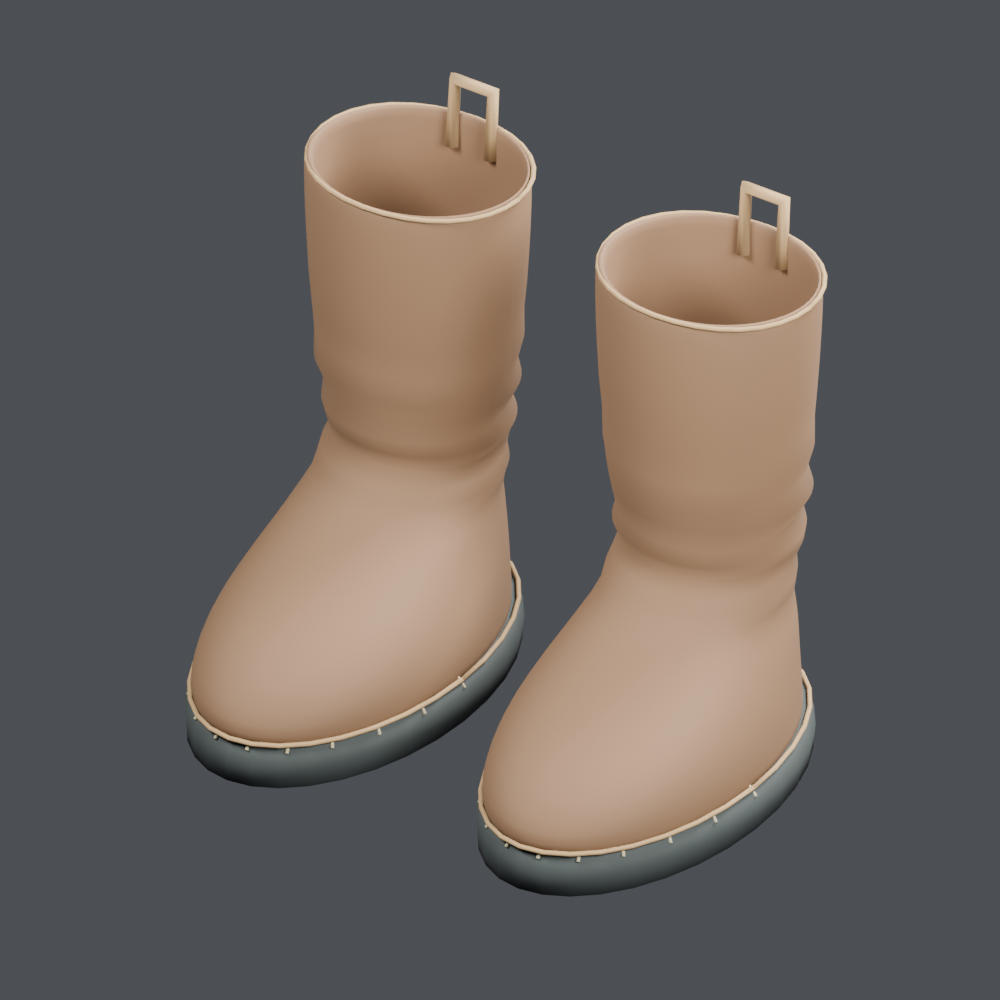

Use / purpose: Pair of boots left to dry from the harbor collection. Unit: one model record. Includes BLEND and GLB. The close-up is rendered from the distributed BLEND.

Record type: model. Formats: BLEND/GLB.

Reported dimensions (metres; XYZ when derived from measured bounds, legacy axis order not reverified): [0.42, 0.3, 0.4]. Triangles: 12656.

Origin: Unknown / not independently confirmed. Orientation: Unknown / not independently confirmed.

Measured bounds relative to stored coordinates (metres): [[-0.20999999344348907, -0.15000000596046448, 0.0], [0.20999999344348907, 0.15000000596046448, 0.4000000059604645]]. Bounds do not establish the intended placement origin or facing direction.

[Download ZIP](https://github.com/k3peta/tales-on-a-table/releases/download/v2026.10.18/FH_038_CC0.zip) · [License scope](../../LICENSE.md)

**CC0-1.0** — See original ZIP license and repository license scope. Models and embedded materials only; previews excluded.

Source details: [Catalogue 1](../../catalog/textiles_01.en.md) · [Catalogue 2](../../catalog/textiles_01.md) · [Catalogue 3](../../catalog/textiles_01.zh-CN.md)

## FH_039

**Lantern maintenance box**

灯火の手入れ箱

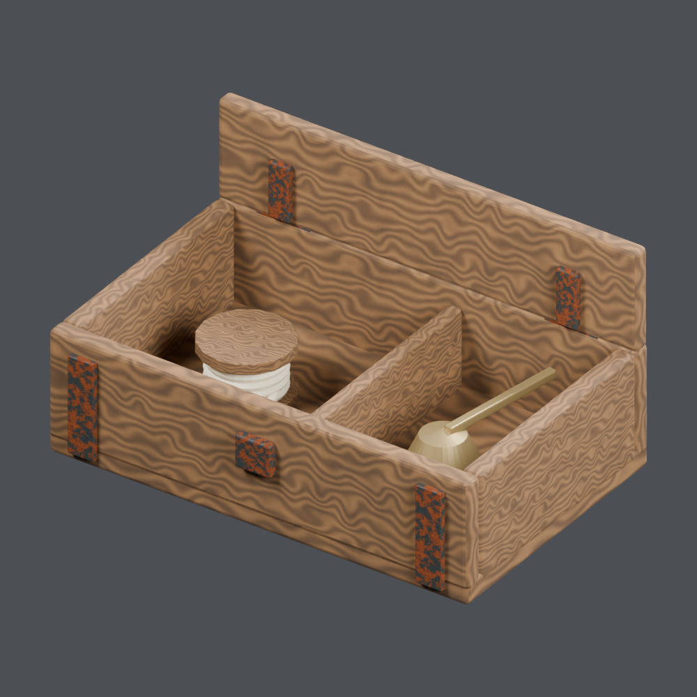

Use / purpose: Lantern maintenance box from the harbor collection. Unit: one model record. Includes BLEND and GLB. The close-up is rendered from the distributed BLEND.

Record type: model. Formats: BLEND/GLB.

Reported dimensions (metres; XYZ when derived from measured bounds, legacy axis order not reverified): [0.35, 0.2315, 0.18]. Triangles: 6476.

Origin: Unknown / not independently confirmed. Orientation: Unknown / not independently confirmed.

Measured bounds relative to stored coordinates (metres): [[-0.17499999701976776, -0.11574999988079071, 0.0], [0.17499999701976776, 0.11574999988079071, 0.18000000715255737]]. Bounds do not establish the intended placement origin or facing direction.

[Download ZIP](https://github.com/k3peta/tales-on-a-table/releases/download/v2026.10.18/FH_039_CC0.zip) · [License scope](../../LICENSE.md)

**CC0-1.0** — See original ZIP license and repository license scope. Models and embedded materials only; previews excluded.

Source details: [Catalogue 1](../../catalog/candles-light_01.en.md) · [Catalogue 2](../../catalog/candles-light_01.md) · [Catalogue 3](../../catalog/candles-light_01.zh-CN.md)

## FH_040

**Wooden tide gauge**

潮位を刻んだ木板

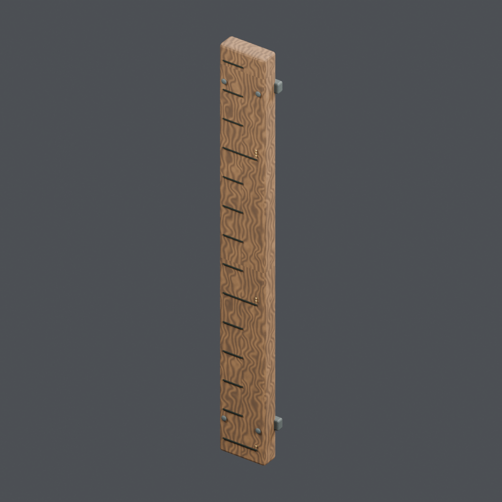

Use / purpose: Wooden tide gauge from the harbor collection. Unit: one model record. Includes BLEND and GLB. The close-up is rendered from the distributed BLEND.

Record type: model. Formats: BLEND/GLB.

Reported dimensions (metres; XYZ when derived from measured bounds, legacy axis order not reverified): [0.19, 0.0805, 1.4]. Triangles: 7116.

Origin: Unknown / not independently confirmed. Orientation: Unknown / not independently confirmed.

Measured bounds relative to stored coordinates (metres): [[-0.0949999988079071, -0.03800000250339508, 0.0], [0.0949999988079071, 0.042500000447034836, 1.399999976158142]]. Bounds do not establish the intended placement origin or facing direction.

[Download ZIP](https://github.com/k3peta/tales-on-a-table/releases/download/v2026.10.18/FH_040_CC0.zip) · [License scope](../../LICENSE.md)

**CC0-1.0** — See original ZIP license and repository license scope. Models and embedded materials only; previews excluded.

Source details: [Catalogue 1](../../catalog/marine_02.en.md) · [Catalogue 2](../../catalog/marine_02.md) · [Catalogue 3](../../catalog/marine_02.zh-CN.md)
