# Base distribution records 97–120

[Browse index](README.md) · [Coverage and missing fields](COVERAGE.md)

Images are actual existing model renders for browsing, not covered by model CC0. A group record may show several reused models. Dimensions and triangle counts apply only to the original record when sourced; revisions can differ. Unknown means unverified, not zero. No blanket CC0 grant for scenes, images, code or articles.

## FH_041

**Harbor return-tag board**

帰港札の掛け板

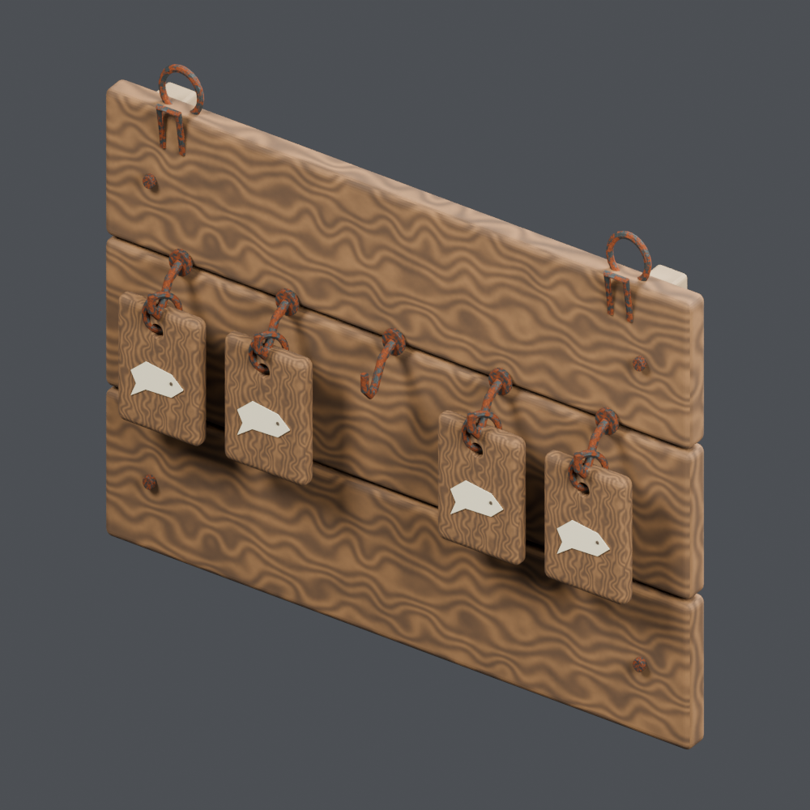

Use / purpose: Harbor return-tag board from the harbor collection. Unit: one model record. Includes BLEND and GLB. The close-up is rendered from the distributed BLEND.

Record type: model. Formats: BLEND/GLB.

Reported dimensions (metres; XYZ when derived from measured bounds, legacy axis order not reverified): [0.55, 0.09, 0.45]. Triangles: 9868.

Origin: Unknown / not independently confirmed. Orientation: Unknown / not independently confirmed.

Measured bounds relative to stored coordinates (metres): [[-0.2750000059604645, -0.04500000178813934, -0.44999998807907104], [0.2750000059604645, 0.04500000178813934, 1.7881394143159923e-08]]. Bounds do not establish the intended placement origin or facing direction.

[Download ZIP](https://github.com/k3peta/tales-on-a-table/releases/download/v2026.10.18/FH_041_CC0.zip) · [License scope](../../LICENSE.md)

**CC0-1.0** — See original ZIP license and repository license scope. Models and embedded materials only; previews excluded.

Source details: [Catalogue 1](../../catalog/curios-tools_01.en.md) · [Catalogue 2](../../catalog/curios-tools_01.md) · [Catalogue 3](../../catalog/curios-tools_01.zh-CN.md)

**Version scope:** The image above depicts the primary recorded ZIP. [Latest revision ZIP](https://raw.githubusercontent.com/k3peta/tales-on-a-table/main/distributions/quality-fh041-050-v1/FH_041__repair_CC0.zip). [Revision-specific preview](../../previews/quality-fh041-050-v1/FH_041__repair_thumb.png). [Version audit](VERSION-AUDIT.md).

## FH_042

**Worn harbor return tag**

すり減った帰港札

Use / purpose: Worn harbor return tag from the harbor collection. Unit: one model record. Includes BLEND and GLB. The close-up is rendered from the distributed BLEND.

Record type: model. Formats: BLEND/GLB.

Reported dimensions (metres; XYZ when derived from measured bounds, legacy axis order not reverified): [0.08, 0.032071, 0.12]. Triangles: 1176.

Origin: Unknown / not independently confirmed. Orientation: Unknown / not independently confirmed.

Measured bounds relative to stored coordinates (metres): [[-0.03999999910593033, -0.016035528853535652, 0.0], [0.03999999910593033, 0.016035528853535652, 0.11999999731779099]]. Bounds do not establish the intended placement origin or facing direction.

[Download ZIP](https://github.com/k3peta/tales-on-a-table/releases/download/v2026.10.18/FH_042_CC0.zip) · [License scope](../../LICENSE.md)

**CC0-1.0** — See original ZIP license and repository license scope. Models and embedded materials only; previews excluded.

Source details: [Catalogue 1](../../catalog/curios-tools_01.en.md) · [Catalogue 2](../../catalog/curios-tools_01.md) · [Catalogue 3](../../catalog/curios-tools_01.zh-CN.md)

**Version scope:** The image above depicts the primary recorded ZIP. [Latest revision ZIP](https://raw.githubusercontent.com/k3peta/tales-on-a-table/main/distributions/quality-fh041-050-v1/FH_042__repair_CC0.zip). [Revision-specific preview](../../previews/quality-fh041-050-v1/FH_042__repair_thumb.png). [Version audit](VERSION-AUDIT.md).

## FH_043

**Small shrine for safe voyages**

航海守りの小祠

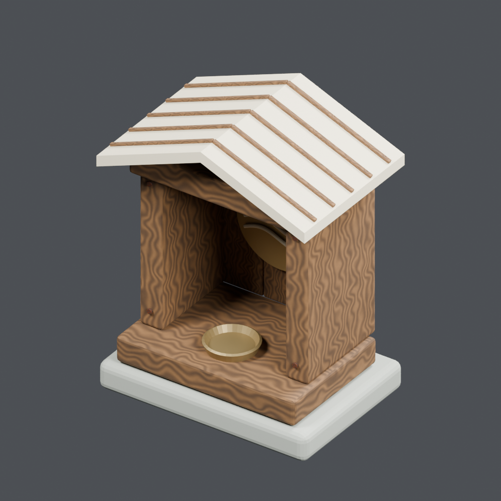

Use / purpose: Small shrine for safe voyages from the harbor collection. Unit: one model record. Includes BLEND and GLB. The close-up is rendered from the distributed BLEND.

Record type: model. Formats: BLEND/GLB.

Reported dimensions (metres; XYZ when derived from measured bounds, legacy axis order not reverified): [0.5, 0.35, 0.655671]. Triangles: 6304.

Origin: Unknown / not independently confirmed. Orientation: Unknown / not independently confirmed.

Measured bounds relative to stored coordinates (metres): [[-0.25, -0.17499999701976776, 0.0], [0.25, 0.17499999701976776, 0.6556705832481384]]. Bounds do not establish the intended placement origin or facing direction.

[Download ZIP](https://github.com/k3peta/tales-on-a-table/releases/download/v2026.10.18/FH_043_CC0.zip) · [License scope](../../LICENSE.md)

**CC0-1.0** — See original ZIP license and repository license scope. Models and embedded materials only; previews excluded.

Source details: [Catalogue 1](../../catalog/curios-tools_01.en.md) · [Catalogue 2](../../catalog/curios-tools_01.md) · [Catalogue 3](../../catalog/curios-tools_01.zh-CN.md)

**Version scope:** The image above depicts the primary recorded ZIP. [Latest revision ZIP](https://raw.githubusercontent.com/k3peta/tales-on-a-table/main/distributions/quality-fh041-050-v1/FH_043__repair_CC0.zip). [Revision-specific preview](../../previews/quality-fh041-050-v1/FH_043__repair_thumb.png). [Version audit](VERSION-AUDIT.md).

## FH_044

**Shell offering dish**

貝殻のお供え皿

Use / purpose: Shell offering dish from the harbor collection. Unit: one model record. Includes BLEND and GLB. The close-up is rendered from the distributed BLEND.

Record type: model. Formats: BLEND/GLB.

Reported dimensions (metres; XYZ when derived from measured bounds, legacy axis order not reverified): [0.2, 0.18, 0.032]. Triangles: 5920.

Origin: Unknown / not independently confirmed. Orientation: Unknown / not independently confirmed.

Measured bounds relative to stored coordinates (metres): [[-0.10000000149011612, -0.08999999612569809, 0.0], [0.10000000149011612, 0.08999999612569809, 0.03200000151991844]]. Bounds do not establish the intended placement origin or facing direction.

[Download ZIP](https://github.com/k3peta/tales-on-a-table/releases/download/v2026.10.18/FH_044_CC0.zip) · [License scope](../../LICENSE.md)

**CC0-1.0** — See original ZIP license and repository license scope. Models and embedded materials only; previews excluded.

Source details: [Catalogue 1](../../catalog/tableware_02.en.md) · [Catalogue 2](../../catalog/tableware_02.md) · [Catalogue 3](../../catalog/tableware_02.zh-CN.md)

## FH_045

**Restitched canvas bag**

縫い直した帆布袋

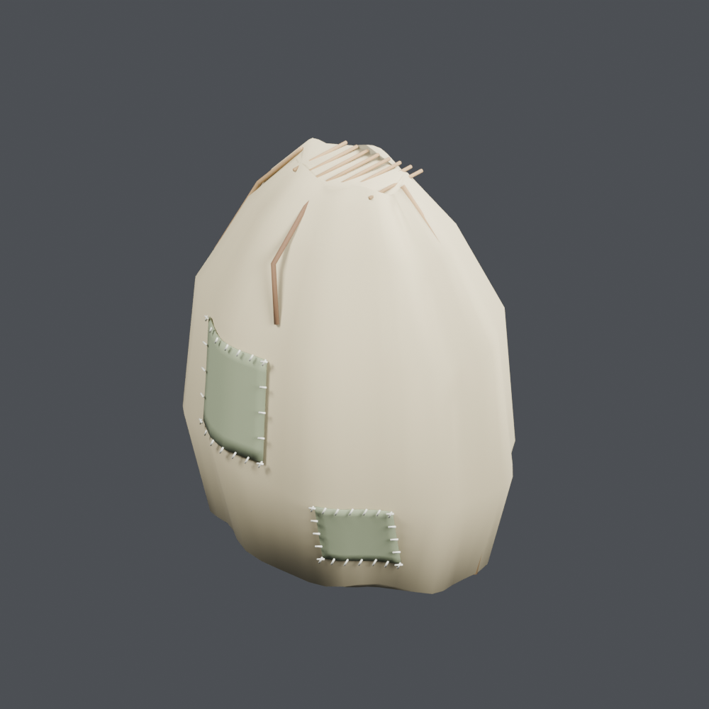

Use / purpose: Restitched canvas bag from the harbor collection. Unit: one model record. Includes BLEND and GLB. The close-up is rendered from the distributed BLEND.

Record type: model. Formats: BLEND/GLB.

Reported dimensions (metres; XYZ when derived from measured bounds, legacy axis order not reverified): [0.38, 0.28, 0.48]. Triangles: 3268.

Origin: Unknown / not independently confirmed. Orientation: Unknown / not independently confirmed.

Measured bounds relative to stored coordinates (metres): [[-0.1899999976158142, -0.14000000059604645, 0.0], [0.1899999976158142, 0.14000000059604645, 0.47999998927116394]]. Bounds do not establish the intended placement origin or facing direction.

[Download ZIP](https://github.com/k3peta/tales-on-a-table/releases/download/v2026.10.18/FH_045_CC0.zip) · [License scope](../../LICENSE.md)

**CC0-1.0** — See original ZIP license and repository license scope. Models and embedded materials only; previews excluded.

Source details: [Catalogue 1](../../catalog/containers_01.en.md) · [Catalogue 2](../../catalog/containers_01.md) · [Catalogue 3](../../catalog/containers_01.zh-CN.md)

## FH_046

**Two-wheeled handcart**

二輪の荷車

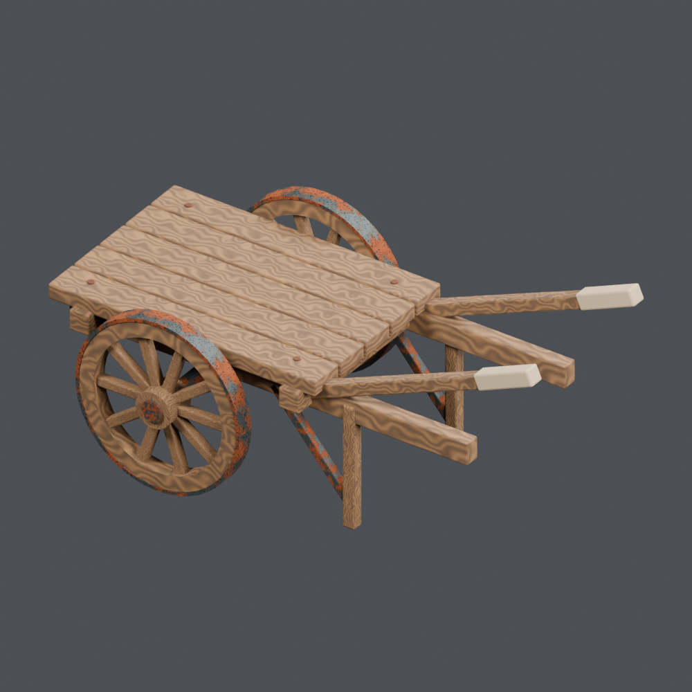

Use / purpose: Two-wheeled handcart from the harbor collection. Unit: one model record. Includes BLEND and GLB. The close-up is rendered from the distributed BLEND.

Record type: model. Formats: BLEND/GLB.

Reported dimensions (metres; XYZ when derived from measured bounds, legacy axis order not reverified): [1.41209, 0.774, 0.651685]. Triangles: 8712.

Origin: Unknown / not independently confirmed. Orientation: Unknown / not independently confirmed.

Measured bounds relative to stored coordinates (metres): [[-0.7060449123382568, -0.3869999945163727, 0.0], [0.7060449123382568, 0.3869999945163727, 0.6516849398612976]]. Bounds do not establish the intended placement origin or facing direction.

[Download ZIP](https://github.com/k3peta/tales-on-a-table/releases/download/v2026.10.18/FH_046_CC0.zip) · [License scope](../../LICENSE.md)

**CC0-1.0** — See original ZIP license and repository license scope. Models and embedded materials only; previews excluded.

Source details: [Catalogue 1](../../catalog/curios-tools_01.en.md) · [Catalogue 2](../../catalog/curios-tools_01.md) · [Catalogue 3](../../catalog/curios-tools_01.zh-CN.md)

**Version scope:** The image above depicts the primary recorded ZIP. [Latest revision ZIP](https://raw.githubusercontent.com/k3peta/tales-on-a-table/main/distributions/quality-fh041-050-v1/FH_046__repair_CC0.zip). [Revision-specific preview](../../previews/quality-fh041-050-v1/FH_046__repair_thumb.png). [Version audit](VERSION-AUDIT.md).

## FH_047

**Braided rope boat fender**

編み索の船用防舷材

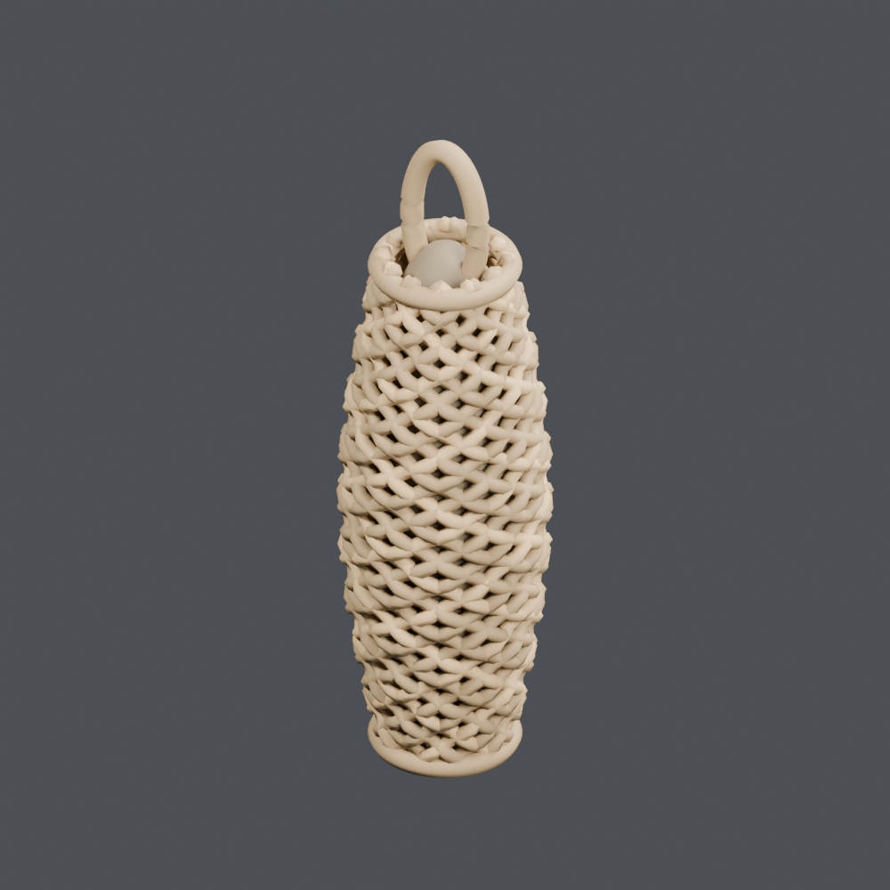

Use / purpose: Braided rope boat fender from the harbor collection. Unit: one model record. Includes BLEND and GLB. The close-up is rendered from the distributed BLEND.

Record type: model. Formats: BLEND/GLB.

Reported dimensions (metres; XYZ when derived from measured bounds, legacy axis order not reverified): [0.18, 0.18, 0.6]. Triangles: 27756.

Origin: Unknown / not independently confirmed. Orientation: Unknown / not independently confirmed.

Measured bounds relative to stored coordinates (metres): [[-0.09000000357627869, -0.09000000357627869, 0.0], [0.09000000357627869, 0.09000000357627869, 0.5999999642372131]]. Bounds do not establish the intended placement origin or facing direction.

[Download ZIP](https://github.com/k3peta/tales-on-a-table/releases/download/v2026.10.18/FH_047_CC0.zip) · [License scope](../../LICENSE.md)

**CC0-1.0** — See original ZIP license and repository license scope. Models and embedded materials only; previews excluded.

Source details: [Catalogue 1](../../catalog/marine_02.en.md) · [Catalogue 2](../../catalog/marine_02.md) · [Catalogue 3](../../catalog/marine_02.zh-CN.md)

## FH_048

**Detached pulley block**

外して置いた滑車

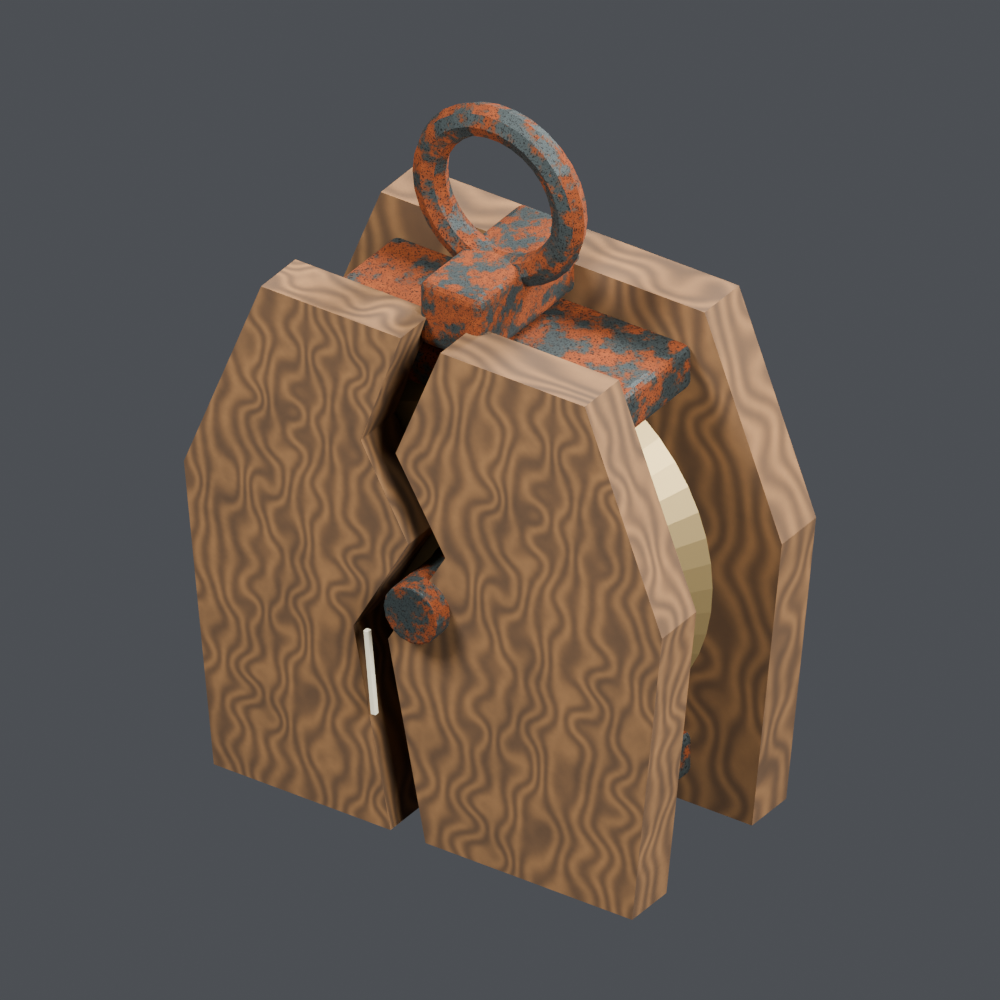

Use / purpose: Detached pulley block from the harbor collection. Unit: one model record. Includes BLEND and GLB. The close-up is rendered from the distributed BLEND.

Record type: model. Formats: BLEND/GLB.

Reported dimensions (metres; XYZ when derived from measured bounds, legacy axis order not reverified): [0.192, 0.105, 0.264814]. Triangles: 2088.

Origin: Unknown / not independently confirmed. Orientation: Unknown / not independently confirmed.

Measured bounds relative to stored coordinates (metres): [[-0.09600000083446503, -0.05249999836087227, 0.0], [0.09600000083446503, 0.05249999836087227, 0.26481375098228455]]. Bounds do not establish the intended placement origin or facing direction.

[Download ZIP](https://github.com/k3peta/tales-on-a-table/releases/download/v2026.10.18/FH_048_CC0.zip) · [License scope](../../LICENSE.md)

**CC0-1.0** — See original ZIP license and repository license scope. Models and embedded materials only; previews excluded.

Source details: [Catalogue 1](../../catalog/marine_02.en.md) · [Catalogue 2](../../catalog/marine_02.md) · [Catalogue 3](../../catalog/marine_02.zh-CN.md)

**Version scope:** The image above depicts the primary recorded ZIP. [Latest revision ZIP](https://raw.githubusercontent.com/k3peta/tales-on-a-table/main/distributions/quality-fh041-050-v1/FH_048__repair_CC0.zip). [Revision-specific preview](../../previews/quality-fh041-050-v1/FH_048__repair_thumb.png). [Version audit](VERSION-AUDIT.md).

## FH_049

**Small bundle of shipwright tools**

小さな船大工道具束

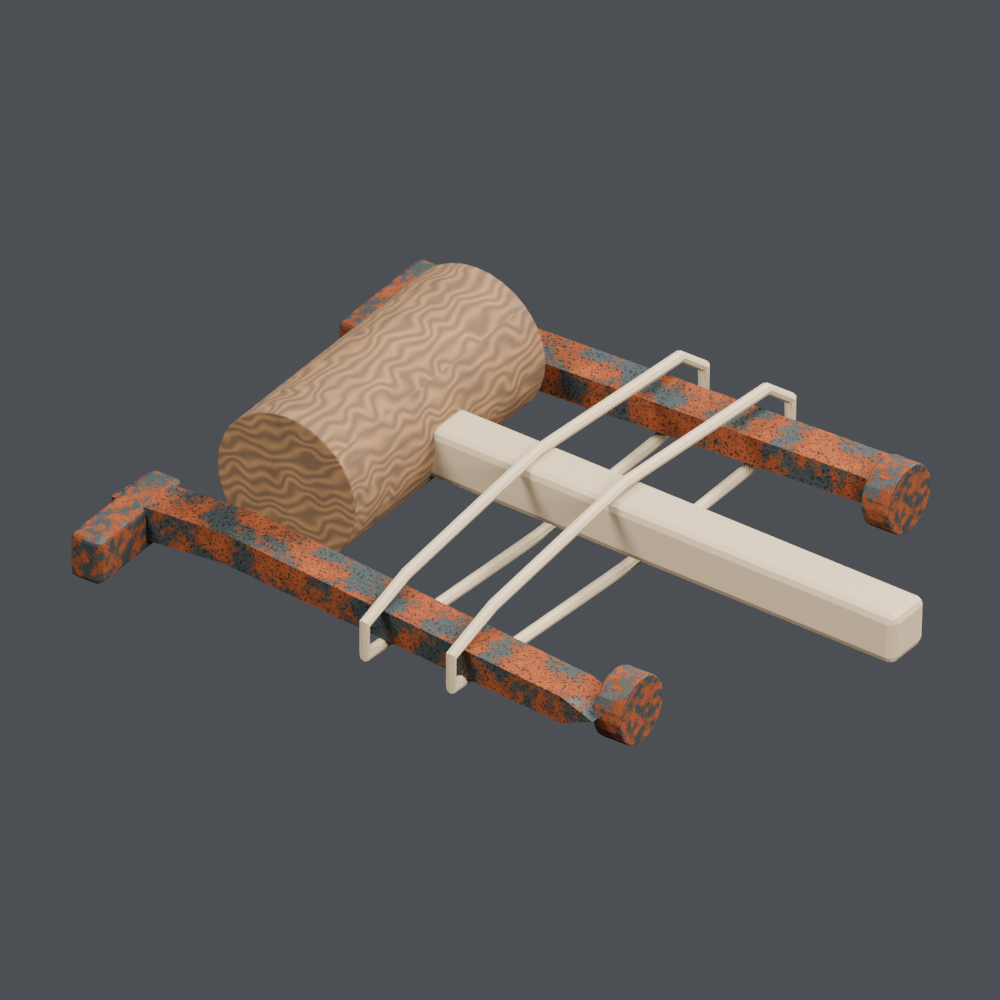

Use / purpose: Small bundle of shipwright tools from the harbor collection. Unit: one model record. Includes BLEND and GLB. The close-up is rendered from the distributed BLEND.

Record type: model. Formats: BLEND/GLB.

Reported dimensions (metres; XYZ when derived from measured bounds, legacy axis order not reverified): [0.382669, 0.297639, 0.08]. Triangles: 2400.

Origin: Unknown / not independently confirmed. Orientation: Unknown / not independently confirmed.

Measured bounds relative to stored coordinates (metres): [[-0.19133466482162476, -0.14881955087184906, 0.0], [0.19133466482162476, 0.14881956577301025, 0.08000000566244125]]. Bounds do not establish the intended placement origin or facing direction.

[Download ZIP](https://github.com/k3peta/tales-on-a-table/releases/download/v2026.10.18/FH_049_CC0.zip) · [License scope](../../LICENSE.md)

**CC0-1.0** — See original ZIP license and repository license scope. Models and embedded materials only; previews excluded.

Source details: [Catalogue 1](../../catalog/marine_02.en.md) · [Catalogue 2](../../catalog/marine_02.md) · [Catalogue 3](../../catalog/marine_02.zh-CN.md)

**Version scope:** The image above depicts the primary recorded ZIP. [Latest revision ZIP](https://raw.githubusercontent.com/k3peta/tales-on-a-table/main/distributions/quality-fh041-050-v1/FH_049__repair_CC0.zip). [Revision-specific preview](../../previews/quality-fh041-050-v1/FH_049__repair_thumb.png). [Version audit](VERSION-AUDIT.md).

## FH_050

**Washed-up bottle and driftwood**

漂着した瓶と流木

Use / purpose: Washed-up bottle and driftwood from the harbor collection. Unit: one model record. Includes BLEND and GLB. The close-up is rendered from the distributed BLEND.

Record type: model. Formats: BLEND/GLB.

Reported dimensions (metres; XYZ when derived from measured bounds, legacy axis order not reverified): [0.525663, 0.195197, 0.146579]. Triangles: 3556.

Origin: Unknown / not independently confirmed. Orientation: Unknown / not independently confirmed.

Measured bounds relative to stored coordinates (metres): [[-0.262831449508667, -0.09759838879108429, 0.0], [0.262831449508667, 0.09759838879108429, 0.14657944440841675]]. Bounds do not establish the intended placement origin or facing direction.

[Download ZIP](https://github.com/k3peta/tales-on-a-table/releases/download/v2026.10.18/FH_050_CC0.zip) · [License scope](../../LICENSE.md)

**CC0-1.0** — See original ZIP license and repository license scope. Models and embedded materials only; previews excluded.

Source details: [Catalogue 1](../../catalog/curios-tools_01.en.md) · [Catalogue 2](../../catalog/curios-tools_01.md) · [Catalogue 3](../../catalog/curios-tools_01.zh-CN.md)

**Version scope:** The image above depicts the primary recorded ZIP. [Latest revision ZIP](https://raw.githubusercontent.com/k3peta/tales-on-a-table/main/distributions/quality-fh041-050-v1/FH_050__repair_CC0.zip). [Revision-specific preview](../../previews/quality-fh041-050-v1/FH_050__repair_thumb.png). [Version audit](VERSION-AUDIT.md).

## FH_051

**Fishing rod**

釣り竿

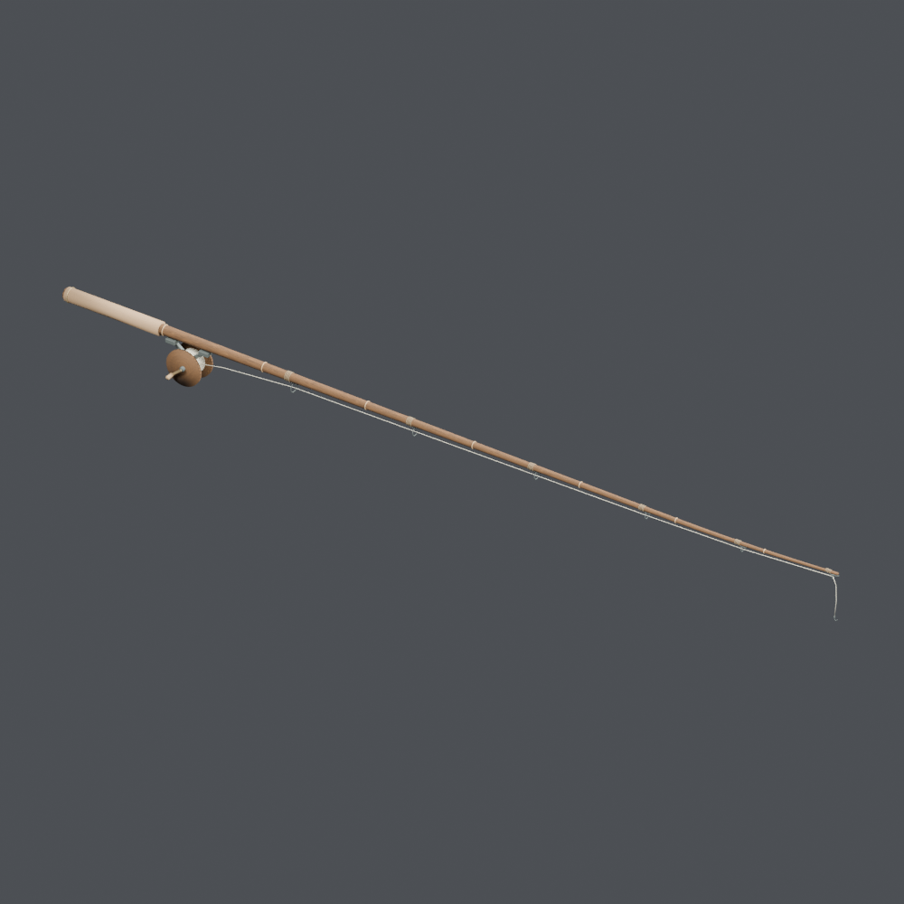

Use / purpose: Fishing rod from the harbor collection. Unit: one model record. Includes BLEND and GLB. The close-up is rendered from the distributed BLEND.

Record type: model. Formats: BLEND/GLB.

Reported dimensions (metres; XYZ when derived from measured bounds, legacy axis order not reverified): [2.102264, 0.087, 0.131579]. Triangles: 17468.

Origin: Unknown / not independently confirmed. Orientation: Unknown / not independently confirmed.

Measured bounds relative to stored coordinates (metres): [[-1.0499999523162842, -0.05000000074505806, 0.0], [1.052263617515564, 0.03700000047683716, 0.13157938420772552]]. Bounds do not establish the intended placement origin or facing direction.

[Download ZIP](https://github.com/k3peta/tales-on-a-table/releases/download/v2026.10.18/FH_051_CC0.zip) · [License scope](../../LICENSE.md)

**CC0-1.0** — See original ZIP license and repository license scope. Models and embedded materials only; previews excluded.

Source details: [Catalogue 1](../../catalog/marine_02.en.md) · [Catalogue 2](../../catalog/marine_02.md) · [Catalogue 3](../../catalog/marine_02.zh-CN.md)

## FH_052

**Landing net**

タモ

Use / purpose: Landing net from the harbor collection. Unit: one model record. Includes BLEND and GLB. The close-up is rendered from the distributed BLEND.

Record type: model. Formats: BLEND/GLB.

Reported dimensions (metres; XYZ when derived from measured bounds, legacy axis order not reverified): [1.11185, 0.393568, 0.274659]. Triangles: 29400.

Origin: Unknown / not independently confirmed. Orientation: Unknown / not independently confirmed.

Measured bounds relative to stored coordinates (metres): [[-0.550000011920929, -0.19678393006324768, -1.6298145055770874e-09], [0.5618500113487244, 0.19678393006324768, 0.27465882897377014]]. Bounds do not establish the intended placement origin or facing direction.

[Download ZIP](https://github.com/k3peta/tales-on-a-table/releases/download/v2026.10.18/FH_052_CC0.zip) · [License scope](../../LICENSE.md)

**CC0-1.0** — See original ZIP license and repository license scope. Models and embedded materials only; previews excluded.

Source details: [Catalogue 1](../../catalog/marine_02.en.md) · [Catalogue 2](../../catalog/marine_02.md) · [Catalogue 3](../../catalog/marine_02.zh-CN.md)

## FH_053

**Fishing rod stand**

竿立て

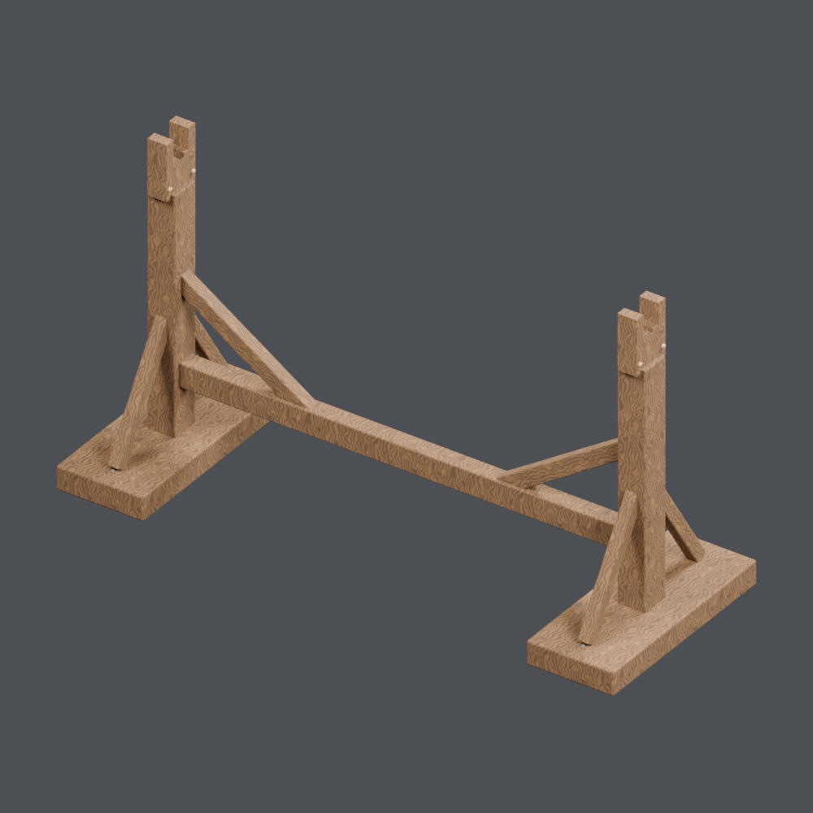

Use / purpose: Fishing rod stand from the harbor collection. Unit: one model record. Includes BLEND and GLB. The close-up is rendered from the distributed BLEND.

Record type: model. Formats: BLEND/GLB.

Reported dimensions (metres; XYZ when derived from measured bounds, legacy axis order not reverified): [1.28, 0.48, 0.718]. Triangles: 2292.

Origin: Unknown / not independently confirmed. Orientation: Unknown / not independently confirmed.

Measured bounds relative to stored coordinates (metres): [[-0.64000004529953, -0.23999999463558197, 0.0], [0.64000004529953, 0.23999999463558197, 0.7179999947547913]]. Bounds do not establish the intended placement origin or facing direction.

[Download ZIP](https://github.com/k3peta/tales-on-a-table/releases/download/v2026.10.18/FH_053_CC0.zip) · [License scope](../../LICENSE.md)

**CC0-1.0** — See original ZIP license and repository license scope. Models and embedded materials only; previews excluded.

Source details: [Catalogue 1](../../catalog/marine_02.en.md) · [Catalogue 2](../../catalog/marine_02.md) · [Catalogue 3](../../catalog/marine_02.zh-CN.md)

**Version scope:** The image above depicts the primary recorded ZIP. [Latest revision ZIP](https://raw.githubusercontent.com/k3peta/tales-on-a-table/main/distributions/quality-fh051-056-ol001-004-v1/FH_053__repair_CC0.zip). [Revision-specific preview](../../previews/quality-fh051-056-ol001-004-v1/FH_053__repair_thumb.png). [Version audit](VERSION-AUDIT.md).

## FH_054

**Bait box**

餌箱

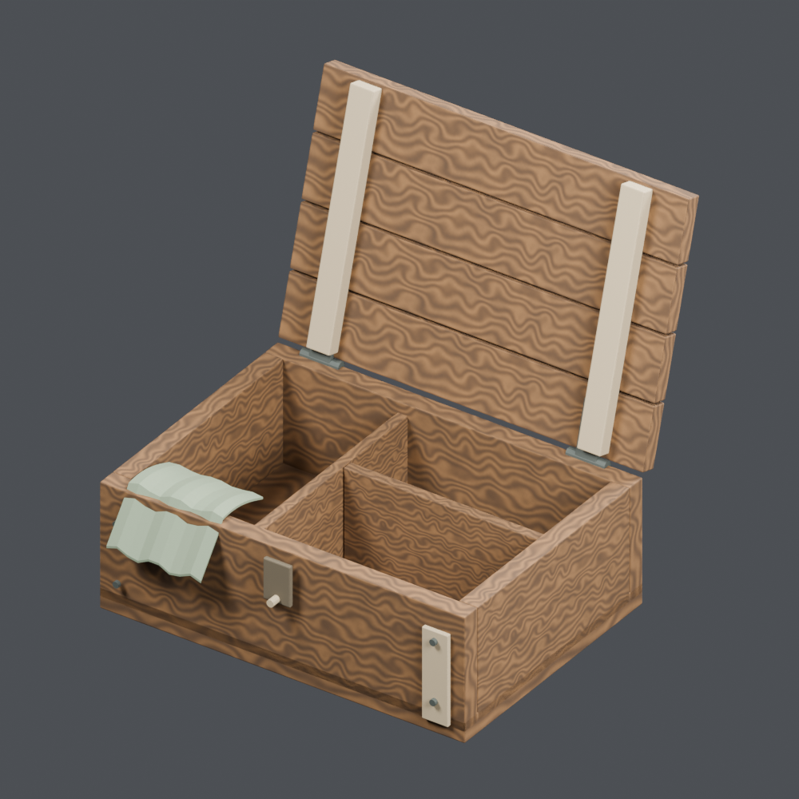

Use / purpose: Bait box from the harbor collection. Unit: one model record. Includes BLEND and GLB. The close-up is rendered from the distributed BLEND.

Record type: model. Formats: BLEND/GLB.

Reported dimensions (metres; XYZ when derived from measured bounds, legacy axis order not reverified): [0.31, 0.312027, 0.306943]. Triangles: 4540.

Origin: Unknown / not independently confirmed. Orientation: Unknown / not independently confirmed.

Measured bounds relative to stored coordinates (metres): [[-0.1550000011920929, -0.13199999928474426, 0.0], [0.1550000011920929, 0.18002712726593018, 0.30694252252578735]]. Bounds do not establish the intended placement origin or facing direction.

[Download ZIP](https://github.com/k3peta/tales-on-a-table/releases/download/v2026.10.18/FH_054_CC0.zip) · [License scope](../../LICENSE.md)

**CC0-1.0** — See original ZIP license and repository license scope. Models and embedded materials only; previews excluded.

Source details: [Catalogue 1](../../catalog/containers_01.en.md) · [Catalogue 2](../../catalog/containers_01.md) · [Catalogue 3](../../catalog/containers_01.zh-CN.md)

**Version scope:** The image above depicts the primary recorded ZIP. [Latest revision ZIP](https://raw.githubusercontent.com/k3peta/tales-on-a-table/main/distributions/quality-fh051-056-ol001-004-v1/FH_054__repair_CC0.zip). [Revision-specific preview](../../previews/quality-fh051-056-ol001-004-v1/FH_054__repair_thumb.png). [Version audit](VERSION-AUDIT.md).

## FH_055

**Fishing-rig winder**

仕掛け巻き

Use / purpose: Fishing-rig winder from the harbor collection. Unit: one model record. Includes BLEND and GLB. The close-up is rendered from the distributed BLEND.

Record type: model. Formats: BLEND/GLB.

Reported dimensions (metres; XYZ when derived from measured bounds, legacy axis order not reverified): [0.24, 0.088, 0.04223]. Triangles: 10724.

Origin: Unknown / not independently confirmed. Orientation: Unknown / not independently confirmed.

Measured bounds relative to stored coordinates (metres): [[-0.11999999731779099, -0.04399999976158142, 0.0], [0.11999999731779099, 0.04399999976158142, 0.04223000258207321]]. Bounds do not establish the intended placement origin or facing direction.

[Download ZIP](https://github.com/k3peta/tales-on-a-table/releases/download/v2026.10.18/FH_055_CC0.zip) · [License scope](../../LICENSE.md)

**CC0-1.0** — See original ZIP license and repository license scope. Models and embedded materials only; previews excluded.

Source details: [Catalogue 1](../../catalog/marine_02.en.md) · [Catalogue 2](../../catalog/marine_02.md) · [Catalogue 3](../../catalog/marine_02.zh-CN.md)

**Version scope:** The image above depicts the primary recorded ZIP. [Latest revision ZIP](https://raw.githubusercontent.com/k3peta/tales-on-a-table/main/distributions/quality-fh051-056-ol001-004-v1/FH_055__repair_CC0.zip). [Revision-specific preview](../../previews/quality-fh051-056-ol001-004-v1/FH_055__repair_thumb.png). [Version audit](VERSION-AUDIT.md).

## FH_056

**Shoulder-carried fish basket**

肩掛け魚籠

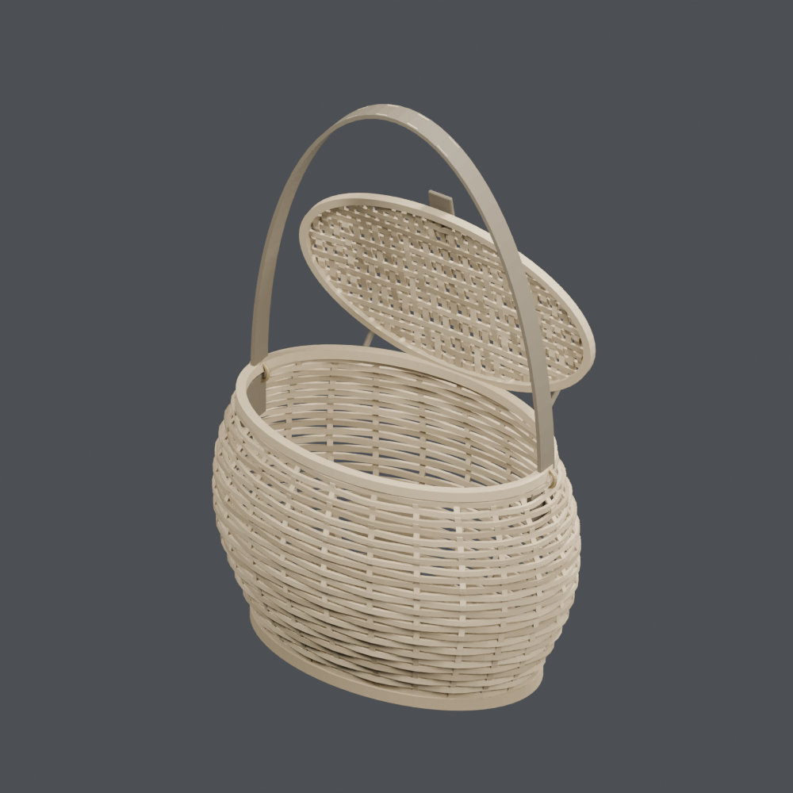

Use / purpose: Shoulder-carried fish basket from the harbor collection. Unit: one model record. Includes BLEND and GLB. The close-up is rendered from the distributed BLEND.

Record type: model. Formats: BLEND/GLB.

Reported dimensions (metres; XYZ when derived from measured bounds, legacy axis order not reverified): [0.376, 0.242, 0.57]. Triangles: 29800.

Origin: Unknown / not independently confirmed. Orientation: Unknown / not independently confirmed.

Measured bounds relative to stored coordinates (metres): [[-0.1879999339580536, -0.11999993771314621, 0.0], [0.1879999339580536, 0.12200000137090683, 0.5699999928474426]]. Bounds do not establish the intended placement origin or facing direction.

[Download ZIP](https://github.com/k3peta/tales-on-a-table/releases/download/v2026.10.18/FH_056_CC0.zip) · [License scope](../../LICENSE.md)

**CC0-1.0** — See original ZIP license and repository license scope. Models and embedded materials only; previews excluded.

Source details: [Catalogue 1](../../catalog/containers_01.en.md) · [Catalogue 2](../../catalog/containers_01.md) · [Catalogue 3](../../catalog/containers_01.zh-CN.md)

## OL_001

**Amber hexagonal lantern**

琥珀色の六角ランタン

Use / purpose: Amber hexagonal lantern from the lamp shop collection. Unit: one model record. Includes BLEND and GLB. The close-up is rendered from the distributed BLEND.

Record type: model. Formats: BLEND/GLB.

Reported dimensions (metres; XYZ when derived from measured bounds, legacy axis order not reverified): [0.506, 0.506, 1.11]. Triangles: 39196.

Origin: Unknown / not independently confirmed. Orientation: Unknown / not independently confirmed.

Measured bounds relative to stored coordinates (metres): [[-0.2529999911785126, -0.2529999911785126, 0.0], [0.2529999911785126, 0.2529999911785126, 1.1100000143051147]]. Bounds do not establish the intended placement origin or facing direction.

[Download ZIP](https://github.com/k3peta/tales-on-a-table/releases/download/v2026.10.18/OL_001_CC0.zip) · [License scope](../../LICENSE.md)

**CC0-1.0** — See original ZIP license and repository license scope. Models and embedded materials only; previews excluded.

Source details: [Catalogue 1](../../catalog/candles-light_01.en.md) · [Catalogue 2](../../catalog/candles-light_01.md) · [Catalogue 3](../../catalog/candles-light_01.zh-CN.md)

## OL_002

**Amber teardrop lantern**

琥珀色のしずく形ランタン

Use / purpose: Amber teardrop lantern from the lamp shop collection. Unit: one model record. Includes BLEND and GLB. The close-up is rendered from the distributed BLEND.

Record type: model. Formats: BLEND/GLB.

Reported dimensions (metres; XYZ when derived from measured bounds, legacy axis order not reverified): [0.486, 0.486, 1.03]. Triangles: 38908.

Origin: Unknown / not independently confirmed. Orientation: Unknown / not independently confirmed.

Measured bounds relative to stored coordinates (metres): [[-0.24300000071525574, -0.24300000071525574, 0.0], [0.24300000071525574, 0.24300000071525574, 1.029999852180481]]. Bounds do not establish the intended placement origin or facing direction.

[Download ZIP](https://github.com/k3peta/tales-on-a-table/releases/download/v2026.10.18/OL_002_CC0.zip) · [License scope](../../LICENSE.md)

**CC0-1.0** — See original ZIP license and repository license scope. Models and embedded materials only; previews excluded.

Source details: [Catalogue 1](../../catalog/candles-light_01.en.md) · [Catalogue 2](../../catalog/candles-light_01.md) · [Catalogue 3](../../catalog/candles-light_01.zh-CN.md)

## OL_003

**Blue decorative vase**

青い飾り壺

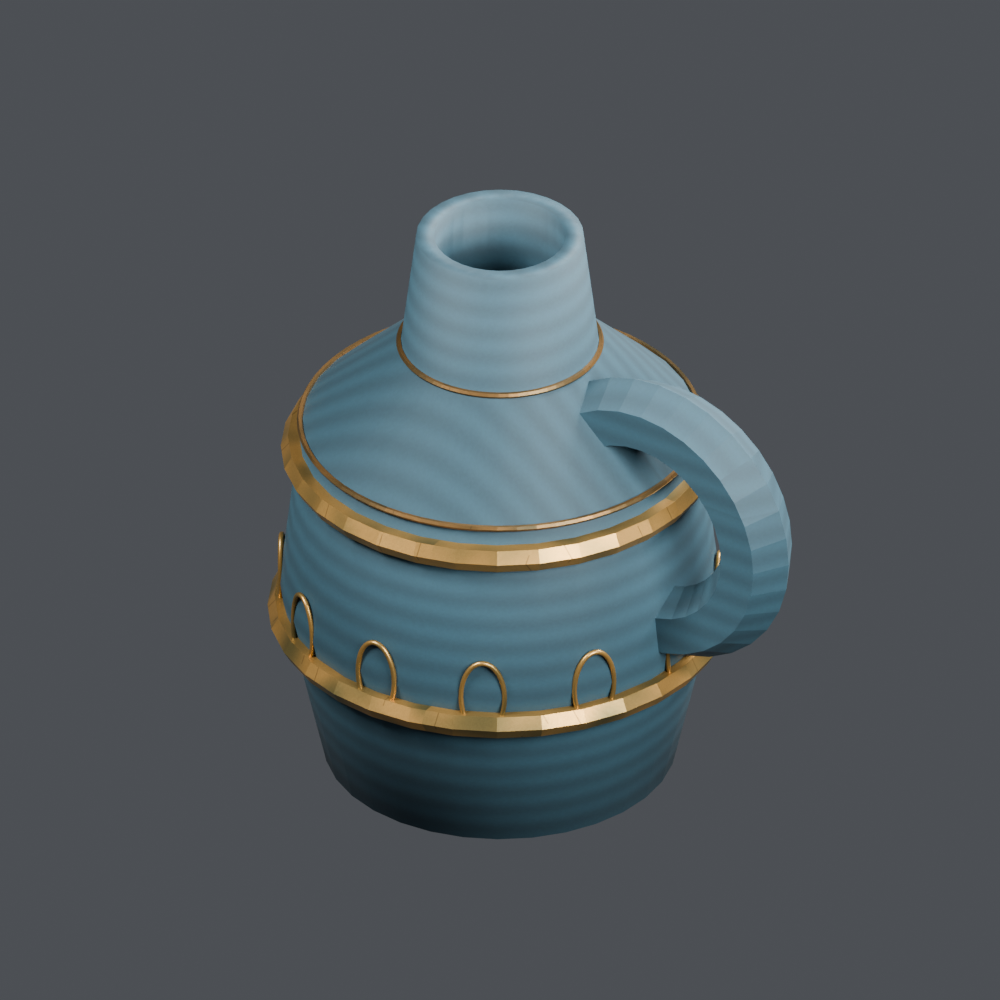

Use / purpose: Blue decorative vase from the lamp shop collection. Unit: one model record. Includes BLEND and GLB. The close-up is rendered from the distributed BLEND.

Record type: model. Formats: BLEND/GLB.

Reported dimensions (metres; XYZ when derived from measured bounds, legacy axis order not reverified): [0.37, 0.2952, 0.4]. Triangles: 8764.

Origin: Unknown / not independently confirmed. Orientation: Unknown / not independently confirmed.

Measured bounds relative to stored coordinates (metres): [[-0.18500001728534698, -0.14760001003742218, 0.0], [0.18499992787837982, 0.14760001003742218, 0.3999999761581421]]. Bounds do not establish the intended placement origin or facing direction.

[Download ZIP](https://github.com/k3peta/tales-on-a-table/releases/download/v2026.10.18/OL_003_CC0.zip) · [License scope](../../LICENSE.md)

**CC0-1.0** — See original ZIP license and repository license scope. Models and embedded materials only; previews excluded.

Source details: [Catalogue 1](../../catalog/containers_01.en.md) · [Catalogue 2](../../catalog/containers_01.md) · [Catalogue 3](../../catalog/containers_01.zh-CN.md)

## OL_004

**Carved counter**

彫刻入りカウンター

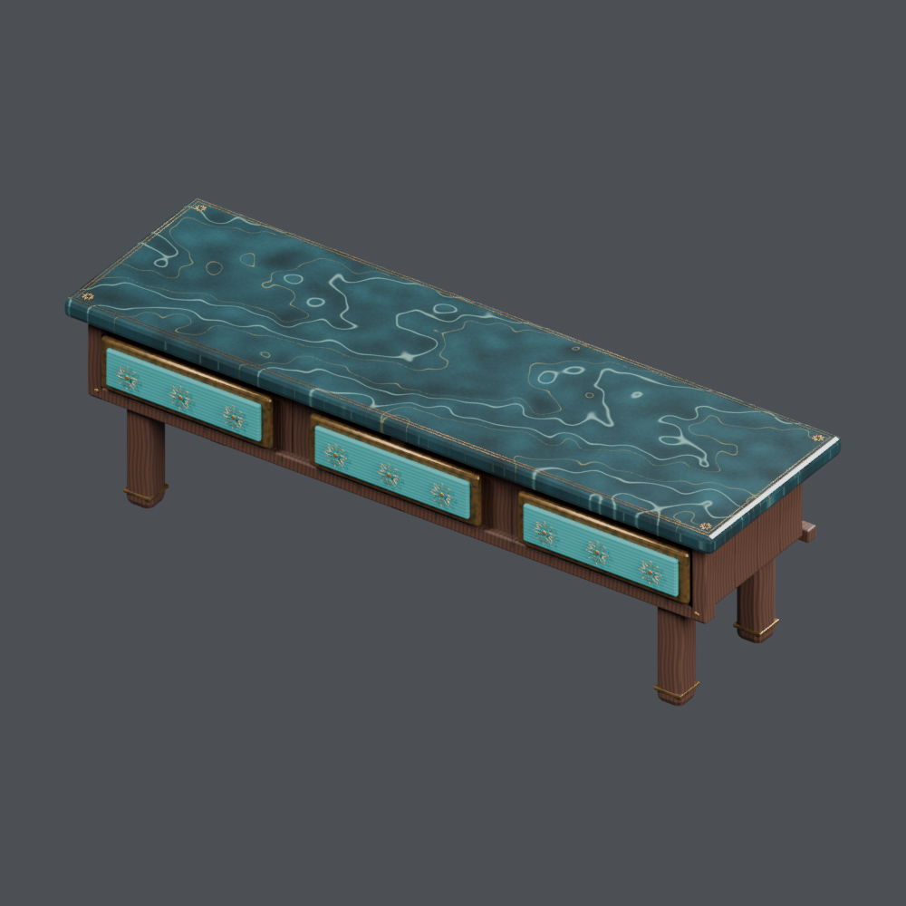

Use / purpose: Carved counter from the lamp shop collection. Unit: one model record. Includes BLEND and GLB. The close-up is rendered from the distributed BLEND.

Record type: model. Formats: BLEND/GLB.

Reported dimensions (metres; XYZ when derived from measured bounds, legacy axis order not reverified): [3.42, 1.02, 1.038039]. Triangles: 31228.

Origin: Unknown / not independently confirmed. Orientation: Unknown / not independently confirmed.

Measured bounds relative to stored coordinates (metres): [[-1.7100000381469727, -0.5099999904632568, 0.0], [1.7100000381469727, 0.5099999904632568, 1.038039207458496]]. Bounds do not establish the intended placement origin or facing direction.

[Download ZIP](https://github.com/k3peta/tales-on-a-table/releases/download/v2026.10.18/OL_004_CC0.zip) · [License scope](../../LICENSE.md)

**CC0-1.0** — See original ZIP license and repository license scope. Models and embedded materials only; previews excluded.

Source details: [Catalogue 1](../../catalog/furniture_02.en.md) · [Catalogue 2](../../catalog/furniture_02.md) · [Catalogue 3](../../catalog/furniture_02.zh-CN.md)

## OL_005

**Crimson medallion carpet**

深紅のメダリオン絨毯

Use / purpose: Crimson medallion carpet from the lamp shop collection. Unit: one model record. Includes BLEND and GLB. The close-up is rendered from the distributed BLEND.

Record type: model. Formats: BLEND/GLB.

Reported dimensions (metres; XYZ when derived from measured bounds, legacy axis order not reverified): [2.65, 2.740932, 0.038]. Triangles: 4968.

Origin: Unknown / not independently confirmed. Orientation: Unknown / not independently confirmed.

Measured bounds relative to stored coordinates (metres): [[-1.3250000476837158, -1.370465874671936, -1.862645149230957e-09], [1.3250000476837158, 1.3704659938812256, 0.03800000250339508]]. Bounds do not establish the intended placement origin or facing direction.

[Download ZIP](https://github.com/k3peta/tales-on-a-table/releases/download/v2026.10.18/OL_005_CC0.zip) · [License scope](../../LICENSE.md)

**CC0-1.0** — See original ZIP license and repository license scope. Models and embedded materials only; previews excluded.

Source details: [Catalogue 1](../../catalog/textiles_01.en.md) · [Catalogue 2](../../catalog/textiles_01.md) · [Catalogue 3](../../catalog/textiles_01.zh-CN.md)

**Version scope:** The image above depicts the primary recorded ZIP. [Latest revision ZIP](https://raw.githubusercontent.com/k3peta/tales-on-a-table/main/distributions/quality-ol005-014-v1/OL_005__repair_CC0.zip). [Revision-specific preview](../../previews/quality-ol005-014-v1/OL_005__repair_thumb.png). [Version audit](VERSION-AUDIT.md).

## OL_006

**Emerald hexagonal lantern**

翠色の六角ランタン

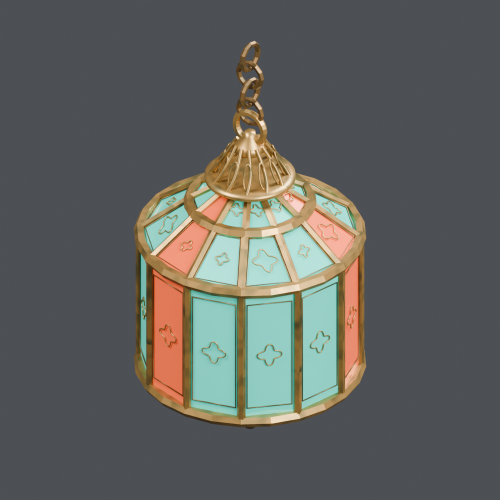

Use / purpose: Emerald hexagonal lantern from the lamp shop collection. Unit: one model record. Includes BLEND and GLB. The close-up is rendered from the distributed BLEND.

Record type: model. Formats: BLEND/GLB.

Reported dimensions (metres; XYZ when derived from measured bounds, legacy axis order not reverified): [0.486, 0.486, 0.95]. Triangles: 38908.

Origin: Unknown / not independently confirmed. Orientation: Unknown / not independently confirmed.

Measured bounds relative to stored coordinates (metres): [[-0.24300000071525574, -0.24300000071525574, 0.0], [0.24300000071525574, 0.24300000071525574, 0.949999988079071]]. Bounds do not establish the intended placement origin or facing direction.

[Download ZIP](https://github.com/k3peta/tales-on-a-table/releases/download/v2026.10.18/OL_006_CC0.zip) · [License scope](../../LICENSE.md)

**CC0-1.0** — See original ZIP license and repository license scope. Models and embedded materials only; previews excluded.

Source details: [Catalogue 1](../../catalog/candles-light_01.en.md) · [Catalogue 2](../../catalog/candles-light_01.md) · [Catalogue 3](../../catalog/candles-light_01.zh-CN.md)

## OL_007

**Emerald melon-shaped lantern**

翠色のメロン形ランタン

Use / purpose: Emerald melon-shaped lantern from the lamp shop collection. Unit: one model record. Includes BLEND and GLB. The close-up is rendered from the distributed BLEND.

Record type: model. Formats: BLEND/GLB.

Reported dimensions (metres; XYZ when derived from measured bounds, legacy axis order not reverified): [0.666, 0.666, 1.235]. Triangles: 47500.

Origin: Unknown / not independently confirmed. Orientation: Unknown / not independently confirmed.

Measured bounds relative to stored coordinates (metres): [[-0.3330000042915344, -0.3330000042915344, 0.0], [0.3330000042915344, 0.3330000042915344, 1.2350000143051147]]. Bounds do not establish the intended placement origin or facing direction.

[Download ZIP](https://github.com/k3peta/tales-on-a-table/releases/download/v2026.10.18/OL_007_CC0.zip) · [License scope](../../LICENSE.md)

**CC0-1.0** — See original ZIP license and repository license scope. Models and embedded materials only; previews excluded.

Source details: [Catalogue 1](../../catalog/candles-light_01.en.md) · [Catalogue 2](../../catalog/candles-light_01.md) · [Catalogue 3](../../catalog/candles-light_01.zh-CN.md)

## OL_008

**Gold floor candlestick**

床置きの金色燭台

Use / purpose: Gold floor candlestick from the lamp shop collection. Unit: one model record. Includes BLEND and GLB. The close-up is rendered from the distributed BLEND.

Record type: model. Formats: BLEND/GLB.

Reported dimensions (metres; XYZ when derived from measured bounds, legacy axis order not reverified): [0.28, 0.28, 0.635]. Triangles: 4812.

Origin: Unknown / not independently confirmed. Orientation: Unknown / not independently confirmed.

Measured bounds relative to stored coordinates (metres): [[-0.1399998664855957, -0.13999998569488525, 0.0], [0.1400001049041748, 0.13999998569488525, 0.6350000500679016]]. Bounds do not establish the intended placement origin or facing direction.

[Download ZIP](https://github.com/k3peta/tales-on-a-table/releases/download/v2026.10.18/OL_008_CC0.zip) · [License scope](../../LICENSE.md)

**CC0-1.0** — See original ZIP license and repository license scope. Models and embedded materials only; previews excluded.

Source details: [Catalogue 1](../../catalog/candles-light_01.en.md) · [Catalogue 2](../../catalog/candles-light_01.md) · [Catalogue 3](../../catalog/candles-light_01.zh-CN.md)
