# Base distribution records 121–144

[Browse index](README.md) · [Coverage and missing fields](COVERAGE.md)

Images are actual existing model renders for browsing, not covered by model CC0. A group record may show several reused models. Dimensions and triangle counts apply only to the original record when sourced; revisions can differ. Unknown means unverified, not zero. No blanket CC0 grant for scenes, images, code or articles.

## OL_009

**Gold display-shelf candlestick**

飾り棚用の金色燭台

Use / purpose: Gold display-shelf candlestick from the lamp shop collection. Unit: one model record. Includes BLEND and GLB. The close-up is rendered from the distributed BLEND.

Record type: model. Formats: BLEND/GLB.

Reported dimensions (metres; XYZ when derived from measured bounds, legacy axis order not reverified): [0.28, 0.28, 0.625]. Triangles: 4812.

Origin: Unknown / not independently confirmed. Orientation: Unknown / not independently confirmed.

Measured bounds relative to stored coordinates (metres): [[-0.13999998569488525, -0.1399998664855957, 0.0], [0.13999998569488525, 0.1400001049041748, 0.6249999403953552]]. Bounds do not establish the intended placement origin or facing direction.

[Download ZIP](https://github.com/k3peta/tales-on-a-table/releases/download/v2026.10.18/OL_009_CC0.zip) · [License scope](../../LICENSE.md)

**CC0-1.0** — See original ZIP license and repository license scope. Models and embedded materials only; previews excluded.

Source details: [Catalogue 1](../../catalog/candles-light_01.en.md) · [Catalogue 2](../../catalog/candles-light_01.md) · [Catalogue 3](../../catalog/candles-light_01.zh-CN.md)

## OL_010

**Gold three-arm candelabrum**

金色の三枝燭台

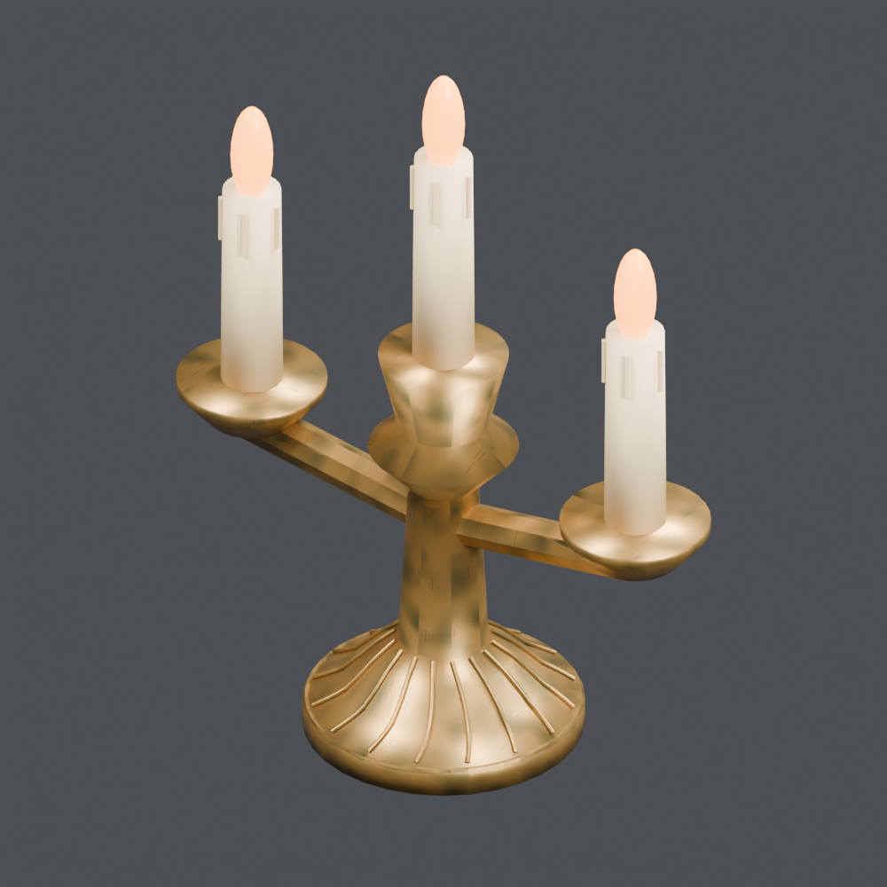

Use / purpose: Gold three-arm candelabrum from the lamp shop collection. Unit: one model record. Includes BLEND and GLB. The close-up is rendered from the distributed BLEND.

Record type: model. Formats: BLEND/GLB.

Reported dimensions (metres; XYZ when derived from measured bounds, legacy axis order not reverified): [0.61, 0.28, 0.755]. Triangles: 6772.

Origin: Unknown / not independently confirmed. Orientation: Unknown / not independently confirmed.

Measured bounds relative to stored coordinates (metres): [[-0.3050000071525574, -0.14000004529953003, 0.0], [0.3050000071525574, 0.13999998569488525, 0.7550000548362732]]. Bounds do not establish the intended placement origin or facing direction.

[Download ZIP](https://github.com/k3peta/tales-on-a-table/releases/download/v2026.10.18/OL_010_CC0.zip) · [License scope](../../LICENSE.md)

**CC0-1.0** — See original ZIP license and repository license scope. Models and embedded materials only; previews excluded.

Source details: [Catalogue 1](../../catalog/candles-light_01.en.md) · [Catalogue 2](../../catalog/candles-light_01.md) · [Catalogue 3](../../catalog/candles-light_01.zh-CN.md)

## OL_011

**Indigo runner rug**

藍色の細長い敷物

Use / purpose: Indigo runner rug from the lamp shop collection. Unit: one model record. Includes BLEND and GLB. The close-up is rendered from the distributed BLEND.

Record type: model. Formats: BLEND/GLB.

Reported dimensions (metres; XYZ when derived from measured bounds, legacy axis order not reverified): [1.05, 3.340932, 0.038]. Triangles: 4968.

Origin: Unknown / not independently confirmed. Orientation: Unknown / not independently confirmed.

Measured bounds relative to stored coordinates (metres): [[-0.5249999761581421, -1.6704658269882202, -1.862645149230957e-09], [0.5249999761581421, 1.6704657077789307, 0.03800000250339508]]. Bounds do not establish the intended placement origin or facing direction.

[Download ZIP](https://github.com/k3peta/tales-on-a-table/releases/download/v2026.10.18/OL_011_CC0.zip) · [License scope](../../LICENSE.md)

**CC0-1.0** — See original ZIP license and repository license scope. Models and embedded materials only; previews excluded.

Source details: [Catalogue 1](../../catalog/textiles_01.en.md) · [Catalogue 2](../../catalog/textiles_01.md) · [Catalogue 3](../../catalog/textiles_01.zh-CN.md)

**Version scope:** The image above depicts the primary recorded ZIP. [Latest revision ZIP](https://raw.githubusercontent.com/k3peta/tales-on-a-table/main/distributions/quality-ol005-014-v1/OL_011__repair_CC0.zip). [Revision-specific preview](../../previews/quality-ol005-014-v1/OL_011__repair_thumb.png). [Version audit](VERSION-AUDIT.md).

## OL_012

**Jewelry display tray**

宝飾品の展示トレイ

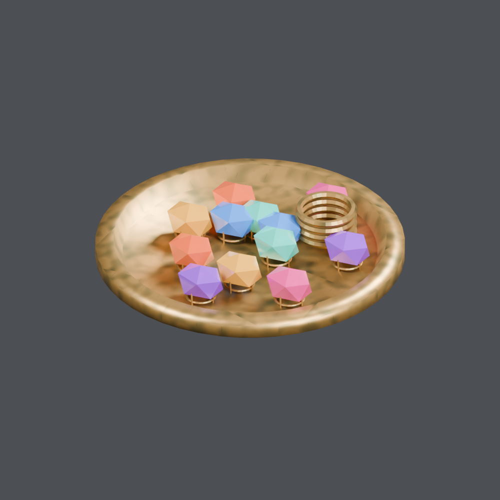

Use / purpose: Jewelry display tray from the lamp shop collection. Unit: one model record. Includes BLEND and GLB. The close-up is rendered from the distributed BLEND.

Record type: model. Formats: BLEND/GLB.

Reported dimensions (metres; XYZ when derived from measured bounds, legacy axis order not reverified): [0.68, 0.68, 0.122928]. Triangles: 7244.

Origin: Unknown / not independently confirmed. Orientation: Unknown / not independently confirmed.

Measured bounds relative to stored coordinates (metres): [[-0.3399999737739563, -0.3399999737739563, 0.0], [0.3399999737739563, 0.3399999737739563, 0.12292826175689697]]. Bounds do not establish the intended placement origin or facing direction.

[Download ZIP](https://github.com/k3peta/tales-on-a-table/releases/download/v2026.10.18/OL_012_CC0.zip) · [License scope](../../LICENSE.md)

**CC0-1.0** — See original ZIP license and repository license scope. Models and embedded materials only; previews excluded.

Source details: [Catalogue 1](../../catalog/furniture_02.en.md) · [Catalogue 2](../../catalog/furniture_02.md) · [Catalogue 3](../../catalog/furniture_02.zh-CN.md)

## OL_013

**Octagonal side table**

八角形のサイドテーブル

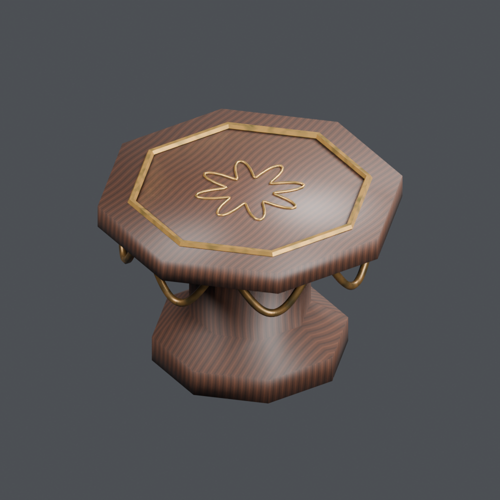

Use / purpose: Octagonal side table from the lamp shop collection. Unit: one model record. Includes BLEND and GLB. The close-up is rendered from the distributed BLEND.

Record type: model. Formats: BLEND/GLB.

Reported dimensions (metres; XYZ when derived from measured bounds, legacy axis order not reverified): [0.9, 0.9, 0.563392]. Triangles: 3704.

Origin: Unknown / not independently confirmed. Orientation: Unknown / not independently confirmed.

Measured bounds relative to stored coordinates (metres): [[-0.4500000476837158, -0.44999998807907104, 0.0], [0.4500000476837158, 0.44999998807907104, 0.5633922815322876]]. Bounds do not establish the intended placement origin or facing direction.

[Download ZIP](https://github.com/k3peta/tales-on-a-table/releases/download/v2026.10.18/OL_013_CC0.zip) · [License scope](../../LICENSE.md)

**CC0-1.0** — See original ZIP license and repository license scope. Models and embedded materials only; previews excluded.

Source details: [Catalogue 1](../../catalog/furniture_02.en.md) · [Catalogue 2](../../catalog/furniture_02.md) · [Catalogue 3](../../catalog/furniture_02.zh-CN.md)

**Version scope:** The image above depicts the primary recorded ZIP. [Latest revision ZIP](https://raw.githubusercontent.com/k3peta/tales-on-a-table/main/distributions/quality-ol005-014-v1/OL_013__repair_CC0.zip). [Revision-specific preview](../../previews/quality-ol005-014-v1/OL_013__repair_thumb.png). [Version audit](VERSION-AUDIT.md).

## OL_014

**Three rolled carpets**

巻いた絨毯3本

Use / purpose: Three rolled carpets from the lamp shop collection. Unit: one model record. Includes BLEND and GLB. The close-up is rendered from the distributed BLEND.

Record type: model. Formats: BLEND/GLB.

Reported dimensions (metres; XYZ when derived from measured bounds, legacy axis order not reverified): [0.862, 1.0076, 0.322]. Triangles: 16140.

Origin: Unknown / not independently confirmed. Orientation: Unknown / not independently confirmed.

Measured bounds relative to stored coordinates (metres): [[-0.4309999942779541, -0.5038000345230103, 0.0], [0.4309999942779541, 0.5038000345230103, 0.32200002670288086]]. Bounds do not establish the intended placement origin or facing direction.

[Download ZIP](https://github.com/k3peta/tales-on-a-table/releases/download/v2026.10.18/OL_014_CC0.zip) · [License scope](../../LICENSE.md)

**CC0-1.0** — See original ZIP license and repository license scope. Models and embedded materials only; previews excluded.

Source details: [Catalogue 1](../../catalog/textiles_01.en.md) · [Catalogue 2](../../catalog/textiles_01.md) · [Catalogue 3](../../catalog/textiles_01.zh-CN.md)

## OL_015

**Crimson teardrop lantern**

紅色のしずく形ランタン

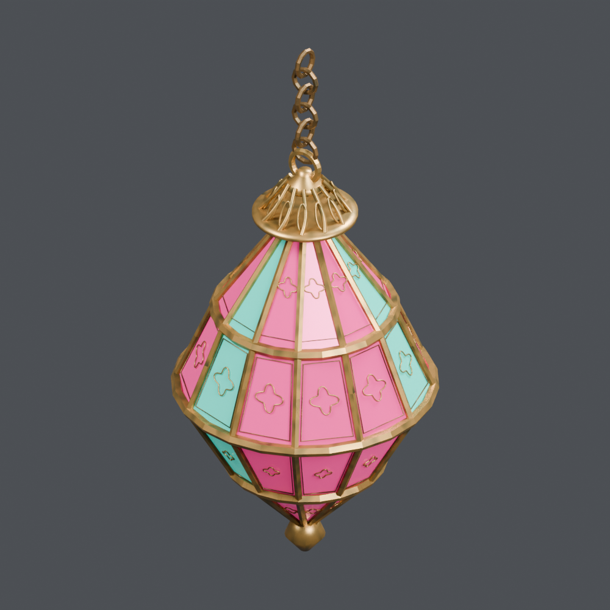

Use / purpose: Crimson teardrop lantern from the lamp shop collection. Unit: one model record. Includes BLEND and GLB. The close-up is rendered from the distributed BLEND.

Record type: model. Formats: BLEND/GLB.

Reported dimensions (metres; XYZ when derived from measured bounds, legacy axis order not reverified): [0.586, 0.586, 1.29]. Triangles: 39196.

Origin: Unknown / not independently confirmed. Orientation: Unknown / not independently confirmed.

Measured bounds relative to stored coordinates (metres): [[-0.2930000126361847, -0.2930000126361847, 0.0], [0.2930000126361847, 0.2930000126361847, 1.2899999618530273]]. Bounds do not establish the intended placement origin or facing direction.

[Download ZIP](https://github.com/k3peta/tales-on-a-table/releases/download/v2026.10.18/OL_015_CC0.zip) · [License scope](../../LICENSE.md)

**CC0-1.0** — See original ZIP license and repository license scope. Models and embedded materials only; previews excluded.

Source details: [Catalogue 1](../../catalog/candles-light_02.en.md) · [Catalogue 2](../../catalog/candles-light_02.md) · [Catalogue 3](../../catalog/candles-light_02.zh-CN.md)

## OL_016

**Blue hexagonal lantern**

青い六角ランタン

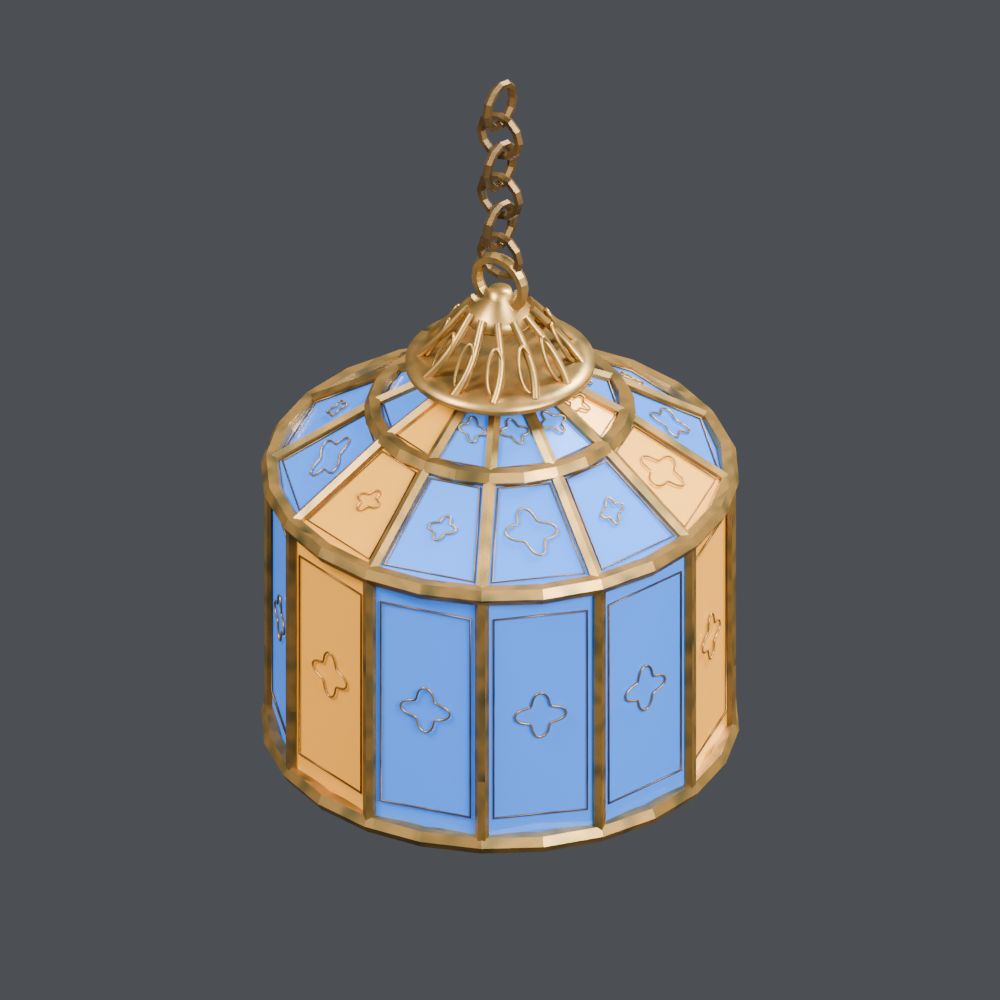

Use / purpose: Blue hexagonal lantern from the lamp shop collection. Unit: one model record. Includes BLEND and GLB. The close-up is rendered from the distributed BLEND.

Record type: model. Formats: BLEND/GLB.

Reported dimensions (metres; XYZ when derived from measured bounds, legacy axis order not reverified): [0.606, 0.606, 1.13]. Triangles: 39196.

Origin: Unknown / not independently confirmed. Orientation: Unknown / not independently confirmed.

Measured bounds relative to stored coordinates (metres): [[-0.30300000309944153, -0.30300000309944153, 0.0], [0.30300000309944153, 0.30300000309944153, 1.1299999952316284]]. Bounds do not establish the intended placement origin or facing direction.

[Download ZIP](https://github.com/k3peta/tales-on-a-table/releases/download/v2026.10.18/OL_016_CC0.zip) · [License scope](../../LICENSE.md)

**CC0-1.0** — See original ZIP license and repository license scope. Models and embedded materials only; previews excluded.

Source details: [Catalogue 1](../../catalog/candles-light_02.en.md) · [Catalogue 2](../../catalog/candles-light_02.md) · [Catalogue 3](../../catalog/candles-light_02.zh-CN.md)

## OL_017

**Amber shelf lantern**

棚置きの琥珀色ランタン

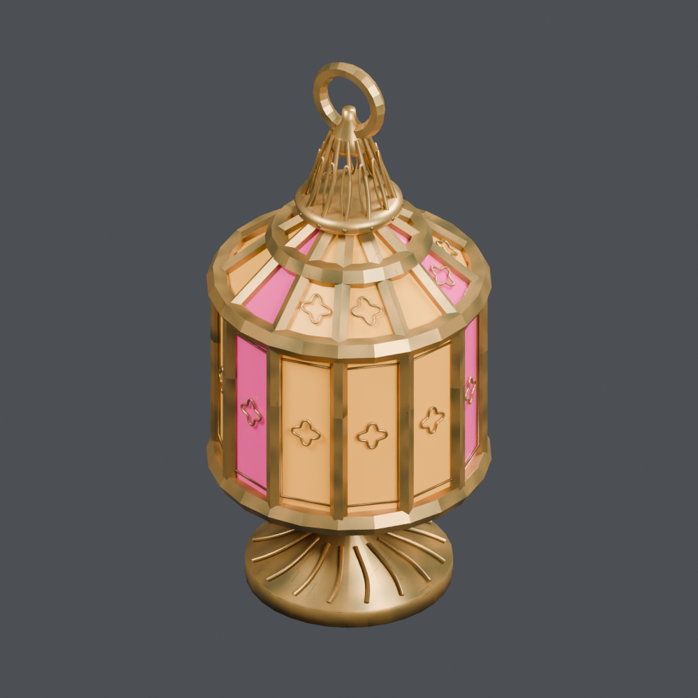

Use / purpose: Amber shelf lantern from the lamp shop collection. Unit: one model record. Includes BLEND and GLB. The close-up is rendered from the distributed BLEND.

Record type: model. Formats: BLEND/GLB.

Reported dimensions (metres; XYZ when derived from measured bounds, legacy axis order not reverified): [0.286, 0.286, 0.603]. Triangles: 35148.

Origin: Unknown / not independently confirmed. Orientation: Unknown / not independently confirmed.

Measured bounds relative to stored coordinates (metres): [[-0.14299999177455902, -0.14299999177455902, 0.0], [0.14299999177455902, 0.14299999177455902, 0.6030000448226929]]. Bounds do not establish the intended placement origin or facing direction.

[Download ZIP](https://github.com/k3peta/tales-on-a-table/releases/download/v2026.10.18/OL_017_CC0.zip) · [License scope](../../LICENSE.md)

**CC0-1.0** — See original ZIP license and repository license scope. Models and embedded materials only; previews excluded.

Source details: [Catalogue 1](../../catalog/candles-light_02.en.md) · [Catalogue 2](../../catalog/candles-light_02.md) · [Catalogue 3](../../catalog/candles-light_02.zh-CN.md)

## OL_018

**Crimson shelf lantern**

棚置きの紅色ランタン

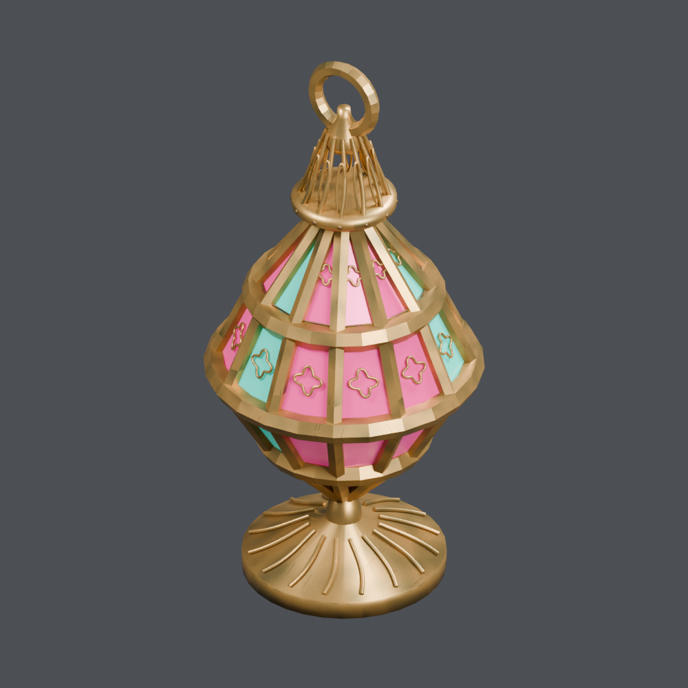

Use / purpose: Crimson shelf lantern from the lamp shop collection. Unit: one model record. Includes BLEND and GLB. The close-up is rendered from the distributed BLEND.

Record type: model. Formats: BLEND/GLB.

Reported dimensions (metres; XYZ when derived from measured bounds, legacy axis order not reverified): [0.286, 0.286, 0.603]. Triangles: 31692.

Origin: Unknown / not independently confirmed. Orientation: Unknown / not independently confirmed.

Measured bounds relative to stored coordinates (metres): [[-0.14299999177455902, -0.14299999177455902, 0.0], [0.14299999177455902, 0.14299999177455902, 0.6030000448226929]]. Bounds do not establish the intended placement origin or facing direction.

[Download ZIP](https://github.com/k3peta/tales-on-a-table/releases/download/v2026.10.18/OL_018_CC0.zip) · [License scope](../../LICENSE.md)

**CC0-1.0** — See original ZIP license and repository license scope. Models and embedded materials only; previews excluded.

Source details: [Catalogue 1](../../catalog/candles-light_02.en.md) · [Catalogue 2](../../catalog/candles-light_02.md) · [Catalogue 3](../../catalog/candles-light_02.zh-CN.md)

## OL_019

**Set of silk cushions**

絹のクッション一式

Use / purpose: Set of silk cushions from the lamp shop collection. Unit: one model record. Includes BLEND and GLB. The close-up is rendered from the distributed BLEND.

Record type: model. Formats: BLEND/GLB.

Reported dimensions (metres; XYZ when derived from measured bounds, legacy axis order not reverified): [3.75, 2.19, 0.277]. Triangles: 9568.

Origin: Unknown / not independently confirmed. Orientation: Unknown / not independently confirmed.

Measured bounds relative to stored coordinates (metres): [[-1.8750001192092896, -1.09499990940094, 0.0], [1.875000238418579, 1.0950000286102295, 0.27699998021125793]]. Bounds do not establish the intended placement origin or facing direction.

[Download ZIP](https://github.com/k3peta/tales-on-a-table/releases/download/v2026.10.18/OL_019_CC0.zip) · [License scope](../../LICENSE.md)

**CC0-1.0** — See original ZIP license and repository license scope. Models and embedded materials only; previews excluded.

Source details: [Catalogue 1](../../catalog/textiles_01.en.md) · [Catalogue 2](../../catalog/textiles_01.md) · [Catalogue 3](../../catalog/textiles_01.zh-CN.md)

**Version scope:** The image above depicts the primary recorded ZIP. [Latest revision ZIP](https://raw.githubusercontent.com/k3peta/tales-on-a-table/main/distributions/quality-ol015-024-v1/OL_019__repair_CC0.zip). [Revision-specific preview](../../previews/quality-ol015-024-v1/OL_019__repair_thumb.png). [Version audit](VERSION-AUDIT.md).

## OL_020

**Silver display-shelf candlestick**

飾り棚用の銀色燭台

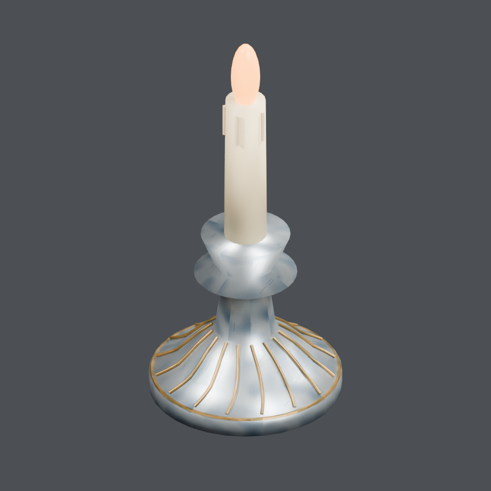

Use / purpose: Silver display-shelf candlestick from the lamp shop collection. Unit: one model record. Includes BLEND and GLB. The close-up is rendered from the distributed BLEND.

Record type: model. Formats: BLEND/GLB.

Reported dimensions (metres; XYZ when derived from measured bounds, legacy axis order not reverified): [0.28, 0.28, 0.585]. Triangles: 4812.

Origin: Unknown / not independently confirmed. Orientation: Unknown / not independently confirmed.

Measured bounds relative to stored coordinates (metres): [[-0.13999998569488525, -0.1399998664855957, 0.0], [0.13999998569488525, 0.1400001049041748, 0.5849999785423279]]. Bounds do not establish the intended placement origin or facing direction.

[Download ZIP](https://github.com/k3peta/tales-on-a-table/releases/download/v2026.10.18/OL_020_CC0.zip) · [License scope](../../LICENSE.md)

**CC0-1.0** — See original ZIP license and repository license scope. Models and embedded materials only; previews excluded.

Source details: [Catalogue 1](../../catalog/candles-light_02.en.md) · [Catalogue 2](../../catalog/candles-light_02.md) · [Catalogue 3](../../catalog/candles-light_02.zh-CN.md)

## OL_021

**Silver three-arm candelabrum**

銀色の三枝燭台

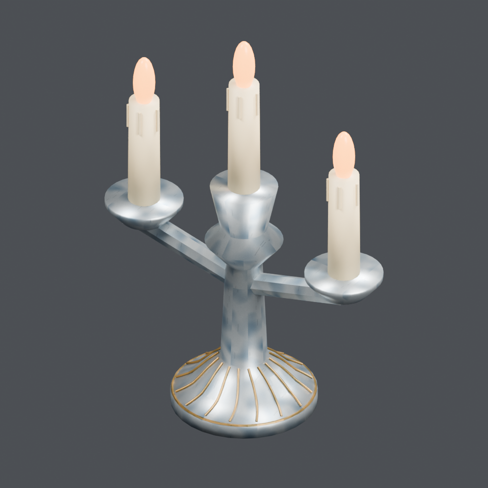

Use / purpose: Silver three-arm candelabrum from the lamp shop collection. Unit: one model record. Includes BLEND and GLB. The close-up is rendered from the distributed BLEND.

Record type: model. Formats: BLEND/GLB.

Reported dimensions (metres; XYZ when derived from measured bounds, legacy axis order not reverified): [0.61, 0.28, 0.805]. Triangles: 6772.

Origin: Unknown / not independently confirmed. Orientation: Unknown / not independently confirmed.

Measured bounds relative to stored coordinates (metres): [[-0.3050000071525574, -0.1400001049041748, 0.0], [0.3049999475479126, 0.13999998569488525, 0.8050000071525574]]. Bounds do not establish the intended placement origin or facing direction.

[Download ZIP](https://github.com/k3peta/tales-on-a-table/releases/download/v2026.10.18/OL_021_CC0.zip) · [License scope](../../LICENSE.md)

**CC0-1.0** — See original ZIP license and repository license scope. Models and embedded materials only; previews excluded.

Source details: [Catalogue 1](../../catalog/candles-light_02.en.md) · [Catalogue 2](../../catalog/candles-light_02.md) · [Catalogue 3](../../catalog/candles-light_02.zh-CN.md)

## OL_022

**Small gold lantern**

小さな金色ランタン

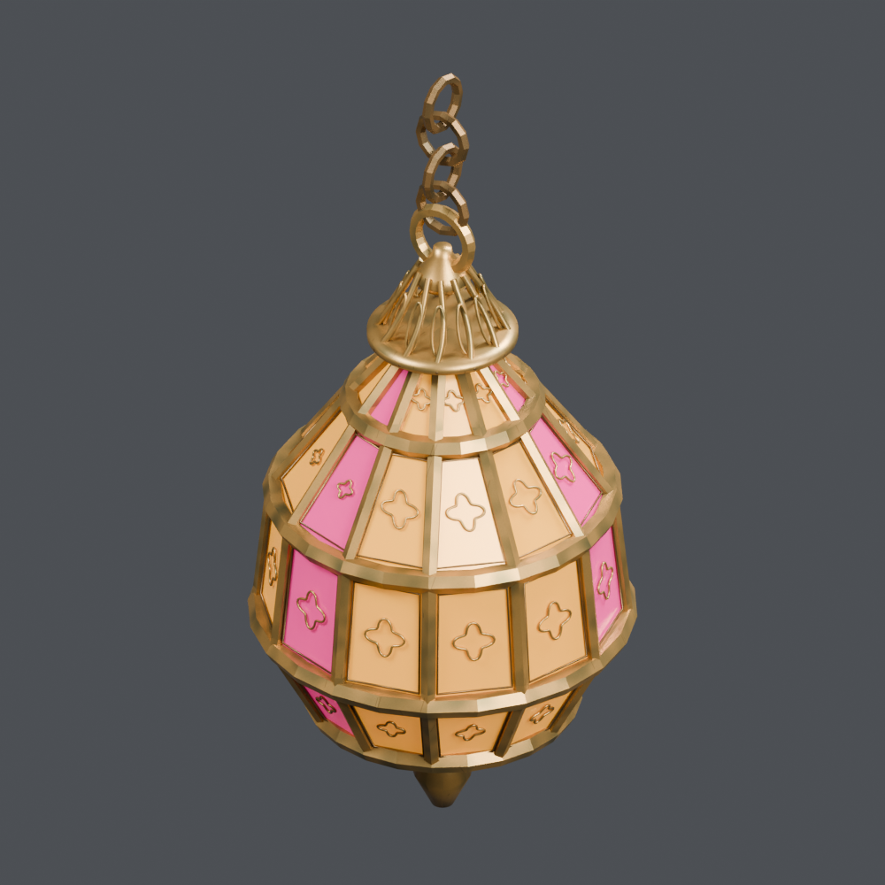

Use / purpose: Small gold lantern from the lamp shop collection. Unit: one model record. Includes BLEND and GLB. The close-up is rendered from the distributed BLEND.

Record type: model. Formats: BLEND/GLB.

Reported dimensions (metres; XYZ when derived from measured bounds, legacy axis order not reverified): [0.426, 0.426, 0.94]. Triangles: 47068.

Origin: Unknown / not independently confirmed. Orientation: Unknown / not independently confirmed.

Measured bounds relative to stored coordinates (metres): [[-0.21299999952316284, -0.21299999952316284, 0.0], [0.21299999952316284, 0.21299999952316284, 0.9399999976158142]]. Bounds do not establish the intended placement origin or facing direction.

[Download ZIP](https://github.com/k3peta/tales-on-a-table/releases/download/v2026.10.18/OL_022_CC0.zip) · [License scope](../../LICENSE.md)

**CC0-1.0** — See original ZIP license and repository license scope. Models and embedded materials only; previews excluded.

Source details: [Catalogue 1](../../catalog/candles-light_02.en.md) · [Catalogue 2](../../catalog/candles-light_02.md) · [Catalogue 3](../../catalog/candles-light_02.zh-CN.md)

## OL_023

**Teal floor pitcher**

床置きの青緑色水差し

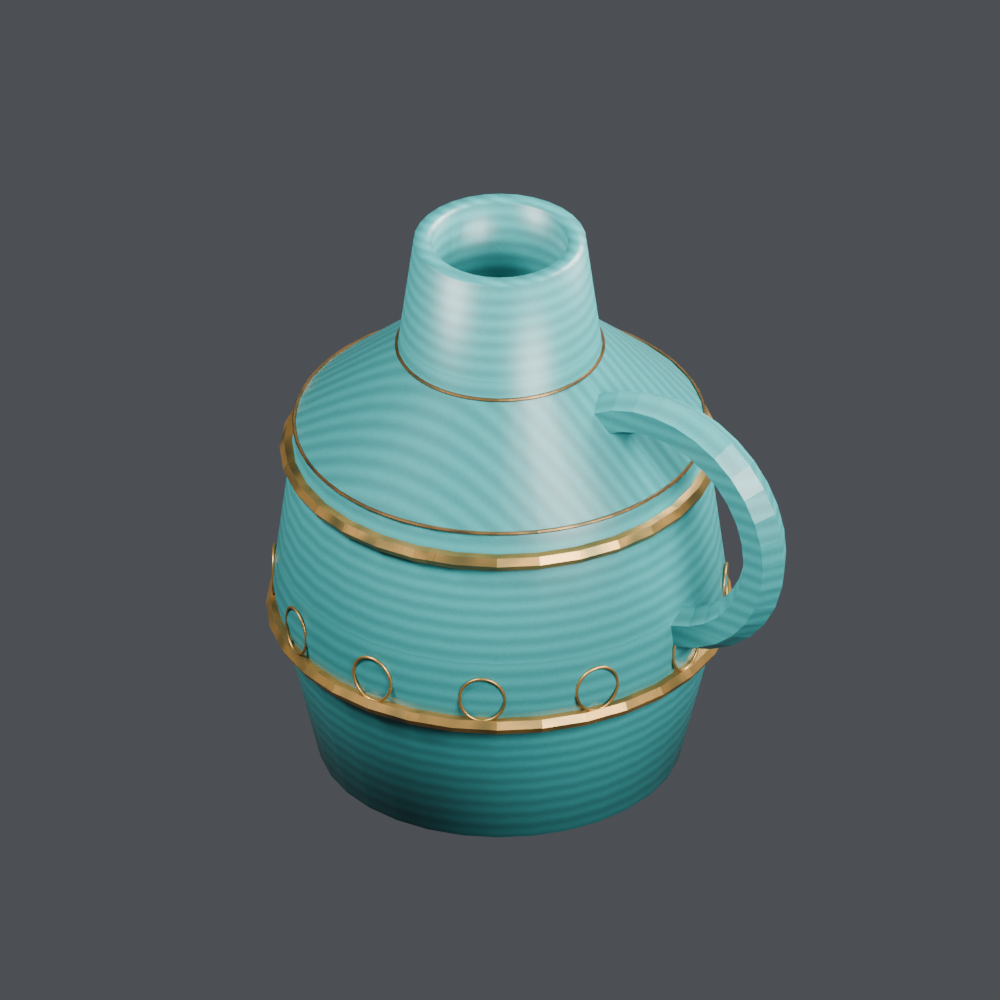

Use / purpose: Teal floor pitcher from the lamp shop collection. Unit: one model record. Includes BLEND and GLB. The close-up is rendered from the distributed BLEND.

Record type: model. Formats: BLEND/GLB.

Reported dimensions (metres; XYZ when derived from measured bounds, legacy axis order not reverified): [0.61, 0.4932, 0.65]. Triangles: 8764.

Origin: Unknown / not independently confirmed. Orientation: Unknown / not independently confirmed.

Measured bounds relative to stored coordinates (metres): [[-0.3050001561641693, -0.24660000205039978, 0.0], [0.30499985814094543, 0.24660000205039978, 0.6499999761581421]]. Bounds do not establish the intended placement origin or facing direction.

[Download ZIP](https://github.com/k3peta/tales-on-a-table/releases/download/v2026.10.18/OL_023_CC0.zip) · [License scope](../../LICENSE.md)

**CC0-1.0** — See original ZIP license and repository license scope. Models and embedded materials only; previews excluded.

Source details: [Catalogue 1](../../catalog/tableware_02.en.md) · [Catalogue 2](../../catalog/tableware_02.md) · [Catalogue 3](../../catalog/tableware_02.zh-CN.md)

**Version scope:** The image above depicts the primary recorded ZIP. [Latest revision ZIP](https://raw.githubusercontent.com/k3peta/tales-on-a-table/main/distributions/quality-ol015-024-v1/OL_023__repair_CC0.zip). [Revision-specific preview](../../previews/quality-ol015-024-v1/OL_023__repair_thumb.png). [Version audit](VERSION-AUDIT.md).

## OL_024

**Teal decorative vase**

青緑色の飾り壺

Use / purpose: Teal decorative vase from the lamp shop collection. Unit: one model record. Includes BLEND and GLB. The close-up is rendered from the distributed BLEND.

Record type: model. Formats: BLEND/GLB.

Reported dimensions (metres; XYZ when derived from measured bounds, legacy axis order not reverified): [0.346, 0.2754, 0.37]. Triangles: 8764.

Origin: Unknown / not independently confirmed. Orientation: Unknown / not independently confirmed.

Measured bounds relative to stored coordinates (metres): [[-0.1730000227689743, -0.13770000636577606, 0.0], [0.1730000078678131, 0.13770000636577606, 0.3700000047683716]]. Bounds do not establish the intended placement origin or facing direction.

[Download ZIP](https://github.com/k3peta/tales-on-a-table/releases/download/v2026.10.18/OL_024_CC0.zip) · [License scope](../../LICENSE.md)

**CC0-1.0** — See original ZIP license and repository license scope. Models and embedded materials only; previews excluded.

Source details: [Catalogue 1](../../catalog/containers_01.en.md) · [Catalogue 2](../../catalog/containers_01.md) · [Catalogue 3](../../catalog/containers_01.zh-CN.md)

**Version scope:** The image above depicts the primary recorded ZIP. [Latest revision ZIP](https://raw.githubusercontent.com/k3peta/tales-on-a-table/main/distributions/quality-ol015-024-v1/OL_024__repair_CC0.zip). [Revision-specific preview](../../previews/quality-ol015-024-v1/OL_024__repair_thumb.png). [Version audit](VERSION-AUDIT.md).

## OL_025

**Violet melon-shaped lantern**

紫のメロン形ランタン

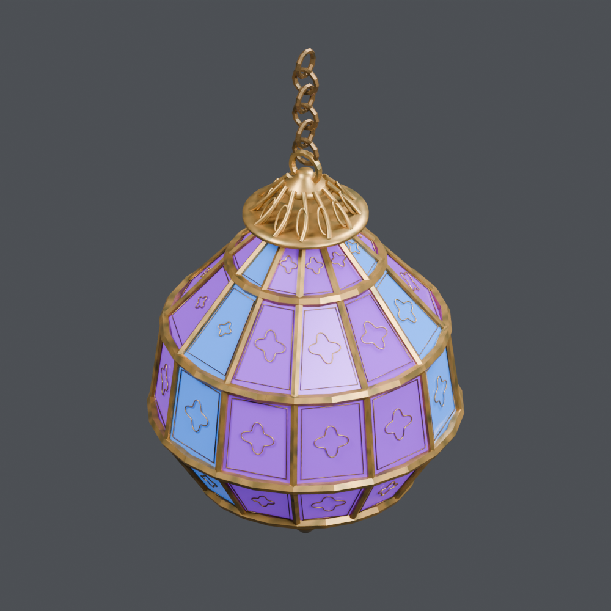

Use / purpose: Violet melon-shaped lantern from the lamp shop collection. Unit: one model record. Includes BLEND and GLB. The close-up is rendered from the distributed BLEND.

Record type: model. Formats: BLEND/GLB.

Reported dimensions (metres; XYZ when derived from measured bounds, legacy axis order not reverified): [0.686, 0.686, 1.23]. Triangles: 47356.

Origin: Unknown / not independently confirmed. Orientation: Unknown / not independently confirmed.

Measured bounds relative to stored coordinates (metres): [[-0.34300002455711365, -0.34300002455711365, 0.0], [0.34300002455711365, 0.34300002455711365, 1.2299998998641968]]. Bounds do not establish the intended placement origin or facing direction.

[Download ZIP](https://github.com/k3peta/tales-on-a-table/releases/download/v2026.10.18/OL_025_CC0.zip) · [License scope](../../LICENSE.md)

**CC0-1.0** — See original ZIP license and repository license scope. Models and embedded materials only; previews excluded.

Source details: [Catalogue 1](../../catalog/candles-light_02.en.md) · [Catalogue 2](../../catalog/candles-light_02.md) · [Catalogue 3](../../catalog/candles-light_02.zh-CN.md)

## OL_026

**Violet onion-shaped lamp**

紫の玉ねぎ形ランプ

Use / purpose: Violet onion-shaped lamp from the lamp shop collection. Unit: one model record. Includes BLEND and GLB. The close-up is rendered from the distributed BLEND.

Record type: model. Formats: BLEND/GLB.

Reported dimensions (metres; XYZ when derived from measured bounds, legacy axis order not reverified): [0.741223, 0.741223, 1.272]. Triangles: 47668.

Origin: Unknown / not independently confirmed. Orientation: Unknown / not independently confirmed.

Measured bounds relative to stored coordinates (metres): [[-0.3706114888191223, -0.3706115186214447, 0.0], [0.3706115484237671, 0.3706114888191223, 1.2719999551773071]]. Bounds do not establish the intended placement origin or facing direction.

[Download ZIP](https://github.com/k3peta/tales-on-a-table/releases/download/v2026.10.18/OL_026_CC0.zip) · [License scope](../../LICENSE.md)

**CC0-1.0** — See original ZIP license and repository license scope. Models and embedded materials only; previews excluded.

Source details: [Catalogue 1](../../catalog/candles-light_02.en.md) · [Catalogue 2](../../catalog/candles-light_02.md) · [Catalogue 3](../../catalog/candles-light_02.zh-CN.md)

## OL_027

**Emerald spherical lamp**

翠色の球形ランプ

Use / purpose: Emerald spherical lamp from the lamp shop collection. Unit: one model record. Includes BLEND and GLB. The close-up is rendered from the distributed BLEND.

Record type: model. Formats: BLEND/GLB.

Reported dimensions (metres; XYZ when derived from measured bounds, legacy axis order not reverified): [0.72, 0.72, 1.227]. Triangles: 47860.

Origin: Unknown / not independently confirmed. Orientation: Unknown / not independently confirmed.

Measured bounds relative to stored coordinates (metres): [[-0.35999998450279236, -0.35999998450279236, 0.0], [0.35999998450279236, 0.35999998450279236, 1.2269998788833618]]. Bounds do not establish the intended placement origin or facing direction.

[Download ZIP](https://github.com/k3peta/tales-on-a-table/releases/download/v2026.10.18/OL_027_CC0.zip) · [License scope](../../LICENSE.md)

**CC0-1.0** — See original ZIP license and repository license scope. Models and embedded materials only; previews excluded.

Source details: [Catalogue 1](../../catalog/candles-light_02.en.md) · [Catalogue 2](../../catalog/candles-light_02.md) · [Catalogue 3](../../catalog/candles-light_02.zh-CN.md)

## OL_028

**Blue flattened-sphere lamp**

青い扁球形ランプ

Use / purpose: Blue flattened-sphere lamp from the lamp shop collection. Unit: one model record. Includes BLEND and GLB. The close-up is rendered from the distributed BLEND.

Record type: model. Formats: BLEND/GLB.

Reported dimensions (metres; XYZ when derived from measured bounds, legacy axis order not reverified): [0.84, 0.84, 1.057]. Triangles: 48244.

Origin: Unknown / not independently confirmed. Orientation: Unknown / not independently confirmed.

Measured bounds relative to stored coordinates (metres): [[-0.41999998688697815, -0.41999998688697815, 0.0], [0.41999998688697815, 0.41999998688697815, 1.0570000410079956]]. Bounds do not establish the intended placement origin or facing direction.

[Download ZIP](https://github.com/k3peta/tales-on-a-table/releases/download/v2026.10.18/OL_028_CC0.zip) · [License scope](../../LICENSE.md)

**CC0-1.0** — See original ZIP license and repository license scope. Models and embedded materials only; previews excluded.

Source details: [Catalogue 1](../../catalog/candles-light_02.en.md) · [Catalogue 2](../../catalog/candles-light_02.md) · [Catalogue 3](../../catalog/candles-light_02.zh-CN.md)

## OL_029

**Decorative hookah**

装飾用の水煙草器

Use / purpose: Decorative hookah from the lamp shop collection. Unit: one model record. Includes BLEND and GLB. The close-up is rendered from the distributed BLEND.

Record type: model. Formats: BLEND/GLB.

Reported dimensions (metres; XYZ when derived from measured bounds, legacy axis order not reverified): [0.817047, 0.884001, 0.95]. Triangles: 13040.

Origin: Unknown / not independently confirmed. Orientation: Unknown / not independently confirmed.

Measured bounds relative to stored coordinates (metres): [[-0.4085233211517334, -0.44200050830841064, 0.0], [0.40852320194244385, 0.4420005679130554, 0.949999988079071]]. Bounds do not establish the intended placement origin or facing direction.

[Download ZIP](https://github.com/k3peta/tales-on-a-table/releases/download/v2026.10.18/OL_029_CC0.zip) · [License scope](../../LICENSE.md)

**CC0-1.0** — See original ZIP license and repository license scope. Models and embedded materials only; previews excluded.

Source details: [Catalogue 1](../../catalog/curios-tools_01.en.md) · [Catalogue 2](../../catalog/curios-tools_01.md) · [Catalogue 3](../../catalog/curios-tools_01.zh-CN.md)

## OL_030

**Additional amber round lantern**

追加の琥珀色丸形ランタン

Use / purpose: Additional amber round lantern from the lamp shop collection. Unit: one model record. Includes BLEND and GLB. The close-up is rendered from the distributed BLEND.

Record type: model. Formats: BLEND/GLB.

Reported dimensions (metres; XYZ when derived from measured bounds, legacy axis order not reverified): [0.446, 0.446, 1.17]. Triangles: 47644.

Origin: Unknown / not independently confirmed. Orientation: Unknown / not independently confirmed.

Measured bounds relative to stored coordinates (metres): [[-0.22299998998641968, -0.22299998998641968, 0.0], [0.22299998998641968, 0.22299998998641968, 1.1699999570846558]]. Bounds do not establish the intended placement origin or facing direction.

[Download ZIP](https://github.com/k3peta/tales-on-a-table/releases/download/v2026.10.18/OL_030_CC0.zip) · [License scope](../../LICENSE.md)

**CC0-1.0** — See original ZIP license and repository license scope. Models and embedded materials only; previews excluded.

Source details: [Catalogue 1](../../catalog/candles-light_02.en.md) · [Catalogue 2](../../catalog/candles-light_02.md) · [Catalogue 3](../../catalog/candles-light_02.zh-CN.md)

## OL_031

**Additional blue hexagonal lantern**

追加の青い六角ランタン

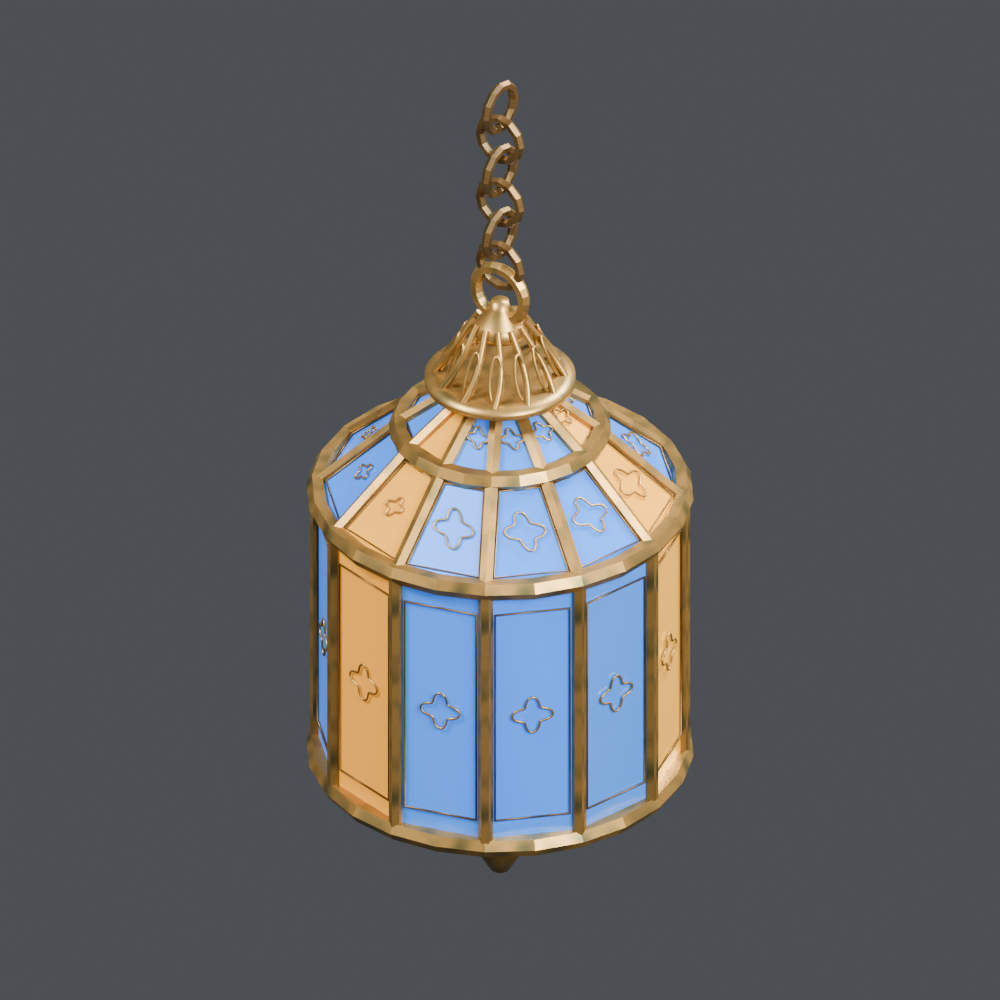

Use / purpose: Additional blue hexagonal lantern from the lamp shop collection. Unit: one model record. Includes BLEND and GLB. The close-up is rendered from the distributed BLEND.

Record type: model. Formats: BLEND/GLB.

Reported dimensions (metres; XYZ when derived from measured bounds, legacy axis order not reverified): [0.466, 0.466, 1.12]. Triangles: 39196.

Origin: Unknown / not independently confirmed. Orientation: Unknown / not independently confirmed.

Measured bounds relative to stored coordinates (metres): [[-0.2329999953508377, -0.2329999953508377, 0.0], [0.2329999953508377, 0.2329999953508377, 1.1200000047683716]]. Bounds do not establish the intended placement origin or facing direction.

[Download ZIP](https://github.com/k3peta/tales-on-a-table/releases/download/v2026.10.18/OL_031_CC0.zip) · [License scope](../../LICENSE.md)

**CC0-1.0** — See original ZIP license and repository license scope. Models and embedded materials only; previews excluded.

Source details: [Catalogue 1](../../catalog/candles-light_02.en.md) · [Catalogue 2](../../catalog/candles-light_02.md) · [Catalogue 3](../../catalog/candles-light_02.zh-CN.md)

## OL_032

**Additional crimson teardrop lantern**

追加の紅色しずく形ランタン

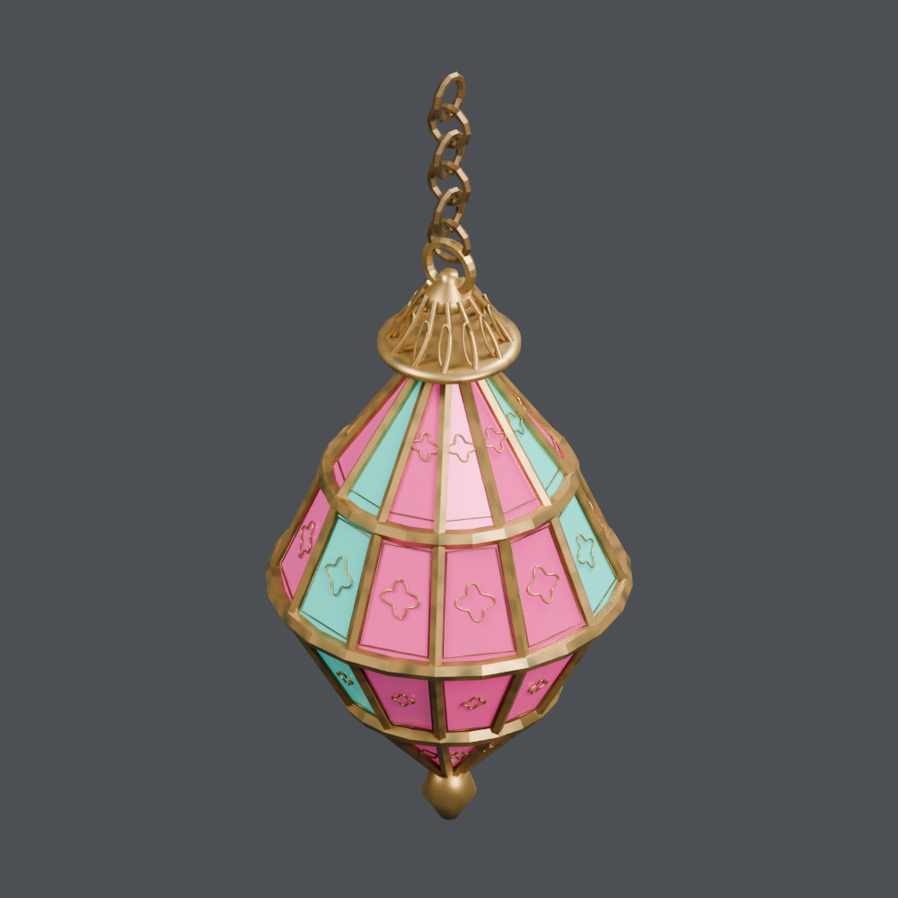

Use / purpose: Additional crimson teardrop lantern from the lamp shop collection. Unit: one model record. Includes BLEND and GLB. The close-up is rendered from the distributed BLEND.

Record type: model. Formats: BLEND/GLB.

Reported dimensions (metres; XYZ when derived from measured bounds, legacy axis order not reverified): [0.486, 0.486, 1.16]. Triangles: 39196.

Origin: Unknown / not independently confirmed. Orientation: Unknown / not independently confirmed.

Measured bounds relative to stored coordinates (metres): [[-0.24300000071525574, -0.24300000071525574, 0.0], [0.24300000071525574, 0.24300000071525574, 1.159999966621399]]. Bounds do not establish the intended placement origin or facing direction.

[Download ZIP](https://github.com/k3peta/tales-on-a-table/releases/download/v2026.10.18/OL_032_CC0.zip) · [License scope](../../LICENSE.md)

**CC0-1.0** — See original ZIP license and repository license scope. Models and embedded materials only; previews excluded.

Source details: [Catalogue 1](../../catalog/candles-light_02.en.md) · [Catalogue 2](../../catalog/candles-light_02.md) · [Catalogue 3](../../catalog/candles-light_02.zh-CN.md)
