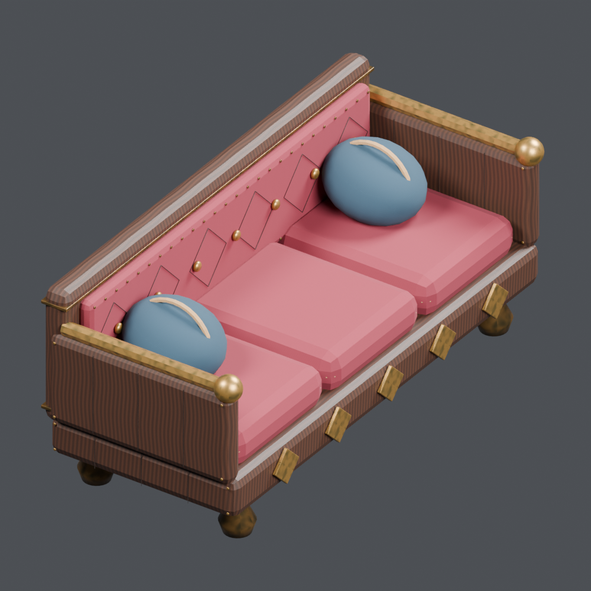
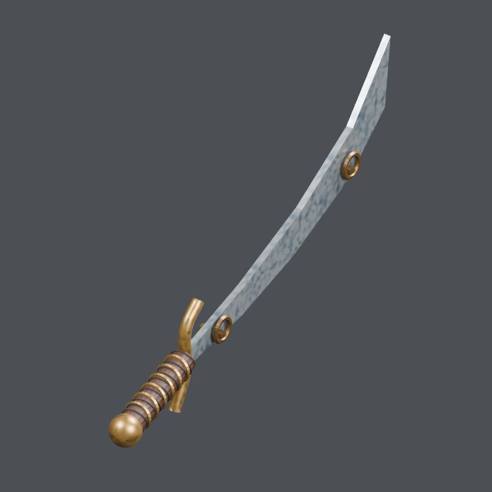
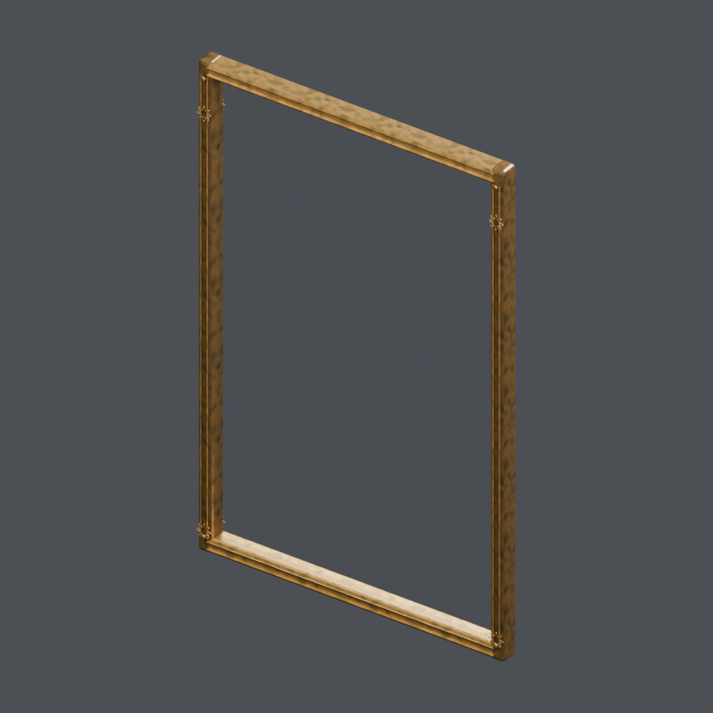
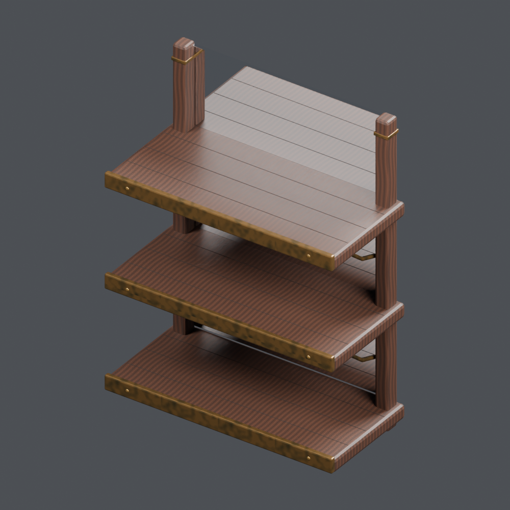
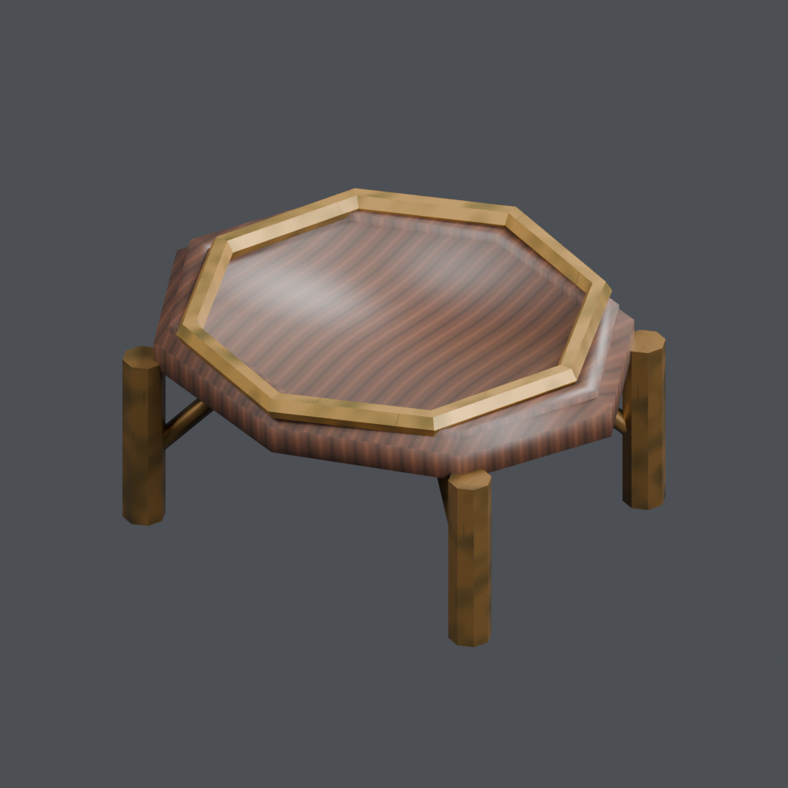

# Base distribution records 145–168

[Browse index](README.md) · [Coverage and missing fields](COVERAGE.md)

Images are actual existing model renders for browsing, not covered by model CC0. A group record may show several reused models. Dimensions and triangle counts apply only to the original record when sourced; revisions can differ. Unknown means unverified, not zero. No blanket CC0 grant for scenes, images, code or articles.

## OL_033

**Gold-decorated jewelry box**

金装飾の宝石箱

Use / purpose: Gold-decorated jewelry box from the lamp shop collection. Unit: one model record. Includes BLEND and GLB. The close-up is rendered from the distributed BLEND.

Record type: model. Formats: BLEND/GLB.

Reported dimensions (metres; XYZ when derived from measured bounds, legacy axis order not reverified): [0.41, 0.321, 0.243]. Triangles: 4952.

Origin: Unknown / not independently confirmed. Orientation: Unknown / not independently confirmed.

Measured bounds relative to stored coordinates (metres): [[-0.20499999821186066, -0.1680000126361847, 0.0], [0.20499999821186066, 0.15299999713897705, 0.24300000071525574]]. Bounds do not establish the intended placement origin or facing direction.

[Download ZIP](https://github.com/k3peta/tales-on-a-table/releases/download/v2026.10.18/OL_033_CC0.zip) · [License scope](../../LICENSE.md)

**CC0-1.0** — See original ZIP license and repository license scope. Models and embedded materials only; previews excluded.

Source details: [Catalogue 1](../../catalog/containers_01.en.md) · [Catalogue 2](../../catalog/containers_01.md) · [Catalogue 3](../../catalog/containers_01.zh-CN.md)

## OL_034

**Merchant chest with gold bands**

金帯の商人の櫃

Use / purpose: Merchant chest with gold bands from the lamp shop collection. Unit: one model record. Includes BLEND and GLB. The close-up is rendered from the distributed BLEND.

Record type: model. Formats: BLEND/GLB.

Reported dimensions (metres; XYZ when derived from measured bounds, legacy axis order not reverified): [0.875, 0.746, 0.747]. Triangles: 12592.

Origin: Unknown / not independently confirmed. Orientation: Unknown / not independently confirmed.

Measured bounds relative to stored coordinates (metres): [[-0.4375000596046448, -0.38140618801116943, 0.0], [0.4375000596046448, 0.36459383368492126, 0.7470000386238098]]. Bounds do not establish the intended placement origin or facing direction.

[Download ZIP](https://github.com/k3peta/tales-on-a-table/releases/download/v2026.10.18/OL_034_CC0.zip) · [License scope](../../LICENSE.md)

**CC0-1.0** — See original ZIP license and repository license scope. Models and embedded materials only; previews excluded.

Source details: [Catalogue 1](../../catalog/containers_02.en.md) · [Catalogue 2](../../catalog/containers_02.md) · [Catalogue 3](../../catalog/containers_02.zh-CN.md)

## OL_035

**Indigo wall carpet**

壁掛けの藍色絨毯

Use / purpose: Indigo wall carpet from the lamp shop collection. Unit: one model record. Includes BLEND and GLB. The close-up is rendered from the distributed BLEND.

Record type: model. Formats: BLEND/GLB.

Reported dimensions (metres; XYZ when derived from measured bounds, legacy axis order not reverified): [0.094, 1.19, 1.517]. Triangles: 6536.

Origin: Unknown / not independently confirmed. Orientation: Unknown / not independently confirmed.

Measured bounds relative to stored coordinates (metres): [[-0.04425007849931717, -0.5950000882148743, 5.899896038386032e-08], [0.04974991828203201, 0.5950000882148743, 1.5170000791549683]]. Bounds do not establish the intended placement origin or facing direction.

[Download ZIP](https://github.com/k3peta/tales-on-a-table/releases/download/v2026.10.18/OL_035_CC0.zip) · [License scope](../../LICENSE.md)

**CC0-1.0** — See original ZIP license and repository license scope. Models and embedded materials only; previews excluded.

Source details: [Catalogue 1](../../catalog/textiles_01.en.md) · [Catalogue 2](../../catalog/textiles_01.md) · [Catalogue 3](../../catalog/textiles_01.zh-CN.md)

## OL_036

**Velvet chaise longue**

横たわるためのベルベット長椅子

Use / purpose: Velvet chaise longue from the lamp shop collection. Unit: one model record. Includes BLEND and GLB. The close-up is rendered from the distributed BLEND.

Record type: model. Formats: BLEND/GLB.

Reported dimensions (metres; XYZ when derived from measured bounds, legacy axis order not reverified): [1.061, 2.43, 1.025]. Triangles: 44472.

Origin: Unknown / not independently confirmed. Orientation: Unknown / not independently confirmed.

Measured bounds relative to stored coordinates (metres): [[-0.5435001254081726, -1.215000033378601, 0.0], [0.5174999833106995, 1.2149999141693115, 1.024999976158142]]. Bounds do not establish the intended placement origin or facing direction.

[Download ZIP](https://github.com/k3peta/tales-on-a-table/releases/download/v2026.10.18/OL_036_CC0.zip) · [License scope](../../LICENSE.md)

**CC0-1.0** — See original ZIP license and repository license scope. Models and embedded materials only; previews excluded.

Source details: [Catalogue 1](../../catalog/furniture_02.en.md) · [Catalogue 2](../../catalog/furniture_02.md) · [Catalogue 3](../../catalog/furniture_02.zh-CN.md)

## OL_037

**Small pile of gold coins**

小さな金貨の山

Use / purpose: Small pile of gold coins from the lamp shop collection. Unit: one model record. Includes BLEND and GLB. The close-up is rendered from the distributed BLEND.

Record type: model. Formats: BLEND/GLB.

Reported dimensions (metres; XYZ when derived from measured bounds, legacy axis order not reverified): [0.156751, 0.216509, 0.034639]. Triangles: 15516.

Origin: Unknown / not independently confirmed. Orientation: Unknown / not independently confirmed.

Measured bounds relative to stored coordinates (metres): [[-0.07837557792663574, -0.10825440287590027, 0.0], [0.07837581634521484, 0.10825440287590027, 0.03463922441005707]]. Bounds do not establish the intended placement origin or facing direction.

[Download ZIP](https://github.com/k3peta/tales-on-a-table/releases/download/v2026.10.18/OL_037_CC0.zip) · [License scope](../../LICENSE.md)

**CC0-1.0** — See original ZIP license and repository license scope. Models and embedded materials only; previews excluded.

Source details: [Catalogue 1](../../catalog/curios-tools_01.en.md) · [Catalogue 2](../../catalog/curios-tools_01.md) · [Catalogue 3](../../catalog/curios-tools_01.zh-CN.md)

## OL_038

**Decorative wall-mounted scimitar**

壁飾りの曲刀

Use / purpose: Decorative wall-mounted scimitar from the lamp shop collection. Unit: one model record. Includes BLEND and GLB. The close-up is rendered from the distributed BLEND.

Record type: model. Formats: BLEND/GLB.

Reported dimensions (metres; XYZ when derived from measured bounds, legacy axis order not reverified): [0.14, 1.94, 1.010529]. Triangles: 7672.

Origin: Unknown / not independently confirmed. Orientation: Unknown / not independently confirmed.

Measured bounds relative to stored coordinates (metres): [[-0.07000003010034561, -0.9699999690055847, 0.0], [0.07000000774860382, 0.9700000286102295, 1.0105289220809937]]. Bounds do not establish the intended placement origin or facing direction.

[Download ZIP](https://github.com/k3peta/tales-on-a-table/releases/download/v2026.10.18/OL_038_CC0.zip) · [License scope](../../LICENSE.md)

**CC0-1.0** — See original ZIP license and repository license scope. Models and embedded materials only; previews excluded.

Source details: [Catalogue 1](../../catalog/weapons-equipment_01.en.md) · [Catalogue 2](../../catalog/weapons-equipment_01.md) · [Catalogue 3](../../catalog/weapons-equipment_01.zh-CN.md)

## OL_039

**Spherical mosaic pendant lamp**

球形モザイクの吊りランプ

Use / purpose: Spherical mosaic pendant lamp from the lamp shop collection. Unit: one model record. Includes BLEND and GLB. The close-up is rendered from the distributed BLEND.

Record type: model. Formats: BLEND/GLB.

Reported dimensions (metres; XYZ when derived from measured bounds, legacy axis order not reverified): [0.539981, 0.539981, 1.148]. Triangles: 170300.

Origin: Unknown / not independently confirmed. Orientation: Unknown / not independently confirmed.

Measured bounds relative to stored coordinates (metres): [[-0.26999029517173767, -0.26999029517173767, 0.0], [0.26999029517173767, 0.26999029517173767, 1.1480000019073486]]. Bounds do not establish the intended placement origin or facing direction.

[Download ZIP](https://github.com/k3peta/tales-on-a-table/releases/download/v2026.10.18/OL_039_CC0.zip) · [License scope](../../LICENSE.md)

**CC0-1.0** — See original ZIP license and repository license scope. Models and embedded materials only; previews excluded.

Source details: [Catalogue 1](../../catalog/candles-light_02.en.md) · [Catalogue 2](../../catalog/candles-light_02.md) · [Catalogue 3](../../catalog/candles-light_02.zh-CN.md)

## OL_040

**Flattened-sphere mosaic pendant lamp**

扁球形モザイクの吊りランプ

Use / purpose: Flattened-sphere mosaic pendant lamp from the lamp shop collection. Unit: one model record. Includes BLEND and GLB. The close-up is rendered from the distributed BLEND.

Record type: model. Formats: BLEND/GLB.

Reported dimensions (metres; XYZ when derived from measured bounds, legacy axis order not reverified): [0.679976, 0.679976, 0.998]. Triangles: 191804.

Origin: Unknown / not independently confirmed. Orientation: Unknown / not independently confirmed.

Measured bounds relative to stored coordinates (metres): [[-0.33998778462409973, -0.33998778462409973, 0.0], [0.33998778462409973, 0.33998778462409973, 0.9980000257492065]]. Bounds do not establish the intended placement origin or facing direction.

[Download ZIP](https://github.com/k3peta/tales-on-a-table/releases/download/v2026.10.18/OL_040_CC0.zip) · [License scope](../../LICENSE.md)

**CC0-1.0** — See original ZIP license and repository license scope. Models and embedded materials only; previews excluded.

Source details: [Catalogue 1](../../catalog/candles-light_02.en.md) · [Catalogue 2](../../catalog/candles-light_02.md) · [Catalogue 3](../../catalog/candles-light_02.zh-CN.md)

## OL_041

**Onion-shaped mosaic pendant lamp**

玉ねぎ形モザイクの吊りランプ

Use / purpose: Onion-shaped mosaic pendant lamp from the lamp shop collection. Unit: one model record. Includes BLEND and GLB. The close-up is rendered from the distributed BLEND.

Record type: model. Formats: BLEND/GLB.

Reported dimensions (metres; XYZ when derived from measured bounds, legacy axis order not reverified): [0.562021, 0.562021, 1.218]. Triangles: 148796.

Origin: Unknown / not independently confirmed. Orientation: Unknown / not independently confirmed.

Measured bounds relative to stored coordinates (metres): [[-0.2810106575489044, -0.2810106575489044, 0.0], [0.2810106575489044, 0.2810106575489044, 1.218000054359436]]. Bounds do not establish the intended placement origin or facing direction.

[Download ZIP](https://github.com/k3peta/tales-on-a-table/releases/download/v2026.10.18/OL_041_CC0.zip) · [License scope](../../LICENSE.md)

**CC0-1.0** — See original ZIP license and repository license scope. Models and embedded materials only; previews excluded.

Source details: [Catalogue 1](../../catalog/candles-light_03.en.md) · [Catalogue 2](../../catalog/candles-light_03.md) · [Catalogue 3](../../catalog/candles-light_03.zh-CN.md)

## OL_042

**Teardrop mosaic pendant lamp**

しずく形モザイクの吊りランプ

Use / purpose: Teardrop mosaic pendant lamp from the lamp shop collection. Unit: one model record. Includes BLEND and GLB. The close-up is rendered from the distributed BLEND.

Record type: model. Formats: BLEND/GLB.

Reported dimensions (metres; XYZ when derived from measured bounds, legacy axis order not reverified): [0.554356, 0.55394, 1.248]. Triangles: 199868.

Origin: Unknown / not independently confirmed. Orientation: Unknown / not independently confirmed.

Measured bounds relative to stored coordinates (metres): [[-0.27716562151908875, -0.27702218294143677, 0.0], [0.277190238237381, 0.2769174873828888, 1.2480000257492065]]. Bounds do not establish the intended placement origin or facing direction.

[Download ZIP](https://github.com/k3peta/tales-on-a-table/releases/download/v2026.10.18/OL_042_CC0.zip) · [License scope](../../LICENSE.md)

**CC0-1.0** — See original ZIP license and repository license scope. Models and embedded materials only; previews excluded.

Source details: [Catalogue 1](../../catalog/candles-light_03.en.md) · [Catalogue 2](../../catalog/candles-light_03.md) · [Catalogue 3](../../catalog/candles-light_03.zh-CN.md)

## OL_043

**Low-base table lamp**

低い台座の卓上ランプ

Use / purpose: Low-base table lamp from the lamp shop collection. Unit: one model record. Includes BLEND and GLB. The close-up is rendered from the distributed BLEND.

Record type: model. Formats: BLEND/GLB.

Reported dimensions (metres; XYZ when derived from measured bounds, legacy axis order not reverified): [0.419985, 0.419813, 0.585]. Triangles: 161196.

Origin: Unknown / not independently confirmed. Orientation: Unknown / not independently confirmed.

Measured bounds relative to stored coordinates (metres): [[-0.2099923938512802, -0.20991408824920654, 0.0], [0.2099923938512802, 0.2098993957042694, 0.5849999785423279]]. Bounds do not establish the intended placement origin or facing direction.

[Download ZIP](https://github.com/k3peta/tales-on-a-table/releases/download/v2026.10.18/OL_043_CC0.zip) · [License scope](../../LICENSE.md)

**CC0-1.0** — See original ZIP license and repository license scope. Models and embedded materials only; previews excluded.

Source details: [Catalogue 1](../../catalog/candles-light_03.en.md) · [Catalogue 2](../../catalog/candles-light_03.md) · [Catalogue 3](../../catalog/candles-light_03.zh-CN.md)

## OL_044

**Tall-stem table lamp**

背の高い支柱の卓上ランプ

Use / purpose: Tall-stem table lamp from the lamp shop collection. Unit: one model record. Includes BLEND and GLB. The close-up is rendered from the distributed BLEND.

Record type: model. Formats: BLEND/GLB.

Reported dimensions (metres; XYZ when derived from measured bounds, legacy axis order not reverified): [0.399985, 0.399985, 0.805192]. Triangles: 172140.

Origin: Unknown / not independently confirmed. Orientation: Unknown / not independently confirmed.

Measured bounds relative to stored coordinates (metres): [[-0.19999270141124725, -0.19999270141124725, 0.0], [0.19999270141124725, 0.19999270141124725, 0.8051918745040894]]. Bounds do not establish the intended placement origin or facing direction.

[Download ZIP](https://github.com/k3peta/tales-on-a-table/releases/download/v2026.10.18/OL_044_CC0.zip) · [License scope](../../LICENSE.md)

**CC0-1.0** — See original ZIP license and repository license scope. Models and embedded materials only; previews excluded.

Source details: [Catalogue 1](../../catalog/candles-light_03.en.md) · [Catalogue 2](../../catalog/candles-light_03.md) · [Catalogue 3](../../catalog/candles-light_03.zh-CN.md)

## OL_045

**Tripod table lamp**

三脚の卓上ランプ

Use / purpose: Tripod table lamp from the lamp shop collection. Unit: one model record. Includes BLEND and GLB. The close-up is rendered from the distributed BLEND.

Record type: model. Formats: BLEND/GLB.

Reported dimensions (metres; XYZ when derived from measured bounds, legacy axis order not reverified): [0.459982, 0.459982, 0.597739]. Triangles: 131936.

Origin: Unknown / not independently confirmed. Orientation: Unknown / not independently confirmed.

Measured bounds relative to stored coordinates (metres): [[-0.22999098896980286, -0.22999098896980286, 0.0], [0.22999098896980286, 0.22999098896980286, 0.5977388024330139]]. Bounds do not establish the intended placement origin or facing direction.

[Download ZIP](https://github.com/k3peta/tales-on-a-table/releases/download/v2026.10.18/OL_045_CC0.zip) · [License scope](../../LICENSE.md)

**CC0-1.0** — See original ZIP license and repository license scope. Models and embedded materials only; previews excluded.

Source details: [Catalogue 1](../../catalog/candles-light_03.en.md) · [Catalogue 2](../../catalog/candles-light_03.md) · [Catalogue 3](../../catalog/candles-light_03.zh-CN.md)

## OL_046

**Gooseneck table lamp**

曲がり首の卓上ランプ

Use / purpose: Gooseneck table lamp from the lamp shop collection. Unit: one model record. Includes BLEND and GLB. The close-up is rendered from the distributed BLEND.

Record type: model. Formats: BLEND/GLB.

Reported dimensions (metres; XYZ when derived from measured bounds, legacy axis order not reverified): [0.64083, 0.36, 0.861126]. Triangles: 215928.

Origin: Unknown / not independently confirmed. Orientation: Unknown / not independently confirmed.

Measured bounds relative to stored coordinates (metres): [[-0.32041385769844055, -0.18000000715255737, 0.0], [0.3204162120819092, 0.18000000715255737, 0.8611257076263428]]. Bounds do not establish the intended placement origin or facing direction.

[Download ZIP](https://github.com/k3peta/tales-on-a-table/releases/download/v2026.10.18/OL_046_CC0.zip) · [License scope](../../LICENSE.md)

**CC0-1.0** — See original ZIP license and repository license scope. Models and embedded materials only; previews excluded.

Source details: [Catalogue 1](../../catalog/candles-light_03.en.md) · [Catalogue 2](../../catalog/candles-light_03.md) · [Catalogue 3](../../catalog/candles-light_03.zh-CN.md)

## OL_047

**Two-arm table lamp**

二枝の卓上ランプ

Use / purpose: Two-arm table lamp from the lamp shop collection. Unit: one model record. Includes BLEND and GLB. The close-up is rendered from the distributed BLEND.

Record type: model. Formats: BLEND/GLB.

Reported dimensions (metres; XYZ when derived from measured bounds, legacy axis order not reverified): [0.900373, 0.36, 0.825]. Triangles: 340576.

Origin: Unknown / not independently confirmed. Orientation: Unknown / not independently confirmed.

Measured bounds relative to stored coordinates (metres): [[-0.45018628239631653, -0.18000000715255737, 0.0], [0.45018628239631653, 0.18000000715255737, 0.824999988079071]]. Bounds do not establish the intended placement origin or facing direction.

[Download ZIP](https://github.com/k3peta/tales-on-a-table/releases/download/v2026.10.18/OL_047_CC0.zip) · [License scope](../../LICENSE.md)

**CC0-1.0** — See original ZIP license and repository license scope. Models and embedded materials only; previews excluded.

Source details: [Catalogue 1](../../catalog/candles-light_03.en.md) · [Catalogue 2](../../catalog/candles-light_03.md) · [Catalogue 3](../../catalog/candles-light_03.zh-CN.md)

## OL_048

**Three-tier floor lamp**

三段の床置きランプ

Use / purpose: Three-tier floor lamp from the lamp shop collection. Unit: one model record. Includes BLEND and GLB. The close-up is rendered from the distributed BLEND.

Record type: model. Formats: BLEND/GLB.

Reported dimensions (metres; XYZ when derived from measured bounds, legacy axis order not reverified): [0.775303, 0.842598, 1.737599]. Triangles: 575108.

Origin: Unknown / not independently confirmed. Orientation: Unknown / not independently confirmed.

Measured bounds relative to stored coordinates (metres): [[-0.3876514732837677, -0.4212988317012787, 0.0], [0.3876514732837677, 0.4212988317012787, 1.7375993728637695]]. Bounds do not establish the intended placement origin or facing direction.

[Download ZIP](https://github.com/k3peta/tales-on-a-table/releases/download/v2026.10.18/OL_048_CC0.zip) · [License scope](../../LICENSE.md)

**CC0-1.0** — See original ZIP license and repository license scope. Models and embedded materials only; previews excluded.

Source details: [Catalogue 1](../../catalog/candles-light_03.en.md) · [Catalogue 2](../../catalog/candles-light_03.md) · [Catalogue 3](../../catalog/candles-light_03.zh-CN.md)

## OL_049

**Five-light chandelier**

五灯のシャンデリア

Use / purpose: Five-light chandelier from the lamp shop collection. Unit: one model record. Includes BLEND and GLB. The close-up is rendered from the distributed BLEND.

Record type: model. Formats: BLEND/GLB.

Reported dimensions (metres; XYZ when derived from measured bounds, legacy axis order not reverified): [0.987415, 1.022792, 1.298]. Triangles: 751396.

Origin: Unknown / not independently confirmed. Orientation: Unknown / not independently confirmed.

Measured bounds relative to stored coordinates (metres): [[-0.4937076270580292, -0.5113958716392517, 0.0], [0.4937076270580292, 0.5113958716392517, 1.2979999780654907]]. Bounds do not establish the intended placement origin or facing direction.

[Download ZIP](https://github.com/k3peta/tales-on-a-table/releases/download/v2026.10.18/OL_049_CC0.zip) · [License scope](../../LICENSE.md)

**CC0-1.0** — See original ZIP license and repository license scope. Models and embedded materials only; previews excluded.

Source details: [Catalogue 1](../../catalog/candles-light_03.en.md) · [Catalogue 2](../../catalog/candles-light_03.md) · [Catalogue 3](../../catalog/candles-light_03.zh-CN.md)

## OL_050

**Curved ornamental wall light**

曲線装飾の壁付け灯

Use / purpose: Curved ornamental wall light from the lamp shop collection. Unit: one model record. Includes BLEND and GLB. The close-up is rendered from the distributed BLEND.

Record type: model. Formats: BLEND/GLB.

Reported dimensions (metres; XYZ when derived from measured bounds, legacy axis order not reverified): [0.354129, 0.554626, 0.846665]. Triangles: 202032.

Origin: Unknown / not independently confirmed. Orientation: Unknown / not independently confirmed.

Measured bounds relative to stored coordinates (metres): [[-0.1767929494380951, -0.27740880846977234, 0.0], [0.17733630537986755, 0.2772168815135956, 0.8466647863388062]]. Bounds do not establish the intended placement origin or facing direction.

[Download ZIP](https://github.com/k3peta/tales-on-a-table/releases/download/v2026.10.18/OL_050_CC0.zip) · [License scope](../../LICENSE.md)

**CC0-1.0** — See original ZIP license and repository license scope. Models and embedded materials only; previews excluded.

Source details: [Catalogue 1](../../catalog/candles-light_03.en.md) · [Catalogue 2](../../catalog/candles-light_03.md) · [Catalogue 3](../../catalog/candles-light_03.zh-CN.md)

## OL_051

**Hexagonal mosaic shelf lantern**

六角モザイクの棚置きランタン

Use / purpose: Hexagonal mosaic shelf lantern from the lamp shop collection. Unit: one model record. Includes BLEND and GLB. The close-up is rendered from the distributed BLEND.

Record type: model. Formats: BLEND/GLB.

Reported dimensions (metres; XYZ when derived from measured bounds, legacy axis order not reverified): [0.44, 0.381051, 0.693]. Triangles: 20976.

Origin: Unknown / not independently confirmed. Orientation: Unknown / not independently confirmed.

Measured bounds relative to stored coordinates (metres): [[-0.2199999988079071, -0.1905255913734436, 0.0], [0.2199999988079071, 0.1905255913734436, 0.6930000185966492]]. Bounds do not establish the intended placement origin or facing direction.

[Download ZIP](https://github.com/k3peta/tales-on-a-table/releases/download/v2026.10.18/OL_051_CC0.zip) · [License scope](../../LICENSE.md)

**CC0-1.0** — See original ZIP license and repository license scope. Models and embedded materials only; previews excluded.

Source details: [Catalogue 1](../../catalog/candles-light_03.en.md) · [Catalogue 2](../../catalog/candles-light_03.md) · [Catalogue 3](../../catalog/candles-light_03.zh-CN.md)

## OL_052

**Pierced brass lantern**

透かし真鍮ランタン

Use / purpose: Pierced brass lantern from the lamp shop collection. Unit: one model record. Includes BLEND and GLB. The close-up is rendered from the distributed BLEND.

Record type: model. Formats: BLEND/GLB.

Reported dimensions (metres; XYZ when derived from measured bounds, legacy axis order not reverified): [0.44, 0.44, 0.638]. Triangles: 146856.

Origin: Unknown / not independently confirmed. Orientation: Unknown / not independently confirmed.

Measured bounds relative to stored coordinates (metres): [[-0.2199999988079071, -0.2199999988079071, 0.0], [0.2199999988079071, 0.2199999988079071, 0.6380000114440918]]. Bounds do not establish the intended placement origin or facing direction.

[Download ZIP](https://github.com/k3peta/tales-on-a-table/releases/download/v2026.10.18/OL_052_CC0.zip) · [License scope](../../LICENSE.md)

**CC0-1.0** — See original ZIP license and repository license scope. Models and embedded materials only; previews excluded.

Source details: [Catalogue 1](../../catalog/candles-light_03.en.md) · [Catalogue 2](../../catalog/candles-light_03.md) · [Catalogue 3](../../catalog/candles-light_03.zh-CN.md)

## OL_053

**Framed mirror panel**

額縁付き鏡パネル

Use / purpose: Framed mirror panel from the lamp shop collection. Unit: one model record. Includes BLEND and GLB. The close-up is rendered from the distributed BLEND.

Record type: model. Formats: BLEND/GLB.

Reported dimensions (metres; XYZ when derived from measured bounds, legacy axis order not reverified): [1.156078, 0.07944, 1.81]. Triangles: 8204.

Origin: Unknown / not independently confirmed. Orientation: Unknown / not independently confirmed.

Measured bounds relative to stored coordinates (metres): [[-0.5780392289161682, -0.044440001249313354, 0.0], [0.5780392289161682, 0.03500000014901161, 1.809999942779541]]. Bounds do not establish the intended placement origin or facing direction.

[Download ZIP](https://github.com/k3peta/tales-on-a-table/releases/download/v2026.10.18/OL_053_CC0.zip) · [License scope](../../LICENSE.md)

**CC0-1.0** — See original ZIP license and repository license scope. Models and embedded materials only; previews excluded.

Source details: [Catalogue 1](../../catalog/furniture_02.en.md) · [Catalogue 2](../../catalog/furniture_02.md) · [Catalogue 3](../../catalog/furniture_02.zh-CN.md)

## OL_054

**Three-tier shelf with mirror**

鏡付き三段棚

Use / purpose: Three-tier shelf with mirror from the lamp shop collection. Unit: one model record. Includes BLEND and GLB. The close-up is rendered from the distributed BLEND.

Record type: model. Formats: BLEND/GLB.

Reported dimensions (metres; XYZ when derived from measured bounds, legacy axis order not reverified): [1.08, 0.51969, 1.44]. Triangles: 5928.

Origin: Unknown / not independently confirmed. Orientation: Unknown / not independently confirmed.

Measured bounds relative to stored coordinates (metres): [[-0.5400000214576721, -0.2614400088787079, 0.0], [0.5400000214576721, 0.25824999809265137, 1.440000057220459]]. Bounds do not establish the intended placement origin or facing direction.

[Download ZIP](https://github.com/k3peta/tales-on-a-table/releases/download/v2026.10.18/OL_054_CC0.zip) · [License scope](../../LICENSE.md)

**CC0-1.0** — See original ZIP license and repository license scope. Models and embedded materials only; previews excluded.

Source details: [Catalogue 1](../../catalog/furniture_02.en.md) · [Catalogue 2](../../catalog/furniture_02.md) · [Catalogue 3](../../catalog/furniture_02.zh-CN.md)

## OL_055

**Small display pedestal**

小さな展示台

Use / purpose: Small display pedestal from the lamp shop collection. Unit: one model record. Includes BLEND and GLB. The close-up is rendered from the distributed BLEND.

Record type: model. Formats: BLEND/GLB.

Reported dimensions (metres; XYZ when derived from measured bounds, legacy axis order not reverified): [0.48, 0.404, 0.220392]. Triangles: 396.

Origin: Unknown / not independently confirmed. Orientation: Unknown / not independently confirmed.

Measured bounds relative to stored coordinates (metres): [[-0.23999999463558197, -0.2019999921321869, 0.0], [0.23999999463558197, 0.2019999921321869, 0.22039230167865753]]. Bounds do not establish the intended placement origin or facing direction.

[Download ZIP](https://github.com/k3peta/tales-on-a-table/releases/download/v2026.10.18/OL_055_CC0.zip) · [License scope](../../LICENSE.md)

**CC0-1.0** — See original ZIP license and repository license scope. Models and embedded materials only; previews excluded.

Source details: [Catalogue 1](../../catalog/furniture_02.en.md) · [Catalogue 2](../../catalog/furniture_02.md) · [Catalogue 3](../../catalog/furniture_02.zh-CN.md)

[Quality 18 revision and comparison](../../catalog/material_variants_ol055_story_at001.md). Original download retained; AT001 revised triangle count is 6068, not the original measurement.

## OL_056

**Ceiling rosette and hook**

天井の飾り座とフック

Use / purpose: Ceiling rosette and hook from the lamp shop collection. Unit: one model record. Includes BLEND and GLB. The close-up is rendered from the distributed BLEND.

Record type: model. Formats: BLEND/GLB.

Reported dimensions (metres; XYZ when derived from measured bounds, legacy axis order not reverified): [0.2, 0.2, 0.158]. Triangles: 5708.

Origin: Unknown / not independently confirmed. Orientation: Unknown / not independently confirmed.

Measured bounds relative to stored coordinates (metres): [[-0.10000000149011612, -0.10000000149011612, 0.0], [0.10000000149011612, 0.10000000149011612, 0.15800000727176666]]. Bounds do not establish the intended placement origin or facing direction.

[Download ZIP](https://github.com/k3peta/tales-on-a-table/releases/download/v2026.10.18/OL_056_CC0.zip) · [License scope](../../LICENSE.md)

**CC0-1.0** — See original ZIP license and repository license scope. Models and embedded materials only; previews excluded.

Source details: [Catalogue 1](../../catalog/curios-tools_02.en.md) · [Catalogue 2](../../catalog/curios-tools_02.md) · [Catalogue 3](../../catalog/curios-tools_02.zh-CN.md)
