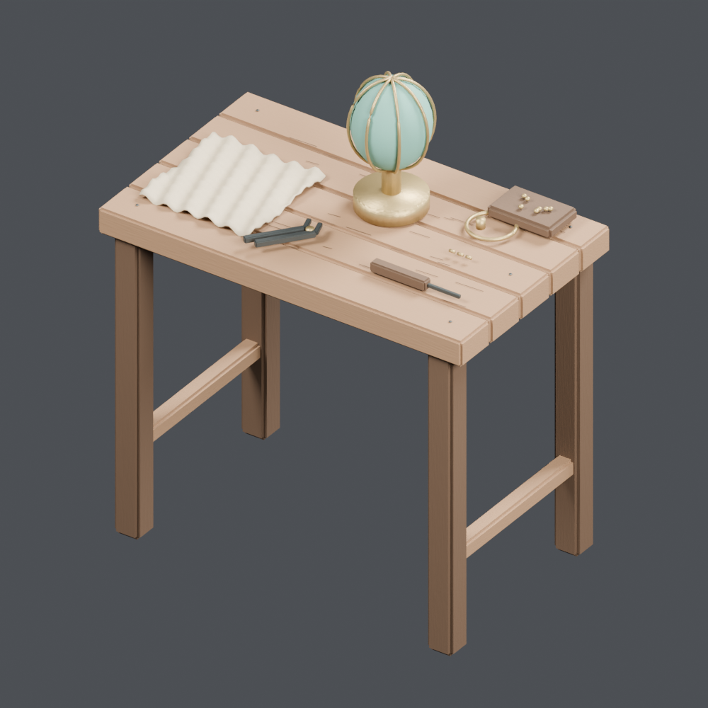
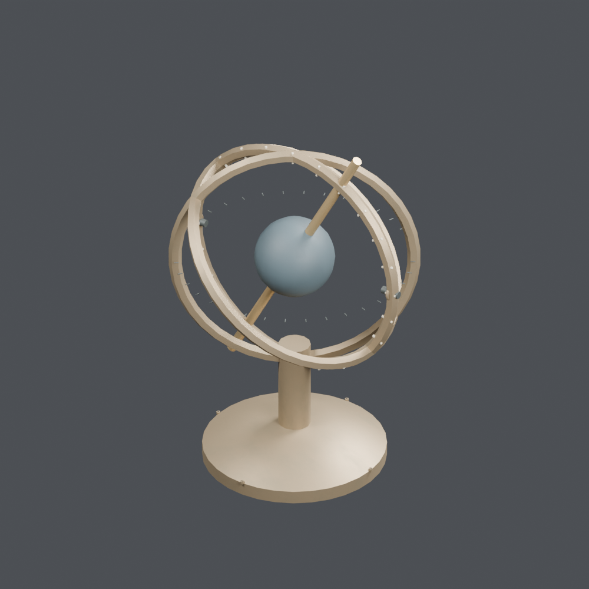
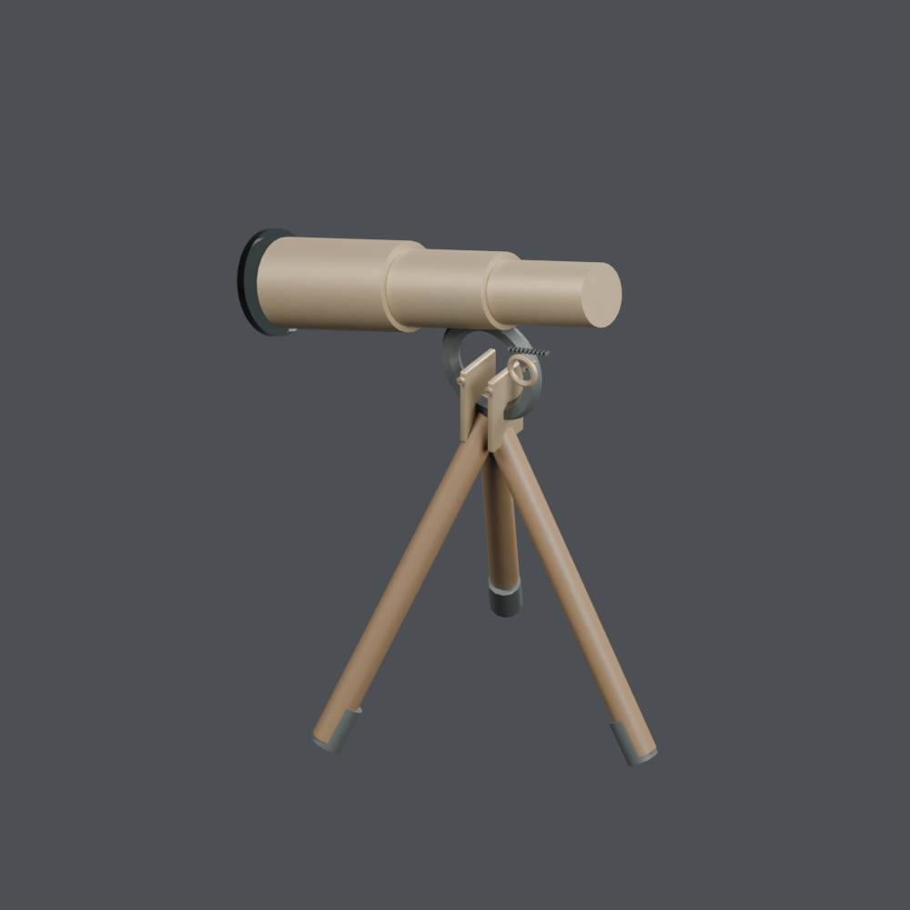
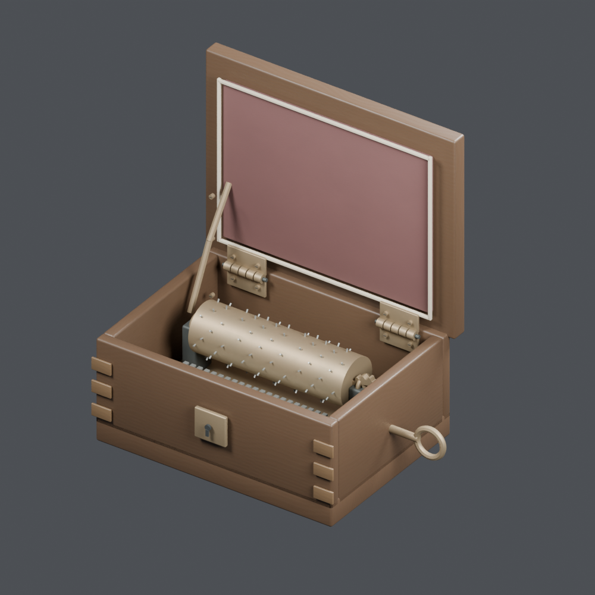
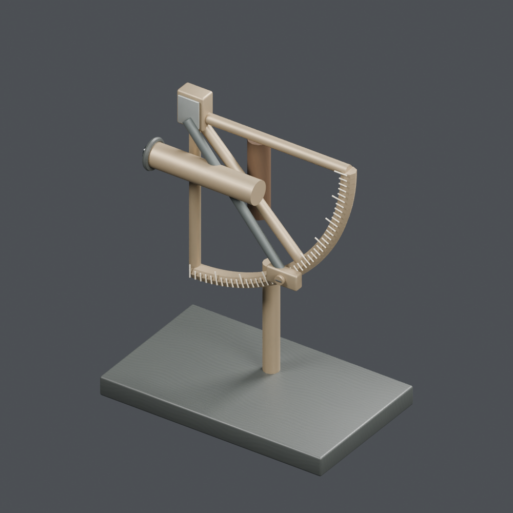
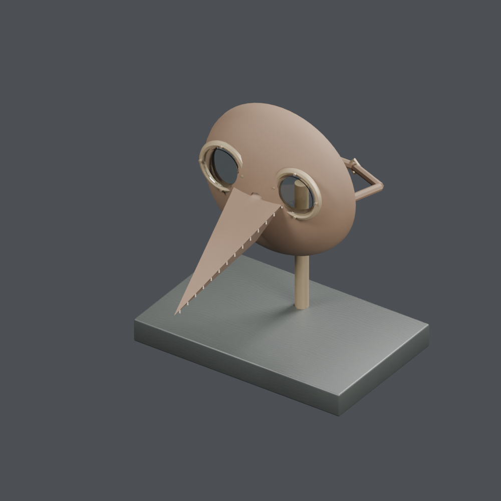
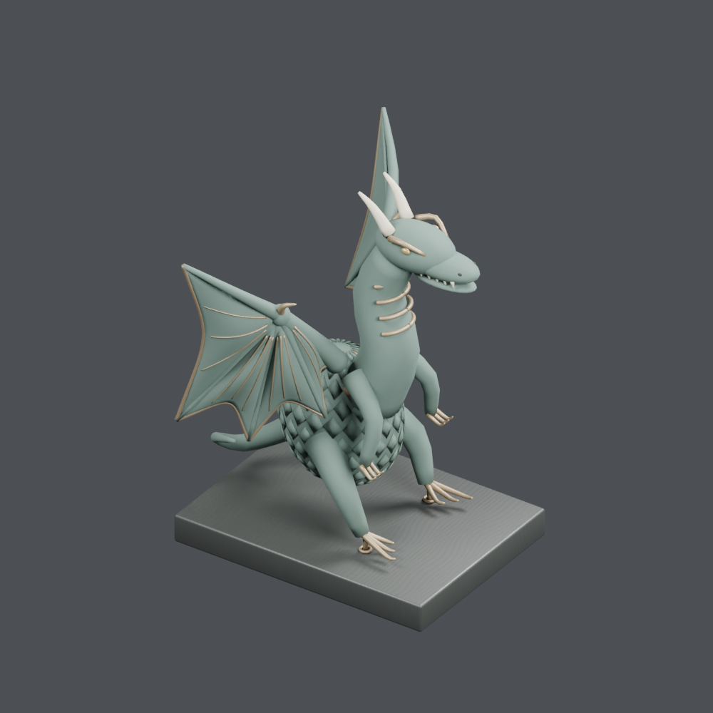
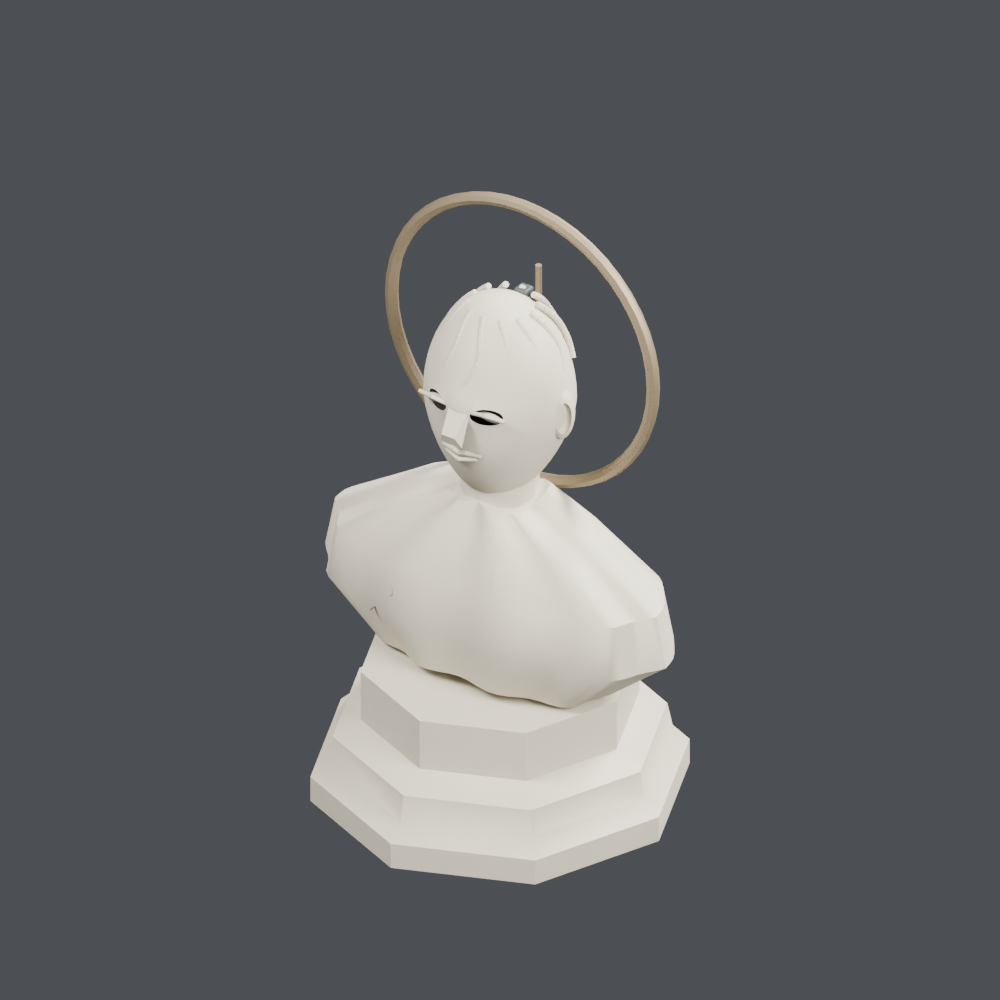
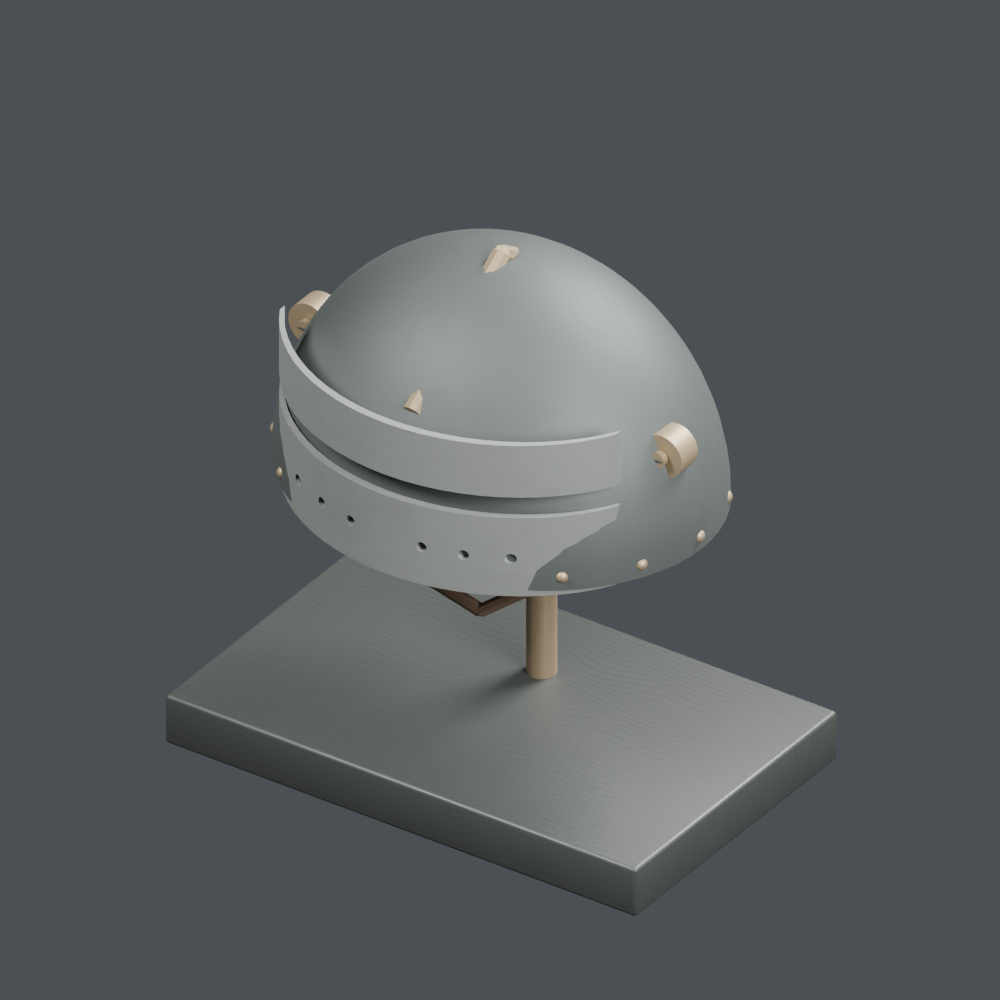
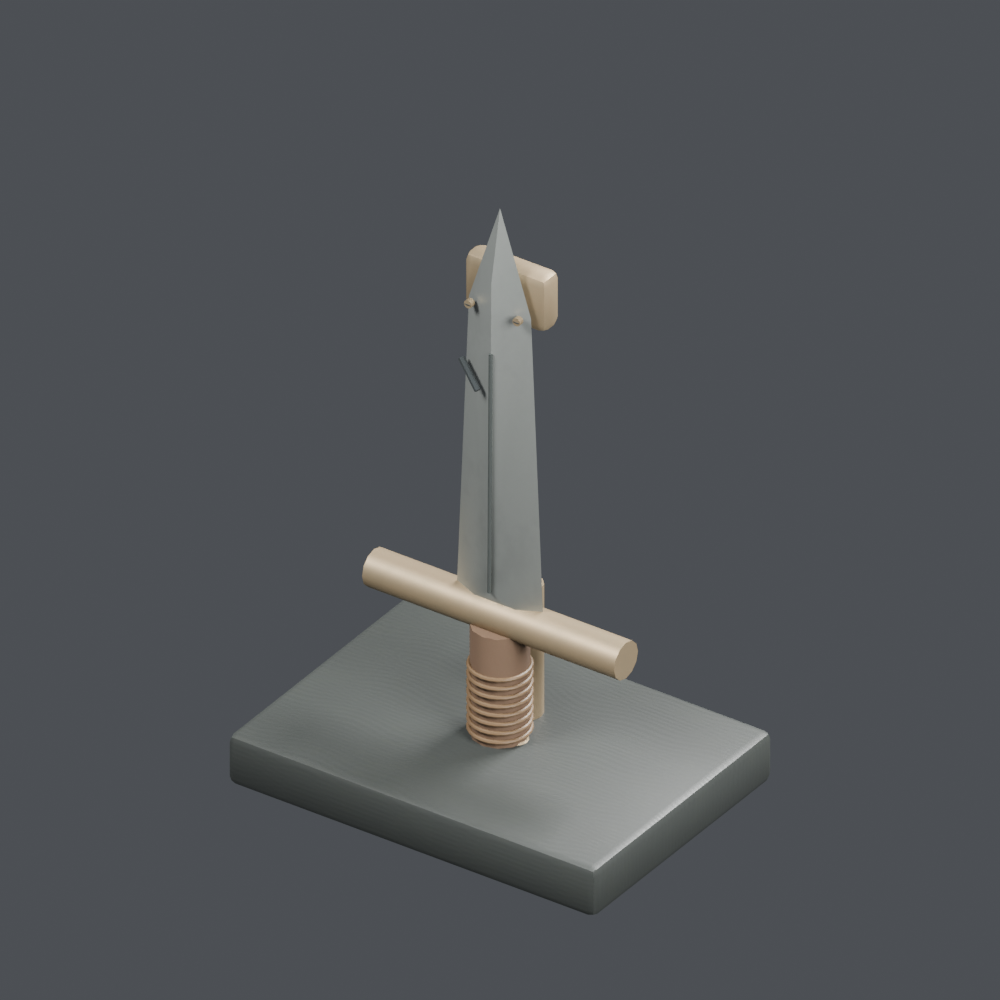

# Base distribution records 169–192

[Browse index](README.md) · [Coverage and missing fields](COVERAGE.md)

Images are actual existing model renders for browsing, not covered by model CC0. A group record may show several reused models. Dimensions and triangle counts apply only to the original record when sourced; revisions can differ. Unknown means unverified, not zero. No blanket CC0 grant for scenes, images, code or articles.

## OL_extra_blue

**Single blue cushion**

青い単体クッション

Use / purpose: Single blue cushion from the lamp shop collection. Unit: a component separated from an existing model. Includes BLEND and GLB. The close-up is rendered from the distributed BLEND.

Record type: derived_component. Formats: BLEND/GLB.

Reported dimensions (metres; XYZ when derived from measured bounds, legacy axis order not reverified): [0.8, 0.64, 0.277]. Triangles: 4784.

Origin: Unknown / not independently confirmed. Orientation: Unknown / not independently confirmed.

Measured bounds relative to stored coordinates (metres): [[-0.4000002145767212, -0.3200000524520874, 0.0], [0.40000009536743164, 0.3199999928474426, 0.27699998021125793]]. Bounds do not establish the intended placement origin or facing direction.

[Download ZIP](https://github.com/k3peta/tales-on-a-table/releases/download/v2026.10.18/OL_extra_blue_CC0.zip) · [License scope](../../LICENSE.md)

**CC0-1.0** — See original ZIP license and repository license scope. Models and embedded materials only; previews excluded.

Source details: [Catalogue 1](../../catalog/textiles_01.en.md) · [Catalogue 2](../../catalog/textiles_01.md) · [Catalogue 3](../../catalog/textiles_01.zh-CN.md)

## OL_extra_red

**Single red cushion**

赤い単体クッション

Use / purpose: Single red cushion from the lamp shop collection. Unit: a component separated from an existing model. Includes BLEND and GLB. The close-up is rendered from the distributed BLEND.

Record type: derived_component. Formats: BLEND/GLB.

Reported dimensions (metres; XYZ when derived from measured bounds, legacy axis order not reverified): [0.8, 0.64, 0.277]. Triangles: 4784.

Origin: Unknown / not independently confirmed. Orientation: Unknown / not independently confirmed.

Measured bounds relative to stored coordinates (metres): [[-0.4000002145767212, -0.320000022649765, 0.0], [0.40000009536743164, 0.3199999928474426, 0.27699998021125793]]. Bounds do not establish the intended placement origin or facing direction.

[Download ZIP](https://github.com/k3peta/tales-on-a-table/releases/download/v2026.10.18/OL_extra_red_CC0.zip) · [License scope](../../LICENSE.md)

**CC0-1.0** — See original ZIP license and repository license scope. Models and embedded materials only; previews excluded.

Source details: [Catalogue 1](../../catalog/textiles_01.en.md) · [Catalogue 2](../../catalog/textiles_01.md) · [Catalogue 3](../../catalog/textiles_01.zh-CN.md)

## OL_STORY_001

**Cloth-draped handbox**

布を掛けた手箱

Use / purpose: Cloth-draped handbox from the lamp shop collection. Unit: one group containing several objects. Includes BLEND and GLB. The close-up is rendered from the distributed BLEND.

Record type: group. Formats: BLEND/GLB.

Reported dimensions (metres; XYZ when derived from measured bounds, legacy axis order not reverified): [0.54189, 0.4275, 0.266981]. Triangles: 12948.

Origin: Unknown / not independently confirmed. Orientation: Unknown / not independently confirmed.

Measured bounds relative to stored coordinates (metres): [[-0.2709449529647827, -0.25999999046325684, 0.0], [0.2709449529647827, 0.16750000417232513, 0.266981303691864]]. Bounds do not establish the intended placement origin or facing direction.

[Download ZIP](https://github.com/k3peta/tales-on-a-table/releases/download/v2026.10.18/OL_STORY_001_CC0.zip) · [License scope](../../LICENSE.md)

**CC0-1.0** — See original ZIP license and repository license scope. Models and embedded materials only; previews excluded.

Source details: [Catalogue 1](../../catalog/containers_02.en.md) · [Catalogue 2](../../catalog/containers_02.md) · [Catalogue 3](../../catalog/containers_02.zh-CN.md)

## OL_STORY_002

**Gift lamp presentation box**

贈答用ランプの化粧箱

Use / purpose: Gift lamp presentation box from the lamp shop collection. Unit: one group containing several objects. Includes BLEND and GLB. The close-up is rendered from the distributed BLEND.

Record type: group. Formats: BLEND/GLB.

Reported dimensions (metres; XYZ when derived from measured bounds, legacy axis order not reverified): [0.49, 0.42515, 0.485]. Triangles: 20988.

Origin: Unknown / not independently confirmed. Orientation: Unknown / not independently confirmed.

Measured bounds relative to stored coordinates (metres): [[-0.24500000476837158, -0.201650008559227, 0.0], [0.24500000476837158, 0.22349999845027924, 0.48500001430511475]]. Bounds do not establish the intended placement origin or facing direction.

[Download ZIP](https://github.com/k3peta/tales-on-a-table/releases/download/v2026.10.18/OL_STORY_002_CC0.zip) · [License scope](../../LICENSE.md)

**CC0-1.0** — See original ZIP license and repository license scope. Models and embedded materials only; previews excluded.

Source details: [Catalogue 1](../../catalog/candles-light_03.en.md) · [Catalogue 2](../../catalog/candles-light_03.md) · [Catalogue 3](../../catalog/candles-light_03.zh-CN.md)

## OL_STORY_003

**Sealed letter and ledger**

封書と帳簿

Use / purpose: Sealed letter and ledger from the lamp shop collection. Unit: one group containing several objects. Includes BLEND and GLB. The close-up is rendered from the distributed BLEND.

Record type: group. Formats: BLEND/GLB.

Reported dimensions (metres; XYZ when derived from measured bounds, legacy axis order not reverified): [0.306, 0.272331, 0.097]. Triangles: 4380.

Origin: Unknown / not independently confirmed. Orientation: Unknown / not independently confirmed.

Measured bounds relative to stored coordinates (metres): [[-0.15600000321865082, -0.12018696963787079, 0.0], [0.15000000596046448, 0.15214373171329498, 0.09700000286102295]]. Bounds do not establish the intended placement origin or facing direction.

[Download ZIP](https://github.com/k3peta/tales-on-a-table/releases/download/v2026.10.18/OL_STORY_003_CC0.zip) · [License scope](../../LICENSE.md)

**CC0-1.0** — See original ZIP license and repository license scope. Models and embedded materials only; previews excluded.

Source details: [Catalogue 1](../../catalog/books-paper_01.en.md) · [Catalogue 2](../../catalog/books-paper_01.md) · [Catalogue 3](../../catalog/books-paper_01.zh-CN.md)

## OL_STORY_004

**Small repair workbench**

小さな修理作業台

Use / purpose: Small repair workbench from the lamp shop collection. Unit: one group containing several objects. Includes BLEND and GLB. The close-up is rendered from the distributed BLEND.

Record type: group. Formats: BLEND/GLB.

Reported dimensions (metres; XYZ when derived from measured bounds, legacy axis order not reverified): [0.79, 0.472, 0.966987]. Triangles: 19096.

Origin: Unknown / not independently confirmed. Orientation: Unknown / not independently confirmed.

Measured bounds relative to stored coordinates (metres): [[-0.39500001072883606, -0.23600000143051147, 0.0], [0.39500001072883606, 0.23600000143051147, 0.966986894607544]]. Bounds do not establish the intended placement origin or facing direction.

[Download ZIP](https://github.com/k3peta/tales-on-a-table/releases/download/v2026.10.18/OL_STORY_004_CC0.zip) · [License scope](../../LICENSE.md)

**CC0-1.0** — See original ZIP license and repository license scope. Models and embedded materials only; previews excluded.

Source details: [Catalogue 1](../../catalog/furniture_02.en.md) · [Catalogue 2](../../catalog/furniture_02.md) · [Catalogue 3](../../catalog/furniture_02.zh-CN.md)

## OL_STORY_005

**Travel souvenir bundle**

旅の土産包み

Use / purpose: Travel souvenir bundle from the lamp shop collection. Unit: one group containing several objects. Includes BLEND and GLB. The close-up is rendered from the distributed BLEND.

Record type: group. Formats: BLEND/GLB.

Reported dimensions (metres; XYZ when derived from measured bounds, legacy axis order not reverified): [0.441688, 0.302617, 0.1785]. Triangles: 8718.

Origin: Unknown / not independently confirmed. Orientation: Unknown / not independently confirmed.

Measured bounds relative to stored coordinates (metres): [[-0.226500004529953, -0.1980000138282776, 0.0], [0.21518824994564056, 0.10461661219596863, 0.1784999966621399]]. Bounds do not establish the intended placement origin or facing direction.

[Download ZIP](https://github.com/k3peta/tales-on-a-table/releases/download/v2026.10.18/OL_STORY_005_CC0.zip) · [License scope](../../LICENSE.md)

**CC0-1.0** — See original ZIP license and repository license scope. Models and embedded materials only; previews excluded.

Source details: [Catalogue 1](../../catalog/containers_02.en.md) · [Catalogue 2](../../catalog/containers_02.md) · [Catalogue 3](../../catalog/containers_02.zh-CN.md)

## AT_001

**Old celestial globe**

古い天球儀

Use / purpose: Old celestial globe from the antique shop collection. Unit: one model record. Includes BLEND and GLB. The close-up is rendered from the distributed BLEND.

Record type: model. Formats: BLEND/GLB.

Reported dimensions (metres; XYZ when derived from measured bounds, legacy axis order not reverified): [0.466, 0.464, 0.694331]. Triangles: 5300.

Origin: Unknown / not independently confirmed. Orientation: Unknown / not independently confirmed.

Measured bounds relative to stored coordinates (metres): [[-0.2330000102519989, -0.23199999332427979, 0.0], [0.2330000102519989, 0.23199999332427979, 0.6943312883377075]]. Bounds do not establish the intended placement origin or facing direction.

[Download ZIP](https://github.com/k3peta/tales-on-a-table/releases/download/v2026.10.18/AT_001_CC0.zip) · [License scope](../../LICENSE.md)

**CC0-1.0** — See original ZIP license and repository license scope. Models and embedded materials only; previews excluded.

Source details: [Catalogue 1](../../catalog/curios-tools_02.en.md) · [Catalogue 2](../../catalog/curios-tools_02.md) · [Catalogue 3](../../catalog/curios-tools_02.zh-CN.md)

[Quality 18 revision and comparison](../../catalog/material_variants_ol055_story_at001.md). Original download retained; AT001 revised triangle count is 6068, not the original measurement.

## AT_002

**Stopped mantel clock**

止まった置時計

Use / purpose: Stopped mantel clock from the antique shop collection. Unit: one model record. Includes BLEND and GLB. The close-up is rendered from the distributed BLEND.

Record type: model. Formats: BLEND/GLB.

Reported dimensions (metres; XYZ when derived from measured bounds, legacy axis order not reverified): Unknown. Triangles: Unknown.

Origin: Unknown / not independently confirmed. Orientation: Unknown / not independently confirmed.

[Download ZIP](https://github.com/k3peta/tales-on-a-table/releases/download/v2026.10.18/AT_002_CC0.zip) · [License scope](../../LICENSE.md)

**CC0-1.0** — See original ZIP license and repository license scope. Models and embedded materials only; previews excluded.

Source details: [Catalogue 1](../../catalog/curios-tools_02.en.md) · [Catalogue 2](../../catalog/curios-tools_02.md) · [Catalogue 3](../../catalog/curios-tools_02.zh-CN.md)

## AT_003

**Portable sundial**

携帯日時計

Use / purpose: Portable sundial from the antique shop collection. Unit: one model record. Includes BLEND and GLB. The close-up is rendered from the distributed BLEND.

Record type: model. Formats: BLEND/GLB.

Reported dimensions (metres; XYZ when derived from measured bounds, legacy axis order not reverified): Unknown. Triangles: Unknown.

Origin: Unknown / not independently confirmed. Orientation: Unknown / not independently confirmed.

[Download ZIP](https://github.com/k3peta/tales-on-a-table/releases/download/v2026.10.18/AT_003_CC0.zip) · [License scope](../../LICENSE.md)

**CC0-1.0** — See original ZIP license and repository license scope. Models and embedded materials only; previews excluded.

Source details: [Catalogue 1](../../catalog/curios-tools_02.en.md) · [Catalogue 2](../../catalog/curios-tools_02.md) · [Catalogue 3](../../catalog/curios-tools_02.zh-CN.md)

## AT_004

**Tripod telescope**

三脚望遠鏡

Use / purpose: Tripod telescope from the antique shop collection. Unit: one model record. Includes BLEND and GLB. The close-up is rendered from the distributed BLEND.

Record type: model. Formats: BLEND/GLB.

Reported dimensions (metres; XYZ when derived from measured bounds, legacy axis order not reverified): Unknown. Triangles: Unknown.

Origin: Unknown / not independently confirmed. Orientation: Unknown / not independently confirmed.

[Download ZIP](https://github.com/k3peta/tales-on-a-table/releases/download/v2026.10.18/AT_004_CC0.zip) · [License scope](../../LICENSE.md)

**CC0-1.0** — See original ZIP license and repository license scope. Models and embedded materials only; previews excluded.

Source details: [Catalogue 1](../../catalog/curios-tools_02.en.md) · [Catalogue 2](../../catalog/curios-tools_02.md) · [Catalogue 3](../../catalog/curios-tools_02.zh-CN.md)

## AT_005

**Navigator's compass**

航海士の羅針盤

Use / purpose: Navigator's compass from the antique shop collection. Unit: one model record. Includes BLEND and GLB. The close-up is rendered from the distributed BLEND.

Record type: model. Formats: BLEND/GLB.

Reported dimensions (metres; XYZ when derived from measured bounds, legacy axis order not reverified): Unknown. Triangles: Unknown.

Origin: Unknown / not independently confirmed. Orientation: Unknown / not independently confirmed.

[Download ZIP](https://github.com/k3peta/tales-on-a-table/releases/download/v2026.10.18/AT_005_CC0.zip) · [License scope](../../LICENSE.md)

**CC0-1.0** — See original ZIP license and repository license scope. Models and embedded materials only; previews excluded.

Source details: [Catalogue 1](../../catalog/curios-tools_02.en.md) · [Catalogue 2](../../catalog/curios-tools_02.md) · [Catalogue 3](../../catalog/curios-tools_02.zh-CN.md)

## AT_006

**Merchant's balance scale**

商人の天秤

Use / purpose: Merchant's balance scale from the antique shop collection. Unit: one model record. Includes BLEND and GLB. The close-up is rendered from the distributed BLEND.

Record type: model. Formats: BLEND/GLB.

Reported dimensions (metres; XYZ when derived from measured bounds, legacy axis order not reverified): Unknown. Triangles: Unknown.

Origin: Unknown / not independently confirmed. Orientation: Unknown / not independently confirmed.

[Download ZIP](https://github.com/k3peta/tales-on-a-table/releases/download/v2026.10.18/AT_006_CC0.zip) · [License scope](../../LICENSE.md)

**CC0-1.0** — See original ZIP license and repository license scope. Models and embedded materials only; previews excluded.

Source details: [Catalogue 1](../../catalog/curios-tools_02.en.md) · [Catalogue 2](../../catalog/curios-tools_02.md) · [Catalogue 3](../../catalog/curios-tools_02.zh-CN.md)

## AT_007

**Clockwork orrery**

ぜんまい仕掛けの惑星儀

Use / purpose: Clockwork orrery from the antique shop collection. Unit: one model record. Includes BLEND and GLB. The close-up is rendered from the distributed BLEND.

Record type: model. Formats: BLEND/GLB.

Reported dimensions (metres; XYZ when derived from measured bounds, legacy axis order not reverified): Unknown. Triangles: Unknown.

Origin: Unknown / not independently confirmed. Orientation: Unknown / not independently confirmed.

[Download ZIP](https://github.com/k3peta/tales-on-a-table/releases/download/v2026.10.18/AT_007_CC0.zip) · [License scope](../../LICENSE.md)

**CC0-1.0** — See original ZIP license and repository license scope. Models and embedded materials only; previews excluded.

Source details: [Catalogue 1](../../catalog/curios-tools_02.en.md) · [Catalogue 2](../../catalog/curios-tools_02.md) · [Catalogue 3](../../catalog/curios-tools_02.zh-CN.md)

## AT_008

**Open music box**

開いたオルゴール

Use / purpose: Open music box from the antique shop collection. Unit: one model record. Includes BLEND and GLB. The close-up is rendered from the distributed BLEND.

Record type: model. Formats: BLEND/GLB.

Reported dimensions (metres; XYZ when derived from measured bounds, legacy axis order not reverified): Unknown. Triangles: Unknown.

Origin: Unknown / not independently confirmed. Orientation: Unknown / not independently confirmed.

[Download ZIP](https://github.com/k3peta/tales-on-a-table/releases/download/v2026.10.18/AT_008_CC0.zip) · [License scope](../../LICENSE.md)

**CC0-1.0** — See original ZIP license and repository license scope. Models and embedded materials only; previews excluded.

Source details: [Catalogue 1](../../catalog/curios-tools_02.en.md) · [Catalogue 2](../../catalog/curios-tools_02.md) · [Catalogue 3](../../catalog/curios-tools_02.zh-CN.md)

## AT_009

**Amber-sand hourglass**

琥珀砂の砂時計

Use / purpose: Amber-sand hourglass from the antique shop collection. Unit: one model record. Includes BLEND and GLB. The close-up is rendered from the distributed BLEND.

Record type: model. Formats: BLEND/GLB.

Reported dimensions (metres; XYZ when derived from measured bounds, legacy axis order not reverified): Unknown. Triangles: Unknown.

Origin: Unknown / not independently confirmed. Orientation: Unknown / not independently confirmed.

[Download ZIP](https://github.com/k3peta/tales-on-a-table/releases/download/v2026.10.18/AT_009_CC0.zip) · [License scope](../../LICENSE.md)

**CC0-1.0** — See original ZIP license and repository license scope. Models and embedded materials only; previews excluded.

Source details: [Catalogue 1](../../catalog/curios-tools_02.en.md) · [Catalogue 2](../../catalog/curios-tools_02.md) · [Catalogue 3](../../catalog/curios-tools_02.zh-CN.md)

## AT_010

**Brass sextant**

真鍮の六分儀

Use / purpose: Brass sextant from the antique shop collection. Unit: one model record. Includes BLEND and GLB. The close-up is rendered from the distributed BLEND.

Record type: model. Formats: BLEND/GLB.

Reported dimensions (metres; XYZ when derived from measured bounds, legacy axis order not reverified): Unknown. Triangles: Unknown.

Origin: Unknown / not independently confirmed. Orientation: Unknown / not independently confirmed.

[Download ZIP](https://github.com/k3peta/tales-on-a-table/releases/download/v2026.10.18/AT_010_CC0.zip) · [License scope](../../LICENSE.md)

**CC0-1.0** — See original ZIP license and repository license scope. Models and embedded materials only; previews excluded.

Source details: [Catalogue 1](../../catalog/curios-tools_02.en.md) · [Catalogue 2](../../catalog/curios-tools_02.md) · [Catalogue 3](../../catalog/curios-tools_02.zh-CN.md)

## AT_011

**Owl relic mask**

梟の遺物仮面

Use / purpose: Owl relic mask from the antique shop collection. Unit: one model record. Includes BLEND and GLB. The close-up is rendered from the distributed BLEND.

Record type: model. Formats: BLEND/GLB.

Reported dimensions (metres; XYZ when derived from measured bounds, legacy axis order not reverified): Unknown. Triangles: Unknown.

Origin: Unknown / not independently confirmed. Orientation: Unknown / not independently confirmed.

[Download ZIP](https://github.com/k3peta/tales-on-a-table/releases/download/v2026.10.18/AT_011_CC0.zip) · [License scope](../../LICENSE.md)

**CC0-1.0** — See original ZIP license and repository license scope. Models and embedded materials only; previews excluded.

Source details: [Catalogue 1](../../catalog/curios-tools_02.en.md) · [Catalogue 2](../../catalog/curios-tools_02.md) · [Catalogue 3](../../catalog/curios-tools_02.zh-CN.md)

## AT_012

**Raven procession mask**

渡鴉の行列仮面

Use / purpose: Raven procession mask from the antique shop collection. Unit: one model record. Includes BLEND and GLB. The close-up is rendered from the distributed BLEND.

Record type: model. Formats: BLEND/GLB.

Reported dimensions (metres; XYZ when derived from measured bounds, legacy axis order not reverified): Unknown. Triangles: Unknown.

Origin: Unknown / not independently confirmed. Orientation: Unknown / not independently confirmed.

[Download ZIP](https://github.com/k3peta/tales-on-a-table/releases/download/v2026.10.18/AT_012_CC0.zip) · [License scope](../../LICENSE.md)

**CC0-1.0** — See original ZIP license and repository license scope. Models and embedded materials only; previews excluded.

Source details: [Catalogue 1](../../catalog/curios-tools_02.en.md) · [Catalogue 2](../../catalog/curios-tools_02.md) · [Catalogue 3](../../catalog/curios-tools_02.zh-CN.md)

## AT_013

**Verdigris dragon figurine**

緑青の竜像

Use / purpose: Verdigris dragon figurine from the antique shop collection. Unit: one model record. Includes BLEND and GLB. The close-up is rendered from the distributed BLEND.

Record type: model. Formats: BLEND/GLB.

Reported dimensions (metres; XYZ when derived from measured bounds, legacy axis order not reverified): Unknown. Triangles: Unknown.

Origin: Unknown / not independently confirmed. Orientation: Unknown / not independently confirmed.

[Download ZIP](https://github.com/k3peta/tales-on-a-table/releases/download/v2026.10.18/AT_013_CC0.zip) · [License scope](../../LICENSE.md)

**CC0-1.0** — See original ZIP license and repository license scope. Models and embedded materials only; previews excluded.

Source details: [Catalogue 1](../../catalog/curios-tools_02.en.md) · [Catalogue 2](../../catalog/curios-tools_02.md) · [Catalogue 3](../../catalog/curios-tools_02.zh-CN.md)

## AT_014

**Nameless saint's bust**

名を失った聖人胸像

Use / purpose: Nameless saint's bust from the antique shop collection. Unit: one model record. Includes BLEND and GLB. The close-up is rendered from the distributed BLEND.

Record type: model. Formats: BLEND/GLB.

Reported dimensions (metres; XYZ when derived from measured bounds, legacy axis order not reverified): Unknown. Triangles: Unknown.

Origin: Unknown / not independently confirmed. Orientation: Unknown / not independently confirmed.

[Download ZIP](https://github.com/k3peta/tales-on-a-table/releases/download/v2026.10.18/AT_014_CC0.zip) · [License scope](../../LICENSE.md)

**CC0-1.0** — See original ZIP license and repository license scope. Models and embedded materials only; previews excluded.

Source details: [Catalogue 1](../../catalog/curios-tools_02.en.md) · [Catalogue 2](../../catalog/curios-tools_02.md) · [Catalogue 3](../../catalog/curios-tools_02.zh-CN.md)

## AT_015

**Dented knight's helmet**

へこんだ騎士兜

Use / purpose: Dented knight's helmet from the antique shop collection. Unit: one model record. Includes BLEND and GLB. The close-up is rendered from the distributed BLEND.

Record type: model. Formats: BLEND/GLB.

Reported dimensions (metres; XYZ when derived from measured bounds, legacy axis order not reverified): Unknown. Triangles: Unknown.

Origin: Unknown / not independently confirmed. Orientation: Unknown / not independently confirmed.

[Download ZIP](https://github.com/k3peta/tales-on-a-table/releases/download/v2026.10.18/AT_015_CC0.zip) · [License scope](../../LICENSE.md)

**CC0-1.0** — See original ZIP license and repository license scope. Models and embedded materials only; previews excluded.

Source details: [Catalogue 1](../../catalog/weapons-equipment_01.en.md) · [Catalogue 2](../../catalog/weapons-equipment_01.md) · [Catalogue 3](../../catalog/weapons-equipment_01.zh-CN.md)

## AT_016

**Restored adventurer's sword**

修復された冒険者の剣

Use / purpose: Restored adventurer's sword from the antique shop collection. Unit: one model record. Includes BLEND and GLB. The close-up is rendered from the distributed BLEND.

Record type: model. Formats: BLEND/GLB.

Reported dimensions (metres; XYZ when derived from measured bounds, legacy axis order not reverified): Unknown. Triangles: Unknown.

Origin: Unknown / not independently confirmed. Orientation: Unknown / not independently confirmed.

[Download ZIP](https://github.com/k3peta/tales-on-a-table/releases/download/v2026.10.18/AT_016_CC0.zip) · [License scope](../../LICENSE.md)

**CC0-1.0** — See original ZIP license and repository license scope. Models and embedded materials only; previews excluded.

Source details: [Catalogue 1](../../catalog/weapons-equipment_01.en.md) · [Catalogue 2](../../catalog/weapons-equipment_01.md) · [Catalogue 3](../../catalog/weapons-equipment_01.zh-CN.md)

## AT_017

**Scarred shield**

傷だらけの盾

Use / purpose: Scarred shield from the antique shop collection. Unit: one model record. Includes BLEND and GLB. The close-up is rendered from the distributed BLEND.

Record type: model. Formats: BLEND/GLB.

Reported dimensions (metres; XYZ when derived from measured bounds, legacy axis order not reverified): Unknown. Triangles: Unknown.

Origin: Unknown / not independently confirmed. Orientation: Unknown / not independently confirmed.

[Download ZIP](https://github.com/k3peta/tales-on-a-table/releases/download/v2026.10.18/AT_017_CC0.zip) · [License scope](../../LICENSE.md)

**CC0-1.0** — See original ZIP license and repository license scope. Models and embedded materials only; previews excluded.

Source details: [Catalogue 1](../../catalog/weapons-equipment_01.en.md) · [Catalogue 2](../../catalog/weapons-equipment_01.md) · [Catalogue 3](../../catalog/weapons-equipment_01.zh-CN.md)
