# Base distribution records 193–216

[Browse index](README.md) · [Coverage and missing fields](COVERAGE.md)

Images are actual existing model renders for browsing, not covered by model CC0. A group record may show several reused models. Dimensions and triangle counts apply only to the original record when sourced; revisions can differ. Unknown means unverified, not zero. No blanket CC0 grant for scenes, images, code or articles.

## AT_018

**Gold-banded drinking horn**

金帯の酒角

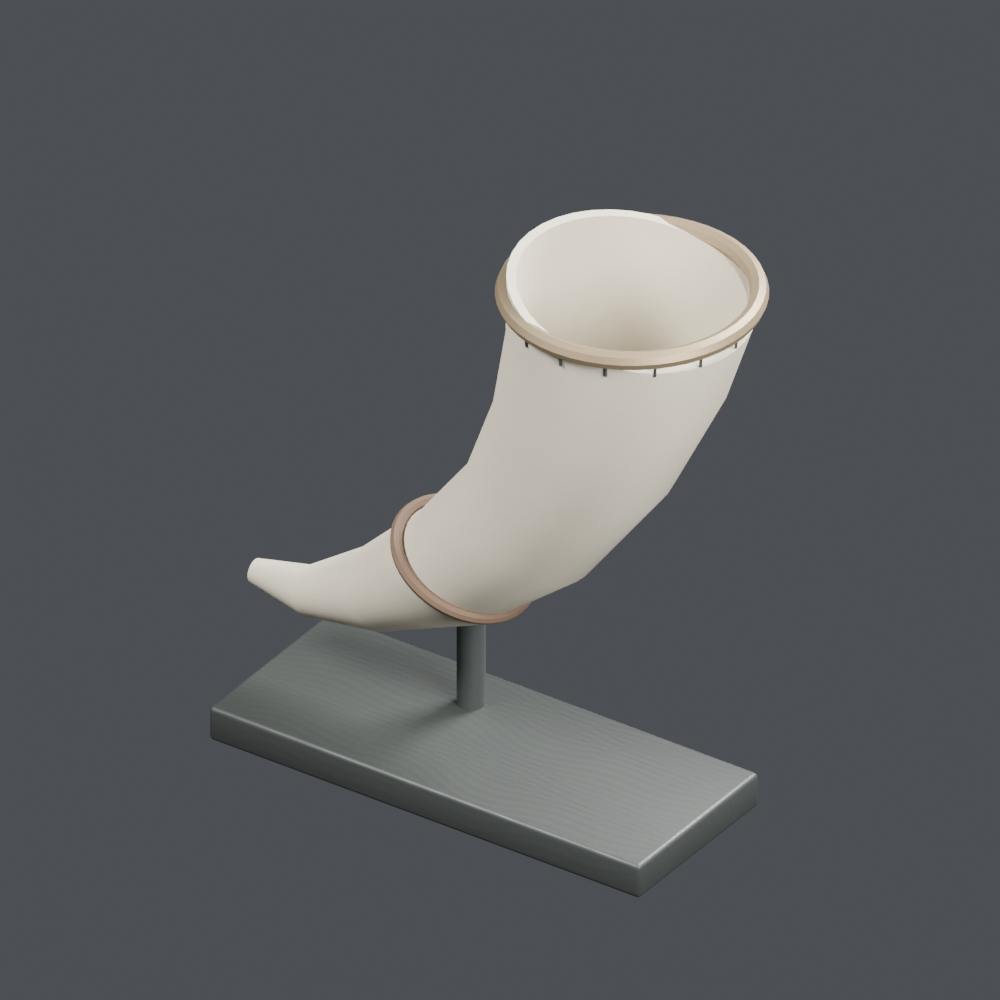

Use / purpose: Gold-banded drinking horn from the antique shop collection. Unit: one model record. Includes BLEND and GLB. The close-up is rendered from the distributed BLEND.

Record type: model. Formats: BLEND/GLB.

Reported dimensions (metres; XYZ when derived from measured bounds, legacy axis order not reverified): Unknown. Triangles: Unknown.

Origin: Unknown / not independently confirmed. Orientation: Unknown / not independently confirmed.

[Download ZIP](https://github.com/k3peta/tales-on-a-table/releases/download/v2026.10.18/AT_018_CC0.zip) · [License scope](../../LICENSE.md)

**CC0-1.0** — See original ZIP license and repository license scope. Models and embedded materials only; previews excluded.

Source details: [Catalogue 1](../../catalog/tableware_02.en.md) · [Catalogue 2](../../catalog/tableware_02.md) · [Catalogue 3](../../catalog/tableware_02.zh-CN.md)

## AT_019

**Horned beast skull**

角獣の頭骨

Use / purpose: Horned beast skull from the antique shop collection. Unit: one model record. Includes BLEND and GLB. The close-up is rendered from the distributed BLEND.

Record type: model. Formats: BLEND/GLB.

Reported dimensions (metres; XYZ when derived from measured bounds, legacy axis order not reverified): Unknown. Triangles: Unknown.

Origin: Unknown / not independently confirmed. Orientation: Unknown / not independently confirmed.

[Download ZIP](https://github.com/k3peta/tales-on-a-table/releases/download/v2026.10.18/AT_019_CC0.zip) · [License scope](../../LICENSE.md)

**CC0-1.0** — See original ZIP license and repository license scope. Models and embedded materials only; previews excluded.

Source details: [Catalogue 1](../../catalog/curios-tools_02.en.md) · [Catalogue 2](../../catalog/curios-tools_02.md) · [Catalogue 3](../../catalog/curios-tools_02.zh-CN.md)

**Unresolved performance issue:** 93574 triangles exceeds small-prop20k budget; unrepaired, redesign pending.

## AT_020

**Dragon egg on a pedestal**

台座に据えた竜の卵

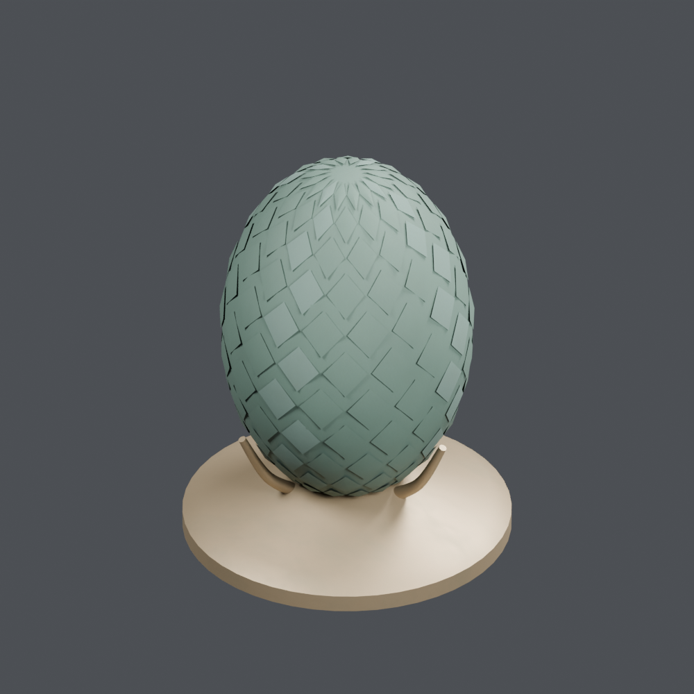

Use / purpose: Dragon egg on a pedestal from the antique shop collection. Unit: one model record. Includes BLEND and GLB. The close-up is rendered from the distributed BLEND.

Record type: model. Formats: BLEND/GLB.

Reported dimensions (metres; XYZ when derived from measured bounds, legacy axis order not reverified): Unknown. Triangles: Unknown.

Origin: Unknown / not independently confirmed. Orientation: Unknown / not independently confirmed.

[Download ZIP](https://github.com/k3peta/tales-on-a-table/releases/download/v2026.10.18/AT_020_CC0.zip) · [License scope](../../LICENSE.md)

**CC0-1.0** — See original ZIP license and repository license scope. Models and embedded materials only; previews excluded.

Source details: [Catalogue 1](../../catalog/curios-tools_03.en.md) · [Catalogue 2](../../catalog/curios-tools_03.md) · [Catalogue 3](../../catalog/curios-tools_03.zh-CN.md)

## AT_021

**Sealed cursed reliquary**

封印された呪物聖遺物箱

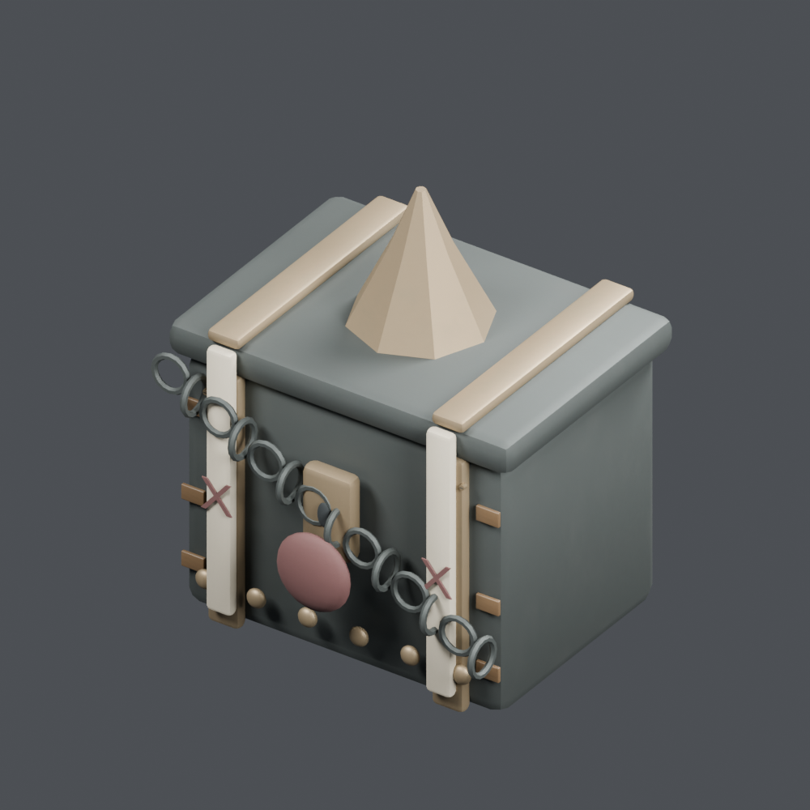

Use / purpose: Sealed cursed reliquary from the antique shop collection. Unit: one model record. Includes BLEND and GLB. The close-up is rendered from the distributed BLEND.

Record type: model. Formats: BLEND/GLB.

Reported dimensions (metres; XYZ when derived from measured bounds, legacy axis order not reverified): Unknown. Triangles: Unknown.

Origin: Unknown / not independently confirmed. Orientation: Unknown / not independently confirmed.

[Download ZIP](https://github.com/k3peta/tales-on-a-table/releases/download/v2026.10.18/AT_021_CC0.zip) · [License scope](../../LICENSE.md)

**CC0-1.0** — See original ZIP license and repository license scope. Models and embedded materials only; previews excluded.

Source details: [Catalogue 1](../../catalog/containers_02.en.md) · [Catalogue 2](../../catalog/containers_02.md) · [Catalogue 3](../../catalog/containers_02.zh-CN.md)

## AT_022

**Chain-bound grimoire**

鎖で閉じた魔導書

Use / purpose: Chain-bound grimoire from the antique shop collection. Unit: one model record. Includes BLEND and GLB. The close-up is rendered from the distributed BLEND.

Record type: model. Formats: BLEND/GLB.

Reported dimensions (metres; XYZ when derived from measured bounds, legacy axis order not reverified): Unknown. Triangles: Unknown.

Origin: Unknown / not independently confirmed. Orientation: Unknown / not independently confirmed.

[Download ZIP](https://github.com/k3peta/tales-on-a-table/releases/download/v2026.10.18/AT_022_CC0.zip) · [License scope](../../LICENSE.md)

**CC0-1.0** — See original ZIP license and repository license scope. Models and embedded materials only; previews excluded.

Source details: [Catalogue 1](../../catalog/books-paper_01.en.md) · [Catalogue 2](../../catalog/books-paper_01.md) · [Catalogue 3](../../catalog/books-paper_01.zh-CN.md)

## AT_023

**Confiscated noble's seal**

没収された貴族の印章

Use / purpose: Confiscated noble's seal from the antique shop collection. Unit: one model record. Includes BLEND and GLB. The close-up is rendered from the distributed BLEND.

Record type: model. Formats: BLEND/GLB.

Reported dimensions (metres; XYZ when derived from measured bounds, legacy axis order not reverified): Unknown. Triangles: Unknown.

Origin: Unknown / not independently confirmed. Orientation: Unknown / not independently confirmed.

[Download ZIP](https://github.com/k3peta/tales-on-a-table/releases/download/v2026.10.18/AT_023_CC0.zip) · [License scope](../../LICENSE.md)

**CC0-1.0** — See original ZIP license and repository license scope. Models and embedded materials only; previews excluded.

Source details: [Catalogue 1](../../catalog/curios-tools_03.en.md) · [Catalogue 2](../../catalog/curios-tools_03.md) · [Catalogue 3](../../catalog/curios-tools_03.zh-CN.md)

## AT_024

**Old thieves' guild badge**

古い盗賊ギルド章

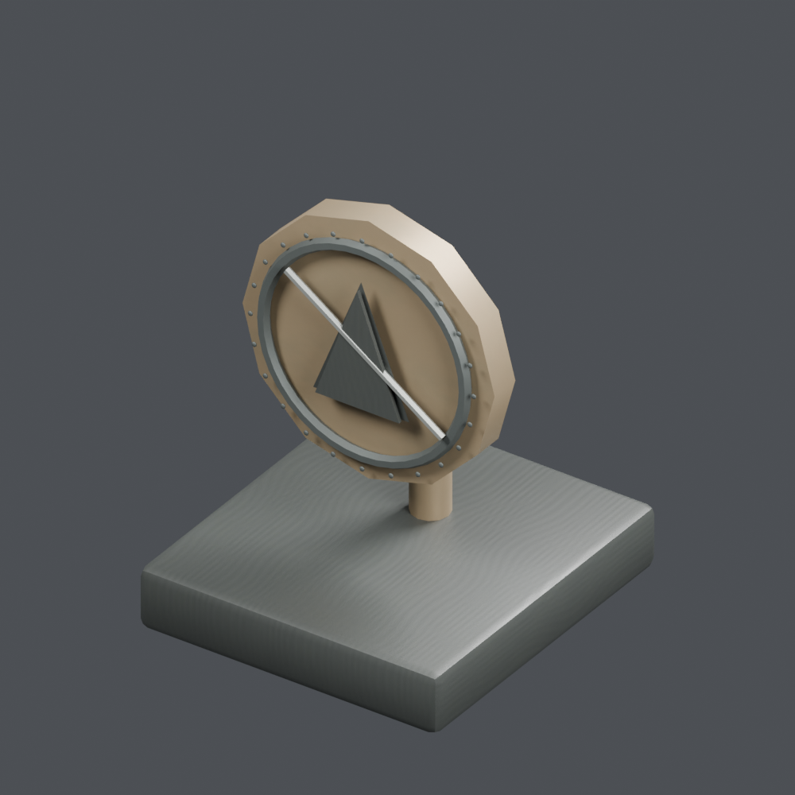

Use / purpose: Old thieves' guild badge from the antique shop collection. Unit: one model record. Includes BLEND and GLB. The close-up is rendered from the distributed BLEND.

Record type: model. Formats: BLEND/GLB.

Reported dimensions (metres; XYZ when derived from measured bounds, legacy axis order not reverified): Unknown. Triangles: Unknown.

Origin: Unknown / not independently confirmed. Orientation: Unknown / not independently confirmed.

[Download ZIP](https://github.com/k3peta/tales-on-a-table/releases/download/v2026.10.18/AT_024_CC0.zip) · [License scope](../../LICENSE.md)

**CC0-1.0** — See original ZIP license and repository license scope. Models and embedded materials only; previews excluded.

Source details: [Catalogue 1](../../catalog/curios-tools_03.en.md) · [Catalogue 2](../../catalog/curios-tools_03.md) · [Catalogue 3](../../catalog/curios-tools_03.zh-CN.md)

## AT_025

**Bottled aether**

瓶詰めエーテル

Use / purpose: Bottled aether from the antique shop collection. Unit: one model record. Includes BLEND and GLB. The close-up is rendered from the distributed BLEND.

Record type: model. Formats: BLEND/GLB.

Reported dimensions (metres; XYZ when derived from measured bounds, legacy axis order not reverified): Unknown. Triangles: Unknown.

Origin: Unknown / not independently confirmed. Orientation: Unknown / not independently confirmed.

[Download ZIP](https://github.com/k3peta/tales-on-a-table/releases/download/v2026.10.18/AT_025_CC0.zip) · [License scope](../../LICENSE.md)

**CC0-1.0** — See original ZIP license and repository license scope. Models and embedded materials only; previews excluded.

Source details: [Catalogue 1](../../catalog/curios-tools_03.en.md) · [Catalogue 2](../../catalog/curios-tools_03.md) · [Catalogue 3](../../catalog/curios-tools_03.zh-CN.md)

## AT_026

**Ghost-glow cage lantern**

幽光の檻ランタン

Use / purpose: Ghost-glow cage lantern from the antique shop collection. Unit: one model record. Includes BLEND and GLB. The close-up is rendered from the distributed BLEND.

Record type: model. Formats: BLEND/GLB.

Reported dimensions (metres; XYZ when derived from measured bounds, legacy axis order not reverified): Unknown. Triangles: Unknown.

Origin: Unknown / not independently confirmed. Orientation: Unknown / not independently confirmed.

[Download ZIP](https://github.com/k3peta/tales-on-a-table/releases/download/v2026.10.18/AT_026_CC0.zip) · [License scope](../../LICENSE.md)

**CC0-1.0** — See original ZIP license and repository license scope. Models and embedded materials only; previews excluded.

Source details: [Catalogue 1](../../catalog/candles-light_03.en.md) · [Catalogue 2](../../catalog/candles-light_03.md) · [Catalogue 3](../../catalog/candles-light_03.zh-CN.md)

## AT_027

**Eclipse scrying mirror**

蝕の占視鏡

Use / purpose: Eclipse scrying mirror from the antique shop collection. Unit: one model record. Includes BLEND and GLB. The close-up is rendered from the distributed BLEND.

Record type: model. Formats: BLEND/GLB.

Reported dimensions (metres; XYZ when derived from measured bounds, legacy axis order not reverified): Unknown. Triangles: Unknown.

Origin: Unknown / not independently confirmed. Orientation: Unknown / not independently confirmed.

[Download ZIP](https://github.com/k3peta/tales-on-a-table/releases/download/v2026.10.18/AT_027_CC0.zip) · [License scope](../../LICENSE.md)

**CC0-1.0** — See original ZIP license and repository license scope. Models and embedded materials only; previews excluded.

Source details: [Catalogue 1](../../catalog/curios-tools_03.en.md) · [Catalogue 2](../../catalog/curios-tools_03.md) · [Catalogue 3](../../catalog/curios-tools_03.zh-CN.md)

## AT_028

**Chained smuggler's chest**

鎖で縛った密売箱

Use / purpose: Chained smuggler's chest from the antique shop collection. Unit: one model record. Includes BLEND and GLB. The close-up is rendered from the distributed BLEND.

Record type: model. Formats: BLEND/GLB.

Reported dimensions (metres; XYZ when derived from measured bounds, legacy axis order not reverified): Unknown. Triangles: Unknown.

Origin: Unknown / not independently confirmed. Orientation: Unknown / not independently confirmed.

[Download ZIP](https://github.com/k3peta/tales-on-a-table/releases/download/v2026.10.18/AT_028_CC0.zip) · [License scope](../../LICENSE.md)

**CC0-1.0** — See original ZIP license and repository license scope. Models and embedded materials only; previews excluded.

Source details: [Catalogue 1](../../catalog/containers_02.en.md) · [Catalogue 2](../../catalog/containers_02.md) · [Catalogue 3](../../catalog/containers_02.zh-CN.md)

## AT_029

**Broken rune tablet**

割れたルーン石板

Use / purpose: Broken rune tablet from the antique shop collection. Unit: one model record. Includes BLEND and GLB. The close-up is rendered from the distributed BLEND.

Record type: model. Formats: BLEND/GLB.

Reported dimensions (metres; XYZ when derived from measured bounds, legacy axis order not reverified): Unknown. Triangles: Unknown.

Origin: Unknown / not independently confirmed. Orientation: Unknown / not independently confirmed.

[Download ZIP](https://github.com/k3peta/tales-on-a-table/releases/download/v2026.10.18/AT_029_CC0.zip) · [License scope](../../LICENSE.md)

**CC0-1.0** — See original ZIP license and repository license scope. Models and embedded materials only; previews excluded.

Source details: [Catalogue 1](../../catalog/curios-tools_03.en.md) · [Catalogue 2](../../catalog/curios-tools_03.md) · [Catalogue 3](../../catalog/curios-tools_03.zh-CN.md)

## AT_030

**False-spine ledger**

偽背表紙の帳簿

Use / purpose: False-spine ledger from the antique shop collection. Unit: one model record. Includes BLEND and GLB. The close-up is rendered from the distributed BLEND.

Record type: model. Formats: BLEND/GLB.

Reported dimensions (metres; XYZ when derived from measured bounds, legacy axis order not reverified): Unknown. Triangles: Unknown.

Origin: Unknown / not independently confirmed. Orientation: Unknown / not independently confirmed.

[Download ZIP](https://github.com/k3peta/tales-on-a-table/releases/download/v2026.10.18/AT_030_CC0.zip) · [License scope](../../LICENSE.md)

**CC0-1.0** — See original ZIP license and repository license scope. Models and embedded materials only; previews excluded.

Source details: [Catalogue 1](../../catalog/books-paper_01.en.md) · [Catalogue 2](../../catalog/books-paper_01.md) · [Catalogue 3](../../catalog/books-paper_01.zh-CN.md)

## AT_031

**Old tool roll**

古い工具の巻き袋

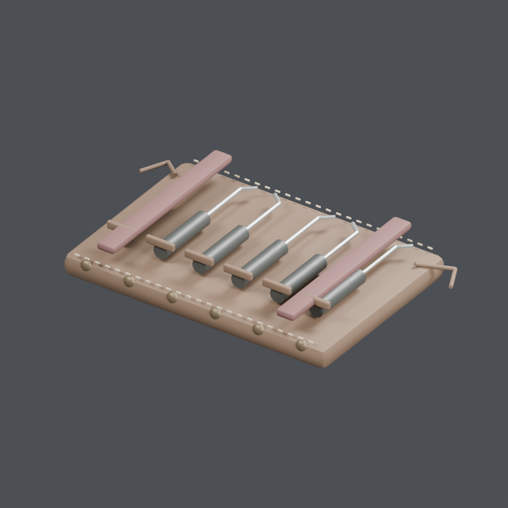

Use / purpose: Old tool roll from the antique shop collection. Unit: one model record. Includes BLEND and GLB. The close-up is rendered from the distributed BLEND.

Record type: model. Formats: BLEND/GLB.

Reported dimensions (metres; XYZ when derived from measured bounds, legacy axis order not reverified): Unknown. Triangles: Unknown.

Origin: Unknown / not independently confirmed. Orientation: Unknown / not independently confirmed.

[Download ZIP](https://github.com/k3peta/tales-on-a-table/releases/download/v2026.10.18/AT_031_CC0.zip) · [License scope](../../LICENSE.md)

**CC0-1.0** — See original ZIP license and repository license scope. Models and embedded materials only; previews excluded.

Source details: [Catalogue 1](../../catalog/curios-tools_03.en.md) · [Catalogue 2](../../catalog/curios-tools_03.md) · [Catalogue 3](../../catalog/curios-tools_03.zh-CN.md)

[Quality 21 revision and comparison](../../catalog/material_variants_at022_031.md). Original download retained; AT031 stitch positions changed; green variant uses repaired stitch_seating_v1 baseline.

## AT_032

**Old grappling hook and rope**

古い鉤とロープ

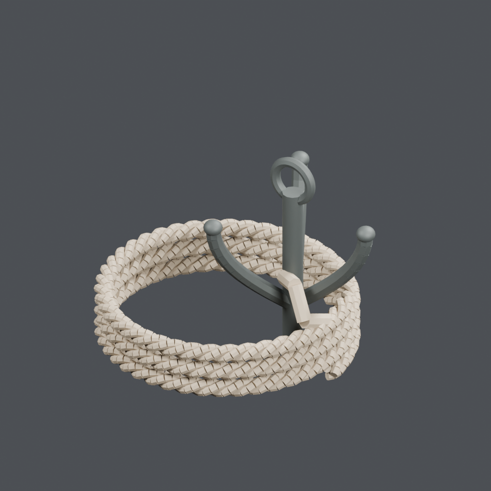

Use / purpose: Old grappling hook and rope from the antique shop collection. Unit: one model record. Includes BLEND and GLB. The close-up is rendered from the distributed BLEND.

Record type: model. Formats: BLEND/GLB.

Reported dimensions (metres; XYZ when derived from measured bounds, legacy axis order not reverified): Unknown. Triangles: Unknown.

Origin: Unknown / not independently confirmed. Orientation: Unknown / not independently confirmed.

[Download ZIP](https://github.com/k3peta/tales-on-a-table/releases/download/v2026.10.18/AT_032_CC0.zip) · [License scope](../../LICENSE.md)

**CC0-1.0** — See original ZIP license and repository license scope. Models and embedded materials only; previews excluded.

Source details: [Catalogue 1](../../catalog/curios-tools_03.en.md) · [Catalogue 2](../../catalog/curios-tools_03.md) · [Catalogue 3](../../catalog/curios-tools_03.zh-CN.md)

## AT_033

**Patched travel bag**

継ぎ当て旅鞄

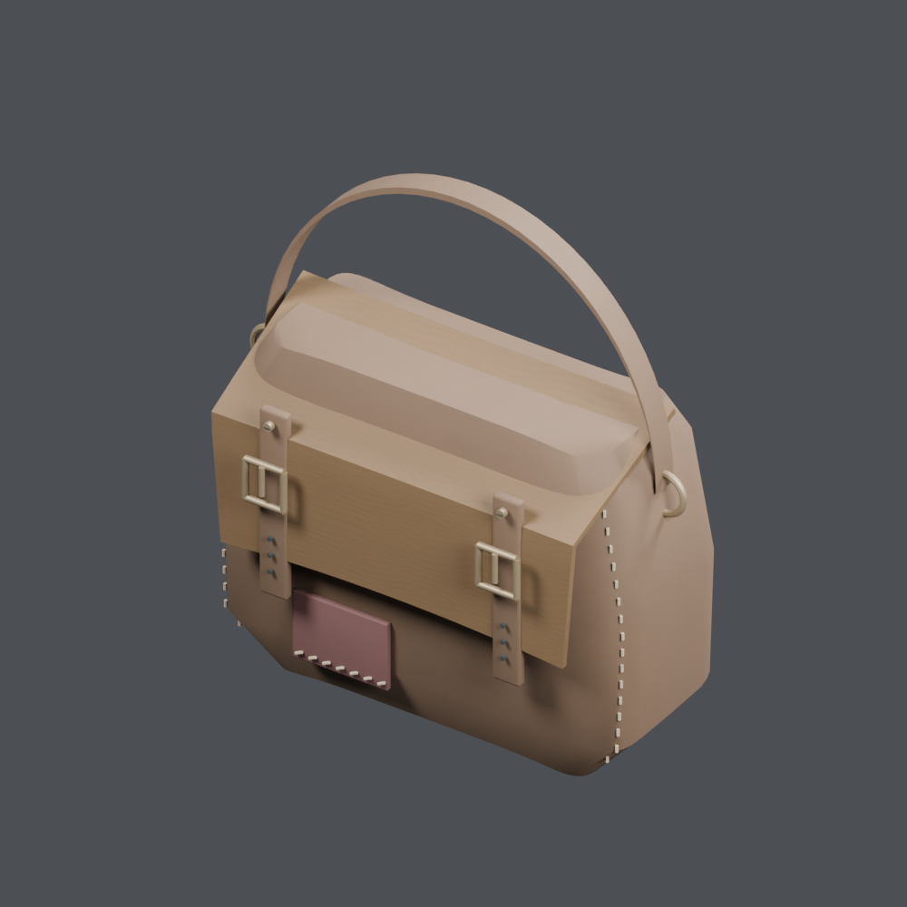

Use / purpose: Patched travel bag from the antique shop collection. Unit: one model record. Includes BLEND and GLB. The close-up is rendered from the distributed BLEND.

Record type: model. Formats: BLEND/GLB.

Reported dimensions (metres; XYZ when derived from measured bounds, legacy axis order not reverified): Unknown. Triangles: Unknown.

Origin: Unknown / not independently confirmed. Orientation: Unknown / not independently confirmed.

[Download ZIP](https://github.com/k3peta/tales-on-a-table/releases/download/v2026.10.18/AT_033_CC0.zip) · [License scope](../../LICENSE.md)

**CC0-1.0** — See original ZIP license and repository license scope. Models and embedded materials only; previews excluded.

Source details: [Catalogue 1](../../catalog/containers_02.en.md) · [Catalogue 2](../../catalog/containers_02.md) · [Catalogue 3](../../catalog/containers_02.zh-CN.md)

## AT_034

**Old feathered hat**

羽飾りの古帽子

Use / purpose: Old feathered hat from the antique shop collection. Unit: one model record. Includes BLEND and GLB. The close-up is rendered from the distributed BLEND.

Record type: model. Formats: BLEND/GLB.

Reported dimensions (metres; XYZ when derived from measured bounds, legacy axis order not reverified): Unknown. Triangles: Unknown.

Origin: Unknown / not independently confirmed. Orientation: Unknown / not independently confirmed.

[Download ZIP](https://github.com/k3peta/tales-on-a-table/releases/download/v2026.10.18/AT_034_CC0.zip) · [License scope](../../LICENSE.md)

**CC0-1.0** — See original ZIP license and repository license scope. Models and embedded materials only; previews excluded.

Source details: [Catalogue 1](../../catalog/textiles_01.en.md) · [Catalogue 2](../../catalog/textiles_01.md) · [Catalogue 3](../../catalog/textiles_01.zh-CN.md)

## AT_035

**Pair of worn boots**

履き古したブーツ一組

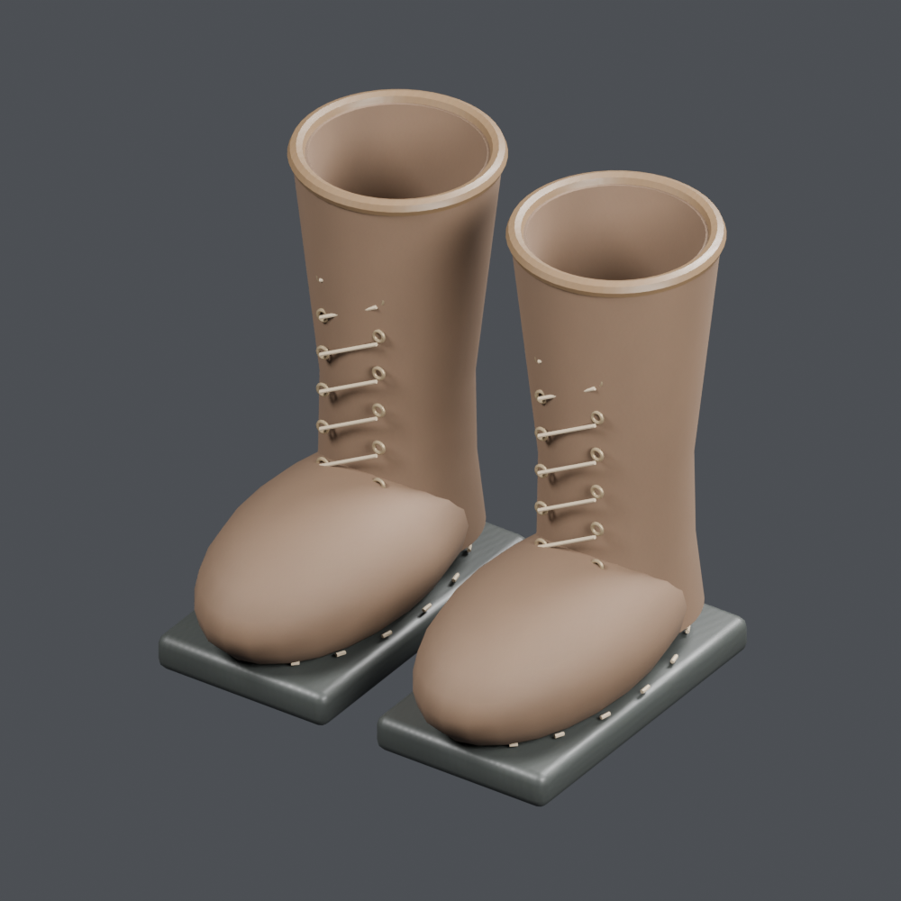

Use / purpose: Pair of worn boots from the antique shop collection. Unit: one model record. Includes BLEND and GLB. The close-up is rendered from the distributed BLEND.

Record type: model. Formats: BLEND/GLB.

Reported dimensions (metres; XYZ when derived from measured bounds, legacy axis order not reverified): Unknown. Triangles: Unknown.

Origin: Unknown / not independently confirmed. Orientation: Unknown / not independently confirmed.

[Download ZIP](https://github.com/k3peta/tales-on-a-table/releases/download/v2026.10.18/AT_035_CC0.zip) · [License scope](../../LICENSE.md)

**CC0-1.0** — See original ZIP license and repository license scope. Models and embedded materials only; previews excluded.

Source details: [Catalogue 1](../../catalog/textiles_01.en.md) · [Catalogue 2](../../catalog/textiles_01.md) · [Catalogue 3](../../catalog/textiles_01.zh-CN.md)

## AT_036

**Sealed map case**

封のある地図筒

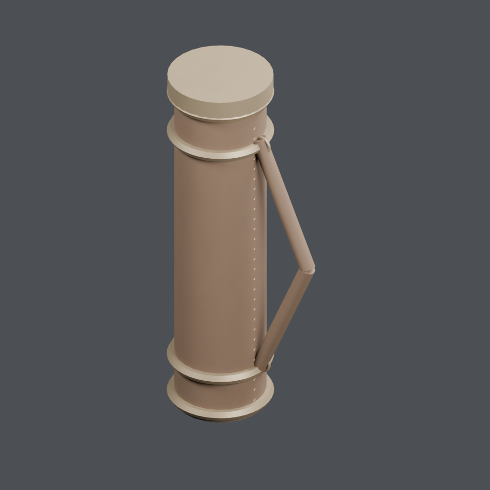

Use / purpose: Sealed map case from the antique shop collection. Unit: one model record. Includes BLEND and GLB. The close-up is rendered from the distributed BLEND.

Record type: model. Formats: BLEND/GLB.

Reported dimensions (metres; XYZ when derived from measured bounds, legacy axis order not reverified): Unknown. Triangles: Unknown.

Origin: Unknown / not independently confirmed. Orientation: Unknown / not independently confirmed.

[Download ZIP](https://github.com/k3peta/tales-on-a-table/releases/download/v2026.10.18/AT_036_CC0.zip) · [License scope](../../LICENSE.md)

**CC0-1.0** — See original ZIP license and repository license scope. Models and embedded materials only; previews excluded.

Source details: [Catalogue 1](../../catalog/books-paper_01.en.md) · [Catalogue 2](../../catalog/books-paper_01.md) · [Catalogue 3](../../catalog/books-paper_01.zh-CN.md)

## AT_037

**Unfolded archipelago map**

広げた群島の地図

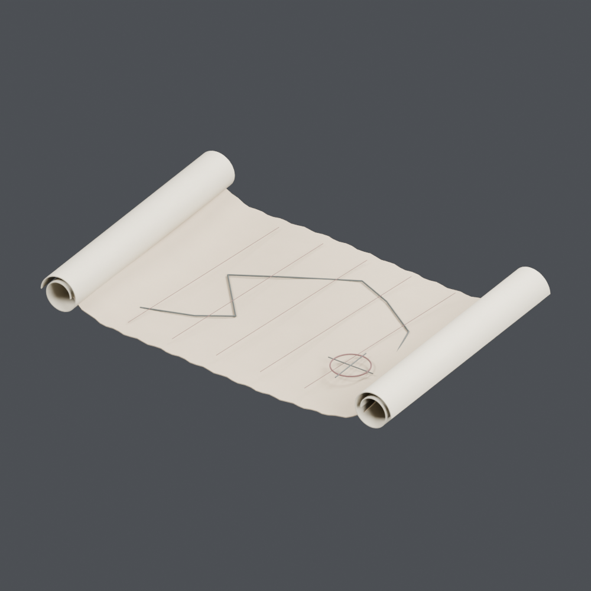

Use / purpose: Unfolded archipelago map from the antique shop collection. Unit: one model record. Includes BLEND and GLB. The close-up is rendered from the distributed BLEND.

Record type: model. Formats: BLEND/GLB.

Reported dimensions (metres; XYZ when derived from measured bounds, legacy axis order not reverified): Unknown. Triangles: Unknown.

Origin: Unknown / not independently confirmed. Orientation: Unknown / not independently confirmed.

[Download ZIP](https://github.com/k3peta/tales-on-a-table/releases/download/v2026.10.18/AT_037_CC0.zip) · [License scope](../../LICENSE.md)

**CC0-1.0** — See original ZIP license and repository license scope. Models and embedded materials only; previews excluded.

Source details: [Catalogue 1](../../catalog/books-paper_01.en.md) · [Catalogue 2](../../catalog/books-paper_01.md) · [Catalogue 3](../../catalog/books-paper_01.zh-CN.md)

## AT_038

**Stitched travel journal**

縫い綴じの旅日記

Use / purpose: Stitched travel journal from the antique shop collection. Unit: one model record. Includes BLEND and GLB. The close-up is rendered from the distributed BLEND.

Record type: model. Formats: BLEND/GLB.

Reported dimensions (metres; XYZ when derived from measured bounds, legacy axis order not reverified): Unknown. Triangles: Unknown.

Origin: Unknown / not independently confirmed. Orientation: Unknown / not independently confirmed.

[Download ZIP](https://github.com/k3peta/tales-on-a-table/releases/download/v2026.10.18/AT_038_CC0.zip) · [License scope](../../LICENSE.md)

**CC0-1.0** — See original ZIP license and repository license scope. Models and embedded materials only; previews excluded.

Source details: [Catalogue 1](../../catalog/books-paper_01.en.md) · [Catalogue 2](../../catalog/books-paper_01.md) · [Catalogue 3](../../catalog/books-paper_01.zh-CN.md)

## AT_039

**Framed dagger**

額装された短剣

Use / purpose: Framed dagger from the antique shop collection. Unit: one model record. Includes BLEND and GLB. The close-up is rendered from the distributed BLEND.

Record type: model. Formats: BLEND/GLB.

Reported dimensions (metres; XYZ when derived from measured bounds, legacy axis order not reverified): Unknown. Triangles: Unknown.

Origin: Unknown / not independently confirmed. Orientation: Unknown / not independently confirmed.

[Download ZIP](https://github.com/k3peta/tales-on-a-table/releases/download/v2026.10.18/AT_039_CC0.zip) · [License scope](../../LICENSE.md)

**CC0-1.0** — See original ZIP license and repository license scope. Models and embedded materials only; previews excluded.

Source details: [Catalogue 1](../../catalog/weapons-equipment_01.en.md) · [Catalogue 2](../../catalog/weapons-equipment_01.md) · [Catalogue 3](../../catalog/weapons-equipment_01.zh-CN.md)

## AT_040

**Leather pouch of old coins**

古銭入りの革袋

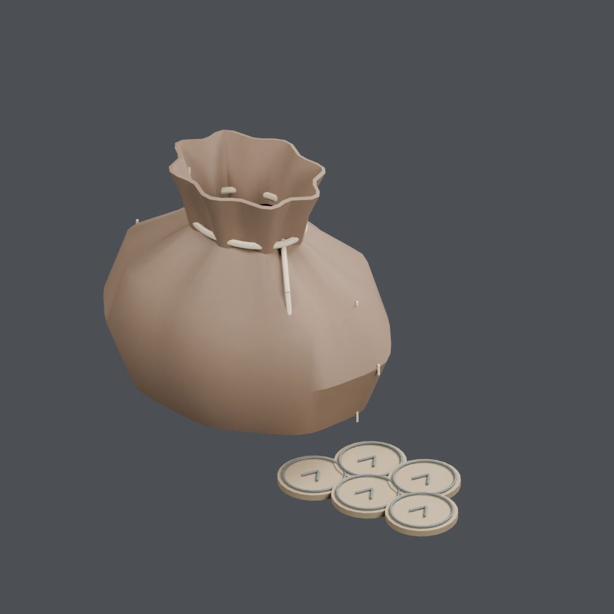

Use / purpose: Leather pouch of old coins from the antique shop collection. Unit: one model record. Includes BLEND and GLB. The close-up is rendered from the distributed BLEND.

Record type: model. Formats: BLEND/GLB.

Reported dimensions (metres; XYZ when derived from measured bounds, legacy axis order not reverified): Unknown. Triangles: Unknown.

Origin: Unknown / not independently confirmed. Orientation: Unknown / not independently confirmed.

[Download ZIP](https://github.com/k3peta/tales-on-a-table/releases/download/v2026.10.18/AT_040_CC0.zip) · [License scope](../../LICENSE.md)

**CC0-1.0** — See original ZIP license and repository license scope. Models and embedded materials only; previews excluded.

Source details: [Catalogue 1](../../catalog/containers_02.en.md) · [Catalogue 2](../../catalog/containers_02.md) · [Catalogue 3](../../catalog/containers_02.zh-CN.md)

## AT_041

**Cracked ceramic pot**

ひびの入った陶器ポット

Use / purpose: Cracked ceramic pot from the antique shop collection. Unit: one model record. Includes BLEND and GLB. The close-up is rendered from the distributed BLEND.

Record type: model. Formats: BLEND/GLB.

Reported dimensions (metres; XYZ when derived from measured bounds, legacy axis order not reverified): Unknown. Triangles: Unknown.

Origin: Unknown / not independently confirmed. Orientation: Unknown / not independently confirmed.

[Download ZIP](https://github.com/k3peta/tales-on-a-table/releases/download/v2026.10.18/AT_041_CC0.zip) · [License scope](../../LICENSE.md)

**CC0-1.0** — See original ZIP license and repository license scope. Models and embedded materials only; previews excluded.

Source details: [Catalogue 1](../../catalog/tableware_02.en.md) · [Catalogue 2](../../catalog/tableware_02.md) · [Catalogue 3](../../catalog/tableware_02.zh-CN.md)
