# Base distribution records 217–240

[Browse index](README.md) · [Coverage and missing fields](COVERAGE.md)

Images are actual existing model renders for browsing, not covered by model CC0. A group record may show several reused models. Dimensions and triangle counts apply only to the original record when sourced; revisions can differ. Unknown means unverified, not zero. No blanket CC0 grant for scenes, images, code or articles.

## AT_042

**Tarnished silver goblet**

曇った銀のゴブレット

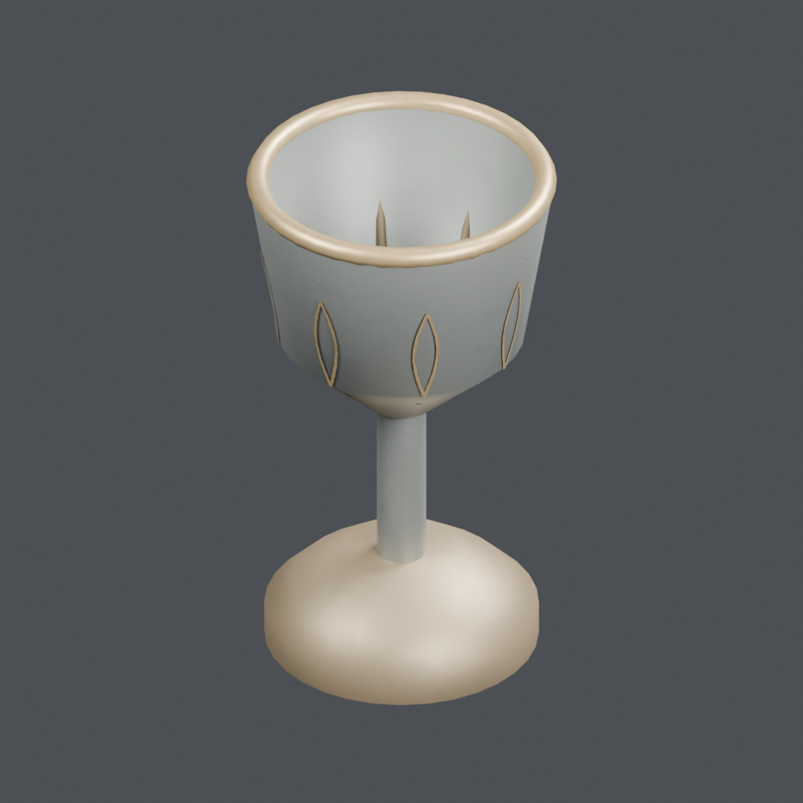

Use / purpose: Tarnished silver goblet from the antique shop collection. Unit: one model record. Includes BLEND and GLB. The close-up is rendered from the distributed BLEND.

Record type: model. Formats: BLEND/GLB.

Reported dimensions (metres; XYZ when derived from measured bounds, legacy axis order not reverified): Unknown. Triangles: Unknown.

Origin: Unknown / not independently confirmed. Orientation: Unknown / not independently confirmed.

[Download ZIP](https://github.com/k3peta/tales-on-a-table/releases/download/v2026.10.18/AT_042_CC0.zip) · [License scope](../../LICENSE.md)

**CC0-1.0** — See original ZIP license and repository license scope. Models and embedded materials only; previews excluded.

Source details: [Catalogue 1](../../catalog/tableware_02.en.md) · [Catalogue 2](../../catalog/tableware_02.md) · [Catalogue 3](../../catalog/tableware_02.zh-CN.md)

**Unresolved:** Cup interior decoration cross-section diagnosis pending; unresolved.

**Revision available, public-download check pending:** [AT042 repair and comparison](../../catalog/at042_section_repair.md). Original download/image retained.

## AT_043

**Blue two-handled amphora**

青い双耳アンフォラ

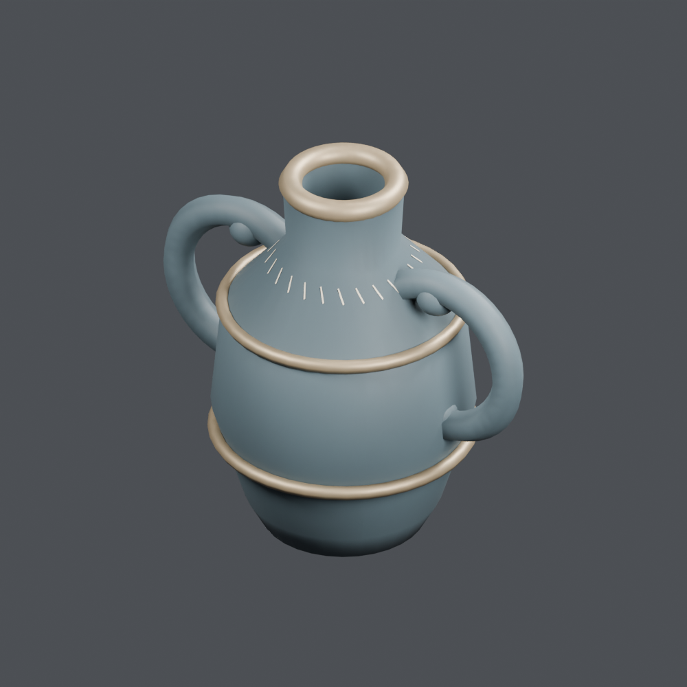

Use / purpose: Blue two-handled amphora from the antique shop collection. Unit: one model record. Includes BLEND and GLB. The close-up is rendered from the distributed BLEND.

Record type: model. Formats: BLEND/GLB.

Reported dimensions (metres; XYZ when derived from measured bounds, legacy axis order not reverified): Unknown. Triangles: Unknown.

Origin: Unknown / not independently confirmed. Orientation: Unknown / not independently confirmed.

[Download ZIP](https://github.com/k3peta/tales-on-a-table/releases/download/v2026.10.18/AT_043_CC0.zip) · [License scope](../../LICENSE.md)

**CC0-1.0** — See original ZIP license and repository license scope. Models and embedded materials only; previews excluded.

Source details: [Catalogue 1](../../catalog/tableware_02.en.md) · [Catalogue 2](../../catalog/tableware_02.md) · [Catalogue 3](../../catalog/tableware_02.zh-CN.md)

## AT_044

**Jade plate repaired with gold seams**

金継ぎされた翡翠皿

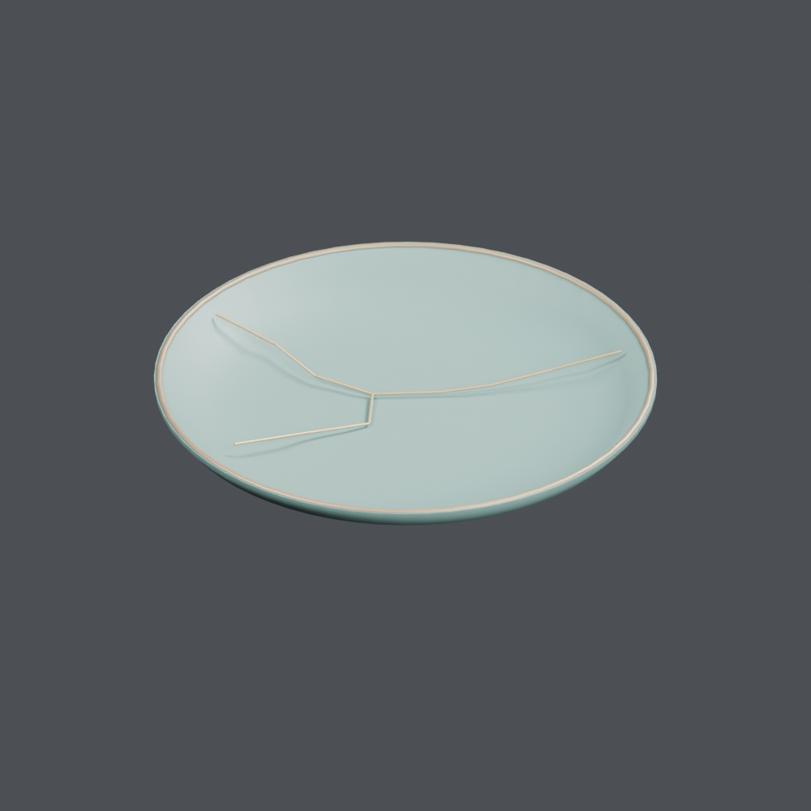

Use / purpose: Jade plate repaired with gold seams from the antique shop collection. Unit: one model record. Includes BLEND and GLB. The close-up is rendered from the distributed BLEND.

Record type: model. Formats: BLEND/GLB.

Reported dimensions (metres; XYZ when derived from measured bounds, legacy axis order not reverified): Unknown. Triangles: Unknown.

Origin: Unknown / not independently confirmed. Orientation: Unknown / not independently confirmed.

[Download ZIP](https://github.com/k3peta/tales-on-a-table/releases/download/v2026.10.18/AT_044_CC0.zip) · [License scope](../../LICENSE.md)

**CC0-1.0** — See original ZIP license and repository license scope. Models and embedded materials only; previews excluded.

Source details: [Catalogue 1](../../catalog/tableware_02.en.md) · [Catalogue 2](../../catalog/tableware_02.md) · [Catalogue 3](../../catalog/tableware_02.zh-CN.md)

## AT_045

**Silver handbell**

銀の呼び鈴

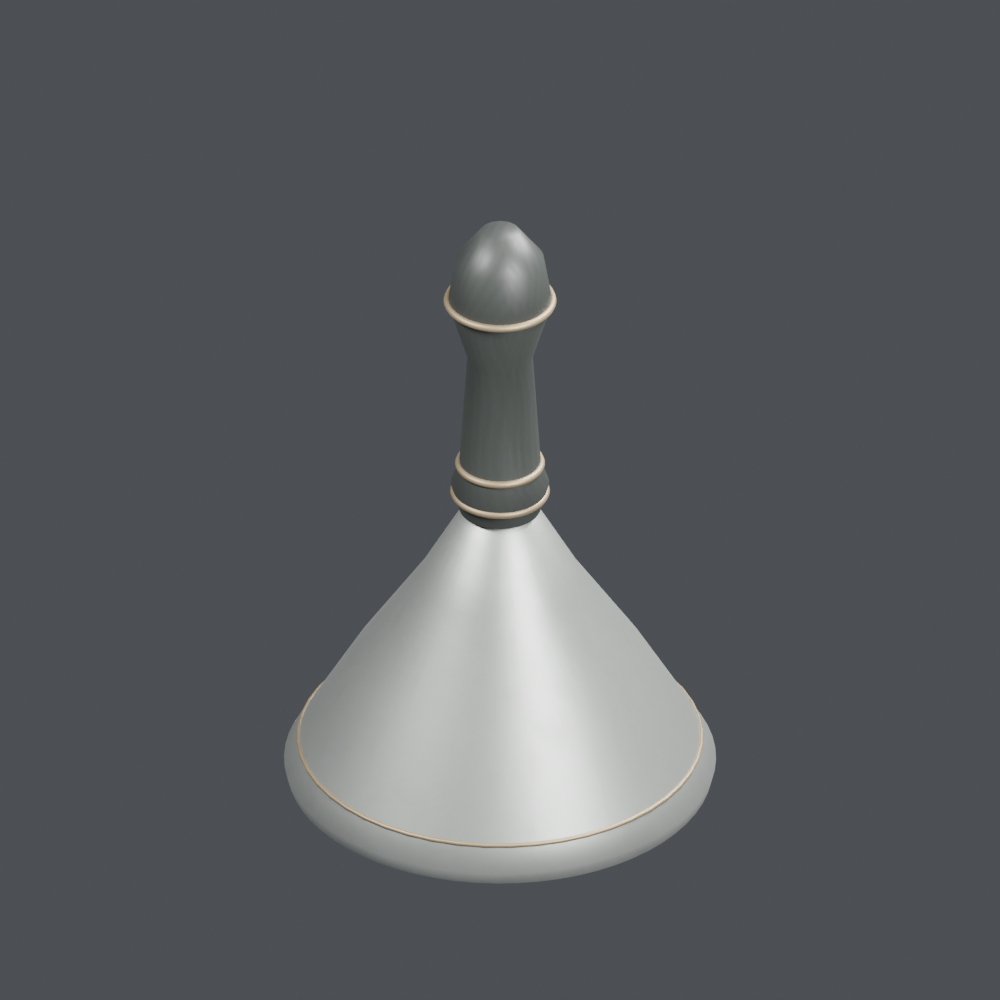

Use / purpose: Silver handbell from the antique shop collection. Unit: one model record. Includes BLEND and GLB. The close-up is rendered from the distributed BLEND.

Record type: model. Formats: BLEND/GLB.

Reported dimensions (metres; XYZ when derived from measured bounds, legacy axis order not reverified): Unknown. Triangles: Unknown.

Origin: Unknown / not independently confirmed. Orientation: Unknown / not independently confirmed.

[Download ZIP](https://github.com/k3peta/tales-on-a-table/releases/download/v2026.10.18/AT_045_CC0.zip) · [License scope](../../LICENSE.md)

**CC0-1.0** — See original ZIP license and repository license scope. Models and embedded materials only; previews excluded.

Source details: [Catalogue 1](../../catalog/curios-tools_03.en.md) · [Catalogue 2](../../catalog/curios-tools_03.md) · [Catalogue 3](../../catalog/curios-tools_03.zh-CN.md)

## AT_046

**Dusty five-string lute**

埃をかぶった五弦リュート

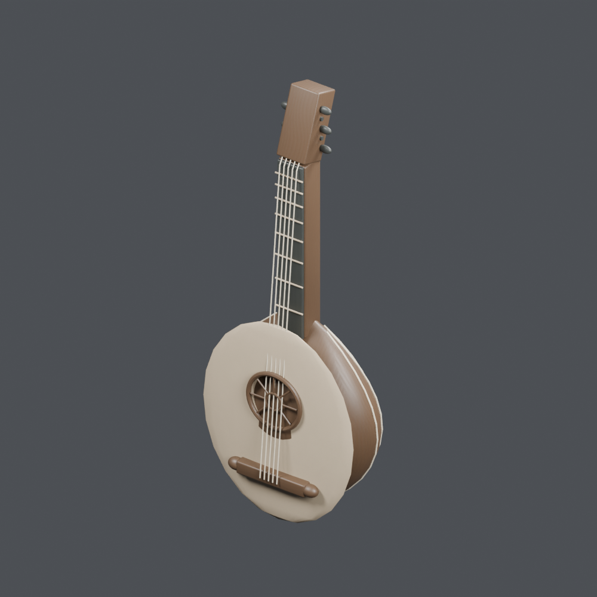

Use / purpose: Dusty five-string lute from the antique shop collection. Unit: one model record. Includes BLEND and GLB. The close-up is rendered from the distributed BLEND.

Record type: model. Formats: BLEND/GLB.

Reported dimensions (metres; XYZ when derived from measured bounds, legacy axis order not reverified): Unknown. Triangles: Unknown.

Origin: Unknown / not independently confirmed. Orientation: Unknown / not independently confirmed.

[Download ZIP](https://github.com/k3peta/tales-on-a-table/releases/download/v2026.10.18/AT_046_CC0.zip) · [License scope](../../LICENSE.md)

**CC0-1.0** — See original ZIP license and repository license scope. Models and embedded materials only; previews excluded.

Source details: [Catalogue 1](../../catalog/curios-tools_03.en.md) · [Catalogue 2](../../catalog/curios-tools_03.md) · [Catalogue 3](../../catalog/curios-tools_03.zh-CN.md)

## AT_047

**Old violin and bow**

古いヴァイオリンと弓

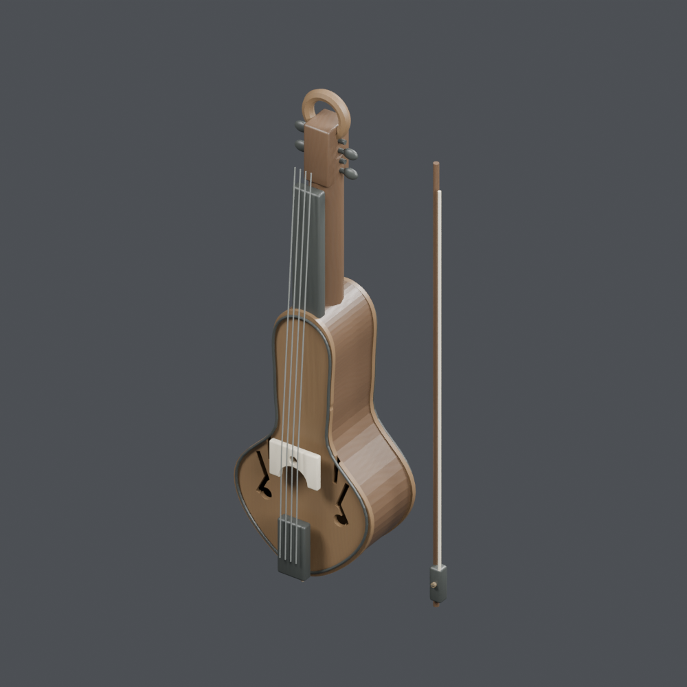

Use / purpose: Old violin and bow from the antique shop collection. Unit: one model record. Includes BLEND and GLB. The close-up is rendered from the distributed BLEND.

Record type: model. Formats: BLEND/GLB.

Reported dimensions (metres; XYZ when derived from measured bounds, legacy axis order not reverified): Unknown. Triangles: Unknown.

Origin: Unknown / not independently confirmed. Orientation: Unknown / not independently confirmed.

[Download ZIP](https://github.com/k3peta/tales-on-a-table/releases/download/v2026.10.18/AT_047_CC0.zip) · [License scope](../../LICENSE.md)

**CC0-1.0** — See original ZIP license and repository license scope. Models and embedded materials only; previews excluded.

Source details: [Catalogue 1](../../catalog/curios-tools_03.en.md) · [Catalogue 2](../../catalog/curios-tools_03.md) · [Catalogue 3](../../catalog/curios-tools_03.zh-CN.md)

## AT_048

**Brass candlestick with wax drips**

蝋の垂れた真鍮燭台

Use / purpose: Brass candlestick with wax drips from the antique shop collection. Unit: one model record. Includes BLEND and GLB. The close-up is rendered from the distributed BLEND.

Record type: model. Formats: BLEND/GLB.

Reported dimensions (metres; XYZ when derived from measured bounds, legacy axis order not reverified): Unknown. Triangles: Unknown.

Origin: Unknown / not independently confirmed. Orientation: Unknown / not independently confirmed.

[Download ZIP](https://github.com/k3peta/tales-on-a-table/releases/download/v2026.10.18/AT_048_CC0.zip) · [License scope](../../LICENSE.md)

**CC0-1.0** — See original ZIP license and repository license scope. Models and embedded materials only; previews excluded.

Source details: [Catalogue 1](../../catalog/candles-light_03.en.md) · [Catalogue 2](../../catalog/candles-light_03.md) · [Catalogue 3](../../catalog/candles-light_03.zh-CN.md)

## AT_049

**Brass counter lamp**

真鍮のカウンターランプ

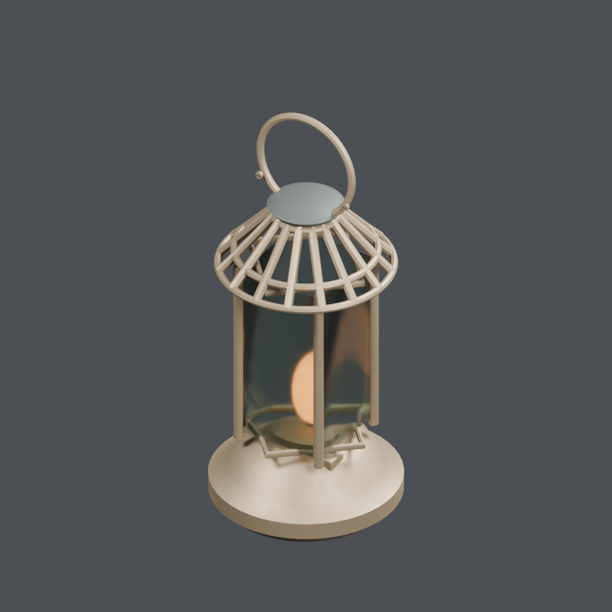

Use / purpose: Brass counter lamp from the antique shop collection. Unit: one model record. Includes BLEND and GLB. The close-up is rendered from the distributed BLEND.

Record type: model. Formats: BLEND/GLB.

Reported dimensions (metres; XYZ when derived from measured bounds, legacy axis order not reverified): Unknown. Triangles: Unknown.

Origin: Unknown / not independently confirmed. Orientation: Unknown / not independently confirmed.

[Download ZIP](https://github.com/k3peta/tales-on-a-table/releases/download/v2026.10.18/AT_049_CC0.zip) · [License scope](../../LICENSE.md)

**CC0-1.0** — See original ZIP license and repository license scope. Models and embedded materials only; previews excluded.

Source details: [Catalogue 1](../../catalog/candles-light_03.en.md) · [Catalogue 2](../../catalog/candles-light_03.md) · [Catalogue 3](../../catalog/candles-light_03.zh-CN.md)

## AT_050

**Incense burner with pierced lid**

透かし蓋の香炉

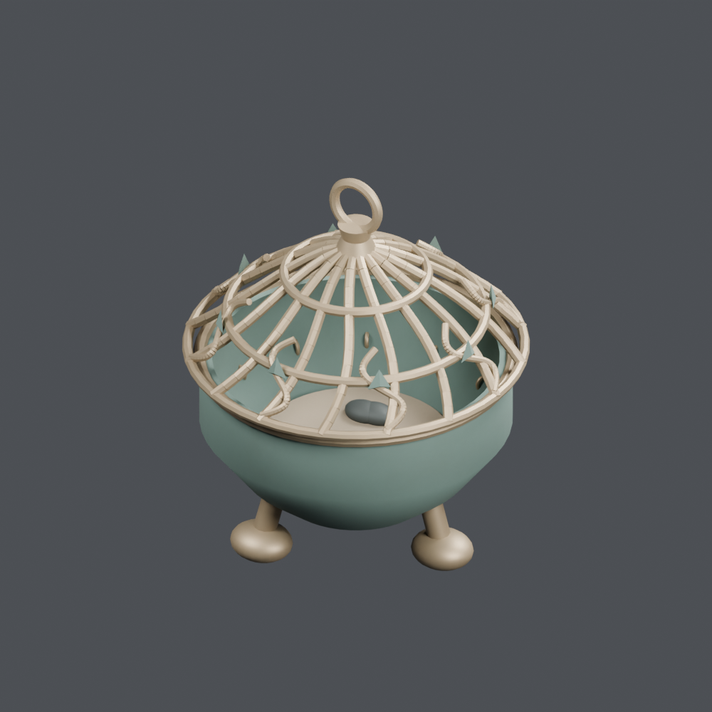

Use / purpose: Incense burner with pierced lid from the antique shop collection. Unit: one model record. Includes BLEND and GLB. The close-up is rendered from the distributed BLEND.

Record type: model. Formats: BLEND/GLB.

Reported dimensions (metres; XYZ when derived from measured bounds, legacy axis order not reverified): Unknown. Triangles: Unknown.

Origin: Unknown / not independently confirmed. Orientation: Unknown / not independently confirmed.

[Download ZIP](https://github.com/k3peta/tales-on-a-table/releases/download/v2026.10.18/AT_050_CC0.zip) · [License scope](../../LICENSE.md)

**CC0-1.0** — See original ZIP license and repository license scope. Models and embedded materials only; previews excluded.

Source details: [Catalogue 1](../../catalog/curios-tools_03.en.md) · [Catalogue 2](../../catalog/curios-tools_03.md) · [Catalogue 3](../../catalog/curios-tools_03.zh-CN.md)

**Unresolved:** Polygon budget exceeded; unrepaired.

## AT_051

**Mother-of-pearl jewelry box**

螺鈿の宝石箱

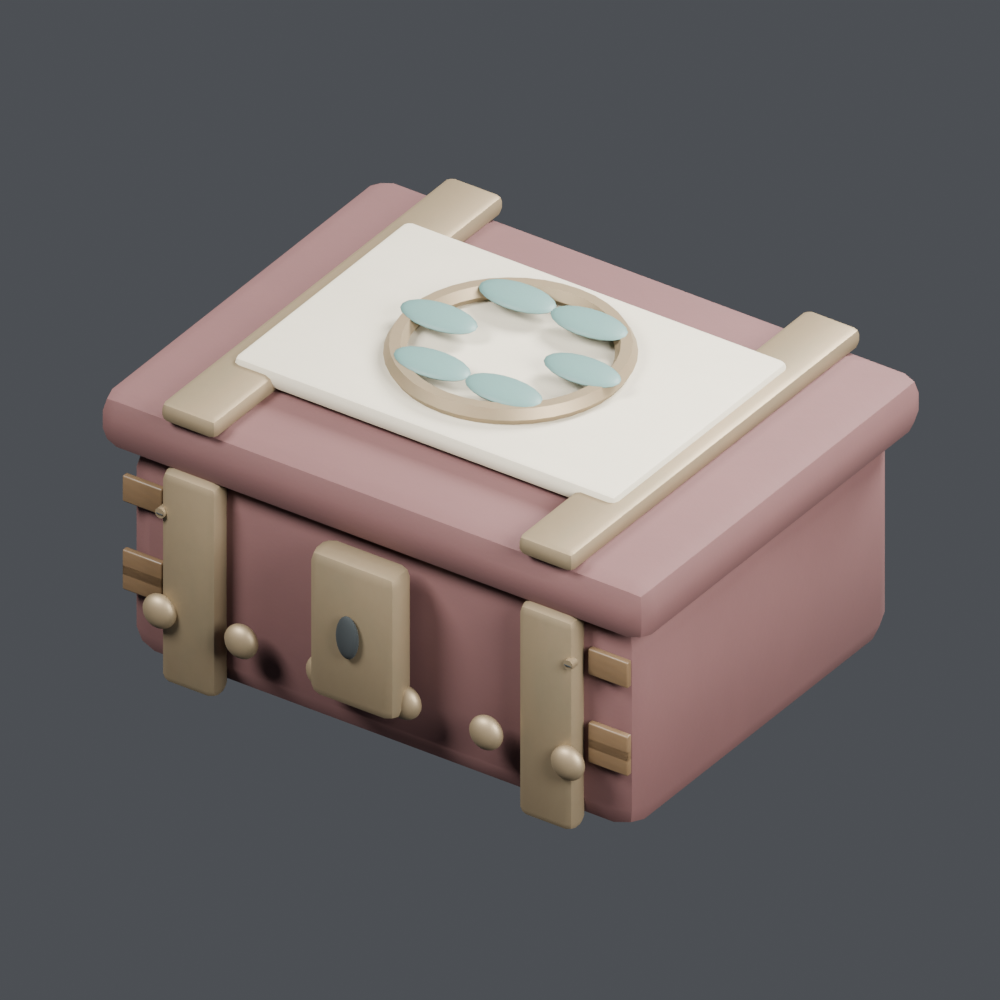

Use / purpose: Mother-of-pearl jewelry box from the antique shop collection. Unit: one model record. Includes BLEND and GLB. The close-up is rendered from the distributed BLEND.

Record type: model. Formats: BLEND/GLB.

Reported dimensions (metres; XYZ when derived from measured bounds, legacy axis order not reverified): Unknown. Triangles: Unknown.

Origin: Unknown / not independently confirmed. Orientation: Unknown / not independently confirmed.

[Download ZIP](https://github.com/k3peta/tales-on-a-table/releases/download/v2026.10.18/AT_051_CC0.zip) · [License scope](../../LICENSE.md)

**CC0-1.0** — See original ZIP license and repository license scope. Models and embedded materials only; previews excluded.

Source details: [Catalogue 1](../../catalog/containers_02.en.md) · [Catalogue 2](../../catalog/containers_02.md) · [Catalogue 3](../../catalog/containers_02.zh-CN.md)

## AT_052

**Velvet ring stand**

指輪のベルベット台

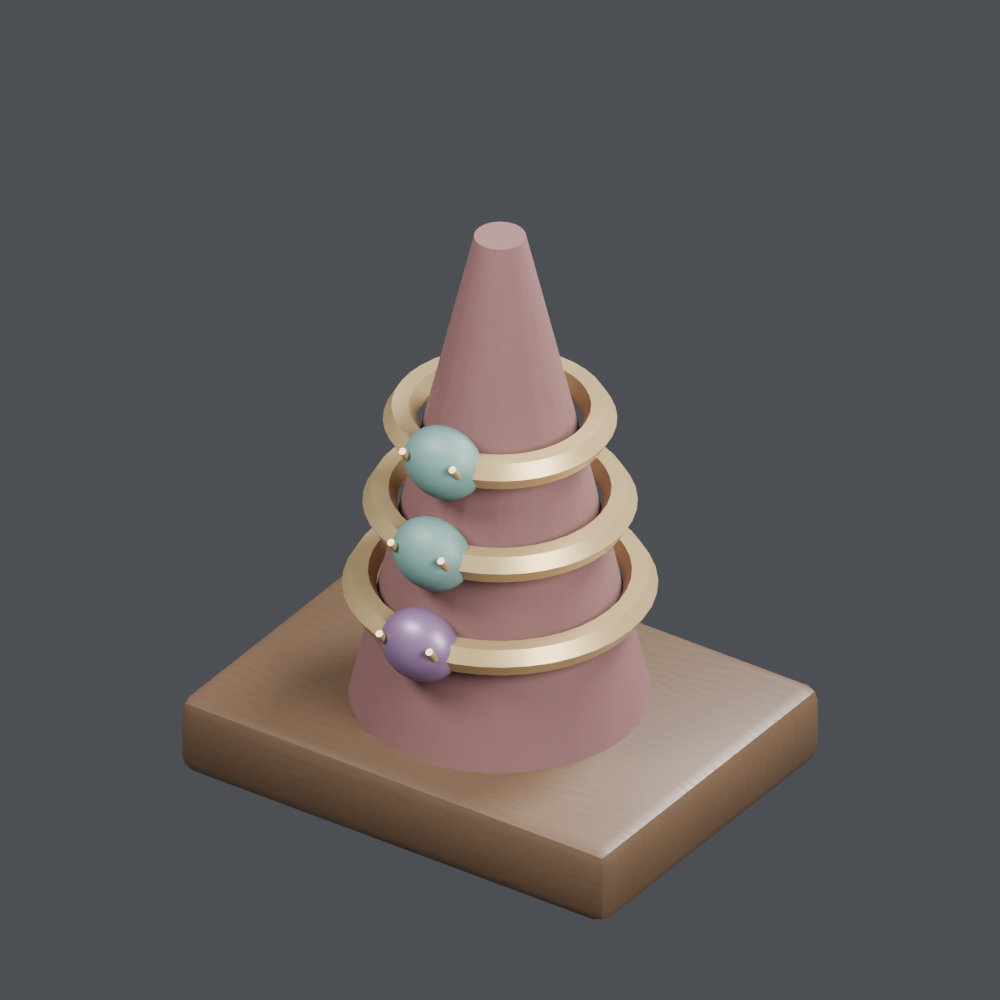

Use / purpose: Velvet ring stand from the antique shop collection. Unit: one model record. Includes BLEND and GLB. The close-up is rendered from the distributed BLEND.

Record type: model. Formats: BLEND/GLB.

Reported dimensions (metres; XYZ when derived from measured bounds, legacy axis order not reverified): Unknown. Triangles: Unknown.

Origin: Unknown / not independently confirmed. Orientation: Unknown / not independently confirmed.

[Download ZIP](https://github.com/k3peta/tales-on-a-table/releases/download/v2026.10.18/AT_052_CC0.zip) · [License scope](../../LICENSE.md)

**CC0-1.0** — See original ZIP license and repository license scope. Models and embedded materials only; previews excluded.

Source details: [Catalogue 1](../../catalog/furniture_02.en.md) · [Catalogue 2](../../catalog/furniture_02.md) · [Catalogue 3](../../catalog/furniture_02.zh-CN.md)

## AT_053

**Beaded-necklace display bust**

ビーズ首飾りの胸台

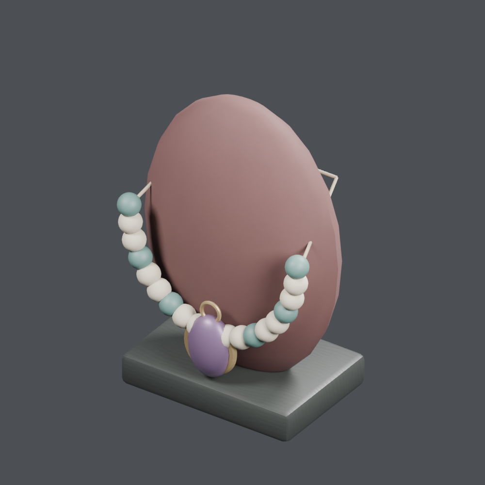

Use / purpose: Beaded-necklace display bust from the antique shop collection. Unit: one model record. Includes BLEND and GLB. The close-up is rendered from the distributed BLEND.

Record type: model. Formats: BLEND/GLB.

Reported dimensions (metres; XYZ when derived from measured bounds, legacy axis order not reverified): Unknown. Triangles: Unknown.

Origin: Unknown / not independently confirmed. Orientation: Unknown / not independently confirmed.

[Download ZIP](https://github.com/k3peta/tales-on-a-table/releases/download/v2026.10.18/AT_053_CC0.zip) · [License scope](../../LICENSE.md)

**CC0-1.0** — See original ZIP license and repository license scope. Models and embedded materials only; previews excluded.

Source details: [Catalogue 1](../../catalog/furniture_02.en.md) · [Catalogue 2](../../catalog/furniture_02.md) · [Catalogue 3](../../catalog/furniture_02.zh-CN.md)

## AT_054

**Anonymous portrait cameo**

匿名の肖像カメオ

Use / purpose: Anonymous portrait cameo from the antique shop collection. Unit: one model record. Includes BLEND and GLB. The close-up is rendered from the distributed BLEND.

Record type: model. Formats: BLEND/GLB.

Reported dimensions (metres; XYZ when derived from measured bounds, legacy axis order not reverified): Unknown. Triangles: Unknown.

Origin: Unknown / not independently confirmed. Orientation: Unknown / not independently confirmed.

[Download ZIP](https://github.com/k3peta/tales-on-a-table/releases/download/v2026.10.18/AT_054_CC0.zip) · [License scope](../../LICENSE.md)

**CC0-1.0** — See original ZIP license and repository license scope. Models and embedded materials only; previews excluded.

Source details: [Catalogue 1](../../catalog/curios-tools_03.en.md) · [Catalogue 2](../../catalog/curios-tools_03.md) · [Catalogue 3](../../catalog/curios-tools_03.zh-CN.md)

## AT_055

**Antique dealer's magnifying glass**

骨董商の拡大鏡

Use / purpose: Antique dealer's magnifying glass from the antique shop collection. Unit: one model record. Includes BLEND and GLB. The close-up is rendered from the distributed BLEND.

Record type: model. Formats: BLEND/GLB.

Reported dimensions (metres; XYZ when derived from measured bounds, legacy axis order not reverified): Unknown. Triangles: Unknown.

Origin: Unknown / not independently confirmed. Orientation: Unknown / not independently confirmed.

[Download ZIP](https://github.com/k3peta/tales-on-a-table/releases/download/v2026.10.18/AT_055_CC0.zip) · [License scope](../../LICENSE.md)

**CC0-1.0** — See original ZIP license and repository license scope. Models and embedded materials only; previews excluded.

Source details: [Catalogue 1](../../catalog/curios-tools_03.en.md) · [Catalogue 2](../../catalog/curios-tools_03.md) · [Catalogue 3](../../catalog/curios-tools_03.zh-CN.md)

## AT_056

**Quill and inkwell**

羽ペンとインク壺

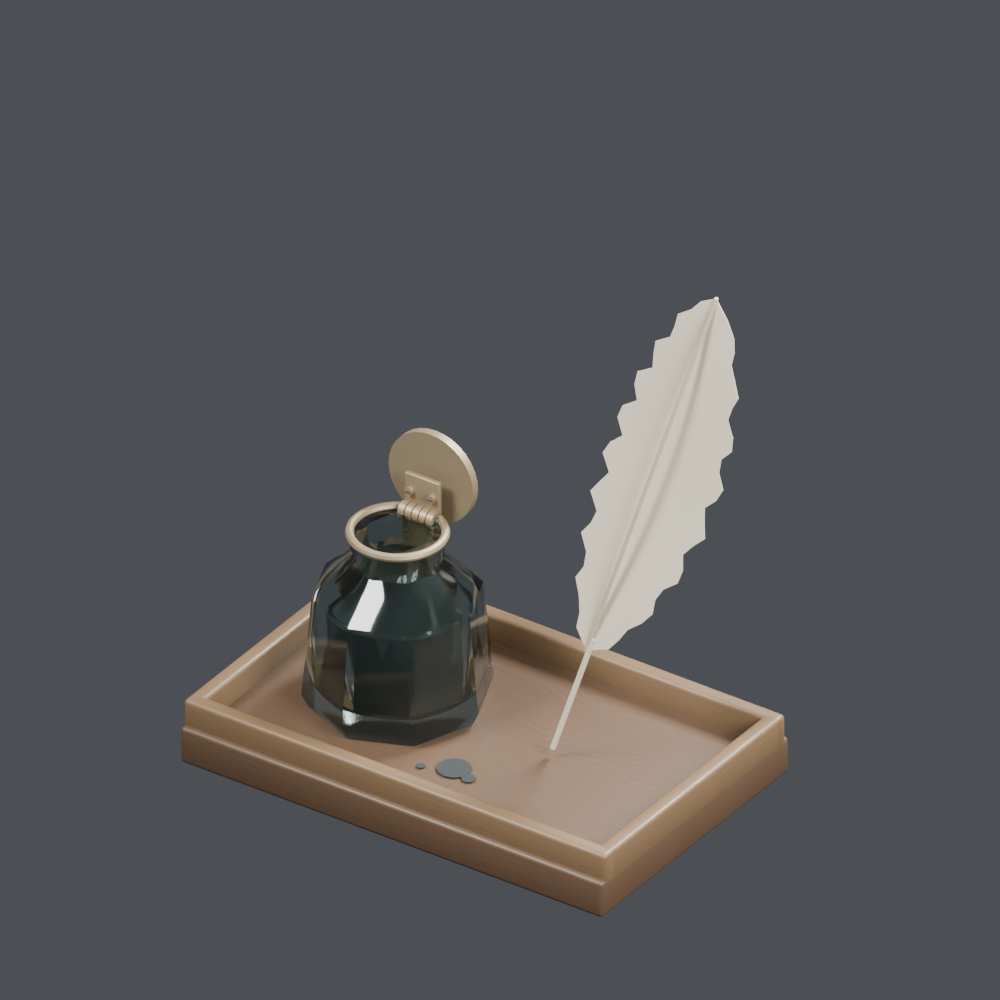

Use / purpose: Quill and inkwell from the antique shop collection. Unit: one model record. Includes BLEND and GLB. The close-up is rendered from the distributed BLEND.

Record type: model. Formats: BLEND/GLB.

Reported dimensions (metres; XYZ when derived from measured bounds, legacy axis order not reverified): Unknown. Triangles: Unknown.

Origin: Unknown / not independently confirmed. Orientation: Unknown / not independently confirmed.

[Download ZIP](https://github.com/k3peta/tales-on-a-table/releases/download/v2026.10.18/AT_056_CC0.zip) · [License scope](../../LICENSE.md)

**CC0-1.0** — See original ZIP license and repository license scope. Models and embedded materials only; previews excluded.

Source details: [Catalogue 1](../../catalog/books-paper_01.en.md) · [Catalogue 2](../../catalog/books-paper_01.md) · [Catalogue 3](../../catalog/books-paper_01.zh-CN.md)

## AT_057

**Nine-drawer cabinet**

九段引き出しの小物棚

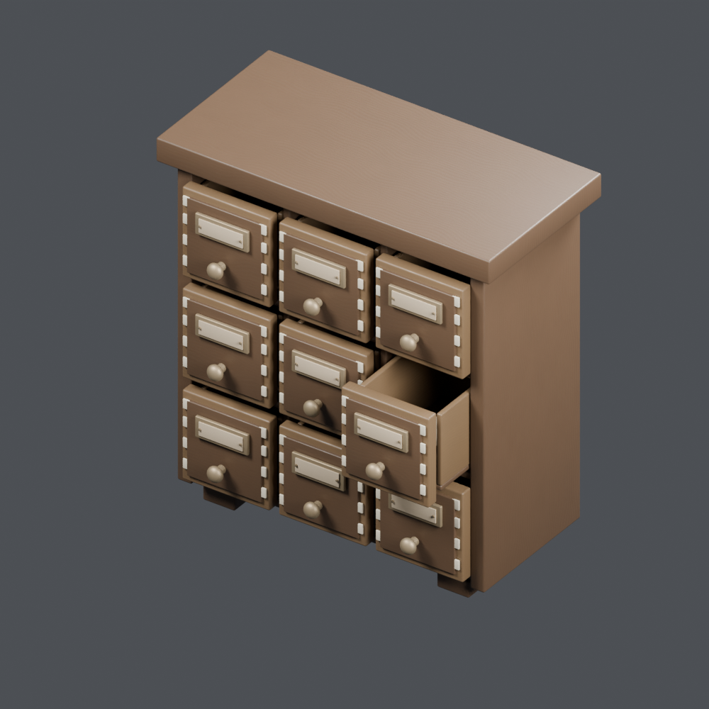

Use / purpose: Nine-drawer cabinet from the antique shop collection. Unit: one model record. Includes BLEND and GLB. The close-up is rendered from the distributed BLEND.

Record type: model. Formats: BLEND/GLB.

Reported dimensions (metres; XYZ when derived from measured bounds, legacy axis order not reverified): Unknown. Triangles: Unknown.

Origin: Unknown / not independently confirmed. Orientation: Unknown / not independently confirmed.

[Download ZIP](https://github.com/k3peta/tales-on-a-table/releases/download/v2026.10.18/AT_057_CC0.zip) · [License scope](../../LICENSE.md)

**CC0-1.0** — See original ZIP license and repository license scope. Models and embedded materials only; previews excluded.

Source details: [Catalogue 1](../../catalog/furniture_02.en.md) · [Catalogue 2](../../catalog/furniture_02.md) · [Catalogue 3](../../catalog/furniture_02.zh-CN.md)

## AT_058

**False crown with imitation gems**

模造宝石の偽王冠

Use / purpose: False crown with imitation gems from the antique shop collection. Unit: one model record. Includes BLEND and GLB. The close-up is rendered from the distributed BLEND.

Record type: model. Formats: BLEND/GLB.

Reported dimensions (metres; XYZ when derived from measured bounds, legacy axis order not reverified): Unknown. Triangles: Unknown.

Origin: Unknown / not independently confirmed. Orientation: Unknown / not independently confirmed.

[Download ZIP](https://github.com/k3peta/tales-on-a-table/releases/download/v2026.10.18/AT_058_CC0.zip) · [License scope](../../LICENSE.md)

**CC0-1.0** — See original ZIP license and repository license scope. Models and embedded materials only; previews excluded.

Source details: [Catalogue 1](../../catalog/curios-tools_03.en.md) · [Catalogue 2](../../catalog/curios-tools_03.md) · [Catalogue 3](../../catalog/curios-tools_03.zh-CN.md)

## AT_059

**Ammonite fossil**

アンモナイトの化石

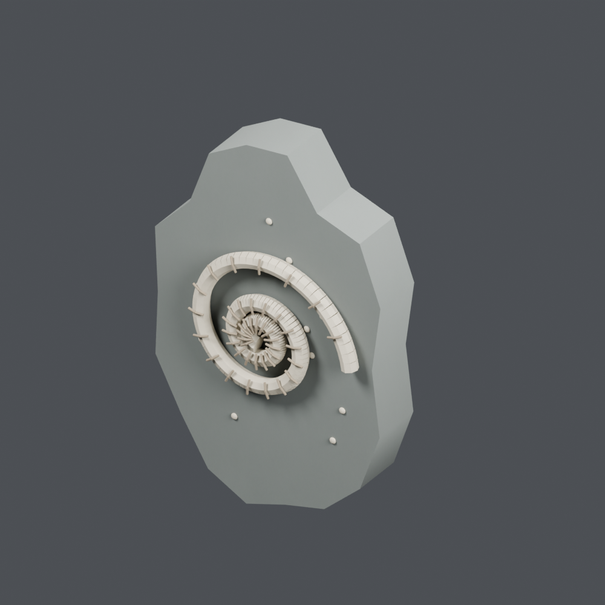

Use / purpose: Ammonite fossil from the antique shop collection. Unit: one model record. Includes BLEND and GLB. The close-up is rendered from the distributed BLEND.

Record type: model. Formats: BLEND/GLB.

Reported dimensions (metres; XYZ when derived from measured bounds, legacy axis order not reverified): Unknown. Triangles: Unknown.

Origin: Unknown / not independently confirmed. Orientation: Unknown / not independently confirmed.

[Download ZIP](https://github.com/k3peta/tales-on-a-table/releases/download/v2026.10.18/AT_059_CC0.zip) · [License scope](../../LICENSE.md)

**CC0-1.0** — See original ZIP license and repository license scope. Models and embedded materials only; previews excluded.

Source details: [Catalogue 1](../../catalog/curios-tools_03.en.md) · [Catalogue 2](../../catalog/curios-tools_03.md) · [Catalogue 3](../../catalog/curios-tools_03.zh-CN.md)

## AT_060

**Clockwork bird**

ぜんまいの小鳥

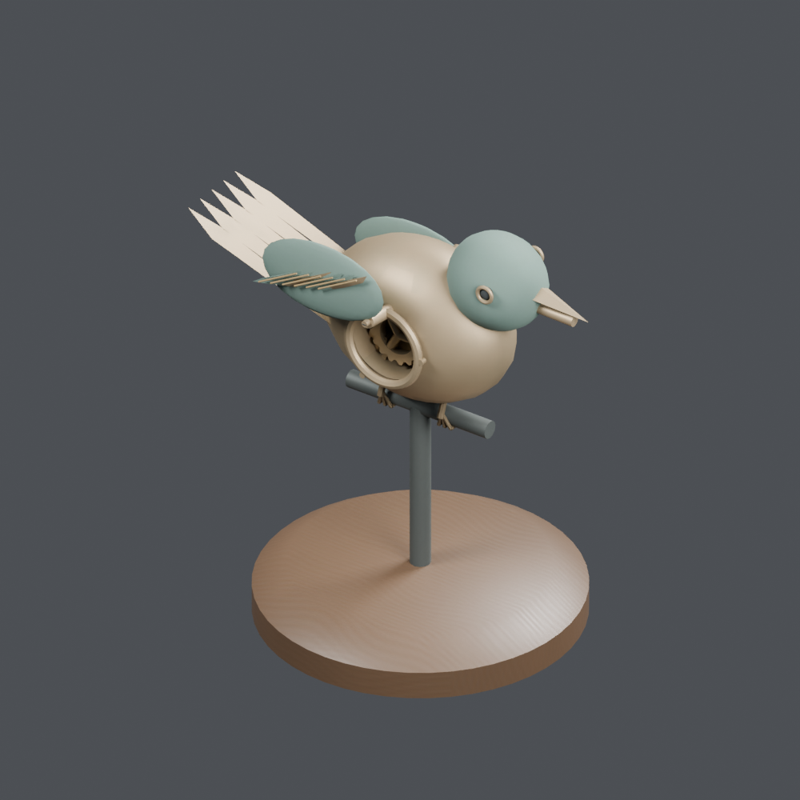

Use / purpose: Clockwork bird from the antique shop collection. Unit: one model record. Includes BLEND and GLB. The close-up is rendered from the distributed BLEND.

Record type: model. Formats: BLEND/GLB.

Reported dimensions (metres; XYZ when derived from measured bounds, legacy axis order not reverified): Unknown. Triangles: Unknown.

Origin: Unknown / not independently confirmed. Orientation: Unknown / not independently confirmed.

[Download ZIP](https://github.com/k3peta/tales-on-a-table/releases/download/v2026.10.18/AT_060_CC0.zip) · [License scope](../../LICENSE.md)

**CC0-1.0** — See original ZIP license and repository license scope. Models and embedded materials only; previews excluded.

Source details: [Catalogue 1](../../catalog/curios-tools_04.en.md) · [Catalogue 2](../../catalog/curios-tools_04.md) · [Catalogue 3](../../catalog/curios-tools_04.zh-CN.md)

## AT_061

**Large desktop appraisal loupe**

大型の卓上鑑定ルーペ

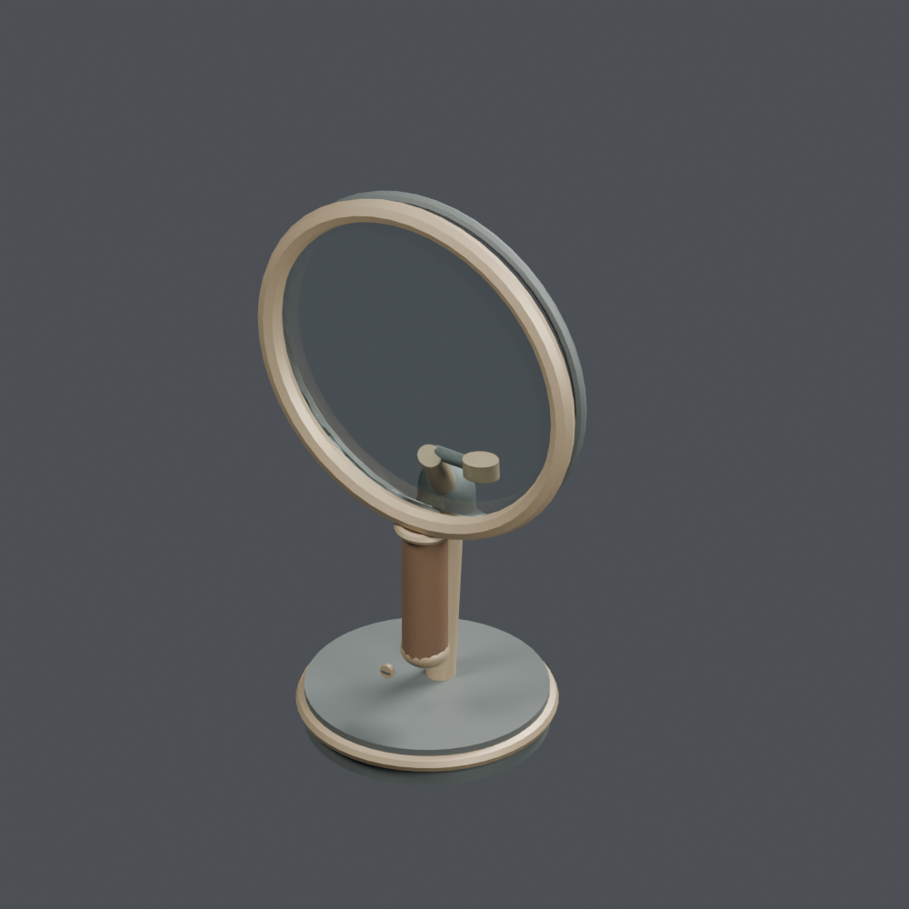

Use / purpose: Large desktop appraisal loupe from the antique shop collection. Unit: one model record. Includes BLEND and GLB. The close-up is rendered from the distributed BLEND.

Record type: model. Formats: BLEND/GLB.

Reported dimensions (metres; XYZ when derived from measured bounds, legacy axis order not reverified): Unknown. Triangles: Unknown.

Origin: Unknown / not independently confirmed. Orientation: Unknown / not independently confirmed.

[Download ZIP](https://github.com/k3peta/tales-on-a-table/releases/download/v2026.10.18/AT_061_CC0.zip) · [License scope](../../LICENSE.md)

**CC0-1.0** — See original ZIP license and repository license scope. Models and embedded materials only; previews excluded.

Source details: [Catalogue 1](../../catalog/curios-tools_04.en.md) · [Catalogue 2](../../catalog/curios-tools_04.md) · [Catalogue 3](../../catalog/curios-tools_04.zh-CN.md)

## AT_062

**Mismatched appraisal weights**

不揃いな鑑定用分銅

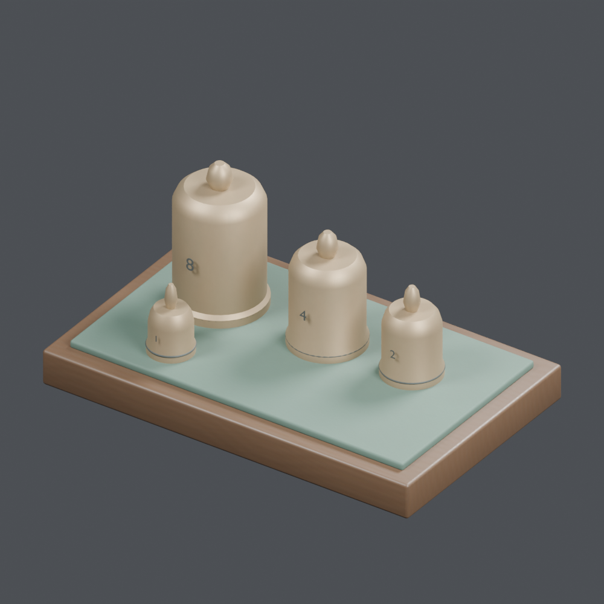

Use / purpose: Mismatched appraisal weights from the antique shop collection. Unit: one model record. Includes BLEND and GLB. The close-up is rendered from the distributed BLEND.

Record type: model. Formats: BLEND/GLB.

Reported dimensions (metres; XYZ when derived from measured bounds, legacy axis order not reverified): Unknown. Triangles: Unknown.

Origin: Unknown / not independently confirmed. Orientation: Unknown / not independently confirmed.

[Download ZIP](https://github.com/k3peta/tales-on-a-table/releases/download/v2026.10.18/AT_062_CC0.zip) · [License scope](../../LICENSE.md)

**CC0-1.0** — See original ZIP license and repository license scope. Models and embedded materials only; previews excluded.

Source details: [Catalogue 1](../../catalog/curios-tools_04.en.md) · [Catalogue 2](../../catalog/curios-tools_04.md) · [Catalogue 3](../../catalog/curios-tools_04.zh-CN.md)

## AT_063

**Gem appraisal tweezers**

宝石鑑定用ピンセット

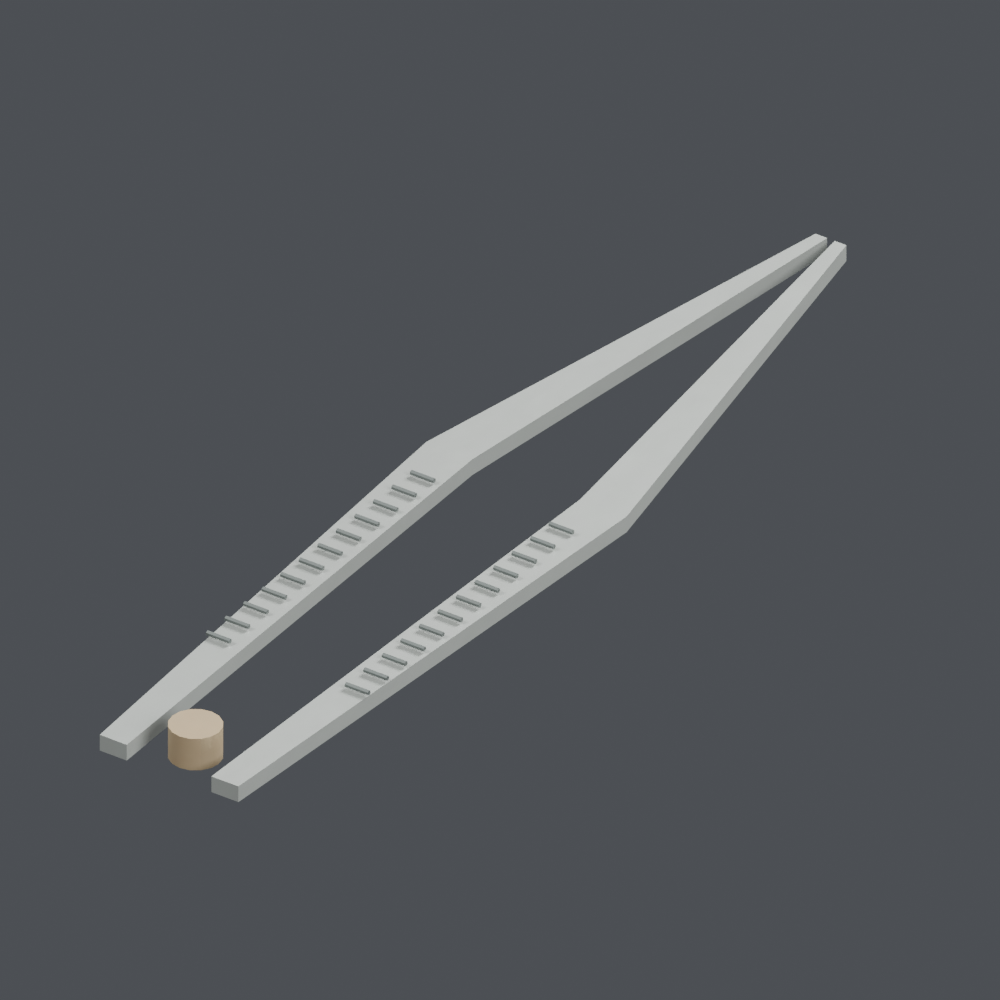

Use / purpose: Gem appraisal tweezers from the antique shop collection. Unit: one model record. Includes BLEND and GLB. The close-up is rendered from the distributed BLEND.

Record type: model. Formats: BLEND/GLB.

Reported dimensions (metres; XYZ when derived from measured bounds, legacy axis order not reverified): Unknown. Triangles: Unknown.

Origin: Unknown / not independently confirmed. Orientation: Unknown / not independently confirmed.

[Download ZIP](https://github.com/k3peta/tales-on-a-table/releases/download/v2026.10.18/AT_063_CC0.zip) · [License scope](../../LICENSE.md)

**CC0-1.0** — See original ZIP license and repository license scope. Models and embedded materials only; previews excluded.

Source details: [Catalogue 1](../../catalog/curios-tools_04.en.md) · [Catalogue 2](../../catalog/curios-tools_04.md) · [Catalogue 3](../../catalog/curios-tools_04.zh-CN.md)

## AT_064

**Used touchstone**

使用痕のある試金石

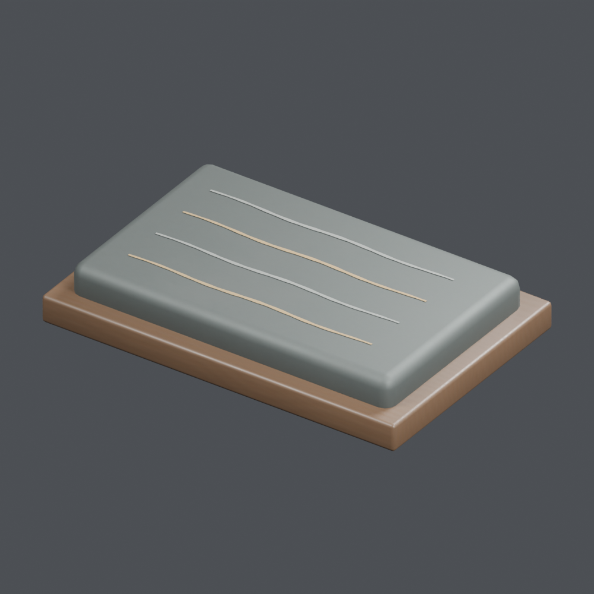

Use / purpose: Used touchstone from the antique shop collection. Unit: one model record. Includes BLEND and GLB. The close-up is rendered from the distributed BLEND.

Record type: model. Formats: BLEND/GLB.

Reported dimensions (metres; XYZ when derived from measured bounds, legacy axis order not reverified): Unknown. Triangles: Unknown.

Origin: Unknown / not independently confirmed. Orientation: Unknown / not independently confirmed.

[Download ZIP](https://github.com/k3peta/tales-on-a-table/releases/download/v2026.10.18/AT_064_CC0.zip) · [License scope](../../LICENSE.md)

**CC0-1.0** — See original ZIP license and repository license scope. Models and embedded materials only; previews excluded.

Source details: [Catalogue 1](../../catalog/curios-tools_04.en.md) · [Catalogue 2](../../catalog/curios-tools_04.md) · [Catalogue 3](../../catalog/curios-tools_04.zh-CN.md)

## AT_065

**Unfinished appraisal ledger**

書きかけの鑑定帳

Use / purpose: Unfinished appraisal ledger from the antique shop collection. Unit: one model record. Includes BLEND and GLB. The close-up is rendered from the distributed BLEND.

Record type: model. Formats: BLEND/GLB.

Reported dimensions (metres; XYZ when derived from measured bounds, legacy axis order not reverified): Unknown. Triangles: Unknown.

Origin: Unknown / not independently confirmed. Orientation: Unknown / not independently confirmed.

[Download ZIP](https://github.com/k3peta/tales-on-a-table/releases/download/v2026.10.18/AT_065_CC0.zip) · [License scope](../../LICENSE.md)

**CC0-1.0** — See original ZIP license and repository license scope. Models and embedded materials only; previews excluded.

Source details: [Catalogue 1](../../catalog/books-paper_01.en.md) · [Catalogue 2](../../catalog/books-paper_01.md) · [Catalogue 3](../../catalog/books-paper_01.zh-CN.md)
