# Base distribution records 241–264

[Browse index](README.md) · [Coverage and missing fields](COVERAGE.md)

Images are actual existing model renders for browsing, not covered by model CC0. A group record may show several reused models. Dimensions and triangle counts apply only to the original record when sourced; revisions can differ. Unknown means unverified, not zero. No blanket CC0 grant for scenes, images, code or articles.

## AT_066

**Tray of coins and gems under appraisal**

鑑定中の古銭と宝石皿

Use / purpose: Tray of coins and gems under appraisal from the antique shop collection. Unit: one model record. Includes BLEND and GLB. The close-up is rendered from the distributed BLEND.

Record type: model. Formats: BLEND/GLB.

Reported dimensions (metres; XYZ when derived from measured bounds, legacy axis order not reverified): Unknown. Triangles: Unknown.

Origin: Unknown / not independently confirmed. Orientation: Unknown / not independently confirmed.

[Download ZIP](https://github.com/k3peta/tales-on-a-table/releases/download/v2026.10.18/AT_066_CC0.zip) · [License scope](../../LICENSE.md)

**CC0-1.0** — See original ZIP license and repository license scope. Models and embedded materials only; previews excluded.

Source details: [Catalogue 1](../../catalog/tableware_02.en.md) · [Catalogue 2](../../catalog/tableware_02.md) · [Catalogue 3](../../catalog/tableware_02.zh-CN.md)

[Gem placement revision and comparison](../material_variants_at062_071.md). Original download retained.

## AT_067

**Travel staff with worn grip**

握りの擦れた旅の杖

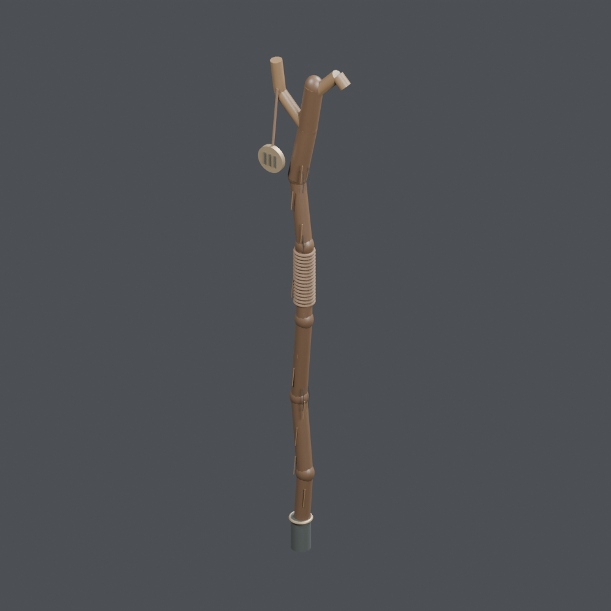

Use / purpose: Travel staff with worn grip from the antique shop collection. Unit: one model record. Includes BLEND and GLB. The close-up is rendered from the distributed BLEND.

Record type: model. Formats: BLEND/GLB.

Reported dimensions (metres; XYZ when derived from measured bounds, legacy axis order not reverified): Unknown. Triangles: Unknown.

Origin: Unknown / not independently confirmed. Orientation: Unknown / not independently confirmed.

[Download ZIP](https://github.com/k3peta/tales-on-a-table/releases/download/v2026.10.18/AT_067_CC0.zip) · [License scope](../../LICENSE.md)

**CC0-1.0** — See original ZIP license and repository license scope. Models and embedded materials only; previews excluded.

Source details: [Catalogue 1](../../catalog/curios-tools_04.en.md) · [Catalogue 2](../../catalog/curios-tools_04.md) · [Catalogue 3](../../catalog/curios-tools_04.zh-CN.md)

**Version history:** Scratch strips diagnosed and revised; see revision below. Polygon-budget issue remains unresolved.

**Revision: final ZIP guard and public-download identity verified:** [AT067 repair and comparison](../../catalog/at067_scratch_repair.md). Original download/image retained.

## AT_068

**Raven-marked incoming crate**

鴉印の入荷木箱

Use / purpose: Raven-marked incoming crate from the antique shop collection. Unit: one model record. Includes BLEND and GLB. The close-up is rendered from the distributed BLEND.

Record type: model. Formats: BLEND/GLB.

Reported dimensions (metres; XYZ when derived from measured bounds, legacy axis order not reverified): Unknown. Triangles: Unknown.

Origin: Unknown / not independently confirmed. Orientation: Unknown / not independently confirmed.

[Download ZIP](https://github.com/k3peta/tales-on-a-table/releases/download/v2026.10.18/AT_068_CC0.zip) · [License scope](../../LICENSE.md)

**CC0-1.0** — See original ZIP license and repository license scope. Models and embedded materials only; previews excluded.

Source details: [Catalogue 1](../../catalog/containers_02.en.md) · [Catalogue 2](../../catalog/containers_02.md) · [Catalogue 3](../../catalog/containers_02.zh-CN.md)

## AT_069

**Heavily patched leather armor**

継ぎ当てを重ねた革鎧

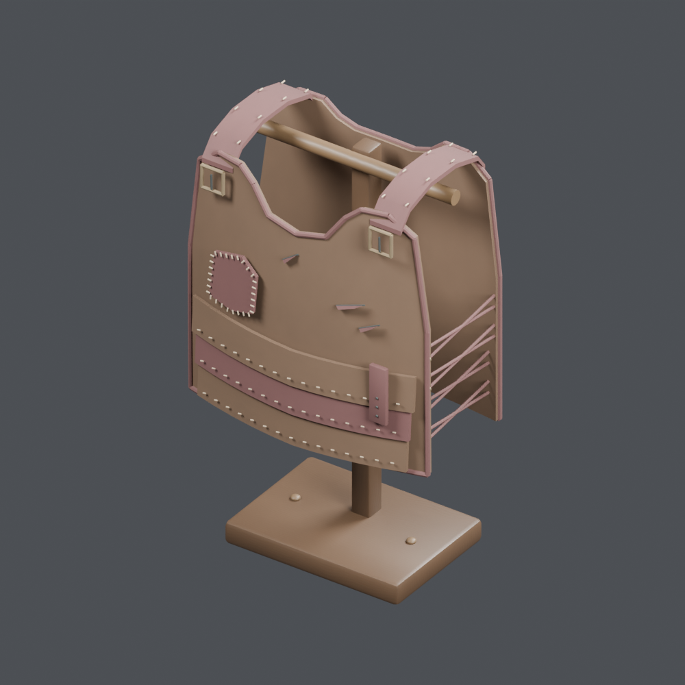

Use / purpose: Heavily patched leather armor from the antique shop collection. Unit: one model record. Includes BLEND and GLB. The close-up is rendered from the distributed BLEND.

Record type: model. Formats: BLEND/GLB.

Reported dimensions (metres; XYZ when derived from measured bounds, legacy axis order not reverified): Unknown. Triangles: Unknown.

Origin: Unknown / not independently confirmed. Orientation: Unknown / not independently confirmed.

[Download ZIP](https://github.com/k3peta/tales-on-a-table/releases/download/v2026.10.18/AT_069_CC0.zip) · [License scope](../../LICENSE.md)

**CC0-1.0** — See original ZIP license and repository license scope. Models and embedded materials only; previews excluded.

Source details: [Catalogue 1](../../catalog/weapons-equipment_01.en.md) · [Catalogue 2](../../catalog/weapons-equipment_01.md) · [Catalogue 3](../../catalog/weapons-equipment_01.zh-CN.md)

## AT_070

**Cracked wooden shield of the last bridge**

割れた最後の橋の木盾

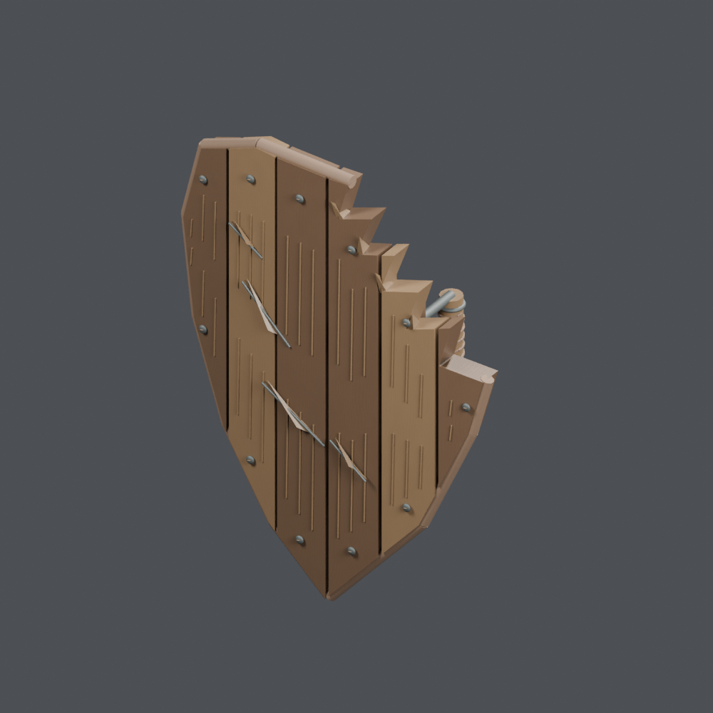

Use / purpose: Cracked wooden shield of the last bridge from the antique shop collection. Unit: one model record. Includes BLEND and GLB. The close-up is rendered from the distributed BLEND.

Record type: model. Formats: BLEND/GLB.

Reported dimensions (metres; XYZ when derived from measured bounds, legacy axis order not reverified): Unknown. Triangles: Unknown.

Origin: Unknown / not independently confirmed. Orientation: Unknown / not independently confirmed.

[Download ZIP](https://github.com/k3peta/tales-on-a-table/releases/download/v2026.10.18/AT_070_CC0.zip) · [License scope](../../LICENSE.md)

**CC0-1.0** — See original ZIP license and repository license scope. Models and embedded materials only; previews excluded.

Source details: [Catalogue 1](../../catalog/weapons-equipment_01.en.md) · [Catalogue 2](../../catalog/weapons-equipment_01.md) · [Catalogue 3](../../catalog/weapons-equipment_01.zh-CN.md)

## AT_071

**Repaired drawstring leather pouch**

補修跡のある口紐付き革袋

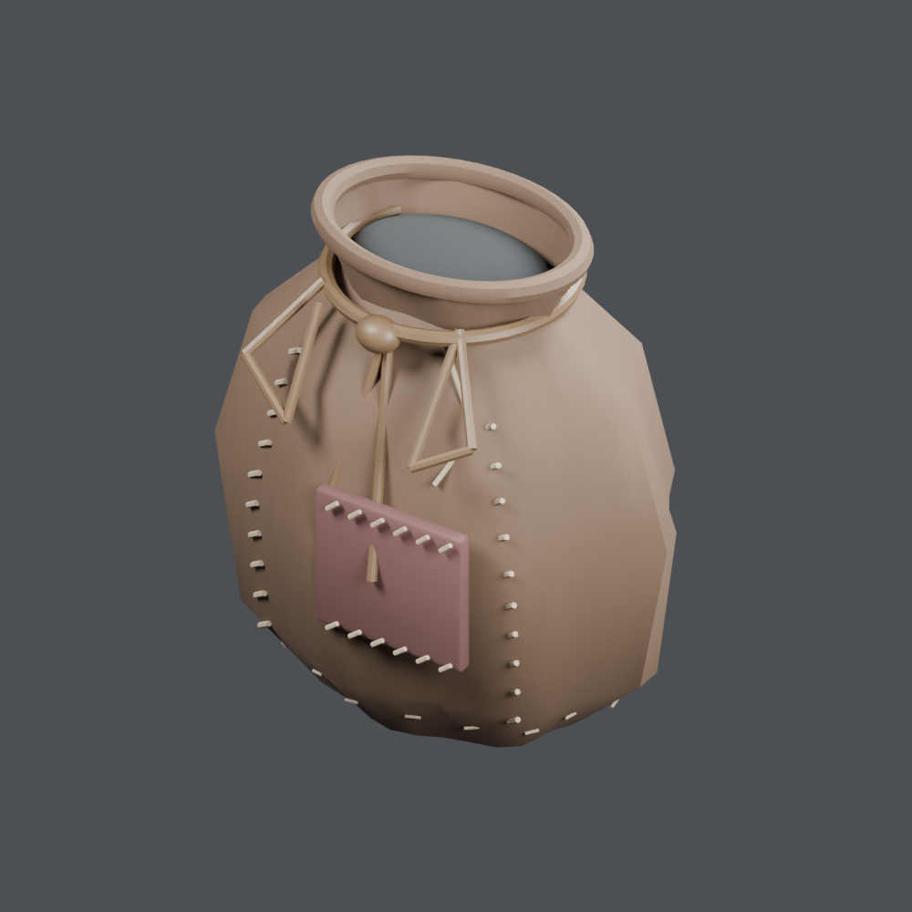

Use / purpose: Repaired drawstring leather pouch from the antique shop collection. Unit: one model record. Includes BLEND and GLB. The close-up is rendered from the distributed BLEND.

Record type: model. Formats: BLEND/GLB.

Reported dimensions (metres; XYZ when derived from measured bounds, legacy axis order not reverified): Unknown. Triangles: Unknown.

Origin: Unknown / not independently confirmed. Orientation: Unknown / not independently confirmed.

[Download ZIP](https://github.com/k3peta/tales-on-a-table/releases/download/v2026.10.18/AT_071_CC0.zip) · [License scope](../../LICENSE.md)

**CC0-1.0** — See original ZIP license and repository license scope. Models and embedded materials only; previews excluded.

Source details: [Catalogue 1](../../catalog/containers_02.en.md) · [Catalogue 2](../../catalog/containers_02.md) · [Catalogue 3](../../catalog/containers_02.zh-CN.md)

## AT_072

**Sealed vial of fictional Moonbane poison**

厳封された架空毒ムーンベインの小瓶

Use / purpose: Sealed vial of fictional Moonbane poison from the antique shop collection. Unit: one model record. Includes BLEND and GLB. The close-up is rendered from the distributed BLEND.

Record type: model. Formats: BLEND/GLB.

Reported dimensions (metres; XYZ when derived from measured bounds, legacy axis order not reverified): Unknown. Triangles: Unknown.

Origin: Unknown / not independently confirmed. Orientation: Unknown / not independently confirmed.

[Download ZIP](https://github.com/k3peta/tales-on-a-table/releases/download/v2026.10.18/AT_072_CC0.zip) · [License scope](../../LICENSE.md)

**CC0-1.0** — See original ZIP license and repository license scope. Models and embedded materials only; previews excluded.

Source details: [Catalogue 1](../../catalog/curios-tools_04.en.md) · [Catalogue 2](../../catalog/curios-tools_04.md) · [Catalogue 3](../../catalog/curios-tools_04.zh-CN.md)

## AT_073

**Field medicine box with bandages and packets**

包帯と薬包が残る野戦薬箱

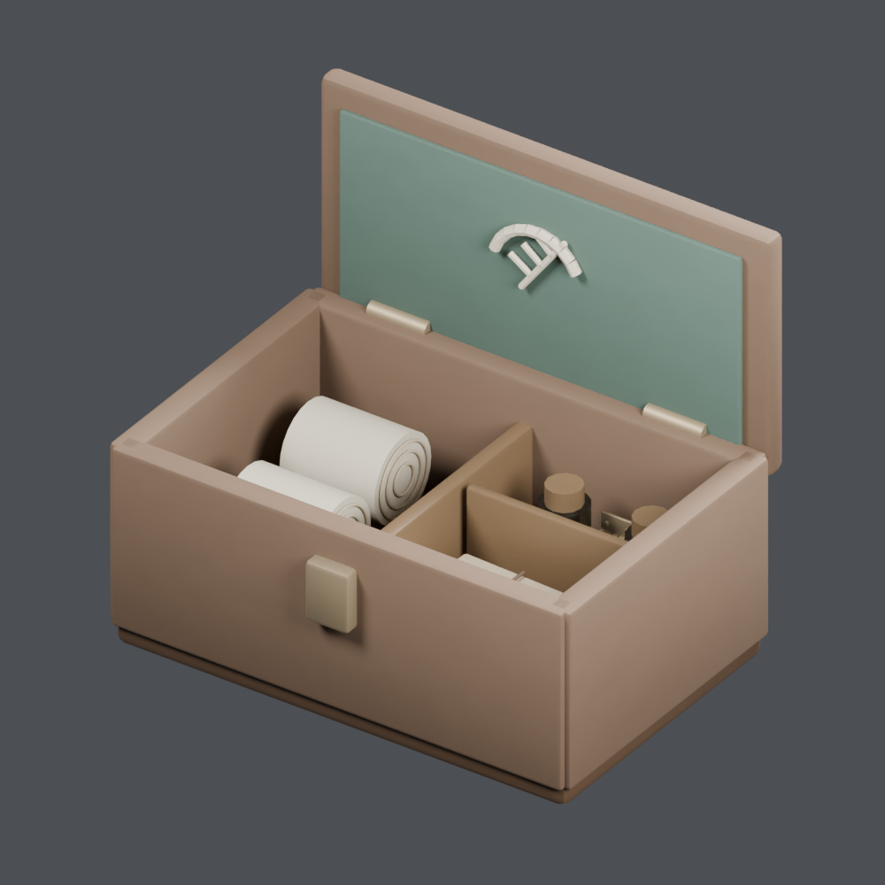

Use / purpose: Field medicine box with bandages and packets from the antique shop collection. Unit: one model record. Includes BLEND and GLB. The close-up is rendered from the distributed BLEND.

Record type: model. Formats: BLEND/GLB.

Reported dimensions (metres; XYZ when derived from measured bounds, legacy axis order not reverified): Unknown. Triangles: Unknown.

Origin: Unknown / not independently confirmed. Orientation: Unknown / not independently confirmed.

[Download ZIP](https://github.com/k3peta/tales-on-a-table/releases/download/v2026.10.18/AT_073_CC0.zip) · [License scope](../../LICENSE.md)

**CC0-1.0** — See original ZIP license and repository license scope. Models and embedded materials only; previews excluded.

Source details: [Catalogue 1](../../catalog/containers_02.en.md) · [Catalogue 2](../../catalog/containers_02.md) · [Catalogue 3](../../catalog/containers_02.zh-CN.md)

## AT_074

**Woven basket of forgotten bottles**

忘れられた瓶の編み籠

Use / purpose: Woven basket of forgotten bottles from the antique shop collection. Unit: one group containing several objects. Includes BLEND and GLB. The close-up is rendered from the distributed BLEND.

Record type: group. Formats: BLEND/GLB.

Reported dimensions (metres; XYZ when derived from measured bounds, legacy axis order not reverified): Unknown. Triangles: Unknown.

Origin: Unknown / not independently confirmed. Orientation: Unknown / not independently confirmed.

[Download ZIP](https://github.com/k3peta/tales-on-a-table/releases/download/v2026.10.18/AT_074_CC0.zip) · [License scope](../../LICENSE.md)

**CC0-1.0** — See original ZIP license and repository license scope. Models and embedded materials only; previews excluded.

Source details: [Catalogue 1](../../catalog/containers_02.en.md) · [Catalogue 2](../../catalog/containers_02.md) · [Catalogue 3](../../catalog/containers_02.zh-CN.md)

**Unresolved:** 85628 triangles; budget/redesign unresolved.

## AT_075

**Corner cobweb A**

隅の蜘蛛の巣 A

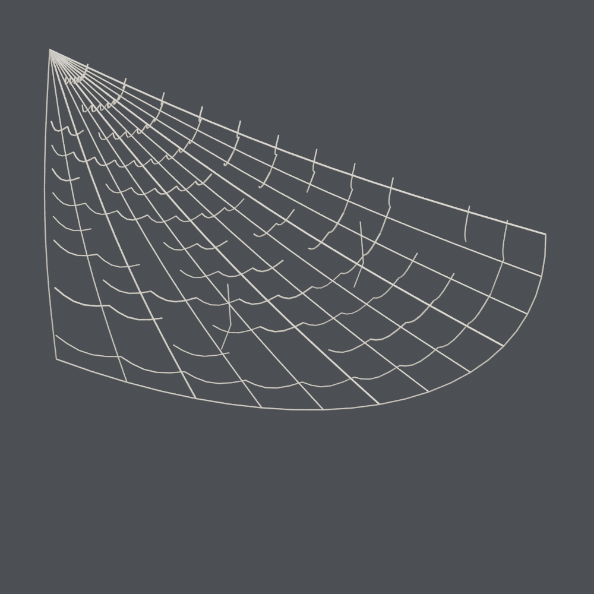

Use / purpose: Corner cobweb A from the antique shop collection. Unit: one group containing several objects. Includes BLEND and GLB. The close-up is rendered from the distributed BLEND.

Record type: group. Formats: BLEND/GLB.

Reported dimensions (metres; XYZ when derived from measured bounds, legacy axis order not reverified): Unknown. Triangles: Unknown.

Origin: Unknown / not independently confirmed. Orientation: Unknown / not independently confirmed.

[Download ZIP](https://github.com/k3peta/tales-on-a-table/releases/download/v2026.10.18/AT_075_CC0.zip) · [License scope](../../LICENSE.md)

**CC0-1.0** — See original ZIP license and repository license scope. Models and embedded materials only; previews excluded.

Source details: [Catalogue 1](../../catalog/curios-tools_04.en.md) · [Catalogue 2](../../catalog/curios-tools_04.md) · [Catalogue 3](../../catalog/curios-tools_04.zh-CN.md)

## AT_076

**Corner cobweb B**

隅の蜘蛛の巣 B

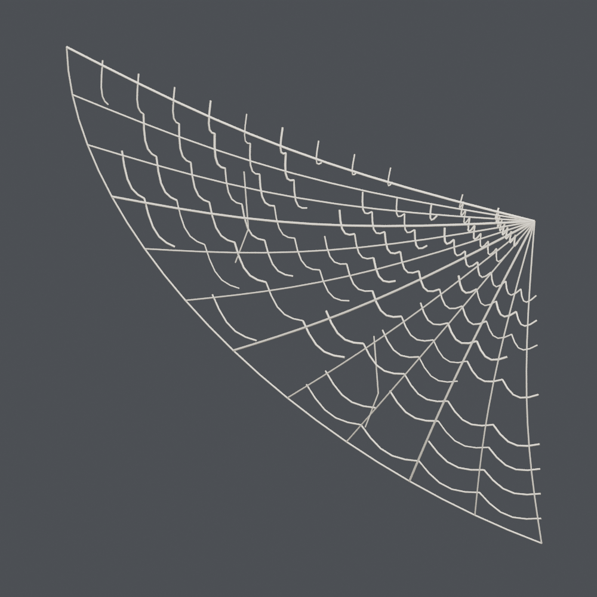

Use / purpose: Corner cobweb B from the antique shop collection. Unit: one group containing several objects. Includes BLEND and GLB. The close-up is rendered from the distributed BLEND.

Record type: group. Formats: BLEND/GLB.

Reported dimensions (metres; XYZ when derived from measured bounds, legacy axis order not reverified): Unknown. Triangles: Unknown.

Origin: Unknown / not independently confirmed. Orientation: Unknown / not independently confirmed.

[Download ZIP](https://github.com/k3peta/tales-on-a-table/releases/download/v2026.10.18/AT_076_CC0.zip) · [License scope](../../LICENSE.md)

**CC0-1.0** — See original ZIP license and repository license scope. Models and embedded materials only; previews excluded.

Source details: [Catalogue 1](../../catalog/curios-tools_04.en.md) · [Catalogue 2](../../catalog/curios-tools_04.md) · [Catalogue 3](../../catalog/curios-tools_04.zh-CN.md)

## AT_077

**Corner cobweb C**

隅の蜘蛛の巣 C

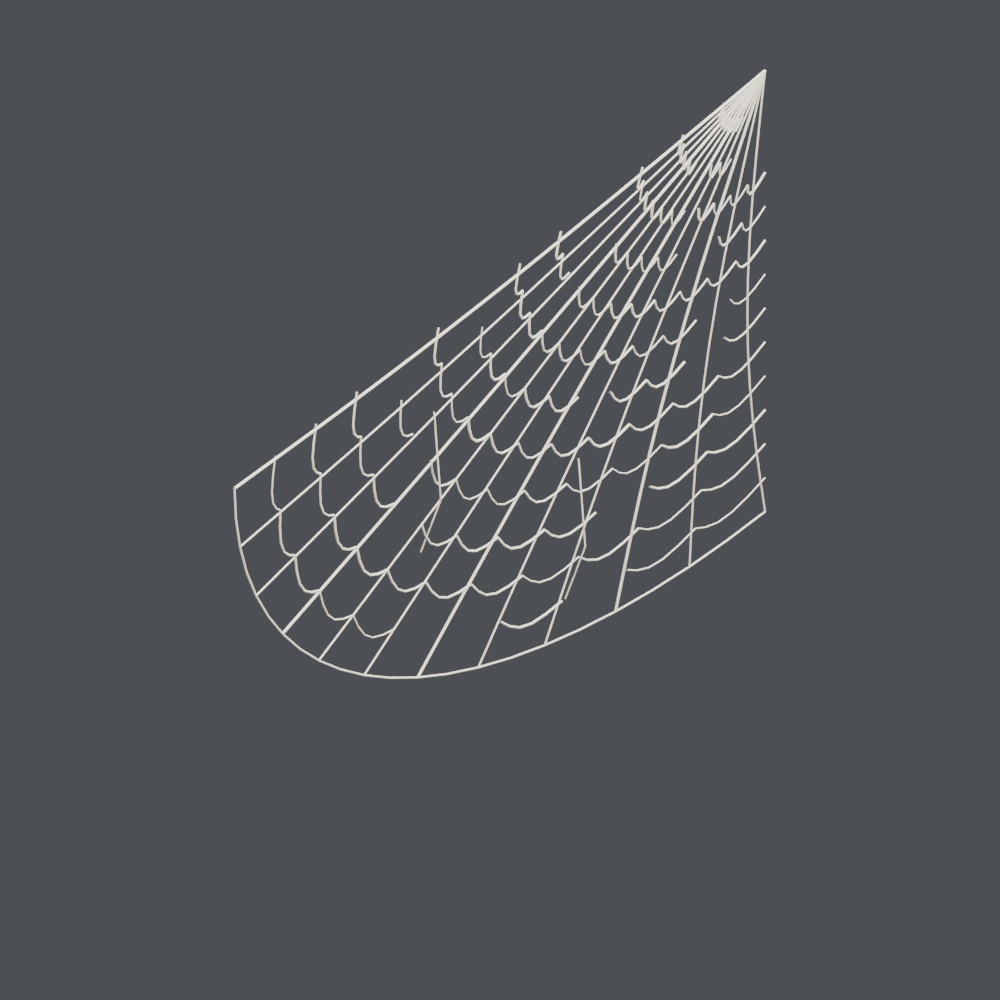

Use / purpose: Corner cobweb C from the antique shop collection. Unit: one group containing several objects. Includes BLEND and GLB. The close-up is rendered from the distributed BLEND.

Record type: group. Formats: BLEND/GLB.

Reported dimensions (metres; XYZ when derived from measured bounds, legacy axis order not reverified): Unknown. Triangles: Unknown.

Origin: Unknown / not independently confirmed. Orientation: Unknown / not independently confirmed.

[Download ZIP](https://github.com/k3peta/tales-on-a-table/releases/download/v2026.10.18/AT_077_CC0.zip) · [License scope](../../LICENSE.md)

**CC0-1.0** — See original ZIP license and repository license scope. Models and embedded materials only; previews excluded.

Source details: [Catalogue 1](../../catalog/curios-tools_04.en.md) · [Catalogue 2](../../catalog/curios-tools_04.md) · [Catalogue 3](../../catalog/curios-tools_04.zh-CN.md)

## AT_078

**Localized dust and spill marks**

局所的な埃とこぼれ跡

Use / purpose: Localized dust and spill marks from the antique shop collection. Unit: one group containing several objects. Includes BLEND and GLB. The close-up is rendered from the distributed BLEND.

Record type: group. Formats: BLEND/GLB.

Reported dimensions (metres; XYZ when derived from measured bounds, legacy axis order not reverified): Unknown. Triangles: Unknown.

Origin: Unknown / not independently confirmed. Orientation: Unknown / not independently confirmed.

[Download ZIP](https://github.com/k3peta/tales-on-a-table/releases/download/v2026.10.18/AT_078_CC0.zip) · [License scope](../../LICENSE.md)

**CC0-1.0** — See original ZIP license and repository license scope. Models and embedded materials only; previews excluded.

Source details: [Catalogue 1](../../catalog/curios-tools_04.en.md) · [Catalogue 2](../../catalog/curios-tools_04.md) · [Catalogue 3](../../catalog/curios-tools_04.zh-CN.md)

**Unresolved:** Placement context unresolved.

## AT_079

**Papers with a partly buried green stone**

翠石が埋もれた書類束

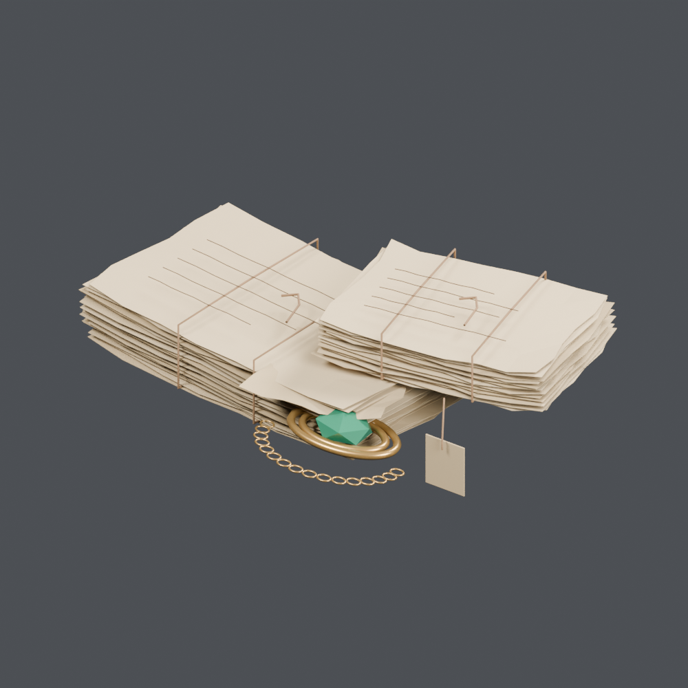

Use / purpose: Papers with a partly buried green stone from the antique shop collection. Unit: one group containing several objects. Includes BLEND and GLB. The close-up is rendered from the distributed BLEND.

Record type: group. Formats: BLEND/GLB.

Reported dimensions (metres; XYZ when derived from measured bounds, legacy axis order not reverified): Unknown. Triangles: Unknown.

Origin: Unknown / not independently confirmed. Orientation: Unknown / not independently confirmed.

[Download ZIP](https://github.com/k3peta/tales-on-a-table/releases/download/v2026.10.18/AT_079_CC0.zip) · [License scope](../../LICENSE.md)

**CC0-1.0** — See original ZIP license and repository license scope. Models and embedded materials only; previews excluded.

Source details: [Catalogue 1](../../catalog/books-paper_01.en.md) · [Catalogue 2](../../catalog/books-paper_01.md) · [Catalogue 3](../../catalog/books-paper_01.zh-CN.md)

**Unresolved:** Raised cords/overlap diagnosis pending.

## AT_080

**Sealed object beneath linen**

リネンの下の封印品

Use / purpose: Sealed object beneath linen from the antique shop collection. Unit: one group containing several objects. Includes BLEND and GLB. The close-up is rendered from the distributed BLEND. The original source title is retained. The close-up shows a wooden tray holding books, a bottle and a cup.

Record type: group. Formats: BLEND/GLB.

Reported dimensions (metres; XYZ when derived from measured bounds, legacy axis order not reverified): Unknown. Triangles: Unknown.

Origin: Unknown / not independently confirmed. Orientation: Unknown / not independently confirmed.

[Download ZIP](https://github.com/k3peta/tales-on-a-table/releases/download/v2026.10.18/AT_080_CC0.zip) · [License scope](../../LICENSE.md)

**CC0-1.0** — See original ZIP license and repository license scope. Models and embedded materials only; previews excluded.

Source details: [Catalogue 1](../../catalog/textiles_01.en.md) · [Catalogue 2](../../catalog/textiles_01.md) · [Catalogue 3](../../catalog/textiles_01.zh-CN.md)

**Unresolved:** Public name/content mismatch and raised cords/overlap diagnosis pending.

## AT_081

**Scrolls and loose letters**

巻物とばらの書簡

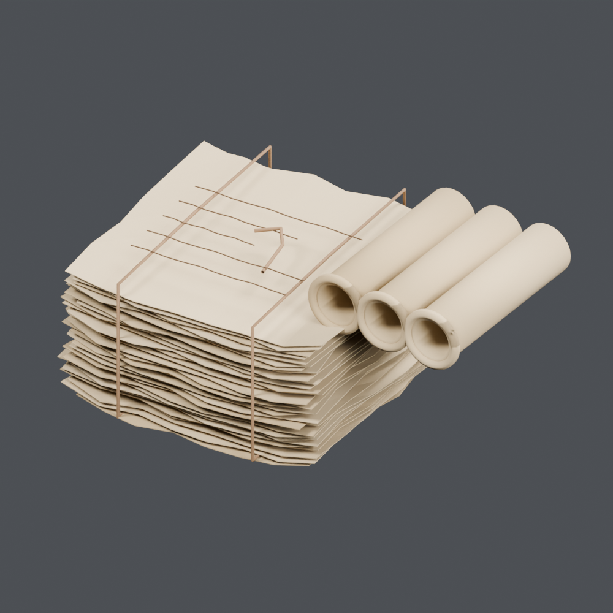

Use / purpose: Scrolls and loose letters from the antique shop collection. Unit: one group containing several objects. Includes BLEND and GLB. The close-up is rendered from the distributed BLEND.

Record type: group. Formats: BLEND/GLB.

Reported dimensions (metres; XYZ when derived from measured bounds, legacy axis order not reverified): Unknown. Triangles: Unknown.

Origin: Unknown / not independently confirmed. Orientation: Unknown / not independently confirmed.

[Download ZIP](https://github.com/k3peta/tales-on-a-table/releases/download/v2026.10.18/AT_081_CC0.zip) · [License scope](../../LICENSE.md)

**CC0-1.0** — See original ZIP license and repository license scope. Models and embedded materials only; previews excluded.

Source details: [Catalogue 1](../../catalog/books-paper_01.en.md) · [Catalogue 2](../../catalog/books-paper_01.md) · [Catalogue 3](../../catalog/books-paper_01.zh-CN.md)

**Unresolved:** Raised cords/overlap diagnosis pending.

## AT_082

**Folded deed and broken seal**

折った証書と割れた封印

Use / purpose: Folded deed and broken seal from the antique shop collection. Unit: one group containing several objects. Includes BLEND and GLB. The close-up is rendered from the distributed BLEND.

Record type: group. Formats: BLEND/GLB.

Reported dimensions (metres; XYZ when derived from measured bounds, legacy axis order not reverified): Unknown. Triangles: Unknown.

Origin: Unknown / not independently confirmed. Orientation: Unknown / not independently confirmed.

[Download ZIP](https://github.com/k3peta/tales-on-a-table/releases/download/v2026.10.18/AT_082_CC0.zip) · [License scope](../../LICENSE.md)

**CC0-1.0** — See original ZIP license and repository license scope. Models and embedded materials only; previews excluded.

Source details: [Catalogue 1](../../catalog/books-paper_01.en.md) · [Catalogue 2](../../catalog/books-paper_01.md) · [Catalogue 3](../../catalog/books-paper_01.zh-CN.md)

**Audit status (no adopted repair):** Raised cord clearance/intended ties diagnosis pending. [Audit scope](../quality_audit_at082_092.md).

## AT_083

**Old pottery shards and papers**

古い陶片と書類

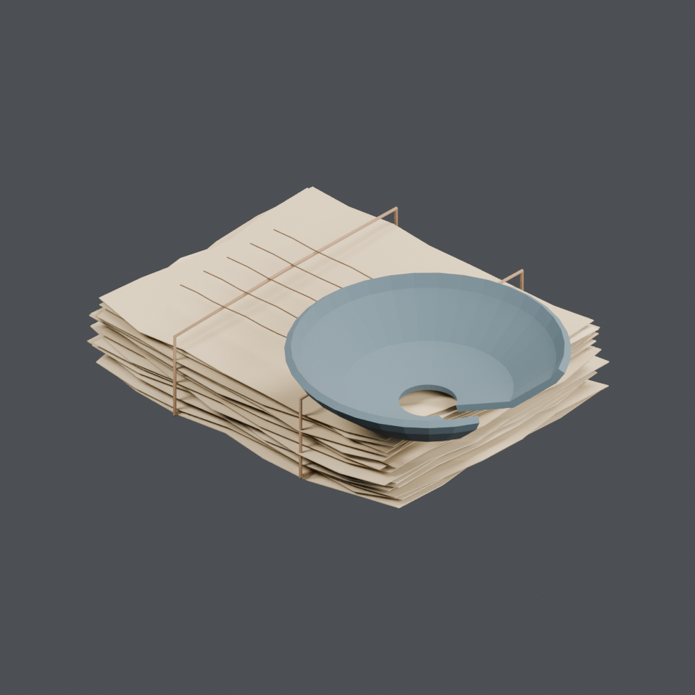

Use / purpose: Old pottery shards and papers from the antique shop collection. Unit: one group containing several objects. Includes BLEND and GLB. The close-up is rendered from the distributed BLEND.

Record type: group. Formats: BLEND/GLB.

Reported dimensions (metres; XYZ when derived from measured bounds, legacy axis order not reverified): Unknown. Triangles: Unknown.

Origin: Unknown / not independently confirmed. Orientation: Unknown / not independently confirmed.

[Download ZIP](https://github.com/k3peta/tales-on-a-table/releases/download/v2026.10.18/AT_083_CC0.zip) · [License scope](../../LICENSE.md)

**CC0-1.0** — See original ZIP license and repository license scope. Models and embedded materials only; previews excluded.

Source details: [Catalogue 1](../../catalog/books-paper_01.en.md) · [Catalogue 2](../../catalog/books-paper_01.md) · [Catalogue 3](../../catalog/books-paper_01.zh-CN.md)

**Audit status (no adopted repair):** Raised cord diagnosis pending; broken pottery rim may be intentional. [Audit scope](../quality_audit_at082_092.md).

## AT_084

**Leaning bundle of papers**

立て掛けた書類綴り

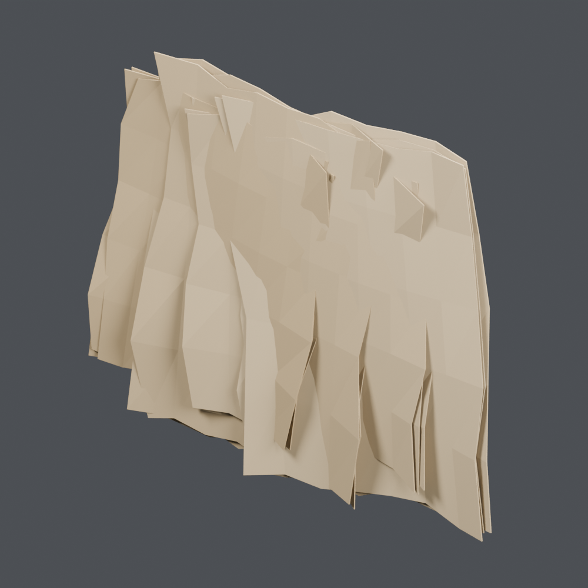

Use / purpose: Leaning bundle of papers from the antique shop collection. Unit: one group containing several objects. Includes BLEND and GLB. The close-up is rendered from the distributed BLEND.

Record type: group. Formats: BLEND/GLB.

Reported dimensions (metres; XYZ when derived from measured bounds, legacy axis order not reverified): Unknown. Triangles: Unknown.

Origin: Unknown / not independently confirmed. Orientation: Unknown / not independently confirmed.

[Download ZIP](https://github.com/k3peta/tales-on-a-table/releases/download/v2026.10.18/AT_084_CC0.zip) · [License scope](../../LICENSE.md)

**CC0-1.0** — See original ZIP license and repository license scope. Models and embedded materials only; previews excluded.

Source details: [Catalogue 1](../../catalog/books-paper_01.en.md) · [Catalogue 2](../../catalog/books-paper_01.md) · [Catalogue 3](../../catalog/books-paper_01.zh-CN.md)

**Audit status (no adopted repair):** Angular paper folds/weak detail noted; no demonstrated defect or adopted variant. [Audit scope](../quality_audit_at082_092.md).

## AT_085

**Box with a broken seal**

割れた封印の箱

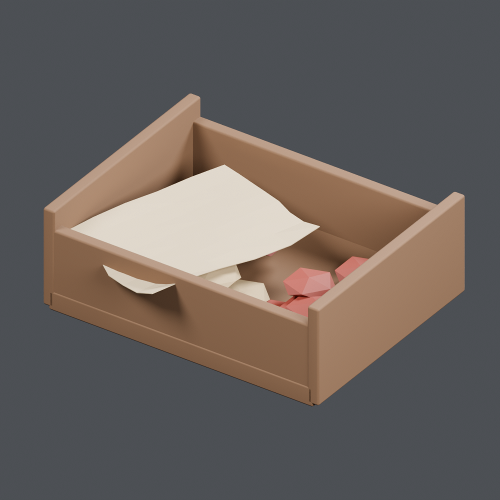

Use / purpose: Box with a broken seal from the antique shop collection. Unit: one group containing several objects. Includes BLEND and GLB. The close-up is rendered from the distributed BLEND.

Record type: group. Formats: BLEND/GLB.

Reported dimensions (metres; XYZ when derived from measured bounds, legacy axis order not reverified): Unknown. Triangles: Unknown.

Origin: Unknown / not independently confirmed. Orientation: Unknown / not independently confirmed.

[Download ZIP](https://github.com/k3peta/tales-on-a-table/releases/download/v2026.10.18/AT_085_CC0.zip) · [License scope](../../LICENSE.md)

**CC0-1.0** — See original ZIP license and repository license scope. Models and embedded materials only; previews excluded.

Source details: [Catalogue 1](../../catalog/containers_02.en.md) · [Catalogue 2](../../catalog/containers_02.md) · [Catalogue 3](../../catalog/containers_02.zh-CN.md)

**Audit status (no adopted repair):** Paper/box-wall overhang versus intersection diagnosis pending. [Audit scope](../quality_audit_at082_092.md).

## AT_086

**Old cloth bundle tied with string**

紐で結んだ古い布包み

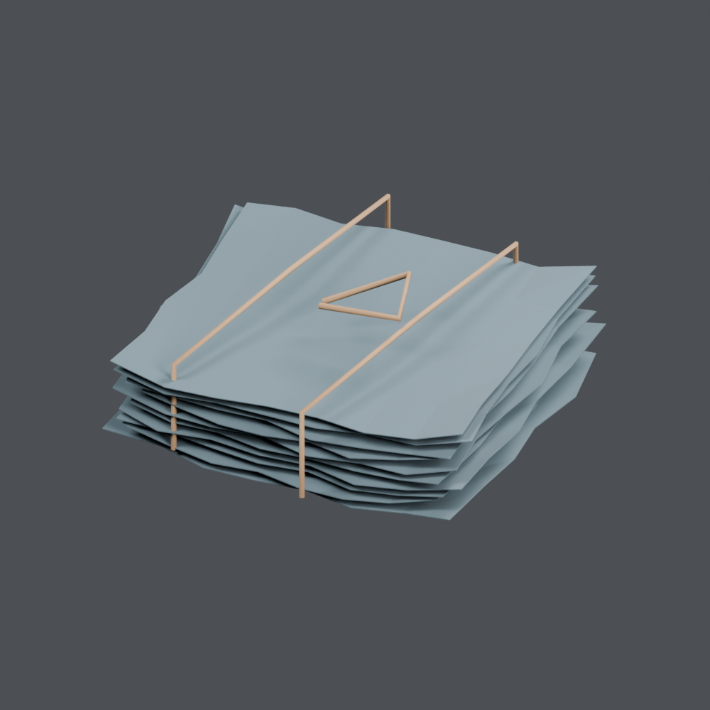

Use / purpose: Old cloth bundle tied with string from the antique shop collection. Unit: one group containing several objects. Includes BLEND and GLB. The close-up is rendered from the distributed BLEND.

Record type: group. Formats: BLEND/GLB.

Reported dimensions (metres; XYZ when derived from measured bounds, legacy axis order not reverified): Unknown. Triangles: Unknown.

Origin: Unknown / not independently confirmed. Orientation: Unknown / not independently confirmed.

[Download ZIP](https://github.com/k3peta/tales-on-a-table/releases/download/v2026.10.18/AT_086_CC0.zip) · [License scope](../../LICENSE.md)

**CC0-1.0** — See original ZIP license and repository license scope. Models and embedded materials only; previews excluded.

Source details: [Catalogue 1](../../catalog/containers_02.en.md) · [Catalogue 2](../../catalog/containers_02.md) · [Catalogue 3](../../catalog/containers_02.zh-CN.md)

**Audit status (no adopted repair):** Raised cords and apparently disconnected/embedded segments: diagnosis pending. [Audit scope](../quality_audit_at082_092.md).

## AT_087

**Unsorted survey maps**

未整理の測量地図

Use / purpose: Unsorted survey maps from the antique shop collection. Unit: one group containing several objects. Includes BLEND and GLB. The close-up is rendered from the distributed BLEND.

Record type: group. Formats: BLEND/GLB.

Reported dimensions (metres; XYZ when derived from measured bounds, legacy axis order not reverified): Unknown. Triangles: Unknown.

Origin: Unknown / not independently confirmed. Orientation: Unknown / not independently confirmed.

[Download ZIP](https://github.com/k3peta/tales-on-a-table/releases/download/v2026.10.18/AT_087_CC0.zip) · [License scope](../../LICENSE.md)

**CC0-1.0** — See original ZIP license and repository license scope. Models and embedded materials only; previews excluded.

Source details: [Catalogue 1](../../catalog/books-paper_01.en.md) · [Catalogue 2](../../catalog/books-paper_01.md) · [Catalogue 3](../../catalog/books-paper_01.zh-CN.md)

**Audit status (no adopted repair):** Paper/cord layering versus penetration diagnosis pending. [Audit scope](../quality_audit_at082_092.md).

## AT_088

**Assorted rolled parchments**

巻いた羊皮紙の取り合わせ

Use / purpose: Assorted rolled parchments from the antique shop collection. Unit: one group containing several objects. Includes BLEND and GLB. The close-up is rendered from the distributed BLEND.

Record type: group. Formats: BLEND/GLB.

Reported dimensions (metres; XYZ when derived from measured bounds, legacy axis order not reverified): Unknown. Triangles: Unknown.

Origin: Unknown / not independently confirmed. Orientation: Unknown / not independently confirmed.

[Download ZIP](https://github.com/k3peta/tales-on-a-table/releases/download/v2026.10.18/AT_088_CC0.zip) · [License scope](../../LICENSE.md)

**CC0-1.0** — See original ZIP license and repository license scope. Models and embedded materials only; previews excluded.

Source details: [Catalogue 1](../../catalog/books-paper_01.en.md) · [Catalogue 2](../../catalog/books-paper_01.md) · [Catalogue 3](../../catalog/books-paper_01.zh-CN.md)

**Audit status (no adopted repair):** Dark scroll bases/open ties: material, shading and construction diagnosis pending. [Audit scope](../quality_audit_at082_092.md).

## AT_089

**Unopened parcel for a scholar**

未開封の学者宛て包み

Use / purpose: Unopened parcel for a scholar from the antique shop collection. Unit: one group containing several objects. Includes BLEND and GLB. The close-up is rendered from the distributed BLEND.

Record type: group. Formats: BLEND/GLB.

Reported dimensions (metres; XYZ when derived from measured bounds, legacy axis order not reverified): Unknown. Triangles: Unknown.

Origin: Unknown / not independently confirmed. Orientation: Unknown / not independently confirmed.

[Download ZIP](https://github.com/k3peta/tales-on-a-table/releases/download/v2026.10.18/AT_089_CC0.zip) · [License scope](../../LICENSE.md)

**CC0-1.0** — See original ZIP license and repository license scope. Models and embedded materials only; previews excluded.

Source details: [Catalogue 1](../../catalog/books-paper_01.en.md) · [Catalogue 2](../../catalog/books-paper_01.md) · [Catalogue 3](../../catalog/books-paper_01.zh-CN.md)
**Audit status (no adopted repair):** Raised binding cords: repair diagnosis pending. [Audit scope](../quality_audit_at082_092.md).
