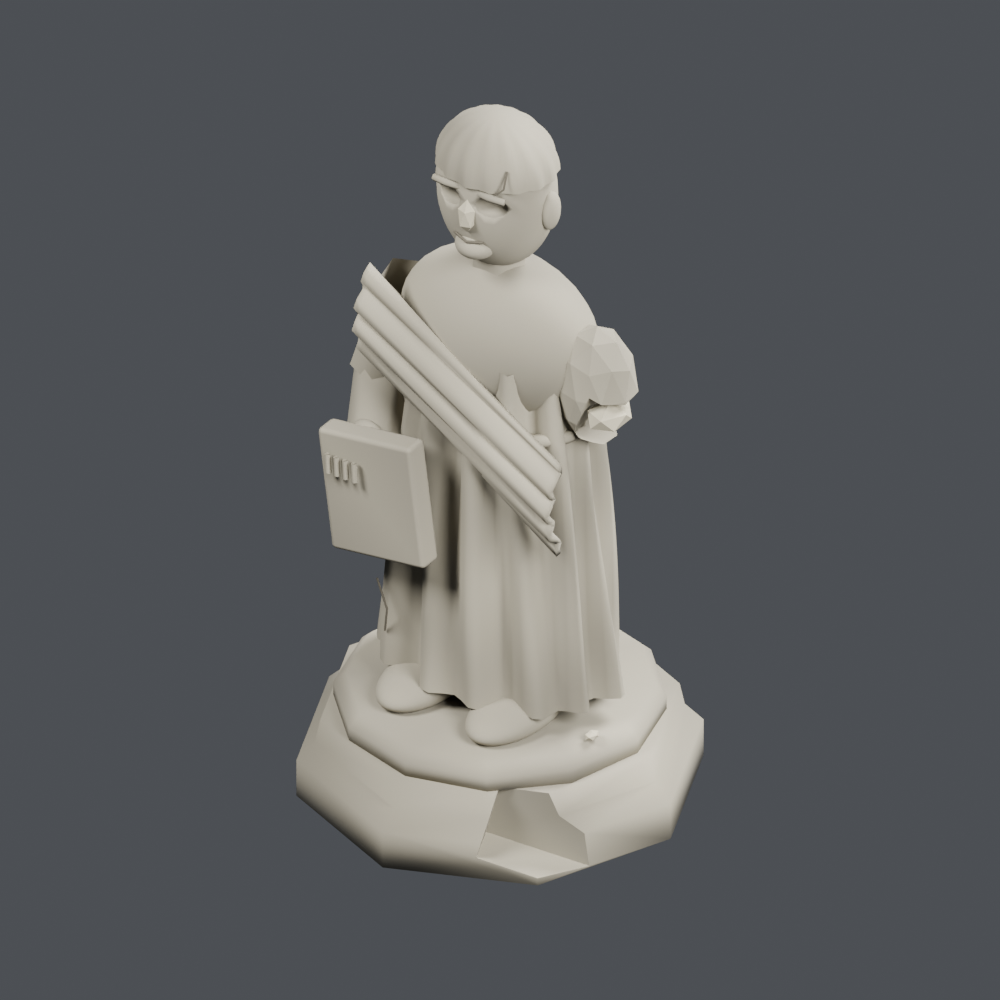
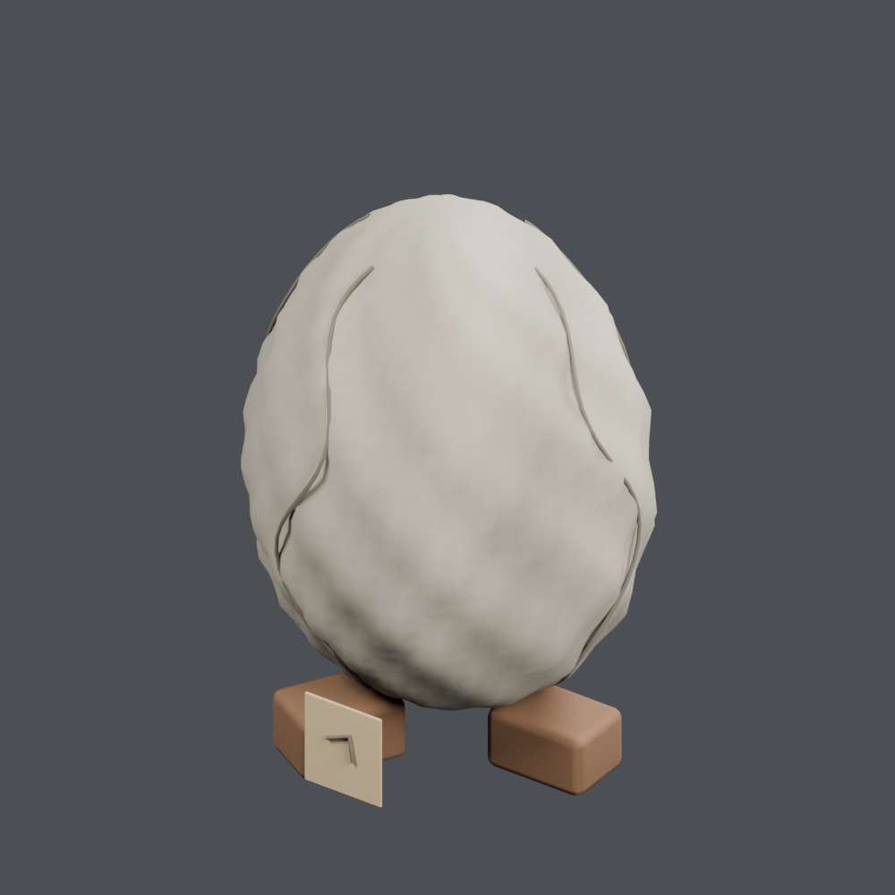
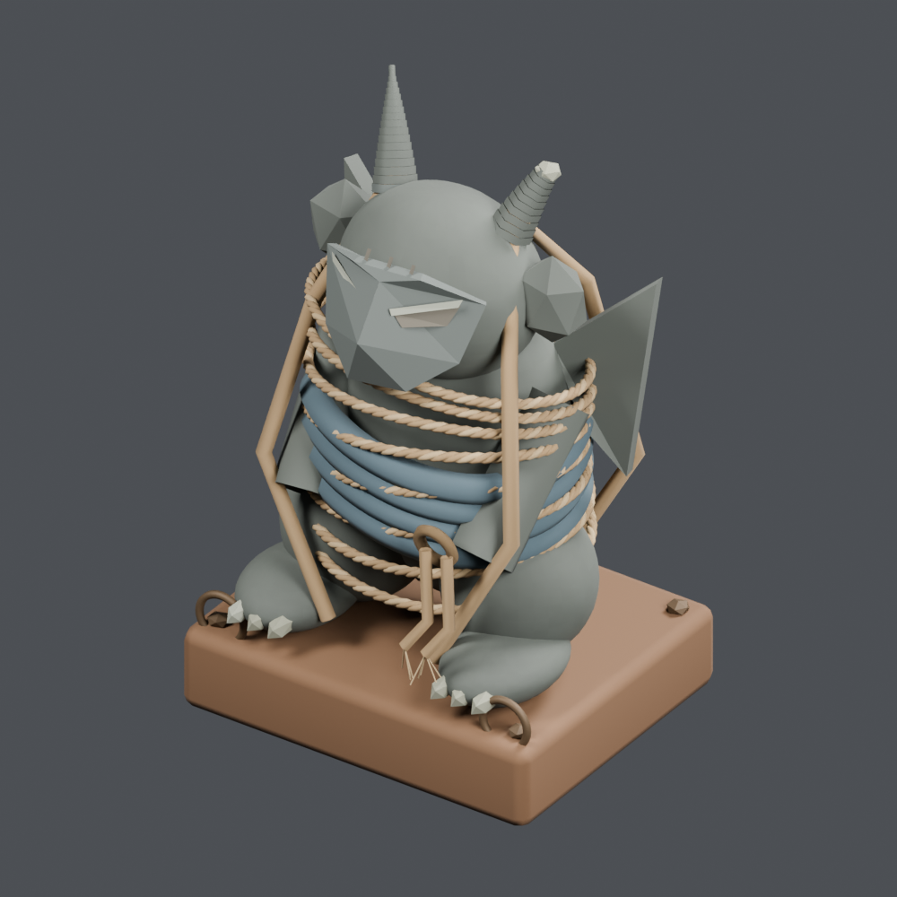

# Base distribution records 265–288

[Browse index](README.md) · [Coverage and missing fields](COVERAGE.md)

Images are actual existing model renders for browsing, not covered by model CC0. A group record may show several reused models. Dimensions and triangle counts apply only to the original record when sourced; revisions can differ. Unknown means unverified, not zero. No blanket CC0 grant for scenes, images, code or articles.

## AT_090

**Bundle of loose letters**

ばらの書簡包み

Use / purpose: Bundle of loose letters from the antique shop collection. Unit: one group containing several objects. Includes BLEND and GLB. The close-up is rendered from the distributed BLEND.

Record type: group. Formats: BLEND/GLB.

Reported dimensions (metres; XYZ when derived from measured bounds, legacy axis order not reverified): Unknown. Triangles: Unknown.

Origin: Unknown / not independently confirmed. Orientation: Unknown / not independently confirmed.

[Download ZIP](https://github.com/k3peta/tales-on-a-table/releases/download/v2026.10.18/AT_090_CC0.zip) · [License scope](../../LICENSE.md)

**CC0-1.0** — See original ZIP license and repository license scope. Models and embedded materials only; previews excluded.

Source details: [Catalogue 1](../../catalog/books-paper_01.en.md) · [Catalogue 2](../../catalog/books-paper_01.md) · [Catalogue 3](../../catalog/books-paper_01.zh-CN.md)

**Audit status (no adopted repair):** Separated paper layers/rigid cord bridges: intended assembly unconfirmed. [Audit scope](../quality_audit_at082_092.md).

## AT_092

**Chipped antique standing statue**

欠けた骨董の立像

Use / purpose: Chipped antique standing statue from the antique shop collection. Unit: one group containing several objects. Includes BLEND and GLB. The close-up is rendered from the distributed BLEND.

Record type: group. Formats: BLEND/GLB.

Reported dimensions (metres; XYZ when derived from measured bounds, legacy axis order not reverified): Unknown. Triangles: Unknown.

Origin: Unknown / not independently confirmed. Orientation: Unknown / not independently confirmed.

[Download ZIP](https://github.com/k3peta/tales-on-a-table/releases/download/v2026.10.18/AT_092_CC0.zip) · [License scope](../../LICENSE.md)

**CC0-1.0** — See original ZIP license and repository license scope. Models and embedded materials only; previews excluded.

Source details: [Catalogue 1](../../catalog/curios-tools_04.en.md) · [Catalogue 2](../../catalog/curios-tools_04.md) · [Catalogue 3](../../catalog/curios-tools_04.zh-CN.md)

**Audit status (no adopted repair):** 20262 triangles exceeds20000 small-prop budget; unresolved. [Audit scope](../quality_audit_at082_092.md).

## AT_093

**Weathered strange stone egg**

風化した奇妙な石の卵

Use / purpose: Weathered strange stone egg from the antique shop collection. Unit: one group containing several objects. Includes BLEND and GLB. The close-up is rendered from the distributed BLEND.

Record type: group. Formats: BLEND/GLB.

Reported dimensions (metres; XYZ when derived from measured bounds, legacy axis order not reverified): Unknown. Triangles: Unknown.

Origin: Unknown / not independently confirmed. Orientation: Unknown / not independently confirmed.

[Download ZIP](https://github.com/k3peta/tales-on-a-table/releases/download/v2026.10.18/AT_093_CC0.zip) · [License scope](../../LICENSE.md)

**CC0-1.0** — See original ZIP license and repository license scope. Models and embedded materials only; previews excluded.

Source details: [Catalogue 1](../../catalog/curios-tools_04.en.md) · [Catalogue 2](../../catalog/curios-tools_04.md) · [Catalogue 3](../../catalog/curios-tools_04.zh-CN.md)

## AT_094

**Rope-bound unidentified statue**

縄で縛られた正体不明の像

Use / purpose: Rope-bound unidentified statue from the antique shop collection. Unit: one group containing several objects. Includes BLEND and GLB. The close-up is rendered from the distributed BLEND.

Record type: group. Formats: BLEND/GLB.

Reported dimensions (metres; XYZ when derived from measured bounds, legacy axis order not reverified): Unknown. Triangles: Unknown.

Origin: Unknown / not independently confirmed. Orientation: Unknown / not independently confirmed.

[Download ZIP](https://github.com/k3peta/tales-on-a-table/releases/download/v2026.10.18/AT_094_CC0.zip) · [License scope](../../LICENSE.md)

**CC0-1.0** — See original ZIP license and repository license scope. Models and embedded materials only; previews excluded.

Source details: [Catalogue 1](../../catalog/curios-tools_04.en.md) · [Catalogue 2](../../catalog/curios-tools_04.md) · [Catalogue 3](../../catalog/curios-tools_04.zh-CN.md)

## WS_001

**Moon-emblem grimoire with twin clasps**

双留め金の月章魔導書

Use / purpose: A thick closed grimoire with twin clasps and a moon emblem.

Record type: model. Formats: Unknown; inspect ZIP.

Reported dimensions (metres; XYZ when derived from measured bounds, legacy axis order not reverified): [0.26899999380111694, 0.33010053634643555, 0.11070559173822403]. Triangles: Unknown.

Origin: Unknown / not independently confirmed. Orientation: Unknown / not independently confirmed.

[Download ZIP](https://github.com/k3peta/tales-on-a-table/releases/download/v2026.10.19-wizard-study/WS_001_CC0.zip) · [License scope](../../LICENSE.md)

**CC0-1.0** — See original ZIP license and repository license scope. Models and embedded materials only; previews excluded.

Source details: [Catalogue 1](../../catalog/wizard-study.en.md) · [Catalogue 2](../../catalog/wizard-study.md) · [Catalogue 3](../../catalog/wizard-study.zh-CN.md)

## WS_002

**Cord-bound field notebook**

紐綴じの野外採集帳

Use / purpose: A cord-bound notebook for field observations and collecting notes.

Record type: model. Formats: Unknown; inspect ZIP.

Reported dimensions (metres; XYZ when derived from measured bounds, legacy axis order not reverified): [0.164326012134552, 0.2563730478286743, 0.05779321491718292]. Triangles: Unknown.

Origin: Unknown / not independently confirmed. Orientation: Unknown / not independently confirmed.

[Download ZIP](https://github.com/k3peta/tales-on-a-table/releases/download/v2026.10.19-wizard-study/WS_002_CC0.zip) · [License scope](../../LICENSE.md)

**CC0-1.0** — See original ZIP license and repository license scope. Models and embedded materials only; previews excluded.

Source details: [Catalogue 1](../../catalog/wizard-study.en.md) · [Catalogue 2](../../catalog/wizard-study.md) · [Catalogue 3](../../catalog/wizard-study.zh-CN.md)

## WS_003

**Large star atlas**

大型星図集

Use / purpose: A large star atlas for a desk or a stack of reference books.

Record type: model. Formats: Unknown; inspect ZIP.

Reported dimensions (metres; XYZ when derived from measured bounds, legacy axis order not reverified): [0.33149999380111694, 0.3900403678417206, 0.0696900263428688]. Triangles: Unknown.

Origin: Unknown / not independently confirmed. Orientation: Unknown / not independently confirmed.

[Download ZIP](https://github.com/k3peta/tales-on-a-table/releases/download/v2026.10.19-wizard-study/WS_003_CC0.zip) · [License scope](../../LICENSE.md)

**CC0-1.0** — See original ZIP license and repository license scope. Models and embedded materials only; previews excluded.

Source details: [Catalogue 1](../../catalog/wizard-study.en.md) · [Catalogue 2](../../catalog/wizard-study.md) · [Catalogue 3](../../catalog/wizard-study.zh-CN.md)

## WS_004

**Banded reference folio**

背帯付き参考書

Use / purpose: A reference folio with spine bands, suitable for book piles.

Record type: model. Formats: Unknown; inspect ZIP.

Reported dimensions (metres; XYZ when derived from measured bounds, legacy axis order not reverified): [0.2371172159910202, 0.300073504447937, 0.0937352403998375]. Triangles: Unknown.

Origin: Unknown / not independently confirmed. Orientation: Unknown / not independently confirmed.

[Download ZIP](https://github.com/k3peta/tales-on-a-table/releases/download/v2026.10.19-wizard-study/WS_004_CC0.zip) · [License scope](../../LICENSE.md)

**CC0-1.0** — See original ZIP license and repository license scope. Models and embedded materials only; previews excluded.

Source details: [Catalogue 1](../../catalog/wizard-study.en.md) · [Catalogue 2](../../catalog/wizard-study.md) · [Catalogue 3](../../catalog/wizard-study.zh-CN.md)

## WS_005

**Slim index booklet**

薄い索引冊子

Use / purpose: A slim index booklet to pair with thicker reference volumes.

Record type: model. Formats: Unknown; inspect ZIP.

Reported dimensions (metres; XYZ when derived from measured bounds, legacy axis order not reverified): [0.1841413825750351, 0.25001513957977295, 0.031372252851724625]. Triangles: Unknown.

Origin: Unknown / not independently confirmed. Orientation: Unknown / not independently confirmed.

[Download ZIP](https://github.com/k3peta/tales-on-a-table/releases/download/v2026.10.19-wizard-study/WS_005_CC0.zip) · [License scope](../../LICENSE.md)

**CC0-1.0** — See original ZIP license and repository license scope. Models and embedded materials only; previews excluded.

Source details: [Catalogue 1](../../catalog/wizard-study.en.md) · [Catalogue 2](../../catalog/wizard-study.md) · [Catalogue 3](../../catalog/wizard-study.zh-CN.md)

## WS_006

**Open annotated manuscript**

書込みのある開いた研究書

Use / purpose: An open annotated manuscript for a research desk or lectern.

Record type: model. Formats: Unknown; inspect ZIP.

Reported dimensions (metres; XYZ when derived from measured bounds, legacy axis order not reverified): [0.49113231897354126, 0.3755047619342804, 0.04038912057876587]. Triangles: Unknown.

Origin: Unknown / not independently confirmed. Orientation: Unknown / not independently confirmed.

[Download ZIP](https://github.com/k3peta/tales-on-a-table/releases/download/v2026.10.19-wizard-study/WS_006_CC0.zip) · [License scope](../../LICENSE.md)

**CC0-1.0** — See original ZIP license and repository license scope. Models and embedded materials only; previews excluded.

Source details: [Catalogue 1](../../catalog/wizard-study.en.md) · [Catalogue 2](../../catalog/wizard-study.md) · [Catalogue 3](../../catalog/wizard-study.zh-CN.md)

## WS_007

**Wax-sealed scroll**

封蝋付き巻物

Use / purpose: A wax-sealed scroll for a shelf or desk.

Record type: model. Formats: Unknown; inspect ZIP.

Reported dimensions (metres; XYZ when derived from measured bounds, legacy axis order not reverified): [0.28200000524520874, 0.0629010945558548, 0.06180422753095627]. Triangles: Unknown.

Origin: Unknown / not independently confirmed. Orientation: Unknown / not independently confirmed.

[Download ZIP](https://github.com/k3peta/tales-on-a-table/releases/download/v2026.10.19-wizard-study/WS_007_CC0.zip) · [License scope](../../LICENSE.md)

**CC0-1.0** — See original ZIP license and repository license scope. Models and embedded materials only; previews excluded.

Source details: [Catalogue 1](../../catalog/wizard-study.en.md) · [Catalogue 2](../../catalog/wizard-study.md) · [Catalogue 3](../../catalog/wizard-study.zh-CN.md)

## WS_008

**Unrolled survey chart**

開いた調査地図

Use / purpose: An unrolled survey chart for a scene of ongoing research.

Record type: model. Formats: Unknown; inspect ZIP.

Reported dimensions (metres; XYZ when derived from measured bounds, legacy axis order not reverified): [0.4660000205039978, 0.3199999928474426, 0.03600001335144043]. Triangles: Unknown.

Origin: Unknown / not independently confirmed. Orientation: Unknown / not independently confirmed.

[Download ZIP](https://github.com/k3peta/tales-on-a-table/releases/download/v2026.10.19-wizard-study/WS_008_CC0.zip) · [License scope](../../LICENSE.md)

**CC0-1.0** — See original ZIP license and repository license scope. Models and embedded materials only; previews excluded.

Source details: [Catalogue 1](../../catalog/wizard-study.en.md) · [Catalogue 2](../../catalog/wizard-study.md) · [Catalogue 3](../../catalog/wizard-study.zh-CN.md)

## WS_009

**Twin-roller ritual scroll**

両軸式の儀式巻物

Use / purpose: A ritual scroll with rollers at both ends.

Record type: model. Formats: Unknown; inspect ZIP.

Reported dimensions (metres; XYZ when derived from measured bounds, legacy axis order not reverified): [0.4660000205039978, 0.42399999499320984, 0.03600001335144043]. Triangles: Unknown.

Origin: Unknown / not independently confirmed. Orientation: Unknown / not independently confirmed.

[Download ZIP](https://github.com/k3peta/tales-on-a-table/releases/download/v2026.10.19-wizard-study/WS_009_CC0.zip) · [License scope](../../LICENSE.md)

**CC0-1.0** — See original ZIP license and repository license scope. Models and embedded materials only; previews excluded.

Source details: [Catalogue 1](../../catalog/wizard-study.en.md) · [Catalogue 2](../../catalog/wizard-study.md) · [Catalogue 3](../../catalog/wizard-study.zh-CN.md)

## WS_010

**Research desk with drawers**

引出し付き研究机

Use / purpose: A research desk with drawers and a broad working surface.

Record type: model. Formats: Unknown; inspect ZIP.

Reported dimensions (metres; XYZ when derived from measured bounds, legacy axis order not reverified): [1.725000023841858, 0.8999999761581421, 0.8224999904632568]. Triangles: Unknown.

Origin: Unknown / not independently confirmed. Orientation: Unknown / not independently confirmed.

[Download ZIP](https://github.com/k3peta/tales-on-a-table/releases/download/v2026.10.19-wizard-study/WS_010_CC0.zip) · [License scope](../../LICENSE.md)

**CC0-1.0** — See original ZIP license and repository license scope. Models and embedded materials only; previews excluded.

Source details: [Catalogue 1](../../catalog/wizard-study.en.md) · [Catalogue 2](../../catalog/wizard-study.md) · [Catalogue 3](../../catalog/wizard-study.zh-CN.md)

## WS_011

**Library bay with carved columns**

彫刻柱付き書架

Use / purpose: A library bay with carved columns and lower storage.

Record type: model. Formats: Unknown; inspect ZIP.

Reported dimensions (metres; XYZ when derived from measured bounds, legacy axis order not reverified): [1.3200000524520874, 0.559999942779541, 2.507499933242798]. Triangles: Unknown.

Origin: Unknown / not independently confirmed. Orientation: Unknown / not independently confirmed.

[Download ZIP](https://github.com/k3peta/tales-on-a-table/releases/download/v2026.10.19-wizard-study/WS_011_CC0.zip) · [License scope](../../LICENSE.md)

**CC0-1.0** — See original ZIP license and repository license scope. Models and embedded materials only; previews excluded.

Source details: [Catalogue 1](../../catalog/wizard-study.en.md) · [Catalogue 2](../../catalog/wizard-study.md) · [Catalogue 3](../../catalog/wizard-study.zh-CN.md)

## WS_012

**Flat map cabinet**

平面地図の引出し棚

Use / purpose: A drawer cabinet for flat maps and plans.

Record type: model. Formats: Unknown; inspect ZIP.

Reported dimensions (metres; XYZ when derived from measured bounds, legacy axis order not reverified): [1.1200000047683716, 0.9100000262260437, 0.8850000500679016]. Triangles: Unknown.

Origin: Unknown / not independently confirmed. Orientation: Unknown / not independently confirmed.

[Download ZIP](https://github.com/k3peta/tales-on-a-table/releases/download/v2026.10.19-wizard-study/WS_012_CC0.zip) · [License scope](../../LICENSE.md)

**CC0-1.0** — See original ZIP license and repository license scope. Models and embedded materials only; previews excluded.

Source details: [Catalogue 1](../../catalog/wizard-study.en.md) · [Catalogue 2](../../catalog/wizard-study.md) · [Catalogue 3](../../catalog/wizard-study.zh-CN.md)

## WS_013

**24-drawer catalogue cabinet**

24抽斗の資料目録棚

Use / purpose: A 24-drawer cabinet for organizing catalogue records.

Record type: model. Formats: Unknown; inspect ZIP.

Reported dimensions (metres; XYZ when derived from measured bounds, legacy axis order not reverified): [0.8799999952316284, 0.4514999985694885, 1.149999976158142]. Triangles: Unknown.

Origin: Unknown / not independently confirmed. Orientation: Unknown / not independently confirmed.

[Download ZIP](https://github.com/k3peta/tales-on-a-table/releases/download/v2026.10.19-wizard-study/WS_013_CC0.zip) · [License scope](../../LICENSE.md)

**CC0-1.0** — See original ZIP license and repository license scope. Models and embedded materials only; previews excluded.

Source details: [Catalogue 1](../../catalog/wizard-study.en.md) · [Catalogue 2](../../catalog/wizard-study.md) · [Catalogue 3](../../catalog/wizard-study.zh-CN.md)

## WS_014

**Sloped reading lectern**

傾斜天板の書見台

Use / purpose: A sloped lectern for displaying an open book.

Record type: model. Formats: Unknown; inspect ZIP.

Reported dimensions (metres; XYZ when derived from measured bounds, legacy axis order not reverified): [0.550000011920929, 0.3915010392665863, 0.9486557245254517]. Triangles: Unknown.

Origin: Unknown / not independently confirmed. Orientation: Unknown / not independently confirmed.

[Download ZIP](https://github.com/k3peta/tales-on-a-table/releases/download/v2026.10.19-wizard-study/WS_014_CC0.zip) · [License scope](../../LICENSE.md)

**CC0-1.0** — See original ZIP license and repository license scope. Models and embedded materials only; previews excluded.

Source details: [Catalogue 1](../../catalog/chapel_training_v1.md) · [Catalogue 2](../../catalog/wizard-study.en.md) · [Catalogue 3](../../catalog/wizard-study.md)

## WS_015

**High-backed reading chair**

高背の読書椅子

Use / purpose: An upholstered reading chair with a high back.

Record type: model. Formats: Unknown; inspect ZIP.

Reported dimensions (metres; XYZ when derived from measured bounds, legacy axis order not reverified): [0.5699999928474426, 0.5299999713897705, 1.4137763977050781]. Triangles: Unknown.

Origin: Unknown / not independently confirmed. Orientation: Unknown / not independently confirmed.

[Download ZIP](https://github.com/k3peta/tales-on-a-table/releases/download/v2026.10.19-wizard-study/WS_015_CC0.zip) · [License scope](../../LICENSE.md)

**CC0-1.0** — See original ZIP license and repository license scope. Models and embedded materials only; previews excluded.

Source details: [Catalogue 1](../../catalog/wizard-study.en.md) · [Catalogue 2](../../catalog/wizard-study.md) · [Catalogue 3](../../catalog/wizard-study.zh-CN.md)

## WS_016

**Library ladder with brass rollers**

書架用の真鍮滑車梯子

Use / purpose: A library ladder with brass rollers for a bookcase rail.

Record type: model. Formats: Unknown; inspect ZIP.

Reported dimensions (metres; XYZ when derived from measured bounds, legacy axis order not reverified): [0.45000001788139343, 0.5846779346466064, 2.150848150253296]. Triangles: Unknown.

Origin: Unknown / not independently confirmed. Orientation: Unknown / not independently confirmed.

[Download ZIP](https://github.com/k3peta/tales-on-a-table/releases/download/v2026.10.19-wizard-study/WS_016_CC0.zip) · [License scope](../../LICENSE.md)

**CC0-1.0** — See original ZIP license and repository license scope. Models and embedded materials only; previews excluded.

Source details: [Catalogue 1](../../catalog/wizard-study.en.md) · [Catalogue 2](../../catalog/wizard-study.md) · [Catalogue 3](../../catalog/wizard-study.zh-CN.md)

## WS_017

**Wooden bookbinding press**

修復用の木製製本プレス

Use / purpose: A wooden bookbinding press for a book restoration workspace.

Record type: model. Formats: Unknown; inspect ZIP.

Reported dimensions (metres; XYZ when derived from measured bounds, legacy axis order not reverified): [0.47999998927116394, 0.3400000035762787, 0.4619999825954437]. Triangles: Unknown.

Origin: Unknown / not independently confirmed. Orientation: Unknown / not independently confirmed.

[Download ZIP](https://github.com/k3peta/tales-on-a-table/releases/download/v2026.10.19-wizard-study/WS_017_CC0.zip) · [License scope](../../LICENSE.md)

**CC0-1.0** — See original ZIP license and repository license scope. Models and embedded materials only; previews excluded.

Source details: [Catalogue 1](../../catalog/husbandry_cellar_v1.md) · [Catalogue 2](../../catalog/wizard-study.en.md) · [Catalogue 3](../../catalog/wizard-study.md)

## WS_018

**Wide-mouth crystal specimen jar**

結晶標本の広口瓶

Use / purpose: A wide-mouth jar containing a crystal specimen.

Record type: model. Formats: Unknown; inspect ZIP.

Reported dimensions (metres; XYZ when derived from measured bounds, legacy axis order not reverified): [0.17249999940395355, 0.17249999940395355, 0.27180424332618713]. Triangles: Unknown.

Origin: Unknown / not independently confirmed. Orientation: Unknown / not independently confirmed.

[Download ZIP](https://github.com/k3peta/tales-on-a-table/releases/download/v2026.10.19-wizard-study/WS_018_CC0.zip) · [License scope](../../LICENSE.md)

**CC0-1.0** — See original ZIP license and repository license scope. Models and embedded materials only; previews excluded.

Source details: [Catalogue 1](../../catalog/wizard-study.en.md) · [Catalogue 2](../../catalog/wizard-study.md) · [Catalogue 3](../../catalog/wizard-study.zh-CN.md)

## WS_019

**Narrow-neck feather specimen jar**

羽根標本の細口瓶

Use / purpose: A narrow-neck container holding a feather specimen.

Record type: model. Formats: Unknown; inspect ZIP.

Reported dimensions (metres; XYZ when derived from measured bounds, legacy axis order not reverified): [0.11959999799728394, 0.11959999799728394, 0.31180423498153687]. Triangles: Unknown.

Origin: Unknown / not independently confirmed. Orientation: Unknown / not independently confirmed.

[Download ZIP](https://github.com/k3peta/tales-on-a-table/releases/download/v2026.10.19-wizard-study/WS_019_CC0.zip) · [License scope](../../LICENSE.md)

**CC0-1.0** — See original ZIP license and repository license scope. Models and embedded materials only; previews excluded.

Source details: [Catalogue 1](../../catalog/wizard-study.en.md) · [Catalogue 2](../../catalog/wizard-study.md) · [Catalogue 3](../../catalog/wizard-study.zh-CN.md)

## WS_020

**Botanical specimen dome**

植物採集のドーム

Use / purpose: A domed container displaying a collected plant specimen.

Record type: model. Formats: Unknown; inspect ZIP.

Reported dimensions (metres; XYZ when derived from measured bounds, legacy axis order not reverified): [0.2070000022649765, 0.2070000022649765, 0.24180422723293304]. Triangles: Unknown.

Origin: Unknown / not independently confirmed. Orientation: Unknown / not independently confirmed.

[Download ZIP](https://github.com/k3peta/tales-on-a-table/releases/download/v2026.10.19-wizard-study/WS_020_CC0.zip) · [License scope](../../LICENSE.md)

**CC0-1.0** — See original ZIP license and repository license scope. Models and embedded materials only; previews excluded.

Source details: [Catalogue 1](../../catalog/wizard-study.en.md) · [Catalogue 2](../../catalog/wizard-study.md) · [Catalogue 3](../../catalog/wizard-study.zh-CN.md)
