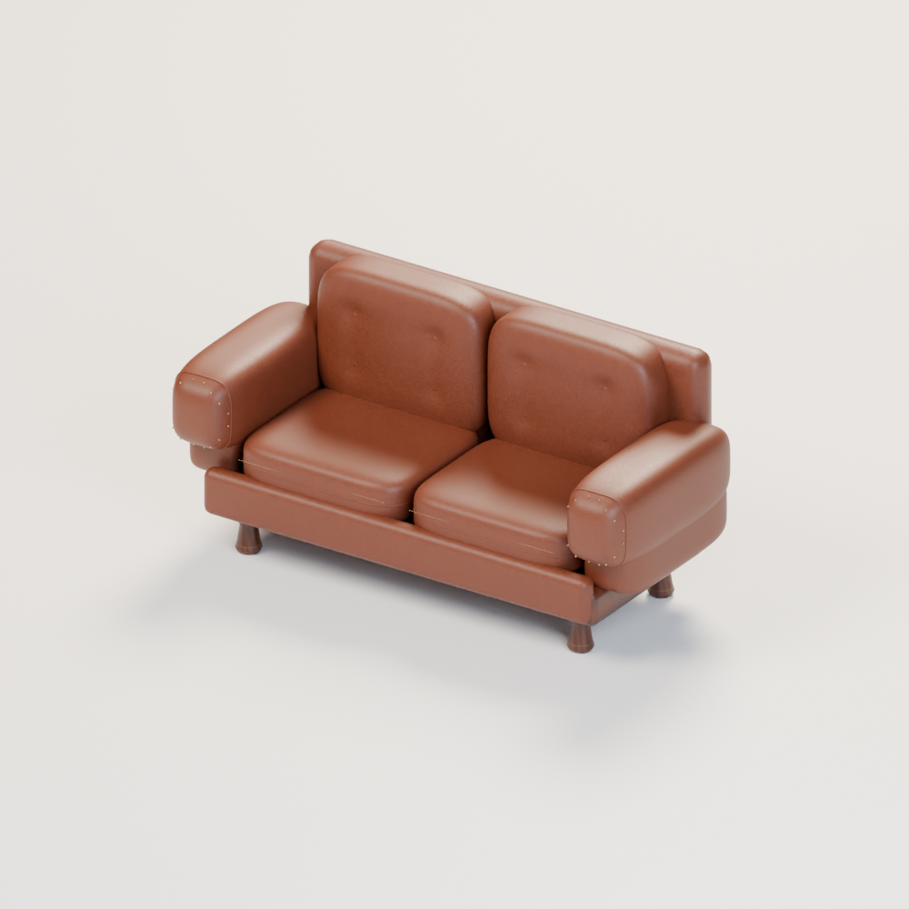
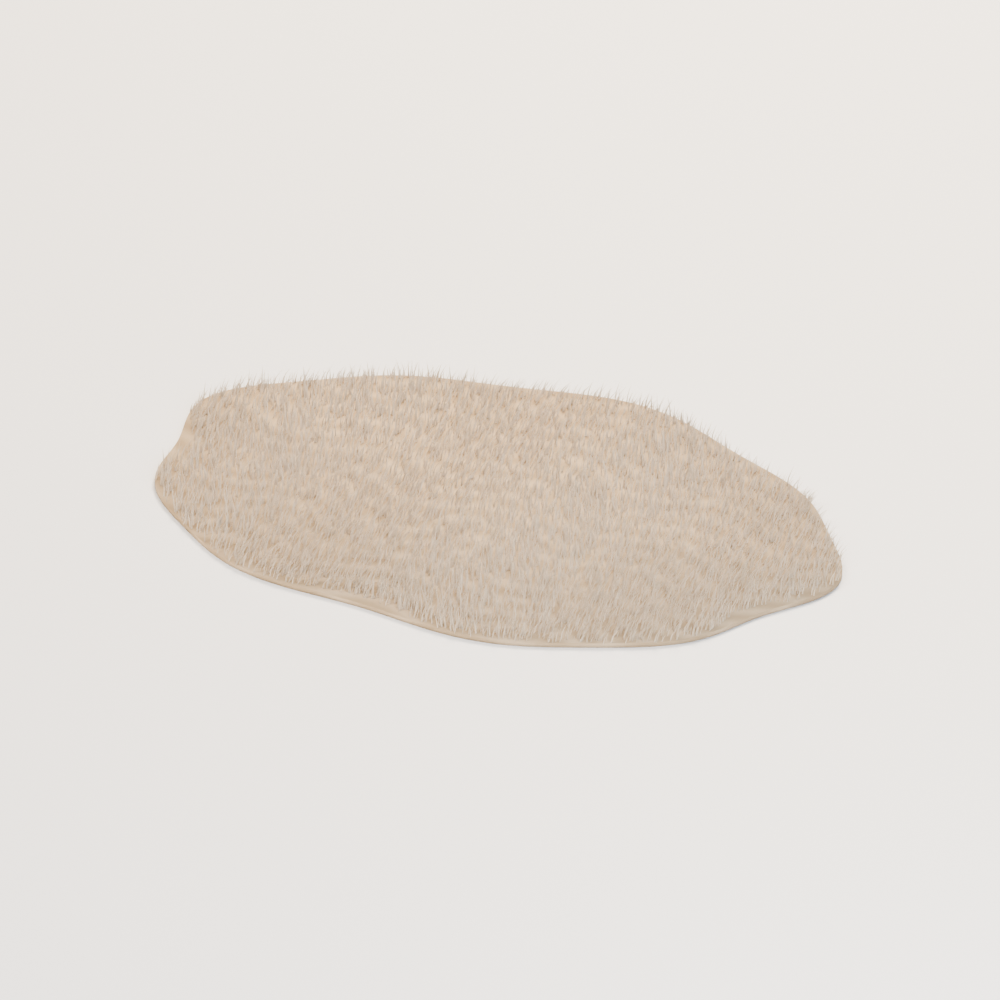

# Base distribution records 313–336

[Browse index](README.md) · [Coverage and missing fields](COVERAGE.md)

Images are actual existing model renders for browsing, not covered by model CC0. A group record may show several reused models. Dimensions and triangle counts apply only to the original record when sourced; revisions can differ. Unknown means unverified, not zero. No blanket CC0 grant for scenes, images, code or articles.

## CP_005

**Handheld sextant**

握り付きの手持ち六分儀

Use / purpose: A handgrip, graduated frame, sighting tube, mirrors and attached supports.

Record type: model. Formats: Unknown; inspect ZIP.

Reported dimensions (metres; XYZ when derived from measured bounds, legacy axis order not reverified): [0.32653114199638367, 0.24321556091308594, 0.07750000804662704]. Triangles: Unknown.

Origin: Unknown / not independently confirmed. Orientation: Unknown / not independently confirmed.

[Download ZIP](https://github.com/k3peta/tales-on-a-table/releases/download/v2026.10.19-captain-cabin/CP_005_CC0.zip) · [License scope](../../LICENSE.md)

**CC0-1.0** — See original ZIP license and repository license scope. Models and embedded materials only; previews excluded.

Source details: [Catalogue 1](../../catalog/captain-cabin.en.md) · [Catalogue 2](../../catalog/captain-cabin.md) · [Catalogue 3](../../catalog/captain-cabin.zh-CN.md)

**Quality32:** Zero-area cleanup; navigation/optical calibration untested. [Details](../material_variants_ws039_cp012.md).

## CP_006

**Fitted sextant case**

輪郭支え付きの六分儀収納箱

Use / purpose: An open lined wooden case with shaped supports, hinges and lid stays; repaired exterior joints.

Record type: model. Formats: Unknown; inspect ZIP.

Reported dimensions (metres; XYZ when derived from measured bounds, legacy axis order not reverified): [0.3750000298023224, 0.35018956661224365, 0.3660086691379547]. Triangles: Unknown.

Origin: Unknown / not independently confirmed. Orientation: Unknown / not independently confirmed.

[Download ZIP](https://github.com/k3peta/tales-on-a-table/releases/download/v2026.10.19-captain-cabin/CP_006_CC0.zip) · [License scope](../../LICENSE.md)

**CC0-1.0** — See original ZIP license and repository license scope. Models and embedded materials only; previews excluded.

Source details: [Catalogue 1](../../catalog/captain-cabin.en.md) · [Catalogue 2](../../catalog/captain-cabin.md) · [Catalogue 3](../../catalog/captain-cabin.zh-CN.md)

## CP_010

**Double-sheave block**

二輪溝の複滑車

Use / purpose: Two grooved sheaves within a wooden block, with a metal mounting loop.

Record type: model. Formats: Unknown; inspect ZIP.

Reported dimensions (metres; XYZ when derived from measured bounds, legacy axis order not reverified): [0.14000000059604645, 0.12000000476837158, 0.3089999556541443]. Triangles: Unknown.

Origin: Unknown / not independently confirmed. Orientation: Unknown / not independently confirmed.

[Download ZIP](https://github.com/k3peta/tales-on-a-table/releases/download/v2026.10.19-captain-cabin/CP_010_CC0.zip) · [License scope](../../LICENSE.md)

**CC0-1.0** — See original ZIP license and repository license scope. Models and embedded materials only; previews excluded.

Source details: [Catalogue 1](../../catalog/captain-cabin.en.md) · [Catalogue 2](../../catalog/captain-cabin.md) · [Catalogue 3](../../catalog/captain-cabin.zh-CN.md)

**Quality32:** Zero-area cleanup; pulley motion/load untested. [Details](../material_variants_ws039_cp012.md).

## CP_012

**Rimmed chart desk**

落下止め縁付きの海図机

Use / purpose: A wooden chart desk with raised edges, sturdy legs and drawers.

Record type: model. Formats: Unknown; inspect ZIP.

Reported dimensions (metres; XYZ when derived from measured bounds, legacy axis order not reverified): [1.6040000915527344, 0.9019999504089355, 0.8169999718666077]. Triangles: Unknown.

Origin: Unknown / not independently confirmed. Orientation: Unknown / not independently confirmed.

[Download ZIP](https://github.com/k3peta/tales-on-a-table/releases/download/v2026.10.19-captain-cabin/CP_012_CC0.zip) · [License scope](../../LICENSE.md)

**CC0-1.0** — See original ZIP license and repository license scope. Models and embedded materials only; previews excluded.

Source details: [Catalogue 1](../../catalog/captain-cabin.en.md) · [Catalogue 2](../../catalog/captain-cabin.md) · [Catalogue 3](../../catalog/captain-cabin.zh-CN.md)

## CP_013

**Plotted route chart**

赤線で航路を記した海図

Use / purpose: A separate chart with fictional coastlines and a red plotted route.

Record type: model. Formats: Unknown; inspect ZIP.

Reported dimensions (metres; XYZ when derived from measured bounds, legacy axis order not reverified): [0.6499999761581421, 0.4399999976158142, 0.0016608452424407005]. Triangles: Unknown.

Origin: Unknown / not independently confirmed. Orientation: Unknown / not independently confirmed.

[Download ZIP](https://github.com/k3peta/tales-on-a-table/releases/download/v2026.10.19-captain-cabin/CP_013_CC0.zip) · [License scope](../../LICENSE.md)

**CC0-1.0** — See original ZIP license and repository license scope. Models and embedded materials only; previews excluded.

Source details: [Catalogue 1](../../catalog/captain-cabin.en.md) · [Catalogue 2](../../catalog/captain-cabin.md) · [Catalogue 3](../../catalog/captain-cabin.zh-CN.md)

**Quality33:** Thin chart strokes at thumbnail size; navigation accuracy unverified. [Details](../material_variants_cp013_023.md).

## CP_014

**Brass chart dividers**

真鍮の海図用ディバイダー

Use / purpose: Two pointed legs and a hinged brass joint for a navigator's desk.

Record type: model. Formats: Unknown; inspect ZIP.

Reported dimensions (metres; XYZ when derived from measured bounds, legacy axis order not reverified): [0.14766833186149597, 0.1906074732542038, 0.015000000596046448]. Triangles: Unknown.

Origin: Unknown / not independently confirmed. Orientation: Unknown / not independently confirmed.

[Download ZIP](https://github.com/k3peta/tales-on-a-table/releases/download/v2026.10.19-captain-cabin/CP_014_CC0.zip) · [License scope](../../LICENSE.md)

**CC0-1.0** — See original ZIP license and repository license scope. Models and embedded materials only; previews excluded.

Source details: [Catalogue 1](../../catalog/captain-cabin.en.md) · [Catalogue 2](../../catalog/captain-cabin.md) · [Catalogue 3](../../catalog/captain-cabin.zh-CN.md)

## CP_015

**Linked parallel rule**

連動する平行定規

Use / purpose: Two dark straightedges joined by brass links and pivots.

Record type: model. Formats: Unknown; inspect ZIP.

Reported dimensions (metres; XYZ when derived from measured bounds, legacy axis order not reverified): [0.30000001192092896, 0.11700000613927841, 0.017000000923871994]. Triangles: Unknown.

Origin: Unknown / not independently confirmed. Orientation: Unknown / not independently confirmed.

[Download ZIP](https://github.com/k3peta/tales-on-a-table/releases/download/v2026.10.19-captain-cabin/CP_015_CC0.zip) · [License scope](../../LICENSE.md)

**CC0-1.0** — See original ZIP license and repository license scope. Models and embedded materials only; previews excluded.

Source details: [Catalogue 1](../../catalog/captain-cabin.en.md) · [Catalogue 2](../../catalog/captain-cabin.md) · [Catalogue 3](../../catalog/captain-cabin.zh-CN.md)

## CP_016

**Open captain's log**

記入途中の航海日誌

Use / purpose: An open bound logbook with layered leaves and partially filled ruled pages.

Record type: model. Formats: Unknown; inspect ZIP.

Reported dimensions (metres; XYZ when derived from measured bounds, legacy axis order not reverified): [0.36000001430511475, 0.25, 0.01772797666490078]. Triangles: Unknown.

Origin: Unknown / not independently confirmed. Orientation: Unknown / not independently confirmed.

[Download ZIP](https://github.com/k3peta/tales-on-a-table/releases/download/v2026.10.19-captain-cabin/CP_016_CC0.zip) · [License scope](../../LICENSE.md)

**CC0-1.0** — See original ZIP license and repository license scope. Models and embedded materials only; previews excluded.

Source details: [Catalogue 1](../../catalog/captain-cabin.en.md) · [Catalogue 2](../../catalog/captain-cabin.md) · [Catalogue 3](../../catalog/captain-cabin.zh-CN.md)

## CP_017

**Handled chart weight**

把手付きの海図重し

Use / purpose: A compact rectangular metal paperweight with a raised carrying handle.

Record type: model. Formats: Unknown; inspect ZIP.

Reported dimensions (metres; XYZ when derived from measured bounds, legacy axis order not reverified): [0.08299999684095383, 0.05000000074505806, 0.04503709822893143]. Triangles: Unknown.

Origin: Unknown / not independently confirmed. Orientation: Unknown / not independently confirmed.

[Download ZIP](https://github.com/k3peta/tales-on-a-table/releases/download/v2026.10.19-captain-cabin/CP_017_CC0.zip) · [License scope](../../LICENSE.md)

**CC0-1.0** — See original ZIP license and repository license scope. Models and embedded materials only; previews excluded.

Source details: [Catalogue 1](../../catalog/captain-cabin.en.md) · [Catalogue 2](../../catalog/captain-cabin.md) · [Catalogue 3](../../catalog/captain-cabin.zh-CN.md)

**Quality33:** 24 positive tiny triangles retained. [Details](../material_variants_cp013_023.md).

## CP_019

**Cabin berth with storage**

収納付きの船室寝台

Use / purpose: A timber-framed berth with storage fronts, a pillow and a draped navy blanket.

Record type: model. Formats: Unknown; inspect ZIP.

Reported dimensions (metres; XYZ when derived from measured bounds, legacy axis order not reverified): [0.8309999704360962, 1.9649999141693115, 0.8299999833106995]. Triangles: Unknown.

Origin: Unknown / not independently confirmed. Orientation: Unknown / not independently confirmed.

[Download ZIP](https://github.com/k3peta/tales-on-a-table/releases/download/v2026.10.19-captain-cabin/CP_019_CC0.zip) · [License scope](../../LICENSE.md)

**CC0-1.0** — See original ZIP license and repository license scope. Models and embedded materials only; previews excluded.

Source details: [Catalogue 1](../../catalog/captain-cabin.en.md) · [Catalogue 2](../../catalog/captain-cabin.md) · [Catalogue 3](../../catalog/captain-cabin.zh-CN.md)

**Quality33:** Orange wool retains original geometry but adds1 missing UV layer. [Details](../material_variants_cp013_023.md).

## CP_020

**Weighted treasure map**

巻き癖と重し付きの宝の地図

Use / purpose: Worn parchment edges, curled corners, fictional islands, a dotted route and brass weights.

Record type: model. Formats: Unknown; inspect ZIP.

Reported dimensions (metres; XYZ when derived from measured bounds, legacy axis order not reverified): [0.6850237846374512, 0.48562055826187134, 0.033195123076438904]. Triangles: Unknown.

Origin: Unknown / not independently confirmed. Orientation: Unknown / not independently confirmed.

[Download ZIP](https://github.com/k3peta/tales-on-a-table/releases/download/v2026.10.19-captain-cabin/CP_020_CC0.zip) · [License scope](../../LICENSE.md)

**CC0-1.0** — See original ZIP license and repository license scope. Models and embedded materials only; previews excluded.

Source details: [Catalogue 1](../../catalog/captain-cabin.en.md) · [Catalogue 2](../../catalog/captain-cabin.md) · [Catalogue 3](../../catalog/captain-cabin.zh-CN.md)

**Quality33:** 37712 triangles exceeds20k budget;9 constant-color meshes lack UV; redesign unresolved. [Details](../material_variants_cp013_023.md).

## CP_021

**Large sheathed captain's knife**

大型船長ナイフ・鞘付き

Use / purpose: A large knife fully enclosed in a stitched leather sheath, with a guard and riveted wooden grip.

Record type: model. Formats: Unknown; inspect ZIP.

Reported dimensions (metres; XYZ when derived from measured bounds, legacy axis order not reverified): [0.5656999945640564, 0.142910435795784, 0.048377640545368195]. Triangles: Unknown.

Origin: Unknown / not independently confirmed. Orientation: Unknown / not independently confirmed.

[Download ZIP](https://github.com/k3peta/tales-on-a-table/releases/download/v2026.10.19-captain-cabin/CP_021_CC0.zip) · [License scope](../../LICENSE.md)

**CC0-1.0** — See original ZIP license and repository license scope. Models and embedded materials only; previews excluded.

Source details: [Catalogue 1](../../catalog/captain-cabin.en.md) · [Catalogue 2](../../catalog/captain-cabin.md) · [Catalogue 3](../../catalog/captain-cabin.zh-CN.md)

**Quality33:** 2 flat-color meshes lack UV; future mapping limitation. [Details](../material_variants_cp013_023.md).

## CP_022

**Folding loupe with leather case**

革ケース付き折畳みルーペ

Use / purpose: A convex lens in a brass barrel, double retaining rings, a pivot and rounded leather case.

Record type: model. Formats: Unknown; inspect ZIP.

Reported dimensions (metres; XYZ when derived from measured bounds, legacy axis order not reverified): [0.24549999833106995, 0.10099999606609344, 0.030570633709430695]. Triangles: Unknown.

Origin: Unknown / not independently confirmed. Orientation: Unknown / not independently confirmed.

[Download ZIP](https://github.com/k3peta/tales-on-a-table/releases/download/v2026.10.19-captain-cabin/CP_022_CC0.zip) · [License scope](../../LICENSE.md)

**CC0-1.0** — See original ZIP license and repository license scope. Models and embedded materials only; previews excluded.

Source details: [Catalogue 1](../../catalog/captain-cabin.en.md) · [Catalogue 2](../../catalog/captain-cabin.md) · [Catalogue 3](../../catalog/captain-cabin.zh-CN.md)

**Quality33:** 1 flat-color mesh lacks UV; dark optical reflection retained. [Details](../material_variants_cp013_023.md).

## CP_023

**Ceramic coffee jug**

コーヒー入りの陶製ジャグ

Use / purpose: A hollow glazed jug with a pouring lip, joined handle, inner ceramic wall and coffee surface.

Record type: model. Formats: Unknown; inspect ZIP.

Reported dimensions (metres; XYZ when derived from measured bounds, legacy axis order not reverified): [0.3083110451698303, 0.19599999487400055, 0.24699999392032623]. Triangles: Unknown.

Origin: Unknown / not independently confirmed. Orientation: Unknown / not independently confirmed.

[Download ZIP](https://github.com/k3peta/tales-on-a-table/releases/download/v2026.10.19-captain-cabin/CP_023_CC0.zip) · [License scope](../../LICENSE.md)

**CC0-1.0** — See original ZIP license and repository license scope. Models and embedded materials only; previews excluded.

Source details: [Catalogue 1](../../catalog/captain-cabin.en.md) · [Catalogue 2](../../catalog/captain-cabin.md) · [Catalogue 3](../../catalog/captain-cabin.zh-CN.md)

**Quality33:** 384 exact-zero triangles removed,2 missing UV layers added; handle-joint shading still under diagnosis. Smooth orange glaze uses repaired baseline. [Details](../material_variants_cp013_023.md).

## CP_024

**Hanging captain's coat**

壁掛けの豪華な船長コート

Use / purpose: An empty long coat with crimson lining, hollow sleeves, gold braid, epaulettes and a hanger.

Record type: model. Formats: Unknown; inspect ZIP.

Reported dimensions (metres; XYZ when derived from measured bounds, legacy axis order not reverified): [0.8575104475021362, 0.29061460494995117, 1.1698421239852905]. Triangles: Unknown.

Origin: Unknown / not independently confirmed. Orientation: Unknown / not independently confirmed.

[Download ZIP](https://github.com/k3peta/tales-on-a-table/releases/download/v2026.10.19-captain-cabin/CP_024_CC0.zip) · [License scope](../../LICENSE.md)

**CC0-1.0** — See original ZIP license and repository license scope. Models and embedded materials only; previews excluded.

Source details: [Catalogue 1](../../catalog/captain-cabin.en.md) · [Catalogue 2](../../catalog/captain-cabin.md) · [Catalogue 3](../../catalog/captain-cabin.zh-CN.md)

## CP_025

**Gold-trimmed admiral's hat**

金縁と徽章の提督帽

Use / purpose: A swept bicorne brim, hollow crown, double gold edging, cords and a cockade.

Record type: model. Formats: Unknown; inspect ZIP.

Reported dimensions (metres; XYZ when derived from measured bounds, legacy axis order not reverified): [0.6959999799728394, 0.36148759722709656, 0.19710709154605865]. Triangles: Unknown.

Origin: Unknown / not independently confirmed. Orientation: Unknown / not independently confirmed.

[Download ZIP](https://github.com/k3peta/tales-on-a-table/releases/download/v2026.10.19-captain-cabin/CP_025_CC0.zip) · [License scope](../../LICENSE.md)

**CC0-1.0** — See original ZIP license and repository license scope. Models and embedded materials only; previews excluded.

Source details: [Catalogue 1](../../catalog/captain-cabin.en.md) · [Catalogue 2](../../catalog/captain-cabin.md) · [Catalogue 3](../../catalog/captain-cabin.zh-CN.md)

## CP_026

**Large birdcage with open door**

開く扉付きの大型鳥籠

Use / purpose: A domed brass cage with bent bars, a removable tray, an open door and feeding bowls.

Record type: model. Formats: Unknown; inspect ZIP.

Reported dimensions (metres; XYZ when derived from measured bounds, legacy axis order not reverified): [0.699999988079071, 0.895266056060791, 1.277706265449524]. Triangles: Unknown.

Origin: Unknown / not independently confirmed. Orientation: Unknown / not independently confirmed.

[Download ZIP](https://github.com/k3peta/tales-on-a-table/releases/download/v2026.10.19-captain-cabin/CP_026_CC0.zip) · [License scope](../../LICENSE.md)

**CC0-1.0** — See original ZIP license and repository license scope. Models and embedded materials only; previews excluded.

Source details: [Catalogue 1](../../catalog/captain-cabin.en.md) · [Catalogue 2](../../catalog/captain-cabin.md) · [Catalogue 3](../../catalog/captain-cabin.zh-CN.md)

## CP_027

**Freestanding parrot perch**

床置きの独立した止まり木

Use / purpose: A weighted round base, turned post and supported wooden crossbar; separate from the bird.

Record type: model. Formats: Unknown; inspect ZIP.

Reported dimensions (metres; XYZ when derived from measured bounds, legacy axis order not reverified): [0.49000000953674316, 0.47999998927116394, 0.8552168607711792]. Triangles: Unknown.

Origin: Unknown / not independently confirmed. Orientation: Unknown / not independently confirmed.

[Download ZIP](https://github.com/k3peta/tales-on-a-table/releases/download/v2026.10.19-captain-cabin/CP_027_CC0.zip) · [License scope](../../LICENSE.md)

**CC0-1.0** — See original ZIP license and repository license scope. Models and embedded materials only; previews excluded.

Source details: [Catalogue 1](../../catalog/captain-cabin.en.md) · [Catalogue 2](../../catalog/captain-cabin.md) · [Catalogue 3](../../catalog/captain-cabin.zh-CN.md)

## CP_028

**Scarlet macaw**

赤い大型鸚鵡

Use / purpose: A static red macaw with layered yellow and blue wing feathers, a long tail and gripping feet.

Record type: model. Formats: Unknown; inspect ZIP.

Reported dimensions (metres; XYZ when derived from measured bounds, legacy axis order not reverified): [0.24199999868869781, 0.42336753010749817, 0.8289999961853027]. Triangles: Unknown.

Origin: Unknown / not independently confirmed. Orientation: Unknown / not independently confirmed.

[Download ZIP](https://github.com/k3peta/tales-on-a-table/releases/download/v2026.10.19-captain-cabin/CP_028_CC0.zip) · [License scope](../../LICENSE.md)

**CC0-1.0** — See original ZIP license and repository license scope. Models and embedded materials only; previews excluded.

Source details: [Catalogue 1](../../catalog/captain-cabin.en.md) · [Catalogue 2](../../catalog/captain-cabin.md) · [Catalogue 3](../../catalog/captain-cabin.zh-CN.md)

## CP_029

**Floor globe on wooden legs**

木製脚と真鍮輪の床置き地球儀

Use / purpose: Original fictional continents, latitude and longitude lines, brass rings and a wooden tripod.

Record type: model. Formats: Unknown; inspect ZIP.

Reported dimensions (metres; XYZ when derived from measured bounds, legacy axis order not reverified): [0.7119559049606323, 0.6959999799728394, 1.2045437097549438]. Triangles: Unknown.

Origin: Unknown / not independently confirmed. Orientation: Unknown / not independently confirmed.

[Download ZIP](https://github.com/k3peta/tales-on-a-table/releases/download/v2026.10.19-captain-cabin/CP_029_CC0.zip) · [License scope](../../LICENSE.md)

**CC0-1.0** — See original ZIP license and repository license scope. Models and embedded materials only; previews excluded.

Source details: [Catalogue 1](../../catalog/captain-cabin.en.md) · [Catalogue 2](../../catalog/captain-cabin.md) · [Catalogue 3](../../catalog/captain-cabin.zh-CN.md)

## CP_030

**Open personal sea chest**

大型の私物用船旅雑貨箱

Use / purpose: A lined divided wooden chest with a raised curved lid, stays, folded linen, bottles and repaired joints.

Record type: model. Formats: Unknown; inspect ZIP.

Reported dimensions (metres; XYZ when derived from measured bounds, legacy axis order not reverified): [1.1015557050704956, 0.7476211786270142, 1.0309184789657593]. Triangles: Unknown.

Origin: Unknown / not independently confirmed. Orientation: Unknown / not independently confirmed.

[Download ZIP](https://github.com/k3peta/tales-on-a-table/releases/download/v2026.10.19-captain-cabin/CP_030_CC0.zip) · [License scope](../../LICENSE.md)

**CC0-1.0** — See original ZIP license and repository license scope. Models and embedded materials only; previews excluded.

Source details: [Catalogue 1](../../catalog/captain-cabin.en.md) · [Catalogue 2](../../catalog/captain-cabin.md) · [Catalogue 3](../../catalog/captain-cabin.zh-CN.md)

## CP_031

**Tall leather travel bag**

縦型の大型革旅行バッグ

Use / purpose: A structured 0.92-metre tall bag with reinforcing straps, buckles, handles, feet and a luggage tag.

Record type: model. Formats: Unknown; inspect ZIP.

Reported dimensions (metres; XYZ when derived from measured bounds, legacy axis order not reverified): [0.47999998927116394, 0.3823637366294861, 0.9196653366088867]. Triangles: Unknown.

Origin: Unknown / not independently confirmed. Orientation: Unknown / not independently confirmed.

[Download ZIP](https://github.com/k3peta/tales-on-a-table/releases/download/v2026.10.19-captain-cabin/CP_031_CC0.zip) · [License scope](../../LICENSE.md)

**CC0-1.0** — See original ZIP license and repository license scope. Models and embedded materials only; previews excluded.

Source details: [Catalogue 1](../../catalog/captain-cabin.en.md) · [Catalogue 2](../../catalog/captain-cabin.md) · [Catalogue 3](../../catalog/captain-cabin.zh-CN.md)

## IF_001

**Leather two-seat sofa**

革張りの二人掛けソファ

Use / purpose: Two separate seat cushions, tufted backs, rounded arms, piping and wooden feet. A close-up model with 113,500 triangles and 193 meshes.

Record type: model. Formats: Unknown; inspect ZIP.

Reported dimensions (metres; XYZ when derived from measured bounds, legacy axis order not reverified): [2.190000057220459, 0.9549999833106995, 1.090000033378601]. Triangles: Unknown.

Origin: Unknown / not independently confirmed. Orientation: Unknown / not independently confirmed.

[Download ZIP](https://github.com/k3peta/tales-on-a-table/releases/download/v2026.10.19-independent-furnishings/IF_001_CC0.zip) · [License scope](../../LICENSE.md)

**CC0-1.0** — See original ZIP license and repository license scope. Models and embedded materials only; previews excluded.

Source details: [Catalogue 1](../../catalog/independent-furnishings.en.md) · [Catalogue 2](../../catalog/independent-furnishings.md) · [Catalogue 3](../../catalog/independent-furnishings.zh-CN.md)

## IF_002

**Short-pile fur rug**

毛足のある楕円ファーラグ

Use / purpose: Opaque geometric pile over a separate backing. Includes a distant-view LOD1 (55,646 triangles); use the full model for close-ups. LOD is not an additional design.

Record type: model. Formats: Unknown; inspect ZIP.

Reported dimensions (metres; XYZ when derived from measured bounds, legacy axis order not reverified): [1.74665367603302, 1.231710135936737, 0.05099838599562645]. Triangles: Unknown.

Origin: Unknown / not independently confirmed. Orientation: Unknown / not independently confirmed.

[Download ZIP](https://github.com/k3peta/tales-on-a-table/releases/download/v2026.10.19-independent-furnishings/IF_002_CC0.zip) · [License scope](../../LICENSE.md)

**CC0-1.0** — See original ZIP license and repository license scope. Models and embedded materials only; previews excluded.

Source details: [Catalogue 1](../../catalog/independent-furnishings.en.md) · [Catalogue 2](../../catalog/independent-furnishings.md) · [Catalogue 3](../../catalog/independent-furnishings.zh-CN.md)
