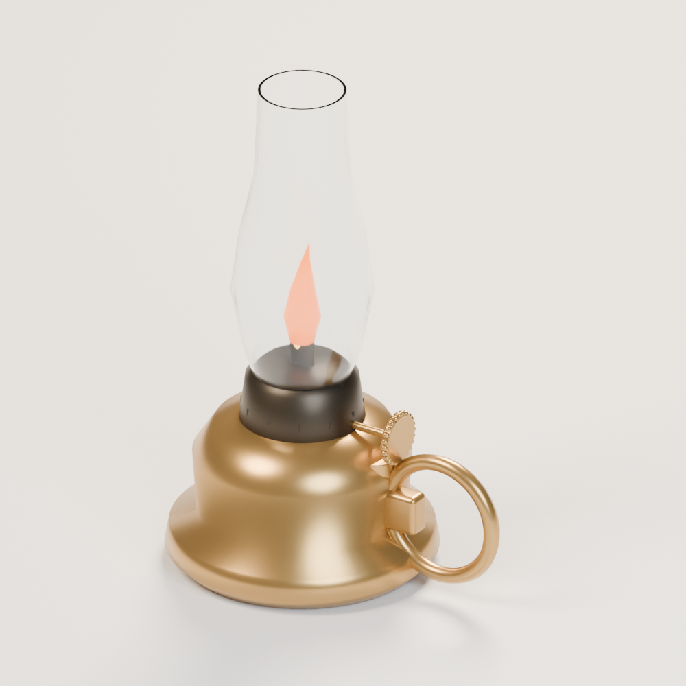
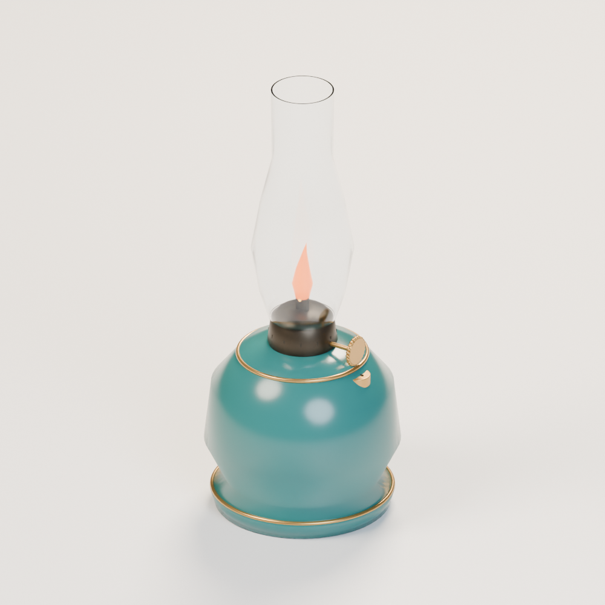
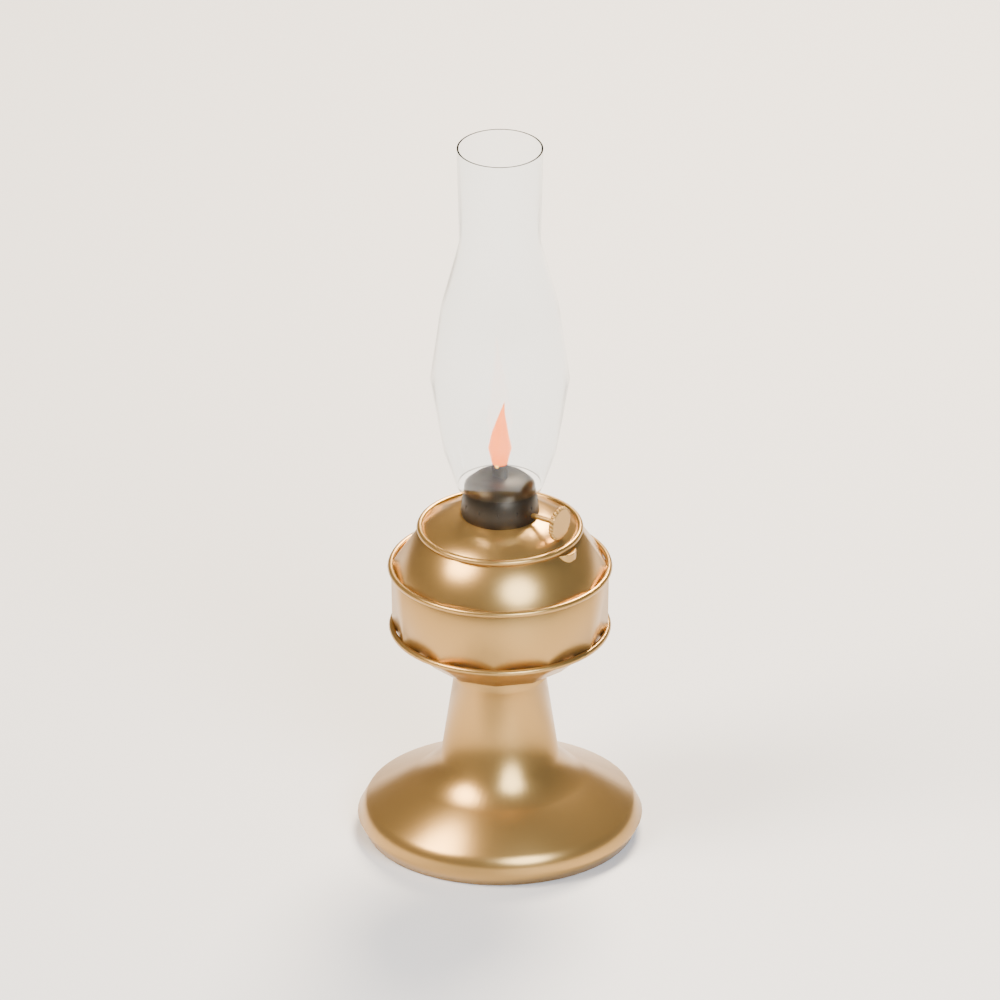
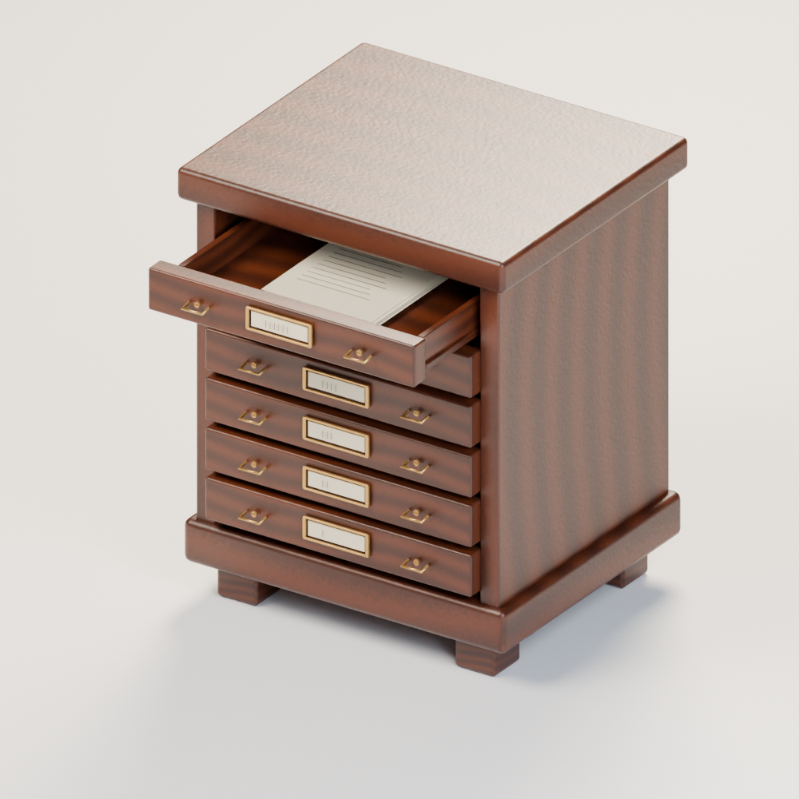
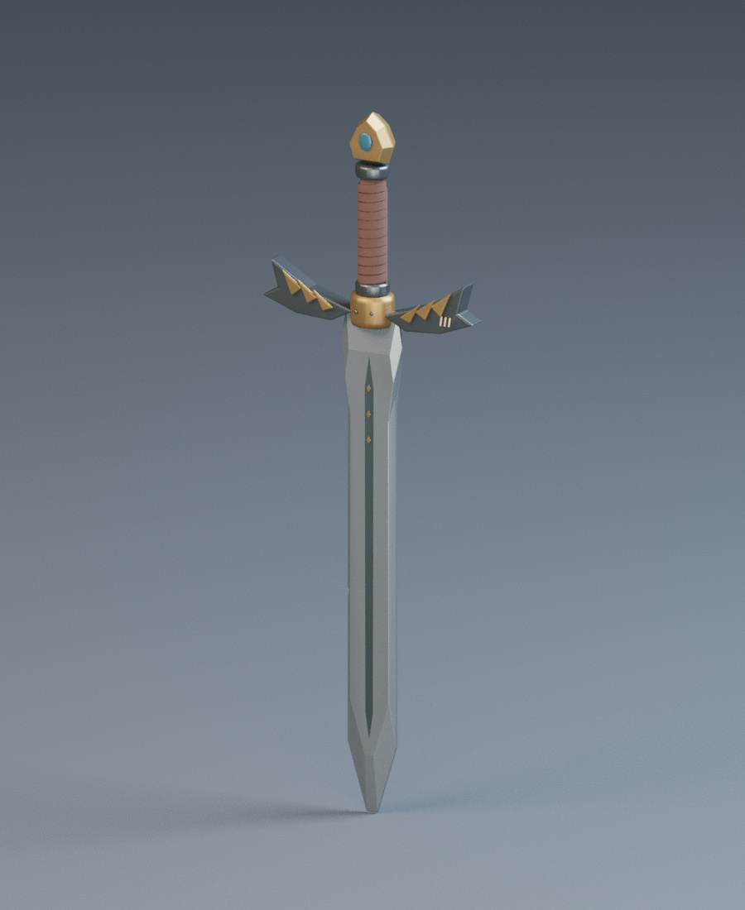
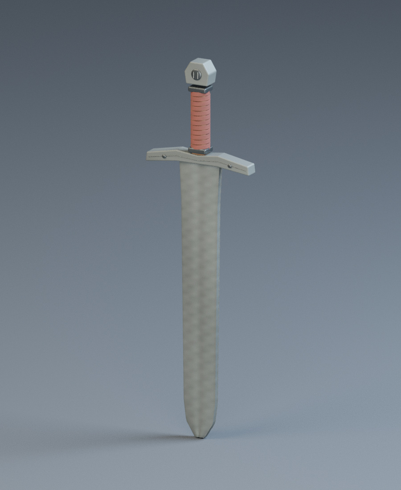
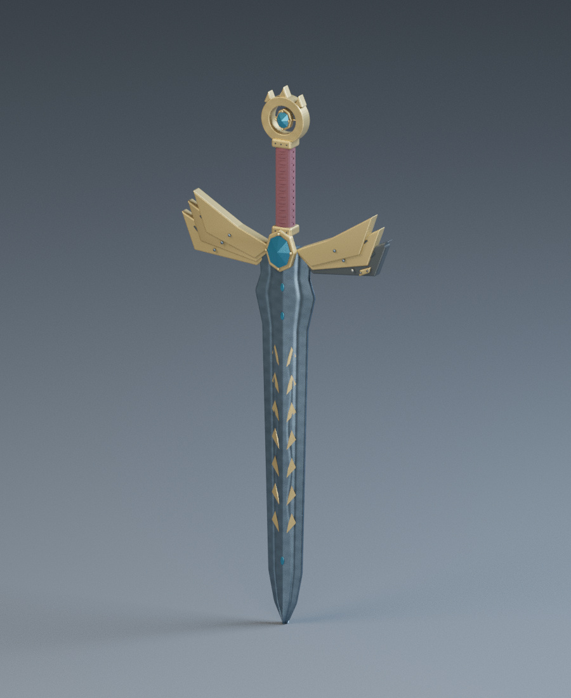

# Base distribution records 337–360

[Browse index](README.md) · [Coverage and missing fields](COVERAGE.md)

Images are actual existing model renders for browsing, not covered by model CC0. A group record may show several reused models. Dimensions and triangle counts apply only to the original record when sourced; revisions can differ. Unknown means unverified, not zero. No blanket CC0 grant for scenes, images, code or articles.

## IF_003

**Small brass chimney oil lamp**

小型・持ち手付きホヤ油灯

Use / purpose: Low brass oil font and finger loop, clear open chimney, filler, wick wheel and static flame.

Record type: model. Formats: Unknown; inspect ZIP.

Reported dimensions (metres; XYZ when derived from measured bounds, legacy axis order not reverified): [0.17599999904632568, 0.12999999523162842, 0.24500000476837158]. Triangles: Unknown.

Origin: Unknown / not independently confirmed. Orientation: Unknown / not independently confirmed.

[Download ZIP](https://github.com/k3peta/tales-on-a-table/releases/download/v2026.10.19-independent-furnishings/IF_003_CC0.zip) · [License scope](../../LICENSE.md)

**CC0-1.0** — See original ZIP license and repository license scope. Models and embedded materials only; previews excluded.

Source details: [Catalogue 1](../../catalog/independent-furnishings.en.md) · [Catalogue 2](../../catalog/independent-furnishings.md) · [Catalogue 3](../../catalog/independent-furnishings.zh-CN.md)

**Quality35:** 320 exact-zero triangles removed;22120tri still over20k; flame emission retained, no lighting safety guarantee. [Details](../material_variants_if003_td006.md).

**Version scope:** The image above depicts the primary recorded ZIP. [Latest revision ZIP](https://raw.githubusercontent.com/k3peta/tales-on-a-table/main/distributions/quality-if003-td006-v1/IF_003__repair_CC0.zip). [Revision-specific preview](../../previews/quality-if003-td006-v1/IF_003__repair_thumb.png). [Version audit](VERSION-AUDIT.md).

## IF_004

**Medium ceramic chimney oil lamp**

中型・陶製油壺のホヤ油灯

Use / purpose: Rounded teal ceramic oil font with gilt bands, a distinct chimney profile and static flame.

Record type: model. Formats: Unknown; inspect ZIP.

Reported dimensions (metres; XYZ when derived from measured bounds, legacy axis order not reverified): [0.1679999977350235, 0.1679999977350235, 0.38999998569488525]. Triangles: Unknown.

Origin: Unknown / not independently confirmed. Orientation: Unknown / not independently confirmed.

[Download ZIP](https://github.com/k3peta/tales-on-a-table/releases/download/v2026.10.19-independent-furnishings/IF_004_CC0.zip) · [License scope](../../LICENSE.md)

**CC0-1.0** — See original ZIP license and repository license scope. Models and embedded materials only; previews excluded.

Source details: [Catalogue 1](../../catalog/independent-furnishings.en.md) · [Catalogue 2](../../catalog/independent-furnishings.md) · [Catalogue 3](../../catalog/independent-furnishings.zh-CN.md)

**Quality35:** 320 zero triangles removed;22956tri over20k; orange ceramic uses repaired baseline, glass/flame unchanged. [Details](../material_variants_if003_td006.md).

**Version scope:** The image above depicts the primary recorded ZIP. [Latest revision ZIP](https://raw.githubusercontent.com/k3peta/tales-on-a-table/main/distributions/quality-if003-td006-v1/IF_004__repair_CC0.zip). [Revision-specific preview](../../previews/quality-if003-td006-v1/IF_004__repair_thumb.png). [Version audit](VERSION-AUDIT.md).

## IF_005

**Large pedestal chimney oil lamp**

大型・脚付き真鍮ホヤ油灯

Use / purpose: A tall stem and wide base support the banded brass reservoir and clear chimney. Static flame.

Record type: model. Formats: Unknown; inspect ZIP.

Reported dimensions (metres; XYZ when derived from measured bounds, legacy axis order not reverified): [0.2160000056028366, 0.2160000056028366, 0.574999988079071]. Triangles: Unknown.

Origin: Unknown / not independently confirmed. Orientation: Unknown / not independently confirmed.

[Download ZIP](https://github.com/k3peta/tales-on-a-table/releases/download/v2026.10.19-independent-furnishings/IF_005_CC0.zip) · [License scope](../../LICENSE.md)

**CC0-1.0** — See original ZIP license and repository license scope. Models and embedded materials only; previews excluded.

Source details: [Catalogue 1](../../catalog/independent-furnishings.en.md) · [Catalogue 2](../../catalog/independent-furnishings.md) · [Catalogue 3](../../catalog/independent-furnishings.zh-CN.md)

**Quality35:** 344 zero triangles removed;24100tri over20k; dark glass silhouette remains. [Details](../material_variants_if003_td006.md).

**Version scope:** The image above depicts the primary recorded ZIP. [Latest revision ZIP](https://raw.githubusercontent.com/k3peta/tales-on-a-table/main/distributions/quality-if003-td006-v1/IF_005__repair_CC0.zip). [Revision-specific preview](../../previews/quality-if003-td006-v1/IF_005__repair_thumb.png). [Version audit](VERSION-AUDIT.md).

## IF_006

**Six-drawer document side chest**

6段の書類用サイドチェスト

Use / purpose: Six shallow document trays with brass label holders; the upper tray is open with papers inside. Dimensions include the extended tray.

Record type: model. Formats: Unknown; inspect ZIP.

Reported dimensions (metres; XYZ when derived from measured bounds, legacy axis order not reverified): [0.6050000190734863, 0.7113832235336304, 0.7475000023841858]. Triangles: Unknown.

Origin: Unknown / not independently confirmed. Orientation: Unknown / not independently confirmed.

[Download ZIP](https://github.com/k3peta/tales-on-a-table/releases/download/v2026.10.19-independent-furnishings/IF_006_CC0.zip) · [License scope](../../LICENSE.md)

**CC0-1.0** — See original ZIP license and repository license scope. Models and embedded materials only; previews excluded.

Source details: [Catalogue 1](../../catalog/independent-furnishings.en.md) · [Catalogue 2](../../catalog/independent-furnishings.md) · [Catalogue 3](../../catalog/independent-furnishings.zh-CN.md)

**Quality35:** 192 zero triangles removed; broad walnut striping suppressed, normal strength0.45 to0.08; fine regularity remains. [Details](../material_variants_if003_td006.md).

**Version scope:** The image above depicts the primary recorded ZIP. [Latest revision ZIP](https://raw.githubusercontent.com/k3peta/tales-on-a-table/main/distributions/quality-if003-td006-v1/IF_006__repair_CC0.zip). [Revision-specific preview](../../previews/quality-if003-td006-v1/IF_006__repair_thumb.png). [Version audit](VERSION-AUDIT.md).

## TD_001

**Sun and emerald talisman**

太陽と翠玉のタリスマン

Use / purpose: An openwork eight-point ring, faceted green centre stone, linked chain and reverse seal motif.

Record type: model. Formats: Unknown; inspect ZIP.

Reported dimensions (metres; XYZ when derived from measured bounds, legacy axis order not reverified): [0.19946371018886566, 0.36320000886917114, 0.039500001817941666]. Triangles: Unknown.

Origin: Unknown / not independently confirmed. Orientation: Unknown / not independently confirmed.

[Download ZIP](https://github.com/k3peta/tales-on-a-table/releases/download/v2026.10.19-treasury-quality/TD_001_CC0.zip) · [License scope](../../LICENSE.md)

**CC0-1.0** — See original ZIP license and repository license scope. Models and embedded materials only; previews excluded.

Source details: [Catalogue 1](../../catalog/treasury.en.md) · [Catalogue 2](../../catalog/treasury.md) · [Catalogue 3](../../catalog/treasury.zh-CN.md)

**Quality35:** 547056tri far over20k;9 untextured meshes lack UV, redesign/baking required. [Details](../material_variants_if003_td006.md).

## TD_002

**Moonlight longsword**

月光の長剣

Use / purpose: A diamond-section blade, inlaid markings, winged guard, leather grip and blue pommel stone.

Record type: model. Formats: Unknown; inspect ZIP.

Reported dimensions (metres; XYZ when derived from measured bounds, legacy axis order not reverified): [0.3919999897480011, 0.07600000500679016, 1.2599999904632568]. Triangles: Unknown.

Origin: Unknown / not independently confirmed. Orientation: Unknown / not independently confirmed.

[Download ZIP](https://github.com/k3peta/tales-on-a-table/releases/download/v2026.10.19-treasury-quality/TD_002_CC0.zip) · [License scope](../../LICENSE.md)

**CC0-1.0** — See original ZIP license and repository license scope. Models and embedded materials only; previews excluded.

Source details: [Catalogue 1](../../catalog/treasury.en.md) · [Catalogue 2](../../catalog/treasury.md) · [Catalogue 3](../../catalog/treasury.zh-CN.md)

**Quality35:** 96 zero triangles removed;6 missing UV added; static prop, combat/physics untested. [Details](../material_variants_if003_td006.md).

**Version scope:** The image above depicts the primary recorded ZIP. [Latest revision ZIP](https://raw.githubusercontent.com/k3peta/tales-on-a-table/main/distributions/quality-if003-td006-v1/TD_002__repair_CC0.zip). [Revision-specific preview](../../previews/quality-if003-td006-v1/TD_002__repair_thumb.png). [Version audit](VERSION-AUDIT.md).

## TD_003

**Dragon-headed ceremonial dagger**

竜頭の儀礼短剣

Use / purpose: A dragon pommel with integrated horns, gem eyes and a continuous muzzle and jaw; pointed scale plates, a slim guard junction and a diamond-section blade.

Record type: model. Formats: Unknown; inspect ZIP.

Reported dimensions (metres; XYZ when derived from measured bounds, legacy axis order not reverified): [0.18750055134296417, 0.11153322458267212, 0.5568543076515198]. Triangles: Unknown.

Origin: Unknown / not independently confirmed. Orientation: Unknown / not independently confirmed.

[Download ZIP](https://github.com/k3peta/tales-on-a-table/releases/download/v2026.10.19-treasury-quality/TD_003_CC0.zip) · [License scope](../../LICENSE.md)

**CC0-1.0** — See original ZIP license and repository license scope. Models and embedded materials only; previews excluded.

Source details: [Catalogue 1](../../catalog/treasury.en.md) · [Catalogue 2](../../catalog/treasury.md) · [Catalogue 3](../../catalog/treasury.zh-CN.md)

**Quality35:** 41 zero triangles removed;93 positive tiny retained;83 missing UV added;131673tri over20k. [Details](../material_variants_if003_td006.md).

**Version scope:** The image above depicts the primary recorded ZIP. [Latest revision ZIP](https://raw.githubusercontent.com/k3peta/tales-on-a-table/main/distributions/quality-if003-td006-v1/TD_003__repair_CC0.zip). [Revision-specific preview](../../previews/quality-if003-td006-v1/TD_003__repair_thumb.png). [Version audit](VERSION-AUDIT.md).

## TD_004

**Star-dragon embroidered mantle**

星竜の刺繍マント

Use / purpose: A crimson mantle with a filled gold dragon on a navy shield, floral borders, palmette hem and ruby clasp.

Record type: model. Formats: Unknown; inspect ZIP.

Reported dimensions (metres; XYZ when derived from measured bounds, legacy axis order not reverified): [1.543454647064209, 0.281873419880867, 1.6960543394088745]. Triangles: Unknown.

Origin: Unknown / not independently confirmed. Orientation: Unknown / not independently confirmed.

[Download ZIP](https://github.com/k3peta/tales-on-a-table/releases/download/v2026.10.19-treasury-quality/TD_004_CC0.zip) · [License scope](../../LICENSE.md)

**CC0-1.0** — See original ZIP license and repository license scope. Models and embedded materials only; previews excluded.

Source details: [Catalogue 1](../../catalog/treasury.en.md) · [Catalogue 2](../../catalog/treasury.md) · [Catalogue 3](../../catalog/treasury.zh-CN.md)

**Quality35:** 4652604tri far over20k;132 meshes lack UV, thread-to-texture redesign required, unrepaired. [Details](../material_variants_if003_td006.md).

## TD_005

**Crystal-bearing magic staff**

翠晶を抱く魔法杖

Use / purpose: Spiral metal branches cradle a large crystal above a leather grip and ferrule.

Record type: model. Formats: Unknown; inspect ZIP.

Reported dimensions (metres; XYZ when derived from measured bounds, legacy axis order not reverified): [0.19417305290699005, 0.17666853964328766, 1.840000033378601]. Triangles: Unknown.

Origin: Unknown / not independently confirmed. Orientation: Unknown / not independently confirmed.

[Download ZIP](https://github.com/k3peta/tales-on-a-table/releases/download/v2026.10.19-treasury-quality/TD_005_CC0.zip) · [License scope](../../LICENSE.md)

**CC0-1.0** — See original ZIP license and repository license scope. Models and embedded materials only; previews excluded.

Source details: [Catalogue 1](../../catalog/treasury.en.md) · [Catalogue 2](../../catalog/treasury.md) · [Catalogue 3](../../catalog/treasury.zh-CN.md)

**Quality35:** 2 flat-color meshes lack UV; optics/rig untested. [Details](../material_variants_if003_td006.md).

## TD_006

**Wax-sealed secret scroll**

封蝋と金帯の秘伝巻物

Use / purpose: A twenty-turn parchment roll, two stitched leather bands, a seal strip and recessed red wax seal.

Record type: model. Formats: Unknown; inspect ZIP.

Reported dimensions (metres; XYZ when derived from measured bounds, legacy axis order not reverified): [0.3199999928474426, 0.10613545775413513, 0.09128714352846146]. Triangles: Unknown.

Origin: Unknown / not independently confirmed. Orientation: Unknown / not independently confirmed.

[Download ZIP](https://github.com/k3peta/tales-on-a-table/releases/download/v2026.10.19-treasury-quality/TD_006_CC0.zip) · [License scope](../../LICENSE.md)

**CC0-1.0** — See original ZIP license and repository license scope. Models and embedded materials only; previews excluded.

Source details: [Catalogue 1](../../catalog/treasury.en.md) · [Catalogue 2](../../catalog/treasury.md) · [Catalogue 3](../../catalog/treasury.zh-CN.md)

**Quality35:** 20 zero triangles removed;12 positive tiny retained;3 missing UV added;33952tri over20k. [Details](../material_variants_if003_td006.md).

**Version scope:** The image above depicts the primary recorded ZIP. [Latest revision ZIP](https://raw.githubusercontent.com/k3peta/tales-on-a-table/main/distributions/quality-if003-td006-v1/TD_006__repair_CC0.zip). [Revision-specific preview](../../previews/quality-if003-td006-v1/TD_006__repair_thumb.png). [Version audit](VERSION-AUDIT.md).

## TD_007

**Royal heraldic coin**

王家の紋章金貨

Use / purpose: Raised rims on both faces, a crown emblem, radial marks and a milled edge.

Record type: model. Formats: Unknown; inspect ZIP.

Reported dimensions (metres; XYZ when derived from measured bounds, legacy axis order not reverified): [0.04470000043511391, 0.04470000043511391, 0.0058300006203353405]. Triangles: Unknown.

Origin: Unknown / not independently confirmed. Orientation: Unknown / not independently confirmed.

[Download ZIP](https://github.com/k3peta/tales-on-a-table/releases/download/v2026.10.19-treasury-quality/TD_007_CC0.zip) · [License scope](../../LICENSE.md)

**CC0-1.0** — See original ZIP license and repository license scope. Models and embedded materials only; previews excluded.

Source details: [Catalogue 1](../../catalog/treasury.en.md) · [Catalogue 2](../../catalog/treasury.md) · [Catalogue 3](../../catalog/treasury.zh-CN.md)

**Quality36:** Black cutoff was camera near clipping corrected in audit renders; model unchanged. [Details](../material_variants_td007_016.md).

## TD_008

**Stamped gold ingot**

刻印入り金塊

Use / purpose: A tapered cast ingot with bevelled edges and recessed purity and assay markings.

Record type: model. Formats: Unknown; inspect ZIP.

Reported dimensions (metres; XYZ when derived from measured bounds, legacy axis order not reverified): [0.18998941779136658, 0.08499354869127274, 0.05548042431473732]. Triangles: Unknown.

Origin: Unknown / not independently confirmed. Orientation: Unknown / not independently confirmed.

[Download ZIP](https://github.com/k3peta/tales-on-a-table/releases/download/v2026.10.19-treasury-quality/TD_008_CC0.zip) · [License scope](../../LICENSE.md)

**CC0-1.0** — See original ZIP license and repository license scope. Models and embedded materials only; previews excluded.

Source details: [Catalogue 1](../../catalog/treasury.en.md) · [Catalogue 2](../../catalog/treasury.md) · [Catalogue 3](../../catalog/treasury.zh-CN.md)

## TD_009

**Faceted gem pile**

多面宝石の小山

Use / purpose: One group of bevelled gems in four colours and varied sizes; its contents are not counted separately.

Record type: group. Formats: Unknown; inspect ZIP.

Reported dimensions (metres; XYZ when derived from measured bounds, legacy axis order not reverified): [0.20938646793365479, 0.21078920364379883, 0.03442375734448433]. Triangles: Unknown.

Origin: Unknown / not independently confirmed. Orientation: Unknown / not independently confirmed.

[Download ZIP](https://github.com/k3peta/tales-on-a-table/releases/download/v2026.10.19-treasury-quality/TD_009_CC0.zip) · [License scope](../../LICENSE.md)

**CC0-1.0** — See original ZIP license and repository license scope. Models and embedded materials only; previews excluded.

Source details: [Catalogue 1](../../catalog/treasury.en.md) · [Catalogue 2](../../catalog/treasury.md) · [Catalogue 3](../../catalog/treasury.zh-CN.md)

**Quality36:** 25 constant-material objects lack UV. [Details](../material_variants_td007_016.md).

## TD_010

**Nine-leaf royal crown**

九葉の宝冠

Use / purpose: Openwork leaves, red and blue stone settings and a double engraved band.

Record type: model. Formats: Unknown; inspect ZIP.

Reported dimensions (metres; XYZ when derived from measured bounds, legacy axis order not reverified): [0.2715218961238861, 0.27523232996463776, 0.1189129427075386]. Triangles: Unknown.

Origin: Unknown / not independently confirmed. Orientation: Unknown / not independently confirmed.

[Download ZIP](https://github.com/k3peta/tales-on-a-table/releases/download/v2026.10.19-treasury-quality/TD_010_CC0.zip) · [License scope](../../LICENSE.md)

**CC0-1.0** — See original ZIP license and repository license scope. Models and embedded materials only; previews excluded.

Source details: [Catalogue 1](../../catalog/treasury.en.md) · [Catalogue 2](../../catalog/treasury.md) · [Catalogue 3](../../catalog/treasury.zh-CN.md)

**Quality36:** 44180tri exceeds20k;10 objects lack UV; redesign pending. [Details](../material_variants_td007_016.md).

## TD_011

**Open gilded treasure chest**

金装飾の開いた宝箱

Use / purpose: A large static chest with inner walls, floor, curved lid, hinges and corner fittings. Contents are separate assets.

Record type: model. Formats: Unknown; inspect ZIP.

Reported dimensions (metres; XYZ when derived from measured bounds, legacy axis order not reverified): [1.093868613243103, 0.9509692788124084, 0.9811983108520508]. Triangles: Unknown.

Origin: Unknown / not independently confirmed. Orientation: Unknown / not independently confirmed.

[Download ZIP](https://github.com/k3peta/tales-on-a-table/releases/download/v2026.10.19-treasury-quality/TD_011_CC0.zip) · [License scope](../../LICENSE.md)

**CC0-1.0** — See original ZIP license and repository license scope. Models and embedded materials only; previews excluded.

Source details: [Catalogue 1](../../catalog/treasury.en.md) · [Catalogue 2](../../catalog/treasury.md) · [Catalogue 3](../../catalog/treasury.zh-CN.md)

**Quality36:** 96 exact-zero triangles removed;79192tri exceeds50k; coarse wood grain retained. [Details](../material_variants_td007_016.md).

**Latest revision:** [ZIP](https://raw.githubusercontent.com/k3peta/tales-on-a-table/main/distributions/quality-td007-016-v1/TD_011__repair_CC0.zip) · [Matching revision preview](../../previews/quality-td007-016-v1/TD_011__repair_thumb.png). Original pictured ZIP retained above. Public ZIP/member/image identity verified.

## TD_012

**Sealed jewel casket**

封印された宝石小箱

Use / purpose: A square casket with overlapping silver straps and supports, hinges, a latch and a red stone setting.

Record type: model. Formats: Unknown; inspect ZIP.

Reported dimensions (metres; XYZ when derived from measured bounds, legacy axis order not reverified): [0.31200000643730164, 0.26999999582767487, 0.26499998569488525]. Triangles: Unknown.

Origin: Unknown / not independently confirmed. Orientation: Unknown / not independently confirmed.

[Download ZIP](https://github.com/k3peta/tales-on-a-table/releases/download/v2026.10.19-treasury-quality/TD_012_CC0.zip) · [License scope](../../LICENSE.md)

**CC0-1.0** — See original ZIP license and repository license scope. Models and embedded materials only; previews excluded.

Source details: [Catalogue 1](../../catalog/treasury.en.md) · [Catalogue 2](../../catalog/treasury.md) · [Catalogue 3](../../catalog/treasury.zh-CN.md)

**Quality36:** 25128tri exceeds20k;1 missing UV retained; redesign pending. [Details](../material_variants_td007_016.md).

## TD_013

**Round brilliant-cut gem**

円形ブリリアント宝石

Use / purpose: An individual base gem/crystal shape. Five original colour GLBs remain in the previous release; colours are not extra designs.

Record type: model. Formats: Unknown; inspect ZIP.

Reported dimensions (metres; XYZ when derived from measured bounds, legacy axis order not reverified): [0.06400000303983688, 0.06400000303983688, 0.04100000113248825]. Triangles: Unknown.

Origin: Unknown / not independently confirmed. Orientation: Unknown / not independently confirmed.

[Download ZIP](https://github.com/k3peta/tales-on-a-table/releases/download/v2026.10.19-treasury-quality/TD_013_CC0.zip) · [License scope](../../LICENSE.md)

**CC0-1.0** — See original ZIP license and repository license scope. Models and embedded materials only; previews excluded.

Source details: [Catalogue 1](../../catalog/treasury.en.md) · [Catalogue 2](../../catalog/treasury.md) · [Catalogue 3](../../catalog/treasury.zh-CN.md)

**Quality36:** Orange gem variant adds missing UV baseline; geometry/transmission/IOR/emission unchanged. [Details](../material_variants_td007_016.md).

## TD_014

**Rectangular step-cut gem**

長方形ステップカット宝石

Use / purpose: An individual base gem/crystal shape. Five original colour GLBs remain in the previous release; colours are not extra designs.

Record type: model. Formats: Unknown; inspect ZIP.

Reported dimensions (metres; XYZ when derived from measured bounds, legacy axis order not reverified): [0.07199999690055847, 0.09600000083446503, 0.04699999839067459]. Triangles: Unknown.

Origin: Unknown / not independently confirmed. Orientation: Unknown / not independently confirmed.

[Download ZIP](https://github.com/k3peta/tales-on-a-table/releases/download/v2026.10.19-treasury-quality/TD_014_CC0.zip) · [License scope](../../LICENSE.md)

**CC0-1.0** — See original ZIP license and repository license scope. Models and embedded materials only; previews excluded.

Source details: [Catalogue 1](../../catalog/treasury.en.md) · [Catalogue 2](../../catalog/treasury.md) · [Catalogue 3](../../catalog/treasury.zh-CN.md)

**Quality36:** Cyan gem variant adds missing UV baseline; geometry/transmission/IOR/emission unchanged. [Details](../material_variants_td007_016.md).

## TD_015

**Pear-cut gem**

洋梨形カット宝石

Use / purpose: An individual base gem/crystal shape. Five original colour GLBs remain in the previous release; colours are not extra designs.

Record type: model. Formats: Unknown; inspect ZIP.

Reported dimensions (metres; XYZ when derived from measured bounds, legacy axis order not reverified): [0.04981314390897751, 0.06400000303983688, 0.04100000113248825]. Triangles: Unknown.

Origin: Unknown / not independently confirmed. Orientation: Unknown / not independently confirmed.

[Download ZIP](https://github.com/k3peta/tales-on-a-table/releases/download/v2026.10.19-treasury-quality/TD_015_CC0.zip) · [License scope](../../LICENSE.md)

**CC0-1.0** — See original ZIP license and repository license scope. Models and embedded materials only; previews excluded.

Source details: [Catalogue 1](../../catalog/treasury.en.md) · [Catalogue 2](../../catalog/treasury.md) · [Catalogue 3](../../catalog/treasury.zh-CN.md)

**Quality36:** Amber gem variant adds missing UV baseline; geometry/transmission/IOR/emission unchanged. [Details](../material_variants_td007_016.md).

## TD_016

**Marquise-cut gem**

マーキス形カット宝石

Use / purpose: An individual base gem/crystal shape. Five original colour GLBs remain in the previous release; colours are not extra designs.

Record type: model. Formats: Unknown; inspect ZIP.

Reported dimensions (metres; XYZ when derived from measured bounds, legacy axis order not reverified): [0.03519999980926514, 0.08320000022649765, 0.04100000113248825]. Triangles: Unknown.

Origin: Unknown / not independently confirmed. Orientation: Unknown / not independently confirmed.

[Download ZIP](https://github.com/k3peta/tales-on-a-table/releases/download/v2026.10.19-treasury-quality/TD_016_CC0.zip) · [License scope](../../LICENSE.md)

**CC0-1.0** — See original ZIP license and repository license scope. Models and embedded materials only; previews excluded.

Source details: [Catalogue 1](../../catalog/treasury.en.md) · [Catalogue 2](../../catalog/treasury.md) · [Catalogue 3](../../catalog/treasury.zh-CN.md)

**Quality36:** Violet gem variant adds missing UV baseline; geometry/transmission/IOR/emission unchanged. [Details](../material_variants_td007_016.md).

## TD_017

**Hexagonal crystal**

六角柱の原石結晶

Use / purpose: An individual base gem/crystal shape. Five original colour GLBs remain in the previous release; colours are not extra designs.

Record type: model. Formats: Unknown; inspect ZIP.

Reported dimensions (metres; XYZ when derived from measured bounds, legacy axis order not reverified): [0.06400000303983688, 0.055425625294446945, 0.14000000059604645]. Triangles: Unknown.

Origin: Unknown / not independently confirmed. Orientation: Unknown / not independently confirmed.

[Download ZIP](https://github.com/k3peta/tales-on-a-table/releases/download/v2026.10.19-treasury-quality/TD_017_CC0.zip) · [License scope](../../LICENSE.md)

**CC0-1.0** — See original ZIP license and repository license scope. Models and embedded materials only; previews excluded.

Source details: [Catalogue 1](../../catalog/treasury.en.md) · [Catalogue 2](../../catalog/treasury.md) · [Catalogue 3](../../catalog/treasury.zh-CN.md)

**Quality37:** Orange body-color variant retains geometry; missing UV added before baseline. [Details](../material_variants_td017_arm013.md).

## ARM_001

**竜翼鍔の旅剣**

竜翼鍔の旅剣

Use / purpose: Static nonfunctional fantasy model. No LOD, collision proxies or working rig; appearance in external game engines is untested.

Record type: model. Formats: Unknown; inspect ZIP.

Reported dimensions (metres; XYZ when derived from measured bounds, legacy axis order not reverified): [0.3512582778930664, 0.06000000238418579, 1.0765777826309204]. Triangles: Unknown.

Origin: Unknown / not independently confirmed. Orientation: Unknown / not independently confirmed.

[Download ZIP](https://github.com/k3peta/tales-on-a-table/releases/download/v2026.10.19-armory/ARM_001_CC0.zip) · [License scope](../../LICENSE.md)

**CC0-1.0** — See original ZIP license and repository license scope. Models and embedded materials only; previews excluded.

Source details: [Catalogue 1](../../catalog/armory.en.md) · [Catalogue 2](../../catalog/armory.md) · [Catalogue 3](../../catalog/armory.zh-CN.md)

**Quality37:** 42 exact-zero triangles removed;160 positive tiny retained;10426tri. [Details](../material_variants_td017_arm013.md).

**Latest revision:** [ZIP](https://raw.githubusercontent.com/k3peta/tales-on-a-table/main/distributions/quality-td017-arm013-v1/ARM_001__repair_CC0.zip) · [Matching revision preview](../../previews/quality-td017-arm013-v1/ARM_001__repair_thumb.png). Original pictured ZIP retained above. Public ZIP/member/image identity verified.

## ARM_002

**量産風鋳肌剣**

量産風鋳肌剣

Use / purpose: Static nonfunctional fantasy model. No LOD, collision proxies or working rig; appearance in external game engines is untested.

Record type: model. Formats: Unknown; inspect ZIP.

Reported dimensions (metres; XYZ when derived from measured bounds, legacy axis order not reverified): [0.2992851436138153, 0.0544000007212162, 1.0012719631195068]. Triangles: Unknown.

Origin: Unknown / not independently confirmed. Orientation: Unknown / not independently confirmed.

[Download ZIP](https://github.com/k3peta/tales-on-a-table/releases/download/v2026.10.19-armory/ARM_002_CC0.zip) · [License scope](../../LICENSE.md)

**CC0-1.0** — See original ZIP license and repository license scope. Models and embedded materials only; previews excluded.

Source details: [Catalogue 1](../../catalog/armory.en.md) · [Catalogue 2](../../catalog/armory.md) · [Catalogue 3](../../catalog/armory.zh-CN.md)

**Quality37:** 29068tri over20k; authored mottled display-alloy material, no color-to-normal error detected. [Details](../material_variants_td017_arm013.md).

## ARM_003

**海門守護の伝説剣**

海門守護の伝説剣

Use / purpose: Static nonfunctional fantasy model. No LOD, collision proxies or working rig; appearance in external game engines is untested.

Record type: model. Formats: Unknown; inspect ZIP.

Reported dimensions (metres; XYZ when derived from measured bounds, legacy axis order not reverified): [0.5500773191452026, 0.06450000405311584, 1.3136353492736816]. Triangles: Unknown.

Origin: Unknown / not independently confirmed. Orientation: Unknown / not independently confirmed.

[Download ZIP](https://github.com/k3peta/tales-on-a-table/releases/download/v2026.10.19-armory/ARM_003_CC0.zip) · [License scope](../../LICENSE.md)

**CC0-1.0** — See original ZIP license and repository license scope. Models and embedded materials only; previews excluded.

Source details: [Catalogue 1](../../catalog/armory.en.md) · [Catalogue 2](../../catalog/armory.md) · [Catalogue 3](../../catalog/armory.zh-CN.md)
**Quality37:** 96 exact-zero triangles removed;19 positive tiny retained;41808tri over20k. [Details](../material_variants_td017_arm013.md).
**Latest revision:** [ZIP](https://raw.githubusercontent.com/k3peta/tales-on-a-table/main/distributions/quality-td017-arm013-v1/ARM_003__repair_CC0.zip) · [Matching revision preview](../../previews/quality-td017-arm013-v1/ARM_003__repair_thumb.png). Original pictured ZIP retained above. Public ZIP/member/image identity verified.
