# Base distribution records 361–384

[Browse index](README.md) · [Coverage and missing fields](COVERAGE.md)

Images are actual existing model renders for browsing, not covered by model CC0. A group record may show several reused models. Dimensions and triangle counts apply only to the original record when sourced; revisions can differ. Unknown means unverified, not zero. No blanket CC0 grant for scenes, images, code or articles.

## ARM_004

**波紋鍔の旅曲剣**

波紋鍔の旅曲剣

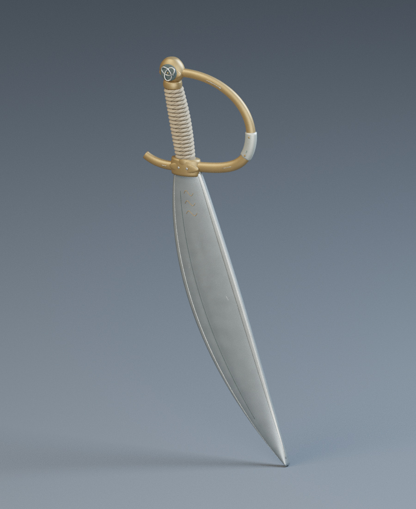

Use / purpose: Static nonfunctional fantasy model. No LOD, collision proxies or working rig; appearance in external game engines is untested.

Record type: model. Formats: Unknown; inspect ZIP.

Reported dimensions (metres; XYZ when derived from measured bounds, legacy axis order not reverified): [0.42777860164642334, 0.055858880281448364, 1.0574109554290771]. Triangles: Unknown.

Origin: Unknown / not independently confirmed. Orientation: Unknown / not independently confirmed.

[Download ZIP](https://github.com/k3peta/tales-on-a-table/releases/download/v2026.10.19-armory/ARM_004_CC0.zip) · [License scope](../../LICENSE.md)

**CC0-1.0** — See original ZIP license and repository license scope. Models and embedded materials only; previews excluded.

Source details: [Catalogue 1](../../catalog/armory.en.md) · [Catalogue 2](../../catalog/armory.md) · [Catalogue 3](../../catalog/armory.zh-CN.md)

**Quality37:** 156580tri over20k; rope/aged materials authored; redesign open. [Details](../material_variants_td017_arm013.md).

## ARM_005

**山道の短剣**

山道の短剣

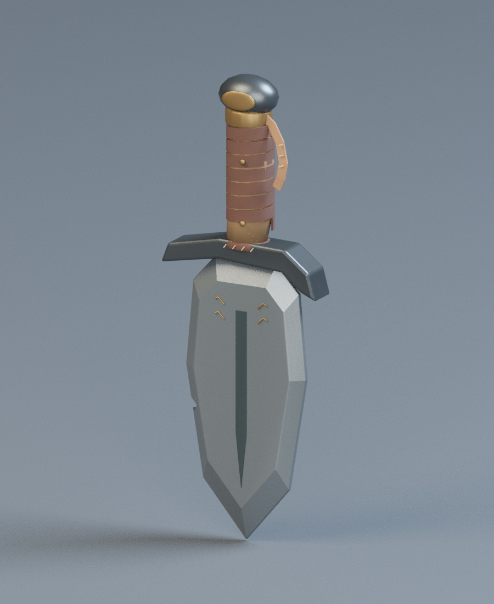

Use / purpose: Static nonfunctional fantasy model. No LOD, collision proxies or working rig; appearance in external game engines is untested.

Record type: model. Formats: Unknown; inspect ZIP.

Reported dimensions (metres; XYZ when derived from measured bounds, legacy axis order not reverified): [0.17161720991134644, 0.04879999905824661, 0.47549736499786377]. Triangles: Unknown.

Origin: Unknown / not independently confirmed. Orientation: Unknown / not independently confirmed.

[Download ZIP](https://github.com/k3peta/tales-on-a-table/releases/download/v2026.10.19-armory/ARM_005_CC0.zip) · [License scope](../../LICENSE.md)

**CC0-1.0** — See original ZIP license and repository license scope. Models and embedded materials only; previews excluded.

Source details: [Catalogue 1](../../catalog/armory.en.md) · [Catalogue 2](../../catalog/armory.md) · [Catalogue 3](../../catalog/armory.zh-CN.md)

**Quality37:** 36 positive tiny stamped triangles retained; loose hide token not proven defective. [Details](../material_variants_td017_arm013.md).

## ARM_006

**雫宝石の装飾短剣**

雫宝石の装飾短剣

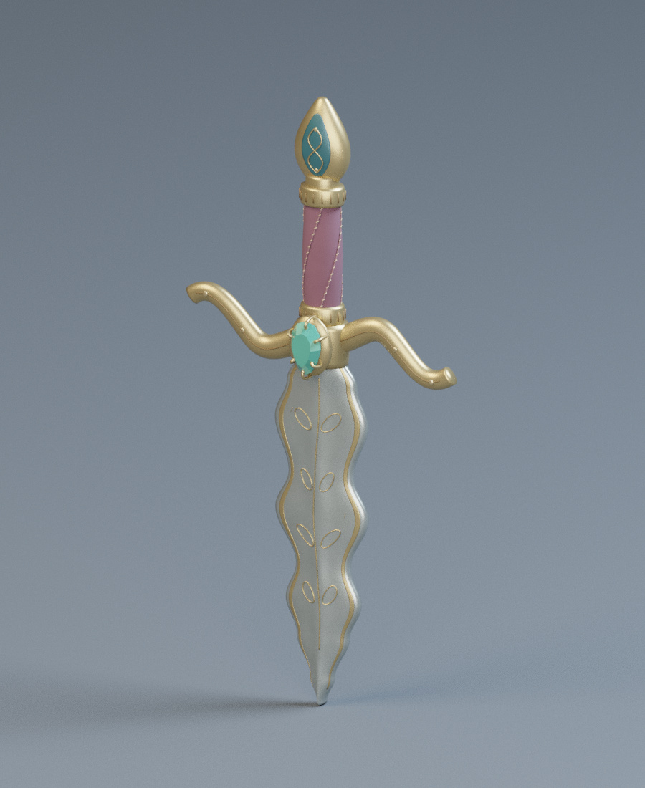

Use / purpose: Static nonfunctional fantasy model. No LOD, collision proxies or working rig; appearance in external game engines is untested.

Record type: model. Formats: Unknown; inspect ZIP.

Reported dimensions (metres; XYZ when derived from measured bounds, legacy axis order not reverified): [0.3054639995098114, 0.07214999943971634, 0.6330000162124634]. Triangles: Unknown.

Origin: Unknown / not independently confirmed. Orientation: Unknown / not independently confirmed.

[Download ZIP](https://github.com/k3peta/tales-on-a-table/releases/download/v2026.10.19-armory/ARM_006_CC0.zip) · [License scope](../../LICENSE.md)

**CC0-1.0** — See original ZIP license and repository license scope. Models and embedded materials only; previews excluded.

Source details: [Catalogue 1](../../catalog/armory.en.md) · [Catalogue 2](../../catalog/armory.md) · [Catalogue 3](../../catalog/armory.zh-CN.md)

**Quality37:** 124796tri over20k; redesign open. [Details](../material_variants_td017_arm013.md).

## ARM_007

**月形の斧**

月形の斧

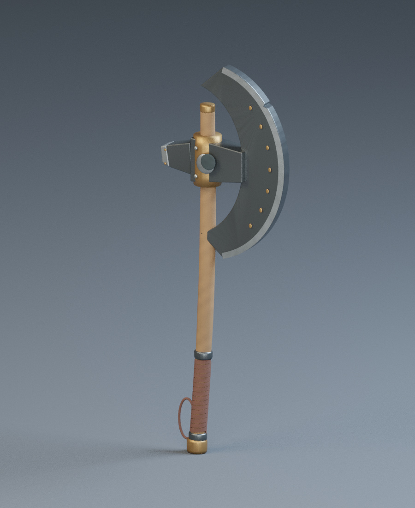

Use / purpose: Static nonfunctional fantasy model. No LOD, collision proxies or working rig; appearance in external game engines is untested.

Record type: model. Formats: Unknown; inspect ZIP.

Reported dimensions (metres; XYZ when derived from measured bounds, legacy axis order not reverified): [0.4076278805732727, 0.10199999809265137, 1.192775011062622]. Triangles: Unknown.

Origin: Unknown / not independently confirmed. Orientation: Unknown / not independently confirmed.

[Download ZIP](https://github.com/k3peta/tales-on-a-table/releases/download/v2026.10.19-armory/ARM_007_CC0.zip) · [License scope](../../LICENSE.md)

**CC0-1.0** — See original ZIP license and repository license scope. Models and embedded materials only; previews excluded.

Source details: [Catalogue 1](../../catalog/armory.en.md) · [Catalogue 2](../../catalog/armory.md) · [Catalogue 3](../../catalog/armory.zh-CN.md)

**Quality37:** 18805tri; static prop, load/function untested. [Details](../material_variants_td017_arm013.md).

## ARM_011

**葉飾り儀礼槍**

葉飾り儀礼槍

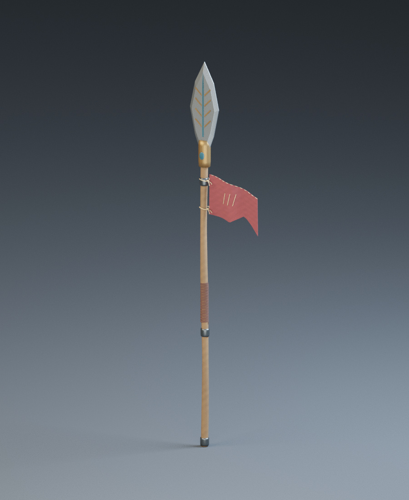

Use / purpose: Static nonfunctional fantasy model. No LOD, collision proxies or working rig; appearance in external game engines is untested.

Record type: model. Formats: Unknown; inspect ZIP.

Reported dimensions (metres; XYZ when derived from measured bounds, legacy axis order not reverified): [0.3903226852416992, 0.06399999558925629, 2.0394129753112793]. Triangles: Unknown.

Origin: Unknown / not independently confirmed. Orientation: Unknown / not independently confirmed.

[Download ZIP](https://github.com/k3peta/tales-on-a-table/releases/download/v2026.10.19-armory/ARM_011_CC0.zip) · [License scope](../../LICENSE.md)

**CC0-1.0** — See original ZIP license and repository license scope. Models and embedded materials only; previews excluded.

Source details: [Catalogue 1](../../catalog/armory.en.md) · [Catalogue 2](../../catalog/armory.md) · [Catalogue 3](../../catalog/armory.zh-CN.md)

**Quality37:** 22384tri over20k;272 positive tiny retained; teal cloth retains geometry/UV. [Details](../material_variants_td017_arm013.md).

## ARM_013

**貝波飾りの海神三叉槍**

貝波飾りの海神三叉槍

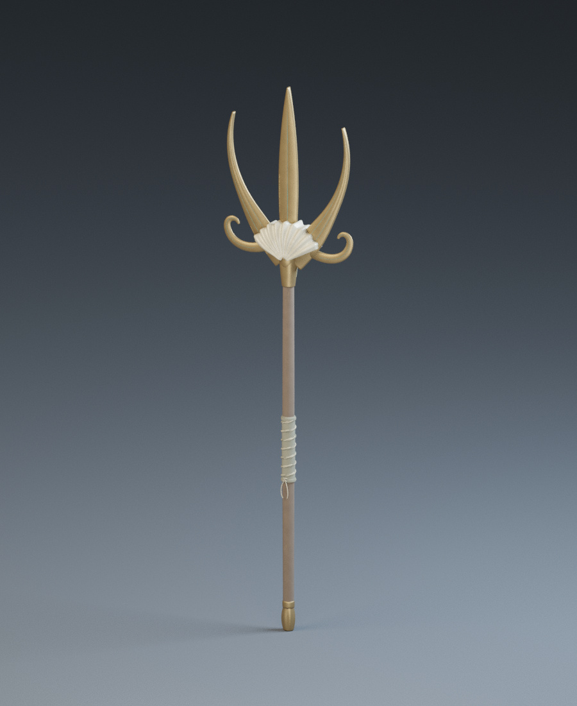

Use / purpose: Static nonfunctional fantasy model. No LOD, collision proxies or working rig; appearance in external game engines is untested.

Record type: model. Formats: Unknown; inspect ZIP.

Reported dimensions (metres; XYZ when derived from measured bounds, legacy axis order not reverified): [0.5604871511459351, 0.11195404082536697, 2.1570000648498535]. Triangles: Unknown.

Origin: Unknown / not independently confirmed. Orientation: Unknown / not independently confirmed.

[Download ZIP](https://github.com/k3peta/tales-on-a-table/releases/download/v2026.10.19-armory/ARM_013_CC0.zip) · [License scope](../../LICENSE.md)

**CC0-1.0** — See original ZIP license and repository license scope. Models and embedded materials only; previews excluded.

Source details: [Catalogue 1](../../catalog/armory.en.md) · [Catalogue 2](../../catalog/armory.md) · [Catalogue 3](../../catalog/armory.zh-CN.md)

**Quality37:** 127892tri over20k; redesign open. [Details](../material_variants_td017_arm013.md).

## ARM_014

**城門の長柄斧**

城門の長柄斧

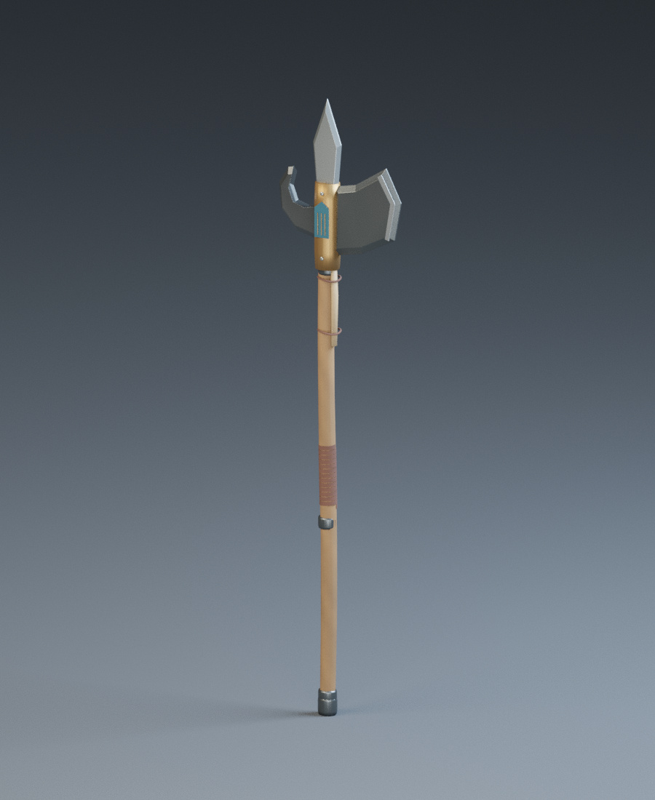

Use / purpose: Static nonfunctional fantasy model. No LOD, collision proxies or working rig; appearance in external game engines is untested.

Record type: model. Formats: Unknown; inspect ZIP.

Reported dimensions (metres; XYZ when derived from measured bounds, legacy axis order not reverified): [0.40175503492355347, 0.07859999686479568, 1.8633853197097778]. Triangles: Unknown.

Origin: Unknown / not independently confirmed. Orientation: Unknown / not independently confirmed.

[Download ZIP](https://github.com/k3peta/tales-on-a-table/releases/download/v2026.10.19-armory/ARM_014_CC0.zip) · [License scope](../../LICENSE.md)

**CC0-1.0** — See original ZIP license and repository license scope. Models and embedded materials only; previews excluded.

Source details: [Catalogue 1](../../catalog/armory.en.md) · [Catalogue 2](../../catalog/armory.md) · [Catalogue 3](../../catalog/armory.zh-CN.md)

**Quality38:** 8 zero-area triangles removed;29 positive tiny retained;14840tri. [Details](../material_variants_arm014_arm023.md).

**Latest revision:** [ZIP](https://raw.githubusercontent.com/k3peta/tales-on-a-table/main/distributions/quality-arm014-023-v1/ARM_014__repair_CC0.zip) · [Matching revision preview](../../previews/quality-arm014-023-v1/ARM_014__repair_thumb.png). Original pictured ZIP retained above. Public ZIP/member/image identity verified.

## ARM_015

**巡礼の石槌**

巡礼の石槌

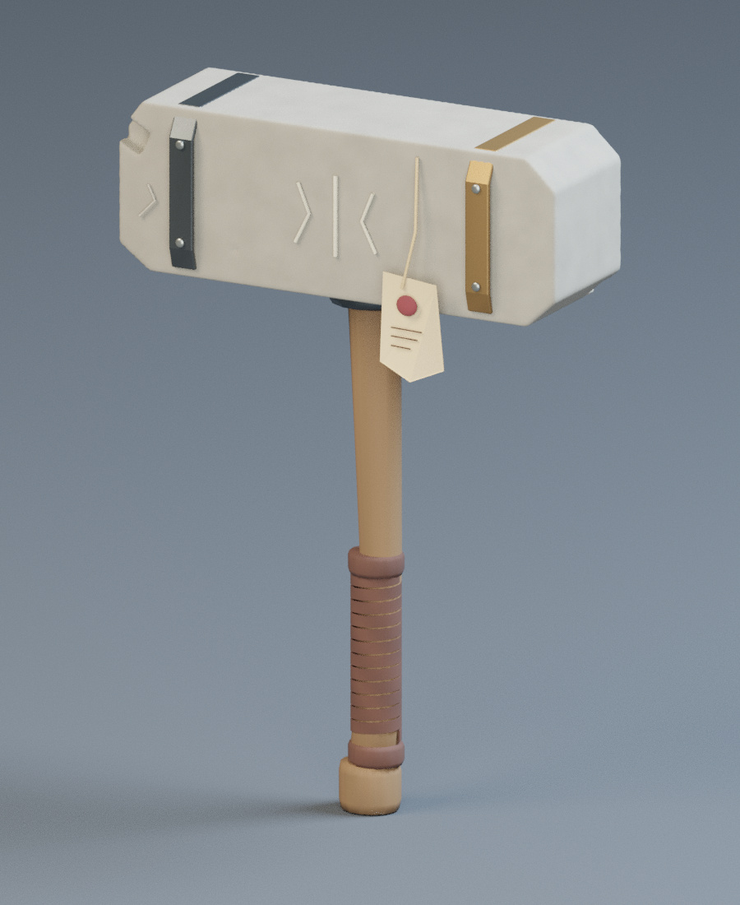

Use / purpose: Static nonfunctional fantasy model. No LOD, collision proxies or working rig; appearance in external game engines is untested.

Record type: model. Formats: Unknown; inspect ZIP.

Reported dimensions (metres; XYZ when derived from measured bounds, legacy axis order not reverified): [0.5006360411643982, 0.1899999976158142, 0.7310000658035278]. Triangles: Unknown.

Origin: Unknown / not independently confirmed. Orientation: Unknown / not independently confirmed.

[Download ZIP](https://github.com/k3peta/tales-on-a-table/releases/download/v2026.10.19-armory/ARM_015_CC0.zip) · [License scope](../../LICENSE.md)

**CC0-1.0** — See original ZIP license and repository license scope. Models and embedded materials only; previews excluded.

Source details: [Catalogue 1](../../catalog/armory.en.md) · [Catalogue 2](../../catalog/armory.md) · [Catalogue 3](../../catalog/armory.zh-CN.md)

## ARM_016

**花冠の騎士メイス**

花冠の騎士メイス

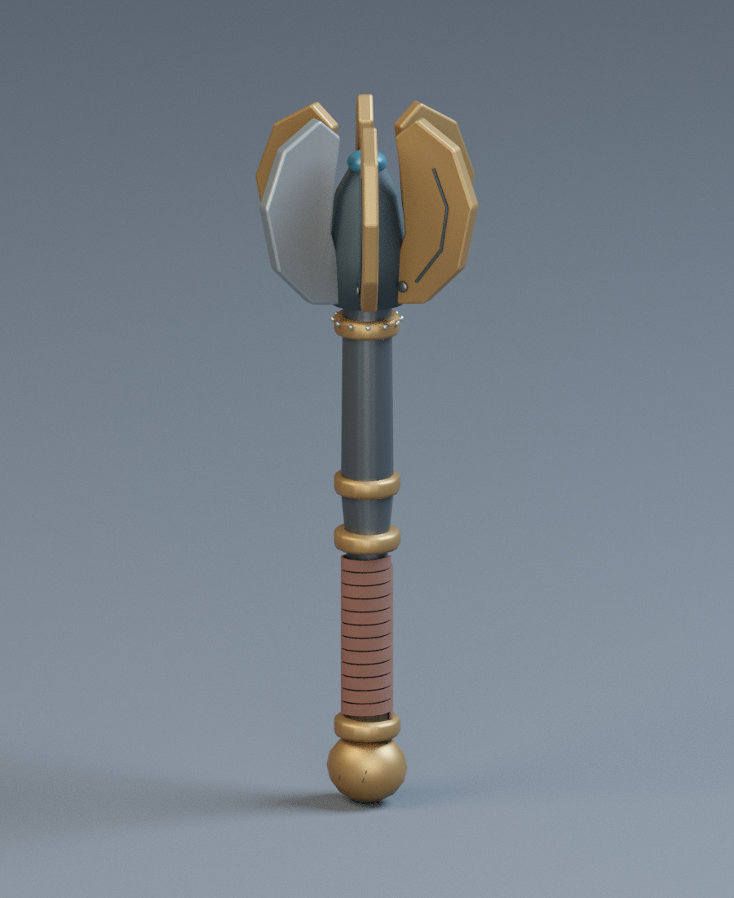

Use / purpose: Static nonfunctional fantasy model. No LOD, collision proxies or working rig; appearance in external game engines is untested.

Record type: model. Formats: Unknown; inspect ZIP.

Reported dimensions (metres; XYZ when derived from measured bounds, legacy axis order not reverified): [0.2530311942100525, 0.2271314561367035, 0.7369797825813293]. Triangles: Unknown.

Origin: Unknown / not independently confirmed. Orientation: Unknown / not independently confirmed.

[Download ZIP](https://github.com/k3peta/tales-on-a-table/releases/download/v2026.10.19-armory/ARM_016_CC0.zip) · [License scope](../../LICENSE.md)

**CC0-1.0** — See original ZIP license and repository license scope. Models and embedded materials only; previews excluded.

Source details: [Catalogue 1](../../catalog/armory.en.md) · [Catalogue 2](../../catalog/armory.md) · [Catalogue 3](../../catalog/armory.zh-CN.md)

## ARM_017

**節のある古木弓**

節のある古木弓

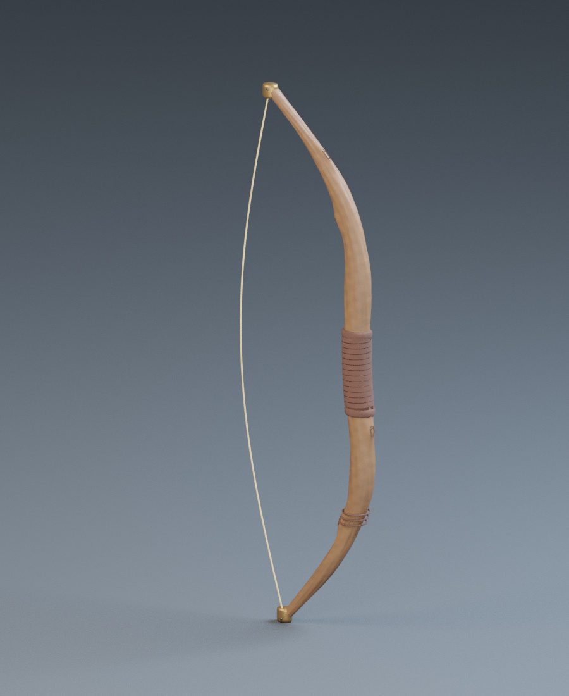

Use / purpose: Static nonfunctional fantasy model. No LOD, collision proxies or working rig; appearance in external game engines is untested.

Record type: model. Formats: Unknown; inspect ZIP.

Reported dimensions (metres; XYZ when derived from measured bounds, legacy axis order not reverified): [0.38134193420410156, 0.063960000872612, 1.3880000114440918]. Triangles: Unknown.

Origin: Unknown / not independently confirmed. Orientation: Unknown / not independently confirmed.

[Download ZIP](https://github.com/k3peta/tales-on-a-table/releases/download/v2026.10.19-armory/ARM_017_CC0.zip) · [License scope](../../LICENSE.md)

**CC0-1.0** — See original ZIP license and repository license scope. Models and embedded materials only; previews excluded.

Source details: [Catalogue 1](../../catalog/armory.en.md) · [Catalogue 2](../../catalog/armory.md) · [Catalogue 3](../../catalog/armory.zh-CN.md)

## ARM_018

**組紐飾りの宮廷月弓**

組紐飾りの宮廷月弓

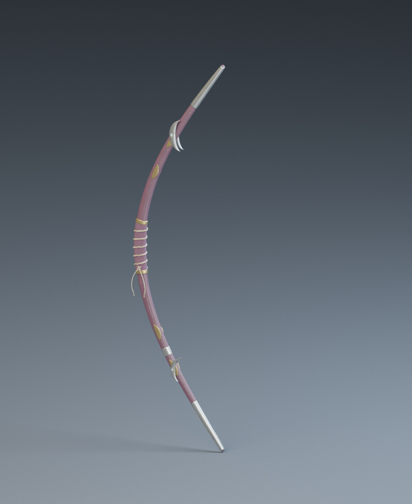

Use / purpose: Static nonfunctional fantasy model. No LOD, collision proxies or working rig; appearance in external game engines is untested.

Record type: model. Formats: Unknown; inspect ZIP.

Reported dimensions (metres; XYZ when derived from measured bounds, legacy axis order not reverified): [0.44368019700050354, 0.054557062685489655, 1.7229406833648682]. Triangles: Unknown.

Origin: Unknown / not independently confirmed. Orientation: Unknown / not independently confirmed.

[Download ZIP](https://github.com/k3peta/tales-on-a-table/releases/download/v2026.10.19-armory/ARM_018_CC0.zip) · [License scope](../../LICENSE.md)

**CC0-1.0** — See original ZIP license and repository license scope. Models and embedded materials only; previews excluded.

Source details: [Catalogue 1](../../catalog/armory.en.md) · [Catalogue 2](../../catalog/armory.md) · [Catalogue 3](../../catalog/armory.zh-CN.md)

## ARM_019

**打痕のある練習木剣**

打痕のある練習木剣

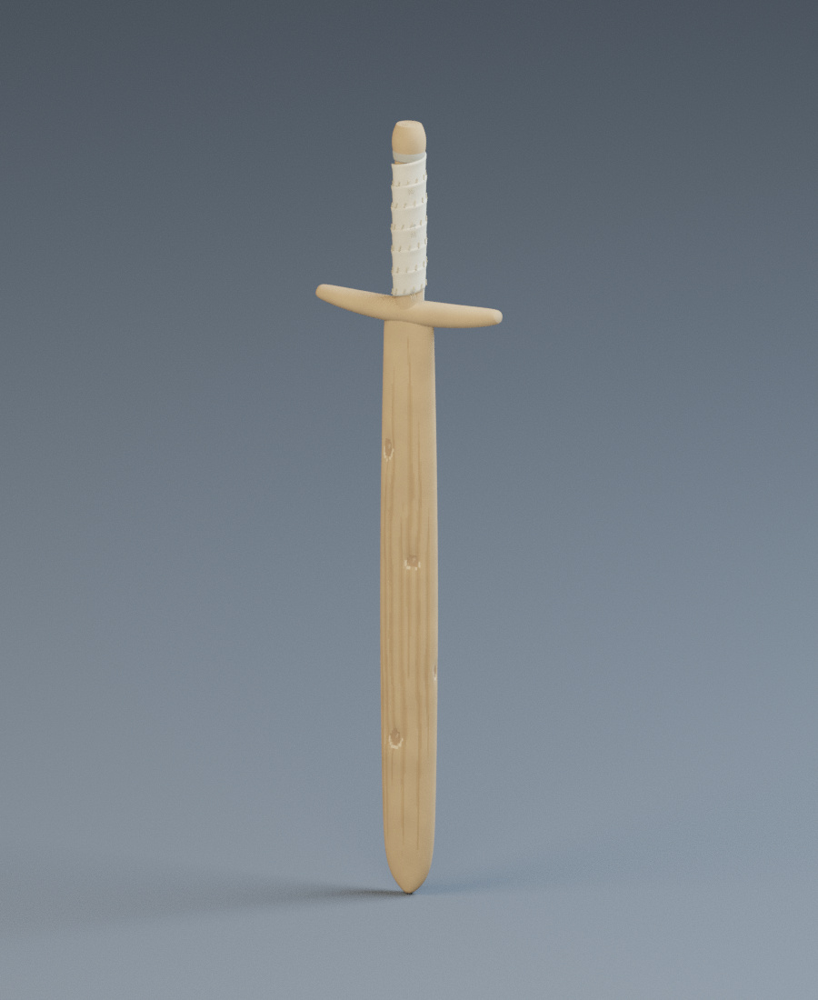

Use / purpose: Static nonfunctional fantasy model. No LOD, collision proxies or working rig; appearance in external game engines is untested.

Record type: model. Formats: Unknown; inspect ZIP.

Reported dimensions (metres; XYZ when derived from measured bounds, legacy axis order not reverified): [0.2562372088432312, 0.04158126562833786, 0.9943099617958069]. Triangles: Unknown.

Origin: Unknown / not independently confirmed. Orientation: Unknown / not independently confirmed.

[Download ZIP](https://github.com/k3peta/tales-on-a-table/releases/download/v2026.10.19-armory/ARM_019_CC0.zip) · [License scope](../../LICENSE.md)

**CC0-1.0** — See original ZIP license and repository license scope. Models and embedded materials only; previews excluded.

Source details: [Catalogue 1](../../catalog/armory.en.md) · [Catalogue 2](../../catalog/armory.md) · [Catalogue 3](../../catalog/armory.zh-CN.md)

## ARM_020

**籠飾りの決闘細剣**

籠飾りの決闘細剣

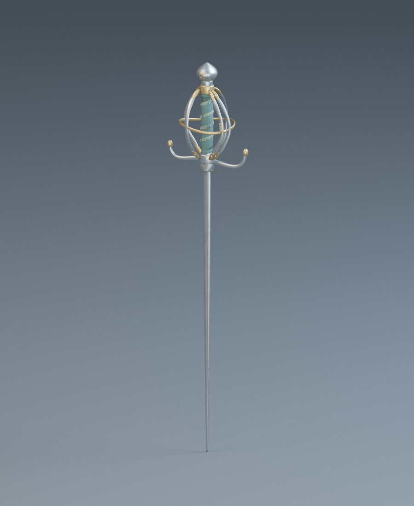

Use / purpose: Static nonfunctional fantasy model. No LOD, collision proxies or working rig; appearance in external game engines is untested.

Record type: model. Formats: Unknown; inspect ZIP.

Reported dimensions (metres; XYZ when derived from measured bounds, legacy axis order not reverified): [0.2549999952316284, 0.13699999451637268, 1.13100004196167]. Triangles: Unknown.

Origin: Unknown / not independently confirmed. Orientation: Unknown / not independently confirmed.

[Download ZIP](https://github.com/k3peta/tales-on-a-table/releases/download/v2026.10.19-armory/ARM_020_CC0.zip) · [License scope](../../LICENSE.md)

**CC0-1.0** — See original ZIP license and repository license scope. Models and embedded materials only; previews excluded.

Source details: [Catalogue 1](../../catalog/armory.en.md) · [Catalogue 2](../../catalog/armory.md) · [Catalogue 3](../../catalog/armory.zh-CN.md)

## ARM_021

**継ぎ板の塔盾**

継ぎ板の塔盾

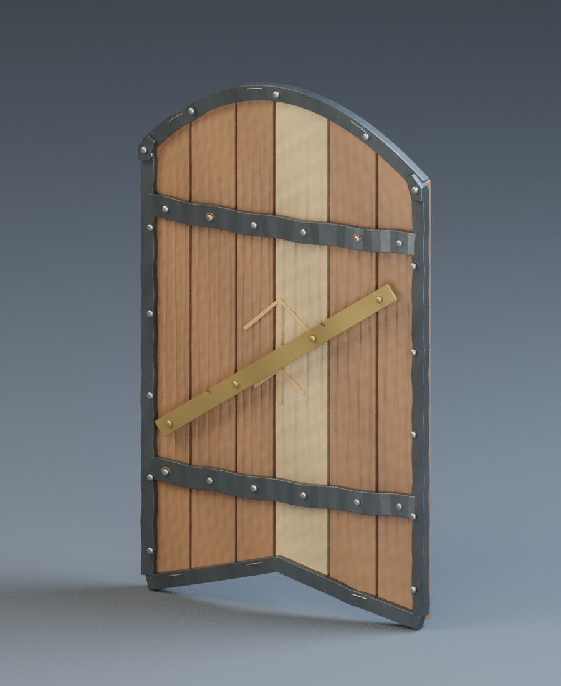

Use / purpose: Static nonfunctional fantasy model. No LOD, collision proxies or working rig; appearance in external game engines is untested.

Record type: model. Formats: Unknown; inspect ZIP.

Reported dimensions (metres; XYZ when derived from measured bounds, legacy axis order not reverified): [0.718978226184845, 0.26322701573371887, 1.2222124338150024]. Triangles: Unknown.

Origin: Unknown / not independently confirmed. Orientation: Unknown / not independently confirmed.

[Download ZIP](https://github.com/k3peta/tales-on-a-table/releases/download/v2026.10.19-armory/ARM_021_CC0.zip) · [License scope](../../LICENSE.md)

**CC0-1.0** — See original ZIP license and repository license scope. Models and embedded materials only; previews excluded.

Source details: [Catalogue 1](../../catalog/armory.en.md) · [Catalogue 2](../../catalog/armory.md) · [Catalogue 3](../../catalog/armory.zh-CN.md)

**Quality38:** 30 zero-area triangles removed;6 positive tiny retained;92210tri over20k and regular grain remain. [Details](../material_variants_arm014_arm023.md).

**Latest revision:** [ZIP](https://raw.githubusercontent.com/k3peta/tales-on-a-table/main/distributions/quality-arm014-023-v1/ARM_021__repair_CC0.zip) · [Matching revision preview](../../previews/quality-arm014-023-v1/ARM_021__repair_thumb.png). Original pictured ZIP retained above. Public ZIP/member/image identity verified.

## ARM_022

**兵士の革張り円盾**

兵士の革張り円盾

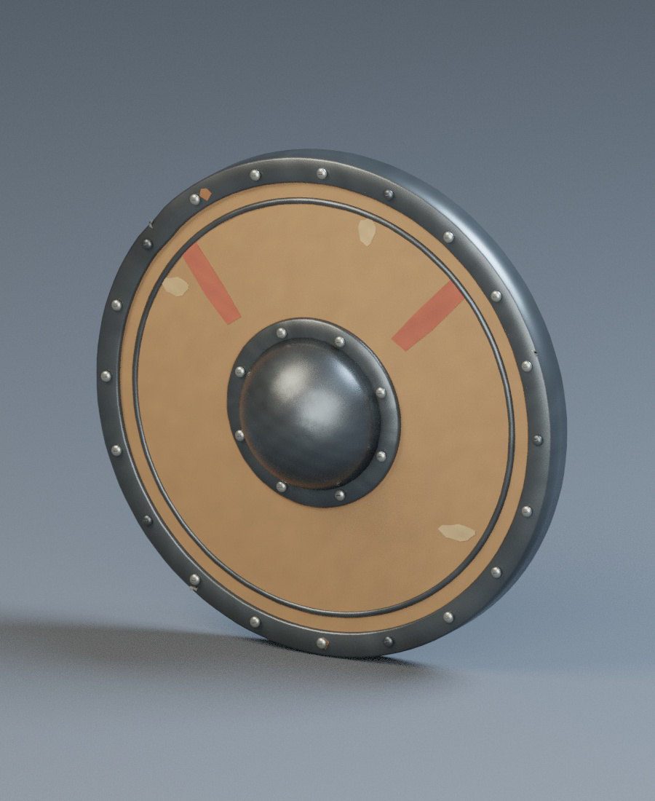

Use / purpose: Static nonfunctional fantasy model. No LOD, collision proxies or working rig; appearance in external game engines is untested.

Record type: model. Formats: Unknown; inspect ZIP.

Reported dimensions (metres; XYZ when derived from measured bounds, legacy axis order not reverified): [0.7120000123977661, 0.2600463628768921, 0.7120000123977661]. Triangles: Unknown.

Origin: Unknown / not independently confirmed. Orientation: Unknown / not independently confirmed.

[Download ZIP](https://github.com/k3peta/tales-on-a-table/releases/download/v2026.10.19-armory/ARM_022_CC0.zip) · [License scope](../../LICENSE.md)

**CC0-1.0** — See original ZIP license and repository license scope. Models and embedded materials only; previews excluded.

Source details: [Catalogue 1](../../catalog/armory.en.md) · [Catalogue 2](../../catalog/armory.md) · [Catalogue 3](../../catalog/armory.zh-CN.md)

**Quality38:** 66056tri over20k; blue hide variant retains geometry, UV and vertex color. [Details](../material_variants_arm014_arm023.md).

## ARM_023

**道標紋の冒険者凧盾**

道標紋の冒険者凧盾

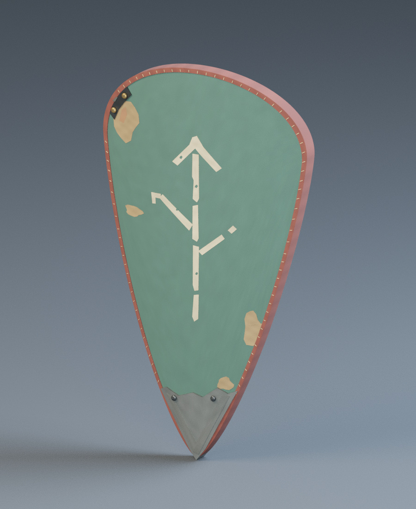

Use / purpose: Static nonfunctional fantasy model. No LOD, collision proxies or working rig; appearance in external game engines is untested.

Record type: model. Formats: Unknown; inspect ZIP.

Reported dimensions (metres; XYZ when derived from measured bounds, legacy axis order not reverified): [0.627437949180603, 0.21036753058433533, 1.1038200855255127]. Triangles: Unknown.

Origin: Unknown / not independently confirmed. Orientation: Unknown / not independently confirmed.

[Download ZIP](https://github.com/k3peta/tales-on-a-table/releases/download/v2026.10.19-armory/ARM_023_CC0.zip) · [License scope](../../LICENSE.md)

**CC0-1.0** — See original ZIP license and repository license scope. Models and embedded materials only; previews excluded.

Source details: [Catalogue 1](../../catalog/armory.en.md) · [Catalogue 2](../../catalog/armory.md) · [Catalogue 3](../../catalog/armory.zh-CN.md)

**Quality38:** 77600tri over20k; rust-red hide variant retains geometry, UV and vertex color. [Details](../material_variants_arm014_arm023.md).

## ARM_024

**鹿獣紋の儀礼盾**

鹿獣紋の儀礼盾

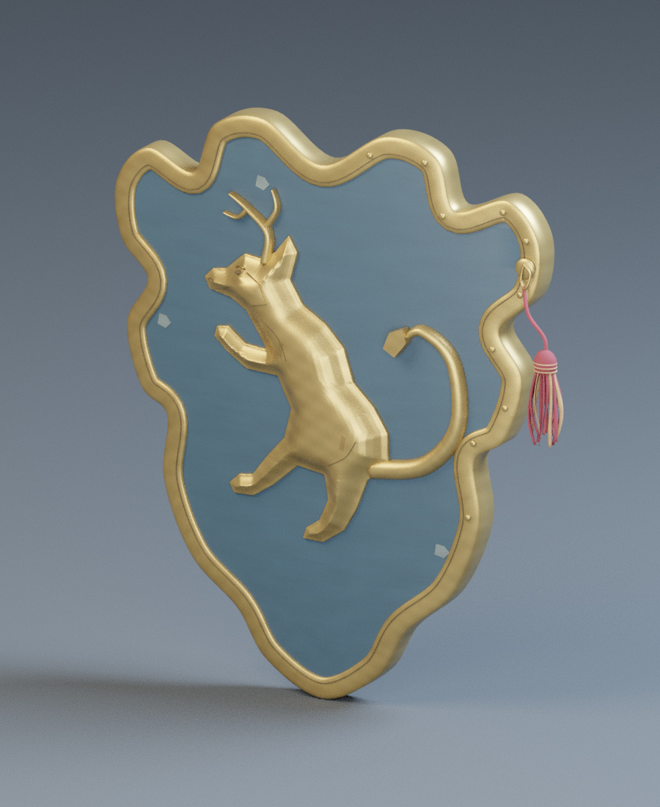

Use / purpose: Static nonfunctional fantasy model. No LOD, collision proxies or working rig; appearance in external game engines is untested.

Record type: model. Formats: Unknown; inspect ZIP.

Reported dimensions (metres; XYZ when derived from measured bounds, legacy axis order not reverified): [0.7945040464401245, 0.20712509751319885, 0.908735990524292]. Triangles: Unknown.

Origin: Unknown / not independently confirmed. Orientation: Unknown / not independently confirmed.

[Download ZIP](https://github.com/k3peta/tales-on-a-table/releases/download/v2026.10.19-armory/ARM_024_CC0.zip) · [License scope](../../LICENSE.md)

**CC0-1.0** — See original ZIP license and repository license scope. Models and embedded materials only; previews excluded.

Source details: [Catalogue 1](../../catalog/armory.en.md) · [Catalogue 2](../../catalog/armory.md) · [Catalogue 3](../../catalog/armory.zh-CN.md)

## ARM_025

**深皿の小型拳盾**

深皿の小型拳盾

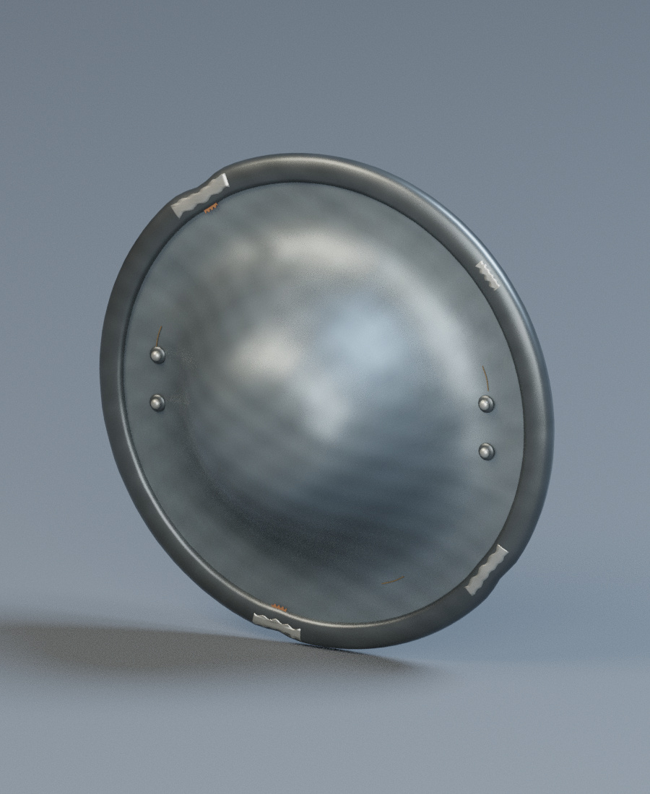

Use / purpose: Static nonfunctional fantasy model. No LOD, collision proxies or working rig; appearance in external game engines is untested.

Record type: model. Formats: Unknown; inspect ZIP.

Reported dimensions (metres; XYZ when derived from measured bounds, legacy axis order not reverified): [0.4320000112056732, 0.18729937076568604, 0.4320000112056732]. Triangles: Unknown.

Origin: Unknown / not independently confirmed. Orientation: Unknown / not independently confirmed.

[Download ZIP](https://github.com/k3peta/tales-on-a-table/releases/download/v2026.10.19-armory/ARM_025_CC0.zip) · [License scope](../../LICENSE.md)

**CC0-1.0** — See original ZIP license and repository license scope. Models and embedded materials only; previews excluded.

Source details: [Catalogue 1](../../catalog/armory.en.md) · [Catalogue 2](../../catalog/armory.md) · [Catalogue 3](../../catalog/armory.zh-CN.md)

## ARM_026

**獅子面の空洞兜**

獅子面の空洞兜

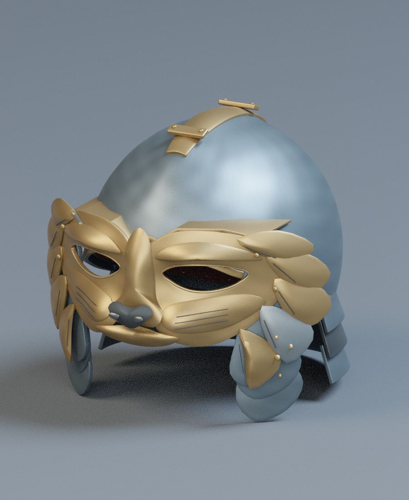

Use / purpose: Static nonfunctional fantasy model. No LOD, collision proxies or working rig; appearance in external game engines is untested.

Record type: model. Formats: Unknown; inspect ZIP.

Reported dimensions (metres; XYZ when derived from measured bounds, legacy axis order not reverified): [0.3813526928424835, 0.40102338790893555, 0.33645275235176086]. Triangles: Unknown.

Origin: Unknown / not independently confirmed. Orientation: Unknown / not independently confirmed.

[Download ZIP](https://github.com/k3peta/tales-on-a-table/releases/download/v2026.10.19-armory/ARM_026_CC0.zip) · [License scope](../../LICENSE.md)

**CC0-1.0** — See original ZIP license and repository license scope. Models and embedded materials only; previews excluded.

Source details: [Catalogue 1](../../catalog/armory.en.md) · [Catalogue 2](../../catalog/armory.md) · [Catalogue 3](../../catalog/armory.zh-CN.md)

## ARM_027

**幅広ひさしの歩兵兜**

幅広ひさしの歩兵兜

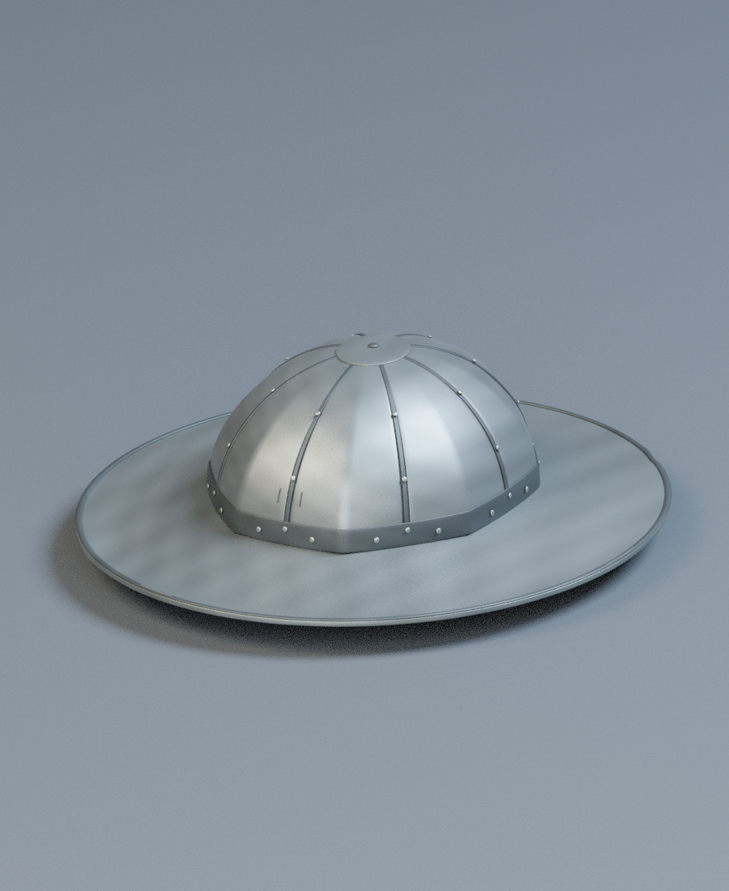

Use / purpose: Static nonfunctional fantasy model. No LOD, collision proxies or working rig; appearance in external game engines is untested.

Record type: model. Formats: Unknown; inspect ZIP.

Reported dimensions (metres; XYZ when derived from measured bounds, legacy axis order not reverified): [0.5405197143554688, 0.6265679597854614, 0.19775167107582092]. Triangles: Unknown.

Origin: Unknown / not independently confirmed. Orientation: Unknown / not independently confirmed.

[Download ZIP](https://github.com/k3peta/tales-on-a-table/releases/download/v2026.10.19-armory/ARM_027_CC0.zip) · [License scope](../../LICENSE.md)

**CC0-1.0** — See original ZIP license and repository license scope. Models and embedded materials only; previews excluded.

Source details: [Catalogue 1](../../catalog/armory.en.md) · [Catalogue 2](../../catalog/armory.md) · [Catalogue 3](../../catalog/armory.zh-CN.md)

## ARM_028

**頬当て付きの旅兜**

頬当て付きの旅兜

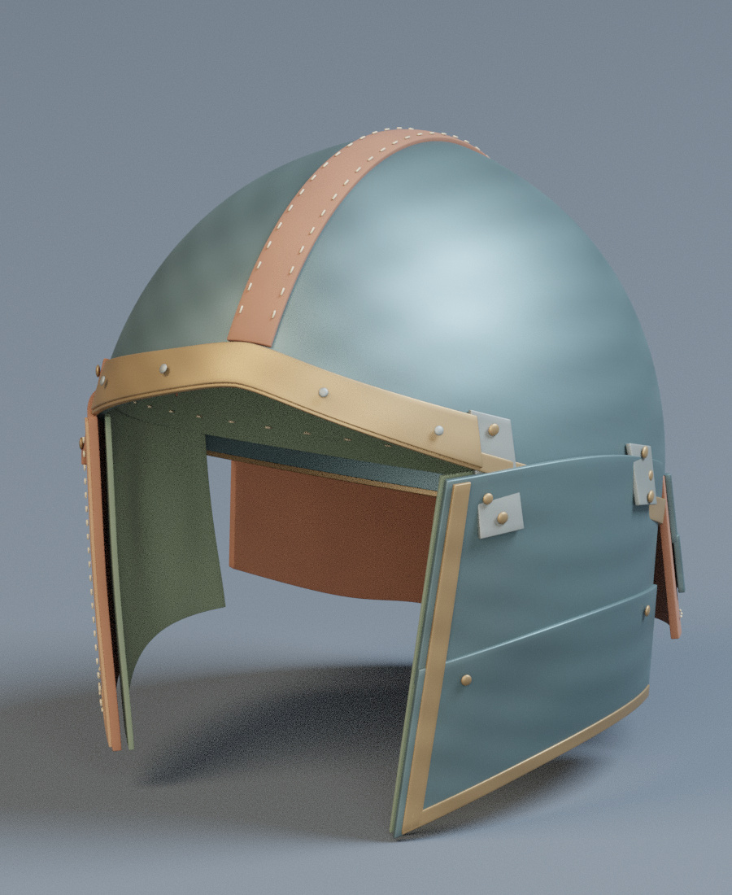

Use / purpose: Static nonfunctional fantasy model. No LOD, collision proxies or working rig; appearance in external game engines is untested.

Record type: model. Formats: Unknown; inspect ZIP.

Reported dimensions (metres; XYZ when derived from measured bounds, legacy axis order not reverified): [0.306265264749527, 0.34830838441848755, 0.33992999792099]. Triangles: Unknown.

Origin: Unknown / not independently confirmed. Orientation: Unknown / not independently confirmed.

[Download ZIP](https://github.com/k3peta/tales-on-a-table/releases/download/v2026.10.19-armory/ARM_028_CC0.zip) · [License scope](../../LICENSE.md)

**CC0-1.0** — See original ZIP license and repository license scope. Models and embedded materials only; previews excluded.

Source details: [Catalogue 1](../../catalog/armory.en.md) · [Catalogue 2](../../catalog/armory.md) · [Catalogue 3](../../catalog/armory.zh-CN.md)

## ARM_029

**翼飾りの儀礼兜**

翼飾りの儀礼兜

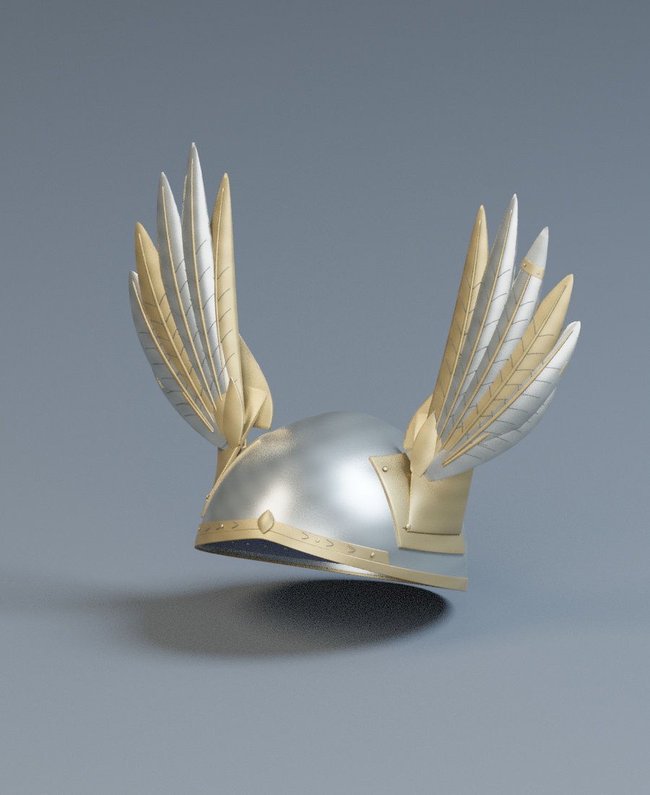

Use / purpose: Static nonfunctional fantasy model. No LOD, collision proxies or working rig; appearance in external game engines is untested.

Record type: model. Formats: Unknown; inspect ZIP.

Reported dimensions (metres; XYZ when derived from measured bounds, legacy axis order not reverified): [0.5764812231063843, 0.34344708919525146, 0.5158347487449646]. Triangles: Unknown.

Origin: Unknown / not independently confirmed. Orientation: Unknown / not independently confirmed.

[Download ZIP](https://github.com/k3peta/tales-on-a-table/releases/download/v2026.10.19-armory/ARM_029_CC0.zip) · [License scope](../../LICENSE.md)

**CC0-1.0** — See original ZIP license and repository license scope. Models and embedded materials only; previews excluded.

Source details: [Catalogue 1](../../catalog/armory.en.md) · [Catalogue 2](../../catalog/armory.md) · [Catalogue 3](../../catalog/armory.zh-CN.md)

## ARM_030

**継ぎ革のフード**

継ぎ革のフード

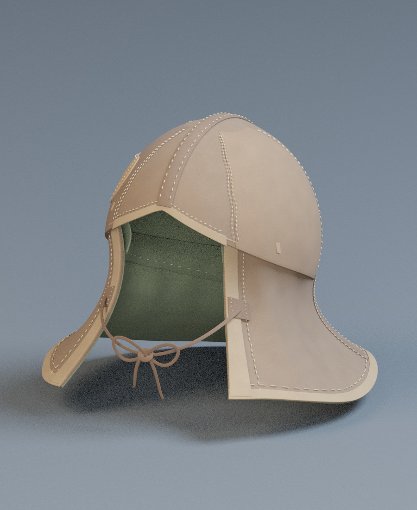

Use / purpose: Static nonfunctional fantasy model. No LOD, collision proxies or working rig; appearance in external game engines is untested.

Record type: model. Formats: Unknown; inspect ZIP.

Reported dimensions (metres; XYZ when derived from measured bounds, legacy axis order not reverified): [0.5041031837463379, 0.5062053203582764, 0.4405992031097412]. Triangles: Unknown.

Origin: Unknown / not independently confirmed. Orientation: Unknown / not independently confirmed.

[Download ZIP](https://github.com/k3peta/tales-on-a-table/releases/download/v2026.10.19-armory/ARM_030_CC0.zip) · [License scope](../../LICENSE.md)

**CC0-1.0** — See original ZIP license and repository license scope. Models and embedded materials only; previews excluded.

Source details: [Catalogue 1](../../catalog/armory.en.md) · [Catalogue 2](../../catalog/armory.md) · [Catalogue 3](../../catalog/armory.zh-CN.md)

## ARM_031

**左右非対称の遍歴鎧**

左右非対称の遍歴鎧

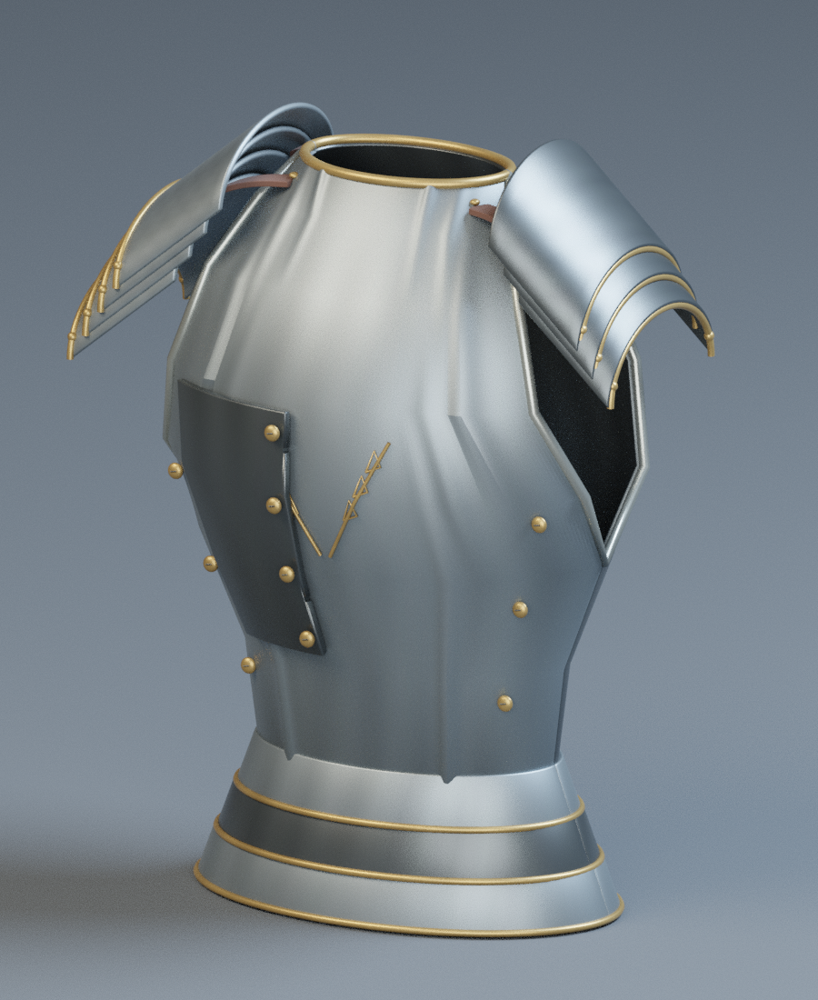

Use / purpose: Static nonfunctional fantasy model. No LOD, collision proxies or working rig; appearance in external game engines is untested.

Record type: model. Formats: Unknown; inspect ZIP.

Reported dimensions (metres; XYZ when derived from measured bounds, legacy axis order not reverified): [0.5699399709701538, 0.36054256558418274, 0.7419494390487671]. Triangles: Unknown.

Origin: Unknown / not independently confirmed. Orientation: Unknown / not independently confirmed.

[Download ZIP](https://github.com/k3peta/tales-on-a-table/releases/download/v2026.10.19-armory/ARM_031_CC0.zip) · [License scope](../../LICENSE.md)

**CC0-1.0** — See original ZIP license and repository license scope. Models and embedded materials only; previews excluded.

Source details: [Catalogue 1](../../catalog/armory.en.md) · [Catalogue 2](../../catalog/armory.md) · [Catalogue 3](../../catalog/armory.zh-CN.md)
